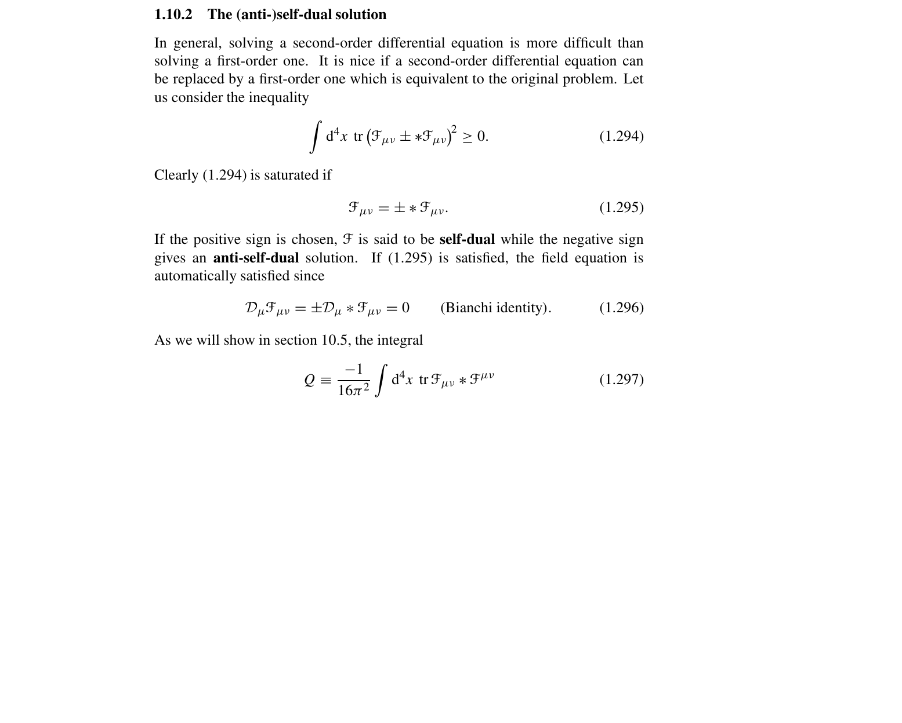

# 1.10.2 The (anti-)self-dual solution｜自对偶解与作用量下界

[总目录](README.md) · [上一小节](27-1.10.1.md) · [下一小节](29-Problems.md)

本节把一个二阶的非线性方程，转成一类特别的一阶方程求解。要注意：自对偶解给出 Yang–Mills 解的一部分，不是所有二阶解都与自对偶方程等价。

## 原书第 64 页：原文底本

以下影印块是本小节在该页的完整原文；相邻小节在同页交接时按标题分界。PDF 页码为 87。

## 第 64 页句读与集注

### 句读式 (1.294)–(1.296)：Hodge 星在这里做什么？

四维欧氏空间中，

$$
(*F)_{\mu\nu}=\frac12\epsilon_{\mu\nu\rho\sigma}F_{\rho\sigma}.
$$

它利用度规和定向，把一个定向二维面积方向对应到互补二维方向。二形式空间有六维，且 $*^2=1$，所以可分解成三个自对偶方向与三个反自对偶方向：

$$
F_\pm=\frac12(F\pm *F).
$$

自对偶条件 $F=*F$ 表示反自对偶部分为零。这是对场强的特殊几何限制，不是说场等于它自己的复共轭，也不是把电场、磁场的向量值直接按普通三维方式相等。

在 Lorentz 四维中，二形式的 $*^2$ 符号会不同，因此实欧氏自对偶解不能原封不动解释成一个真实时间电磁场。Wick 旋转和度规是这一步成立的前提。

### 疏：为什么一阶条件保证二阶方程？

曲率本身满足 Bianchi 恒等式 $D_\mu(*F)_{\mu\nu}=0$。若 $F=\pm *F$，立刻得到

$$
D_\mu F_{\mu\nu}
=\pm D_\mu(*F)_{\mu\nu}=0.
$$

左边正是无源 Yang–Mills 方程。因为 $F$ 含势的一阶导数，自对偶条件对势是一阶；再作用协变导数才是二阶动力学。

这证明“自对偶 ⇒ Yang–Mills”，没有证明反向蕴含。原文开头的 “equivalent” 应按“在达到拓扑下界的特殊构造中，可以改解一阶系统”理解，不能当作一般二阶解分类的定理。

### 校读式 (1.294)：反 Hermitian 平方的 trace 不是非负

对反 Hermitian 矩阵 $X$，$\operatorname{tr}X^2\le0$，因此正范数要用 $-\operatorname{tr}X^2$。原文沿用反 Hermitian 场强却写 $\int\operatorname{tr}(F\pm *F)^2\ge0$，正负号不相容。若改用 Hermitian 场强，则需一起修改曲率中的 $i$ 与作用量约定。

为避免继续混用，下面统一采用反 Hermitian 联络 $a$、曲率 $f=da+a^2$，把耦合从联络吸收进作用量：

$$
S_E=-\frac1{2g_{\rm YM}^2}\int d^4x\,
\operatorname{tr}f_{\mu\nu}f_{\mu\nu},\qquad
Q=-\frac1{16\pi^2}\int d^4x\,
\operatorname{tr}f_{\mu\nu}(*f)_{\mu\nu}.
$$

在本节的光滑、适当渐近条件与 trace 归一化下，$Q$ 是整数。这里的新符号是在解释中建立一致计算，不是悄悄改写作者的原文。

## 原书第 65 页：原文底本

以下影印块是本小节在该页的完整原文；相邻小节在同页交接时按标题分界。PDF 页码为 88。

## 第 65 页句读与集注

### 句读式 (1.297)–(1.299)：下界怎样算出来？

令

$$
I=-\int\operatorname{tr}f^2,\qquad
J=-\int\operatorname{tr}f(*f)=16\pi^2Q.
$$

欧氏 Hodge 星保持二形式范数，故

$$
0\le-\int\operatorname{tr}(f\mp *f)^2
=2I\mp2J.
$$

两种符号同时给出 $I\ge|J|$，所以

$$
S_E\ge\frac{8\pi^2}{g_{\rm YM}^2}|Q|.
$$

等号当且仅当相应的一半曲率为零，即自对偶或反自对偶。若采用作者吸收耦合或取耦合为 1 的归一化，就出现 $8\pi^2|Q|$。不能在场强定义仍含任意 $g$ 时，忘记检查 $Q$ 与作用量的归一化是否一起改变。

这个推导在数学上类似“平方配方＋固定约束量”。不同的是约束量 $Q$ 来自全球拓扑，在固定类别内连续变动不改变它，所以不等式真正给出该类别中的能垒或作用量代价。$Q=0$ 真空仍可有更低的零作用量。

### 句读式 (1.300)–(1.303)：为何引入径向 profile f(r)？

先从无穷远的纯规范形状出发，乘一个仅依赖半径的函数。这个 ansatz 利用旋转对称性把偏微分方程简化为常微分方程；它是寻找一个高度对称解的方法，不是对所有瞬子的一般表达。

原文得到

$$
r f'(r)=2f(1-f).
$$

在 $0<f<1$ 的非平凡分支上，

$$
\frac{df}{f(1-f)}=2\frac{dr}{r}
\quad\Longrightarrow\quad
\log\frac f{1-f}=2\log r+C.
$$

因此

$$
f(r)=\frac{r^2}{r^2+\lambda^2}.
$$

它在无穷远趋于 1，使势趋于纯规范；在原点附近按 $r^2$ 消失，使适当规范中的核心保持正则。单有 $f(\infty)=1$ 还包括常数分支 $f=1$，需要结合核心正则性及非平凡拓扑来选择这个解。

### 疏：λ 为什么可以自由变化？

$\lambda$ 控制场强集中的尺度。经典四维纯 Yang–Mills 作用量具有尺度不变结构，因此可以有不同大小、同一拓扑数和同一经典作用量的解。将解平移，也得到不同中心的解。这些连续参数称为模或集体坐标。

所以围绕瞬子展开时，某些变化方向不会增加作用量，Hessian 有零模。前面 Gaussian 的“行列式倒平方根”不能直接对包含零特征值的整个算符使用；要把零模分出，转而积分相应集体坐标。这解释了为何瞬子计算虽然也从涨落展开出发，却比谐振子复杂。

### 校记式 (1.305)：分母幂次影响有限作用量

原文写场强随 $4\lambda^2/(r^2+\lambda^2)$ 衰减。以 $\lambda,r$ 都有长度单位检查，这个系数无量纲，而场强应有长度的 $-2$ 次量纲；若按此式在无穷远只有 $r^{-2}$，四维作用量尾部会有 $\int^\infty dr/r$ 的对数发散。

标准单瞬子场强的径向尺度应为

$$
f_{\mu\nu}\ \propto\
\frac{\lambda^2}{(r^2+\lambda^2)^2}
\times(\text{固定的群与时空张量}),
$$

整体符号、$i$ 和常数由 Hermitian 及生成元约定决定。关键是分母平方，带来 $r^{-4}$ 衰减和正确量纲。本页还承接前述 $\mathcal A$ 与 $i$ 的约定冲突，故不把印出的 (1.304)–(1.306) 整套当作无需调整即可数值代入的公式。

### 集注：从本章可以建立怎样的图像？

在无穷远，场看起来已经没有局部曲率，却仍可能带着不能消去的规范绕数。要在内部光滑填满这种边界数据，就会产生非零曲率核心。自对偶方程使这份曲率以固定拓扑数允许的最低作用量排列。这个图像把“局部曲率”“全球拼接”“积分整数”连了起来，也是作者后面几何与拓扑章节的物理动机。

**回看问题：**为什么自对偶只能保证一类二阶解？作用量下界依赖哪一个正范数？为什么 $Q$ 固定时能谈极小，而不同 $Q$ 仍可有更低值？$f(r)$ 的两个极限各有什么意义？为什么瞬子零模不能当普通 Gaussian 模式积分？

---

[总目录](README.md) · [上一小节](27-1.10.1.md) · [下一小节](29-Problems.md)
