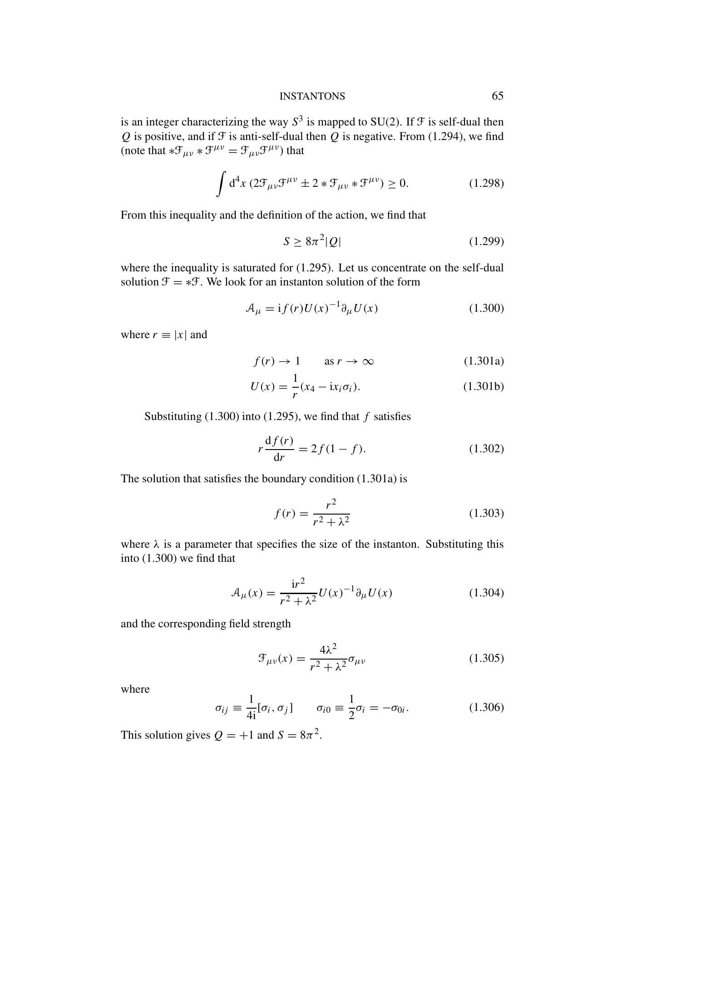

# 1.10.2 The (anti-)self-dual solution｜自对偶解与作用量下界

[阅读目录](README.md) · [上一小节](27-1.10.1.md) · [下一小节](29-Problems.md)

**这一节在做什么：找一种更容易解的一阶条件，使它既满足 Yang–Mills 方程，又在给定拓扑类别里使作用量最低。**先讲自对偶在说什么，再看平方不等式怎样产生下界。

## 原书第 64 页：原文底本

本块保留该页属于本小节的完整原文。PDF 阅读器页码为 87。

## 第 64 页：先说目的，再逐步解读

### 一、Hodge 星：把一个二维方向换成它的互补二维方向

**这段在干什么：**解释式 (1.294)–(1.295) 中的星号，让“自对偶”有具体数学内容。

场强是二形式，可以理解为给每个定向小面积安排一个场强值。四维中，平面方向有 6 个基本分量，例如 $(12),(13),(14),(23),(24),(34)$。

Hodge 星利用度规和定向，将一个二维方向对应到互补二维方向。例如在标准欧氏定向下，

$$
*(dx^1\wedge dx^2)=dx^3\wedge dx^4,
\qquad
*(dx^3\wedge dx^4)=dx^1\wedge dx^2.
$$

所以对二形式做两次星会回到自身。可以把它分为星作用后不变的部分与变号的部分：

$$
F_+=\frac12(F+*F),\qquad F_-=\frac12(F-*F).
$$

自对偶 $F=*F$ 就是 $F_-=0$；反自对偶则为 $F_+=0$。它不是复共轭，也不是直接说普通三维电场等于磁场。

这里是四维欧氏度规。换成真实时间的 Lorentz 度规，星平方的符号会变，不能原封不动把这个实解当作实际电磁运动。

### 二、为什么这一阶条件能保证二阶场方程？

**这段在干什么：**把式 (1.296) 的推理逐步写出，分清哪个方向成立。

曲率按定义满足 Bianchi 恒等式：

$$
D_\mu(*F)_{\mu\nu}=0.
$$

若再要求 $F_{\mu\nu}=\pm(*F)_{\mu\nu}$，就有

$$
D_\mu F_{\mu\nu}
=\pm D_\mu(*F)_{\mu\nu}=0.
$$

最后正是无源 Yang–Mills 方程。因为 $F$ 含势的一阶导数，自对偶条件对势是一阶；再对 $F$ 求导才是二阶。

因此“自对偶解一定是 Yang–Mills 解”。反过来却未证明。作者开头说能用一阶替代二阶，应理解为找到这类特别的解，不是将全部二阶解都分类完。

### 三、平方不等式之前，先选能为正的范数

**这段在干什么：**纠正原文反 Hermitian 约定下的符号，并为下一页下界计算固定定义。

普通实数 $x^2\ge0$。反 Hermitian 矩阵却有 $\operatorname{tr}X^2\le0$，所以正的“长度平方”应使用 $-\operatorname{tr}X^2$。

本注统一用反 Hermitian 联络 $a$ 和曲率 $f=da+a^2$，把耦合写在作用量前：

$$
S_E=-\frac1{2g_{\rm YM}^2}\int d^4x\,\operatorname{tr}f_{\mu\nu}f_{\mu\nu},
$$

$$
Q=-\frac1{16\pi^2}\int d^4x\,\operatorname{tr}f_{\mu\nu}(*f)_{\mu\nu}.
$$

$Q$ 在本节的光滑与渐近条件下等于上一节的整数类别。原文这里的 $i$、trace 和耦合若不同时对齐，不能直接沿用它的非负不等式。

## 原书第 65 页：原文底本

本块保留该页属于本小节的完整原文。PDF 阅读器页码为 88。

## 第 65 页：先说目的，再逐步解读

### 四、作用量下界怎样从一个平方算出来？

**这段在干什么：**展开式 (1.297)–(1.299) 的核心计算，解释拓扑数为什么能限制作用量。

先把长积分缩写成

$$
I=-\int\operatorname{tr}f^2,\qquad
J=-\int\operatorname{tr}f(*f)=16\pi^2Q.
$$

因为星保持这里的范数，展开一个非负平方：

$$
0\le-\int\operatorname{tr}(f\mp *f)^2=2I\mp2J.
$$

分别取两种符号，得到 $I\ge J$ 与 $I\ge-J$，合起来 $I\ge|J|$。再代回作用量：

$$
\boxed{S_E\ge\frac{8\pi^2}{g_{\rm YM}^2}|Q|.}
$$

等号要求前面的平方为零，也就是自对偶或反自对偶。现在你能看出定义的动机：这个条件恰好把固定拓扑类别里的额外作用量降到零。

若 $Q=1$，有一个正下界；若 $Q=0$，真空仍可取零。所以极小值是在固定类别里说的，不是任意瞬子都比所有真空更低。

### 五、为什么试一个只依赖半径的函数？

**这段在干什么：**解释式 (1.300)–(1.303) 如何把偏微分方程缩成可解的常微分方程。

无穷远已经知道应趋向纯规范。作者用一个径向系数 $f(r)$ 乘在那个形状上，尝试让它在核心适当改变、远处恢复原状。这是一种有对称性的试探形式，不是所有解都必须如此。

自对偶条件最终给

$$
rf'=2f(1-f).
$$

在非平凡分支上分离变量：

$$
\frac{df}{f(1-f)}=2\frac{dr}{r},
\quad
\log\frac f{1-f}=2\log r+C,
\quad
f(r)=\frac{r^2}{r^2+\lambda^2}.
$$

远处 $f\to1$，回到所需纯规范；中心附近 $f$ 按 $r^2$ 变小，使适当规范下的核心保持正常。选择这个分支还使用了核心正则要求，不只是一条无穷远条件。

### 六、λ 是什么？为什么最后场强的分母幂次不能漏？

**这段在干什么：**解释解的大小参数，并用量纲、远处积分核对式 (1.305)。

$\lambda$ 控制场强集中区域的大小。经典四维纯 Yang–Mills 作用量具有尺度不变结构，所以可以有不同大小、相同拓扑数及作用量的解。

原文场强分母少了平方。正确径向尺度应为

$$
f_{\mu\nu}\propto
\frac{\lambda^2}{(r^2+\lambda^2)^2}
\times\text{相应固定张量}.
$$

如果只随 $r^{-2}$ 衰减，场强平方配上四维体积因子，会出现 $\int^\infty dr/r$ 的发散；平方分母给 $r^{-4}$ 衰减，尾部才可积。这个核对直接关乎“有限作用量”，不是无关紧要的排版细节。

### 七、这一节复习：哪些变化不会提高作用量？

**这段在干什么：**把模、零模这些词放回具体解的变化，并总结学习目标。

移动瞬子中心、改变某些大小参数，可能仍得到同作用量解。这些参数叫模；沿它们小变化，二次变化有零方向，叫零模。

因此涨落积分不能不加处理地把零特征值放进 Gaussian 倒平方根。需要把相应参数另拿出来积分。这是前面谐振子方法在新背景下必须补的一步。

A 级是懂自对偶如何推出场方程，以及平方如何给拓扑下界。径向常微分方程应会复算。完整瞬子涨落和模空间理论为 B/C，不因本章提到名字就要求你现在全部掌握。

---

[阅读目录](README.md) · [上一小节](27-1.10.1.md) · [下一小节](29-Problems.md)
