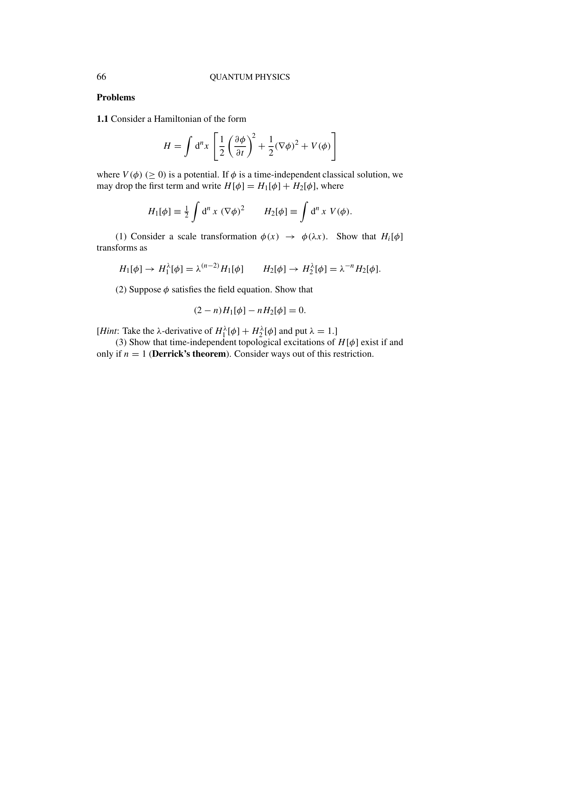

# Problems Problems｜Derrick 缩放论证

[总目录](README.md) · [上一小节](28-1.10.2.md)

这里保留章末 Problem 1.1 全文，并按题目的三步做详解。题目涉及标度、稳定性与拓扑激发，能帮助你区分“一个场配置有拓扑意义”和“给定动力学真的允许稳定解”。

## 原书第 66 页：原文底本

以下影印块是本小节在该页的完整原文；相邻小节在同页交接时按标题分界。PDF 页码为 89。

## 第 66 页句读与集注

### 句读题设：为什么只留下 H₁ 与 H₂？

Hamiltonian 是总能量。若场与时间无关，$\partial_t\phi=0$，时间动能消失，只剩

$$
E[\phi]=H_1+H_2,\quad
H_1=\frac12\int_{\mathbb R^n}|\nabla\phi|^2d^nx,\quad
H_2=\int_{\mathbb R^n}V(\phi)d^nx,
$$

其中 $V\ge0$。$H_1$ 是场在空间中变化的代价，$H_2$ 是偏离局部势能最低值的代价。有限能量通常要求无穷远趋向某个真空，使两项可积；也要保证下面的缩放变动不破坏允许的边界条件。

这不是任意场论的总能量模型。它限定为标准二阶梯度项、非负势、平直无穷空间中的静态标量配置。改了这些前提，结论可能改变。

### 句读第 (1) 问：先看“缩小”究竟是哪一个函数

令 $\phi_\lambda(x)=\phi(\lambda x)$。当 $\lambda>1$ 时，原来在半径 $R$ 发生的变化，现在在半径 $R/\lambda$ 就完成，配置缩小。

梯度按链式法则给 $\nabla\phi_\lambda(x)=\lambda(\nabla\phi)(\lambda x)$；换元 $y=\lambda x$ 给 $d^nx=\lambda^{-n}d^ny$，因此

$$
H_1[\phi_\lambda]=\lambda^{2-n}H_1[\phi],
\qquad
H_2[\phi_\lambda]=\lambda^{-n}H_2[\phi].
$$

梯度项有两份导数尺度，体积有 $n$ 份反尺度。势项没有空间导数，只有体积尺度。这就是所有指数的来由。

**校记：**题目第 (1) 问印成 $\lambda^{n-2}H_1$，与所给 $\phi(\lambda x)$ 不相容；正确是 $\lambda^{2-n}H_1$。若改用 $\phi(x/\lambda)$，两项指数都应同时反转，不能只改一项。题目的第 (2) 问实际上已经使用正确指数。

### 句读第 (2) 问：为何驻点必须对缩放也驻定？

若 $\phi$ 是满足适当边界条件的静态场方程解，则能量的一阶变分对允许变动为零。缩放只是许多变动方向中的一个，所以

$$
0=\left.\frac d{d\lambda}E[\phi_\lambda]\right|_{\lambda=1}
=(2-n)H_1-nH_2.
$$

这是一条必要条件。它检查配置是变大更有利，还是变小更有利。如果某个方向一阶就能降低能量，该配置便不可能是静态驻点。

更谨慎地说，若缩放变分不紧支撑，需要用有限能量和衰减条件控制边界项，或以带截断的变分取极限。不是任何边界问题都可以不经检查地套用这条公式。

### 句读第 (3) 问：各维数究竟推出什么？

若 $n>2$，$(2-n)H_1-nH_2$ 两项都非正；非平凡有限能配置无法相消，必须 $H_1=H_2=0$。因此在这些假设下排除通常的非平凡静态局域标量解。

若 $n=2$，条件给 $H_2=0$。若势的零点离散、场连续且目标空间是通常无约束实标量，$V(\phi)=0$ 会迫使配置取定一个真空，从而平凡。但单靠标度等式不能排除所有二维场模型；例如没有势、目标空间受约束的非线性 sigma 模型，梯度能的尺度不变可能允许不同现象。需要把模型假设说完整。

若 $n=1$，条件为 $H_1=H_2$，梯度代价与势能代价可以平衡。允许平衡不等于任何势都保证存在拓扑解。

**校记：“if and only if n=1”过强。**缩放论证主要给出排除条件和一维的可能性，不单独证明一维必然存在拓扑激发。例如只有一个真空的自由质量势，并不会因为空间是一维就自动出现连接两个不同真空的 kink。

### 疏：用一维 kink 看见两种能量为何能平衡

取

$$
V(\phi)=\frac{\lambda_0}{4}(\phi^2-v^2)^2,\qquad
\lambda_0>0.
$$

它有两个最低点 $\pm v$。要求 $\phi(-\infty)=-v$、$\phi(+\infty)=v$。空间中必须有一段过渡区，无法处处待在同一个真空。

静态方程为 $\phi''=V'(\phi)$。乘 $\phi'$ 并积分，

$$
\frac12(\phi')^2-V(\phi)=C.
$$

由远处 $\phi'\to0$、$V\to0$ 得 $C=0$，故梯度能密度与势能密度逐点相等。进一步积分得到

$$
\phi(x)=v\tanh\left(v\sqrt{\frac{\lambda_0}{2}}(x-x_0)\right).
$$

把过渡区压得太窄，梯度变大，$H_1$ 上升；拉得太宽，很多区域偏离真空，$H_2$ 上升。两者形成有限宽度平衡。边界的两个不同真空使它不能通过保持有限能量边界的连续变形直接变成单一常数真空，这就是此例的拓扑保护来源。

这还不意味着所有扰动稳定性都只需检查缩放。完整稳定性要研究所有允许变化方向；缩放只是其中一个有效的排除检验。

### 集注：“ways out”应当怎样理解？

可以改变能量项的缩放行为：加入高阶空间导数；引入规范场；使用不同目标空间与约束；允许带守恒荷的非静态场；改成有限体积或有边界的问题；加入引力等新动力学。每种方式都要重算能量及缩放，不能只说“有拓扑就一定稳定”。

本题也不排除前文四维欧氏 Yang–Mills 瞬子：它研究的不是同一个无约束静态标量能量泛函，曲率项在四维具有不同的尺度结构。比较两个定理前，先比较研究对象、维数含义、边界条件和作用量项。

**本章收束问题：**一个场配置可以同时具有局部方程、全局拓扑类别和能量稳定性要求；三者各限制什么？拓扑保护为何不自动等于任意动力学下存在稳定解？能说清这点，就能带着物理判断继续读后面的几何、同伦与纤维丛。

---

[总目录](README.md) · [上一小节](28-1.10.2.md)
