# 第一章章句集注：高中物理起点的大白话修订版

[阅读说明与分节目录](README.md) · [复习提纲与答案要点](review-guide.md) · [原书校读索引](editorial-notes.md)

从已有笔记之后的 1.2.4 开始，依原书次序注到章末习题。每个句读单元先说明这段要解决什么问题，再解释具体情景、词语和公式，最后作复习整理。原文仍以完整影印保留，未改动原笔记和原文图片。

## 合订本目录

- [1.2.4 波函数](#part-01)

- [1.2.5 谐振子的算符量子化](#part-02)

- [1.3.1 玻色粒子的路径积分](#part-03)

- [1.3.2 虚时间与配分函数](#part-04)

- [1.3.3 编时乘积与生成泛函](#part-05)

- [1.4.1 谐振子的传播振幅](#part-06)

- [1.4.2 谐振子的配分函数与谱行列式](#part-07)

- [1.5.1 费米谐振子](#part-08)

- [1.5.2 Grassmann 数与分次](#part-09)

- [1.5.3 Grassmann 微分](#part-10)

- [1.5.4 Berezin 积分与换元](#part-11)

- [1.5.5 Grassmann δ 函数](#part-12)

- [1.5.6 费米高斯积分与 Pfaffian](#part-13)

- [1.5.7 Grassmann 泛函微分](#part-14)

- [1.5.8 Grassmann 共轭](#part-15)

- [1.5.9 费米相干态与完备关系](#part-16)

- [1.5.10 费米配分函数与反周期条件](#part-17)

- [1.6.1 自由标量场](#part-18)

- [1.6.2 相互作用、关联函数与有效作用量](#part-19)

- [1.7 Dirac 场的量子化](#part-20)

- [1.8.1 电磁场与阿贝尔规范理论](#part-21)

- [1.8.2 非阿贝尔规范理论](#part-22)

- [1.8.3 Higgs 场与质量](#part-23)

- [1.9.1 Dirac 磁单极子](#part-24)

- [1.9.2 Wu–Yang 拼接](#part-25)

- [1.9.3 电荷量子化](#part-26)

- [1.10.1 瞬子与拓扑扇区](#part-27)

- [1.10.2 自对偶解与作用量下界](#part-28)

- [Problems Derrick 缩放论证](#part-29)

# 1.2.4 Wavefunction｜波函数

[阅读目录](README.md) · [下一小节](02-1.2.5.md)

**这一节要完成的事：把“量子态”变成能用来算位置、动量和测量概率的函数。**你不需要先把量子力学全部学完。我们先弄清实验问什么，再看作者为什么引入这些符号。

## 原书第 13 页：原文底本

本块保留该页属于本小节的完整原文。PDF 阅读器页码为 36。

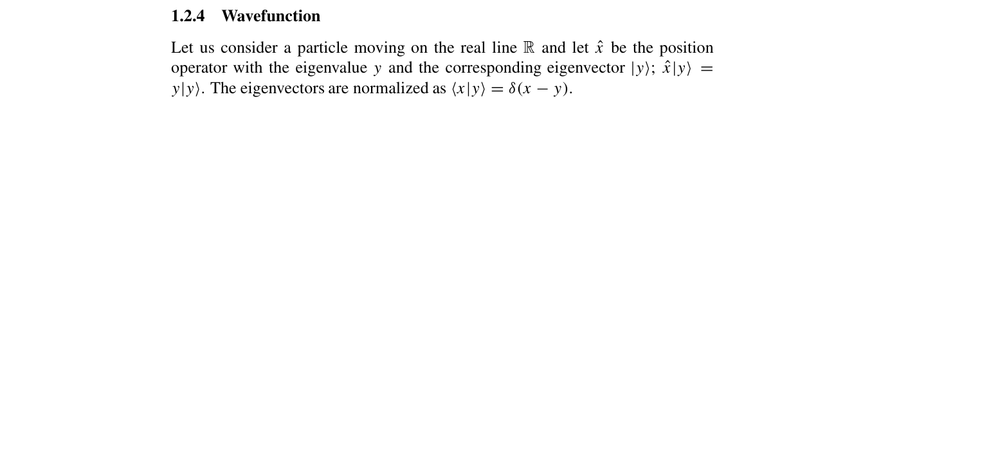

## 第 13 页：先说目的，再逐步解读

### 一、作者先把问题缩小：只问一个粒子在直线上的位置

**这段在干什么：**规定一个最简单的研究对象，并说明“确定在某个位置”怎样写进数学。

原文从 “a particle moving on the real line” 开始。可以想象一个只能沿细长轨道运动的粒子。我们暂时不问它向上还是向下，也不问它的内部结构，只用一个数记录位置。

例如轨道上选好原点后，$y=2$ 表示在原点右边 2 个长度单位。作者把“位置确定为 $y$ 的理想状态”记为 $|y\rangle$。竖线和尖括号只是量子态的一种记号，不是绝对值。

于是

$$
\hat x|y\rangle=y|y\rangle
$$

可以先读成一句话：**如果系统处在这个理想状态，测量位置会确定得到 $y$。**

$\hat x$ 是位置算符。你可以先把算符理解为“作用在状态上的数学操作”。它和某种测量对应，但不是把实验仪器画成一个字母。这里的本征方程恰好表达“测量结果没有不确定性”的情形。

### 二、δ 归一化：把“按编号求和”改成“沿整条直线积分”

**这段在干什么：**让位置取连续值时，仍能像线性代数那样展开一个状态。

你熟悉离散正交基：不同基向量内积为零，相同基向量内积为一。矩阵里用 $\delta_{ij}$ 表示这件事。

位置却不是只许取 1、2、3；两点之间还可以有任意实数位置。作者于是用连续版本 $\delta(x-y)$。它最有用的性质是：

$$
\int dy\,\delta(x-y)f(y)=f(x).
$$

用大白话说：在整个 $y$ 轴上积分，这个符号只把 $y=x$ 处的函数值挑出来。这正好能接替离散公式中 $\delta_{ij}$ 的工作。

这里先不要把 $\delta(0)$ 当作某个可以代入的普通数。$|y\rangle$ 也是理想化的“位置完全精确”的状态；实际准备的粒子位置总有一定宽度。作者用这种理想状态作展开工具，类似用理想点光源或理想质点建模。你已经学过分析，之后可以用分布和连续谱把它说得更严格；当前先掌握它的用途。

## 原书第 14 页：原文底本

本块保留该页属于本小节的完整原文。PDF 阅读器页码为 37。

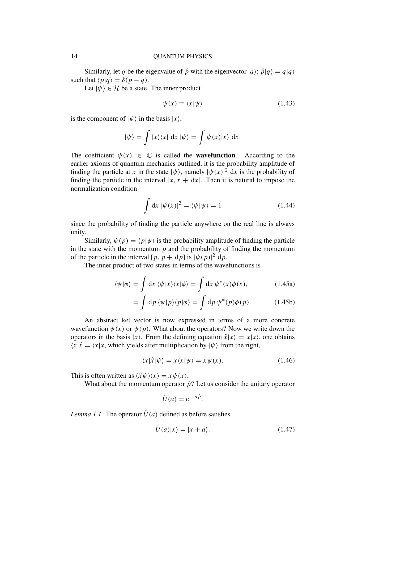

## 第 14 页：先说目的，再逐步解读

### 三、波函数：给每一个可能位置安排一个计算用的数

**这段在干什么：**解释式 (1.43) 定义的函数是什么，以及它和整个量子态有什么关系。

先比较一个你熟悉的例子。平面向量可以用两个坐标 $(v_1,v_2)$ 表示。向量是一整个对象，坐标是在选定坐标轴后描述这个对象的数字。

量子态 $|\psi\rangle$ 也是一整个对象。若我们关心位置，就按位置来描述它：每个 $x$ 对应一个数 $\psi(x)$。作者写

$$
\psi(x)=\langle x|\psi\rangle,
\qquad
|\psi\rangle=\int dx\,\psi(x)|x\rangle.
$$

第一式相当于“取出对应 $x$ 的坐标”；第二式相当于“用全部坐标把整个对象拼回来”。因为位置连续，拼接时用积分。

**$\psi(x)$ 叫波函数。**但现在还缺最重要的一步：这个计算用的数怎样和实验结果联系？作者接着称它为概率振幅，就是要补上这一层意思。

### 四、先别急着背“概率振幅”：为什么光有概率还不够？

**这段在干什么：**解释作者为什么不直接给每个位置一个概率，而要先给一个叫“振幅”的数。

先从普通概率想起。假设一个盒子里有红球和蓝球，你摸出一个球。摸到红球与摸到蓝球是两个互斥结果。要算“摸到红球或蓝球”的概率，可以把两个概率相加。这种加法很好理解：两类结果各算一次，不会互相抵消。

现在换一个实验：粒子从左边发出，经过两条可供通过的路径，最后到右边探测器。我们关心的是某个探测器最后有没有记录到粒子。实验可以反复做很多次，再数记录次数。

在合适条件下，两条路径同时参与时，某个探测器的记录次数会增加，也可能减少到零。尤其奇怪的是：**多开一条路，不一定让这里更容易收到粒子。**

这叫干涉。先记住这个词的实际意思：两部分过程合起来，结果可能加强，也可能抵消。我们需要一套能算出这两种结果的办法。

普通的非负概率相加只能增加，不能解释这种抵消。因此量子力学的计算分成两步：

1. 先给每条不能被区分的过程安排一个“振幅”，把这些振幅相加。
2. 再把总振幅换成最终的探测概率。

这里“不能被区分”不是说你暂时没去看记录，而是说装置中没有留下能够标明路径的记录，并且两路之间的关系没有被环境打乱。若装置留下了明确的路径记录，通常就不能再照着这条简单的振幅相加公式计算。

### 五、一个算得出来的例子：正负号改变结果，但不产生负概率

**这段在干什么：**用数字说明“加强”和“抵消”究竟是怎样算出来的。

先只用实数，把复杂性降到最低。在一个简化的两路计算中，设某个探测结果的两路振幅贡献为

$$
a_1=\frac12,\qquad a_2=\frac12.
$$

先相加，得到总振幅 $1$。再平方，得到这个结果的概率 $1$。

现在设装置让第二路的振幅反过号：

$$
a_1=\frac12,\qquad a_2=-\frac12.
$$

先相加，得到 $0$。再平方，得到概率 $0$。**负号出现在振幅里，没有出现在最终概率里。**

你可能马上追问：那么只知道两路各自“有多大”，能不能判断最后结果？不能。因为

$$
\left|\frac12\right|^2
=\left|-\frac12\right|^2=\frac14.
$$

平方以后，正负号被抹掉了。两种情形的每一路振幅大小相同，但它们相加时一个加强、一个抵消。只保留平方后的两个数，就无法分辨这两种情况。

因此，**提前把正负方向的信息丢掉，就没法算两路合起来会怎样。**

这里的 $a_1,a_2$ 是同一个装置中、同一个探测结果的两部分计算贡献，不能一律当成“堵住另一条路以后测得的概率”的平方根；堵路可能改变制备和归一化。这个例子只是把相加规则清楚算给你看。概率在各个可能结果之间重新分布，粒子没有被相消成负数量，也没有凭空增加。

### 六、相位：把“同号还是反号”推广成“两个箭头朝什么方向”

**这段在干什么：**解释“相位”这个词，不要求你先接受一句没有画面的定义。

实数只有沿数轴向右、向左两种方向。复数则可以画成平面上的箭头：

$$
z=r(\cos\theta+i\sin\theta).
$$

$r$ 是箭头长度，$\theta$ 是它和正实轴的夹角。**这个角度就叫相位。**相位差，就是两个箭头方向相差多少角度。

现在把两路振幅当成两根复平面上的箭头。箭头同向，相加后变长；箭头反向且等长，相加后变成零；方向相差直角，则得到斜向的合箭头。

例如

$$
\left|\frac12+\frac12\right|^2=1,\qquad
\left|\frac12-\frac12\right|^2=0,\qquad
\left|\frac12+\frac i2\right|^2=\frac12.
$$

因此相位不是一句神秘的“额外信息”：它在这套计算里就是箭头朝向，决定相加后的箭头有多长。

这也和你高中见过的波有关。两个相同波动，一个正好处在波峰、另一个也在波峰，会加强；一个波峰遇到一个波谷，会抵消。周期运动进行到哪一步，也可以用一个角度记录。复数非常适合记录这种大小与周期进程。不过粒子波函数不是水面的实际高度，我们借用波来帮助理解相加规则，不把电子直接说成一团水。

### 七、Born 规则：算出振幅之后，怎样得到实验概率？

**这段在干什么：**把“用于计算的复数”与“多次实验中出现的频率”明确接起来。

若某个离散结果的总振幅是 $a=u+iv$，量子力学使用

$$
P=|a|^2=u^2+v^2.
$$

也就是：先量出复平面箭头的长度，再平方。例如 $a=0.3+0.4i$，得到 $P=0.09+0.16=0.25$，即 25%。

这项从振幅到概率的规则，叫 Born 规则。名字不难，内容就是上面这一步。它不是因为“复数很方便”就必然成立的数学定理，而是理论用来连接实验的一条基本规则；这套规则算出的结果需要与实际统计相符。

你现在只需分清两件事：复数帮助我们保留方向并相加；模平方告诉我们怎样把相加结果换成概率。这两步应当分开理解。

### 八、位置是连续的，为什么还要乘 dx？

**这段在干什么：**解释式 (1.44) 为什么是积分，以及 $|\psi(x)|^2$ 为什么不直接叫一个点的概率。

实际探测器总有宽度。你可以问粒子落在从 1 厘米到 1.1 厘米的区域里的概率，而不是要求探测器报告一个无限精确的实数。

作者规定

$$
\Pr\{a\le x\le b\}=\int_a^b|\psi(x)|^2\,dx.
$$

$|\psi(x)|^2$ 是概率密度：它表示这一带概率分布得有多密。密度大，不等于单点概率大；还要看取的区间多宽。

例如某小段上密度近似为每厘米 $0.2$，探测区间宽 $0.1$ 厘米，则概率近似为 $0.2\times0.1=0.02$。把整个可能区域的概率加起来应为 1，所以有 $\int|\psi|^2dx=1$。这就是归一化。

### 九、为什么后面又出现动量波函数和位置算符？

**这段在干什么：**说明同一个状态可以用来回答不同测量问题，不需要每换一个问题就换一个粒子。

$\psi(x)$ 回答位置问题。$\widetilde\psi(p)$ 则用来算动量落在某个范围的概率。对于高中范围的运动，动量是 $p=mv$；在量子理论里，动量仍是能测量的物理量，但测量前的状态一般不能直接当成一个确定的 $p$。

在位置表示里，$\hat x$ 的作用很简单：把函数乘以自变量 $x$。于是平均位置就是熟悉的加权平均：

$$
\langle x\rangle=\int dx\,x|\psi(x)|^2.
$$

本页末尾引入 $U(a)$，准备研究“把整个位置分布向右挪 $a$”。作者接下来要说明：这个平移操作为什么和动量有关。先知道它要完成这个任务，再读指数符号，就不会把它当作凭空增加的一条公式。

## 原书第 15 页：原文底本

本块保留该页属于本小节的完整原文。PDF 阅读器页码为 38。

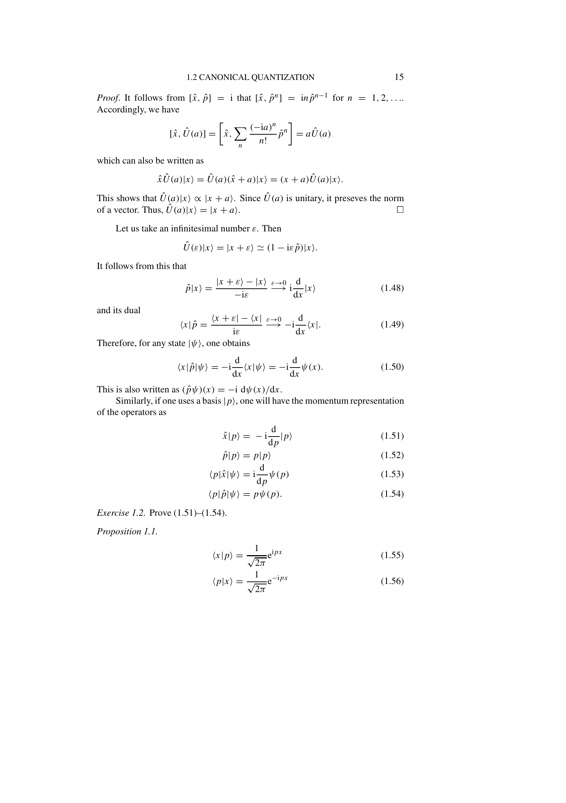

## 第 15 页：先说目的，再逐步解读

### 十、平移：先用一张函数图像理解 U(a)

**这段在干什么：**说明引理 1.1 所说的操作是什么，并从平移一步步找出动量的微分表达式。

设原波形集中在 $x=0$ 附近。把整个图形向右挪 3 个单位，新图形就集中在 $x=3$ 附近。这个操作记作 $U(3)$。对理想位置态，它把 $|x\rangle$ 变成 $|x+3\rangle$。

对函数，向右挪 $a$ 却写成 $\psi(x-a)$。例如原函数峰值在自变量 0，新函数要在 $x=a$ 达到峰值，所以里面必须是 $x-a$。这个负号来自平移图形，与你熟悉的高中函数平移相同。

作者已经给出正则关系 $[\hat x,\hat p]=i\hbar$。方括号的定义是 $AB-BA$。由它可证明

$$
\hat xU(a)=U(a)(\hat x+a).
$$

再作用到 $|x\rangle$，可得 $U(a)|x\rangle$ 对应的位置是 $x+a$。所以指数 $U(a)=e^{-ia\hat p/\hbar}$ 真的实现了平移。这里的 $\hbar$ 是一个基本物理常数，负责把位置、动量的乘积换成无量纲数；本书常把它设为 1 以缩短公式。

再让 $a$ 很小，一边展开函数：

$$
\psi(x-a)=\psi(x)-a\psi'(x)+O(a^2).
$$

另一边展开算符指数：

$$
U(a)\psi=\psi-\frac{ia}{\hbar}\hat p\psi+O(a^2).
$$

比较两边关于 $a$ 的一次项，

$$
-\frac i\hbar\hat p\psi=-\psi',
\qquad
\boxed{\hat p\psi=-i\hbar\psi'.}
$$

因此动量算符中的导数不是随便猜的：**导数描述小平移怎样改变函数，而动量正是这套量子理论中控制空间平移的量。**

原文证明末尾还省略了对位置态相位的选择。它不改变这里的计算主线，详细说明放在 [公式核对附录](formula-checks.md)；第一次读到这里，可以先掌握这两次展开怎样比较。

### 十一、动量表示：换一种坐标，算符的样子也会改变

**这段在干什么：**解释式 (1.51)–(1.56) 为什么把“乘法”和“微分”的角色交换了。

在位置表示里，状态写成 $\psi(x)$。此时位置测量最容易处理，$\hat x$ 就乘 $x$；动量则写成 $-i\hbar\,d/dx$。

若改用动量表示，状态写成 $\widetilde\psi(p)$，动量测量变得最容易处理，$\hat p$ 就乘 $p$；位置算符则写成 $i\hbar\,d/dp$。

这类似同一个线性变换换基后矩阵会变。物理操作没有变，变的是表示方法。

页末的 $\langle x|p\rangle$ 接着问：一个“动量确定为 $p$”的理想状态，写成位置函数以后是什么样？下一页就是求这个函数。它将把你熟悉的 Fourier 变换引进来。

## 原书第 16 页：原文底本

本块保留该页属于本小节的完整原文。PDF 阅读器页码为 39。

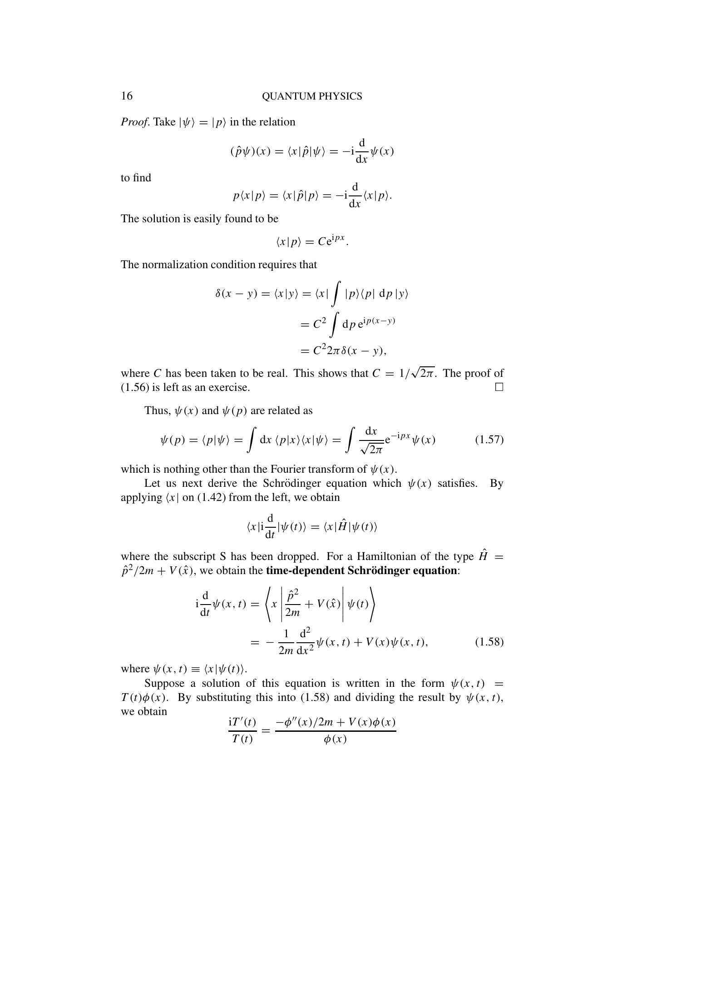

## 第 16 页：先说目的，再逐步解读

### 十二、Fourier 变换：为什么动量和波的频率接上了？

补充阅读：[第 16 页傅里叶变换详解：从波形分解到位置与动量的换基](p16-fourier-transform-explained.md)。逐步说明复指数、正交提取、式 (1.57)、归一化与不确定关系，并提供返回本段的链接。

**这段在干什么：**求出动量确定时的位置波形，说明为什么从位置函数转到动量函数要做 Fourier 变换。

令 $u_p(x)=\langle x|p\rangle$。因为它是动量为 $p$ 的状态，必须满足

$$
-i\hbar u_p'(x)=p\,u_p(x).
$$

这是你会解的一阶方程：

$$
u_p'(x)=\frac{ip}{\hbar}u_p(x),
\qquad
u_p(x)=C e^{ipx/\hbar}.
$$

利用 Euler 公式，它包含 $\cos(px/\hbar)$ 与 $\sin(px/\hbar)$。$p/\hbar$ 控制随位置变化的快慢：动量越大，空间振荡越快。这就是 $p=\hbar k$，其中 $k$ 叫波数。

一般波函数可以由不同快慢的这些波形叠加。Fourier 变换正好负责回答“每种波数占多少”，于是也就负责把位置表示换成动量表示：

$$
\widetilde\psi(p)=
\frac1{\sqrt{2\pi\hbar}}
\int dx\,e^{-ipx/\hbar}\psi(x).
$$

它不是另外添加的一种物理运动，而是同一个状态换写法。位置分布很窄时，需要许多不同波数共同合成，所以动量分布往往较宽；以后的位置—动量不确定关系会把这个联系精确写出来。

### 十三、薛定谔方程：用今天的波函数算下一刻的波函数

**这段在干什么：**将上一小节的抽象演化方程，改写成一个能实际求解的偏微分方程。

你在 1.2.3 已经记过 $i\hbar\partial_t|\psi\rangle=H|\psi\rangle$。现在状态能写成函数，位置、动量也已有具体写法，所以直接代入

$$
H=\frac{\hat p^2}{2m}+V(\hat x)
$$

即可。动量用 $-i\hbar\partial_x$ 替代，平方后成为 $-\hbar^2\partial_x^2$；势能用位置函数乘法替代。得到

$$
\boxed{
i\hbar\partial_t\psi(x,t)
=-\frac{\hbar^2}{2m}\partial_x^2\psi(x,t)+V(x)\psi(x,t).
}
$$

左边描述函数随时间如何变化；右边由动能和势能决定。给定初始波函数、势能和适当边界条件，就可以求后来函数，再算各处的探测概率。

这不是一条直接画出粒子轨迹的方程。它首先给出随时间变化的概率计算方法。你可以像理解热方程、波动方程那样关注它的初值问题，但要保留量子力学自己的概率解释。

### 十四、分离变量：为什么先找 ψ(x,t)=T(t)φ(x) 这样的解？

**这段在干什么：**把难解的含时间方程，拆成能量问题和时间问题，为下一页的“定态”作准备。

如果势能不随时间变，作者先找空间形状与时间因子可以分开的解：

$$
\psi(x,t)=T(t)\phi(x).
$$

代入方程，再除去共同因子，得到一边只含 $t$，另一边只含 $x$。要让它们对所有位置和时间都相等，只能共同等于一个常数 $E$。

于是问题拆成

$$
i\hbar T'=ET,\qquad H\phi=E\phi.
$$

后一式是能量本征问题。先找到这些特别的解，再把它们叠加，就能组织更一般的运动。这和求线性方程时先找一批基本解的思路相同，不表示所有解都只能有一个乘积形式。

## 原书第 17 页：原文底本

本块保留该页属于本小节的完整原文。PDF 阅读器页码为 40。

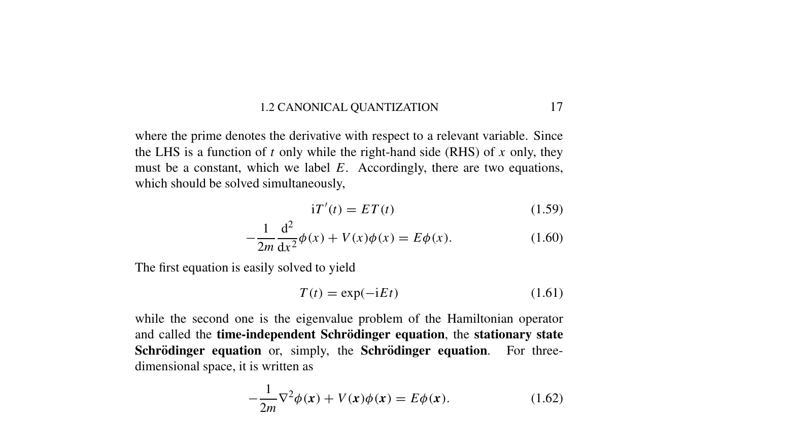

## 第 17 页：先说目的，再逐步解读

### 十五、定态：概率分布不变，并不等于一颗小球停在那里

**这段在干什么：**解释式 (1.59)–(1.62) 的解为什么叫定态，并说明能量怎样进入时间因子。

时间方程直接解得

$$
\psi_E(x,t)=e^{-iEt/\hbar}\phi_E(x).
$$

指数前面的因子在复平面上一直转，但长度始终为 1。所以

$$
|\psi_E(x,t)|^2=|\phi_E(x)|^2.
$$

**相同制备反复做位置测量，得到的位置统计分布不随等待时间改变。**这就是这里“定态”的意思。它没有提供一条小球轨迹，也没有说每次都测在同一个位置。

若把两个不同能量的解相加，它们转动速度不同。开始同向的两根箭头，过一会儿方向可能错开；某些地方的加强、抵消就会随时间变化。因此一般叠加态的位置分布会变化。

### 十六、这一节复习：把整条推理重新说一遍

**这段在干什么：**把本节内容整理成一条可以复述的路线，并明确现在需要掌握到哪里。

先问粒子可能在哪。为回答位置问题，把状态写成 $\psi(x)$。为了处理干涉，这个函数保留复数方向；对一个区间积分 $|\psi|^2$，得到探测概率。为研究位置如何移动，引入平移，由此得到动量的导数表达。动量本征函数是平面波，因此位置与动量表示靠 Fourier 变换相连。最后，把动能和势能代进演化方程，就得到波函数的薛定谔方程。

| 内容 | 等级 | 用自己的话应能做到什么 |
|---|---|---|
| 波函数与概率密度 | A | 说明为什么还要对区间积分 |
| 振幅、相位、干涉 | A | 用两根箭头和一组数字解释加强、抵消 |
| 平移与动量 | A | 从两次小量展开得到 $-i\hbar\partial_x$ |
| 位置与动量表示 | A | 说明是同一状态换写法 |
| 定态 | A | 解释为什么时间因子在变而位置分布不变 |
| 连续谱、严格定义域 | B | 以后补细节，当前不让它打断主线 |

你现在可以检验自己：$1/2$ 和 $-1/2$ 的模平方一样，为什么参与相加后结果不同？如果能从“振幅先相加”一步一步答出来，就掌握了振幅与概率的这项重要区别。

---

[阅读目录](README.md) · [下一小节](02-1.2.5.md)

# 1.2.5 Harmonic oscillator｜谐振子的算符量子化

[阅读目录](README.md) · [上一小节](01-1.2.4.md) · [下一小节](03-1.3.1.md)

**这一节在做什么：用一个具体系统，把上一节的波函数、能量方程真正算一遍。**这个系统就是弹簧小球的量子版本。先理解为什么选它，再看能级、零点能和升降算符怎样出现。

## 原书第 17 页：原文底本

本块保留该页属于本小节的完整原文。PDF 阅读器页码为 40。

## 第 17 页：先说目的，再逐步解读

### 一、为什么作者偏要选谐振子？

**这段在干什么：**说明谐振子不仅是一个能解出来的例题，还能近似描述许多物理系统的小振动。

高中弹簧满足 $F=-kx$：离开平衡位置越远，拉回去的力越大。势能为 $V(x)=kx^2/2$，令 $k=m\omega^2$，便得到原文 (1.63) 的系统。

更一般地，想象小球待在一个光滑碗底。碗的整体形状可以很复杂，但只在最低点附近动一点点，就主要感受到一段近似抛物线的形状。

数学上，在最低点 $x_0$ 附近展开势能：

$$
V(x_0+q)=V(x_0)+V'(x_0)q+\frac12V''(x_0)q^2+\cdots.
$$

最低点有 $V'(x_0)=0$。常数项不影响受力，位移很小时又可先忽略更高次项，于是剩下二次势。**许多不同系统，在稳定平衡附近都会近似成谐振子。**

因此作者不是随便选一个特殊函数练习。以后自由场分解成许多振动模式，每个模式又会回到这里。

### 二、能量为什么只许取一串离散数值？

补充阅读：[第 17、18 页详解：高斯因子、多项式解与离散能级](p17-18-hermite-energy-explained.md)。区分“构造候选解”和“证明没有遗漏”，补齐能量公式的推导。

**这段在干什么：**把能量方程变成可以比较解的方程，并说明哪些解能代表实际准备的状态。

把位置、动量换成上一节的函数表达，得到

$$
-\frac{\hbar^2}{2m}\psi''(x)
+\frac12m\omega^2x^2\psi(x)=E\psi(x).
$$

我们要找的不只是形式上满足方程的函数，还要求 $\int|\psi|^2dx=1$。若一个解在远处增长得太快，积分发散，就不能用它给整条直线安排总和为 1 的位置概率。

为减少常数，设

$$
\xi=\sqrt{\frac{m\omega}{\hbar}}\,x,\qquad
\varepsilon=\frac E{\hbar\omega}.
$$

方程变成

$$
\psi''(\xi)+(2\varepsilon-\xi^2)\psi=0.
$$

原书 (1.65) 少印了这里的 2。读计算时按上式核对，不要为了迁就印错的式子反复怀疑自己。

寻找远处能衰减、总概率可归一化的解，最后会发现只有

$$
\boxed{E_n=\hbar\omega(n+\tfrac12),\quad n=0,1,2,\ldots}
$$

这串能量可行。位置可以连续变化，但能量只能取这串值，并不矛盾：它们是不同测量问题。这里能量的限制来自方程与允许状态的条件共同作用。

## 原书第 18 页：原文底本

本块保留该页属于本小节的完整原文。PDF 阅读器页码为 41。

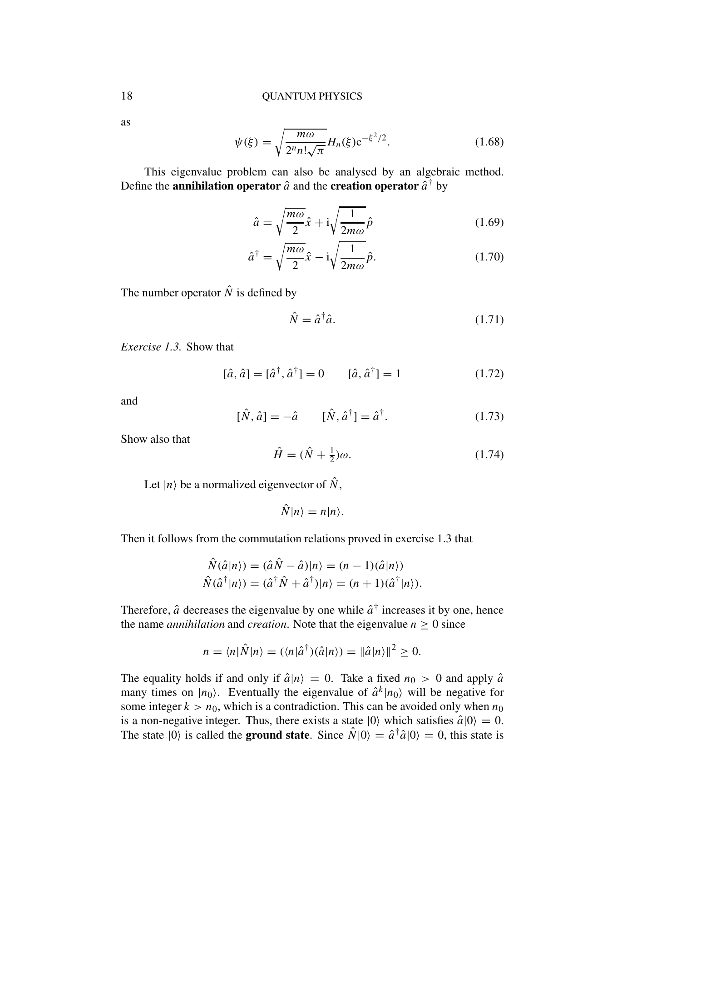

## 第 18 页：先说目的，再逐步解读

### 三、Hermite 多项式先认用途，不必先背名字

补充阅读：[Hermite 多项式为什么出现？](p17-18-hermite-energy-explained.md) 同时解释它与 Hermite 插值的关系、高斯因子的来源，以及平方可积条件在推导中的作用。

**这段在干什么：**给能量方程的各个解命名，并为后面的代数方法提供参照答案。

最低能量的波函数是一条钟形曲线：

$$
\psi_0(x)=C e^{-m\omega x^2/(2\hbar)}.
$$

更高能级的解，是“同一个衰减因子，前面再乘不同多项式”。这些多项式叫 Hermite 多项式。它们让函数在中间出现不同的零点，同时远处仍有足够衰减。

完整归一化式为

$$
\psi_n(x)=
\left(\frac{m\omega}{\pi\hbar}\right)^{1/4}
\frac{H_n(\xi)}{\sqrt{2^nn!}}e^{-\xi^2/2}.
$$

本书 (1.67)–(1.68) 混用了两套多项式和尺度约定，详细核对见附录。初读时先抓住“能级不同，对应的空间形状也不同”；不要把背 Rodrigues 公式当成理解量子振子的前提。

### 四、为什么又定义 a 和 a†，而不一直解微分方程？

**这段在干什么：**找出能把一个已知能级状态变成相邻能级状态的操作，使求解更省力。

作者定义

$$
a=\sqrt{\frac{m\omega}{2\hbar}}\,x
+\frac{i}{\sqrt{2m\hbar\omega}}\,p,
\qquad
a^\dagger=\sqrt{\frac{m\omega}{2\hbar}}\,x
-\frac{i}{\sqrt{2m\hbar\omega}}\,p.
$$

这些系数看着复杂，目的其实很具体：把位置和动量按合适尺度合在一起，让计算关系变成简单的

$$
[a,a^\dagger]=1,\qquad
H=\hbar\omega(a^\dagger a+\tfrac12).
$$

记 $N=a^\dagger a$。如果 $N|n\rangle=n|n\rangle$，就有

$$
H|n\rangle=\hbar\omega(n+\tfrac12)|n\rangle.
$$

所以只要知道 $N$ 的取值，就知道能量。作者接着算出：$a$ 把标签 $n$ 降低 1，$a^\dagger$ 把它提高 1。因此它们叫下降、上升算符，也常叫湮灭、产生算符。

这里“产生”的是一个振动激发：能量提高 $\hbar\omega$。对弹簧上原有的一个粒子，它不是又制造出一颗粒子。这个用词到场论里才会有进一步的粒子解释。

### 五、为什么最低标签是 0，而且所有标签都必须是整数？

**这段在干什么：**用范数非负和逐级下降，解释能谱为什么不是任意实数。

先计算

$$
n=\langle n|a^\dagger a|n\rangle=\|a|n\rangle\|^2\ge0.
$$

所以 $n$ 不可能为负。另一方面，只要 $a|n\rangle$ 没有变成零，它就属于下一层 $n-1$。

假设有一层是 $n=2.3$。往下降，会经过 $1.3$、$0.3$。在 $0.3$ 处，下降后向量的范数平方是 $0.3$，仍不为零；于是再降一次就来到 $-0.7$，与非负要求冲突。

但若从 2 开始，下降为 1、0，在 0 处有 $\|a|0\rangle\|^2=0$，梯子自然终止，不需要出现负层。

因此标签只能是 $0,1,2,\ldots$。这不是先宣布“量子一定整数”，而是这套算符关系与允许状态的条件把整数一步步逼了出来。

## 原书第 19 页：原文底本

本块保留该页属于本小节的完整原文。PDF 阅读器页码为 42。

## 第 19 页：先说目的，再逐步解读

### 六、零点能：最低能态为什么还不是零能量？

**这段在干什么：**由最低状态的条件求出波函数，并解释量子振子为何不能像经典小球那样完全停在最低点。

最低状态满足 $a|0\rangle=0$。代入位置表示，得到

$$
\psi_0'(x)+\frac{m\omega}{\hbar}x\psi_0(x)=0.
$$

积分后就是上一页的钟形曲线。它并没有把位置压成一个点，而是在平衡点附近有一定宽度。

经典小球可以设想同时满足位置为 0、速度为 0，于是动能和势能都为零。量子态却不能同时让位置与动量都毫无宽度：把位置分布压得越窄，就需要更多不同动量的波组成它。

因此，想靠“压在原点”把势能降到最低，会使动能代价升高。最低总能量是在这两种要求之间取平衡，得到 $E_0=\hbar\omega/2$。这叫零点能。它不是不守恒，也不是可以无条件抽出来使用的免费能量。

### 七、这一节复习：两种算法在算同一件事

**这段在干什么：**把微分方程路线与升降算符路线对上，避免记成两组不相干公式。

第一条路线：写能量方程，要求解能归一化，得到离散能量与波函数。第二条路线：用 $a,a^\dagger$ 改写能量，证明标签只能从 0 按整数上升，再从最低态逐级构造：

$$
|n\rangle=\frac{(a^\dagger)^n}{\sqrt{n!}}|0\rangle.
$$

分母用于保持态的归一化。原文 (1.78) 列能量时还需保留相应 $\hbar\omega$ 单位。

| 内容 | 等级 | 复习要求 |
|---|---|---|
| 二次势为何普遍 | A | 能从最低点 Taylor 展开说出理由 |
| 离散能级 | A | 知道需要同时考虑方程与可归一化条件 |
| 上升、下降操作 | A | 说清提高、降低的是哪种能量激发 |
| 零点能 | A | 能说明位置压窄为何有动能代价 |
| Hermite 显式表达 | B | 会查和验证，不靠死背代替理解 |

最好的自测是：不看原文，用“为什么标签不能是 2.3”这个例子，复述整数谱的理由。

---

[阅读目录](README.md) · [上一小节](01-1.2.4.md) · [下一小节](03-1.3.1.md)

# 1.3.1 Path integral quantization｜玻色粒子的路径积分

[阅读目录](README.md) · [上一小节](02-1.2.5.md) · [下一小节](04-1.3.2.md)

**这一节在做什么：换一种办法计算粒子从起点到终点的振幅。**先把一段长时间拆成许多短时间，再把每一小段的计算连起来，“路径积分”就是这样出现的。

## 原书第 19 页：原文底本

本块保留该页属于本小节的完整原文。PDF 阅读器页码为 42。

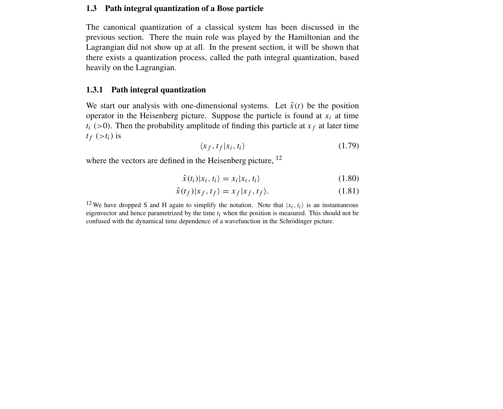

## 第 19 页：先说目的，再逐步解读

### 一、为什么作者从 Hamiltonian 换回 Lagrangian？

**这段在干什么：**说明新方法仍在回答同一个物理问题，并交代作者为什么要引入它。

前面的方法是：先写能量算符 $H$，再让它控制状态随时间变化。现在作者想把同一个计算改写成作用量的形式。作用量就是你在经典力学笔记里见过的 $S=\int L\,dt$。

为什么值得换？因为处理许多相互联系的坐标、尤其是处理场时，直接写一个统一的作用量通常更方便。以后要看时空对称、局部相互作用和拓扑，作用量的写法也更容易显出结构。

这里不是说之前的方法错了。新方法若描述同一个系统，就必须算出同一个实验概率。

### 二、先说清楚要算的数：跃迁振幅

补充阅读：[第 19、20 页详解：为什么位置算符作用于本征态只得到位置值乘以原态？](p19-20-position-eigenstates-explained.md) 解释时间标签、本征值方程，以及位置基底变化与状态时间演化的区别。

**这段在干什么：**把“粒子如何运动”的大问题缩成一个明确的起点、终点计算。

作者固定初始时刻 $t_i$、初始位置 $x_i$，以及后来时刻 $t_f$、终点位置 $x_f$，要算

$$
K=\langle x_f,t_f|x_i,t_i\rangle.
$$

它叫跃迁振幅。意思是：以指定的初始位置作为条件，后来在指定终点出现的计算振幅是什么。

因为位置是连续的，精确位置态是理想工具，这个核不能直接当作某个小探测器的概率。实际计算要把它和初始波函数结合，再对有宽度的探测区域积分。作者先研究这个核，是因为知道它以后，就可以处理许多不同的初始波形。

## 原书第 20 页：原文底本

本块保留该页属于本小节的完整原文。PDF 阅读器页码为 43。

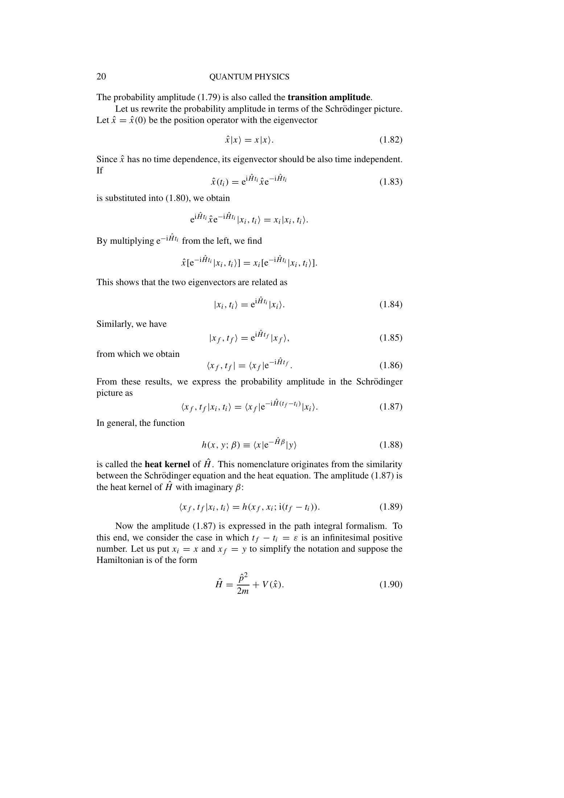

## 第 20 页：先说目的，再逐步解读

### 三、传播核：一张“初始波形怎样变成后来波形”的计算表

补充阅读：[从带时间标签的位置本征态推导传播核](p19-20-position-eigenstates-explained.md)。逐步展开式 (1.80)–(1.87) 中的酉变换，并提供返回本段的链接。

**这段在干什么：**把前页的振幅改写成你已学过的时间演化算符，并说明它能拿来做什么。

式 (1.82)–(1.87) 来回转换两种绘景，最后得到

$$
K(x_f,t_f;x_i,t_i)=
\langle x_f|e^{-iH(t_f-t_i)/\hbar}|x_i\rangle.
$$

你可以先把 $K$ 想成一张由起点、终点标记的表。给它不同起点 $x_i$，它告诉你这些起点对终点 $x_f$ 的振幅贡献。把所有起点的贡献按初始波函数相加，就得到

$$
\psi_f(x_f)=\int dx_i\,K(x_f,t_f;x_i,t_i)\psi_i(x_i).
$$

这和矩阵乘向量很像：原来的求和指标换成连续起点，所以用积分。称它为“核”，就是因为它放在这个积分里面执行状态变化。

### 四、作者为什么先研究极短的一小段？

**这段在干什么：**为后面的时间切片作准备，先找一个短时间里比较容易算的公式。

直接计算很长一段时间的 $e^{-iHT/\hbar}$ 往往困难。但时间很短时，指数可以展开，动能和势能的作用也较容易分开处理。

本节限定

$$
H=\frac{p^2}{2m}+V(x).
$$

这表示动能是高中熟悉的 $p^2/(2m)$，势能只随位置变化。不要先把含磁场、弯曲空间等更复杂问题放进来。

页中提到的热核，是把振荡的指数换成衰减的指数后得到的对象。作者稍后专门解释虚时间；现在只需知道它和同一个能量算符有关，不必在这里提前理解统计物理。

## 原书第 21 页：原文底本

本块保留该页属于本小节的完整原文。PDF 阅读器页码为 44。

## 第 21 页：先说目的，再逐步解读

### 五、为什么一上来先算一个看起来不相关的积分？

**这段在干什么：**准备动量积分需要的工具，确定振荡 Gaussian 积分怎样计算。

普通 Gaussian 积分里有 $e^{-ap^2}$，$a>0$。$p$ 越大，函数越小，所以积分会收敛。这里却出现 $e^{-iap^2}$，长度不衰减，只在复平面上转动。

作者画图 1.1，改变的是复平面中的积分路线，不是粒子真实走的路线。这样能把振荡积分连到会衰减的 Gaussian 积分上。

一种清楚的理解方式是：先加一点衰减，算

$$
\int dp\,e^{-(\eta+ia)p^2}
=\sqrt{\frac{\pi}{\eta+ia}},\qquad \eta>0,
$$

最后让 $\eta$ 逐渐趋于零。这样既得到数值，也确定平方根应选的相位。第一次读时，先知道这项工具是为下一步消去动量准备的。

### 六、短时公式先看结构：它记录这一小段的动能和势能

补充阅读：[命题 1.2、第 22 页长公式与短时传播核的对应](p21-22-short-time-kernel-explained.md)。逐项解释命题的含义、排印问题及它与短时作用量的联系。

**这段在干什么：**说明命题 1.2 的公式每一部分对应什么，不先陷进长证明。

恢复 $\hbar$ 后，短时间 $\epsilon$ 的主要表达为

$$
K_\epsilon(x,y)\simeq
\sqrt{\frac{m}{2\pi i\hbar\epsilon}}\,
\exp\left[
\frac i\hbar\left(
\frac{m(x-y)^2}{2\epsilon}
-\epsilon V\left(\frac{x+y}{2}\right)\right)\right].
$$

看指数里的括号：平均速度是 $(x-y)/\epsilon$，所以第一项等于“平均动能乘时间”。第二项是“势能乘时间”，带负号。两项合起来就是这一小段的作用量。

公式前面的平方根是归一化因子，后面连乘短时核时不能删掉。原书 (1.92) 的前因子和速度平方有排印问题，可对照它第 23 页的证明末尾；详细校记仍保存在附录。

## 原书第 22 页：原文底本

本块保留该页属于本小节的完整原文。PDF 阅读器页码为 45。

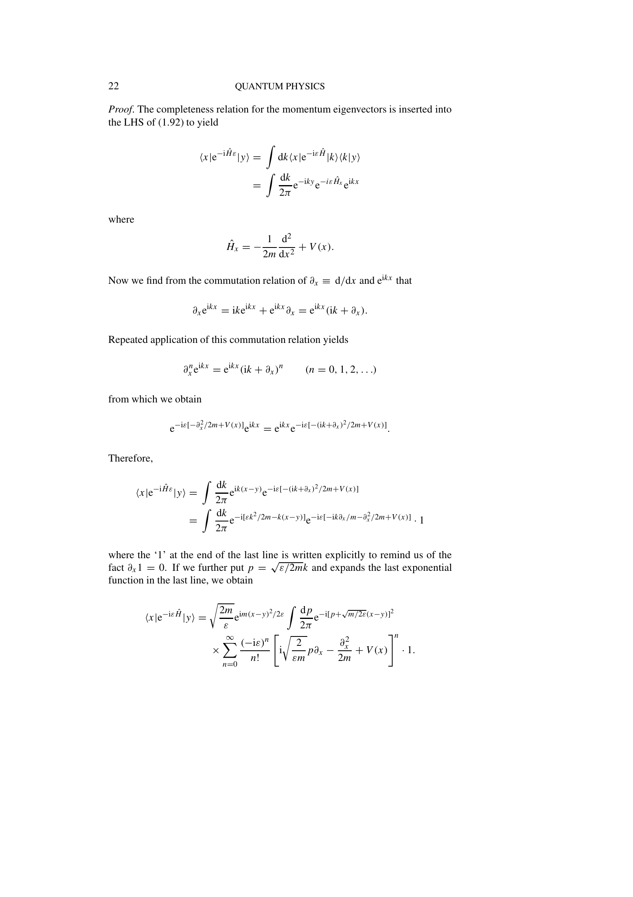

## 第 22 页：先说目的，再逐步解读

### 七、动量积分怎样把 Hamiltonian 变成 Lagrangian？

补充阅读：[第 22 页证明详解：算符重排、末尾的 1 与中点势能](p21-22-short-time-kernel-explained.md)。说明原书长公式与下面简化积分的关系，以及近似和余项的作用。

**这段在干什么：**补出短时核证明的主干，让你看见作用量并不是凭空猜进答案的。

作者插入动量完备关系，是因为在动量表示中 $p^2/(2m)$ 很好处理。略去需要单独控制的高阶小量，核心积分是

$$
\int\frac{dp}{2\pi\hbar}
\exp\left[\frac i\hbar
\left(p(x-y)-\epsilon\frac{p^2}{2m}-\epsilon V\right)\right].
$$

对 $p$ 完成平方：

$$
p(x-y)-\frac{\epsilon p^2}{2m}
=-\frac{\epsilon}{2m}
\left(p-\frac{m(x-y)}{\epsilon}\right)^2
+\frac{m(x-y)^2}{2\epsilon}.
$$

第一项放进上页准备的 Gaussian 积分，产生平方根前因子；第二项不含待积分的 $p$，留下来和势能合成短时作用量。

所以整条逻辑是：**先有时间演化算符，再插入动量，最后积分掉动量，得到动能减势能。**这和经典关系 $L=p\dot x-H$ 也接了起来。

原文逐行移动导数与指数，是在处理它们不一定可交换的问题。你可以先把这条主干算通，再回来核对精细余项；不要先让算符重排遮住为什么要做动量积分。

## 原书第 23 页：原文底本

本块保留该页属于本小节的完整原文。PDF 阅读器页码为 46。

## 第 23 页：先说目的，再逐步解读

### 八、短时以后再短一点，为什么核应变成 δ？

**这段在干什么：**检查刚得到的短时公式是否符合“时间为零时状态不应被改变”。

若根本没有经过时间，初始波函数就应该原样留下。核此时必须执行

$$
\int dy\,K_0(x,y)\psi(y)=\psi(x).
$$

所以 $K_0(x,y)$ 应该是 $\delta(x-y)$。这给短时公式一项非常具体的核对。

注意，短时核不是因为远处的每一个值都变小才实现这个效果；远处的相位变化很快，把它们和波函数一起积分时，许多贡献相互抵消。因而这里必须先积分、再讨论极限，不能把振荡复数当成普通钟形概率密度。

### 九、为什么在中间位置插入积分？

**这段在干什么：**利用演化的分段性质，把长时间传播改写成短时间传播的连接。

假设先从起点传播到中间时刻，再从那里传播到终点。中间位置可能取很多值，于是

$$
K(f;i)=\int dz\,K(f;z)K(z;i).
$$

两个相邻过程的振幅相乘，所有中间位置的贡献再相加。这和矩阵乘法里对中间指标求和完全平行。

这里没有真的安装仪器测中间位置。插入完备关系只是改写计算；若实际测量并留下记录，会改变干涉问题，不能当作同一个计算。

## 原书第 24 页：原文底本

本块保留该页属于本小节的完整原文。PDF 阅读器页码为 47。

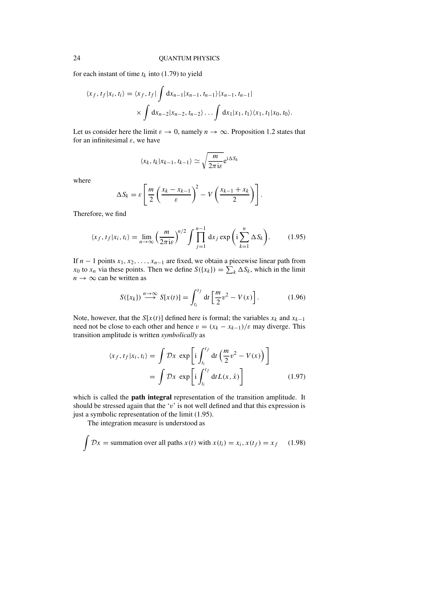

## 第 24 页：先说目的，再逐步解读

### 十、路径积分先是一个普通的多重积分

**这段在干什么：**说明式 (1.95) 为什么可以被读成“对许多条路径求和”。

把时间分成 $n$ 段。两端固定，中间有 $n-1$ 个位置 $x_1,\ldots,x_{n-1}$，每个都要积分。

若选定这些中间位置，可以把相邻点连成一条折线。换一组位置，就得到另一条折线。所以原来的多重积分，也可以说成“遍历所有这些折线”。

$$
K_n=C_n\int dx_1\cdots dx_{n-1}\,
\exp\left(\frac i\hbar\sum_{k=1}^n\Delta S_k\right).
$$

每一段有一个短时作用量 $\Delta S_k$；指数相乘时作用量相加，所以出现总作用量。$C_n$ 汇集每一段的归一化，不能事后随意设成 1。

### 十一、连续的路径符号为什么只是简写？

**这段在干什么：**解释原文反复提醒 “formal” 的原因，防止把每条积分路径都理解成光滑经典轨迹。

让时间段越来越短、中间点越来越多，作者把前面的极限简写成

$$
K=\int\mathcal Dx\,e^{iS[x]/\hbar}.
$$

$\mathcal Dx$ 提醒你积分变量已不是一个数，而是一整条路径。它的具体含义仍要回到前面的时间切片、归一化和边界条件。

中间点不必按光滑速度靠近，所以许多路径不能像高中轨迹那样处处求速度。原文自己指出这一点。当前先把离散公式当作计算根据，不要认为写出 $\mathcal Dx$ 就已经解决了所有无限维积分的严格定义。

## 原书第 25 页：原文底本

本块保留该页属于本小节的完整原文。PDF 阅读器页码为 48。

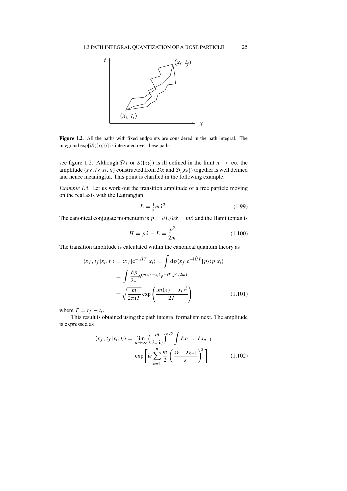

## 第 25 页：先说目的，再逐步解读

### 十二、这么多路径为什么还能回到经典力学？

**这段在干什么：**解释图 1.2 的众多路径，与经典力学的一条轨迹有什么关系。

每条路径贡献一个长度由测度等因素控制、方向由 $S/\hbar$ 决定的复振幅。邻近路径的作用量若差很多，箭头方向就转得很快，许多相加后会抵消。

在经典解附近，稍微改动路径时，作用量的一阶变化为零。因此邻近箭头没有那么快散开，更容易共同留下贡献。这就是“驻相”的意思：附近的相位变化比较慢。

当相关作用量变化相对 $\hbar$ 很大时，这种选择更明显，经典轨迹便成为有效近似。不是先规定粒子只能走经典路径，再把其他路径当作装饰。

### 十三、自由粒子：没有受力，为什么波函数仍会改变？

**这段在干什么：**用最简单的例子核对新方法，并提醒“无受力”不等于量子态不变。

自由粒子取 $V=0$。不同动量分量的能量是 $p^2/(2m)$，所以它们随时间转动的快慢不同。原来共同拼成窄波包的成分，后来会以不同关系相加，波包便可能展宽。

直接做动量积分，作者得到

$$
K_0(x_f,x_i;T)=
\sqrt{\frac{m}{2\pi i\hbar T}}
\exp\left[\frac{im(x_f-x_i)^2}{2\hbar T}\right].
$$

下一页用时间切片再算一次。两种结果相同，才说明路径积分确实复现了原来的量子演化。

## 原书第 26 页：原文底本

本块保留该页属于本小节的完整原文。PDF 阅读器页码为 49。

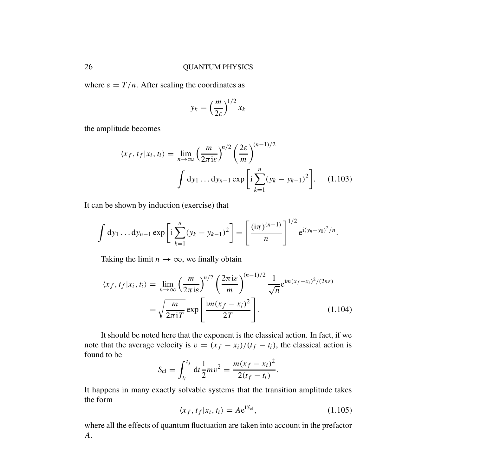

## 第 26 页：先说目的，再逐步解读

### 十四、例题末尾：为什么答案里出现经典作用量？

**这段在干什么：**把自由粒子的最后结果拆成“经典轨迹部分”和“其他路径的共同贡献”。

经典自由粒子从 $x_i$ 到 $x_f$，用时 $T$，速度是 $(x_f-x_i)/T$。其作用量为

$$
S_{\rm cl}=
T\cdot\frac m2\left(\frac{x_f-x_i}{T}\right)^2
=\frac{m(x_f-x_i)^2}{2T}.
$$

这正好是传播核指数中的量。但前面的平方根仍然存在，它来自其余路径的积分。答案里能写出 $S_{\rm cl}$，并不表示计算时只保留了经典路径。

自由粒子和谐振子都是二次问题，围绕经典解的积分可以精确做完。更复杂的势一般没有这么简单，后面的近似方法会继续处理。

### 十五、这一节复习：不要先背“粒子走所有路径”

**这段在干什么：**用可计算的步骤重述路径积分，代替一句容易误解的口号。

完整路线是：想算长时间振幅 → 分成短时间 → 中间插入位置积分 → 每小段做动量 Gaussian 积分 → 短时作用量相加 → 把多重积分简写成路径积分。

| 内容 | 等级 | 自测 |
|---|---|---|
| 传播核 | A | 能写出它怎样把初始波函数变成后来波函数 |
| 时间切片 | A | 能说明中间积分不是实际测量 |
| $e^{iS/\hbar}$ | A | 知道它由短时核连乘得到 |
| 经典极限 | A | 能用邻近箭头的抵消解释驻相 |
| 无限维积分的严格构造 | C | 知道需要条件，当前不用先补完这一整门理论 |

最值得动手复算的是完成平方那一步：它直接回答作者为什么能从 Hamiltonian 方法走到 Lagrangian 方法。

---

[阅读目录](README.md) · [上一小节](02-1.2.5.md) · [下一小节](04-1.3.2.md)

# 1.3.2 Imaginary time and partition function｜虚时间与配分函数

[阅读目录](README.md) · [上一小节](03-1.3.1.md) · [下一小节](05-1.3.3.md)

**这一节在做什么：把量子演化的计算，连到温度下的状态统计。**“虚时间”首先是改写公式的方法；“配分函数”首先是把各种状态的概率安排好。

## 原书第 26 页：原文底本

本块保留该页属于本小节的完整原文。PDF 阅读器页码为 49。

## 第 26 页：先说目的，再逐步解读

### 一、作者为什么先要求能量有下界？

**这段在干什么：**保证系统不会通过不断降低能量而永远没有最低状态。

想象一个没有底的势能坑。若系统能一直往下掉、释放越来越多能量，就很难有通常意义的稳定基态。作者先排除这种情形，要求能量不能无限降低。

然后可以把整个能量零点平移，使所有能量为正。例如原先最低能量是 $-5$，整体加 6，就成为最低 1。能级差没有变，通常的跃迁和归一化概率也没有变。

但能量有下界，还不保证后面的无限求和一定有限。例如自由粒子若可待在无限大的空间，光是位置范围就会带来无限体积。实际计算仍可能需要有限盒子或合适的束缚条件。

## 原书第 27 页：原文底本

本块保留该页属于本小节的完整原文。PDF 阅读器页码为 50。

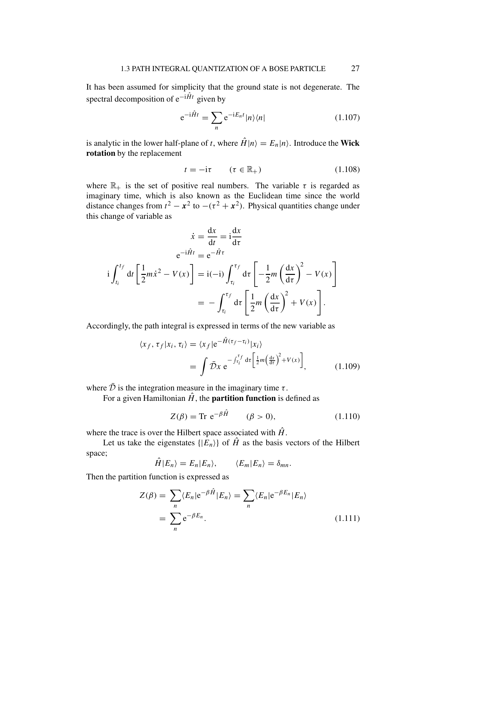

## 第 27 页：先说目的，再逐步解读

### 二、虚时间：把一直转动的因子，换成会衰减的因子

**这段在干什么：**说明式 (1.108) 的替换改变了什么，以及它为什么能简化计算。

能量为 $E_n$ 的成分，在真实时间里乘上 $e^{-iE_nt/\hbar}$。这个复数一直转动，长度不变。

现在作数学替换 $t=-i\tau$：

$$
e^{-iE_nt/\hbar}\longrightarrow e^{-E_n\tau/\hbar}.
$$

右边不再转动，而是衰减。若两个能量为 1 和 3，经过同样长的 $\tau$ 后，能量为 3 的成分衰减得更快。于是长时间之后，较低能量的成分相对突出。

这种替换叫 Wick 旋转，$\tau$ 叫欧氏时间或虚时间。它不是让实验中的钟读出虚数，也不是声称粒子在某个看不见的时间里真实运动。我们是在利用同一个能谱的另一种数学表达。

### 三、为什么作用量里变成“动能加势能”？

**这段在干什么：**把时间替换落实到路径积分，说明为什么会得到更容易处理的衰减权重。

替换时间时，两处都要改变：

$$
dt=-i\,d\tau,\qquad
\frac{dx}{dt}=i\frac{dx}{d\tau}.
$$

因此

$$
\frac{iS}{\hbar}
=-\frac1\hbar\int d\tau
\left[\frac m2\left(\frac{dx}{d\tau}\right)^2+V(x)\right].
$$

将积分内的新量记为欧氏作用量 $S_E$，路径权重就写成 $e^{-S_E/\hbar}$。原来不同路径靠复数转动相互抵消，现在在适当实势条件下，可用衰减大小来组织积分。

这里不是把负号随意改成正号，而是时间微分与速度一起替换的结果。

### 四、配分函数：先给不同能量安排热权重，再把总和调成 1

**这段在干什么：**解释式 (1.110)–(1.111) 所算的物理量，而不只给它一个名字。

一个小系统与固定温度的环境接触后，不一定总待在最低能量。环境可能给它能量，它也可能把能量交回环境。热平衡理论给能量 $E_n$ 的状态安排权重

$$
w_n=e^{-\beta E_n},\qquad \beta=\frac1{k_BT}.
$$

温度低时，$\beta$ 大，高能态被压得很厉害；温度高时，高能态也有机会参与。这里 $k_B$ 是把温度单位换成能量单位的常数。

权重还不是概率，因为它们的和未必为 1。于是定义

$$
Z=\sum_n e^{-\beta E_n},\qquad
P_n=\frac{e^{-\beta E_n}}Z.
$$

**$Z$ 就是配分函数：它首先负责让全部状态的概率加起来等于 1。**

例如只有两级 $0,\Delta$，就有 $Z=1+e^{-\beta\Delta}$。低温几乎全在能量 0；高温两级概率接近各一半。这个具体用途应当先于“热迹”这个术语。

## 原书第 28 页：原文底本

本块保留该页属于本小节的完整原文。PDF 阅读器页码为 51。

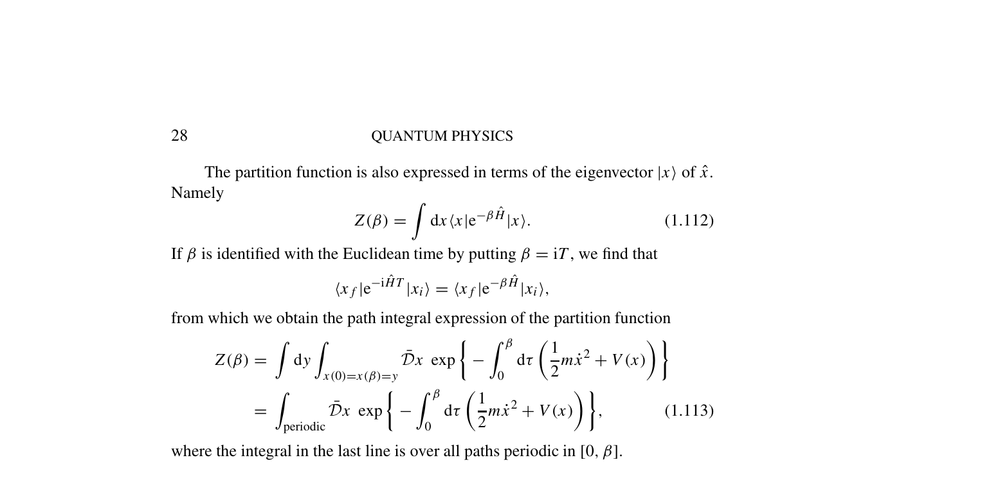

## 第 28 页：先说目的，再逐步解读

### 五、取迹为什么让路径首尾接起来？

**这段在干什么：**解释式 (1.112)–(1.113) 为什么出现周期边界，而不是要粒子做真实的周期运动。

矩阵的迹是把对角元素相加。用位置来标记行列，对角元素就是“起点位置和终点位置相同”的矩阵元：

$$
Z=\int dy\,\langle y|e^{-\beta H}|y\rangle.
$$

每个矩阵元中，路径从 $y$ 出发，又回到 $y$。接着再对所有 $y$ 积分。所以最后不是固定某个点的小圈，而是遍历所有允许的闭合欧氏路径。

这就是 $x(0)=x(\beta)$ 的来源：**迹要求首尾标签相同。**它不表示真实粒子每隔一个由温度决定的时间就必须回原位。

本书设 $\hbar=1$，直接将欧氏时间长度与 $\beta$ 相认。恢复单位时，长度应为 $\hbar\beta$；不能把秒和能量倒数不经换算当成同一种单位。

### 六、这一节复习：三个问题不要混在一起

**这段在干什么：**把演化、低能筛选和热平衡分开记。

真实时间的 $e^{-itH/\hbar}$ 算系统怎样演化；欧氏 $e^{-\tau H/\hbar}$ 会相对压低高能成分；热配分函数还要把 $e^{-\beta H}$ 取迹，给全部热状态归一化。

你应能回答：为什么低温压低高能态？为什么一个固定端点传播核还不是整个 $Z$？为什么闭合路径不等于真实周期轨道？这三点都属于 A 级。解析延拓的一般条件可以随后补，不必在这一节先研究任意算符的全部严格理论。

---

[阅读目录](README.md) · [上一小节](03-1.3.1.md) · [下一小节](05-1.3.3.md)

# 1.3.3 Time-ordered product and generating functional｜编时乘积与生成泛函

[阅读目录](README.md) · [上一小节](04-1.3.2.md) · [下一小节](06-1.4.1.md)

**这一节在做什么：除了算“从哪里到哪里”，还要算不同时间的观测之间有什么联系。**作者用编时乘积规定顺序，再用一个带辅助函数的总公式把许多关联计算装在一起。

## 原书第 28 页：原文底本

本块保留该页属于本小节的完整原文。PDF 阅读器页码为 51。

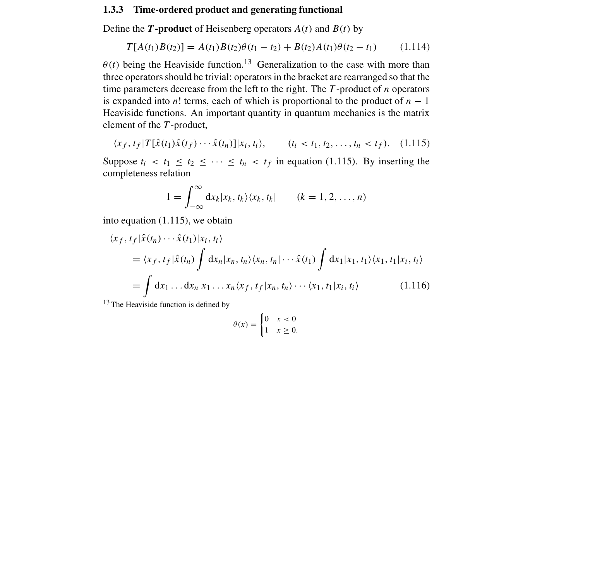

## 第 28 页：先说目的，再逐步解读

### 一、编时：为什么要把晚的时刻写在左边？

**这段在干什么：**规定式 (1.114) 中多个不同时刻的算符应按什么次序相乘。

矩阵作用在列向量上时，最右边先作用。若先在 $t_1$ 做一件事，再在较晚的 $t_2$ 做一件事，算符写法自然是 $B(t_2)A(t_1)$。

量子算符一般不能交换顺序，因此作者定义一个 $T$：它把较晚的时刻排到左边。于是

$$
T[A(t_1)B(t_2)]=
\begin{cases}
B(t_2)A(t_1),&t_2>t_1,\\
A(t_1)B(t_2),&t_1>t_2.
\end{cases}
$$

这叫编时乘积。先记住它只是“按时间重新排好算符”的规则。费米算符以后还要加交换负号；本页先处理位置这类玻色算符。

页中带 $t_f$ 的中间指标排印应结合紧接的说明读成 $t_1,\ldots,t_n$，不必把它误当成新定义。

## 原书第 29 页：原文底本

本块保留该页属于本小节的完整原文。PDF 阅读器页码为 52。

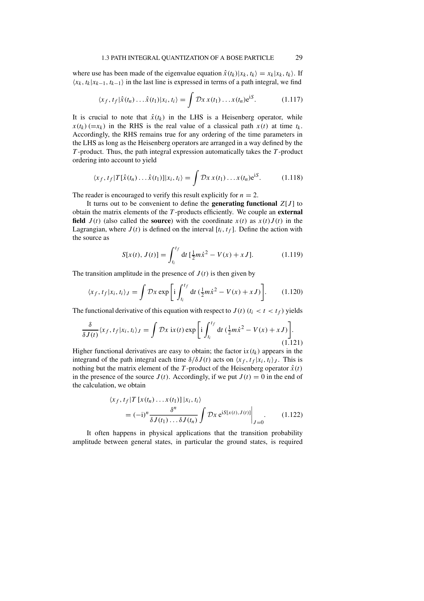

## 第 29 页：先说目的，再逐步解读

### 二、路径积分中的 x(t) 为什么不是算符？

**这段在干什么：**解释式 (1.117)–(1.118) 怎样把算符关联改写成路径积分。

先按时间排好算符，在每个插入时刻放入位置完备关系。$\hat x(t_k)$ 遇到自己的位置本征态，会给出一个普通数 $x_k$。

于是左边是一串算符，右边变成

$$
\int\mathcal Dx\,x(t_1)\cdots x(t_n)e^{iS[x]/\hbar}.
$$

右边的 $x(t_k)$ 是某一条待积分路径在该时刻的数值；不是粒子已经测得的全部历史，也不是仍在作用的算符。

普通数可以交换顺序，不表示左边算符也可以随便交换。右边之所以代表左边，正是因为推导已经把时间顺序固定好了。

### 三、外源 J：给系统加一个可以随时改变的小推动

**这段在干什么：**为式 (1.119)–(1.122) 引入一个辅助函数，使求导可以取出想研究的位置量。

给拉格朗日量加 $J(t)x(t)$。若 $J$ 真的是外界施加的量，它就像一项随时间变化的外力。我们也可以只把它当作计算工具，算完后再令 $J=0$。

定义含它的振幅

$$
Z_{\rm end}[J]=\int\mathcal Dx\,
e^{\frac i\hbar(S+\int dt\,J(t)x(t))}.
$$

现在改变某个时刻 $s$ 的 $J$。因为指数里 $J$ 乘的正是 $x$，求导就会把该时刻的 $x(s)$ 带出来：

$$
\frac{\hbar}{i}\frac{\delta Z_{\rm end}}{\delta J(s)}
=\int\mathcal Dx\,x(s)e^{\frac i\hbar(S+\int Jx)}.
$$

再求一次，会多出另一个时刻的位置。于是一个总公式能产生许多一时、两时、三时关联，这就是“生成泛函”的意思。“泛函”只提醒你自变量是整个函数 $J(t)$。

例如两时关联不是两个普通概率简单相乘，而是用来描述不同时刻的量子涨落如何联系。后面求振动频率与响应时，这类信息比只知道平均位置更丰富。

## 原书第 30 页：原文底本

本块保留该页属于本小节的完整原文。PDF 阅读器页码为 53。

## 第 30 页：先说目的，再逐步解读

### 四、为什么接下来特别挑出基态到基态？

**这段在干什么：**把两端固定位置的问题，改成两端都以最低能状态为条件的问题。

作者让 $J$ 只在中间一段时间存在。远处的过去和未来都没有外源，因此两端可以用同一个无源系统的能量状态描述。

再利用上一节的欧氏演化：高能态相对低能态衰减快。两端拉得足够远，并作适当归一化，就能挑出基态的贡献。

这不是说系统在真实时间里不接触环境也会自动散热。这里用的是数学上的衰减筛选，和真实的耗散过程不同。

原文直接写大时间极限时，省略了共同基态能因子和边界处方。你先抓住“换边界状态”的目的，精确极限如何归一化可查附录。

## 原书第 31 页：原文底本

本块保留该页属于本小节的完整原文。PDF 阅读器页码为 54。

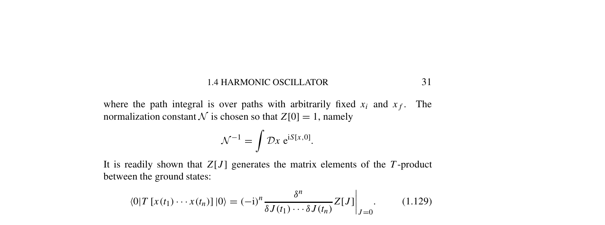

## 第 31 页：先说目的，再逐步解读

### 五、为什么还要除以没有外源时的结果？

**这段在干什么：**解释式 (1.128)–(1.129) 中归一化常数的作用。

如果我们只关心外源带来的变化，整段演化的公共乘子就不应影响答案。因此使用

$$
Z[J]=
\frac{\int\mathcal Dx\,e^{\frac i\hbar(S+\int Jx)}}
{\int\mathcal Dx\,e^{iS/\hbar}},
\qquad Z[0]=1.
$$

像普通概率要除以总权重，这里也先去掉公共的无源因子。然后对 $J$ 求导，就能直接读出归一化的真空编时关联。

“真空”在这里指所研究系统的基态，不是“所有数值永远为零”。谐振子基态有位置和动量涨落，所以真空关联也可以非零。

### 六、这一节复习：Z 是一本能求导的总账

**这段在干什么：**把每一步的目的整理出来，避免记成几个相似的指数。

先想研究多时刻关系 → 因算符不对易而规定编时 → 插入完备关系改成路径值 → 用 $Jx$ 把所需位置放进指数 → 对 $J$ 求导把它取出 → 选好边界态并归一化。

本节 $Z[J]$ 与上节热配分函数 $Z(\beta)$ 不是同一个问题：前者带源、常取真空边界；后者取热迹。看到 $Z$ 先问它算什么，不凭同一个字母把它们混起来。这一整条逻辑属于 A；真空极限的全部分析细节可作 B 级补读。

---

[阅读目录](README.md) · [上一小节](04-1.3.2.md) · [下一小节](06-1.4.1.md)

# 1.4.1 Transition amplitude｜谐振子的传播振幅

[阅读目录](README.md) · [上一小节](05-1.3.3.md) · [下一小节](07-1.4.2.md)

**这一节在做什么：把路径积分用在谐振子上，并真正算出起点到终点的振幅。**作者先找一条容易描述的参考路径，再把其他路径写成对它的偏离。

## 原书第 31 页：原文底本

本块保留该页属于本小节的完整原文。PDF 阅读器页码为 54。

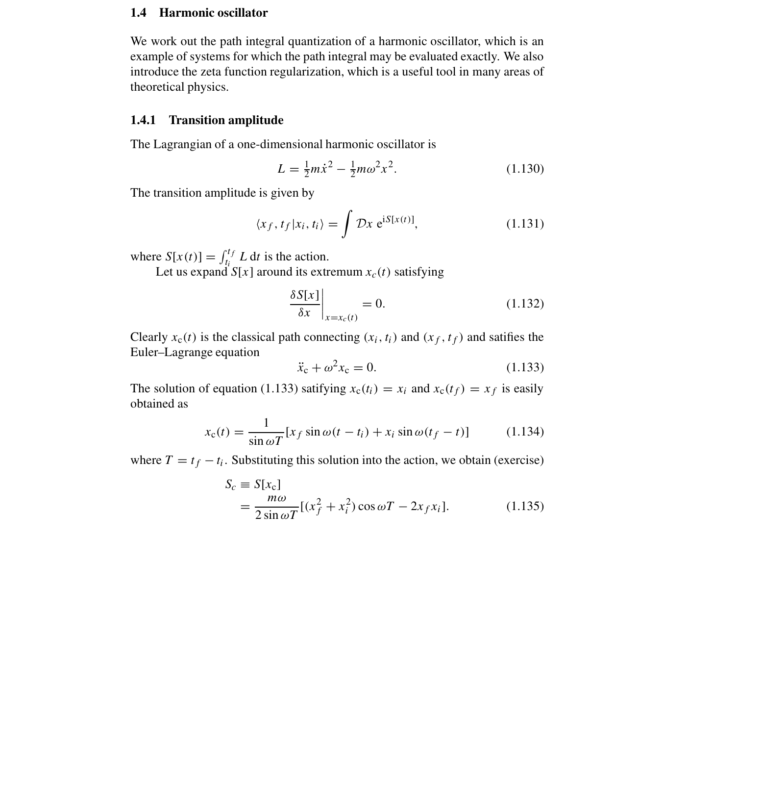

## 第 31 页：先说目的，再逐步解读

### 一、为什么先求一条经典轨迹？

**这段在干什么：**在式 (1.130)–(1.135) 中找一个合适的展开中心，让剩余积分变简单。

我们固定初始位置 $x_i$、最终位置 $x_f$ 和间隔 $T$。经典轨迹满足 $\ddot x_c+\omega^2x_c=0$，并且经过这两个端点。

这与高中常见“给初始位置和速度求以后运动”略有不同：这里给的是两端位置，所以是一个边值问题。

先求 $x_c$，不是认定粒子只有这条量子路径，而是因为作用量在它附近的一阶变化为零。围绕它展开，会少掉一整类项。

代入经典解可得

$$
S_c=\frac{m\omega}{2\sin\omega T}
\left[(x_f^2+x_i^2)\cos\omega T-2x_fx_i\right].
$$

你也可以先证明沿经典解 $S_c=\frac m2[x_c\dot x_c]_{t_i}^{t_f}$，再代端点速度。这是对二次系统较省力的计算。

## 原书第 32 页：原文底本

本块保留该页属于本小节的完整原文。PDF 阅读器页码为 55。

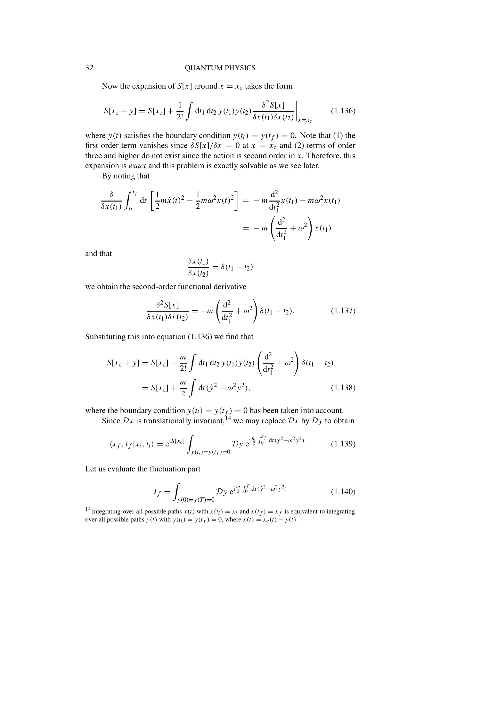

## 第 32 页：先说目的，再逐步解读

### 二、把每条路径写成“经典轨迹＋偏离”

**这段在干什么：**解释式 (1.136)–(1.139) 为什么能把经典部分从积分中拿出来。

任意待积分路径写成 $x=x_c+y$。$y$ 表示它比经典轨迹多走或少走了多少。因为起点、终点已经固定，所以

$$
y(t_i)=y(t_f)=0.
$$

代入作用量展开：

$$
S[x_c+y]=S_c+
m\int(\dot x_c\dot y-\omega^2x_cy)\,dt
+\frac m2\int(\dot y^2-\omega^2y^2)\,dt.
$$

中间项分部积分后，端点部分因 $y=0$ 消失，剩余部分因经典方程消失。于是

$$
S[x_c+y]=S_c+\frac m2\int(\dot y^2-\omega^2y^2)\,dt.
$$

因此振幅等于 $e^{iS_c/\hbar}$ 乘上所有偏离路径的积分。后者就是涨落贡献：这里“涨落”先理解为围绕参考解的各种偏离，不必给它另添一种随机外力。

### 三、为什么这次展开是精确的？

**这段在干什么：**说明谐振子为什么比一般势容易处理。

因为原来的作用量只含 $x$ 和 $\dot x$ 的二次项，展开后根本不会有三次、四次偏离项。一次项又刚好消失，所以二次项就是全部余下内容。

对一般势，围绕经典解展开也能这样做，但三次以上项通常存在。只保留二次项便成为近似；谐振子在这里则没有这项误差。

原文的二阶泛函导数可以当作“作用量对各种小偏离的二次变化规则”。它在有限维叫 Hessian 矩阵，在这里写成微分算符和 δ 核。

## 原书第 33 页：原文底本

本块保留该页属于本小节的完整原文。PDF 阅读器页码为 56。

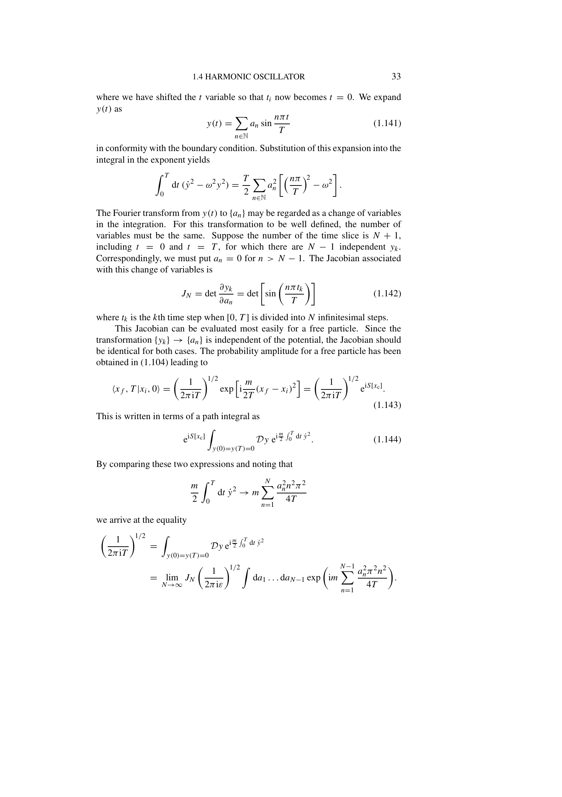

## 第 33 页：先说目的，再逐步解读

### 四、为什么把 y(t) 展开成正弦函数？

**这段在干什么：**把对所有偏离形状的积分，转成对许多个普通系数的积分。

偏离在两端为零，$\sin(n\pi t/T)$ 恰好也在两端为零。所以写

$$
y(t)=\sum_{n\ge1}a_n\sin\frac{n\pi t}{T}.
$$

每个 $a_n$ 控制一种形状的偏离有多大。低 $n$ 变化慢，高 $n$ 在时间中弯来弯去得更快。

正交性把混合项消掉，作用量成为

$$
\frac{mT}{4}\sum_{n\ge1}
\left[\left(\frac{n\pi}{T}\right)^2-\omega^2\right]a_n^2.
$$

于是一个复杂的路径积分，变成许多独立的 Gaussian 积分。正弦基不是随便选的，它先满足了实际传播问题的端点条件。

### 五、为什么拿自由粒子作比较？

**这段在干什么：**用已经知道的答案固定公共归一化，避免单独处理许多发散常数。

对自由粒子作相同展开，变量换元的方式相同。两种积分相除，公共测度和换元因子抵消，留下

$$
\frac{I_f(\omega)}{I_f(0)}
=\prod_{n\ge1}
\left[1-\left(\frac{\omega T}{n\pi}\right)^2\right]^{-1/2}.
$$

这好比两张账里有相同公共费用，比较差别时先消掉公共部分。计算仍须使用同一套时间切片，不能把来源不同的两个“无穷大”随意约掉。

原文这一带若干式子漏保留了一般质量 $m$，完整核对在附录。当前先跟住“用参照答案校准”的思路。

## 原书第 34 页：原文底本

本块保留该页属于本小节的完整原文。PDF 阅读器页码为 57。

## 第 34 页：先说目的，再逐步解读

### 六、无穷乘积：每一种偏离形状贡献一个因子

**这段在干什么：**把上一页的一系列 Gaussian 积分整理成一个能识别的函数。

普通 Gaussian 积分 $\int e^{-\lambda a^2/2}da$ 与 $\lambda^{-1/2}$ 成比例。这里每个 $a_n$ 都贡献相应的平方根因子；全部模式相乘，就得到上页乘积。

再用

$$
\prod_{n\ge1}\left(1-\frac{z^2}{n^2\pi^2}\right)=\frac{\sin z}{z},
$$

便能把无穷多个因子收成 $\sin\omega T$。这不是突然增加一种物理效果，而是同一组涨落积分的简写。

原文花很多篇幅算有限维 Jacobian，目的是让变量数、换元和归一化对得上。你第一次读可以先掌握相对乘积，再回看这些计算。

## 原书第 35 页：原文底本

本块保留该页属于本小节的完整原文。PDF 阅读器页码为 58。

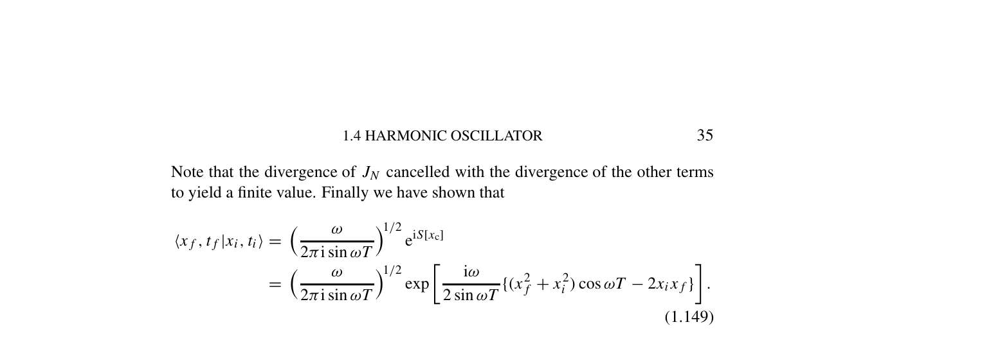

## 第 35 页：先说目的，再逐步解读

### 七、最后答案怎样核对？它在特殊时间发散又是什么意思？

**这段在干什么：**解释式 (1.149) 的用途，并给出一个能亲手做的正确性检查。

恢复单位后，

$$
K=\sqrt{\frac{m\omega}{2\pi i\hbar\sin\omega T}}\,
e^{iS_c/\hbar}.
$$

令 $\omega$ 趋于零，势越来越平。利用 $\sin\omega T\simeq\omega T$、$\cos\omega T\simeq1$，就回到上节自由粒子的结果。能做这个检查，比孤立背下前因子更有用。

当 $\sin\omega T=0$ 时，不能把它当普通函数直接代入。经典振子具有聚焦性质，传播核此时要用 δ 型分布及相容的相位理解。把它作用在正常波包上，仍得到有限归一化概率，并不是概率无限大。

这一节复习时，抓住四步：找经典解 → 加零端点偏离 → 用正弦分解偏离 → 做 Gaussian 并用自由粒子校准。前两步和“为什么正弦”属于 A；完整 Jacobian、跨焦点相位处理属于 B，可以在主线清楚后再看。

---

[阅读目录](README.md) · [上一小节](05-1.3.3.md) · [下一小节](07-1.4.2.md)

# 1.4.2 Partition function｜谐振子的配分函数与谱行列式

[阅读目录](README.md) · [上一小节](06-1.4.1.md) · [下一小节](08-1.5.1.md)

**这一节在做什么：用三种方法算同一个谐振子的热统计。**先用能级直接求和，得到参照答案；再用传播核和模式积分核对。

## 原书第 35 页：原文底本

本块保留该页属于本小节的完整原文。PDF 阅读器页码为 58。

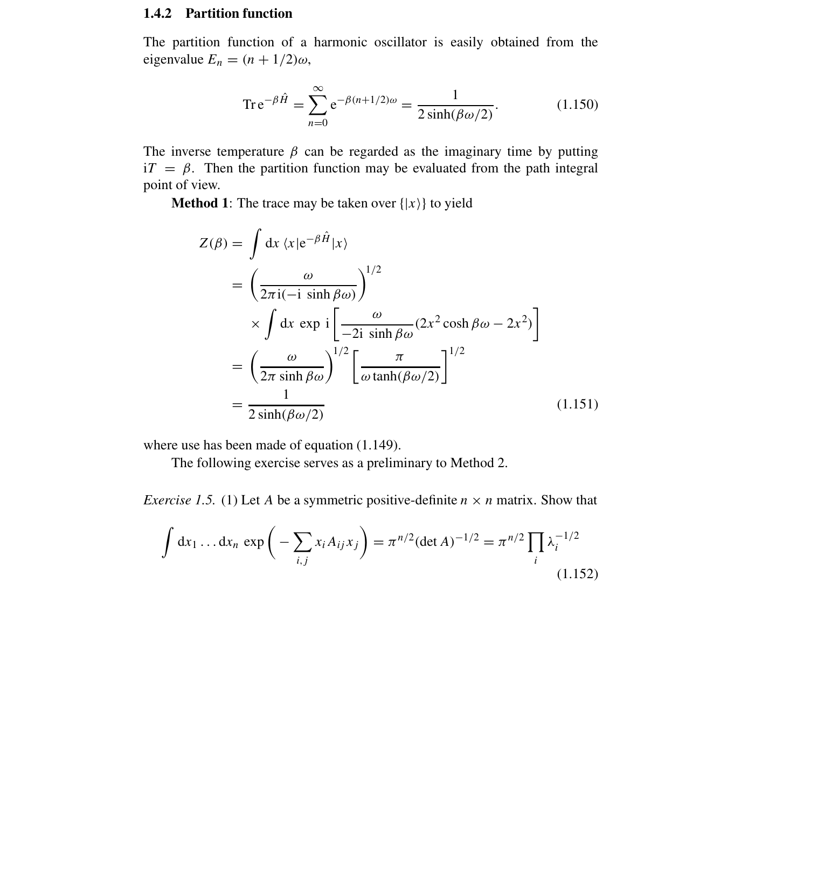

## 第 35 页：先说目的，再逐步解读

### 一、先用能级算：热环境会把系统放在哪一层？

**这段在干什么：**解释式 (1.150) 的求和，而不是把配分函数当成一个特殊函数公式。

谐振子每层能量为 $E_n=\hbar\omega(n+\tfrac12)$。热平衡给它权重 $e^{-\beta E_n}$，所以

$$
Z=e^{-\beta\hbar\omega/2}
\left(1+e^{-\beta\hbar\omega}+e^{-2\beta\hbar\omega}+\cdots\right)
=\frac1{2\sinh(\beta\hbar\omega/2)}.
$$

括号只是一个几何级数。低温时后面的项很小，主要在最低层；高温时许多层都能参与。

取 $-\partial_\beta\log Z$ 可以算平均能量：

$$
\langle H\rangle=\frac{\hbar\omega}{2}
+\frac{\hbar\omega}{e^{\beta\hbar\omega}-1}.
$$

第一项来自最低能量，第二项来自热激发。高温时趋近 $k_BT$，与高中之后常学的经典能量分配接上。

### 二、用传播核算：为什么令两个端点相等还要再积分？

**这段在干什么：**说明 Method 1 怎样把上一节的答案变成热配分函数。

取迹时，我们要把每个位置 $x$ 上的“从 $x$ 到 $x$”都算进去，所以

$$
Z=\int dx\,K_E(x,x;\beta).
$$

先把两端设为相同位置，是取对角元素；再对 $x$ 积分，是把全部对角元素相加。只算 $K_E(0,0;\beta)$，少了其他端点，不是完整热迹。

代入上一节核后，这最后一步是普通的一维 Gaussian 积分。若归一化正确，应回到能级求和的答案。

## 原书第 36 页：原文底本

本块保留该页属于本小节的完整原文。PDF 阅读器页码为 59。

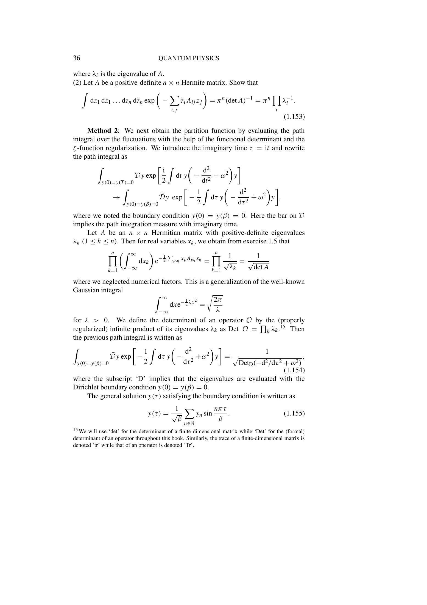

## 第 36 页：先说目的，再逐步解读

### 三、行列式：把许多方向的 Gaussian 因子收进一个符号

**这段在干什么：**解释 Method 2 为什么出现 $\operatorname{Det}^{-1/2}$。

先看两变量例子：

$$
\int da\,db\,e^{-(\lambda_1a^2+\lambda_2b^2)/2}
=\frac{2\pi}{\sqrt{\lambda_1\lambda_2}}.
$$

两个方向越“陡”，允许的变化范围越窄，积分越小。一般正定二次型可先对角化，得到每个方向的 $\lambda_n^{-1/2}$；全部相乘，就是行列式的倒平方根。

路径展开也一样：一个系数对应一种偏离形状，每种形状贡献一个因子。算符行列式只是把无限多个这样的因子放到一起，并没有额外创造一种力。

### 四、Dirichlet 与周期：为什么同一章会出现两种边界？

**这段在干什么：**说明本页式 (1.154) 的涨落算符为什么用零端点条件。

完整热路径首尾相同，但这个共同端点还会积分。作者先固定它，写成经典部分加偏离 $y$；偏离本身必须两端为零，所以它采用 Dirichlet 边界。

然后再积分共同端点，才得到完整热迹。不能一边使用周期模式，一边又额外重复积分作者已经分出的端点贡献。

所以边界不是可以随手选择的装饰。它来自“当前究竟在积分整个路径，还是固定端点后的偏离”。

## 原书第 37 页：原文底本

本块保留该页属于本小节的完整原文。PDF 阅读器页码为 60。

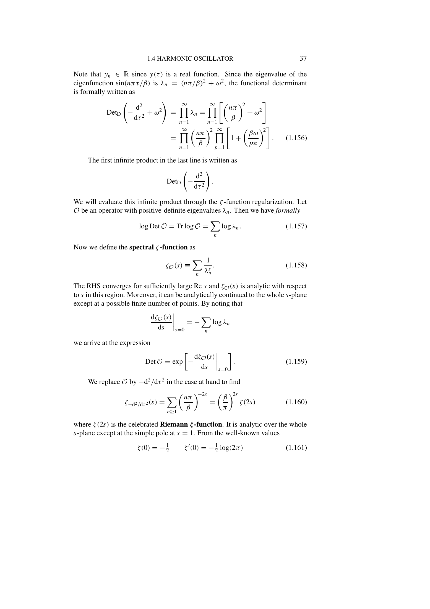

## 第 37 页：先说目的，再逐步解读

### 五、ζ 正则化：普通乘积发散以后，作者在重新定义什么？

**这段在干什么：**解释式 (1.157)–(1.159) 怎样给无限模式乘积一个可操作的定义。

有限矩阵可以直接乘全部特征值。无限多个模式的乘积通常发散，于是不能假装仍在做有限乘法。

作者先定义一个在适当区域收敛的函数：

$$
\zeta_O(s)=\sum_n\lambda_n^{-s}.
$$

再利用解析延拓，使它能在 $s=0$ 附近使用。若那里正则，就定义

$$
\det\nolimits_\zeta O=e^{-\zeta'_O(0)}.
$$

为什么对 $s$ 求导？因为有限情形有 $(\lambda^{-s})'=-\log\lambda\,\lambda^{-s}$，对数能把乘积变成和。这给定义提供了与有限行列式相接的依据。

你学过分析，可以理解这条数学路线。但初读不必先证明一般谱 ζ 定理；只要知道这是带条件的正则化定义，不是把一个普通发散乘积直接算成有限数。

本例特征值为 $(n\pi/\beta)^2+\omega^2$，所以能够联系到 Riemann ζ 函数与双曲正弦乘积。

## 原书第 38 页：原文底本

本块保留该页属于本小节的完整原文。PDF 阅读器页码为 61。

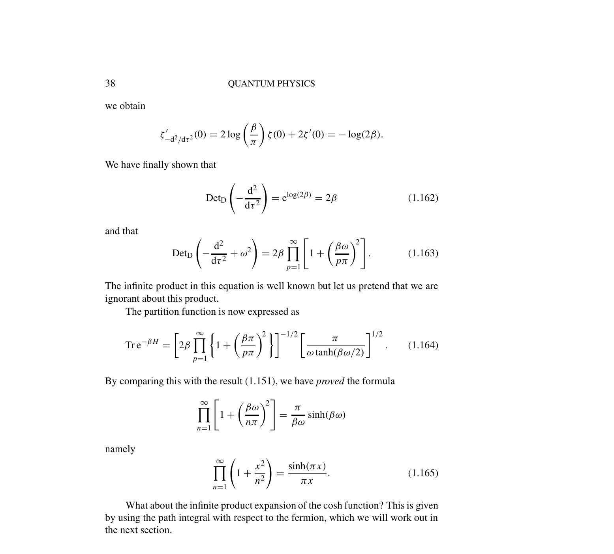

## 第 38 页：先说目的，再逐步解读

### 六、比较答案：数学恒等式为什么会从物理计算里出现？

**这段在干什么：**把模式乘积与已经知道的热迹相对照，并指出归一化不能丢。

前面已经用能级求出 $Z$，现在又把它写成一个无限乘积。同一个系统、同一个温度、同一个迹，两种算法必须相同，因此得到

$$
\prod_{n\ge1}\left(1+\frac{x^2}{n^2}\right)
=\frac{\sinh(\pi x)}{\pi x}.
$$

但比较时必须保留共同的测度约定。前面若写“忽略常数”，后面就不能突然把结果当作绝对归一化的配分函数。

原文 (1.164) 及随后未编号式有 $\omega/\pi$ 和多出 $\pi$ 的排印问题；例如令 $\omega\to0$，正确乘积应趋于 1，就能检查出来。详细核对保留在附录。

复习顺序应是：先会用能级求 $Z$，再会解释取迹怎样闭合路径，然后理解每个模式为什么贡献倒平方根。最后再研究 ζ 细节。前三项是 A，最后一项是 B；不要让技术计算挡住正在算哪一个物理量。

---

[阅读目录](README.md) · [上一小节](06-1.4.1.md) · [下一小节](08-1.5.1.md)

# 1.5.1 Fermionic harmonic oscillator｜费米谐振子

[阅读目录](README.md) · [上一小节](07-1.4.2.md) · [下一小节](09-1.5.2.md)

**这一节在做什么：建立一个最多只能占据一次的量子模式。**它和前面的玻色振子不同，不能一直把激发往上加；作者需要另一套算符关系来表达这个限制。

## 原书第 38 页：原文底本

本块保留该页属于本小节的完整原文。PDF 阅读器页码为 61。

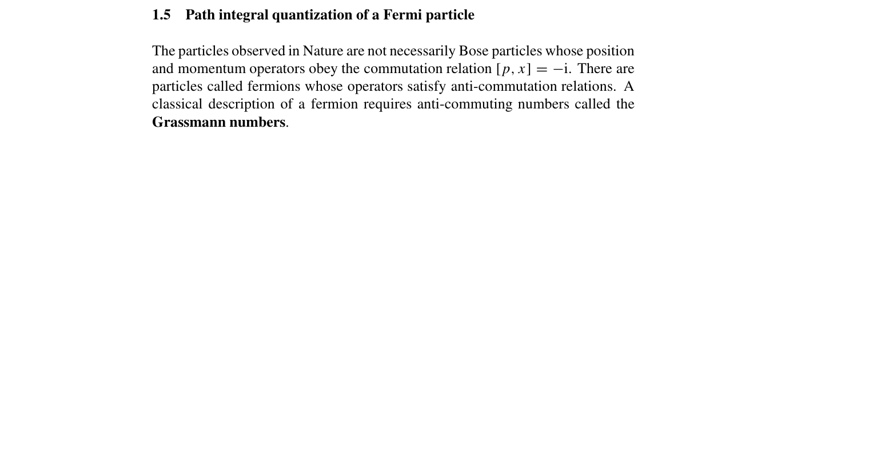

## 第 38 页：先说目的，再逐步解读

### 一、先认识物理问题：为什么有的状态不能重复占据？

**这段在干什么：**解释 1.5 导言为什么开始谈费米子，以及这个新名字要对应什么事实。

电子属于费米子。对全同电子，若把一个量子状态的全部条件都指定好，同一个状态不能再放进第二个电子。这叫 Pauli 不相容原理。

“全部条件”很重要。例如同一空间轨道但自旋不同，可以算两个状态，所以不能把它粗略说成“两个电子不能靠近”。

前面的玻色模式可有 $0,1,2,\ldots$ 个激发；这里每个费米模式只允许 0 或 1。作者先用算符把这项区别写下来，再考虑怎样做路径积分。

本页关于“费米算符满足反对易”的话，主要指模式的产生、湮灭算符。不是说电子的空间位置与动量从此不再具有通常的正则结构。

## 原书第 39 页：原文底本

本块保留该页属于本小节的完整原文。PDF 阅读器页码为 62。

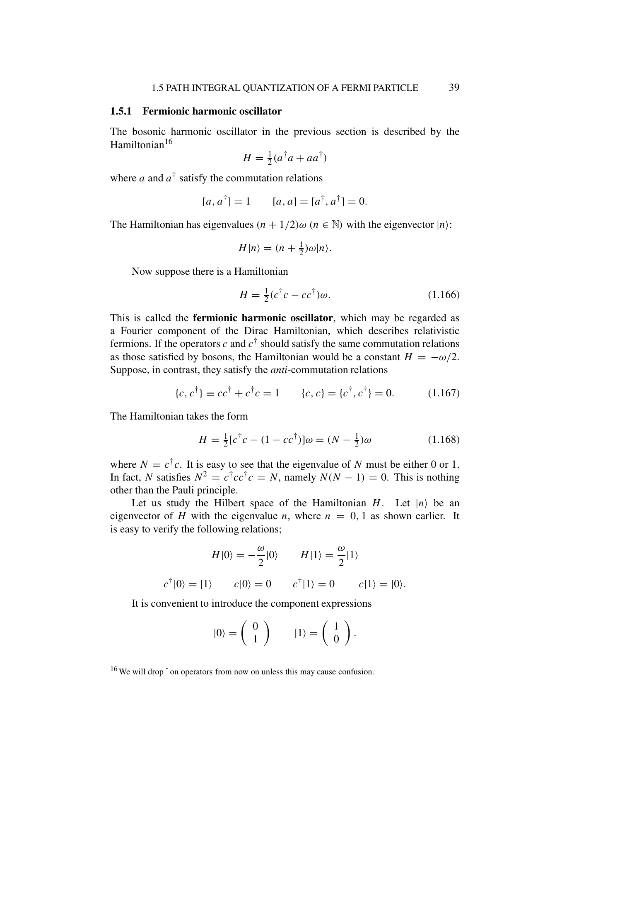

## 第 39 页：先说目的，再逐步解读

### 二、用什么代数表达“再放一次就不行”？

**这段在干什么：**从式 (1.167) 推出数算符的取值只能为 0 或 1。

令 $c^\dagger$ 表示往这个模式增加一次占据，$c$ 表示移走一次。若已经占据，再加一次应当得不到允许状态，所以要求

$$
(c^\dagger)^2=0,\qquad c^2=0.
$$

再给出 $\{c,c^\dagger\}=cc^\dagger+c^\dagger c=1$。花括号表示“两个次序相加”，叫反对易。

数算符 $N=c^\dagger c$ 满足

$$
N^2=c^\dagger(1-c^\dagger c)c=c^\dagger c=N.
$$

若 $N|n\rangle=n|n\rangle$，则 $n^2=n$，所以只能 $n=0,1$。你看见的不是一句“费米子很特殊”，而是明确的占据限制如何从代数关系算出。

### 三、为什么只有两个能量，而且最低能量可以是负的？

**这段在干什么：**解释式 (1.166)–(1.168) 的两态系统，不把它误认成普通弹簧。

作者取

$$
H=\hbar\omega(N-\tfrac12).
$$

于是空态能量为 $-\hbar\omega/2$，占据态为 $+\hbar\omega/2$，能隙为 $\hbar\omega$。

这里叫费米“振子”，因为它会成为自由费米场的一种模式；它并不是一个能无限升高振幅的经典弹簧小球。

最低能量是负数也不表示系统会无限掉下去。只有两个能级，它有明确下界。若在这个孤立模型里把零点整体平移，可写成能量 $0,\hbar\omega$，热占据概率不变。

原文中间替换与本征值标签有小的不一致，最终应以 $N$ 的标签和上面的两能量为准。

## 原书第 40 页：原文底本

本块保留该页属于本小节的完整原文。PDF 阅读器页码为 63。

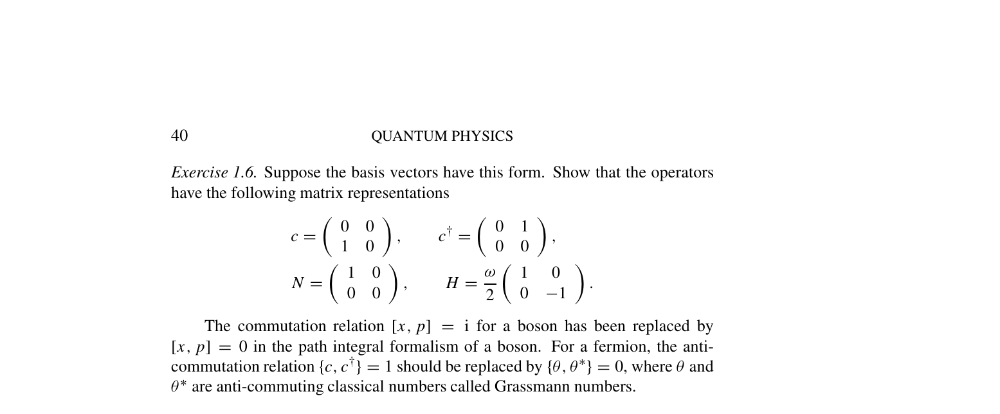

## 第 40 页：先说目的，再逐步解读

### 四、两维矩阵能做完全部检查

**这段在干什么：**用练习 1.6 说明这套代数可以用普通矩阵实现。

取 $|0\rangle=(0,1)^T$、$|1\rangle=(1,0)^T$。令

$$
c=\begin{pmatrix}0&0\\1&0\end{pmatrix},\qquad
c^\dagger=\begin{pmatrix}0&1\\0&0\end{pmatrix}.
$$

直接算可得 $c^\dagger|0\rangle=|1\rangle$、$c^\dagger|1\rangle=0$。反过来 $c$ 把占据态移回空态。算两次同一种操作，确实变零。

所以“反对易”并没有破坏普通线性代数。它只是某些矩阵满足的特殊关系。

### 五、为什么接着要引入 Grassmann 数？

**这段在干什么：**提出后面几节要解决的计算困难。

玻色路径积分里使用普通坐标数。费米模式的交换会带负号，若仍只用可随便交换的普通数，这些符号不容易自动保存。

作者于是引入一种新的代数变量，让它们交换时本身就带负号。它们叫 Grassmann 变量。先把它看作适合这类计算的符号工具，不要想象成实验仪器会显示一个“反交换读数”。

复习只需先掌握三件 A 级内容：一个模式为什么只许 0、1；$c,c^\dagger$ 怎样作用；普通变量为什么不足以直接照搬玻色路径积分。下一节才真正定义新变量。

---

[阅读目录](README.md) · [上一小节](07-1.4.2.md) · [下一小节](09-1.5.2.md)

# 1.5.2 Calculus of Grassmann numbers｜Grassmann 数与分次

[阅读目录](README.md) · [上一小节](08-1.5.1.md) · [下一小节](10-1.5.3.md)

**这一节在做什么：为费米计算定义一套能自动记录交换负号的代数。**先给明确运算规则，再看函数、奇偶与指数怎样计算。

## 原书第 40 页：原文底本

本块保留该页属于本小节的完整原文。PDF 阅读器页码为 63。

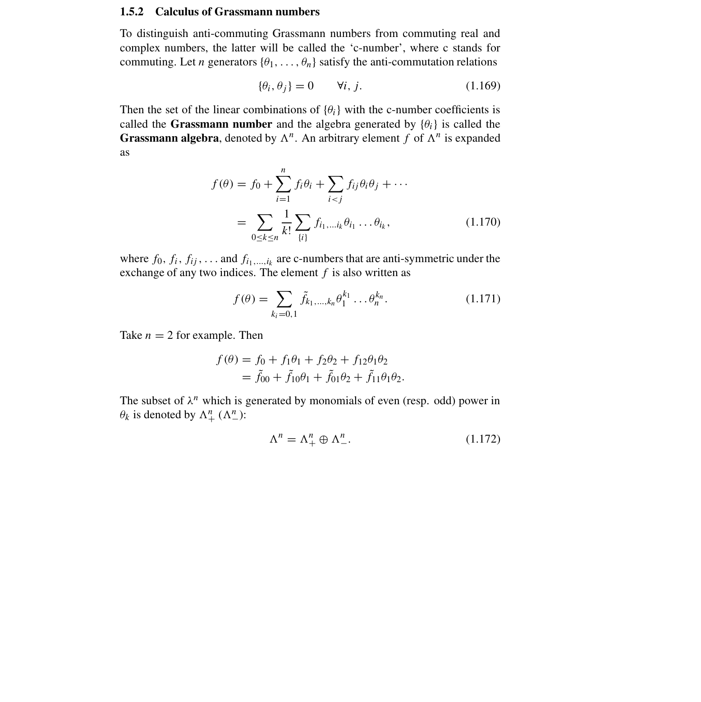

## 第 40 页：先说目的，再逐步解读

### 一、Grassmann 变量是什么？先看规则，不猜它有多大

**这段在干什么：**解释式 (1.169)，并说明它不是一种很小的普通实数。

定义符号 $\theta_1,\ldots,\theta_n$，要求

$$
\theta_i\theta_j=-\theta_j\theta_i.
$$

因此把 $i=j$ 代入，有 $2\theta_i^2=0$，在实、复系数下得到 $\theta_i^2=0$。

这是严格为零，不是“小到可以不算”。若把 $\theta_i$ 当普通实数，只能得到 $\theta_i=0$；那不是作者想要的代数。因此我们承认它是一种新代数元素，就像学习矩阵时不再要求矩阵乘法可交换。

它的用途是：交换两个费米标签该出现负号时，乘法自己就能给出这个负号。

### 二、一般函数为什么只有有限项？

**这段在干什么：**读懂式 (1.170)–(1.171) 的展开，而不把它当成复杂的无限 Taylor 级数。

只有一个生成元时，因为 $\theta^2=0$，所有函数都可写成

$$
f(\theta)=a+b\theta.
$$

两个生成元时，先把顺序统一为 $\theta_1$ 在前：

$$
f=a+b\theta_1+c\theta_2+d\theta_1\theta_2.
$$

不需要 $\theta_2\theta_1$ 这一项，因为它等于 $-\theta_1\theta_2$；也不需要平方项，因为平方为零。

一般 $n$ 个生成元，每个出现 0 或 1 次，所以有 $2^n$ 个基单项。这就是外代数的一种具体写法。原文的两种展开只是在不同记号下组织同一组单项式。

## 原书第 41 页：原文底本

本块保留该页属于本小节的完整原文。PDF 阅读器页码为 64。

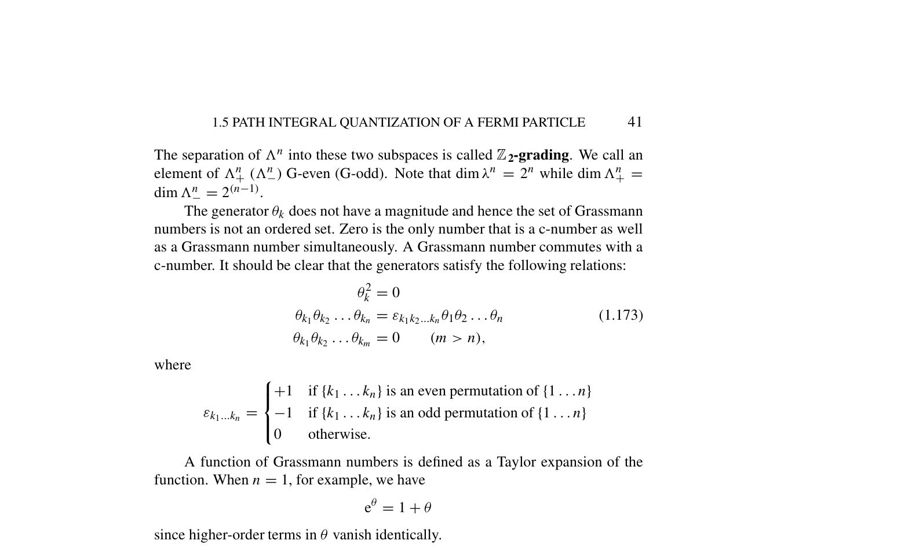

## 第 41 页：先说目的，再逐步解读

### 三、奇、偶分别是什么意思？

**这段在干什么：**为之后的导数和积分确定交换符号。

看单项式里含几个 $\theta$：偶数个叫偶，奇数个叫奇。常数是偶；$\theta_1$ 是奇；$\theta_1\theta_2$ 是偶。

为什么有用？将两个奇单项式整体交换，需要奇数次符号交换，所以带负号。偶单项式整体越过另一个单项式时，交换次数为偶数，不带负号。

因此“奇量彼此反交换，偶量可交换”是一种省力的总规则。这里的奇偶指次数，不是整数的数值。

### 四、每个生成元平方为零，不代表整个代数里所有量都平方为零

**这段在干什么：**纠正一个最容易从定义过度推断的结论，并解释原文的函数例子。

例如

$$
u=\theta_1\theta_2+\theta_3\theta_4
$$

满足 $u^2=2\theta_1\theta_2\theta_3\theta_4$，通常不为零。因此计算时先看具体元素，不能把“生成元幂零”直接替换成“任何表达式的平方都为零”。

对单个 $\theta$，指数却确实精确截断：

$$
e^\theta=1+\theta.
$$

不是省略高阶近似，而是高阶严格消失。

原文说 Grassmann 数不能比较大小，是提醒你不要把它当实数轴上的正负读数。整个代数仍包含普通复常数；“只有零同时是 c-number”应按作者狭义使用奇变量的语境读，不能套到整个外代数。

复习时优先会做两变量展开、判断奇偶、计算一个指数，这些是 A。外代数的抽象定义可作 B 级连接，但不需要让新术语盖住已写明的运算规则。

---

[阅读目录](README.md) · [上一小节](08-1.5.1.md) · [下一小节](10-1.5.3.md)

# 1.5.3 Differentiation｜Grassmann 微分

[阅读目录](README.md) · [上一小节](09-1.5.2.md) · [下一小节](11-1.5.4.md)

**这一节在做什么：定义怎样对 Grassmann 变量求导。**因为变量交换会变号，普通乘积求导规则也必须随之调整。

## 原书第 41 页：原文底本

本块保留该页属于本小节的完整原文。PDF 阅读器页码为 64。

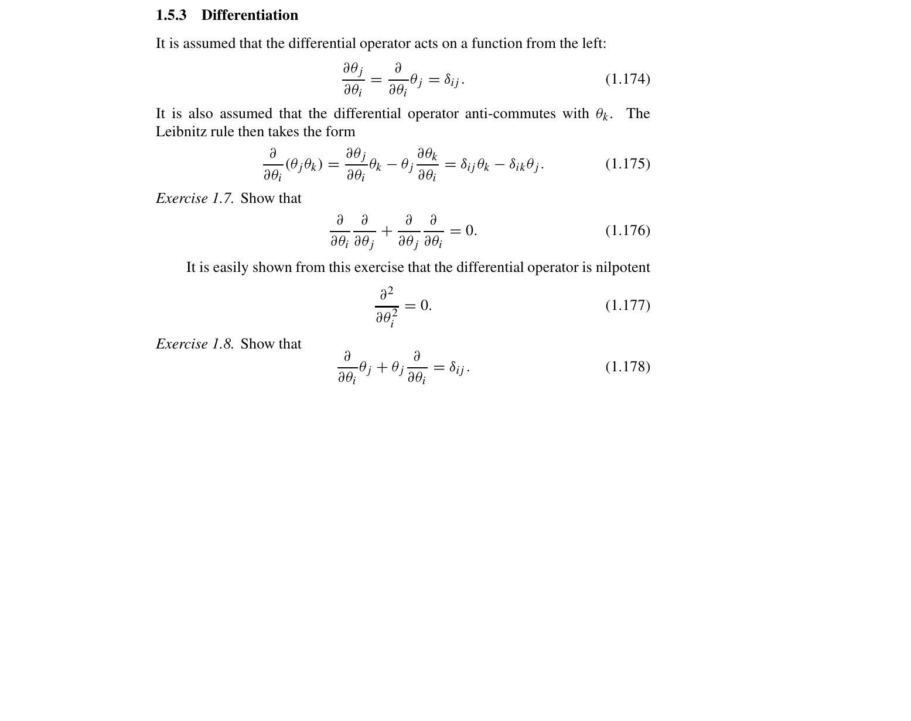

## 第 41 页：先说目的，再逐步解读

### 一、先定义最简单的求导：取出一次项的系数

**这段在干什么：**解释式 (1.174)，让你不用猜这种变量应怎样取极限。

单变量函数只有 $f=a+b\theta$。作者定义

$$
\partial_\theta f=b.
$$

所以导数在这里先是一项代数操作：去掉指定的 $\theta$，取出系数。它不是让一个小实数步长趋于零。

多个变量时，作者选“左导数”：把待求导变量移到适合从左取出的地方，并记下交换符号。这项约定必须固定，否则同一个表达式会出现两种答案。

### 二、为什么 Leibniz 规则里多一个负号？

**这段在干什么：**用式 (1.175) 的低维例子证明负号是被反交换要求出来的。

对 $\theta_1\theta_2$ 求 $\theta_1$ 导数，直接得到 $\theta_2$。但对 $\theta_2$ 求导，先用

$$
\theta_1\theta_2=-\theta_2\theta_1,
$$

再取出左边的 $\theta_2$，得到 $-\theta_1$。

因此

$$
\partial_1(\theta_1\theta_2)=\theta_2,\qquad
\partial_2(\theta_1\theta_2)=-\theta_1.
$$

这迫使乘积规则写成

$$
\partial_i(\theta_j\theta_k)
=\delta_{ij}\theta_k-\delta_{ik}\theta_j.
$$

若套普通无负号的规则，就会和 $\theta_1\theta_2=-\theta_2\theta_1$ 冲突。作者不是任意增加一个麻烦条件，而是为了运算一致。

### 三、两次求导为什么也要看顺序？

**这段在干什么：**用练习 1.7–1.8 检查导数自身的代数关系。

记住右边的算符先作用：

$$
\partial_1\partial_2(\theta_1\theta_2)
=\partial_1(-\theta_1)=-1,
$$

而

$$
\partial_2\partial_1(\theta_1\theta_2)
=\partial_2(\theta_2)=1.
$$

所以交换两次导数也会变号。对同一个生成元求两次则为零，因为第一次以后已没有这个变量可取。

练习 1.8 的
$\partial_i\theta_j+\theta_j\partial_i=\delta_{ij}$
是算符恒等式：要让它们继续作用在任意后续函数上理解，不能把第一项当成已算完的常数后再乱加。

本节 A 级目标很具体：能独立算出上面的 $-1$ 与 $+1$，并说明负号来自哪里。之后算费米关联时，就不会凭感觉补符号。

---

[阅读目录](README.md) · [上一小节](09-1.5.2.md) · [下一小节](11-1.5.4.md)

# 1.5.4 Integration｜Berezin 积分与换元

[阅读目录](README.md) · [上一小节](10-1.5.3.md) · [下一小节](12-1.5.5.md)

**这一节在做什么：定义一种适合奇变量的积分。**它不计算曲线下面积，而是从有限多项式里取系数；这个定义会让后面的费米路径积分能够工作。

## 原书第 42 页：原文底本

本块保留该页属于本小节的完整原文。PDF 阅读器页码为 65。

## 第 42 页：先说目的，再逐步解读

### 一、为什么积分 1 等于 0，积分 θ 却等于 1？

**这段在干什么：**解释式 (1.179) 的定义，避免拿普通面积直观与它硬撞。

单变量函数只有 $f=a+b\theta$。作者希望积分是线性的，并且有“全导数积分为零”的性质。由于 $\partial_\theta(a+b\theta)=b$，这要求积分常数为零。

剩下只需规定 $\theta$ 的积分归一化为 1，于是

$$
\int d\theta\,1=0,\qquad
\int d\theta\,\theta=1,\qquad
\int d\theta\,f(\theta)=b.
$$

这叫 Berezin 积分。它和上一节的单变量左导数给出相同结果，但承担的是积分角色。

所以这没有推翻“正函数积分非负”一类普通定理：这里根本没有定义一个普通实区间和正测度，而是定义了另一项代数运算。

### 二、多变量积分为什么必须注明顺序？

**这段在干什么：**把式 (1.180) 落实成能算的例子。

作者规定

$$
\int d\theta_1d\theta_2\,f=\partial_1\partial_2f.
$$

因此

$$
\int d\theta_1d\theta_2\,\theta_2\theta_1=1,\qquad
\int d\theta_1d\theta_2\,\theta_1\theta_2=-1.
$$

原因就是上一节连续求导的次序。你可以把积分看成“把全部指定变量依规定次序取完”，没包含全的项都会消失。

例如两变量的 $a+b\theta_1+c\theta_2+d\theta_2\theta_1$，积分后只剩 $d$。这是后面 Gaussian 展开只保留最高次项的根据。

### 三、换元为什么出现反过来的比例？

**这段在干什么：**解释本页末尾的换元，不凭记忆套普通积分的 Jacobian。

设 $\theta'=a\theta$。为了仍有 $\int d\theta'\,\theta'=1$，测度必须满足

$$
d\theta'=\frac1a\,d\theta.
$$

代回去就看见 $(1/a)\times a$ 正好抵消。这里变量被放大，系数提取操作要反向缩小，才能保持定义。

## 原书第 43 页：原文底本

本块保留该页属于本小节的完整原文。PDF 阅读器页码为 66。

## 第 43 页：先说目的，再逐步解读

### 四、多个变量的逆行列式怎样出现？

**这段在干什么：**把单变量换元推广为式 (1.181)，为 Gaussian 行列式作准备。

若 $\theta'=A\theta$，将最高次项展开时，反交换符号会把所有排列组合成行列式：

$$
\theta_1'\cdots\theta_n'
=(\det A)\theta_1\cdots\theta_n.
$$

要让积分结果保持 1，测度就得乘倒数：

$$
d\theta_1'\cdots d\theta_n'
=(\det A)^{-1}d\theta_1\cdots d\theta_n.
$$

这就是书中反向写法的同一关系。它不是普通体积变换，因而也没有普通实积分里的绝对值规则。

### 五、这一节复习：会取系数，比先背超积分术语更重要

**这段在干什么：**把后面立刻会用的运算整理出来。

你现在需要会做三件 A 级事情：单变量积分取一次项；多变量积分取最高次项并保留顺序；线性换元的测度带逆行列式。

这三件事一齐决定了费米 Gaussian 为什么给出 $\det M$，而不是普通 Gaussian 的倒平方根。下一节 δ 函数也不再是一根无限尖的峰，而是执行代入的一个多项式。

---

[阅读目录](README.md) · [上一小节](10-1.5.3.md) · [下一小节](12-1.5.5.md)

# 1.5.5 Delta-function｜Grassmann δ 函数

[阅读目录](README.md) · [上一小节](11-1.5.4.md) · [下一小节](13-1.5.6.md)

**这一节在做什么：寻找一个积分核，使奇变量积分也能执行“把变量换成指定值”的操作。**作者沿用 δ 的名称，但对象已经不是普通实数上的尖峰。

## 原书第 43 页：原文底本

本块保留该页属于本小节的完整原文。PDF 阅读器页码为 66。

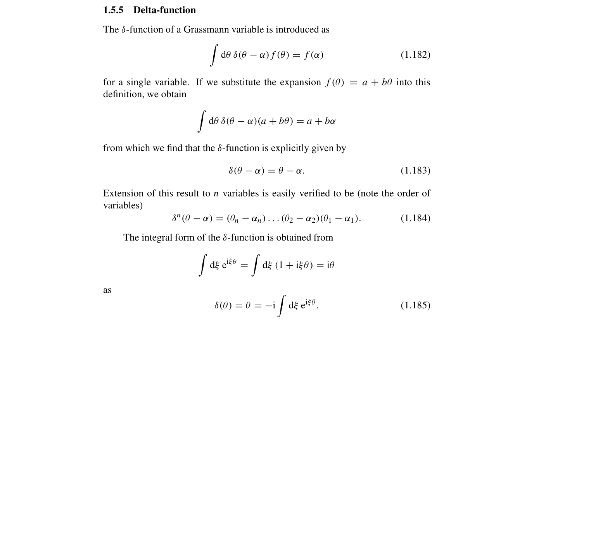

## 第 43 页：先说目的，再逐步解读

### 一、先规定 δ 要完成什么任务

**这段在干什么：**解释式 (1.182)，让定义由用途出发。

我们希望

$$
\int d\theta\,\delta(\theta-\alpha)f(\theta)=f(\alpha).
$$

也就是说，积分后把 $f$ 里的 $\theta$ 替成 $\alpha$。普通 δ 也有这个用途；这里想保留的是代入功能，不是普通 δ 的图像。

由于 $f=a+b\theta$，能用到的项很少。作者给出

$$
\delta(\theta-\alpha)=\theta-\alpha.
$$

下面亲手检查它真的做到这件事。

### 二、把最简单的函数代进去检查

**这段在干什么：**验证式 (1.183)，并指出负号在哪里被反交换改变。

先取 $a,b$ 为普通可交换系数。展开

$$
(\theta-\alpha)(a+b\theta)
=a\theta-a\alpha-b\alpha\theta.
$$

因为 $\alpha\theta=-\theta\alpha$，最后一项可写成 $+b\theta\alpha$。于是含 $\theta$ 的部分为 $a\theta+b\theta\alpha$，左积分后得到

$$
a+b\alpha=f(\alpha).
$$

所以它的确是代入核。若在一般奇系数函数中换动核的位置，要同时核对左右导数与符号，不能随便换序。

### 三、多变量和 Fourier 表示为何也很短？

**这段在干什么：**读懂式 (1.184)–(1.185)，说明这些公式都来自有限项展开。

多变量积分顺序已固定，所以 δ 的因子用反序排列：

$$
\delta^n(\theta-\alpha)
=(\theta_n-\alpha_n)\cdots(\theta_1-\alpha_1).
$$

例如 $\alpha=0,n=2$ 时，$\int d\theta_1d\theta_2\,\theta_2\theta_1=1$，立刻对上。

同样，由 $(\xi\theta)^2=0$，

$$
e^{i\xi\theta}=1+i\xi\theta,\qquad
\int d\xi\,e^{i\xi\theta}=i\theta.
$$

所以 $\delta(\theta)=-i\int d\xi\,e^{i\xi\theta}$。它看起来像 Fourier 积分，实际没有无限振荡求和，只是取出一次项。

本节 A 级目标是会验证代入性质，B 级是熟悉多变量顺序。它没有引入新粒子，也不需要你想象一团“很尖的 Grassmann 物质”。

---

[阅读目录](README.md) · [上一小节](11-1.5.4.md) · [下一小节](13-1.5.6.md)

# 1.5.6 Gaussian integral｜费米高斯积分与 Pfaffian

[阅读目录](README.md) · [上一小节](12-1.5.5.md) · [下一小节](14-1.5.7.md)

**这一节在做什么：求费米计算里最常见的二次指数积分。**先用一个变量对算清楚，再区分“行列式”与“Pfaffian”各自对应哪种表达式。

## 原书第 44 页：原文底本

本块保留该页属于本小节的完整原文。PDF 阅读器页码为 67。

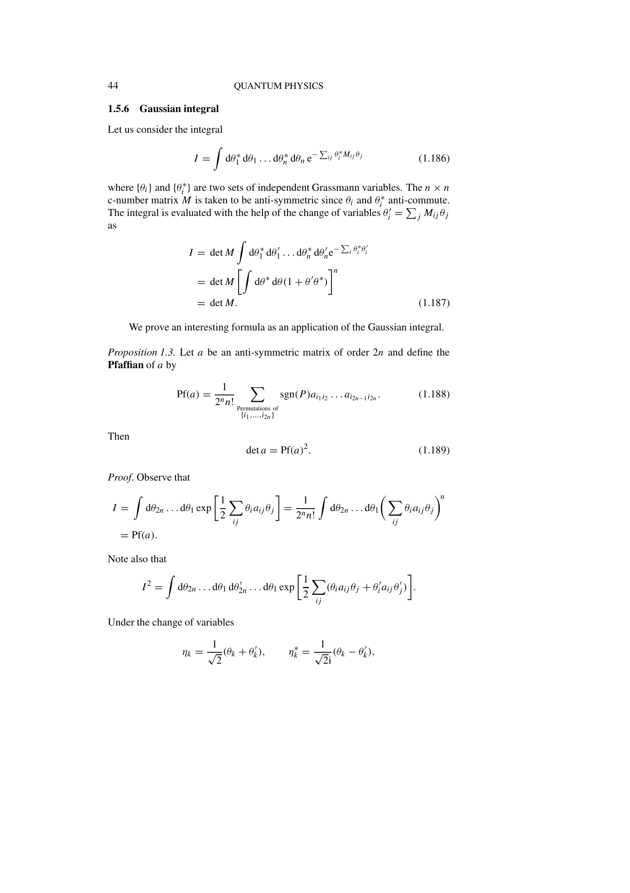

## 第 44 页：先说目的，再逐步解读

### 一、为什么普通 Gaussian 给倒数，这里却给正的系数？

**这段在干什么：**用最小算例解释式 (1.186)–(1.187)，不让 $\det M$ 作为一个突然出现的结论。

取一对独立变量 $\theta,\theta^*$，以及普通数 $m$。指数只剩两项：

$$
e^{-m\theta^*\theta}=1-m\theta^*\theta.
$$

按本书顺序，$\int d\theta^*d\theta\,\theta^*\theta=-1$，所以

$$
\int d\theta^*d\theta\,e^{-m\theta^*\theta}=m.
$$

没有“曲线变窄”的过程，只是挑出最高次项的系数。普通实 Gaussian 是对面积积分，随着二次项系数变大而变窄；这里采用另一种积分定义，结果自然不同。

### 二、许多变量为什么正好组合成行列式？

**这段在干什么：**解释多变量公式中排列符号的来源。

对 $\theta_i^*M_{ij}\theta_j$ 的指数展开，积分只保留每个 $\theta_i,\theta_i^*$ 都出现一次的项。选择矩阵元时，恰好要从每行、每列各选一个；把变量移到统一顺序又会产生排列的正负号。

这正是行列式的组合方式。两对变量时，最后得到

$$
M_{11}M_{22}-M_{12}M_{21}.
$$

所以一般公式为

$$
\int\prod_i(d\theta_i^*d\theta_i)\,
e^{-\theta^*M\theta}=\det M.
$$

原文说 $M$ 必须反对称，这对“两套独立变量”的双线性型并不需要。反对称条件在下面“一套变量”的表达式中才真正必要。

### 三、Pfaffian：如果只有一套变量，改为统计两两配对

**这段在干什么：**说明命题 1.3 为什么另引入一个新对象，以及它与行列式有什么不同。

现在只有 $\vartheta_1,\ldots,\vartheta_{2n}$ 一套变量，指数为 $\frac12\vartheta^TA\vartheta$。因为变量反交换，矩阵对称部分会抵消，只剩反对称部分。

积分需要让每个变量都出现一次，因此要把全部指标两两配对。四个变量时有三种配对，带符号加起来：

$$
\operatorname{Pf}(A)
=A_{12}A_{34}-A_{13}A_{24}+A_{14}A_{23}.
$$

这就是 Pfaffian。先把它理解为“全部两两配对的带符号总和”，比只叫它“行列式平方根”清楚。

两变量时 $A=\left(\begin{smallmatrix}0&a\\-a&0\end{smallmatrix}\right)$，Pfaffian 为 $a$，行列式为 $a^2$。因此可以看见 $\det A=\operatorname{Pf}(A)^2$ 的最低维例子。

## 原书第 45 页：原文底本

本块保留该页属于本小节的完整原文。PDF 阅读器页码为 68。

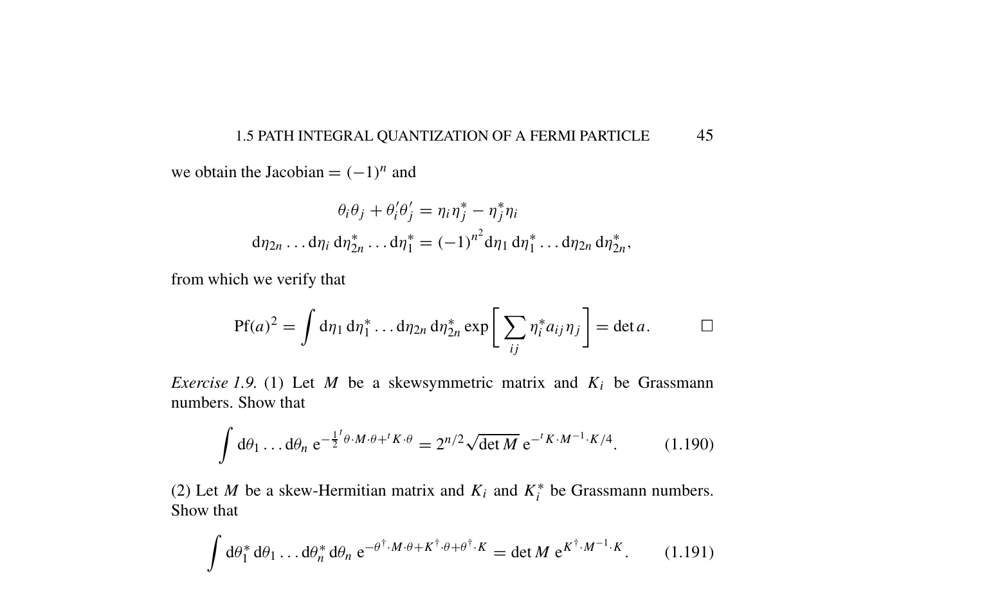

## 第 45 页：先说目的，再逐步解读

### 四、原文的证明为什么要复制一套变量？

**这段在干什么：**概括 Pfaffian 平方等于行列式的证明任务，再说明哪些计算需要细看。

取两份相同的单套变量积分，相乘就得到 Pfaffian 的平方。再把两份变量线性组合成两套独立变量，积分可以化成前面的双线性 Gaussian，于是得到行列式。

作者逐项算换元与重排，是为了保证这次组合没有漏符号。你已经学过线性代数和抽象代数，可以在知道目标以后逐行检查；不要在不知道要证明什么时先钻进一串奇变量。

练习 1.9 的 (1.190) 有系数问题：取两变量、零外源，左边为 $m$，印出的右边却多一个 2。遇到对不上的结果先查附录，不要求自己证明一条在所给约定下不成立的式子。

### 五、这一节复习：先看变量有几套，再选公式

**这段在干什么：**把以后在场论里要用的三种 Gaussian 分清。

| 积分对象 | 结果的主要结构 | 要理解什么 |
|---|---|---|
| 普通实变量二次型 | $(\det M)^{-1/2}$ | 各方向面积宽度相乘 |
| 两套独立奇变量 | $\det M$ | 最高次系数形成带符号排列 |
| 一套偶数个奇变量、反对称二次型 | $\operatorname{Pf}(A)$ | 全部两两配对的带符号总和 |

前两项是后文会立刻用到的 A 级内容。Pfaffian 的定义与平方关系为 B：理解、会做二维和四维例子，再回看一般证明。

---

[阅读目录](README.md) · [上一小节](12-1.5.5.md) · [下一小节](14-1.5.7.md)

# 1.5.7 Functional derivative｜Grassmann 泛函微分

[阅读目录](README.md) · [上一小节](13-1.5.6.md) · [下一小节](15-1.5.8.md)

**这一节在做什么：把有限个奇变量的求导，推广到每个时刻都有一个奇变量的情形。**

## 原书第 45 页：原文底本

本块保留该页属于本小节的完整原文。PDF 阅读器页码为 68。

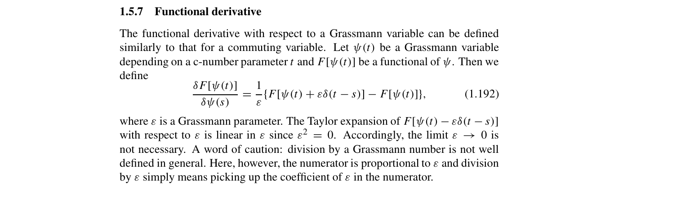

## 第 45 页：先说目的，再逐步解读

### 一、怎样只改变某一个时刻的 ψ？

**这段在干什么：**解释式 (1.192) 的变分，为后面含费米源的生成泛函作准备。

有限维时，你可以只改变 $\theta_2$，看一个多项式怎样变化。现在变量改成 $\psi(t)$，时刻 $t$ 取连续值，所以想只在 $s$ 附近作变化，就用

$$
\delta\psi(t)=\epsilon\,\delta(t-s).
$$

这里有两个不同东西：$\epsilon$ 是新增的奇参数，负责反交换；$\delta(t-s)$ 是普通时间轴上的 Dirac 分布，负责选定时刻。它不是上一节的奇变量 δ。

把变分参数移到最左边，读出它的系数：

$$
F[\psi+\epsilon\delta_s]
=F[\psi]+\epsilon\frac{\delta_LF}{\delta\psi(s)}.
$$

这就是左泛函导数。$\epsilon^2=0$，所以这次展开不需要无穷高阶项。

### 二、为什么这里的“除以 ε”不能当普通除法？

**这段在干什么：**澄清原文分式的实际操作，避免对幂零元素求不存在的逆。

若 $\epsilon$ 有逆，由 $\epsilon^2=0$ 两边乘逆就会推出 $\epsilon=0$，与把它作为非零生成元矛盾。

所以原文写 $1/\epsilon$ 只是简写：**先把新增的独立 $\epsilon$ 移到固定位置，再取出它的系数。**没有真的求倒数。

例如 $F=\psi(t_1)\psi(t_2)$。变分后把 $\epsilon$ 统一放左边，得到

$$
\frac{\delta_LF}{\delta\psi(s)}
=\delta(t_1-s)\psi(t_2)
-\delta(t_2-s)\psi(t_1).
$$

第二项的负号来自 $\epsilon$ 越过 $\psi(t_1)$。因此连续时间并没有改变上一节的符号规则。

复习时会解释“选时刻、移到左边、取系数”这三步即可；它们是 A。不要把这一页误当成需要重新学习一套实数极限。

---

[阅读目录](README.md) · [上一小节](13-1.5.6.md) · [下一小节](15-1.5.8.md)

# 1.5.8 Complex conjugation｜Grassmann 共轭

[阅读目录](README.md) · [上一小节](14-1.5.7.md) · [下一小节](16-1.5.9.md)

**这一节在做什么：规定奇变量怎样取复共轭，使后面的二次表达式有一致的现实性条件。**

## 原书第 45 页：原文底本

本块保留该页属于本小节的完整原文。PDF 阅读器页码为 68。

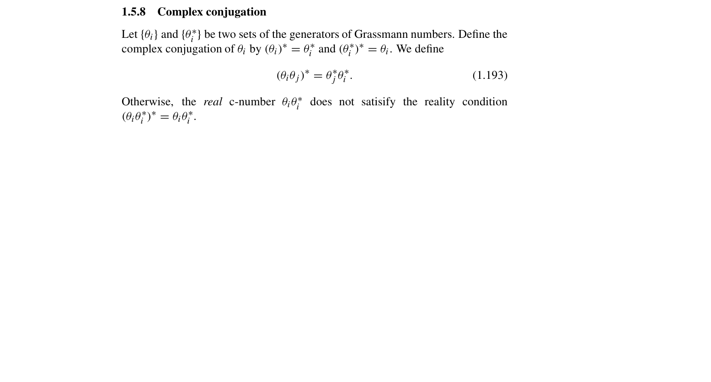

## 第 45 页：先说目的，再逐步解读

### 一、为什么共轭时还要把次序倒过来？

**这段在干什么：**说明式 (1.193) 的规则及它要保住的性质。

对普通复数，你熟悉 $(ab)^*=a^*b^*$。因为普通数可交换，写成 $b^*a^*$ 也一样。奇变量不可交换，这两种写法不再相同。

作者规定

$$
(\theta_i\theta_j)^*=\theta_j^*\theta_i^*.
$$

这和算符伴随 $(AB)^\dagger=B^\dagger A^\dagger$ 的规则相配合。它让费米算符的共轭与奇变量表示中的共轭能一致使用。

用最简单的二次项检查：

$$
(\theta^*\theta)^*=\theta^*\theta.
$$

共轭并倒序后，它回到自身。若不倒序，通常会多一个交换负号。

### 二、共轭后等于自身，为什么仍不能说它是普通非负实数？

**这段在干什么：**分清“在这套代数里满足现实性规则”与“实验读出的实数”。

$\theta^*\theta$ 是一个偶 Grassmann 元素。它与其他元素的交换较简单，但仍带幂零性质，不能搬到实数轴上说“大于零”。

星号只规定代数中怎样对应：$(\theta)^*=\theta^*$、$(\theta^*)^*=\theta$。积分时两者仍可作为独立生成元处理，并不是一对已经给定数值的普通复数。

所以原文称某个二次项为 “real c-number” 时，应理解为它在这里共轭不变、并且是偶量；若 c-number 严格指普通复系数，这个称呼就不够准确。

本节 B 级目标是会核对一个乘积的共轭顺序。物理用途是帮助构造与量子算符伴随相容的作用量，不需要再给它附会一种机械运动图像。

---

[阅读目录](README.md) · [上一小节](14-1.5.7.md) · [下一小节](16-1.5.9.md)

# 1.5.9 Coherent states and completeness relation｜费米相干态与完备关系

[阅读目录](README.md) · [上一小节](15-1.5.8.md) · [下一小节](17-1.5.10.md)

**这一节在做什么：把两维费米态空间与 Grassmann 积分真正连接起来。**前面只是定义了奇变量；现在要证明用它们确实能重写算符计算。

## 原书第 46 页：原文底本

本块保留该页属于本小节的完整原文。PDF 阅读器页码为 69。

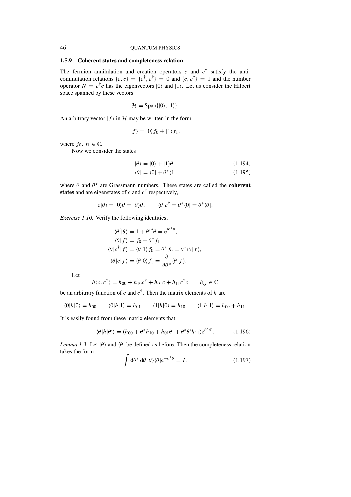

## 第 46 页：先说目的，再逐步解读

### 一、为什么定义 |θ〉=|0〉+|1〉θ？

**这段在干什么：**解释式 (1.194)–(1.195) 的辅助状态为什么适合湮灭算符。

普通单模式态写成 $|0\rangle f_0+|1\rangle f_1$，两个系数是复数。作者暂时扩大系数范围，允许写入奇变量：

$$
|\theta\rangle=|0\rangle+|1\rangle\theta.
$$

对它作用 $c$，

$$
c|\theta\rangle=|0\rangle\theta
=|\theta\rangle\theta,
$$

最后等号用了 $\theta^2=0$。因此它像是 $c$ 的一个以奇数为“本征值”的辅助态，叫费米相干态。

它不是说实验可以制备一个振幅读数为奇变量的普通态。我们扩大代数是为了计算，最后仍要回到普通 Hilbert 空间中的物理结果。

为什么普通复本征值不行？若 $cv=\lambda v$，因 $c^2=0$ 得 $\lambda^2v=0$；非零向量只能有复数 $\lambda=0$。奇变量则恰好能非零而平方为零，与这个结构相配。

### 二、为什么重叠写成指数，又为什么不正交？

**这段在干什么：**读懂练习 1.10，并准备时间切片中会反复出现的相邻态重叠。

直接展开：

$$
\langle\theta'|\theta\rangle
=1+\theta'^*\theta=e^{\theta'^*\theta}.
$$

指数等号是精确的，因为二次以上项为零。这不等于两个标签不同就内积为零，所以相干态不是普通的正交基。

对普通态 $|f\rangle$，
$\langle\theta|f\rangle=f_0+\theta^*f_1$。此时 $c^\dagger$ 可用乘 $\theta^*$ 表示，$c$ 可用对 $\theta^*$ 求导表示。它让算符运算变成已经学过的奇变量运算。

一般算符的矩阵元也可这样展开，但算符排序必须先固定。不能先把 $c,c^\dagger$ 当普通数交换，再去替换。

## 原书第 47 页：原文底本

本块保留该页属于本小节的完整原文。PDF 阅读器页码为 70。

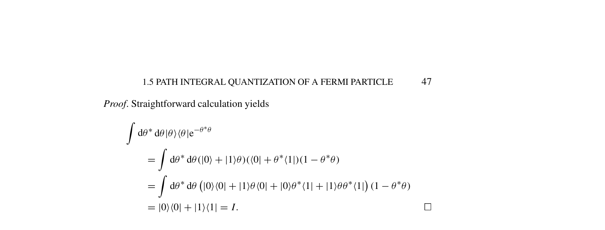

## 第 47 页：先说目的，再逐步解读

### 三、完备关系：怎样知道这批辅助态没有丢掉原来的两种状态？

**这段在干什么：**验证引理 1.3，给后面在每个时间片插入相干态提供根据。

作者要证明

$$
\int d\theta^*d\theta\,
e^{-\theta^*\theta}|\theta\rangle\langle\theta|=I.
$$

先把两个括号以及 $1-\theta^*\theta$ 全部展开。积分会删掉常数项、只含一个变量的项，保留恰好同时含 $\theta,\theta^*$ 的项。

空态投影留下 $|0\rangle\langle0|$，占据态投影留下 $|1\rangle\langle1|$；它们相加正是两维恒等算符。

这说明这套积分可以完整重建任意两维态。于是后面像玻色情形一样，能够在每个时间片插入恒等算符，把演化拆开。

### 四、这一节复习：真正的桥梁是完备关系

**这段在干什么：**说明前面几节繁琐代数现在解决了哪个问题。

奇变量不是只为把交换关系右边的 1 删掉。我们先造适合 $c$ 的辅助态，再用 Berezin 积分解析恒等算符，才能证明时间切片后的积分仍代表原来的算符演化。

A 级要求是会验证 $c|\theta\rangle=|\theta\rangle\theta$ 和两维完备关系。一般矩阵元展开为 B。标签连续而物理态空间仍只有两维，说明不能靠数标签个数来数独立物理状态。

---

[阅读目录](README.md) · [上一小节](15-1.5.8.md) · [下一小节](17-1.5.10.md)

# 1.5.10 Partition function of a fermionic oscillator｜费米配分函数与反周期条件

[阅读目录](README.md) · [上一小节](16-1.5.9.md) · [下一小节](18-1.6.1.md)

**这一节在做什么：用奇变量路径积分重新算一个只有空、占据两种状态的热迹。**最终答案已能直接求出，因此长推导中的每一步都有明确的核对对象。

## 原书第 47 页：原文底本

本块保留该页属于本小节的完整原文。PDF 阅读器页码为 70。

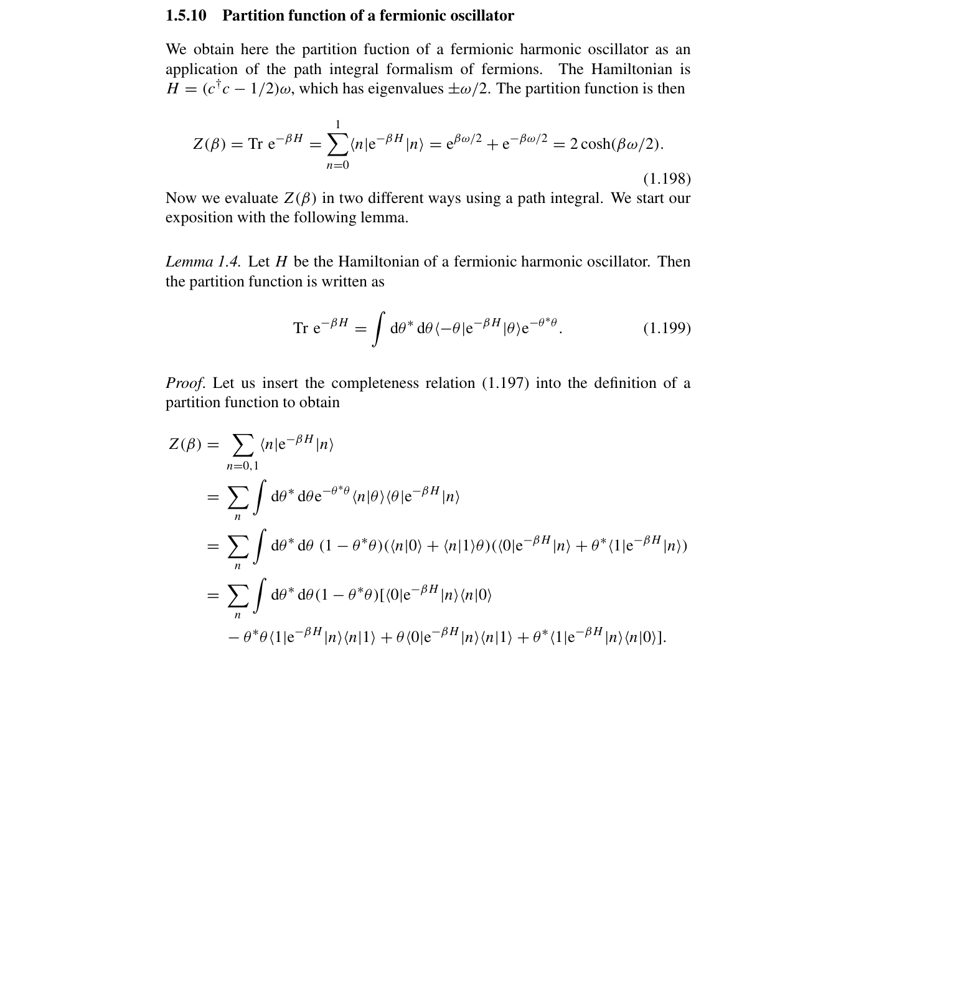

## 第 47 页：先说目的，再逐步解读

### 一、先把两种状态数清楚

**这段在干什么：**由式 (1.198) 得到全节参照答案。

本书取能量 $-\hbar\omega/2$ 和 $+\hbar\omega/2$，所以

$$
Z=e^{\beta\hbar\omega/2}+e^{-\beta\hbar\omega/2}
=2\cosh(\beta\hbar\omega/2).
$$

没有无穷级数，因为不能重复占据。若把零点移成 $0,\hbar\omega$，则 $Z'=1+e^{-\beta\hbar\omega}$，对应占据概率

$$
\Pr(N=1)=\frac1{e^{\beta\hbar\omega}+1}.
$$

低温时占据高一级的概率小；高温时空态与占据态接近各半。这是该两态模型的具体热统计。

### 二、为什么迹公式里偏偏出现 −θ？

**这段在干什么：**说明引理 1.4 的负号不是随意添加，而是为重现普通两维迹所必需。

取最容易检查的算符 $O=I$。两维恒等矩阵的迹应为 2。相干态表示中，

$$
\langle-\theta|\theta\rangle=1-\theta^*\theta.
$$

再乘积分权重 $1-\theta^*\theta$，得到 $1-2\theta^*\theta$。积分后常数消失，后项给 2，正好吻合。

若错误使用 $\langle\theta|$，重叠是 $1+\theta^*\theta$，与权重相乘只剩 1，积分得零，连 $\operatorname{Tr}I=2$ 都算错了。

所以普通热迹要求这个负号。原文的长证明把这项检查推广到相应偶算符。

## 原书第 48 页：原文底本

本块保留该页属于本小节的完整原文。PDF 阅读器页码为 71。

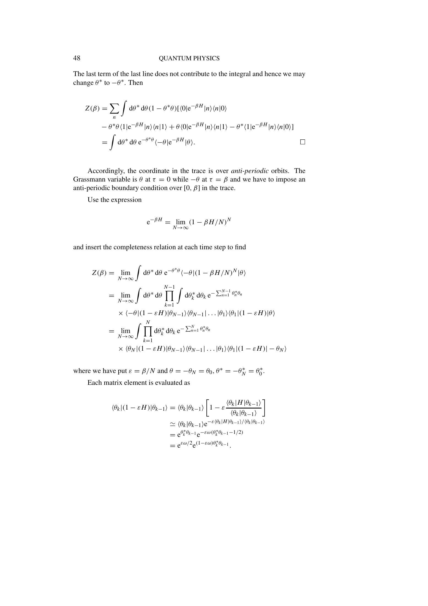

## 第 48 页：先说目的，再逐步解读

### 三、反周期边界：负号现在变成了首尾条件

**这段在干什么：**把迹中的负标签翻译成欧氏路径积分的边界。

前面玻色热迹要求起点、终点相同，所以路径首尾相接。这里相干态迹连接的是 $|\theta\rangle$ 与 $\langle-\theta|$，因此

$$
\theta(\beta)=-\theta(0).
$$

它叫反周期边界。意思是这套辅助变量在欧氏时间区间两端反号；不是电子真实过一段时间后概率变负。

如果没有负标签，计算的是空态与占据态带相反权重的一种分次迹，不是当前普通热平衡的概率总和。

### 四、一阶时间导数是怎样从相邻时间片出现的？

**这段在干什么：**解释原文切片式中的差分项，避免把费米作用量当作另一个猜测。

相邻相干态重叠给 $e^{\theta_k^*\theta_{k-1}}$，完备关系的权重给 $e^{-\theta_k^*\theta_k}$。两者相乘，指数里出现

$$
-\theta_k^*(\theta_k-\theta_{k-1}).
$$

把时间步长记为 $\epsilon$，括号除以 $\epsilon$ 就像普通差分导数。加总后写成连续形式，是 $-\int\theta^*\partial_\tau\theta\,d\tau$。

所以这项一阶导数来自相邻态的重叠与积分权重，不是为了形式好看才写进去。

## 原书第 49 页：原文底本

本块保留该页属于本小节的完整原文。PDF 阅读器页码为 72。

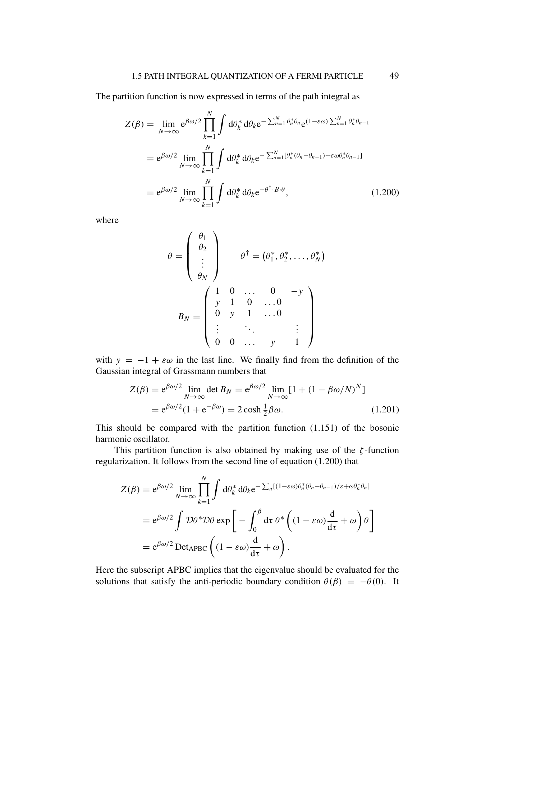

## 第 49 页：先说目的，再逐步解读

### 五、有限行列式怎样回到两个态的答案？

**这段在干什么：**说明式 (1.200)–(1.201) 的矩阵计算到底在核对什么。

取 $N$ 个时间片后，只剩 $N$ 对奇变量，指数是一个有限二次型。上一节 Gaussian 规则告诉我们：积分等于矩阵 $B_N$ 的行列式。

相邻时间片只相邻耦合，所以矩阵很稀疏；首尾反周期条件决定角上那项的负号。计算得到

$$
\det B_N=1+(1-\beta\omega/N)^N.
$$

当 $N\to\infty$，它趋于 $1+e^{-\beta\omega}$；再乘回原来的零点能因子，正好是 $2\cosh(\beta\omega/2)$。

这样，路径积分没有凭空增加无数状态，仍只是在重算空态和占据态的热权重。

原文下一步保留某个随 $\epsilon$ 变小的因子，是为了在无穷模式累积时固定归一化。第一次读先用有限行列式守住答案，再看连续正则化。

## 原书第 50 页：原文底本

本块保留该页属于本小节的完整原文。PDF 阅读器页码为 73。

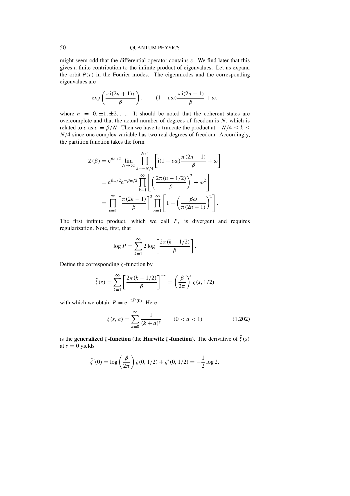

## 第 50 页：先说目的，再逐步解读

### 六、为什么 Fourier 频率变成半整数？

**这段在干什么：**从反周期条件直接推导模式，而不是要求你背 Matsubara 频率。

假设一个模式为 $e^{i\nu\tau}$。首尾反号要求

$$
e^{i\nu\beta}=-1.
$$

复平面转半圈、再加任意整圈，才能到 $-1$，所以

$$
\nu=\frac{(2n+1)\pi}{\beta},\quad n\in\mathbb Z.
$$

这就是费米热模式的半整数频率。玻色首尾同号则要求转整圈，得到 $2n\pi/\beta$。差别直接来自迹的边界条件。

这些频率属于欧氏热计算，不是探测器观测到的全部实际跃迁频率清单。

本页用 Hurwitz ζ 来处理半整数谱，与前面整数谱用 Riemann ζ 的目的相同。具体截断的变量数要回到有限离散化核对，不以“相干态过完备”代替计数。

## 原书第 51 页：原文底本

本块保留该页属于本小节的完整原文。PDF 阅读器页码为 74。

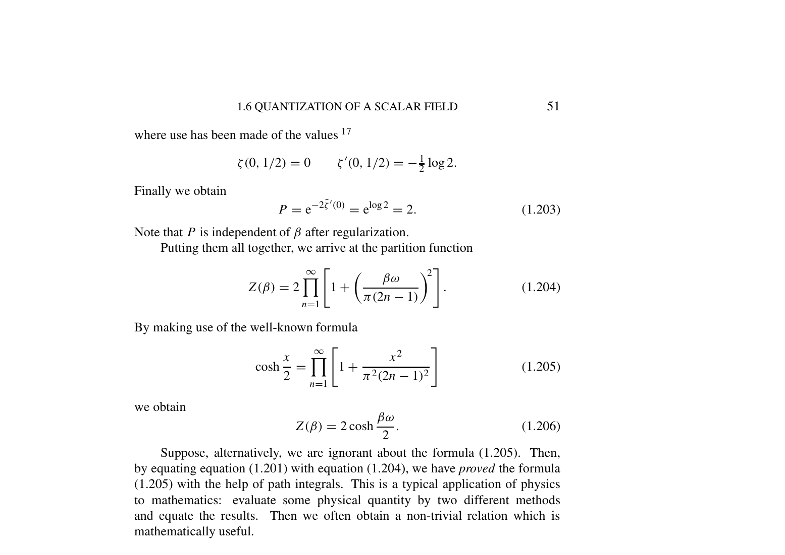

## 第 51 页：先说目的，再逐步解读

### 七、这一节复习：长推导要始终指向同一份两态统计

**这段在干什么：**把相干态、反周期与 cosh 串成可以复述的过程。

先直接相加两个热权重 → 把普通迹写成相干态积分 → 为重现迹出现负标签 → 首尾反号形成反周期边界 → 时间切片给有限 Grassmann Gaussian → 行列式回到两态答案。

再作 Fourier 展开，半整数频率给奇数乘积：

$$
Z=2\prod_{n\ge1}
\left[1+\frac{(\beta\omega)^2}{\pi^2(2n-1)^2}\right]
=2\cosh\frac{\beta\omega}{2}.
$$

这里的 A 级内容是两态计数、迹的负标签、反周期与半整数频率。无穷乘积和 ζ 常数的精细处理属于 B，可在这四件事清楚以后慢慢算。

---

[阅读目录](README.md) · [上一小节](16-1.5.9.md) · [下一小节](18-1.6.1.md)

# 1.6.1 Free scalar field｜自由标量场

[阅读目录](README.md) · [上一小节](17-1.5.10.md) · [下一小节](19-1.6.2.md)

**这一节在做什么：把“一个粒子的一个坐标”，推广成“空间每处都有可以变化的量”，再对整个系统量子化。**这是全章最需要放慢的一次转换。

## 原书第 51 页：原文底本

本块保留该页属于本小节的完整原文。PDF 阅读器页码为 74。

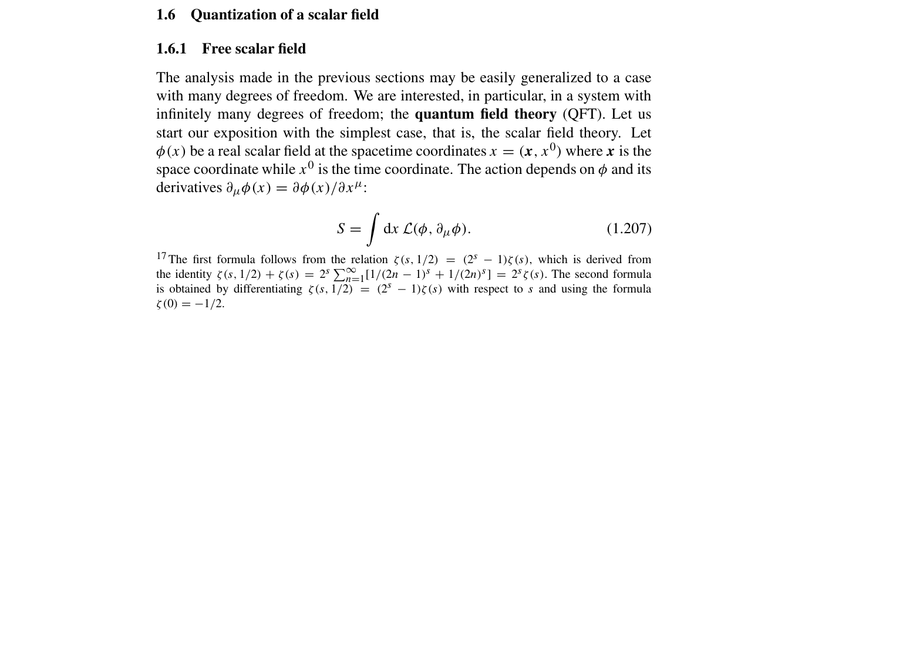

## 第 51 页：先说目的，再逐步解读

### 一、场先从一串小振子想起

**这段在干什么：**解释原文 “many degrees of freedom” 与 “scalar field” 的实际对象。

一个弹簧小球，需要一个位移 $q(t)$。一串相连的弹簧小球，需要 $q_1(t),q_2(t),\ldots,q_N(t)$：每个小球都能动，所以每个都要一个坐标。

如果小球分布越来越密，可以用空间位置 $\mathbf x$ 代替编号。位移便写成 $\phi(\mathbf x,t)$，意思是“在时刻 $t$，位置 $\mathbf x$ 上的量有多大”。这就是场的基本图像。

温度场也给每处一个数；绳子的横向位移场也类似。这里用这些帮助理解“每处都有一个数”，不是说基本标量场真的由小弹簧组成，也不是把温度场直接量子化成书中的相对论场。

“标量”表示每处给的是一个数，而不是像风速那样先给一个空间方向向量。

### 二、φ(x) 和前面的波函数 ψ(x) 不能混为一谈

**这段在干什么：**说明作者换了研究对象，避免把所有带 $x$ 的函数都当成位置概率。

单粒子 $\psi(x)$ 用来算“这一个粒子会在哪里被发现”。场配置 $\phi(\mathbf x)$ 则像一整条绳子的形状：同一时刻每一处都可以有一个场值。

一串 $N$ 个小球量子化后，状态函数是 $\Psi(q_1,\ldots,q_N)$。当坐标数连续化，它自然变成 $\Psi[\phi(\cdot)]$：输入的是一整幅场形状。

所以 $\phi$ 是被量子化的坐标，$\Psi$ 才是描述量子态的函数。一般不能把 $|\phi(\mathbf x)|^2$ 直接读成粒子在这里的概率。

路径积分现在也相应扩大：不只枚举一条 $x(t)$ 轨迹，而是枚举整个场随时间变化的历史 $\phi(\mathbf x,t)$。

### 三、为什么要写拉格朗日密度？

**这段在干什么：**解释式 (1.207) 如何给遍布空间的自由度安排动力学。

单个粒子的 $L$ 已经描述整个系统某一时刻的动力学。场铺满空间，因此先写“每一小块空间贡献多少”，叫拉格朗日密度 $\mathcal L$；再对空间和时间积分，得到作用量。

$$
S=\int dt\,d^{d-1}\mathbf x\,
\mathcal L(\phi,\partial_\mu\phi).
$$

时间导数描述当地变化快慢，空间导数描述邻近位置之间是否一致。只让当地及附近变化参与，是这类局部场模型的基本选择。

## 原书第 52 页：原文底本

本块保留该页属于本小节的完整原文。PDF 阅读器页码为 75。

## 第 52 页：先说目的，再逐步解读

### 四、自由标量方程：一片场为什么会像许多个振子？

**这段在干什么：**从式 (1.208)–(1.210) 读出各能量项的作用，并解释“自由”的意思。

按本书的度规，式 (1.209) 可写成较直观的

$$
\mathcal L_0=
\frac12\dot\phi^2-\frac12|\nabla\phi|^2-\frac12m^2\phi^2.
$$

第一项类似动能；第二项惩罚相邻位置变化太急；第三项惩罚场值偏离零。对它变分、分部积分，得到

$$
\ddot\phi-\nabla^2\phi+m^2\phi=0.
$$

这是 Klein–Gordon 方程。暂时先记内容，不靠名字理解它。

把场分成空间 Fourier 模式，例如 $\phi=q_{\mathbf k}(t)e^{i\mathbf k\cdot\mathbf x}$。代入后有

$$
\ddot q_{\mathbf k}+(|\mathbf k|^2+m^2)q_{\mathbf k}=0.
$$

看见了吗？**每个模式就是一个频率 $\omega_{\mathbf k}=\sqrt{|\mathbf k|^2+m^2}$ 的谐振子。**不同模式在这个二次模型里独立，所以叫自由场。

量子化后，每个模式可以逐级增加激发。把一次激发解释为一个携带该动量的粒子，就把振子与粒子语言接了起来。恢复单位后，其能量、动量满足 $E^2=p^2c^2+m^2c^4$，这说明参数 $m$ 为什么与粒子质量相联系。

### 五、传播子：先理解受迫线性方程怎样求解

**这段在干什么：**解释式 (1.213)–(1.216) 为什么引入一个满足 δ 方程的核。

给场加外源 $J$，就像给一串小球的某些位置加外力。线性方程写成 $O\phi_c=-J$。若有核 $\Delta$ 满足

$$
O_x\Delta(x-y)=\delta(x-y),
$$

便可把各处源的贡献叠加，得到 $\phi_c(x)=-\int dy\,\Delta(x-y)J(y)$。这与你学过的线性微分方程 Green 函数方法相同。

但微分方程还需要边界条件。要求响应只在施力之后出现，和要求真空中的编时关联，会选择不同的核。书中这里的 Feynman 传播子服务于后一种量子计算；不要把它一律读成“一个粒子真实沿这个函数走过来”。

$i\epsilon$ 是给积分与极点选择一致处理方式的符号。它不是新的可测外力。

## 原书第 53 页：原文底本

本块保留该页属于本小节的完整原文。PDF 阅读器页码为 76。

## 第 53 页：先说目的，再逐步解读

### 六、源导数怎样把真空中的两点联系取出来？

**这段在干什么：**说明式 (1.217) 的计算为什么有物理内容。

自由场的含源积分仍能完成平方，得到

$$
Z_0[J]=Z_0[0]\exp\left[-\frac i2\int dx\,dy\,J(x)\Delta(x-y)J(y)\right].
$$

对 $J(x)$ 和 $J(y)$ 各求一次导数，就取出连接这两处的核。乘上与本书定义相应的 $i$ 因子，再除以无源值，便得到归一化的真空两点关联。

物理上，基态并不是所有振子坐标和动量都严格为零。每个模式都有基态涨落，两处测量因而可能有相关性。这种相关不等于真空随便提供能量，也不等于可以用它直接超光速发信号。

先把“传播子”掌握为一个有指定边界规则的计算核：它一方面求解带源线性问题，另一方面组织量子关联。具体是哪一个定义，必须看式子。

### 七、实场、复场的行列式为什么相差一个平方根？

**这段在干什么：**解释式 (1.218)–(1.224) 的 Gaussian 幂次，并整理本节核心。

一个复数可以拆成两个实数。类似地，$\phi=(\phi_1+i\phi_2)/\sqrt2$ 是两套实场自由度。每套实 Gaussian 给 $\operatorname{Det}^{-1/2}$，两套相乘成为 $\operatorname{Det}^{-1}$。

欧氏计算应使用正的二次型算符 $-\Delta_E+m^2$。原文若把负号放进 Det，却不说明相位，容易与前面正 Gaussian 混淆；(1.220) 两行的 $i\epsilon$ 也不一致，遇到时查附录核对。

本节 A 级路线是：连续分布的坐标形成场 → Fourier 模式成为独立振子 → 量子激发得到粒子解释 → 线性逆核与 Gaussian 产生关联。实、复场只是自由度数不同，复数本身不会把玻色场变成费米场。

---

[阅读目录](README.md) · [上一小节](17-1.5.10.md) · [下一小节](19-1.6.2.md)

# 1.6.2 Interacting scalar field｜相互作用、关联函数与有效作用量

[阅读目录](README.md) · [上一小节](18-1.6.1.md) · [下一小节](20-1.7.md)

**这一节在做什么：让原本独立的场模式发生相互作用，再为大量关联计算整理记账方法。**先知道算什么，再认识费曼图、连通函数、有效作用量这些名字。

## 原书第 54 页：原文底本

本块保留该页属于本小节的完整原文。PDF 阅读器页码为 77。

## 第 54 页：先说目的，再逐步解读

### 一、多一个 φ⁴，为什么就叫相互作用？

**这段在干什么：**解释式 (1.225) 与上一节二次理论的物理差别。

上一节用 Fourier 变换后，每个模式是独立振子。可以一个一个研究，再把答案组合。

加入 $V(\phi)=g\phi^4/4!$ 后，把模式之和代入四次方，会出现不同模式相乘。一个模式的变化不再和其他模式完全分开。因此这些激发之间可以有耦合，粒子语言中会出现散射等过程。

$g$ 控制作用强弱。允许哪些项，还需看对称性、能量稳定性和研究尺度。例如单独一个正四次势有下界，而任意多项式不一定稳定。“写得出来”还不足以保证是合适物理模型。

### 二、为什么把 φ 换成源的导数就能算修正？

**这段在干什么：**把式 (1.227) 的长表达拆成一个重复使用的求导动作。

前面已经知道

$$
\frac1i\frac{\delta}{\delta J(x)}
e^{i\int J\phi}=\phi(x)e^{i\int J\phi}.
$$

所以指数里的 $\phi^4$，可以改由四次源导数产生。将相互作用指数按 $g$ 展开，就先得到

$$
Z[J]=Z_0[J]
-\frac{ig}{4!}\int dx\,
\left(\frac1i\frac{\delta}{\delta J(x)}\right)^4Z_0[J]
+O(g^2).
$$

这一步的好处是：$Z_0$ 已经会算，新的作用变成对旧答案反复求导。$g$ 小时，可以先取前几阶估计修正。

反复求导会出现许多两点核的配对，把这些配对画成线、相互作用位置画成顶点，就得到费曼图。它先是一种组织计算的画法，不是给每条内部线都配上一颗被实际观察到的飞行小球。

### 三、n 点函数：比平均值多记录了什么？

**这段在干什么：**解释式 (1.228)–(1.229) 所产生的数据是什么。

只知道一个地方平均场值为零，不能断定那里每次测量都为零；也不能知道两处测量是否一起偏大、一起偏小。两点及更多点关联保存这些关系。

生成泛函对不同位置的源求导，就产生相应关联。前提是先按需除以 $Z[0]$，让它们是归一化期望值。

原文 Taylor 式从 $n=1$ 开始且省掉前文真实时间约定应有的 $i^n$，不能直接照用。先检查 $J=0$ 时是否回到 1，就能发现缺少零阶项。具体公式核对仍见附录。

## 原书第 55 页：原文底本

本块保留该页属于本小节的完整原文。PDF 阅读器页码为 78。

## 第 55 页：先说目的，再逐步解读

### 四、为什么取 log 会留下“真正联系”的部分？

**这段在干什么：**解释式 (1.230) 所称连通关联，不只给出一个指数定义。

普通统计中，若两个量独立，$\langle XY\rangle=\langle X\rangle\langle Y\rangle$。想看它们超出独立情形的联系，就计算

$$
\langle XY\rangle-\langle X\rangle\langle Y\rangle.
$$

对生成函数取对数后，二阶导数恰好具有“二阶平均减去两个一阶平均乘积”的形式。更高阶也会去掉可拆成互不相关组块的部分。因此 $\log Z$ 组织的是连通关联。

费曼图中，分开的几个图块对应这些可分解部分；对数把它们整理成连通图。这个词在说计算能否分解，不是在说两颗粒子之间拴着实体绳子。

### 五、有效作用量：把“施加多少源”换成“平均场变成多少”

**这段在干什么：**解释式 (1.231)–(1.232) 为什么要做 Legendre 变换。

前面以源 $J$ 为自变量：给定外界怎么推动，算系统怎样响应。现在希望反过来，以平均场 $\varphi$ 为自变量组织结果。这与你在凸优化里见过的对偶变换有联系。

为避免本书本页 real/Euclidean 符号切换，单独列一套一致的欧氏定义：

$$
Z_E[J]=\int\mathcal D\phi\,e^{-S_E+\int J\phi},
\quad W_E=\log Z_E,
\quad\varphi=\frac{\delta W_E}{\delta J}.
$$

再令

$$
\Gamma_E[\varphi]=\int J\varphi-W_E[J].
$$

对它求导，得到 $\delta\Gamma_E/\delta\varphi=J$。于是撤去源后，平均场满足 $\delta\Gamma_E/\delta\varphi=0$。

经典作用量只由原始经典模型给出；有效作用量把量子涨落对平均响应的影响也装进来。它不是让每次测量都等于平均值，而是给平均场建立修正后的方程。

本书采用不同的 $W$ 与源符号，需整套转换，不能只把上面的某个负号搬过去。详细约定可查附录。

### 六、这一节复习：三层账本各在记什么？

**这段在干什么：**让这些相似的泛函有明确分工。

| 对象 | 先用大白话记住 | 等级 |
|---|---|---|
| $Z[J]$ | 由源导数产生全部关联 | A |
| $\log Z$ | 去掉可分成独立组块的部分 | A |
| $\Gamma[\varphi]$ | 以平均响应而非外源为自变量，整理量子修正 | B |

原文最后说的一粒子不可约图，是指不能切断一条内部线就分成两个连通块的图。它们是组装计算的构件，不是“只有一个粒子的图”。你现在理解这个用途即可，不必在两页里先学完整套散射理论。

---

[阅读目录](README.md) · [上一小节](18-1.6.1.md) · [下一小节](20-1.7.md)

# 1.7 Quantization of a Dirac field｜Dirac 场的量子化

[阅读目录](README.md) · [上一小节](19-1.6.2.md) · [下一小节](21-1.8.1.md)

**这一节在做什么：给电子这一类带自旋的相对论性自由度建立场方程，并用已学的奇变量积分计算它。**先认识为什么一个标量不够，再看矩阵与行列式。

## 原书第 55 页：原文底本

本块保留该页属于本小节的完整原文。PDF 阅读器页码为 78。

## 第 55 页：先说目的，再逐步解读

### 一、为什么不能继续只用一个标量场？

**这段在干什么：**说明 Dirac 场增加了哪些需要描述的物理信息。

标量场在每处给一个数，但电子还具有自旋。你可以先从测量结果理解它：沿选定轴测量自旋投影，会得到两种基本结果，因此状态需要能同时描述这两种可能性。

自旋不应直接想成一颗小球绕自己表面转动。它描述量子态在旋转下怎样变化，以及相应测量有哪些结果。

考虑相对论时，还需要让不同运动观察者用相容方式描述这些分量。Dirac 旋量就是承担这种变换规律的多分量对象。它的分量不是空间的东、南、西、北四个方向。

### 二、γ 矩阵为什么会出现？

**这段在干什么：**解释式 (1.233)–(1.234) 试图构造怎样的方程。

相对论能量关系包含 $E^2$ 与 $\mathbf p^2$。若想用时间、空间的一阶导数写方程，再让它平方后与这个二次关系一致，普通数字系数不够：不同方向相乘会出现不要的交叉项。

于是使用矩阵 $\gamma^\mu$。给它们规定反对易关系，让不同方向的交叉项抵消，平方项得到正确度规符号。这叫 Clifford 关系。

因此

$$
(i\gamma^\mu\partial_\mu-m)\psi=0
$$

不是“把标量方程随便放个矩阵进去”，而是为相对论与自旋结构构造的一阶方程。本书用 $\not\!\partial$ 简写 $\gamma^\mu\partial_\mu$。

不同度规约定会改变 $\gamma$ 关系中的符号；比较别的书时要成套核对，不能只拿一个公式的正负号判断谁错。

### 三、bar、反对易与奇源各负责什么？

**这段在干什么：**逐项解释式 (1.235)–(1.238) 的新符号，不把它们压成一句“费米 Gaussian”。

$\bar\psi$ 是按 Dirac 结构定义的伴随，用它能构造在相对论变换下合适的双线性项。推方程和做奇变量积分时，$\psi,\bar\psi$ 暂作独立变量处理；对 $\bar\psi$ 变分就得到上面的方程。

电子是费米子，模式的产生、湮灭算符满足反对易关系。因此路径积分用 Grassmann 场记账。这个统计输入不是仅凭写出 $\gamma$ 矩阵就已证明；自旋与统计的完整联系还有独立的理论前提。

源项写成 $\bar\psi\eta+\bar\eta\psi$。为了总项为偶量，$\eta,\bar\eta$ 也选奇源。对它们求导会取出费米场，同时必须保留次序符号。

原文用 $\bar\psi$ 写等时反对易式时省略了旋量矩阵结构。通常先用 $\psi_\alpha,\psi_\beta^\dagger$ 写分量 δ 关系更清楚，完整核对见附录。

## 原书第 56 页：原文底本

本块保留该页属于本小节的完整原文。PDF 阅读器页码为 79。

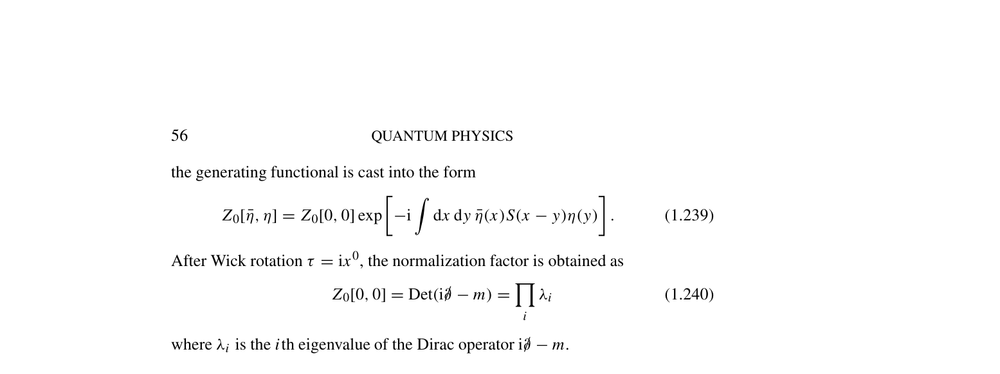

## 第 56 页：先说目的，再逐步解读

### 四、最后又出现“逆算符＋行列式”，为什么并不奇怪？

**这段在干什么：**把式 (1.239)–(1.240) 与前面的有限 Grassmann Gaussian 对上。

将 Dirac 二次算符记为 $D$。积分的结构仍是 $\bar\psi D\psi$。含源时完成平方，源之间由 $D^{-1}$ 连接；无源部分则给 $\det D$。

这与两套独立奇变量的

$$
\int d\theta^*d\theta\,e^{-\theta^*M\theta}=\det M
$$

完全平行，只是有限矩阵变成带时空和旋量指标的微分算符。

因此 Dirac 传播子是一个矩阵核。它既要说明“从哪里到哪里”，也要说明不同分量之间怎样连接。求逆时仍需边界与极点处方，不是只做普通数的倒数。

### 五、这一节复习：三种结构不要用一个词代替

**这段在干什么：**划清当前需要懂的主线与以后可补的课程内容。

自旋告诉你为什么需要多个分量及特殊旋转规律；$\gamma$ 矩阵让相对论的一阶方程与二次能量关系相容；奇变量保存费米交换符号。它们互相关联，但各自解决不同问题。

A 级是能解释这三项分工，以及为何自由费米积分给行列式。完整 Lorentz 旋量表示、反粒子展开和散射计算属于后续 B/C 补充，不要求你仅凭高中物理在这两页一次掌握。

---

[阅读目录](README.md) · [上一小节](19-1.6.2.md) · [下一小节](21-1.8.1.md)

# 1.8.1 Abelian gauge theories｜电磁场与阿贝尔规范理论

[阅读目录](README.md) · [上一小节](20-1.7.md) · [下一小节](22-1.8.2.md)

**这一节在做什么：从电磁场出发，说明为什么同一物理情况可以用不同的势描述，以及比较不同位置的量子相位时为什么需要规范场。**原文默认熟悉大学电磁学，这里把该补的背景先补出来。

## 原书第 56 页：原文底本

本块保留该页属于本小节的完整原文。PDF 阅读器页码为 79。

## 第 56 页：先说目的，再逐步解读

### 一、规范原理先用一句具体话说清

**这段在干什么：**解释 1.8 导言中的 “physics should not depend on how we describe it”。

描述一座城市的位置，可以换地图原点；实际道路没有因此改变。规范自由也涉及一种描述选择，但选择的是场的内部基准，不只是普通地图坐标。

本节最重要的例子是电磁势：两个看上去不同的势，可能给出相同电场、磁场。实验不应仅因我们换了势的写法就得出不同受力。

不过，“描述可换”这句原则还不能单独决定自然界的所有力。我们仍需给出具体自由度、作用量和可检验结果。下面要看它怎样实际约束公式。

### 二、先补物理背景：E、B 代表什么？

**这段在干什么：**为式 (1.241) 的四条方程建立你能使用的物理含义。

电场可通过试探电荷受力来理解。一个静止电荷 $q$ 放在某处，受力为 $q\mathbf E$；磁力则与运动有关，在相容单位下

$$
\mathbf F=q(\mathbf E+\mathbf v\times\mathbf B).
$$

磁力方向垂直速度，所以单靠磁力可以转弯，却不直接改变质点速率。场不是画在纸上的力线，而是用来预测各处试探物体如何受力的物理量。

Maxwell 方程把这些局部量与电荷、电流和变化联系起来：

| 方程 | 先用大白话读 |
|---|---|
| $\nabla\cdot\mathbf B=0$ | 普通理论没有独立磁荷源，闭面净磁通为零 |
| $\partial_t\mathbf B+\nabla\times\mathbf E=0$ | 磁通变化与环绕电场相联系 |
| $\nabla\cdot\mathbf E=\rho$ | 电荷是电场通量的源 |
| $\nabla\times\mathbf B=\mathbf j+\partial_t\mathbf E$ | 电流和变化电场联系磁场的环绕 |

散度可以先理解为“从一小块区域净流出的多少”；旋度可以先理解为“沿小回路环绕的程度”。$\rho$ 是电荷密度，$\mathbf j$ 是电流密度。书中采用简化单位，省去了某些电磁常数。

对最后一式取散度，再用第三式，可得 $\partial_t\rho+\nabla\cdot\mathbf j=0$，就是电荷不能无缘无故在一个区域里增减。

### 三、为什么引入势，反而能使方程更简单？

**这段在干什么：**解释式 (1.242)–(1.243) 的构造及其不唯一性。

先选常用三维约定：

$$
\mathbf B=\nabla\times\mathbf A,\qquad
\mathbf E=-\partial_t\mathbf A-\nabla\Phi.
$$

这样前两条 Maxwell 方程自动满足。比如旋度的散度为零，所以 $\nabla\cdot\mathbf B=0$ 不用另解。

但势不唯一。作变化

$$
\mathbf A'=\mathbf A+\nabla\chi,\qquad
\Phi'=\Phi-\partial_t\chi,
$$

代入可检查 $\mathbf E'=\mathbf E$、$\mathbf B'=\mathbf B$。因此同一电磁场有许多势的写法。这就是此处的规范自由。

原文 (1.242) 将电场时间项写成正号，与其 Faraday 方程不相容；本注先用上面一套相容约定讲清内容。这里不是把“势不唯一”扩大成“力和实验结果任意”。

### 四、为什么把电场、磁场放进一个四维张量？

**这段在干什么：**解释式 (1.244) 为什么不再分开写六个电磁分量。

一个观察者看到静止电荷，另一个相对运动的观察者会看到运动电荷。电流和电场、磁场的划分会随观察者改变，但同一个实验不能自相矛盾。

狭义相对论用时空坐标统一处理这些变换。时间坐标写 $x^0=ct$，空间坐标写 $x^1,x^2,x^3$；度规 $(-+++)$ 对应

$$
ds^2=-c^2dt^2+dx^2+dy^2+dz^2.
$$

$F_{\mu\nu}=\partial_\mu A_\nu-\partial_\nu A_\mu$ 把电、磁装在同一个反对称张量里，便能按统一规则换观察者。它没有增加新的六种场，只是重新组织原来的信息。

原文矩阵里有一项 $B_z$ 应与对应反对称位置配成 $B_x$，见校对附录。第一次读先理解为什么组织为一个对象，不必马上背六个分量的全部符号。

## 原书第 57 页：原文底本

本块保留该页属于本小节的完整原文。PDF 阅读器页码为 80。

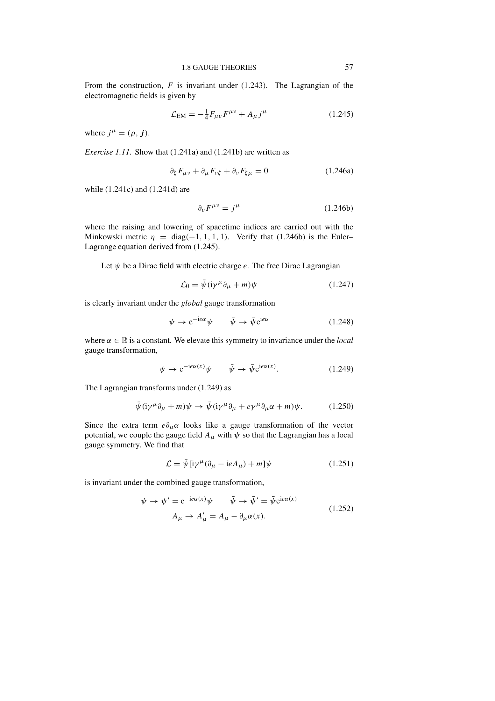

## 第 57 页：先说目的，再逐步解读

### 五、哪两条方程是定义自动给的，哪两条还要靠动力学？

**这段在干什么：**读懂式 (1.245)–(1.246)，区分结构恒等式与作用量变分方程。

由 $F=dA$ 自动得到 $dF=0$，这对应无磁荷与 Faraday 定律。它成立是因为偏导相互交换，不用先求某个具体运动解。

含电荷、电流的另一组方程则要由电磁作用量变分得到。它告诉场怎样响应源，属于动力学。

就像“速度是位置对时间的导数”和“某个物体满足牛顿方程”不是同一种陈述，场强的定义与场的运动方程也不能混为一谈。这个区别会在非阿贝尔理论与自对偶解中再次用到。

### 六、整体相位与局部相位，为什么一个容易、一个会出问题？

**这段在干什么：**解释式 (1.248)–(1.250) 为何从常数相位走向随位置变化的相位。

回到波函数箭头。若把所有位置的箭头一起转同一角度，任意相对方向没有变化，测量概率不变。这叫整体相位改变。

现在尝试每个位置独立选择内部相位基准。这里要特别小心：**只把波函数各处独立转动，而不改变其他量，一般会改变状态。**作者要建立的是一套联合变化规则，使波函数与比较基准一起改变后，仍描述同一物理。

问题出在导数。导数要比较相邻位置的数值；两处基准若各自转了不同角度，普通导数会把基准的变化也算进去。

直接算：

$$
\partial_\mu(e^{-ie\alpha(x)}\psi)
=e^{-ie\alpha(x)}
\left(\partial_\mu\psi-ie(\partial_\mu\alpha)\psi\right).
$$

多出的就是 $\partial_\mu\alpha$ 项。不是原来物理场多受了一次力，而是你换描述后，普通导数没能自动跟着适应。

### 七、协变导数：把基准变化补偿掉

**这段在干什么：**说明式 (1.251)–(1.252) 为什么要把势加入导数。

作者定义

$$
D_\mu=\partial_\mu-ieA_\mu,
$$

并联合变化

$$
\psi'=e^{-ie\alpha}\psi,\qquad
A_\mu'=A_\mu-\partial_\mu\alpha.
$$

代入 $D_\mu'\psi'$，普通导数多出的 $-ie\partial_\mu\alpha$，恰好被势变化带来的 $+ie\partial_\mu\alpha$ 抵消，剩下

$$
D_\mu'\psi'=e^{-ie\alpha}D_\mu\psi.
$$

这叫协变导数：换基准后，求导结果也按和原场相同的规则变化。

所以规范势在这里提供“怎样比较相邻点内部状态”的规则。以后叫它联络，名字出现之前，工作内容已经可以通过这项抵消实际看见。

## 原书第 58 页：原文底本

本块保留该页属于本小节的完整原文。PDF 阅读器页码为 81。

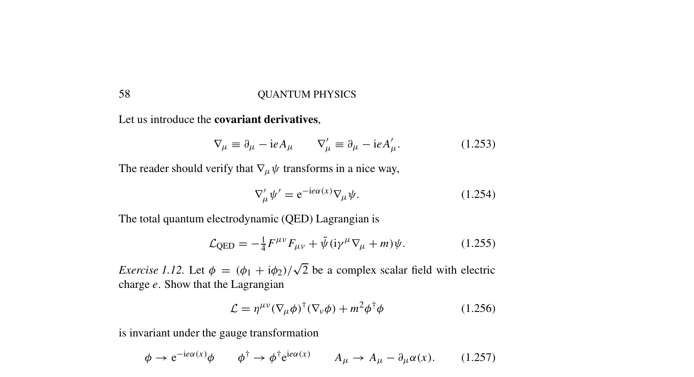

## 第 58 页：先说目的，再逐步解读

### 八、势能变，哪些东西仍有物理意义？

**这段在干什么：**解释式 (1.253)–(1.255) 不是只在消除记号，而是在构造电磁耦合。

换一套势不改变物理，不等于势的全部结构无关紧要。沿不同方向比较再比较，次序差别满足

$$
[D_\mu,D_\nu]\psi=-ieF_{\mu\nu}\psi.
$$

因此真正的电磁场由这套比较规则的绕小圈差别给出。你可以先把它理解为：单个点上可调整基准，但沿闭回路比较后，仍可能留下不能抹掉的结果。

将带电物质的普通导数替换成协变导数，再加入电磁场自己的动能项，就得到此处的 QED 结构。规范不变性约束写法，但相互作用强度和全部允许项仍要由具体理论决定。

### 九、为什么无自旋标量也能带电？

**这段在干什么：**解释练习 1.12，并整理本节推理。

内部相位不等于自旋。复标量场也能在各点按 $\phi\mapsto e^{-ie\alpha}\phi$ 变换，同样需要 $D_\mu\phi$；对应乘积里的相位可以抵消，从而组成规范不变项。

但“规范不变”只说明一类一致性，不替代能量稳定性和动能符号检查。原文不同段落的度规符号应另核对。

本节 A 级主线是：电磁受力 → Maxwell 场 → 势的不唯一 → 局部基准使导数多一项 → 加规范势补偿 → 场强记录闭回路比较的差别。若能依这条顺序复述，再遇到“联络、曲率”就有具体事情可以对应。

---

[阅读目录](README.md) · [上一小节](20-1.7.md) · [下一小节](22-1.8.2.md)

# 1.8.2 Non-Abelian gauge theories｜非阿贝尔规范理论

[阅读目录](README.md) · [上一小节](21-1.8.1.md) · [下一小节](23-1.8.3.md)

**这一节在做什么：把“每点选一个相位角”推广成“每点可对多个内部分量作矩阵变换”。**新的关键是矩阵变换可能不交换，因此先后次序本身带来物理结构。

## 原书第 58 页：原文底本

本块保留该页属于本小节的完整原文。PDF 阅读器页码为 81。

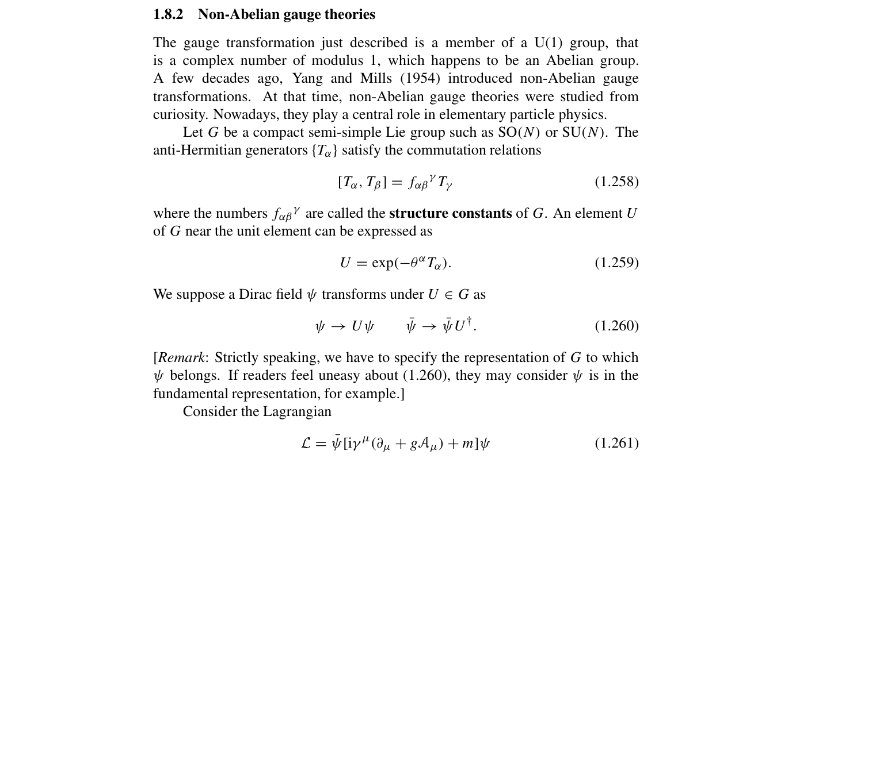

## 第 58 页：先说目的，再逐步解读

### 一、为什么从一个复相位变成一组矩阵？

**这段在干什么：**解释 non-Abelian 的基本差别，不让名称先于例子。

上一节的 $U(1)$ 变换相当于乘单位复数。先转角 $\alpha$ 再转角 $\beta$，和反过来一样，称为阿贝尔。

若场有多个内部分量，可以用矩阵混合这些分量。矩阵 $U,V$ 可能满足 $UV\ne VU$，于是变换先后次序不同，结果也不同。这叫非阿贝尔。

这里“内部”指场分量所在的空间，不一定是实际三维空间方向。例如两个复分量可以构成 $SU(2)$ 的一个基本表示；它们究竟代表什么物理量，需要由模型说明。

### 二、Lie 代数与表示在这页各做什么？

**这段在干什么：**读懂式 (1.258)–(1.261)，区分群自身的规则与它作用在哪种场上。

连续矩阵群靠近单位元时，由生成元 $T_\alpha$ 描述小变化。它们的交换子

$$
[T_\alpha,T_\beta]=f_{\alpha\beta}{}^\gamma T_\gamma
$$

记录不同小变换不交换的程度。$f$ 是在所选基下的结构常数。

“表示”回答的是这些抽象变换具体用什么矩阵作用在 $\psi$ 上。群相同，选择不同表示，场的分量数和变换方式可以不同。因此原文提醒必须指定表示，是在补充具体模型需要的数据。

作者用反 Hermitian 生成元，指数后得到酉变换。其他书常把 $i$ 放到别处，这只是成套约定不同，不能单独混用。

## 原书第 59 页：原文底本

本块保留该页属于本小节的完整原文。PDF 阅读器页码为 82。

## 第 59 页：先说目的，再逐步解读

### 三、为什么规范势的变换不只是普通矩阵换基？

**这段在干什么：**从目标 $D'\psi'=UD\psi$ 推出式 (1.262)，说明导数项的必要性。

取 $D_\mu=\partial_\mu+g\mathcal A_\mu$、$\psi'=U(x)\psi$。展开 $\partial_\mu(U\psi)$ 会多出 $(\partial_\mu U)\psi$。

因此为了让 $D'\psi'=UD\psi$，必须安排

$$
\mathcal A_\mu'
=U\mathcal A_\mu U^{-1}
-\frac1g(\partial_\mu U)U^{-1}.
$$

第一项是普通换基；第二项补偿基准随位置变化。它正是上一节相位补偿的矩阵版本。

你可以自己把它代回去：所有额外导数项抵消，只留下 $UD_\mu\psi$。这是理解变换律最有效的 A 级练习。

### 四、场强为什么非得多一个交换子？

**这段在干什么：**解释式 (1.264) 的新项，说明它不是随意添加的非线性修正。

直接计算两个协变导数的交换子：

$$
[D_\mu,D_\nu]
=g\left(\partial_\mu\mathcal A_\nu-\partial_\nu\mathcal A_\mu
+g[\mathcal A_\mu,\mathcal A_\nu]\right).
$$

括号内定义为 $\mathcal F_{\mu\nu}$。

若两个内部搬运矩阵不交换，先沿一个方向再沿另一个方向，与反过来会留下差别。最后的交换子正好记录这项差别。阿贝尔情形它为零，便退回电磁公式。

因为 $\mathcal F$ 已含势的二次项，再写 $\mathcal F^2$ 就有三次、四次势项。这使规范场能够自相互作用，不再只是线性 Maxwell 理论。

### 五、为什么场强分量会变，作用量仍能不变？

**这段在干什么：**说明式 (1.267)–(1.269) 如何组成与内部基准无关的动力学。

场强按 $\mathcal F'=U\mathcal F U^{-1}$ 变化。单个矩阵分量不必不变，但

$$
\operatorname{tr}(\mathcal F'\mathcal F')
=\operatorname{tr}(\mathcal F\mathcal F)
$$

利用 trace 的循环性质不变。因此可拿这个组合建作用量。

由场强定义自动成立的是 Bianchi 恒等式；由作用量变分得到的是 Yang–Mills 方程。前者是结构关系，后者是具体运动规律，仍须分开。

反 Hermitian 矩阵的平方 trace 一般非正，欧氏正能量型表达要配 $-\operatorname{tr}$。这个约定到瞬子平方不等式时尤其重要。

复习时抓住三问：矩阵为什么不交换？普通导数换基多了什么？闭回路比较留下什么？回答清楚，就是非阿贝尔联络与曲率的物理起点。

---

[阅读目录](README.md) · [上一小节](21-1.8.1.md) · [下一小节](23-1.8.3.md)

# 1.8.3 Higgs fields｜Higgs 场与质量

[阅读目录](README.md) · [上一小节](22-1.8.2.md) · [下一小节](24-1.9.1.md)

**这一节在做什么：说明一个原本用规范场描述的矢量激发，怎样在与标量场耦合后表现出质量。**先弄清“质量”在这里意味着能量关系，而不是穿过介质的摩擦。

## 原书第 60 页：原文底本

本块保留该页属于本小节的完整原文。PDF 阅读器页码为 83。

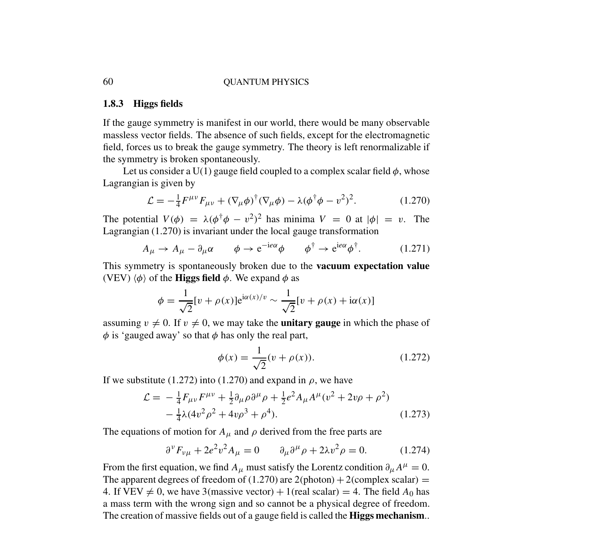

## 第 60 页：先说目的，再逐步解读

### 一、为什么不能直接随手加一个矢量质量项？

**这段在干什么：**解释本节开头提出的困难。

对电磁势直接加 $m_A^2A_\mu A^\mu/2$，一般会破坏上一节的局部规范不变写法。但是我们又希望某些理论的矢量激发具有非零静止能量。

Higgs 机制的任务是：让有质量的谱从一个完整规范理论中出现，而不是先把前面费力建立的结构丢掉。

原文给的是一个简化 $U(1)$ 例子。不能据此把所有非阿贝尔质量问题都归为同一个机制。

### 二、势能最低点为什么是一圈？

**这段在干什么：**解释式 (1.270) 的真空结构，以及径向变化与相位变化的差别。

复标量 $\phi$ 可在复平面画成一个点。若势能是 $\lambda(|\phi|^2-v_0^2)^2$，$\lambda>0$，则所有长度为 $v_0$ 的点势能最低，组成一个圆。

离开这圈向内或向外走，会增加势能；沿圈转，只改相位，势能不变。

如果这个相位属于局部规范选择，圆上的不同取向并不全是可测量不同的物理真空。固定一种写法后谈“自发破缺”很常见，但不能把描述冗余本身理解成一条被实验破坏的物理规律。

### 三、质量项到底从哪一步算出来？

**这段在干什么：**把式 (1.272)–(1.273) 的代入展开写清，而不靠“场吃掉相位”的说法跳过计算。

为避免本页 $v$ 的归一化冲突，采用一致的一套：

$$
\phi=\frac{v+h}{\sqrt2}e^{i\vartheta/v},\qquad
V=\lambda\left(|\phi|^2-\frac{v^2}{2}\right)^2.
$$

$h$ 描述离最低圆向内、外偏离多少；$\vartheta$ 描述沿圆转了多少。代入协变导数，得到

$$
|D_\mu\phi|^2=
\frac12(\partial_\mu h)^2+
\frac12(v+h)^2
\left(\frac{\partial_\mu\vartheta}{v}-eA_\mu\right)^2.
$$

选一个规范把相位代表移去，二次部分便含

$$
\frac12e^2v^2 A_\mu A^\mu.
$$

这就是矢量质量项，对应 $m_A=|e|v$。势能的二次部分给标量 $h$ 的质量 $m_h^2=2\lambda v^2$。放入完整 Lorentz 拉格朗日量时，整体符号仍要与度规一致。

**因此质量不是凭空加到答案里，而是协变导数展开后出现的二次系数。**

### 四、为什么说少掉的相位变成了一个纵向自由度？

**这段在干什么：**解释本页最后的自由度计数，替代一句容易神秘化的“吃掉”。

四维里无质量矢量有两个物理横向极化；复标量有两个实自由度。原来一共四个。

质量生成后，矢量有三个极化，多出纵向一种；剩下一个径向实标量，仍一共四个。因此没有凭空删除一个物理自由度，而是在规范约束下重新组合。

如果只是全局相位对称、没有规范场，沿最低圆的变化通常会留下独立的 Goldstone 模；这里不能把那种情形直接照搬。

质量也不是摩擦。一个有质量自由粒子在真空中不必越来越慢；质量说的是能量、动量及静止能量的关系。

### 五、这一页怎样复习，哪些印式不能直接沿用？

**这段在干什么：**总结计算顺序，并保护你不被本页系数冲突卡住。

原文先说最低半径为 $v$，却用 $(v+\rho)/\sqrt2$ 在 $\rho=0$ 展开，前后最低点不一致；矢量方程的质量系数也与印出的二次项不符。详细核对见附录，主线按上面明确约定计算。

A 级是会复述：选择非零最低半径 → 展开径向与相位 → 协变导数把相位、势结合 → 选规范后显出矢量质量 → 自由度总数保持一致。完整约束分析和量子重整化为 B/C，当前不要求只靠这一页全懂。

---

[阅读目录](README.md) · [上一小节](22-1.8.2.md) · [下一小节](24-1.9.1.md)

# 1.9.1 Dirac monopole｜Dirac 磁单极子

[阅读目录](README.md) · [上一小节](23-1.8.3.md) · [下一小节](25-1.9.2.md)

**这一节在做什么：假设存在一个独立磁荷，研究它的场为什么不能用一个处处光滑的势来描述。**这会把你熟悉的磁通，直接接到“局部能写、全局不能写”的数学问题。

## 原书第 60 页：原文底本

本块保留该页属于本小节的完整原文。PDF 阅读器页码为 83。

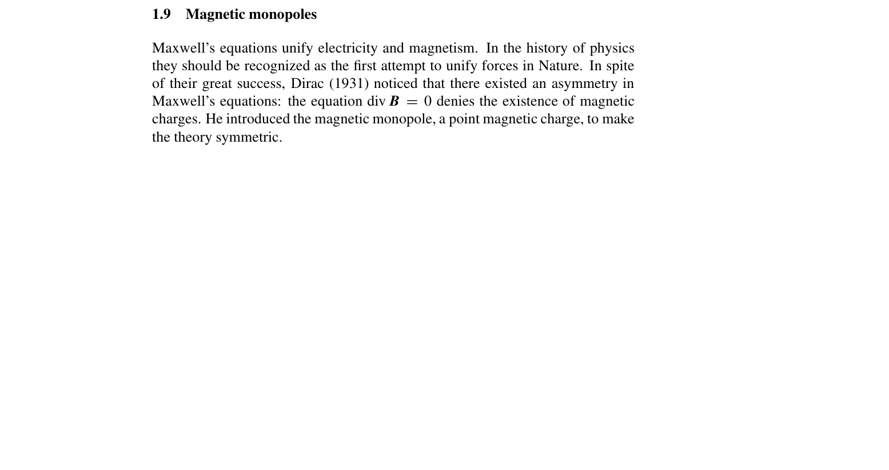

## 第 60 页：先说目的，再逐步解读

### 一、磁单极子与普通磁铁的一端有什么区别？

**这段在干什么：**解释 1.9 导言为什么认为普通 Maxwell 方程中电与磁不对称。

电场有独立正、负电荷作源。普通磁铁虽然有南北端，但把它切开，通常仍得到各有南北端的磁体，不能直接切出一颗只有北极的独立磁荷。

普通 Maxwell 方程 $\nabla\cdot\mathbf B=0$ 表达没有这种独立磁源。Dirac 问的是：**如果允许一个点磁荷，量子理论会要求什么？**

本章接下来研究这个假设的一致性，不是已经从 Maxwell 方程证明磁荷存在。先分清问题的条件，后面的量子化结论才不会读得过头。

## 原书第 61 页：原文底本

本块保留该页属于本小节的完整原文。PDF 阅读器页码为 84。

## 第 61 页：先说目的，再逐步解读

### 二、点磁荷为什么产生径向反平方场？

**这段在干什么：**解释式 (1.275)–(1.277)，把磁荷强度与磁通联系起来。

把磁荷放在原点。各方向没有特殊区别，场应沿径向。半径越大的球面，面积越大；若穿出球面的总磁通固定，平均场强就必须按面积倒数减小。

所以

$$
\mathbf B=g\frac{\mathbf r}{r^3},\qquad
\int_{S^2}\mathbf B\cdot d\mathbf S=4\pi g.
$$

磁通可以先理解为把每小片面积上“垂直穿过的场”加起来。点积负责取垂直分量。这里定义 $g$ 的归一化，使总通量为 $4\pi g$。

原点外场很正常，原点本身是点源，作者用 δ 表示它。不能因为原点外散度为零，就把包含原点的体积当作处处无源。

### 三、为什么场在球面上光滑，势却总有一边出问题？

**这段在干什么：**比较式 (1.278)–(1.280) 的两个势，辨认奇异线来自描述而非球面磁场本身。

北片用的势为

$$
\mathbf A_N=\frac{g(1-\cos\theta)}{r\sin\theta}\hat{\mathbf e}_\varphi.
$$

靠北极时，分子趋零得足够快，势可良好定义；靠南极方向却出问题。换另一个

$$
\mathbf A_S=-\frac{g(1+\cos\theta)}{r\sin\theta}\hat{\mathbf e}_\varphi
$$

则南边好、北边坏。两者在各自正常区域求旋度，给同一个径向磁场。

这条坏轴叫 Dirac string。它不表示理论必须放一根真实细磁线在那个方向。正确做法将是各片使用合适势，不把坏轴硬当作普通物理磁场的一部分。

### 四、为什么不是再努力换个更好的势，就能全球解决？

**这段在干什么：**用非零通量证明障碍是全局的，说明下一小节为何必须拼接。

把球面磁通写成二形式 $F$。若整个球面能有单个光滑一形式 $A$ 满足 $F=dA$，Stokes 定理给

$$
\int_{S^2}F=\int_{S^2}dA
=\int_{\partial S^2}A=0,
$$

因为球面没有边界。

但刚才已算出通量 $4\pi g\ne0$，矛盾。因此没有这种全球光滑的 $A$。这个论证只在球面上做，不必假设能跨过原点。

所以作者真正被迫接受的是：**每一小片可以有自己的势，却不能用一张全球光滑势覆盖全部。**这是拓扑开始进入物理的具体原因。

复习 A 级目标：能从反平方场算通量，说明两个势各好在哪，以及用 Stokes 写出上述矛盾。原文字符串的分布项细节可作 B 级后读。

---

[阅读目录](README.md) · [上一小节](23-1.8.3.md) · [下一小节](25-1.9.2.md)

# 1.9.2 The Wu-Yang monopole｜Wu–Yang 拼接

[阅读目录](README.md) · [上一小节](24-1.9.1.md) · [下一小节](26-1.9.3.md)

**这一节在做什么：既然单个全球势不行，就分别在两片上选好势，并规定它们在重叠处怎样相接。**

## 原书第 62 页：原文底本

本块保留该页属于本小节的完整原文。PDF 阅读器页码为 85。

## 第 62 页：先说目的，再逐步解读

### 一、两片覆盖不是把球面切开后不再联系

**这段在干什么：**说明 Wu–Yang 方法怎样避开两根坏轴，同时仍描述一个磁场。

北片避开南极，使用 $A_N$；南片避开北极，使用 $A_S$。两片都要稍大于一个半球，使赤道附近有重叠带。

重叠是必要的：那里可以同时使用两套描述，检验它们是否真说同一件事。若两片完全不相交，就缺少相接规则。

两片势求出的场相同，所以这不是在北边放一种磁场、南边放另一种磁场，而是在同一个磁场上换了内部描述。

### 二、相差一个梯度是什么意思？

**这段在干什么：**计算式 (1.281)–(1.282)，找到两套势之间的规范变换。

由上一节公式相减：

$$
\mathbf A_N-\mathbf A_S
=\frac{2g}{r\sin\theta}\hat{\mathbf e}_\varphi
=\nabla(2g\varphi).
$$

所以局部转换函数可取 $\Lambda=2g\varphi$。$\varphi$ 是方位角，绕赤道一圈从 0 增到 $2\pi$。

但回到同一点以后，$\Lambda$ 增加了 $4\pi g$。它并不是整个赤道上的单值普通实函数。局部能写成梯度，不代表全局有一个单值函数可用。

这句话是本节真正需要停下来理解的地方：**局部微分算得通，与绕完整个空间能否一致，是两个检查。**

### 三、两半球的通量相加为什么没有完全抵消？

**这段在干什么：**解释式 (1.283)–(1.284) 如何用两套局部势算同一个非零磁通。

对两片分别用 Stokes。两半球沿赤道的边界方向相反，所以

$$
\int_{S^2}F
=\oint_{\rm eq}A_N-\oint_{\rm eq}A_S
=\oint_{\rm eq}(A_N-A_S).
$$

把势写成一形式，差值为 $2g\,d\varphi$，故

$$
\int_{S^2}F=2g\int_0^{2\pi}d\varphi=4\pi g.
$$

若全球用同一个 $A$，两项会抵消；现在不同局部势在重叠处的差值留下了通量。

也不能说“梯度沿闭曲线积分总为零”，因为那需要势函数全局单值，而这里的方位角函数恰好不满足。

### 四、纤维丛这个名字，究竟在记录哪件事？

**这段在干什么：**把后面会学的抽象语言与当前已经看见的拼接问题对应。

每个位置允许选一个内部相位基准。单片上能统一选，跨片时要用相位变换连接。数学家用纤维丛记录这些局部空间及其连接方式，联络描述如何比较邻近点，曲率给出这里的磁场。

先记工作内容，不必现在背完整定义。它解决的是“多张局部描述怎样成为一个全球物理对象”，不是为了把电磁学重新说得复杂。

本节 A 级是会算两势差、解释角函数多值性与边界取向。将它写成丛的正式语言为 B，可留到原书相关章节。

---

[阅读目录](README.md) · [上一小节](24-1.9.1.md) · [下一小节](26-1.9.3.md)

# 1.9.3 Charge quantization｜电荷量子化

[阅读目录](README.md) · [上一小节](25-1.9.2.md) · [下一小节](27-1.10.1.md)

**这一节在做什么：要求带电粒子的量子态也能跨过两片一致拼接，由此限制电荷与磁荷的乘积。**

## 原书第 62 页：原文底本

本块保留该页属于本小节的完整原文。PDF 阅读器页码为 85。

## 第 62 页：先说目的，再逐步解读

### 一、为什么研究磁荷时还要放进一个电荷？

**这段在干什么：**说明本节的量子化条件多用了什么物理输入。

仅写径向磁场时，经典方程可以先让磁荷参数取连续值。现在放进一个电荷 $e$ 的量子粒子，它的波函数要在北片、南片都能算出相同实验结果。

因此除了拼接势，还要拼接波函数。量子相位的规则将对允许的 $e,g$ 产生限制。

假设磁荷很重，是为了先把它当成固定背景，不同时计算它的反冲和运动。

## 原书第 63 页：原文底本

本块保留该页属于本小节的完整原文。PDF 阅读器页码为 86。

## 第 63 页：先说目的，再逐步解读

### 二、为什么两个局部波函数可以不同，却仍描述同一个状态？

**这段在干什么：**解释式 (1.285)–(1.286) 的联合规范变化。

带电粒子的动能使用

$$
H=\frac1{2m}\left(-i\hbar\nabla-\frac ec\mathbf A\right)^2.
$$

改变势时，波函数也按相应相位变化，才能保持同一个物理问题。两片满足

$$
\psi_S=e^{-ie\Lambda/(\hbar c)}\psi_N,\qquad
\Lambda=2g\varphi.
$$

前面的相位因子长度为 1，所以两片概率密度相同。局部函数数值不必完全一样，因为使用的相位基准不同。

这个相位因子叫过渡函数。它不是新的概率，只是在告诉你从一种局部写法怎样换到另一种。

### 三、为什么绕一圈会逼出整数？

**这段在干什么：**从式 (1.286) 直接推导式 (1.287)，让整数有明确来源。

沿赤道走一圈，$\varphi$ 增加 $2\pi$，回到同一个空间点。两片之间的转换关系也必须回到同一个值，否则在同一点会出现互不一致的描述。

因此相位因子的总变化必须为 1：

$$
e^{-ie(4\pi g)/(\hbar c)}=1.
$$

复平面上的箭头转 $2\pi n$ 才回到原方向，所以

$$
\frac{4\pi eg}{\hbar c}=2\pi n,
\qquad
\boxed{\frac{2eg}{\hbar c}=n\in\mathbb Z.}
$$

整数不是预先放进磁场的条件，而是“绕一圈仍描述同一物理状态”逼出来的。

### 四、它为什么也是拓扑的绕数？

**这段在干什么：**将量子相位计算接到后面会学的同伦与 Chern 数。

赤道本身是圆，相位也在单位圆上。过渡函数于是把一个圆映到另一个圆。沿赤道走一圈时，目标相位绕几圈，就是一个整数。

连续改变局部写法，不能在保持条件时随意把整数圈数变成半圈。因此允许的拼接分成整数类别。

以相应定向和单位归一化，这也可写成

$$
\frac e{2\pi\hbar c}\int_{S^2}F\in\mathbb Z,
$$

以后称为第一 Chern 数。名字只是把今天的通量与绕圈计算系统化。

### 五、这一节复习：结论到底依赖什么假设？

**这段在干什么：**避免把有条件的一致性结论误读成磁单极子已经被证明存在。

假如同一理论有固定非零磁荷 $g$，每种电荷都必须满足相应整数条件，因此电荷被限制在一个公共离散单位上。这个结论以磁荷和量子拼接规则为前提。

A 级要求是会从相位绕圈写出上述三行推导，并说明限制的是 $eg$，不是脱离单位直接说 $g$ 本身为整数。正式丛与 Chern 类的定义可作 B 级后续学习。

---

[阅读目录](README.md) · [上一小节](25-1.9.2.md) · [下一小节](27-1.10.1.md)

# 1.10.1 Introduction｜瞬子与拓扑扇区

[阅读目录](README.md) · [上一小节](26-1.9.3.md) · [下一小节](28-1.10.2.md)

**这一节在做什么：寻找一些不同于普通真空小涨落的欧氏场配置，它们由无穷远的绕圈方式分成不同类别。**先弄清为什么寻找它们，再看 $S^3$ 与 $SU(2)$ 怎样出现。

## 原书第 63 页：原文底本

本块保留该页属于本小节的完整原文。PDF 阅读器页码为 86。

## 第 63 页：先说目的，再逐步解读

### 一、为什么有了普通微扰计算，还要研究瞬子？

**这段在干什么：**解释 1.10 导言怎样接着前面的欧氏路径积分往下走。

前面在简单背景附近作小展开。它适合研究那些能从这个背景小幅改变得到的配置。但若空间的全局条件把配置分成互不相连的类别，只在其中一类作小展开，可能看不到其他类。

欧氏路径积分使用 $e^{-S_E/\hbar}$。因此可以寻找其他有有限作用量的经典背景，研究它们周围的贡献。这就是瞬子进入计算的动机。

一个较简单的类比是双势阱隧穿：普通真实时间经典轨迹可能过不了势垒，但欧氏方程可以有连接不同渐近状态的解，用来组织量子隧穿计算。这里只借它解释“为什么转向欧氏解”，不把四维规范场想成一颗小球。

### 二、瞬子到底是什么？不是一颗活得很短的小粒子

**这段在干什么：**规定本节研究的对象，防止名字造成错误画面。

这里的瞬子是四维欧氏空间中的规范场配置，通常在各方向局域集中，作用量有限。它不是一个在真实三维空间里停着、随真实时间长期存在的小物体。

前面“虚时间”已经是数学改写，所以这里首先研究的是该改写下的场方程。之后再利用解来理解量子理论。

原文说它是局部极小，还要补一句：通常是在固定拓扑类别里达到下界。零拓扑数的真空可以有零作用量，不代表所有瞬子都是全部配置中的最低点。

### 三、为什么偏偏先选四维和 SU(2)？

**这段在干什么：**指出式 (1.290) 后面构造所依赖的两个便利条件。

四维中，二形式的 Hodge 对偶仍是二形式，所以可要求场强与其对偶相等。下一节会说明这个条件为何使方程简单。

$SU(2)$ 作为一个流形，形状是三维球面 $S^3$。而四维空间的巨大定半径球面也正是 $S^3$。因此无穷远的规范数据会变成“从一个 $S^3$ 映到另一个 $S^3$”的问题。

这些条件共同使最简单的瞬子构造成立。你不必先凭物理直觉想象四维空间的样子，可以用 $x_1^2+\cdots+x_4^2=R^2$ 清楚理解这个球面。

## 原书第 64 页：原文底本

本块保留该页属于本小节的完整原文。PDF 阅读器页码为 87。

## 第 64 页：先说目的，再逐步解读

### 四、有限作用量为什么要管无穷远？

**这段在干什么：**解释式 (1.291)–(1.293) 的边界要求。

作用量要对整个 $\mathbb R^4$ 积分。远处虽然每一点场强可能很小，但位置太多，衰减不够快仍会积出无穷大。

所以寻找这类光滑经典解时，要安排远处曲率趋零，势趋向纯规范。纯规范的意思是：这个势来自一次局部基准变化，本身不给局部场强。

用反 Hermitian 联络 $a$、并将耦合吸收的约定，写

$$
a=U^{-1}dU,\qquad f=da+a\wedge a=0.
$$

这使“有一个不为零的势”与“有局部物理场强”分开。原文把 $i$、反 Hermitian 性与耦合混用的地方仍应查附录，不要直接照印式代算。

本节说有限作用量，针对的是要寻找的光滑半经典背景；不是已经严格规定整个量子路径积分只含这些光滑配置。

### 五、为什么 SU(2) 是一个球面？

**这段在干什么：**把原文的 $SU(2)\cong S^3$ 展开，避免用一个同胚符号替代解释。

取 Pauli 矩阵

$$
\sigma_1=\begin{pmatrix}0&1\\1&0\end{pmatrix},\quad
\sigma_2=\begin{pmatrix}0&-i\\i&0\end{pmatrix},\quad
\sigma_3=\begin{pmatrix}1&0\\0&-1\end{pmatrix}.
$$

一般 $SU(2)$ 元素可写为 $U=a_0I+i a_j\sigma_j$，其中四个 $a$ 是实数，满足

$$
a_0^2+a_1^2+a_2^2+a_3^2=1.
$$

四个实坐标受一个单位球面约束，正是 $S^3$。这里比较的是形状；群的矩阵乘法仍有自己的规则，不等于向量加法。

因此下一页 $U=(x_4I-ix_j\sigma_j)/r$ 很自然：它把空间单位方向的四个坐标，直接变成一个满足同样球面约束的群元素。

### 六、无穷远都没有场强，怎么还可能有不同类别？

**这段在干什么：**解释本页末尾的同伦分类与非平凡配置。

远处每个方向都有一个 $U$，所以得到

$$
U:S^3_\infty\longrightarrow SU(2)\cong S^3.
$$

先用圆到圆的类比：目标相位绕一圈或绕两圈，不能始终保持连续、合法地随便改成彼此。$S^3$ 到 $S^3$ 也有整数的映射次数，记为 $\pi_3(SU(2))\cong\mathbb Z$。

若无穷远带非零次数，不能在内部始终保持全球平凡的纯规范，并在中心正常填满。内部就需要非零曲率承担这个全局条件。

这和磁单极子的逻辑相近：局部公式简单，不保证全局可一笔抹平。A 级是理解为什么出现无穷远球面和整数类别；一般同伦群计算可后学。

---

[阅读目录](README.md) · [上一小节](26-1.9.3.md) · [下一小节](28-1.10.2.md)

# 1.10.2 The (anti-)self-dual solution｜自对偶解与作用量下界

[阅读目录](README.md) · [上一小节](27-1.10.1.md) · [下一小节](29-Problems.md)

**这一节在做什么：找一种更容易解的一阶条件，使它既满足 Yang–Mills 方程，又在给定拓扑类别里使作用量最低。**先讲自对偶在说什么，再看平方不等式怎样产生下界。

## 原书第 64 页：原文底本

本块保留该页属于本小节的完整原文。PDF 阅读器页码为 87。

## 第 64 页：先说目的，再逐步解读

### 一、Hodge 星：把一个二维方向换成它的互补二维方向

**这段在干什么：**解释式 (1.294)–(1.295) 中的星号，让“自对偶”有具体数学内容。

场强是二形式，可以理解为给每个定向小面积安排一个场强值。四维中，平面方向有 6 个基本分量，例如 $(12),(13),(14),(23),(24),(34)$。

Hodge 星利用度规和定向，将一个二维方向对应到互补二维方向。例如在标准欧氏定向下，

$$
*(dx^1\wedge dx^2)=dx^3\wedge dx^4,
\qquad
*(dx^3\wedge dx^4)=dx^1\wedge dx^2.
$$

所以对二形式做两次星会回到自身。可以把它分为星作用后不变的部分与变号的部分：

$$
F_+=\frac12(F+*F),\qquad F_-=\frac12(F-*F).
$$

自对偶 $F=*F$ 就是 $F_-=0$；反自对偶则为 $F_+=0$。它不是复共轭，也不是直接说普通三维电场等于磁场。

这里是四维欧氏度规。换成真实时间的 Lorentz 度规，星平方的符号会变，不能原封不动把这个实解当作实际电磁运动。

### 二、为什么这一阶条件能保证二阶场方程？

**这段在干什么：**把式 (1.296) 的推理逐步写出，分清哪个方向成立。

曲率按定义满足 Bianchi 恒等式：

$$
D_\mu(*F)_{\mu\nu}=0.
$$

若再要求 $F_{\mu\nu}=\pm(*F)_{\mu\nu}$，就有

$$
D_\mu F_{\mu\nu}
=\pm D_\mu(*F)_{\mu\nu}=0.
$$

最后正是无源 Yang–Mills 方程。因为 $F$ 含势的一阶导数，自对偶条件对势是一阶；再对 $F$ 求导才是二阶。

因此“自对偶解一定是 Yang–Mills 解”。反过来却未证明。作者开头说能用一阶替代二阶，应理解为找到这类特别的解，不是将全部二阶解都分类完。

### 三、平方不等式之前，先选能为正的范数

**这段在干什么：**纠正原文反 Hermitian 约定下的符号，并为下一页下界计算固定定义。

普通实数 $x^2\ge0$。反 Hermitian 矩阵却有 $\operatorname{tr}X^2\le0$，所以正的“长度平方”应使用 $-\operatorname{tr}X^2$。

本注统一用反 Hermitian 联络 $a$ 和曲率 $f=da+a^2$，把耦合写在作用量前：

$$
S_E=-\frac1{2g_{\rm YM}^2}\int d^4x\,\operatorname{tr}f_{\mu\nu}f_{\mu\nu},
$$

$$
Q=-\frac1{16\pi^2}\int d^4x\,\operatorname{tr}f_{\mu\nu}(*f)_{\mu\nu}.
$$

$Q$ 在本节的光滑与渐近条件下等于上一节的整数类别。原文这里的 $i$、trace 和耦合若不同时对齐，不能直接沿用它的非负不等式。

## 原书第 65 页：原文底本

本块保留该页属于本小节的完整原文。PDF 阅读器页码为 88。

## 第 65 页：先说目的，再逐步解读

### 四、作用量下界怎样从一个平方算出来？

**这段在干什么：**展开式 (1.297)–(1.299) 的核心计算，解释拓扑数为什么能限制作用量。

先把长积分缩写成

$$
I=-\int\operatorname{tr}f^2,\qquad
J=-\int\operatorname{tr}f(*f)=16\pi^2Q.
$$

因为星保持这里的范数，展开一个非负平方：

$$
0\le-\int\operatorname{tr}(f\mp *f)^2=2I\mp2J.
$$

分别取两种符号，得到 $I\ge J$ 与 $I\ge-J$，合起来 $I\ge|J|$。再代回作用量：

$$
\boxed{S_E\ge\frac{8\pi^2}{g_{\rm YM}^2}|Q|.}
$$

等号要求前面的平方为零，也就是自对偶或反自对偶。现在你能看出定义的动机：这个条件恰好把固定拓扑类别里的额外作用量降到零。

若 $Q=1$，有一个正下界；若 $Q=0$，真空仍可取零。所以极小值是在固定类别里说的，不是任意瞬子都比所有真空更低。

### 五、为什么试一个只依赖半径的函数？

**这段在干什么：**解释式 (1.300)–(1.303) 如何把偏微分方程缩成可解的常微分方程。

无穷远已经知道应趋向纯规范。作者用一个径向系数 $f(r)$ 乘在那个形状上，尝试让它在核心适当改变、远处恢复原状。这是一种有对称性的试探形式，不是所有解都必须如此。

自对偶条件最终给

$$
rf'=2f(1-f).
$$

在非平凡分支上分离变量：

$$
\frac{df}{f(1-f)}=2\frac{dr}{r},
\quad
\log\frac f{1-f}=2\log r+C,
\quad
f(r)=\frac{r^2}{r^2+\lambda^2}.
$$

远处 $f\to1$，回到所需纯规范；中心附近 $f$ 按 $r^2$ 变小，使适当规范下的核心保持正常。选择这个分支还使用了核心正则要求，不只是一条无穷远条件。

### 六、λ 是什么？为什么最后场强的分母幂次不能漏？

**这段在干什么：**解释解的大小参数，并用量纲、远处积分核对式 (1.305)。

$\lambda$ 控制场强集中区域的大小。经典四维纯 Yang–Mills 作用量具有尺度不变结构，所以可以有不同大小、相同拓扑数及作用量的解。

原文场强分母少了平方。正确径向尺度应为

$$
f_{\mu\nu}\propto
\frac{\lambda^2}{(r^2+\lambda^2)^2}
\times\text{相应固定张量}.
$$

如果只随 $r^{-2}$ 衰减，场强平方配上四维体积因子，会出现 $\int^\infty dr/r$ 的发散；平方分母给 $r^{-4}$ 衰减，尾部才可积。这个核对直接关乎“有限作用量”，不是无关紧要的排版细节。

### 七、这一节复习：哪些变化不会提高作用量？

**这段在干什么：**把模、零模这些词放回具体解的变化，并总结学习目标。

移动瞬子中心、改变某些大小参数，可能仍得到同作用量解。这些参数叫模；沿它们小变化，二次变化有零方向，叫零模。

因此涨落积分不能不加处理地把零特征值放进 Gaussian 倒平方根。需要把相应参数另拿出来积分。这是前面谐振子方法在新背景下必须补的一步。

A 级是懂自对偶如何推出场方程，以及平方如何给拓扑下界。径向常微分方程应会复算。完整瞬子涨落和模空间理论为 B/C，不因本章提到名字就要求你现在全部掌握。

---

[阅读目录](README.md) · [上一小节](27-1.10.1.md) · [下一小节](29-Problems.md)

# Problems Problems｜Derrick 缩放论证

[阅读目录](README.md) · [上一小节](28-1.10.2.md)

**这一题在做什么：不先解复杂场方程，而是试着把一个静态配置整体缩小、放大，看它有没有可能保持能量平衡。**它帮助你区分“有拓扑标签”与“给定动力学真有稳定解”。

## 原书第 66 页：原文底本

本块保留该页属于本小节的完整原文。PDF 阅读器页码为 89。

## 第 66 页：先说目的，再逐步解读

### 一、先把能量里的两项读成具体代价

**这段在干什么：**解释题设为什么只留下 $H_1,H_2$，以及它们各惩罚什么。

静态指场不随时间变，所以时间动能为零。剩下

$$
E=H_1+H_2,\qquad
H_1=\frac12\int|\nabla\phi|^2d^nx,\qquad
H_2=\int V(\phi)d^nx.
$$

$H_1$ 惩罚空间变化太急；$H_2$ 惩罚场值偏离势能最低处。势非负，且我们要求总能量有限。

想象一段从一个场值过渡到另一个场值的区域。压得太窄，变化可能很陡；拉得太宽，偏离真空的区域可能很大。题目要检查这两种代价能否平衡。

### 二、第 (1) 问：φ(λx) 到底是在放大还是缩小？

**这段在干什么：**先判断缩放的实际含义，再逐项推出能量尺度。

设原配置在 $x=R$ 附近变化。新配置 $\phi_\lambda(x)=\phi(\lambda x)$ 在 $x=R/\lambda$ 就发生同样变化。所以 $\lambda>1$ 对应缩小。

梯度按链式法则多一份 $\lambda$，平方多 $\lambda^2$；换元 $y=\lambda x$ 时，体积少 $\lambda^n$。因此

$$
H_1[\phi_\lambda]=\lambda^{2-n}H_1[\phi],\qquad
H_2[\phi_\lambda]=\lambda^{-n}H_2[\phi].
$$

势项没有空间导数，所以只有体积因素。原题将第一项印成 $\lambda^{n-2}$，与所给缩放相反；第 (2) 问实际上用的是正确指数。

### 三、第 (2) 问：为什么静态解必须对缩放也不再一阶下降？

**这段在干什么：**从场方程的驻定性质推导必要条件。

一个满足适当边界条件的静态解，能量对允许的小变化一阶为零。缩放只是其中一种变化，因此必须有

$$
\left.\frac d{d\lambda}
\left(\lambda^{2-n}H_1+\lambda^{-n}H_2\right)
\right|_{\lambda=1}=0.
$$

逐项求导得到

$$
\boxed{(2-n)H_1-nH_2=0.}
$$

这是一项快速排除检查：若缩放一下就能一阶降低能量，它根本不是所需静态驻点。

但一阶为零还不等于完整稳定。像普通函数的驻点可能是极小、极大或其他情况；还要检查别的变化方向。

### 四、第 (3) 问：不同维数到底允许什么？

**这段在干什么：**利用两项非负作判断，并说明题目“当且仅当”的说法为什么需要限制。

若 $n>2$，等式左边两项都非正，非零两项不能抵消，因此要求 $H_1=H_2=0$，通常只剩平凡配置。

若 $n=2$，要求 $H_2=0$。对势零点离散、普通无约束实标量且连续的常见情形，这会迫使取同一个真空。但只有这条缩放式，不能排除所有受约束目标空间或无势的二维模型。

若 $n=1$，得到 $H_1=H_2$，两种代价可以平衡。**可以平衡不等于任意一维势都保证有拓扑解。**若根本没有多个真空或合适边界，不能只因维数是一就宣布解存在。

因此本题的核心是必要条件与排除结论。原文直接写“当且仅当”过强，需要补具体模型前提。

### 五、一个真能看见平衡的一维例子：双真空 kink

**这段在干什么：**给上面抽象的 $H_1=H_2$ 配一幅具体场形状。

取

$$
V(\phi)=\frac{\lambda_0}{4}(\phi^2-v^2)^2,\qquad \lambda_0>0.
$$

最低点有 $-v,+v$ 两个。要求左边无穷远取 $-v$，右边无穷远取 $+v$，中间必须有一段过渡。

静态方程 $\phi''=V'(\phi)$ 乘 $\phi'$ 后积分：

$$
\frac12(\phi')^2-V(\phi)=C.
$$

远处两项都为零，所以 $C=0$。因此梯度与势能密度逐点相等。积分可得

$$
\phi(x)=v\tanh\left[v\sqrt{\frac{\lambda_0}{2}}(x-x_0)\right].
$$

这条曲线从 $-v$ 平滑过渡到 $+v$。压窄它，梯度代价高；拉宽它，偏离最低点的区域大，势能代价高，于是有有限宽度。

两端不同真空让它不能在保持边界时直接变成同一常数，这给出此例的拓扑意义。但完整稳定性仍需研究全部允许扰动。

### 六、怎样规避限制？先改变前提，再重算

**这段在干什么：**回答题末 “ways out”，并说明为什么它不排除前文瞬子。

可以加入新的导数项、规范场，改变目标空间约束，允许带守恒荷的非静态配置，或改成有边界的空间。这些改变会使能量缩放不同，所以必须重新计算，不能只贴“拓扑保护”标签。

四维欧氏 Yang–Mills 瞬子也不是本题的同一个静态标量能量模型，因此不被这项标量排除论证直接否定。

复习时，第一问的链式法则与体积换元是 A；必要条件及各维数判断是 A；kink 例子为 B。最重要的自测是：**“没有被排除”为什么不等于“已经证明存在”？**

---

[阅读目录](README.md) · [上一小节](28-1.10.2.md)
