# 第一章章句集注合订本：从 1.2.4 起

[阅读说明与分册目录](README.md) · [校读索引](editorial-notes.md)

底本为 Mikio Nakahara《Geometry, Topology and Physics》第二版第一章。本合订本从原笔记之后的 1.2.4 开始，覆盖印刷页 13 下部至 66。完整原文以原页影印块保留，紧接对应页的中文句读、推导与物理解释；原文图片不是可编辑英文转录。请同时保留同目录的 assets 文件夹。

## 合订本目录

- [1.2.4 波函数](#part-01)

- [1.2.5 谐振子的算符量子化](#part-02)

- [1.3.1 玻色粒子的路径积分](#part-03)

- [1.3.2 虚时间与配分函数](#part-04)

- [1.3.3 编时乘积与生成泛函](#part-05)

- [1.4.1 谐振子的传播振幅](#part-06)

- [1.4.2 谐振子的配分函数与谱行列式](#part-07)

- [1.5.1 费米谐振子](#part-08)

- [1.5.2 Grassmann 数与分次](#part-09)

- [1.5.3 Grassmann 微分](#part-10)

- [1.5.4 Berezin 积分与换元](#part-11)

- [1.5.5 Grassmann δ 函数](#part-12)

- [1.5.6 费米高斯积分与 Pfaffian](#part-13)

- [1.5.7 Grassmann 泛函微分](#part-14)

- [1.5.8 Grassmann 共轭](#part-15)

- [1.5.9 费米相干态与完备关系](#part-16)

- [1.5.10 费米配分函数与反周期条件](#part-17)

- [1.6.1 自由标量场](#part-18)

- [1.6.2 相互作用、关联函数与有效作用量](#part-19)

- [1.7 Dirac 场的量子化](#part-20)

- [1.8.1 电磁场与阿贝尔规范理论](#part-21)

- [1.8.2 非阿贝尔规范理论](#part-22)

- [1.8.3 Higgs 场与质量](#part-23)

- [1.9.1 Dirac 磁单极子](#part-24)

- [1.9.2 Wu–Yang 拼接](#part-25)

- [1.9.3 电荷量子化](#part-26)

- [1.10.1 瞬子与拓扑扇区](#part-27)

- [1.10.2 自对偶解与作用量下界](#part-28)

- [Problems Derrick 缩放论证](#part-29)

# 1.2.4 Wavefunction｜波函数

[总目录](README.md) · [下一小节](02-1.2.5.md)

本节承接你已写到的 1.2.3。那里讨论同一个量子理论怎样把时间变化放在态或算符上；这里讨论另一个问题：抽象的态矢量怎样变成可以求解、可以与实验比较的函数。下面只在解释中恢复 $\hbar$；影印原文继续保留作者的单位约定。

## 原书第 13 页：原文底本

以下影印块是本小节在该页的完整原文；相邻小节在同页交接时按标题分界。PDF 页码为 36。

## 第 13 页句读与集注

### 句读：“a particle moving on the real line”

先把物理场景说清楚：只关心一个粒子沿一条直线的位置，不关心它的内部结构、自旋或其他粒子。直线是配置空间，不是态空间。一个可能的位置是实数 $x$；一个量子态却是能够给出各种测量概率的整体对象 $|\psi\rangle$。把这两种“空间”分开，后面就不会把波函数的横坐标与 Hilbert 空间中的向量坐标混在一起。

“position operator”不是一台仪器本身，而是理论中编码位置测量结果及其概率的对象。关系 $\hat x|y\rangle=y|y\rangle$ 的物理读法是：在理想的确定位置态中，测位置得到 $y$。符号 $y$ 是测量结果，$|y\rangle$ 是与这个结果对应的理想态，两者不能互换。

### 疏：为什么归一化是 δ 函数，而不是 1？

离散正交基满足 $\langle i|j\rangle=\delta_{ij}$。位置取连续值，所以连续版本是 $\langle x|y\rangle=\delta(x-y)$，相应的展开由求和变成积分。这里的 $\delta$ 是分布，靠

$$
\int dy\,\delta(x-y)f(y)=f(x)
$$

规定作用。不能把 $x=y$ 代入后把“$\delta(0)=\infty$”当作普通数来运算。严格确定位置的 $|y\rangle$ 不是通常 $L^2(\mathbb R)$ 中的单位向量；真实制备的态有有限宽度。作者使用广义本征态是为了方便连续谱计算。这与分析中的分布方法相接，不表示实验能把粒子压成宽度为零的点而不付出任何代价。

本页的数学逻辑是：连续测量结果需要连续谱；连续谱的“基”需要 δ 归一化。这个选择服务于测量问题，不是先随意写一个 δ 再寻找物理意义。

## 原书第 14 页：原文底本

以下影印块是本小节在该页的完整原文；相邻小节在同页交接时按标题分界。PDF 页码为 37。

## 第 14 页句读与集注

### 句读式 (1.43)：波函数是态的一个表示

原文先说 $\psi(x)=\langle x|\psi\rangle$ 是 “component”，再称它为 “probability amplitude”。这两句话承担不同工作。第一句说怎样从抽象态取出位置表示；第二句给这个表示以实验意义。你在线性代数中用基展开向量，这里也在展开，只是基由连续变量标记：

$$
|\psi\rangle=\int dx\,|x\rangle\psi(x).
$$

态本身没有因为选位置表示而改变。以后选动量表示、能量表示，也是在回答不同测量问题时使用不同坐标。不要把 $\psi(x)$ 理解成藏在粒子内部、可以直接像温度那样读出的复数属性。

### 句读 “probability amplitude”：为什么不直接用概率？

因为实验中的替代过程会发生干涉。若到达某处有两条没有被测量区分的通路，理论先加振幅：

$$
P=|a_1+a_2|^2
=|a_1|^2+|a_2|^2+2\operatorname{Re}(a_1^*a_2).
$$

最后一项既可增加，也可减少概率。只记录两条通路各自的非负概率，就没有足够信息确定这一项。复振幅保留了相位信息；相位差决定增强还是抵消。这是使用复向量空间的重要物理动机。单凭“能写成复数”当然推不出 Born 规则；概率取模平方仍是量子理论的物理公设，需要实验支持。

若每次只以经典概率 $1/2$ 选一个态，得到的是混合制备；若制备相干叠加 $(|\psi_1\rangle+|\psi_2\rangle)/\sqrt2$，通常存在交叉项。两者即使看起来都“各有一半”，也不是同一种物理状态。给整个态乘同一个常相位不改变任何测量概率；改变叠加项之间的相对相位则可能改变结果。

### 句读式 (1.44)：密度、归一化和量纲

精确说法是

$$
\Pr\{x\in[a,b]\}=\int_a^b|\psi(x)|^2\,dx.
$$

$|\psi(x)|^2$ 是概率密度，不是“粒子恰好在一个点的概率”。连续分布中单点概率通常为零。归一化保证对所有互斥位置区间相加，得到总概率 1。一维中若 $x$ 有长度单位，$\psi$ 的单位就是长度的 $-1/2$ 次方；因此波函数值本身大于 1 没有矛盾。

同理，动量空间有密度 $|\widetilde\psi(p)|^2$，其积分变量和量纲都与位置密度不同。本注用波浪号区分两种函数；原文都记作 $\psi$，靠自变量区分。

### 句读式 (1.45)–(1.47)：从坐标到算符

内积写成 $\int\psi^*\phi$，说明位置表示保持了原来的 Hilbert 空间结构。$\hat x$ 变成乘法算符，是因为位置基已经把位置测量对角化。于是

$$
\langle\hat x\rangle=\int dx\,x|\psi(x)|^2.
$$

接着作者引入 $U(a)=e^{-ia\hat p/\hbar}$。这里开始回答“动量为什么和导数有关”。关键物理线索是：动量生成空间平移。平移的意思是把整个制备向右移动 $a$，测量分布也整体向右移动，而不是把粒子速度增加 $a$。指数中的 $a\hat p/\hbar$ 必须无量纲。

## 原书第 15 页：原文底本

以下影印块是本小节在该页的完整原文；相邻小节在同页交接时按标题分界。PDF 页码为 38。

## 第 15 页句读与集注

### 句读引理 1.1：从对易关系读出平移

由 $[\hat x,\hat p]=i\hbar$ 得到

$$
\hat xU(a)=U(a)(\hat x+a).
$$

把它作用在 $|x\rangle$ 上，就知道 $U(a)|x\rangle$ 是位置本征值 $x+a$ 的态。这一步说明“生成平移”与正则对易关系相互呼应。对易关系不是说两个普通数的乘法忽然失效；它描述两种操作作用在量子态上时次序不能任意交换。

**校记：**原文从“酉性保持范数”直接得到 $U(a)|x\rangle=|x+a\rangle$。单靠酉性只能固定比例因子的模，不能排除相位。这里还隐含了位置本征态相位的相容选择；广义本征态的“范数”本来也不是普通单位向量的范数。采用通常的直线位置表示，可以使用作者的等式。把这一约定补上，比把论证当作无条件的有限维归一化计算更准确。

### 疏式 (1.48)–(1.50)：导数的负号从哪里来？

看整个波函数比对单个广义 ket 求导更直观。若 $U(a)$ 把态向右平移，平移后的新波函数在 $x$ 处，等于原波函数在 $x-a$ 处：

$$
\langle x|U(a)|\psi\rangle=\psi(x-a)
=\psi(x)-a\partial_x\psi(x)+O(a^2).
$$

另一方面，

$$
U(a)=1-\frac{ia}{\hbar}\hat p+O(a^2).
$$

比较一次项，得到 $\hat p=-i\hbar\partial_x$。负号来自主动右移图形时，函数自变量要写 $x-a$。这也是数值分析中常见的平移算子与微分生成元的关系；这里生成元同时具有可测量的动量意义。

期望动量是 $\int\psi^*(-i\hbar\partial_x)\psi\,dx$。分部积分时边界条件决定它是否具有要求的对称性、自伴性。对于整条直线上足够衰减的态，边界项消失。换成有限区间或圆周时，算符的定义域与边界条件会进入物理，不能只拿微分表达式就宣称所有问题相同。

### 句读式 (1.51)–(1.56)：两种测量表示为什么交换角色？

在动量表示中，$\hat p$ 是乘法，$\hat x=i\hbar\partial_p$。这不是空间位置真的变成了“动量的变化率”，而是同一抽象算符在另一组基中的写法。可直接检验：

$$
[x,-i\hbar\partial_x]f=i\hbar f.
$$

原文最后提出位置态与动量态的重叠。这个重叠就是变换两套连续坐标的核；它必须满足动量本征方程，所以会是平面波。下一页的证明将说明 Fourier 变换如何从物理测量结构中出现。

## 原书第 16 页：原文底本

以下影印块是本小节在该页的完整原文；相邻小节在同页交接时按标题分界。PDF 页码为 39。

## 第 16 页句读与集注

### 句读命题 1.1 的证明：平面波不是随意猜出来的

把动量本征态放进位置表示，记 $u_p(x)=\langle x|p\rangle$，则

$$
-i\hbar\,u_p'(x)=p\,u_p(x).
$$

因此 $u_p(x)=C e^{ipx/\hbar}$。位置越向右，相位以固定速率增长；这个空间频率是 $p/\hbar$，对应 de Broglie 关系 $p=\hbar k$。平面波的模不随位置变化，故它不是整条直线上可归一化的单粒子波包，而是合成波包所用的连续谱模式。

由 $\int dp\,|p\rangle\langle p|=1$ 和 δ 函数的 Fourier 表示可定出

$$
\langle x|p\rangle=\frac{e^{ipx/\hbar}}{\sqrt{2\pi\hbar}},
\qquad
\widetilde\psi(p)=
\frac1{\sqrt{2\pi\hbar}}\int dx\,e^{-ipx/\hbar}\psi(x).
$$

这解释了为什么动量分布与空间波形的 Fourier 频谱有关。一个很窄的空间波包需要许多不同波数来合成；因此它的动量分布通常很宽。这是位置—动量不确定性的直观来源。它不是测量仪器粗糙所造成的计算误差，也不是说动量只有“目前不知道的一个固定值”。

### 句读式 (1.58)：薛定谔偏微分方程从何而来？

你已经在 1.2.3 见过 $i\hbar\partial_t|\psi\rangle=H|\psi\rangle$。这里没有再增加一条不同的动力学公设，只是左乘 $\langle x|$，并把 $\hat p,\hat x$ 换成位置表示：

$$
i\hbar\partial_t\psi
=-\frac{\hbar^2}{2m}\partial_x^2\psi+V(x)\psi.
$$

二阶空间导数来自经典动能 $p^2/(2m)$。势能是位置乘法项，表示不同位置积累不同的局部相位。由于方程线性，叠加态也按同一个规律演化；由于哈密顿量自伴，演化保持内积，因而保持总概率。

若想把“概率随时间流动”想得更具体，可将方程乘 $\psi^*$，减去共轭方程乘 $\psi$，得到

$$
\partial_t|\psi|^2+\partial_xj=0,\qquad
j=\frac{\hbar}{m}\operatorname{Im}(\psi^*\partial_x\psi).
$$

这是概率的连续性方程：一段区间内概率减少，等于概率流从边界净流出。它不把波函数变成物质密度，却说明理论的概率解释与演化是相容的。这个补充也可参看 [MIT 8.04 第六讲](https://ocw.mit.edu/courses/8-04-quantum-physics-i-spring-2016/d87c768c4e1181fde8d4366112169719_MIT8_04S16_LecNotes6.pdf) 对概率密度与概率流的处理。

### 疏：分离变量究竟假设了什么？

原文写 “Suppose a solution ... $T(t)\phi(x)$”。重点在“一个这样的解”。对于不显含时间的 $V$，可以寻找能量本征态形式的解，并用它们合成一般解；不能据此断言任何态都只有一个时间因子。对整个方程除以 $T\phi$ 也应在非零区域理解，再用原微分方程延拓到节点。

## 原书第 17 页：原文底本

以下影印块是本小节在该页的完整原文；相邻小节在同页交接时按标题分界。PDF 页码为 40。

## 第 17 页句读与集注

### 句读式 (1.59)–(1.62)：常数 E 为什么是能量？

分离变量得到 $H\phi=E\phi$。$H$ 原本就代表能量测量，所以 $E$ 不只是一个为了分离变量而引入的积分常数，它是能量本征值。时间部分为

$$
\psi_E(x,t)=e^{-iEt/\hbar}\phi_E(x).
$$

这个态的位置密度 $|\phi_E(x)|^2$ 不随时间改变，故称定态。定态不是“粒子在每一瞬间都有某条静止轨迹”。在有简并、角动量等结构的情形，定态还可能具有非零概率流。此处只需把“概率分布不随时间变”和“经典质点不动”分开。

两个能量分量的叠加

$$
c_1e^{-iE_1t/\hbar}\phi_1+
c_2e^{-iE_2t/\hbar}\phi_2
$$

会出现随 $(E_1-E_2)t/\hbar$ 变化的干涉项，因此一般会有时间变化。能量差对应可观测的相对相位变化率，给整个哈密顿量加常数只增加共同相位。下一小节的离散能级，就要通过本征问题和态的可归一化条件来确定。

三维的 $\nabla^2$ 是三个方向二阶导数之和，来源仍是动能 $(p_x^2+p_y^2+p_z^2)/(2m)$。此处还没有引入相对论、自旋或粒子数改变。

**回看问题：**为什么 $|\psi(x)|^2$ 是密度？整体相位与相对相位有何不同？平移态向右时为什么函数写成 $\psi(x-a)$？Fourier 变换为什么在动量测量中出现？定态为什么仍然有时间相位？能用自己的话连续回答这些问题，就已经抓住本节物理主线。

---

[总目录](README.md) · [下一小节](02-1.2.5.md)

# 1.2.5 Harmonic oscillator｜谐振子的算符量子化

[总目录](README.md) · [上一小节](01-1.2.4.md) · [下一小节](03-1.3.1.md)

本节先用微分方程，再用算符代数研究同一个系统。两种方法交叉核对，是后面理解路径积分和场量子化的起点。

## 原书第 17 页：原文底本

以下影印块是本小节在该页的完整原文；相邻小节在同页交接时按标题分界。PDF 页码为 40。

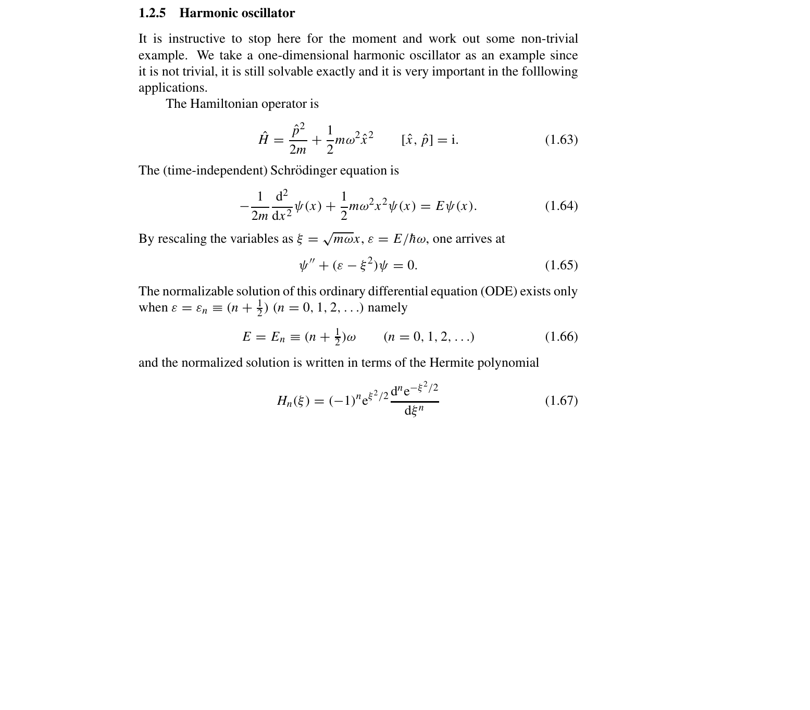

## 第 17 页句读与集注

### 句读开头：“not trivial ... solvable exactly”

谐振子最初来自弹簧，但它的重要性远超过弹簧。设一个系统在稳定平衡点 $x_0$ 附近运动，令 $q=x-x_0$。势能展开为

$$
V(x)=V(x_0)+\underbrace{V'(x_0)}_{0}q+
\frac12V''(x_0)q^2+O(q^3).
$$

稳定性要求二次项系数为正，写成 $m\omega^2$。舍去不影响运动的常数及较小的高阶项，就得到谐振子。这说明它描述稳定平衡附近普遍存在的小振动。多个自由度的二次型在适当条件下可以化成独立的正常模式，每个模式又是谐振子。以后“自由场等于无穷多个振子”的说法，正沿着这条线发展。

### 疏式 (1.63)–(1.66)：离散能级不是先规定的

恢复单位，

$$
H=-\frac{\hbar^2}{2m}\frac{d^2}{dx^2}
+\frac12m\omega^2x^2.
$$

自然长度 $\ell=\sqrt{\hbar/(m\omega)}$ 平衡了动能与势能的尺度。令 $\xi=x/\ell$、$\varepsilon=E/(\hbar\omega)$，直接代入得到

$$
\psi''(\xi)+(2\varepsilon-\xi^2)\psi(\xi)=0.
$$

**校记：**影印原文 (1.65) 在给定 $\varepsilon=E/(\hbar\omega)$ 后写成 $\psi''+(\varepsilon-\xi^2)\psi=0$，少了系数 2；同时该段在 $\hbar=1$ 和恢复 $\hbar$ 的记号间切换。检验方法很简单：把基态 $e^{-\xi^2/2}$ 代进去，它给出 $2\varepsilon=1$。这与原文随后能级一致，却与印出的 (1.65) 不一致。

在很大 $|\xi|$ 下，解可能急剧增长或衰减。物理态需要平方可积，必须剔除增长部分。进一步写 $\psi=e^{-\xi^2/2}h(\xi)$，得到

$$
h''-2\xi h'+(2\varepsilon-1)h=0.
$$

可接受的多项式解要求 $2\varepsilon-1=2n$，于是 $E_n=\hbar\omega(n+\tfrac12)$。边界和归一化条件挑出谱，这与 Sturm–Liouville 问题的思路相接。连续坐标并不保证连续能量；空间束缚和谱的离散性完全可以同时存在。

### 校记式 (1.67)：两套 Hermite 约定不可混用

原文给出的 Rodrigues 公式是概率论常用的 $He_n$ 约定；与本页振子尺度及下一页 $e^{-\xi^2/2}$ 搭配时，需要物理学常用的

$$
H_n(\xi)=(-1)^n e^{\xi^2}
\frac{d^n}{d\xi^n}e^{-\xi^2}.
$$

两套多项式都合法，但变量缩放和归一化必须一起改变。这里把冲突指出，避免你在代入验证时误以为是自己不会解 ODE。

## 原书第 18 页：原文底本

以下影印块是本小节在该页的完整原文；相邻小节在同页交接时按标题分界。PDF 页码为 41。

## 第 18 页句读与集注

### 句读式 (1.68)：用归一化核对公式

按上一页澄清后的约定，位置波函数为

$$
\psi_n(x)=
\left(\frac{m\omega}{\pi\hbar}\right)^{1/4}
\frac{H_n(\sqrt{m\omega/\hbar}\,x)}{\sqrt{2^n n!}}
e^{-m\omega x^2/(2\hbar)}.
$$

若把它视为 $\xi$ 的函数并以 $d\xi$ 归一化，则前面改为 $\pi^{-1/4}/\sqrt{2^n n!}$。**校记：**原文 (1.68) 的系数与变量、Hermite 约定存在不一致；以 $n=0$ 做 Gaussian 积分就能核对。归一化必须明确针对 $dx$ 还是 $d\xi$，因为它们相差 Jacobian。

### 疏式 (1.69)–(1.74)：为什么要把位置和动量合起来？

先构造无量纲变量 $Q=\sqrt{m\omega/\hbar}\,x$、$P=p/\sqrt{m\hbar\omega}$。哈密顿量正比于 $Q^2+P^2$，对易关系是 $[Q,P]=i$。于是定义

$$
a=\frac{Q+iP}{\sqrt2},\qquad
a^\dagger=\frac{Q-iP}{\sqrt2}.
$$

这像把二维相平面组合成复坐标，但 $Q,P$ 是算符，乘法顺序留下一个不可忽略的常数：

$$
a^\dagger a
=\frac12(Q^2+P^2+i[Q,P])
=\frac12(Q^2+P^2-1).
$$

所以 $H=\hbar\omega(N+\tfrac12)$。零点项并非凭空添上，而是由非对易性带出的。

“creation/annihilation”在这里指增加、减少一个振动激发量。对一个被困住的粒子，$a^\dagger$ 通常使它的振动能提高 $\hbar\omega$，不是再创造一颗相同的被困粒子。到了量子场论，正常模式的激发才能进一步解释成粒子占据数。先辨清这两层意思，后面的术语才不会误导。

### 疏：为什么 N 的谱必须是非负整数？

$\langle v|N|v\rangle=\|av\|^2\ge0$ 给出下界。$[N,a]=-a$ 则说明，若 $a|n\rangle$ 不为零，它的本征值是 $n-1$。假设某个本征值是非整数 $n=k+r$，$0<r<1$；下降到 $r$ 后，再作用一次 $a$ 的范数平方仍为 $r>0$，不会消失，却要得到负本征值 $r-1$，矛盾。整数谱则可以在 0 处停止，因为 $\|a|0\rangle\|^2=0$。

这个补充把原文“反复下降，否则负数”的简述补全：必须同时知道下降后的向量何时可能成为零向量。否则只画一条向下的能级梯子，还不算证明。

## 原书第 19 页：原文底本

以下影印块是本小节在该页的完整原文；相邻小节在同页交接时按标题分界。PDF 页码为 42。

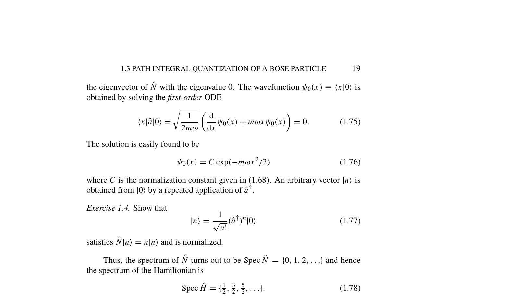

## 第 19 页句读与集注

### 句读式 (1.75)–(1.77)：真空条件如何给出 Gaussian？

$a|0\rangle=0$ 在位置表示中成为

$$
\left(\frac{d}{dx}+\frac{m\omega}{\hbar}x\right)\psi_0=0.
$$

一阶积分得到 $\psi_0=C e^{-m\omega x^2/(2\hbar)}$。Gaussian 不只是“因为许多现象服从正态分布”，而是最低能态的下降算符必须把它消去。它也恰好满足位置—动量不确定关系的等号：

$$
\Delta x=\sqrt{\frac{\hbar}{2m\omega}},\quad
\Delta p=\sqrt{\frac{m\hbar\omega}{2}},\quad
\Delta x\Delta p=\frac{\hbar}{2}.
$$

若要求粒子完全待在势能最低点，$\Delta x$ 极小，动量涨落和平均动能就会变大。最低总能量是在两者之间取得平衡，因此不能把基态理解为经典弹簧完全停住的状态。

由 $\|a^\dagger|n\rangle\|^2=n+1$，可逐级定出归一化：

$$
|n\rangle=\frac{(a^\dagger)^n}{\sqrt{n!}}|0\rangle,\quad
a|n\rangle=\sqrt n\,|n-1\rangle.
$$

**校记式 (1.78)：**本页最后把 $H$ 的谱列为半整数，若未另行令 $\omega=1$，应补乘 $\omega$；恢复单位则补乘 $\hbar\omega$。检验任何能级公式时，都应检查是否具有能量量纲。

**回看问题：**为什么二次势具有普遍性？能量离散来自什么条件？零点能是否意味着能量守恒失效？$a^\dagger$ 在本节增加的究竟是什么？这些问题比背下 Hermite 多项式显式表达式更能支撑后续阅读。

---

[总目录](README.md) · [上一小节](01-1.2.4.md) · [下一小节](03-1.3.1.md)

# 1.3.1 Path integral quantization｜玻色粒子的路径积分

[总目录](README.md) · [上一小节](02-1.2.5.md) · [下一小节](04-1.3.2.md)

本文件包括 1.3 的导言和 1.3.1。路径积分并不是让你遗忘算符理论，改信另一套图像；作者在本节从同一个时间演化算符出发，把矩阵乘法的连续版本改写成路径上的积分。

## 原书第 19 页：原文底本

以下影印块是本小节在该页的完整原文；相邻小节在同页交接时按标题分界。PDF 页码为 42。

## 第 19 页句读与集注

### 句读导言：为什么换到 Lagrangian？

哈密顿形式直接给出能量、态空间和时间演化；拉格朗日形式把理论组织成作用量，较容易把时空对称性和场的局部相互作用写在一起。作者希望后面讨论场、规范结构和拓扑，因此需要一个以作用量为中心的入口。两者描述同一系统时应当给出同一组可观测结果，不能把“换了一种量子化写法”理解为改变了实验规律。

### 句读式 (1.79)–(1.81)：带时间的位置本征态是什么意思？

$|x_i,t_i\rangle$ 是 Heisenberg 位置算符 $\hat x(t_i)$ 的本征态。脚注 12 特别提醒：这里的时间标签标明“在哪个时刻问位置问题”，不要直接把它等同于 Schrödinger 绘景中一个固定初态的动力学演化。

$\langle x_f,t_f|x_i,t_i\rangle$ 叫跃迁振幅。它回答：以初始位置为边界条件，后来在终点探测的复振幅是什么。由于理想位置态是 δ 归一化，核的模平方不能不加说明就当作两个精确点之间的普通概率。实验中应使用有限宽度的初始波包和有限分辨率的探测区间。

## 原书第 20 页：原文底本

以下影印块是本小节在该页的完整原文；相邻小节在同页交接时按标题分界。PDF 页码为 43。

## 第 20 页句读与集注

### 句读式 (1.82)–(1.87)：先回到熟悉的演化算符

把 Heisenberg 算符 $\hat x(t)=e^{iHt/\hbar}\hat x e^{-iHt/\hbar}$ 代入本征方程，就得到原文的态变换。最终真正要计算的是

$$
K(x_f,t_f;x_i,t_i)=
\langle x_f|e^{-iH(t_f-t_i)/\hbar}|x_i\rangle.
$$

这就是演化算符在位置表示中的积分核。若初始态是 $\psi_i$，

$$
\psi_f(x_f)=\int dx_i\,K(x_f,t_f;x_i,t_i)\psi_i(x_i).
$$

这条式子给传播子一个具体用途：它把初始波形变成后来波形。对熟悉数值线性代数的你，可以把它类比为矩阵指数作用在向量上，但这里的矩阵行列指标是连续位置。

### 疏式 (1.88)–(1.90)：为什么叫热核？

将振荡演化换为 $e^{-\beta H}$，它满足 $\partial_\beta h=-H_xh$。若 $H=-\hbar^2\partial_x^2/(2m)$，这就是扩散型方程；而真实时间演化前有 $i$，保持的是概率振幅的酉演化。这个形式联系让分析中的热方程方法进入量子理论，但热扩散的正核与真实时间的复振幅，物理解释仍须区分。

下面限定 $H=p^2/(2m)+V(x)$。这项限定很重要：若哈密顿量含位置依赖的质量、矢势、曲空间动能或非平凡算符排序，短时核和积分测度都要相应处理。本节的简单公式不能无条件套用到所有系统。

## 原书第 21 页：原文底本

以下影印块是本小节在该页的完整原文；相邻小节在同页交接时按标题分界。PDF 页码为 44。

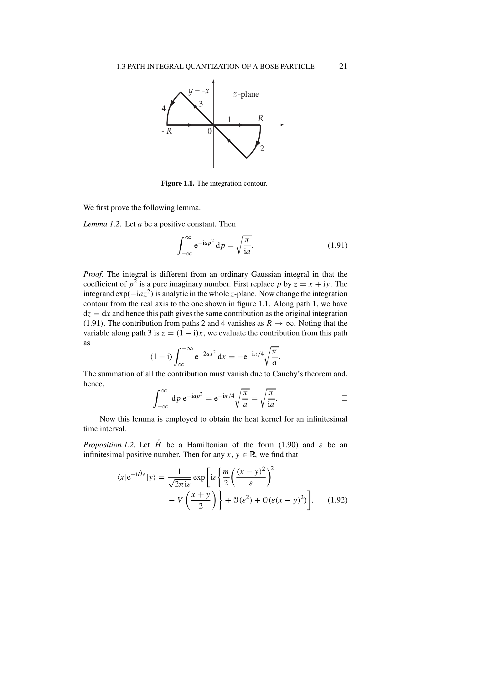

## 第 21 页句读与集注

### 句读引理 1.2 与图 1.1：振荡积分需要怎样理解？

$\int e^{-iap^2}dp$ 不像实 Gaussian 那样绝对可积。旋转积分路径，是利用复解析性把振荡问题连到衰减问题，并确定平方根的相位。结果中的 $\sqrt{1/i}=e^{-i\pi/4}$ 不能随意换号；它影响传播子的初值和组合规律。

一个便于核对的办法是先计算

$$
\int dp\,e^{-(\eta+ia)p^2}
=\sqrt{\frac{\pi}{\eta+ia}},\qquad \eta>0,
$$

再让 $\eta\downarrow0$。这说明答案带着一个极限处方。图 1.1 不是画粒子的运动轨迹，而是画计算复积分时使用的积分路径；两种“路径”不要混淆。

### 疏命题 1.2：短时核为什么长得像经典作用量？

先把正确量纲写清楚。对短时间 $\epsilon$，领先阶为

$$
K_\epsilon(x,y)\simeq
\sqrt{\frac{m}{2\pi i\hbar\epsilon}}\,
\exp\left[\frac{i}{\hbar}
\left(\frac{m(x-y)^2}{2\epsilon}
-\epsilon V\!\left(\frac{x+y}{2}\right)\right)\right].
$$

括号里是“动能乘时间减势能乘时间”：平均速度是 $(x-y)/\epsilon$。这不是先凭物理直觉把 $e^{iS/\hbar}$ 猜进去；下一页的动量积分会把它算出来。

**校记：**本页印出的 (1.92) 前因子缺少 $\sqrt m$，动能括号还出现 $(x-y)^2/\epsilon$ 再平方的写法。与本节证明末尾第 23 页及量纲核对，应该使用上式的 $(x-y)/\epsilon$ 作为速度。影印保留原式，注中不把排印错误沿用到推导。

## 原书第 22 页：原文底本

以下影印块是本小节在该页的完整原文；相邻小节在同页交接时按标题分界。PDF 页码为 45。

## 第 22 页句读与集注

### 句读证明：插入动量完备关系在做什么？

动能在动量表示里对角，势能在位置表示里对角。作者插入 $\int dp\,|p\rangle\langle p|$，是为了把这两种便利结合起来。用短时分解写出主线：

$$
K_\epsilon(x,y)\simeq
\int\frac{dp}{2\pi\hbar}
\exp\left\{\frac{i}{\hbar}
\left[p(x-y)-\epsilon\frac{p^2}{2m}
-\epsilon V\left(\frac{x+y}{2}\right)\right]\right\}.
$$

注意，$e^{A+B}$ 通常不等于 $e^Ae^B$，因为 $\hat p^2$ 与 $V(\hat x)$ 不对易。这里只是在时间切片及相应排序规则下构造极限；更系统的表达是 Trotter 乘积公式或对称短时分解。

完成平方：

$$
p(x-y)-\frac{\epsilon p^2}{2m}
=-\frac{\epsilon}{2m}
\left(p-\frac{m(x-y)}{\epsilon}\right)^2
+\frac{m(x-y)^2}{2\epsilon}.
$$

第一项用 Gaussian 积分给前因子，第二项留下短时动能作用量。这样，为什么出现拉格朗日量就清楚了：消去动量之后，哈密顿表达 $p\dot x-H$ 变成了 $L$。

原文逐行搬动 $\partial_x$ 和 $e^{ikx}$，实质是在谨慎处理微分算符的作用对象。末尾特意保留的“$\cdot1$”提醒你：导数还可能作用在后面的势函数上，只有最终作用到常数时才归零。不能因为 $\partial_x1=0$，就把整段指数里的所有导数提前删掉。

## 原书第 23 页：原文底本

以下影印块是本小节在该页的完整原文；相邻小节在同页交接时按标题分界。PDF 页码为 46。

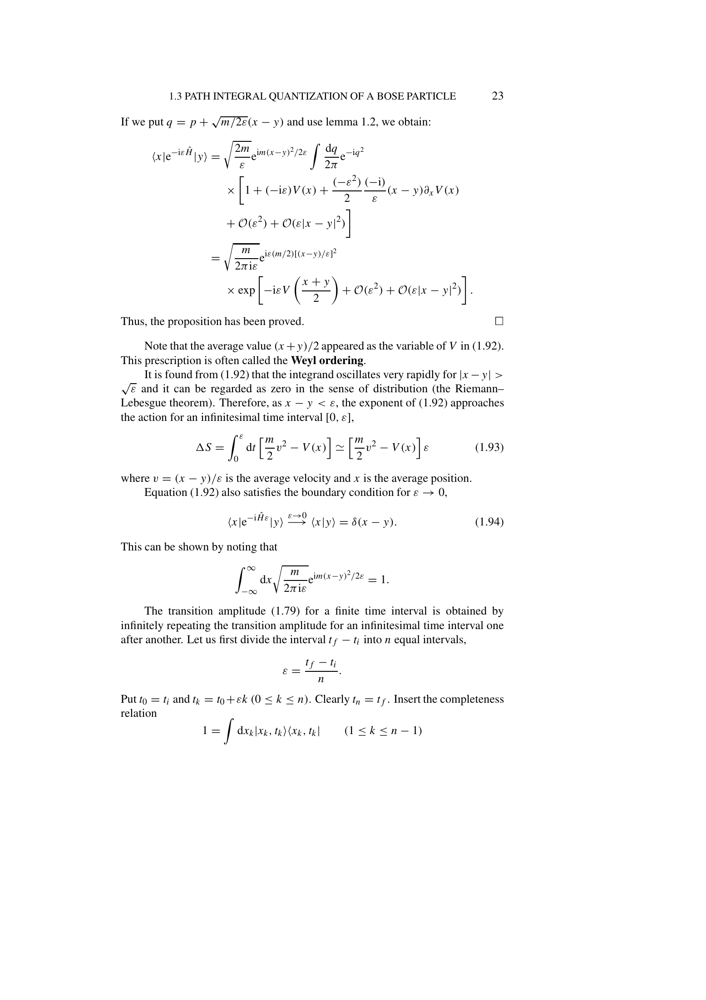

## 第 23 页句读与集注

### 句读中点处方与短时极限

原文的 $V((x+y)/2)$ 对应中点处方。在本节简单的 $p^2/(2m)+V(x)$ 情形，不同相容的短时近似可给出同一连续极限；当 $x,p$ 混合出现时，离散化与算符排序的对应更关键。作者称其为 Weyl ordering，目的是提醒这种对应，不能把“取中点”理解成粒子必然只感受空间中点的势。

核满足

$$
\lim_{\epsilon\downarrow0}K_\epsilon(x,y)=\delta(x-y)
$$

是分布意义的极限：应先与合适函数积分，再取极限。对固定 $x\ne y$，振幅的模并不简单地趋于零，前因子还随 $\epsilon^{-1/2}$ 增长；真正起作用的是不同位置的快速相位振荡相互抵消。因此原文关于“远处可视为零”的话要按分布与积分中的抵消理解。

**尺度提醒：**短时量子涨落的典型尺度与 $\sqrt{\hbar\epsilon/m}$ 有关，而非笼统的 $|x-y|<\epsilon$。后者甚至混合了长度和时间的量纲。也正因为涨落并不按普通光滑轨迹的方式缩小，下一页才强调速度只是形式符号。

### 疏：为什么要把时间切开？

演化算符有组合律。以中间时刻 $t$ 为例，

$$
K(f;i)=\int dx\,K(f;x,t)K(x,t;i).
$$

这是连续基下的矩阵乘法。中间位置没有被实际测量；插入完备关系不会造成测量坍缩。它只是把同一个算符的计算拆开。若真的测量并记录了中间位置，实验问题以及干涉结构都会改变。

## 原书第 24 页：原文底本

以下影印块是本小节在该页的完整原文；相邻小节在同页交接时按标题分界。PDF 页码为 47。

## 第 24 页句读与集注

### 句读式 (1.95)：所谓“所有路径”先是有限多个积分

把 $T$ 分成 $n$ 段后，端点固定，只有 $x_1,\ldots,x_{n-1}$ 是积分变量：

$$
K_n=\left(\frac{m}{2\pi i\hbar\epsilon}\right)^{n/2}
\int dx_1\cdots dx_{n-1}\,
e^{iS_n(x_0,\ldots,x_n)/\hbar}.
$$

每选定一组中间位置，就可以画一条折线路径。积分遍历这些位置，便可以简称为“对路径求和”。这句话来源于有限维积分的重新组织，不要求你相信粒子以经典方式依次访问每条折线。

前因子有 $n$ 份而独立位置只有 $n-1$ 个，是因为有 $n$ 段短时传播，但两个端点不积分。这个计数关系能帮助核对自由粒子的答案，也解释为什么不能把测度中的全部常数随手扔掉。

### 疏式 (1.96)–(1.98)：为什么作者反复说 formal？

时间步长缩小时，典型路径未必可微；差商 $(x_k-x_{k-1})/\epsilon$ 甚至会发散。因而 $\int\mathcal Dx\,e^{iS[x]/\hbar}$ 不能一律当作“某个普通无限维 Lebesgue 测度上，对光滑函数的积分”。本节实际可操作的定义是带有规范化、边界条件和极限处方的离散表达。

这不是理论随意，而是提醒先明确所用的数学对象。欧氏时间下某些势能条件允许用 Wiener 测度和 Feynman–Kac 公式做严格处理；真实时间的一般路径积分还要另外分析。就当前阅读，记住“离散定义先于漂亮的连续符号”即可，不必停下来先修完所有严格构造。

## 原书第 25 页：原文底本

以下影印块是本小节在该页的完整原文；相邻小节在同页交接时按标题分界。PDF 页码为 48。

## 第 25 页句读与集注

### 句读图 1.2：“多条路径”为什么仍会出现经典轨迹？

若作用量变化远大于 $\hbar$，附近路径的相位变化很快，积分中大量抵消。在 $\delta S=0$ 的路径附近，相位的一阶变化消失，邻近贡献较容易保留下来。这是驻相近似把经典方程带回来的机制。经典路径不是另外贴在量子理论上的限制，而是在合适尺度下从振幅叠加中显现。

“驻相”与“最小作用量”不应混用。真实时间作用量的驻点不一定是最小值。量子涨落也没有在经典轨迹之外全部消失；只是宏观条件下，许多不同路径的贡献互相抵消。

### 句读例 1.5：自由粒子也有非平凡传播

自由粒子没有势能，却不是“态永远不变”。不同动量分量具有不同能量 $p^2/(2m)$，积累不同相位，波包可以展宽。动量积分给出

$$
K_0(x_f,x_i;T)=
\sqrt{\frac{m}{2\pi i\hbar T}}
\exp\left[\frac{im(x_f-x_i)^2}{2\hbar T}\right].
$$

指数是连接两端点的匀速经典路径的作用量，但前因子来自对所有中间涨落的积分。不要从答案只含 $S_{\rm cl}$，误以为推导中只保留了这一条轨迹。

位置本征态到位置本征态的这个核，模随端点距离并不衰减；它不是一个归一化的最终位置概率分布。与实际初始波包卷积后，才得到可归一化的最终态及其概率。这也再次说明传播振幅与概率分布需要区分。

## 原书第 26 页：原文底本

以下影印块是本小节在该页的完整原文；相邻小节在同页交接时按标题分界。PDF 页码为 49。

## 第 26 页句读与集注

### 句读离散 Gaussian 计算：怎样消去中间点？

每积去一个中间位置，就是把两个短时核合成为一个较长时间核。例如

$$
\int dz\,K_0(x,z;t_2)K_0(z,y;t_1)
=K_0(x,y;t_1+t_2).
$$

完成平方后，$z$ 的中心位于连接两端点的匀速插值位置；其余 Gaussian 积分贡献归一化。反复使用，就得到原文的归纳式。你可以用有限维三对角二次型的行列式复核同一过程，这与离散差分 Laplacian 的计算有关。

### 句读式 (1.105)：经典作用量之外还有什么？

作者写 $K=Ae^{iS_{\rm cl}}$，并说涨落被装进 $A$。对二次作用量，围绕经典解的展开在二阶精确终止，所以这个结构可以精确成立。一般非线性系统还有高阶涨落，$A$ 也可能包含更复杂的量子修正；不能把本例当作所有路径积分都已被经典轨迹精确求尽。

本节的完整因果链现在可以重述：酉演化有组合律；连续基的组合律插入中间位置积分；短时核的动量积分产生 $p\dot x-H=L$；连乘短时相位产生总作用量；在经典尺度下，驻相条件又产生 Euler–Lagrange 方程。

**回看问题：**插入完备关系是否等于做一次测量？为什么短时核前因子不能删？路径积分中的速度为什么只是形式记号？经典极限依靠什么抵消机制？自由核的模平方为什么不能直接当最终位置概率？

---

[总目录](README.md) · [上一小节](02-1.2.5.md) · [下一小节](04-1.3.2.md)

# 1.3.2 Imaginary time and partition function｜虚时间与配分函数

[总目录](README.md) · [上一小节](03-1.3.1.md) · [下一小节](05-1.3.3.md)

本节把两件事连起来：分析中的热半群，以及统计物理中的热平衡。数学上都出现 $e^{-\beta H}$，但 $\beta$ 的物理解释需要另外说明。

## 原书第 26 页：原文底本

以下影印块是本小节在该页的完整原文；相邻小节在同页交接时按标题分界。PDF 页码为 49。

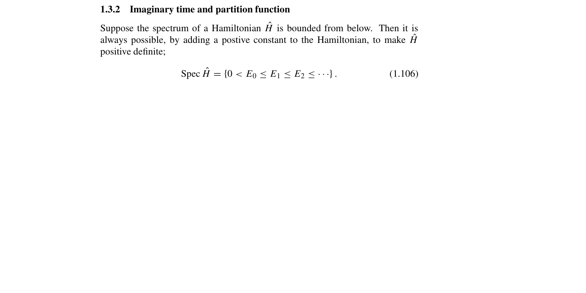

## 第 26 页句读与集注

### 句读“bounded from below”：为什么先要求能量下界？

若能量可以无限向下，$e^{-\beta E}$ 会对越来越低的能量给越来越大的权重，通常既没有稳定基态，也无法建立通常的热平衡。把能量整体平移，可以令下界为零或正数。真实时间演化因此只多一个共同相位；归一化的热态也不变，因为配分函数会乘同一因子。

“有下界”与“热算符可取有限迹”是两件事。无限空间上的自由粒子即使能量非负，配分函数仍会因空间体积无限而发散。后面写离散求和，隐含了适当的有限体积、束缚条件，或其他使迹有意义的安排。不要把任何正算符都自动当作迹类算符。

## 原书第 27 页：原文底本

以下影印块是本小节在该页的完整原文；相邻小节在同页交接时按标题分界。PDF 页码为 50。

## 第 27 页句读与集注

### 句读 Wick rotation：不是把实验时钟拨到虚数

在能量本征基中，

$$
e^{-iHt/\hbar}=\sum_n e^{-iE_nt/\hbar}|n\rangle\langle n|.
$$

令 $t=-i\tau$ 后，相位变成 $e^{-E_n\tau/\hbar}$：高能态比低能态衰减快。这个解析变换把振荡问题改成衰减问题。它是一种计算与结构工具，不是在声称实验中存在一只读数为 $i$ 秒的钟。

真实时间强调态的酉演化；欧氏时间强调谱的抑制。对于一个同时含基态与激发态的向量，作用 $e^{-\tau H/\hbar}$ 并适当归一化，在大 $\tau$ 极限下会挑出基态分量。条件是初始向量与基态不正交，并妥善处理简并和连续谱。原文的解析性表述也应在相应算符、矩阵元和收敛条件下理解，不是对任意势或背景无条件成立的轮廓旋转定理。

### 疏式 (1.109)：势能为什么由负号变成正号？

由 $dt=-i\,d\tau$、$\dot x=i\,dx/d\tau$，

$$
\frac{iS}{\hbar}
=-\frac1\hbar\int d\tau
\left[\frac m2\left(\frac{dx}{d\tau}\right)^2+V(x)\right]
=-\frac{S_E}{\hbar}.
$$

注意这是同时变换时间微分和速度的结果，不能只把 $i$ 删除。对于实势且满足相应下界的例子，$e^{-S_E/\hbar}$ 像非负统计权重，于是最小作用量及涨落的讨论更接近你熟悉的优化与 Gaussian 积分。这种直观在含复杂相位或费米行列式的理论中未必保留。

### 句读式 (1.110)–(1.111)：为什么热权重是指数？

热平衡系统与温度固定的大热库交换能量。小系统获得能量 $E$ 时，热库少掉这部分能量；将热库熵在平衡点展开，其可用微观态数产生比例 $e^{-E/(k_BT)}$。这给出 Gibbs 权重。定义

$$
\beta_{\rm th}=\frac1{k_BT},\qquad
\rho=\frac{e^{-\beta_{\rm th}H}}{Z},\qquad
Z=\operatorname{Tr}e^{-\beta_{\rm th}H}.
$$

$Z$ 首先是使所有概率相加为 1 的归一化因子，同时保存能谱的统计信息。例如 $\langle H\rangle=-\partial_\beta\log Z$。本书用 $\hbar=1$，把欧氏时间区间与 $\beta$ 直接认同；恢复单位时，区间长度为 $\hbar\beta_{\rm th}$，不是把“秒”和“能量倒数”直接等同。

## 原书第 28 页：原文底本

以下影印块是本小节在该页的完整原文；相邻小节在同页交接时按标题分界。PDF 页码为 51。

## 第 28 页句读与集注

### 句读式 (1.112)–(1.113)：取迹为何把路径闭合？

迹是沿任意完备基把对角矩阵元相加。位置基中，

$$
Z=\int dy\,\langle y|e^{-\beta H}|y\rangle.
$$

每个矩阵元是一条初始位置与最终位置都为 $y$ 的欧氏传播；再对 $y$ 积分，便得到所有闭合路径的积分。周期条件 $x(0)=x(\beta)$ 来自“取迹”，而不是粒子受力以后被强行拉回原点。

闭合路径的起点不固定在某个特定位置，它也被积分。只算 $x(0)=x(\beta)=0$ 的振幅，还不是整个配分函数。后面 1.4.2 会把固定端点的涨落积分与端点积分分开，切勿把 Dirichlet 涨落边界直接当成热路径的完整边界。

周期性属于欧氏时间中的配置；不表示真实粒子经过一个温度决定的物理时间就一定回到原位置。热态描述统计平衡，闭合路径是它在这个表示中的计算结构。

**回看问题：**$e^{-itH}$ 与 $e^{-\tau H}$ 各自保留或抑制什么？有能量下界为什么还不够保证 $Z<\infty$？温度怎样进入公式？周期条件为什么由迹产生？能回答这些，就能避免把 Wick 旋转、热化和真实周期运动混为一谈。

---

[总目录](README.md) · [上一小节](03-1.3.1.md) · [下一小节](05-1.3.3.md)

# 1.3.3 Time-ordered product and generating functional｜编时乘积与生成泛函

[总目录](README.md) · [上一小节](04-1.3.2.md) · [下一小节](06-1.4.1.md)

生成泛函可以看作把所有关联信息装进一个“可求导的总账本”。本节最重要的是弄清它记的是什么，以及记账所用的边界态与归一化。

## 原书第 28 页：原文底本

以下影印块是本小节在该页的完整原文；相邻小节在同页交接时按标题分界。PDF 页码为 51。

## 第 28 页句读与集注

### 句读式 (1.114)：“晚时在左”从哪里来？

算符乘积作用在 ket 上时，最右边先作用。若在较早的 $t_1$ 和较晚的 $t_2$ 插入操作，演化链自然是“先 $t_1$，再 $t_2$”，写成算符则较晚者在左。编时算符 $T$ 就把这个规则统一编码。若 $t_2>t_1$，$T[A(t_1)B(t_2)]=B(t_2)A(t_1)$。

这是量子问题，因为不同时间的算符一般不对易。即使只研究谐振子，

$$
[x(t),x(s)]=\frac{i\hbar}{m\omega}\sin[\omega(s-t)],
$$

通常也不为零。原文这一定义针对玻色型算符；费米算符编时在交换时还要带负号。

原文脚注选取的 $\theta(0)$ 不能独自解决所有相同时刻乘积问题。连续场中重合点还可能出现接触项或发散；当前先处理互不重合的时间。式 (1.115) 的时间指标也应按紧接的说明理解为 $t_1,\ldots,t_n$；排印中夹入 $t_f$ 并不表示要把末端算符混入中间插入序列。

## 原书第 29 页：原文底本

以下影印块是本小节在该页的完整原文；相邻小节在同页交接时按标题分界。PDF 页码为 52。

## 第 29 页句读与集注

### 句读式 (1.117)–(1.118)：为什么路径积分“自动”编时？

沿时间从右到左插入位置完备关系，每个 $\hat x(t_k)$ 作用在自己的位置本征态上，就变成一个普通数 $x_k$。因此有

$$
\langle x_f,t_f|T[x(t_1)\cdots x(t_n)]|x_i,t_i\rangle
=\int\mathcal Dx\,x(t_1)\cdots x(t_n)e^{iS[x]/\hbar}.
$$

右边的数彼此可交换，但并不是说左边的量子算符突然可交换了。恰好相反：右边所代表的特定算符排序，已经由左边的时间切片推导确定。这是作者强调“operator”与“real value of a classical path”的原因。

### 疏式 (1.119)–(1.122)：为什么加一个源再求导？

外源 $J(t)$ 以 $J(t)x(t)$ 耦合到位置。若把它当作真的外力，$L$ 多出 $Jx$，Euler–Lagrange 方程中的受力就多出 $J$。但在生成泛函计算中，也可只把它作为辅助探针，最后设为零。

定义 $Z_{\rm end}[J]=\int\mathcal Dx\,e^{i(S+\int Jx)/\hbar}$，则

$$
\frac{\hbar}{i}\frac{\delta Z_{\rm end}}{\delta J(s)}
=\int\mathcal Dx\,x(s)e^{i(S+\int Jx)/\hbar}.
$$

泛函导数之所以能“取出一个 $x(s)$”，来自
$\delta(\int J(t)x(t)dt)/\delta J(s)=x(s)$。多求一次就插入另一个位置。它与普通矩母函数求导产生矩的做法相似，只不过这里记录带编时次序的量子矩阵元。

关联函数有什么物理用处？一次平均值告诉你系统通常在哪里；两时关联还告诉你，在一个时刻的扰动或涨落与另一时刻怎样联系。振动频率、响应特征和量子涨落都能从这些函数中提取。源既可以是计算标签，也可以在适当实验设置下代表外界施加的弱扰动。

## 原书第 30 页：原文底本

以下影印块是本小节在该页的完整原文；相邻小节在同页交接时按标题分界。PDF 页码为 53。

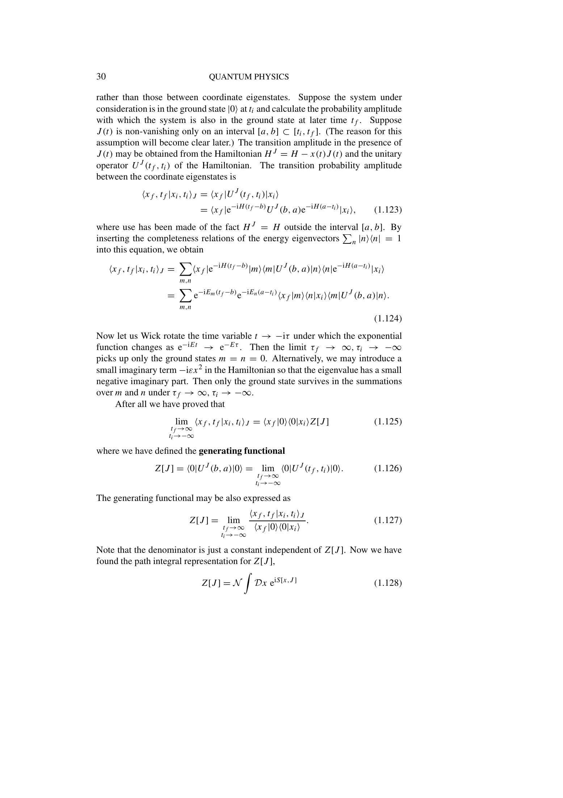

## 第 30 页句读与集注

### 句读式 (1.123)–(1.124)：为什么把源限制在有限时段？

源只在 $[a,b]$ 非零，意味着遥远过去和未来都由同一个无源哈密顿量控制。这样可以清楚地问：系统从无源基态出发，经历一段外部作用，最后又落回无源基态的振幅是什么。两端的自由演化因子与中间的 $U_J(b,a)$ 于是自然分开。

在两端插入能量基，作者把振幅展开成能量分量之和。欧氏演化较长时，激发态相对基态会被 $e^{-(E_n-E_0)\tau/\hbar}$ 压低。这正是上一节谱过滤的应用，不是额外假定系统在真实时间中自动散热到基态。

### 校读式 (1.125)–(1.128)：不能省略的真空极限约定

若 $E_0\ne0$，大欧氏时间会有共同的 $e^{-E_0\tau/\hbar}$ 因子，真实时间则有共同振荡相位。因此原文写出的极限不能不加处理就当作普通逐点极限。通常需要减去基态能、除去无源振幅，并使用相容的 $i\epsilon$ 或欧氏投影处方。

这页关于在哈密顿量中加 $-i\epsilon x^2$ 的说法也不应扩大为“任意系统都能靠这一项严格投影出基态”的定理。投影最清楚的谱论依据是相对能量的欧氏衰减。对本文接下来的计算，采用归一化定义

$$
Z[J]=\frac{\int\mathcal Dx\,e^{i(S+\int Jx)/\hbar}}
{\int\mathcal Dx\,e^{iS/\hbar}},
\qquad Z[0]=1,
$$

并注明真空边界处方，就能避免把共同发散或共同相位误认为关联函数本身。

## 原书第 31 页：原文底本

以下影印块是本小节在该页的完整原文；相邻小节在同页交接时按标题分界。PDF 页码为 54。

## 第 31 页句读与集注

### 句读式 (1.129)：同一个字母 Z 已经换了问题

这里的 $Z[J]$ 是归一化的真空生成泛函；1.3.2 的 $Z(\beta)$ 是热配分函数。一个含源、用于产生真空关联；一个取热迹、用于统计平衡。两者都能用路径积分表示，所以共享字母，但边界条件和物理态并不相同。

由 $Z[0]=1$，

$$
\langle0|T[x(t_1)\cdots x(t_n)]|0\rangle
=\left(\frac{\hbar}{i}\right)^n
\left.\frac{\delta^nZ[J]}
{\delta J(t_1)\cdots\delta J(t_n)}\right|_{J=0}.
$$

若使用未经归一化的路径积分，右边还需除以无源值。这个因子不是可有可无的装饰：没有它，连 $\langle1\rangle=1$ 都未必成立。

**回看问题：**右边路径值可交换，为什么不说明左边算符可交换？源项何以有外力直观？编时关联与普通概率的乘积有何不同？真空投影与热迹分别怎样处理端点？看到后文任何一个 $Z$ 时，先回答“它的边界态和归一化是什么”。

---

[总目录](README.md) · [上一小节](04-1.3.2.md) · [下一小节](06-1.4.1.md)

# 1.4.1 Transition amplitude｜谐振子的传播振幅

[总目录](README.md) · [上一小节](05-1.3.3.md) · [下一小节](07-1.4.2.md)

本节再次研究谐振子，但计算对象从能谱改成传播振幅。重点是展示“经典解＋涨落”怎样变成一个可计算的精确分解。

## 原书第 31 页：原文底本

以下影印块是本小节在该页的完整原文；相邻小节在同页交接时按标题分界。PDF 页码为 54。

## 第 31 页句读与集注

### 句读式 (1.130)–(1.135)：先找连接两端点的经典路径

这里不是给定初始位置和速度，而是给定初、末位置。因而解的是两点边值问题。满足 $\ddot x_c+\omega^2x_c=0$ 的路径由正弦和余弦组合而成；原文 (1.134) 把系数直接整理成符合两个端点的形式。

为什么先找经典解？因为围绕它展开作用量，一阶变化消失，剩下的积分结构最简单。这个步骤在数学上与围绕驻点展开函数相似；但真实时间的作用量一般不是凸函数，所以不要把它无条件理解成全局最小化。

经典作用量可用一个比逐项三角积分更短的计算得到。沿经典解，

$$
\frac d{dt}(x_c\dot x_c)
=\dot x_c^2+x_c\ddot x_c
=\dot x_c^2-\omega^2x_c^2.
$$

故 $S_c=\frac m2[x_c\dot x_c]_{t_i}^{t_f}$。把端点和端点速度代入，就得到 (1.135)。这说明二次系统的在壳作用量可以化成边界量。

式中 $\sin\omega T$ 在某些时间为零，提示两点边值问题会出现特殊情况。此时不能继续把普通函数公式硬代下去；传播核应按分布和正确相位延续理解。

## 原书第 32 页：原文底本

以下影印块是本小节在该页的完整原文；相邻小节在同页交接时按标题分界。PDF 页码为 55。

## 第 32 页句读与集注

### 句读式 (1.136)：为什么涨落必须在端点为零？

令 $x=x_c+y$。原始路径和经典路径都连接同一对端点，因此差值满足 $y(t_i)=y(t_f)=0$。涨落边界不是为了方便随意添加的，它表达的是“比较的是同一个传播问题中的所有路径”。

直接展开：

$$
S[x_c+y]=S_c+
m\int dt\,(\dot x_c\dot y-\omega^2x_cy)
+\frac m2\int dt\,(\dot y^2-\omega^2y^2).
$$

中间项分部积分后为

$$
m[\dot x_cy]_{t_i}^{t_f}
-m\int dt\,(\ddot x_c+\omega^2x_c)y=0.
$$

边界条件消去第一项，经典方程消去第二项。于是只剩二次涨落，且没有三次以上项。这一步同时解释原文两条理由：驻点消一次项，二次理论没有高阶项。

### 疏式 (1.137)–(1.140)：Hessian 为何是微分算符？

对函数求二阶导得到矩阵；对路径作用量求二阶变分得到带两个时间指标的核：

$$
\frac{\delta^2S}{\delta x(t)\delta x(s)}
=-m(\partial_t^2+\omega^2)\delta(t-s).
$$

它告诉你不同形状的微小变动怎样改变作用量。借助分部积分，这个核等价于涨落算符 $-m(\partial_t^2+\omega^2)$，连同固定端点的定义域一起组成完整问题。换了边界条件，谱和行列式都会改变。

把 $x$ 平移为 $x_c+y$ 后，有限切片积分的 Jacobian 为 1，因此

$$
K=e^{iS_c/\hbar}I_f.
$$

$I_f$ 是对全部涨落的积分，不能因为经典解已经找到就设为 1。它控制幅度、相位，以及后面热配分函数的归一化。

## 原书第 33 页：原文底本

以下影印块是本小节在该页的完整原文；相邻小节在同页交接时按标题分界。PDF 页码为 56。

## 第 33 页句读与集注

### 句读式 (1.141)：为什么选正弦展开？

正弦函数在 $0,T$ 两端为零，正好适合固定端点涨落。将 $y$ 展开后，每一个 Fourier 系数 $a_n$ 表示一种独立的时间形状；二次型在这些模式上对角化：

$$
\int_0^T(\dot y^2-\omega^2y^2)\,dt
=\frac T2\sum_{n\ge1}
\left[\left(\frac{n\pi}{T}\right)^2-\omega^2\right]a_n^2.
$$

这样，泛函积分就变成许多普通 Gaussian 积分。这是“无穷维 Gaussian”最可操作的直观：先截断为有限模式，再计算二次型的谱。

### 句读式 (1.142)–(1.144)：为什么用自由粒子定归一化？

从切片值 $y_k$ 到模式系数 $a_n$ 是有限维线性换元，其 Jacobian 依赖模式的归一化方式。作者用同样换元的自由粒子结果来校准，是要让不依赖势能的测度因子彼此抵消。

更稳妥的主线是直接考虑比值：

$$
\frac{I_f(\omega)}{I_f(0)}
=\prod_{n=1}^\infty
\left[1-\left(\frac{\omega T}{n\pi}\right)^2\right]^{-1/2}.
$$

分母自由核的归一化已知，便不用给每个单独的无穷常数赋值。这个思路类似用参照问题消去公共归一化。

**校记：**原文从 (1.143) 起的若干前因子没有保留一般质量 $m$，与前文含 $m$ 的自由核不一致；也没有在这里明确宣布改取 $m=1$。使用一般单位时，自由前因子是 $\sqrt{m/(2\pi i\hbar T)}$。下面不逐个沿抄这些漏项，而以行列式比值和自由极限核对最终结果。

## 原书第 34 页：原文底本

以下影印块是本小节在该页的完整原文；相邻小节在同页交接时按标题分界。PDF 页码为 57。

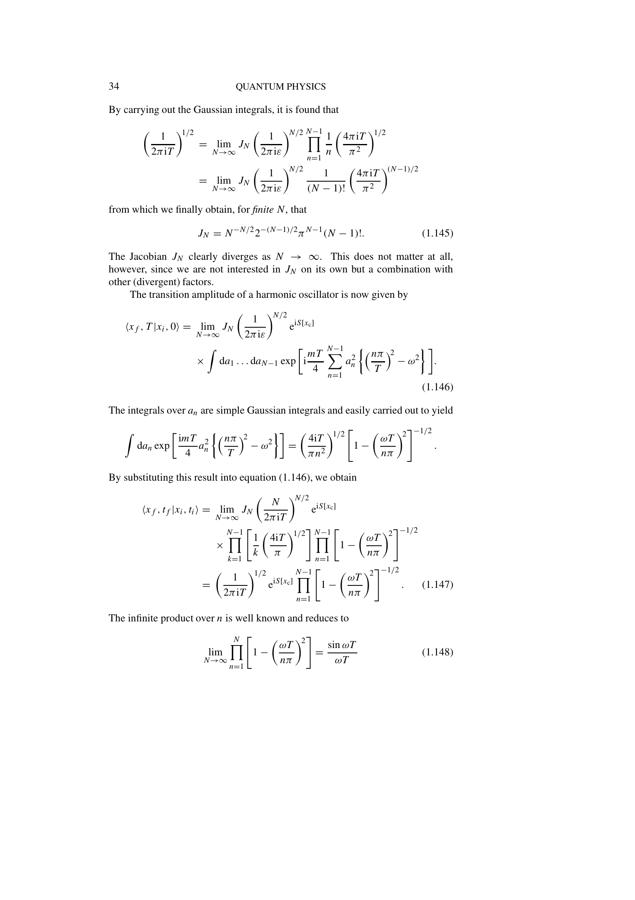

## 第 34 页句读与集注

### 句读式 (1.145)–(1.148)：无穷乘积究竟统计了什么？

每个模式积分贡献一个特征值的 $-1/2$ 次方。振子相对自由粒子的第 $n$ 个特征值比为 $1-(\omega T/n\pi)^2$。乘遍模式，就统计了全部独立涨落形状的贡献。

利用

$$
\frac{\sin z}{z}
=\prod_{n=1}^\infty\left(1-\frac{z^2}{n^2\pi^2}\right)
$$

得到 $I_f(\omega)/I_f(0)=(\sin\omega T/\omega T)^{-1/2}$。模式很多时，分别写出的测度与积分常数可能发散；这里有意义的是同一离散化下组合起来的核或相对行列式。不能把两个来源不同、截断方式不同的“无穷大”直接约掉。

本页的有限维 Jacobian 详细式不是理解物理的前提，但需要知道为什么保持有限切片数有用：在有限维，变量个数、换元行列式、Gaussian 常数都可以逐项检查；最后再取相容的极限。先跳到形式无限乘积，反而容易丢掉常数和相位。

### 疏：哪些地方属于精确解，哪些属于一般方法？

“找驻点，再算 Hessian”是普遍的近似方法；谐振子特别之处是没有高阶项，因此这里精确。一般势中，三阶、四阶变分产生非 Gaussian 涨落，之后的费曼图与微扰展开便是在处理这些项。

## 原书第 35 页：原文底本

以下影印块是本小节在该页的完整原文；相邻小节在同页交接时按标题分界。PDF 页码为 58。

## 第 35 页句读与集注

### 句读式 (1.149)：恢复单位后的传播核

在避开焦点并选择连续相位分支的区间内，

$$
K=
\sqrt{\frac{m\omega}{2\pi i\hbar\sin\omega T}}\,
\exp\left[
\frac{im\omega}{2\hbar\sin\omega T}
\bigl((x_f^2+x_i^2)\cos\omega T-2x_fx_i\bigr)
\right].
$$

令 $\omega\to0$，利用 $\sin\omega T\sim\omega T$、$\cos\omega T\sim1$，就回到自由粒子核。这是很重要的物理与量纲核对；原文在 $m=1$ 的写法下才能与此直接比较。

### 疏：分母为零是不是概率无限大？

在 $T=k\pi/\omega$，经典振子会把位置按周期性关系聚焦，核变成带相位的 δ 型分布，不能继续当普通函数解释。“前因子发散”提示表示形式失效，并不说明归一化波包的总概率发散。

跨越这些时间时，还要跟踪平方根相位，即常说的 Maslov 相位。初学时不必把一般焦散理论学完，但应保留这个边界：原文的单个平方根公式需要相位处方，不能在所有 $T$ 上独立取主值后就宣称得到正确酉演化。

**回看问题：**为什么 $y$ 的端点为零？为什么二次展开精确？正弦模式由哪项物理条件选定？行列式与涨落有什么关系？怎样用自由极限核对传播核？

---

[总目录](README.md) · [上一小节](05-1.3.3.md) · [下一小节](07-1.4.2.md)

# 1.4.2 Partition function｜谐振子的配分函数与谱行列式

[总目录](README.md) · [上一小节](06-1.4.1.md) · [下一小节](08-1.5.1.md)

本节用能谱、传播核和谱行列式三条路线算同一个热配分函数。物理问题相同，数学表示不同；比较时必须保留一致的测度与边界约定。

## 原书第 35 页：原文底本

以下影印块是本小节在该页的完整原文；相邻小节在同页交接时按标题分界。PDF 页码为 58。

## 第 35 页句读与集注

### 句读式 (1.150)：先数清哪些态参与热平衡

能量为 $E_n=\hbar\omega(n+\tfrac12)$，故

$$
Z(\beta)=e^{-\beta\hbar\omega/2}
\sum_{n=0}^\infty e^{-n\beta\hbar\omega}
=\frac1{2\sinh(\beta\hbar\omega/2)}.
$$

这里的每一项是一种占据数状态的热权重。低温时 $\beta\hbar\omega\gg1$，激发态被压低，$Z\sim e^{-\beta E_0}$。高温时 $Z\sim1/(\beta\hbar\omega)$，很多能级都有显著权重，开始接近经典统计。

从 $\langle H\rangle=-\partial_\beta\log Z$ 可得

$$
\langle H\rangle
=\frac{\hbar\omega}{2}
\frac{\hbar\omega}{e^{\beta\hbar\omega}-1}.
$$

第一项是零点能，第二项是热激发贡献；高温趋近 $k_BT$，对应一个动能二次项和一个势能二次项各贡献 $k_BT/2$。这使配分函数与实验中的平均能量、比热联系起来，而不只是一个求和技巧。

### 句读 Method 1：取迹如何变成普通 Gaussian？

传播核中令 $x_f=x_i=x$，再将 $T$ 旋到欧氏时间，最后积分 $x$。这次 $x$ 不是涨落系数，而是闭合路径可以经过的任意端点。固定端点的核加上端点积分，才等于热迹。双曲函数出现，是因为 $\sin(-iz)=-i\sinh z$。

练习 1.5 则准备下一种算法：实对称正定矩阵可以正交对角化，换元 Jacobian 的绝对值为 1，各模式 Gaussian 积分相乘，给出 $(\det A)^{-1/2}$。复变量相当于两套实变量，因此在相应测度约定下给 $(\det A)^{-1}$。指数有无 $1/2$ 会改变 $2\pi$ 因子；“忽略数字因子”只能用于已约定归一化的问题。

## 原书第 36 页：原文底本

以下影印块是本小节在该页的完整原文；相邻小节在同页交接时按标题分界。PDF 页码为 59。

## 第 36 页句读与集注

### 句读式 (1.154)：微分表达式加边界条件才是算符

欧氏涨落算符是

$$
O_D=-\frac{d^2}{d\tau^2}+\omega^2,\qquad
y(0)=y(\beta)=0.
$$

它的谱是 Dirichlet 谱。热路径本身则是周期的。这两句话并不冲突：作者先固定公共端点 $x$，把路径分成端点相关的经典部分与零端点涨落，再对 $x$ 积分。

若直接从周期路径展开，应该用周期模式，包含常数模式；所得是另一个边界条件下的谱行列式。不能拿周期特征值替换本页的 Dirichlet 特征值，同时又保留作者额外的端点积分，否则会重复计数或漏掉模式。

### 疏：为什么 Gaussian 产生行列式的倒平方根？

有限维中，每个方向的“刚度”是 $\lambda_n$。越刚的模式允许的涨落范围越窄，它的积分约为 $\lambda_n^{-1/2}$。所有方向相乘就是 $(\det O)^{-1/2}$。这可以与你熟悉的 Gaussian 协方差联系起来：二次型矩阵描述代价，逆矩阵描述涨落相关。

书中把有限矩阵写作 $\det$，把算符的形式行列式写作 $\operatorname{Det}$。这个大小写不是新物理量，而是提醒后者通常要处理无限个模式。真实路径积分的整体常数、基的归一化和参考尺度仍需一起给定。

## 原书第 37 页：原文底本

以下影印块是本小节在该页的完整原文；相邻小节在同页交接时按标题分界。PDF 页码为 60。

## 第 37 页句读与集注

### 句读式 (1.156)–(1.159)：ζ 正则化不是把发散乘积当普通乘积

直接相乘 $\prod_n\lambda_n$ 通常发散。先在收敛区域定义

$$
\zeta_O(s)=\sum_n\lambda_n^{-s}.
$$

若它能亚纯延拓且在 $s=0$ 正则，就定义

$$
\det\nolimits_\zeta O=\exp[-\zeta'_O(0)].
$$

“定义”很关键：$\sum\log\lambda_n$ 发散时，不能声称用普通求和已经得到有限值；真正做的是通过解析延拓建立一种相容的正则化量。对有量纲的算符，还需要用参考尺度使 $\lambda_n/\mu^2$ 无量纲。某些变化会表现为归一化或局部项，不能离开完整理论随意解释。

原文说一般算符的 ζ 函数可以延拓，适用范围要联系其具体类型。对本例的正椭圆算符和紧区间边界问题，方法良好；并非任意有正谱的算符都自动具有同样的延拓性质。

### 疏式 (1.160)–(1.161)：这里怎样用到熟悉的 Riemann ζ？

自由 Dirichlet 谱是 $\lambda_n=(n\pi/\beta)^2$，所以

$$
\zeta_{-\partial_\tau^2}(s)
=\left(\frac\beta\pi\right)^{2s}\zeta_R(2s).
$$

微分后代入 $\zeta_R(0)=-1/2$ 和 $\zeta_R'(0)=-\log(2\pi)/2$，就得到下一页的 $2\beta$。这一步是谱结构和数论函数的具体相遇；它不是说任何无穷乘积都可以不问条件地“套 ζ 函数”。

## 原书第 38 页：原文底本

以下影印块是本小节在该页的完整原文；相邻小节在同页交接时按标题分界。PDF 页码为 61。

## 第 38 页句读与集注

### 句读式 (1.162)–(1.165)：把结果与已知答案对上

本例给出

$$
\det\nolimits_{\zeta,D}(-\partial_\tau^2+\omega^2)
=2\beta\prod_{n\ge1}
\left[1+\left(\frac{\beta\omega}{n\pi}\right)^2\right]
=\frac{2\sinh(\beta\omega)}{\omega}.
$$

为了与物理传播核一致，固定端点核前因子的平方根相对于这一定义还有测度常数。比如 $m=\hbar=1$ 时，

$$
K_E(x,x;\beta)
=\frac1{\sqrt{\pi\,\det_{\zeta,D}O_D}}\,
e^{-\omega x^2\tanh(\beta\omega/2)}.
$$

再对 $x$ 积分，才回到 $Z=1/[2\sinh(\beta\omega/2)]$。这明确说明：单独写 $\operatorname{Det}^{-1/2}$ 时若省掉常数，之后不能又把它当带绝对归一化的完整配分函数使用。

**校记：**影印页 (1.164) 的乘积中出现 $\beta\pi/(p\pi)$，按前一式应为 $\beta\omega/(p\pi)$；紧接的未编号公式右侧多出 $\pi$，应为 $\sinh(\beta\omega)/(\beta\omega)$。令 $\omega\to0$ 即可检出：左边趋于 1，印出的右边却趋于 $\pi$。原文最后的 (1.165) 才与标准乘积形式一致。本页中间式也反映前述测度常数被忽略的问题。

### 集注：本节该形成怎样的物理直观？

一个系统可以用“逐个能级数热权重”来计算，也可以用“闭合路径的涨落”来计算。相同的物理量迫使两种数学表达一致，因此得到无穷乘积公式。重要的是这条对应链；ζ 值的特殊常数可随用随查，但边界条件、Gaussian 幂次与归一化应当能自行判断。

---

[总目录](README.md) · [上一小节](06-1.4.1.md) · [下一小节](08-1.5.1.md)

# 1.5.1 Fermionic harmonic oscillator｜费米谐振子

[总目录](README.md) · [上一小节](07-1.4.2.md) · [下一小节](09-1.5.2.md)

本文件包括 1.5 导言及 1.5.1。先把物理对象说清，再引入反交换的计算语言，能避免把 Grassmann 代数当成没有来由的技巧。

## 原书第 38 页：原文底本

以下影印块是本小节在该页的完整原文；相邻小节在同页交接时按标题分界。PDF 页码为 61。

## 第 38 页句读与集注

### 句读导言：“particles called fermions”

电子属于费米子，光子属于玻色子。对于全同粒子，不能只靠给粒子编号来区别物理状态；交换两个全同粒子时，多粒子态具有特定交换规律。通常三维相对论性局部量子理论中的整数自旋粒子与玻色统计、半整数自旋粒子与费米统计相联系。这个自旋—统计联系有一套独立而较深的论证，本页没有证明它。

这里首先采用费米模式满足反对易关系这一输入，再看它带来什么后果。不要把推理顺序颠倒成“因为能构造某种反交换数，所以自然界一定有电子”。数学给出相容的描述方式，采用哪种统计仍涉及物理事实与理论前提。

原文把玻色子概括成位置、动量满足对易关系的粒子，是为了过渡到两类算符代数。应避免扩大为“费米粒子的空间位置和动量就不满足通常的正则关系”。本节改用的是模式的产生、湮灭算符；费米反对易关系主要在这层结构上出现。

## 原书第 39 页：原文底本

以下影印块是本小节在该页的完整原文；相邻小节在同页交接时按标题分界。PDF 页码为 62。

## 第 39 页句读与集注

### 句读式 (1.166)–(1.168)：为什么一个模式只能占据 0 或 1 次？

定义 $\{c,c^\dagger\}=1$、$c^2=(c^\dagger)^2=0$，并令 $N=c^\dagger c$。由

$$
N^2=c^\dagger(1-c^\dagger c)c=c^\dagger c=N
$$

可知 $N$ 是投影算符，其本征值只能是 0、1。若模式已占据，再作用 $c^\dagger$ 就得到零向量。这是 Pauli 不相容原理在单个模式上的代数体现。

“一个模式”包含足够完整的量子数。例如空间轨道相同而自旋不同，仍然可以是两个不同模式，所以同一空间轨道常可容纳两个自旋相反的电子。不能把“不许重复占据一个模式”误读成“任何两个电子绝不能在同一位置附近”。

### 疏：为什么叫费米“谐振子”？

它与玻色振子共享“模式、频率、产生湮灭算符”的结构，但 Hilbert 空间只有两维：

$$
H=\hbar\omega(N-\tfrac12),\quad
E_0=-\tfrac12\hbar\omega,\quad
E_1=+\tfrac12\hbar\omega.
$$

普通弹簧振子的能级可无限上升；费米单模式只有空、占据两个状态。这里的“振子”强调它会成为自由费米场的一种模式，并不是一颗经典小球被装进另一种弹簧。

负的基态能在这个有限系统中不意味着能量无下界。整体加 $\hbar\omega/2$ 就能把两级改为 $0,\hbar\omega$，跃迁能隙仍相同。涉及无穷多个模式、引力或不同系统的能量比较时，真空能的处理还要另行说明；不能仅靠“总能量可平移”解释所有场论问题。

**校记：**原文称 $|n\rangle$ 是 $H$ 的本征值为 $n$ 的态，应按紧接的公式理解为 $N$ 的本征值为 $n$，能量为 $(n-\tfrac12)\omega$。本页 (1.168) 的中间代数也应使用 $cc^\dagger=1-c^\dagger c$；最终的 $H=(N-\tfrac12)\omega$ 才是要保留的结论。

## 原书第 40 页：原文底本

以下影印块是本小节在该页的完整原文；相邻小节在同页交接时按标题分界。PDF 页码为 63。

## 第 40 页句读与集注

### 句读练习 1.6：两维矩阵已经包含全部占据逻辑

按作者的基顺序，$|0\rangle=(0,1)^T$、$|1\rangle=(1,0)^T$。矩阵 $c$ 只把 $|1\rangle$ 送到 $|0\rangle$，把 $|0\rangle$ 消去；$c^\dagger$ 反向作用。直接相乘可检查 $cc^\dagger+c^\dagger c=I$，而两者各自平方为零。

这个小矩阵模型很有用：它说明反对易不是要求普通矩阵乘法失去结合律，也没有逻辑矛盾。非交换算符与反对易关系完全可以用熟悉的线性代数实现。

### 疏：为什么路径积分需要另一种“经典变量”？

玻色路径积分把算符的量子信息编进测度、作用量、排序及边界条件，路径坐标本身是可交换数。若想用同样的框架组织费米模式，也需要能保存交换负号的变量。因此引入 $\theta,\theta^*$，令它们反交换。

这不是把量子反对易关系右边的 1 随意删掉就算证明了量子化。后面真正建立联系的是费米相干态完备关系和时间切片。Grassmann 变量是这套积分表示的代数坐标，不是一个带有反交换实验读数的经典测量装置。

---

[总目录](README.md) · [上一小节](07-1.4.2.md) · [下一小节](09-1.5.2.md)

# 1.5.2 Calculus of Grassmann numbers｜Grassmann 数与分次

[总目录](README.md) · [上一小节](08-1.5.1.md) · [下一小节](10-1.5.3.md)

这一小节可与你学习抽象代数的目标直接接上：有限生成 Grassmann 代数就是一个外代数模型。物理用途则是统一记录费米交换符号。

## 原书第 40 页：原文底本

以下影印块是本小节在该页的完整原文；相邻小节在同页交接时按标题分界。PDF 页码为 63。

## 第 40 页句读与集注

### 句读式 (1.169)：反交换为何必然带来幂零？

令 $i=j$，有 $2\theta_i^2=0$。在实数或复数作为系数域时，2 可逆，因此 $\theta_i^2=0$。这不是说 $\theta_i$ 数值极小、平方小到可以忽略，而是平方严格等于零。若把它当作普通实数，就只剩零一个解，失去整个结构；所以它必须属于扩大的代数。

从张量代数除去 $\theta_i\theta_j+\theta_j\theta_i$ 所生成的关系，就得到外代数 $\Lambda(V)$。取固定顺序后，基由

$$
1,\quad \theta_i,\quad \theta_i\theta_j\ (i<j),\quad\ldots,\quad
\theta_1\cdots\theta_n
$$

组成。每个生成元只能出现 0 或 1 次，因此维数是 $2^n$。

### 句读式 (1.170)–(1.171)：为什么一般函数只有有限项？

任何普通幂级数代入有限个 Grassmann 生成元后，超过 $n$ 阶的项都消失。所谓 Taylor 展开在这里常常是有限的精确恒等式，不是“小量近似”。例如

$$
e^{a+b\theta}=e^a(1+b\theta)
$$

适用于 $a,b$ 为可交换系数。若涉及多个奇元素，顺序仍要保留，不能按普通交换多项式随意移项。

原文两种展开只是记账方法不同。按递增指标求和时，每个基单项出现一次；若对所有指标序列求和，就需用反对称系数和 $1/k!$ 除去重复计数。这与微分形式写成 $\frac1{k!}\omega_{i_1\ldots i_k}dx^{i_1}\wedge\cdots\wedge dx^{i_k}$ 的约定相同。

## 原书第 41 页：原文底本

以下影印块是本小节在该页的完整原文；相邻小节在同页交接时按标题分界。PDF 页码为 64。

## 第 41 页句读与集注

### 句读式 (1.172)–(1.173)：为什么还要区分奇、偶？

奇偶分次只记录次数模 2。齐次元素满足

$$
uv=(-1)^{|u||v|}vu.
$$

两个奇元素交换带负号；偶元素与任意元素交换不带负号。这样可以把复杂单项式的符号规则压缩成一个公式。微分、积分和共轭后面都要尊重这项分次。

“每个生成元平方为零”不代表“所有非常数元素平方都为零”。例如

$$
u=\theta_1\theta_2+\theta_3\theta_4,\qquad
u^2=2\theta_1\theta_2\theta_3\theta_4\ne0.
$$

它是偶元素。纯奇元素在特征不为 2 的超交换代数中平方为零；带偶部的一般元素则不能如此概括。这一细节会影响你判断指数何时截断。

### 校读“not an ordered set”与“Zero is the only number ...”

Grassmann 奇量没有通常实数的大小顺序，不能把 $\theta>0$、$\theta\to0$ 当作普通极限语言。原文说零是唯一同时属于 c-number 与 Grassmann number 的数，是在用“Grassmann number”狭指奇变量的语境下说的。若“Grassmann 代数”指整套 $\Lambda_n$，它显然包含 $\mathbb C\cdot1$；因此不能将该句解释为整个代数与系数域只有零交集。

此外，$\theta\theta^*$ 等偶幂零量也不是普通复数；“可交换”只描述交换性质，不会自动把一个元素变成通常可测量的复数。

**回看问题：**幂零与近似小量有什么区别？为什么维数是 $2^n$？哪类元素交换时带负号？外代数与当前物理计算共享了什么结构？这些答案能让你在代数与物理之间建立实质联系。

---

[总目录](README.md) · [上一小节](08-1.5.1.md) · [下一小节](10-1.5.3.md)

# 1.5.3 Differentiation｜Grassmann 微分

[总目录](README.md) · [上一小节](09-1.5.2.md) · [下一小节](11-1.5.4.md)

## 原书第 41 页：原文底本

以下影印块是本小节在该页的完整原文；相邻小节在同页交接时按标题分界。PDF 页码为 64。

## 第 41 页句读与集注

### 句读式 (1.174)：导数先是一种代数操作

对单生成元，$f(\theta)=a+b\theta$，定义左导数 $\partial_\theta f=b$。这里没有普通实数差商的极限，因为 $\theta$ 并不是沿一条实数轴变化的数。导数由“取出指定奇变量的系数”及相容的乘积规则规定。

对多个变量，左导数是一种奇导子：

$$
\partial_i(uv)=(\partial_i u)v+(-1)^{|u|}u(\partial_i v)
$$

适用于齐次 $u$。这里的负号不是人为加来把答案凑对；导数本身要穿过一个奇元素，必须服从同样的分次规则。

### 疏式 (1.175)：用最小算例看见符号

对 $\theta_1\theta_2$，

$$
\partial_1(\theta_1\theta_2)=\theta_2,\qquad
\partial_2(\theta_1\theta_2)=-\theta_1.
$$

第二式也可先把 $\theta_1\theta_2=-\theta_2\theta_1$，再对最左边的 $\theta_2$ 取系数。两种算法必须一致，这就迫使 Leibniz 规则带负号。如果还用普通微分的无符号乘积规则，就会对同一个代数元素得到互相矛盾的答案。

需要区分“求导后所得函数”与“含微分算符的恒等式”。作为算符，

$$
\partial_i\theta_j+\theta_j\partial_i=\delta_{ij},
$$

意思是两边作用到任意后续函数时相等，不能只把 $\partial_i\theta_j$ 当作已经求完的常数，再随意与 $\theta_j\partial_i$ 相加。原文练习 1.8 正是检验这个区别。

### 句读练习 1.7：为什么导数之间也反交换？

对含 $\theta_i,\theta_j$ 的有序单项式，连续取出两个变量时，交换取出的顺序会差一个奇交换符号。因此 $\partial_i\partial_j=-\partial_j\partial_i$，并且 $\partial_i^2=0$。例如

$$
\partial_1\partial_2(\theta_1\theta_2)=-1,\qquad
\partial_2\partial_1(\theta_1\theta_2)=+1.
$$

注意算符从右向左作用。这个例子也提前决定了后面多重积分的符号。

### 集注：左、右导数为什么都能存在？

奇变量与奇系数交换会变号，所以“把变分写在左边”和“把变分写在右边”一般会给不同的符号约定。书中明确采用左作用规则，你跟随它计算即可。遇到其他文献的右导数时，必须先换约定再比较公式。

这项规定的物理用途是在计算费米关联函数时保证交换次序的负号一致。真正可观测的量不应依赖你选左还是右导数，但中间表达式会依赖；就像坐标约定可变，计算必须始终相容。

---

[总目录](README.md) · [上一小节](09-1.5.2.md) · [下一小节](11-1.5.4.md)

# 1.5.4 Integration｜Berezin 积分与换元

[总目录](README.md) · [上一小节](10-1.5.3.md) · [下一小节](12-1.5.5.md)

## 原书第 42 页：原文底本

以下影印块是本小节在该页的完整原文；相邻小节在同页交接时按标题分界。PDF 页码为 65。

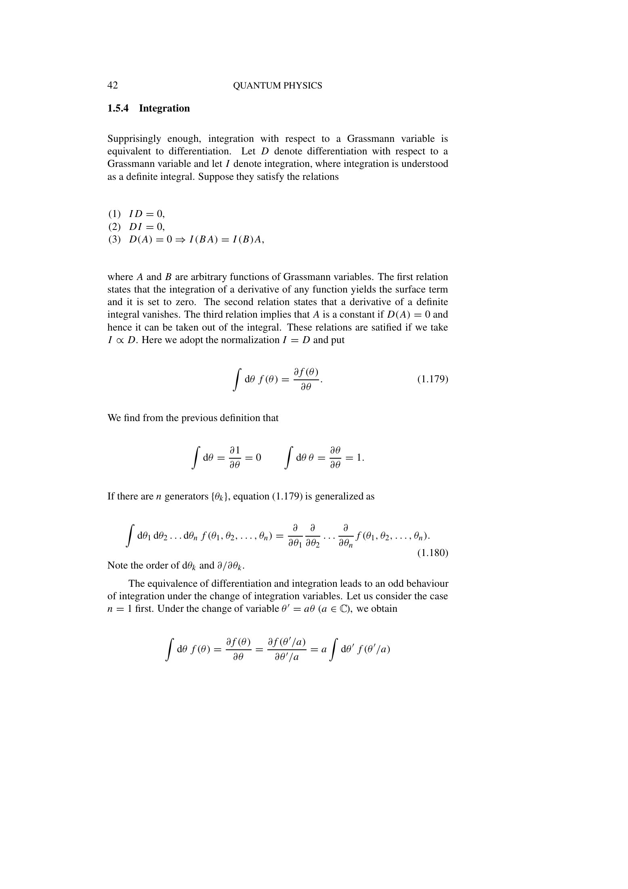

## 第 42 页句读与集注

### 句读开头：“integration ... equivalent to differentiation”

Berezin 积分不是沿一条普通几何区间累计面积。它是一种线性系数提取操作：

$$
\int d\theta\,(a+b\theta)=b,\qquad
\int d\theta\,1=0,\quad
\int d\theta\,\theta=1.
$$

它与单变量左导数恰好相同，但名称来自它在换元、平移和路径积分中承担的角色。$\int1=0$ 没有否定普通积分的定理，因为这里从来没有采用正测度空间的面积定义。

### 疏原文的三条公理：为什么选取这样的积分？

首先要求导数的积分没有边界贡献：$ID=0$。对 $f=a+b\theta$，$Df=b$，所以必须有 $I(1)=0$。其次要求积分结果不再依赖被积分变量，即 $DI=0$。剩余归一化可以选 $I(\theta)=1$。于是 $I=D$。

平移不变性也能直接看见。令 $\eta$ 为另一个奇参数，

$$
\int d\theta\,f(\theta+\eta)
=\int d\theta\,[a+b\theta+b\eta]=b.
$$

系数提取没有因平移而改变。这个性质让有限切片路径积分的变量变换仍可运作。

### 句读式 (1.180)：积分顺序必须从一开始固定

作者规定

$$
\int d\theta_1d\theta_2\,f
=\partial_1\partial_2f.
$$

右边最右导数先作用。因此

$$
\int d\theta_1d\theta_2\,\theta_2\theta_1=1,\qquad
\int d\theta_1d\theta_2\,\theta_1\theta_2=-1.
$$

若更习惯“倒序测度作用在正序单项式上给 1”，那是同一约定的另一种写法。最危险的做法是测度沿用一本书、被积单项式顺序沿用另一本书，却忘记转换符号。

### 疏：换元为什么与普通积分相反？

设 $\theta'=a\theta$、$a\ne0$。为了保证 $\int d\theta'\,\theta'=1$，就必须令

$$
d\theta'=a^{-1}d\theta.
$$

普通实变量 $x'=ax$ 的长度尺度乘 $|a|$；Grassmann 积分抽取的是最高次系数，变量被乘 $a$ 时，提取操作必须乘 $a^{-1}$ 才抵消。这个区别不是单位尺度突然违背常识，而是积分所定义的对象不同。

## 原书第 43 页：原文底本

以下影印块是本小节在该页的完整原文；相邻小节在同页交接时按标题分界。PDF 页码为 66。

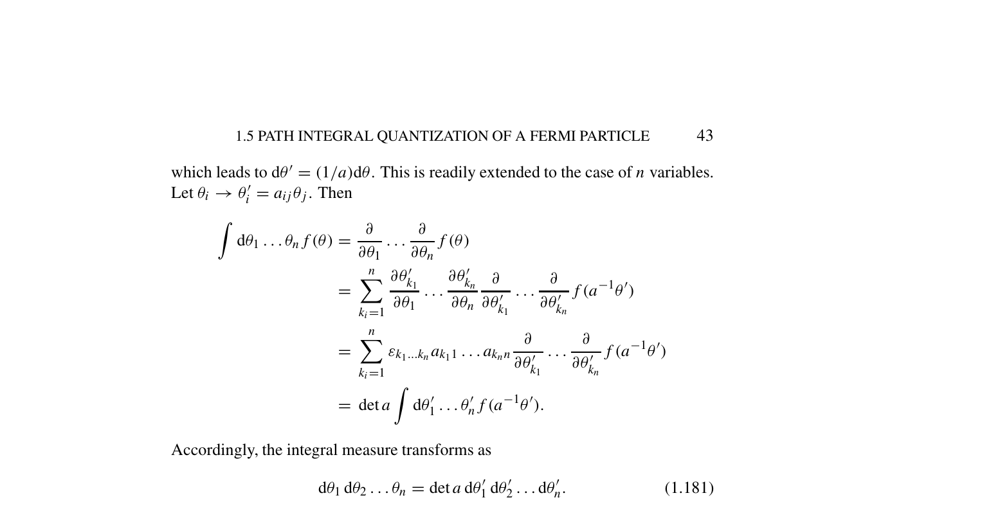

## 第 43 页句读与集注

### 句读式 (1.181)：反行列式来自反对称的最高次项

若 $\theta'=A\theta$，最高次乘积满足

$$
\theta'_1\cdots\theta'_n
=(\det A)\theta_1\cdots\theta_n.
$$

为保持归一化，

$$
d\theta'_1\cdots d\theta'_n
=(\det A)^{-1}d\theta_1\cdots d\theta_n.
$$

这与作者写的反向关系一致。这里没有实积分中的绝对值，反映它是一种带顺序的代数操作，符号本身有意义。

更一般地，偶、奇变量混合时的换元由 Berezinian，也称超行列式，组织。当前不必展开完整超几何，但可以记住其来源：偶变量的积分要按普通 Jacobian 变换，奇变量则按逆 Jacobian 变换。两种规则必须同时编码。

### 集注：为什么这能帮助量子费米子？

费米交换的负号会在最高次系数中自动出现。后面把 $e^{-\theta^*M\theta}$ 展开，积分挑出恰好包含所有奇变量的一项；所有排列的交换符号组成行列式。普通 Gaussian 积分得到倒行列式，Berezin 积分得到正行列式，根源就在本节的积分定义和换元规则。

**回看问题：**为什么 $\int1=0$ 不与普通面积积分矛盾？为什么测度变换带逆行列式？在本书约定下 $\int d\theta_1d\theta_2\,\theta_1\theta_2$ 等于多少？这些符号应当用低维算例随时核对。

---

[总目录](README.md) · [上一小节](10-1.5.3.md) · [下一小节](12-1.5.5.md)

# 1.5.5 Delta-function｜Grassmann δ 函数

[总目录](README.md) · [上一小节](11-1.5.4.md) · [下一小节](13-1.5.6.md)

## 原书第 43 页：原文底本

以下影印块是本小节在该页的完整原文；相邻小节在同页交接时按标题分界。PDF 页码为 66。

## 第 43 页句读与集注

### 句读式 (1.182)：先规定“代入”的功能，再求核的形式

普通 δ 分布由再现性质 $\int dx\,\delta(x-a)f(x)=f(a)$ 来使用。Grassmann δ 也先要求同样形式的代入功能。不过单奇变量函数只有常数项与一次项，因此核不需要无限尖峰，而可以直接是一个一次多项式。

按本书左导数与排列约定，

$$
\delta(\theta-\alpha)=\theta-\alpha.
$$

对 $f=a+b\theta$ 且 $a,b$ 为可交换系数，

$$
(\theta-\alpha)f
=a\theta-a\alpha-\alpha b\theta.
$$

将最后一项中的 $\theta$ 移到便于左求导的位置，会额外变号；最后积分结果是 $a+b\alpha$。所以这个 δ 的意义确实是把 $\theta$ 换成 $\alpha$，不是仅仅借用了一个熟悉名称。

### 疏：它与普通 δ 究竟哪里相同、哪里不同？

相同的是作为积分核执行代入。不同的是所处的代数与积分操作。Grassmann δ 本身是奇元素，会与其他奇元素反交换；普通实 δ 是分布，不是奇数。你不能因为都叫 δ，就把它们的乘法顺序与换元规则混用。

在更一般的带奇系数函数中，核的位置以及导数约定要一起指定。原文用可交换系数 $a,b$ 做验证足以说明本页公式；不要把它不加说明地扩展到任意左右摆放的奇系数表达式。

### 句读式 (1.184)：为什么多个 δ 的因子倒序？

本书多重积分用 $\partial_1\cdots\partial_n$，最右边先作用。为了最终提取最高次系数得到 $+1$，核写成

$$
\delta^n(\theta-\alpha)
=(\theta_n-\alpha_n)\cdots(\theta_1-\alpha_1).
$$

例如 $\alpha=0,n=2$，$\int d\theta_1d\theta_2\,\theta_2\theta_1=1$。倒序不是审美偏好，而是由已经固定的测度约定决定。

### 句读式 (1.185)：Fourier 表示为什么只剩两项？

由于 $(\xi\theta)^2=0$，

$$
e^{i\xi\theta}=1+i\xi\theta,\qquad
\int d\xi\,e^{i\xi\theta}=i\theta.
$$

故 $\delta(\theta)=-i\int d\xi\,e^{i\xi\theta}$。它形式上类似普通 δ 的 Fourier 表示，但根本没有无穷振荡或积分收敛问题；真正发生的是有限多项式的系数提取。

**物理位置：**这一节不是新添了一种粒子或相互作用，而是准备费米路径积分中的约束与核操作。理解它的再现性质、奇偶性和顺序就够了，不应为它寻找“空间中很尖的一团费米物质”这样的图像。

---

[总目录](README.md) · [上一小节](11-1.5.4.md) · [下一小节](13-1.5.6.md)

# 1.5.6 Gaussian integral｜费米高斯积分与 Pfaffian

[总目录](README.md) · [上一小节](12-1.5.5.md) · [下一小节](14-1.5.7.md)

本节有两种不同的二次型：两组独立奇变量的双线性型给行列式；一组奇变量的反对称二次型给 Pfaffian。把它们分开，是本节最关键的句读。

## 原书第 44 页：原文底本

以下影印块是本小节在该页的完整原文；相邻小节在同页交接时按标题分界。PDF 页码为 67。

## 第 44 页句读与集注

### 句读式 (1.186)–(1.187)：为何得到 det M 而不是它的倒数？

对一个变量对，按本书测度顺序，

$$
\int d\theta^*d\theta\,e^{-m\theta^*\theta}
=\int d\theta^*d\theta\,(1-m\theta^*\theta)=m.
$$

这是最高次项的系数提取。与普通 Gaussian 的 $m^{-1}$ 或 $m^{-1/2}$ 相反，刚度增大不会“压窄一团正概率分布”；这里并没有那样的正概率密度可供压窄。

多个变量时，指数的展开中，只有恰好每个 $\theta_i,\theta_i^*$ 都出现一次的项能留下。它们按不同排列选择 $M_{ij}$，交换奇变量时的正负号正是行列式的排列符号。因此

$$
\int\prod_{i=1}^n(d\theta_i^*d\theta_i)\,
e^{-\sum_{ij}\theta_i^*M_{ij}\theta_j}=\det M.
$$

也可像原文那样用 $\theta'=M\theta$ 的逆 Jacobian 证明；若 $M$ 不可逆，先在可逆情形证明，再利用两边都是矩阵元的多项式延拓。

**校记：**原文说这里的 $M$ 必须反对称，这个限制并不需要。$\theta_i$ 与 $\theta_i^*$ 是两套独立生成元，$\theta^*M\theta$ 对一般复矩阵 $M$ 都有意义。若连 $n=1$ 都强迫 $M$ 反对称，只能有 $M=0$，反而破坏最简单的非零 Gaussian 例子。反对称性真正必需的是下面只有一套变量的二次型。

### 句读命题 1.3：Pfaffian 在组合什么？

对一套变量 $\vartheta_1,\ldots,\vartheta_{2n}$，

$$
\frac12\sum_{ij}\vartheta_iA_{ij}\vartheta_j
$$

只保留 $A$ 的反对称部分，因为对称部分与奇变量交换抵消。展开指数后，积分必须把 $2n$ 个指标两两配对，所有配对按交换符号相加，这个多项式就是 $\operatorname{Pf}(A)$。

四维例子最容易看：

$$
\operatorname{Pf}(A)
=A_{12}A_{34}-A_{13}A_{24}+A_{14}A_{23}.
$$

三项对应三种配对方式。Pfaffian 不是随便从 $\det A$ 开平方再选个符号，而是由矩阵元和顺序直接定义的多项式；它的符号带有基的定向信息。

## 原书第 45 页：原文底本

以下影印块是本小节在该页的完整原文；相邻小节在同页交接时按标题分界。PDF 页码为 68。

## 第 45 页句读与集注

### 句读证明的收尾：为什么平方等于行列式？

取两份独立的一组变量积分，相乘后得到 Pfaffian 的平方。将两组实型奇变量线性组合为一对复型独立变量，二次型便可改写成 $\eta^*A\eta$，其积分由上一条规则给 $\det A$。原文逐项追踪 Jacobian 和重排符号，正是为了证明两边的多项式符号一致。

你也可用二维反对称矩阵

$$
A=\begin{pmatrix}0&a\\-a&0\end{pmatrix}
$$

做最低维核对：$\operatorname{Pf}(A)=a$，$\det A=a^2$。奇数维反对称矩阵的行列式为零，不能给出同样的非退化配对。

### 校读练习 1.9：用小例子检验常数

练习 (1) 的 (1.190) 不宜直接作为标准模板。令 $K=0$、$n=2$、
$M=\left(\begin{smallmatrix}0&m\\-m&0\end{smallmatrix}\right)$，按本书测度，

$$
\int d\theta_1d\theta_2\,
e^{-\frac12\theta^TM\theta}
=\int d\theta_1d\theta_2(1-m\theta_1\theta_2)=m.
$$

印出的右边却含 $2^{n/2}\sqrt{\det M}=2\sqrt{m^2}$，即使选同一符号也多出系数 2。一般单组变量应以 Pfaffian 及明确的测度定向写公式，不能跳过符号和归一化。这里保留原题，但不要求你证明一个按所给约定并不成立的等式。

练习 (2) 的双组变量源公式可由平移完成平方得到 $\det M\,e^{K^\dagger M^{-1}K}$，前提是固定奇源的排列和可逆性。与前面的双组 Gaussian 相同，$M$ 不必为了这个恒等式特意取斜 Hermitian；具体物理算符可能有额外性质，那是另外一层要求。

### 集注：这对物理有什么用？

自由 Dirac 场的费米积分会给微分算符的行列式；某些实型费米场的积分则给 Pfaffian。交换符号已经被这些代数量编码，所以后面它们影响有效作用量、涨落与拓扑性质。这里应掌握两种二次型各自对应哪种对象，而不是把 det、平方根和 Pfaffian 当成可随意互换的三个记号。

---

[总目录](README.md) · [上一小节](12-1.5.5.md) · [下一小节](14-1.5.7.md)

# 1.5.7 Functional derivative｜Grassmann 泛函微分

[总目录](README.md) · [上一小节](13-1.5.6.md) · [下一小节](15-1.5.8.md)

## 原书第 45 页：原文底本

以下影印块是本小节在该页的完整原文；相邻小节在同页交接时按标题分界。PDF 页码为 68。

## 第 45 页句读与集注

### 句读式 (1.192)：为什么出现 Grassmann 参数 ε？

$\psi(t)$ 是由普通时间标记的一族奇变量。想求在时刻 $s$ 改变它所引起的函数变化，就写

$$
\delta\psi(t)=\epsilon\,\delta(t-s).
$$

$\epsilon$ 是奇参数，$\delta(t-s)$ 却是普通时间轴上的 Dirac 分布。前者负责奇偶与交换符号，后者负责选定时间点。它们分属不同数学结构，不能因为都出现在上一节附近就混成同一种 δ。

取左变分约定，把 $\epsilon$ 放在最左边，定义

$$
F[\psi+\epsilon\delta_s]
=F[\psi]+\epsilon\frac{\delta_LF}{\delta\psi(s)}.
$$

由于 $\epsilon^2=0$，不含更高次项。这就是原文“无需取 $\epsilon\to0$”的实际理由。

### 疏：“除以 ε”不是求一个倒数

若非零幂零元素 $\epsilon$ 有逆，$\epsilon^2=0$ 两边乘逆就会得到 $\epsilon=0$，矛盾。因此普通意义的 $1/\epsilon$ 不存在。原文自己提醒了这一点：式中的分式只是“把分子写成 $\epsilon$ 乘某个系数，再取出这个系数”的缩写。

为免歧义，最好把 $\epsilon$ 当作独立新增的生成元，先把它移到固定位置，再读出其系数。若任意混用已有生成元、左右位置不固定，所谓“除掉 $\epsilon$”就可能丢失信息或符号。

### 算例：次序如何影响泛函导数？

令 $F=\psi(t_1)\psi(t_2)$。在 $t=s$ 处变分：

$$
\delta F=
\epsilon\delta(t_1-s)\psi(t_2)
+\psi(t_1)\epsilon\delta(t_2-s)
$$

将第二项的 $\epsilon$ 移到左边，得

$$
\frac{\delta_LF}{\delta\psi(s)}
=\delta(t_1-s)\psi(t_2)
-\delta(t_2-s)\psi(t_1).
$$

这就是有限维奇 Leibniz 规则的连续版本。连续时间没有消除反交换的负号，只把离散指标换成了时间标签。

### 集注：它会在哪里出现？

费米生成泛函的源也是 Grassmann 量。依次对这些源求导，会插入费米场；换一次求导顺序就可能差一个负号。理解这里的系数提取和左右约定，才能正确读 1.7 的传播子公式。它并不需要你先掌握一套新的实分析极限理论。

---

[总目录](README.md) · [上一小节](13-1.5.6.md) · [下一小节](15-1.5.8.md)

# 1.5.8 Complex conjugation｜Grassmann 共轭

[总目录](README.md) · [上一小节](14-1.5.7.md) · [下一小节](16-1.5.9.md)

## 原书第 45 页：原文底本

以下影印块是本小节在该页的完整原文；相邻小节在同页交接时按标题分界。PDF 页码为 68。

## 第 45 页句读与集注

### 句读式 (1.193)：共轭为什么反转乘法顺序？

作者定义 $(\theta_i\theta_j)^*=\theta_j^*\theta_i^*$。它仿照量子算符伴随 $(AB)^\dagger=B^\dagger A^\dagger$，使经典奇变量的共轭与费米算符结构相容。若草率沿用普通复数“共轭不反序”的记忆，会在双线性项上产生额外负号。

同时采用 $(\theta_i)^*=\theta_i^*$、$(\theta_i^*)^*=\theta_i$，并令普通复系数按通常方式共轭。这是一种反线性的反自同构：它不仅处理数值的复共轭，还处理乘法次序。

### 疏：θ 与 θ* 究竟是否独立？

作为 Grassmann 代数的生成元，它们可以独立，积分时也分别作为两套变量。星号规定代数上的共轭对应关系，不表示它们已被实现为一对普通复数的数值和共轭数值。正因如此，不能把积分变量减少成一个通常的实部、虚部积分，再套正测度直观。

检验一个双线性项：

$$
(\theta^*\theta)^*=\theta^*\theta.
$$

顺序反转后恰好回到原序，所以它是共轭不变的偶元素。但它仍然幂零，并不是通常的非负实数；不能据此说 $\theta^*\theta\ge0$，更不能把它当成概率。

### 校读末句：“real c-number”需谨慎理解

原文把 $\theta_i\theta_i^*$ 称为 real c-number。若 c-number 严格指普通实、复系数，这个说法过宽；该乘积是可交换的偶 Grassmann 元素。它在本共轭约定下是“实”的，意思只是星号作用后不变，不是实数轴上的正负大小。

### 集注：为什么物理需要这种“实”？

作用量或哈密顿量需要适当的现实性、Hermitian 性，才能与酉演化和真实可测量量相容。费米双线性项的共轭规则是构造这种条件的一部分。但“某个奇代数表达式共轭不变”与“它本身就是一次实验读数”，仍然不是同一件事。

本节无需另找机械图像。它更像为即将使用的计算语言规定语法：乘法顺序、共轭和奇偶规则确定后，后面的场作用量才有一致的意义。

---

[总目录](README.md) · [上一小节](14-1.5.7.md) · [下一小节](16-1.5.9.md)

# 1.5.9 Coherent states and completeness relation｜费米相干态与完备关系

[总目录](README.md) · [上一小节](15-1.5.8.md) · [下一小节](17-1.5.10.md)

本节是算符费米子与 Grassmann 路径积分之间真正的桥梁。前面的代数操作将在这里获得一个与态空间相接的用途。

## 原书第 46 页：原文底本

以下影印块是本小节在该页的完整原文；相邻小节在同页交接时按标题分界。PDF 页码为 69。

## 第 46 页句读与集注

### 句读式 (1.194)–(1.195)：这是一种怎样的“态”？

通常 Hilbert 空间向量是 $|f\rangle=|0\rangle f_0+|1\rangle f_1$，系数为复数。作者现在把系数扩充到 Grassmann 代数，定义

$$
|\theta\rangle=|0\rangle+|1\rangle\theta.
$$

这不是说实验制备出一个“概率振幅为奇数”的普通物理态；它是扩充代数后的辅助对象，便于生成矩阵元并建立积分表示。$c|\theta\rangle=|\theta\rangle\theta$ 也不是普通复 Hilbert 空间里出现了一个新的非零复本征值。

为什么必须扩充？因为 $c^2=0$，若在普通复向量空间要求 $cv=\lambda v$，就有 $\lambda^2=0$，从而 $\lambda=0$。奇本征值 $\theta$ 则满足 $\theta^2=0$，代数上与湮灭算符的幂零性相容。

### 句读练习 1.10：为什么 overlap 是指数？

直接相乘：

$$
\langle\theta'|\theta\rangle=1+\theta'^*\theta
=e^{\theta'^*\theta}.
$$

最后等号没有近似，因为 $(\theta'^*\theta)^2=0$。它不像通常正交基的 δ；不同标签的相干态并不互相正交。

对任意普通 $|f\rangle$，$\langle\theta|f\rangle=f_0+\theta^*f_1$。于是 $c^\dagger$ 在这个表示中对应乘 $\theta^*$，$c$ 对应左导数 $\partial_{\theta^*}$。这与位置表示中 $\hat x$ 乘法、$\hat p$ 微分的结构相呼应，不过代数现在是反交换的。

### 疏式 (1.196)：从算符到 Grassmann 函数

任意两维算符可用 $1,c,c^\dagger,c^\dagger c$ 展开。将它放在相干态之间，其矩阵元等于一段 Grassmann 多项式乘 overlap。对正规排序的表达，可以按规定将 $c^\dagger,c$ 替换成相应的奇标签。

“按规定”很关键：算符的排列如果改变，会产生反对易项，所以不能先把算符当普通数重排，再替换。费米路径积分保留的量子信息，一部分就藏在这个离散化和排序对应中。

## 原书第 47 页：原文底本

以下影印块是本小节在该页的完整原文；相邻小节在同页交接时按标题分界。PDF 页码为 70。

## 第 47 页句读与集注

### 句读引理 1.3 的证明：完备关系如何成立？

展开

$$
|\theta\rangle\langle\theta|
=(|0\rangle+|1\rangle\theta)
(\langle0|+\theta^*\langle1|),
$$

再乘 $e^{-\theta^*\theta}=1-\theta^*\theta$。积分只保留含一个 $\theta$ 和一个 $\theta^*$ 的项。交叉项少一个变量，积分后消失；两项对角投影恰好留下

$$
\int d\theta^*d\theta\,e^{-\theta^*\theta}
|\theta\rangle\langle\theta|
=|0\rangle\langle0|+|1\rangle\langle1|=I.
$$

所以这套连续奇标签虽然不正交，仍能解析恒等算符。完备关系是后面在每个时间片插入相干态的根据。没有它，仅凭“把交换数改成反交换数”，还没有建立费米路径积分。

### 集注：怎样理解“相干”与“过完备”？

玻色相干态通常也以湮灭算符本征态定义，能与经典振动幅度建立联系；这里保留的是相似的代数组织方式，物理解释不能逐字照搬。费米单模式只有两维，连续奇标签只是生成多项式的工具，标签的连续性并不创造无穷多个独立物理态。

“过完备”提醒你标签不构成普通正交基，不表示在时间切片或 Fourier 截断时可以随意改变量数。下一节最可靠的核对，仍是有限切片 Grassmann 积分必须重现两态系统的普通迹。

---

[总目录](README.md) · [上一小节](15-1.5.8.md) · [下一小节](17-1.5.10.md)

# 1.5.10 Partition function of a fermionic oscillator｜费米配分函数与反周期条件

[总目录](README.md) · [上一小节](16-1.5.9.md) · [下一小节](18-1.6.1.md)

本节的结果很短，推导却很长。读时始终拿两态系统的精确迹做参照：所有路径积分步骤最后都必须回到这两个态的热权重之和。

## 原书第 47 页：原文底本

以下影印块是本小节在该页的完整原文；相邻小节在同页交接时按标题分界。PDF 页码为 70。

## 第 47 页句读与集注

### 句读式 (1.198)：为什么是 cosh，而不是 1/sinh？

费米单模式只有 $n=0,1$：

$$
Z_F=e^{+\beta\hbar\omega/2}+e^{-\beta\hbar\omega/2}
=2\cosh(\beta\hbar\omega/2).
$$

如果改用零点能已平移的 $H'=\hbar\omega N$，则 $Z'_F=1+e^{-\beta\hbar\omega}$。两者给出的归一化占据概率相同：

$$
\langle N\rangle=\frac1{e^{\beta\hbar\omega}+1}.
$$

玻色模式可以任意重复占据，求的是无穷几何级数；费米模式最多占据一次，只加两项。这比单记“玻色对应 sinh、费米对应 cosh”更能解释统计差别。

### 句读引理 1.4：迹中的负标签从哪里来？

普通两维迹是 $\langle0|O|0\rangle+\langle1|O|1\rangle$。换成 Grassmann 相干态时，奇变量与奇态的排列带来符号，正确表示为

$$
\operatorname{Tr}O=
\int d\theta^*d\theta\,
e^{-\theta^*\theta}\langle-\theta|O|\theta\rangle
$$

（对当前偶算符）。这个负号不是预先假定费米子“在时间上走一圈要变号”，而是普通迹在相干态表示中的代数结果。下一页才把它读成反周期边界。

## 原书第 48 页：原文底本

以下影印块是本小节在该页的完整原文；相邻小节在同页交接时按标题分界。PDF 页码为 71。

## 第 48 页句读与集注

### 句读证明收尾：普通迹与超迹要分开

取 $O=I$ 做核对，应该得到 2。若删去 $\langle-\theta|$ 中的负号，按同一测度与权重算出的不再是普通迹。事实上，那种边界结构关联的是含 $(-1)^N$ 的分次迹，空态与占据态带相反权重。普通热统计的概率归一化用普通迹，所以必须保留负号。

由此读出

$$
\theta(\beta)=-\theta(0),\qquad
\theta^*(\beta)=-\theta^*(0).
$$

它是欧氏时间圈上的反周期性。不表示一颗真实电子在某个时间后概率变负，更不意味着它沿真实轨迹过了一圈便消失。Grassmann 配置不是可直接测量的概率幅数值。

### 疏时间切片：一阶导数从哪里来？

每个短时矩阵元包含 overlap
$e^{\theta_k^*\theta_{k-1}}$，完备关系的权重含
$e^{-\theta_k^*\theta_k}$。相乘后出现

$$
-\theta_k^*(\theta_k-\theta_{k-1})
-\epsilon\omega\,\theta_k^*\theta_{k-1}.
$$

第一项在连续记号下成为 $-\int\theta^*\partial_\tau\theta\,d\tau$，第二项是模式能量项。费米作用量中的一阶时间导数，正由相干态 overlap 和邻片差分产生。它不是为了模仿 Dirac 方程而随意选的。

## 原书第 49 页：原文底本

以下影印块是本小节在该页的完整原文；相邻小节在同页交接时按标题分界。PDF 页码为 72。

## 第 49 页句读与集注

### 句读式 (1.200)–(1.201)：为什么离散行列式最可靠？

切片后有 $N$ 对独立奇变量，指数是 $\theta^*B_N\theta$。积分就是 $\det B_N$。沿时间相邻耦合使 $B_N$ 近似为双对角矩阵，首尾反周期耦合给角上的特殊符号。

按原文的 $y=-1+\epsilon\omega$，行列式整理为

$$
\det B_N=1+(1-\beta\omega/N)^N.
$$

于是

$$
Z_F=e^{\beta\omega/2}
\lim_{N\to\infty}[1+(1-\beta\omega/N)^N]
=e^{\beta\omega/2}(1+e^{-\beta\omega}).
$$

它清楚保留了两类贡献：空态和一次占据。反周期负号在行列式中最终给出加号；若错误处理首尾耦合，往往会得到 $1-e^{-\beta\omega}$，那已经是另一个统计问题。

### 疏连续记号中的微小项

原文下一条路线保留 $(1-\epsilon\omega)\partial_\tau$。有限 $\epsilon$ 的小项乘上随截断数增长的模式贡献，可能留下有限常数，因此不能看到 $\epsilon\to0$ 就在乘积形成前全部删掉。可靠做法是保留一套一致的离散定义，比较它与连续正则化后的归一化。

这与你熟悉的数值方法有关：逐点小误差在大量步骤累积后，未必对最终结果仍然小。但这里还涉及无穷乘积，必须明确截断与极限次序，不能仅凭这个类比就任意保留某个常数。

## 原书第 50 页：原文底本

以下影印块是本小节在该页的完整原文；相邻小节在同页交接时按标题分界。PDF 页码为 73。

## 第 50 页句读与集注

### 句读 Fourier 模式：半整数频率不是额外的物理假设

令 $\theta(\tau)\propto e^{i\nu\tau}$，反周期条件要求 $e^{i\nu\beta}=-1$，所以

$$
\nu_n=\frac{(2n+1)\pi}{\beta},\qquad n\in\mathbb Z.
$$

玻色周期条件则给 $2n\pi/\beta$。这些称为 Matsubara 频率，描述热欧氏时间展开，不是系统实际能级之间所有跃迁频率的清单。

一阶算符 $\partial_\tau+\omega$ 的模式特征值是 $i\nu_n+\omega$。将正负频率配对得到 $\nu_n^2+\omega^2$，便出现与 cosh 有关的奇数无穷乘积。它与前面 Dirichlet 二阶算符的整数正弦谱不同，根源是边界条件和一阶结构改变了。

### 校读模式截断：别把“过完备”当作随意计数依据

本页的 $N/4$ 截断以及求积指标 $k,n$ 的混用，不宜当作一般性的精确模式计数规则。有限切片上 $\theta$ 与 $\theta^*$ 是独立积分变量，Fourier 变换必须保持独立变量个数；相干态过完备本身不能替代这项检查。

因此理解主线时，以第 49 页的有限行列式为首要核对，再把本页 ζ 正则化当作同一谱结果的连续组织方式。不要在两个不同截断间搬移单个常数，却不比较完整的 $Z_F$。

### 疏 Hurwitz ζ：数学对象为什么换了？

整数谱用 $\zeta_R(s)=\sum n^{-s}$；半整数谱自然用 $\zeta(s,\tfrac12)=\sum_{n\ge0}(n+\tfrac12)^{-s}$。在收敛区域分离奇数项可得

$$
\zeta(s,\tfrac12)=(2^s-1)\zeta_R(s),
$$

然后解析延拓。原文利用它在 0 点的值来固定剩余谱乘积。这是谱的平移决定特殊函数的种类，不是随意把更多特殊函数堆进计算。

## 原书第 51 页：原文底本

以下影印块是本小节在该页的完整原文；相邻小节在同页交接时按标题分界。PDF 页码为 74。

## 第 51 页句读与集注

### 句读式 (1.203)–(1.206)：回到两个态

最终得到

$$
Z_F=2\prod_{n=1}^\infty
\left[1+\frac{(\beta\omega)^2}{\pi^2(2n-1)^2}\right]
=2\cosh\frac{\beta\omega}{2}.
$$

高温时趋于 2，表示两种模式占据状态近乎等权；低温时由最低能态的权重主导。对于采用 $H=\omega(N-\tfrac12)$ 的本书，$Z_F$ 低温增长并不意味着概率发散，因为概率还要除以 $Z_F$。

作者最后说“用两种方法计算同一个物理量”可以得到数学恒等式。这里可以更明确地说：两态谱的有限求和，等于反周期差分算符的 Grassmann 积分；后者再化为谱乘积。因此 cosh 乘积背后是同一个系统的态计数与模式分解。

**回看问题：**反周期条件由哪一步产生？普通热迹与含 $(-1)^N$ 的迹为什么不同？为什么频率是半整数？怎样从两态权重得到 Fermi 占据函数？这些是本节需要带到量子场论的内容。

---

[总目录](README.md) · [上一小节](16-1.5.9.md) · [下一小节](18-1.6.1.md)

# 1.6.1 Free scalar field｜自由标量场

[总目录](README.md) · [上一小节](17-1.5.10.md) · [下一小节](19-1.6.2.md)

本节篇幅短，却跨过“单粒子量子力学”与“量子场论”的边界。需要补的首先是物理对象的变化，而不只是把 $x(t)$ 改写成 $\phi(x)$。

## 原书第 51 页：原文底本

以下影印块是本小节在该页的完整原文；相邻小节在同页交接时按标题分界。PDF 页码为 74。

## 第 51 页句读与集注

### 句读开头：“many degrees of freedom”

先想一串用弹簧连接的小振子。第 $j$ 个振子的位移为 $q_j(t)$，所以系统在同一时刻要用许多个坐标描述。若振子密集分布、间距缩小，标签 $j$ 变成空间位置 $\mathbf x$，位移变成 $\phi(\mathbf x,t)$。每个空间点都有一个可变化的自由度，这就是场的最直接直观。

这个例子是结构类比，并不是说所有基本场都由微小弹簧组成。电磁场也不是空间里某种机械介质必须发生位移。类比要保留的是“自由度分布在空间、邻近自由度能够耦合”的逻辑。

### 疏：φ(x) 与 ψ(x) 为什么不是同一种函数？

前面的单粒子波函数 $\psi(\mathbf x)$ 给粒子位置测量的概率振幅。这里经典标量场 $\phi(\mathbf x,t)$ 是一种空间配置：比如连续介质的某种标量扰动，或基本标量场的场值。$|\phi(\mathbf x,t)|^2$ 一般不是“粒子在这里的概率密度”。

若给场量子化，在 Schrödinger 表示中，态可以写成波泛函 $\Psi[\phi(\cdot)]$：它以“一整幅空间场形状”为自变量。正如一串 $N$ 个振子需要 $\Psi(q_1,\ldots,q_N)$，连续极限需要函数的函数。场路径积分则进一步对整个时空历史 $\phi(\mathbf x,t)$ 积分。

因此本节的“无穷自由度”不是一个粒子的位置坐标突然有无穷个分量，而是空间中有连续分布的动力学坐标。

### 句读式 (1.207)：为什么用作用量密度？

若要求相互作用局域，某处的作用量贡献由当地场和有限阶导数决定，于是写

$$
S[\phi]=\int d^dx\,\mathcal L(\phi,\partial_\mu\phi).
$$

$\mathcal L$ 是拉格朗日密度，积分时空后才得到作用量；它不是单粒子拉格朗日量本身。导数项记录场在时间上如何变、空间上如何不均匀，势项记录局部场值的能量代价。局域性、时空对称性和所研究的自由度一起约束可用的表达式，但不唯一决定全部物理。

## 原书第 52 页：原文底本

以下影印块是本小节在该页的完整原文；相邻小节在同页交接时按标题分界。PDF 页码为 75。

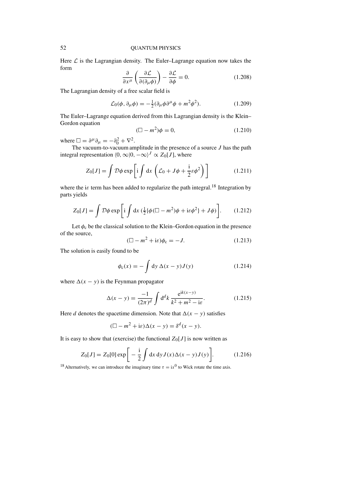

## 第 52 页句读与集注

### 句读式 (1.208)：场方程怎样从变分形成？

取边界为零的变分 $\delta\phi$，

$$
\delta S=\int d^dx
\left[\frac{\partial\mathcal L}{\partial\phi}\delta\phi
+\frac{\partial\mathcal L}{\partial(\partial_\mu\phi)}
\partial_\mu\delta\phi\right].
$$

第二项分部积分，把导数从 $\delta\phi$ 上移走。边界项消失后，任意局部 $\delta\phi$ 的系数必须为零，得到场的 Euler–Lagrange 方程。数学逻辑与单粒子相同，只是“对时间分部积分”变成“对时空各方向分部积分”。

### 疏式 (1.209)–(1.210)：质量项和空间梯度项分别做什么？

作者取 $\eta=\operatorname{diag}(-1,1,1,1)$。于是

$$
\mathcal L_0=
\frac12\dot\phi^2-\frac12|\nabla\phi|^2-\frac12m^2\phi^2
$$

（$c=\hbar=1$）。场方程为

$$
\ddot\phi-\nabla^2\phi+m^2\phi=0.
$$

空间梯度项让相邻位置耦合，抑制急剧不均匀；质量项使均匀但非零的场也有恢复代价。令 $\phi\propto e^{-i\omega t+i\mathbf k\cdot\mathbf x}$，得到

$$
\omega_{\mathbf k}^2=|\mathbf k|^2+m^2.
$$

每个空间 Fourier 模式是一个频率为 $\omega_{\mathbf k}$ 的谐振子。量子化后，它的激发能为 $\hbar\omega_{\mathbf k}$，并可解释为携带对应动量的粒子激发。恢复单位得到 $E^2=p^2c^2+m^2c^4$。这解释为什么参数叫质量，不只是因为公式中恰好有一个字母 $m$。

“自由”指作用量是二次型、正常模式彼此独立，不是场没有时间变化，也不是场没有能量和动量。

### 句读式 (1.211)–(1.216)：传播子为何是逆算符？

加源后，场方程是 $O\phi_c=-J$，$O=\Box-m^2+i\epsilon$。若找到核 $\Delta$ 满足 $O\Delta=\delta$，就有
$\phi_c=-\Delta J$。这正是 Green 函数求解线性受迫问题的方法。

但是同一个微分表达式可有不同 Green 函数：迟滞、超前、Feynman 等，边界条件不同。当前真空编时生成泛函选的是 Feynman 处方，不是任何“传播”都自动意味着信号按这个复核直接传递。因果响应通常联系迟滞核；量子真空二点函数另有定义，不能混为同一个普通波形。

把 $\phi=\phi_c+\eta$ 代入二次作用量，一次项消失，剩下无源 Gaussian 与

$$
Z_0[J]=Z_0[0]\,
\exp\left[-\frac i2\int dx\,dy\,J(x)\Delta(x-y)J(y)\right].
$$

这就是有限维“完成平方”的连续版本。$i\epsilon$ 同时为振荡积分指定收敛方向及极点处方；它不是一个待测的小外力。

## 原书第 53 页：原文底本

以下影印块是本小节在该页的完整原文；相邻小节在同页交接时按标题分界。PDF 页码为 76。

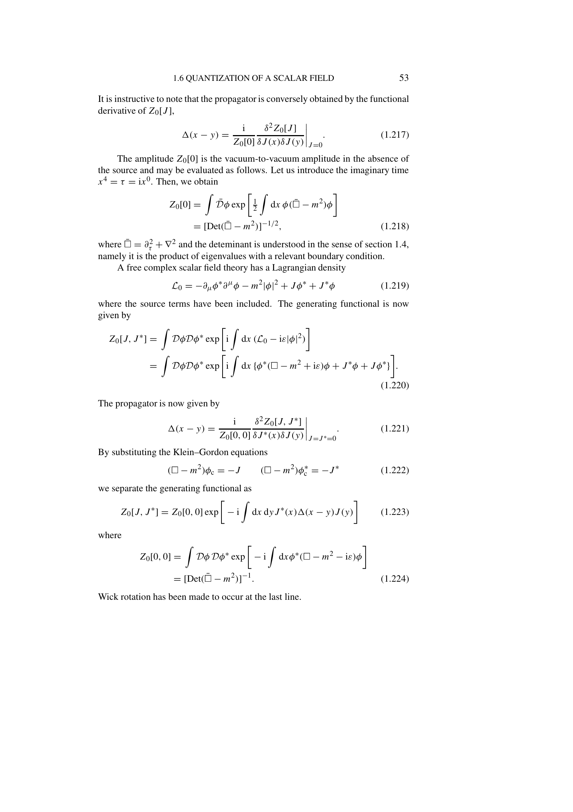

## 第 53 页句读与集注

### 句读式 (1.217)：逆核与真空关联有怎样的关系？

对 Gaussian 生成泛函求两次源导数，便取出 $\Delta(x-y)$。按本页定义和前面的振幅约定，$\langle0|T\phi(x)\phi(y)|0\rangle$ 与这里的 $\Delta$ 还差相应的 $i$ 因子；具体应从生成式推导，不能仅看“propagator”这个名称就把所有文献的符号当成一样。

两点函数描述真空涨落的相关性。真空不是“所有模式坐标、动量都严格为零”；每个振子基态都有涨落。两处场值的量子测量会有相关结构，但这不表示可以凭空从真空提取任意能量，也不表示所有空间相关都能用于超光速通信。

### 疏式 (1.218)：欧氏正算符的符号要明确

Wick 旋转后，实自由场的正二次型是

$$
S_E=\frac12\int d^dx\,\phi(-\Delta_E+m^2)\phi,
\qquad O_E=-\Delta_E+m^2.
$$

因此 Gaussian 因子应按选定归一化写成 $\operatorname{Det}(O_E)^{-1/2}$。原文保留 $\bar\Box-m^2$ 写行列式时，容易把指数中的负定表达与 Gaussian 所用的正算符混淆。解释时使用 $O_E$ 可以避免把负谱直接当正谱套上一节公式；若保留负号进 Det，则必须另外说明相位和定义。

### 句读式 (1.219)–(1.224)：复场为何把幂次变成 -1？

写 $\phi=(\phi_1+i\phi_2)/\sqrt2$，复标量场相当于两套实标量自由度。两套实 Gaussian 各给 $-1/2$ 次幂，相乘成为 $-1$ 次幂。源也成对出现，分别耦合 $\phi$、$\phi^*$；这与后面费米源具有相似排版，却不是相同的交换代数。

复标量场仍是玻色场。“复数”不等于费米，“实数”也不等于经典；统计类型取决于算符交换规律和物理结构。

**校记：**(1.220) 两行 $i\epsilon$ 符号并不一致：第一行写 $-i\epsilon|\phi|^2$，而后一行对应 $+i\epsilon\phi^*\phi$。在 $e^{iS}$ 中需用能带来负实衰减的处方，不能将两种符号同时当作同一个正则化。此处的源导数、Det 与真空归一化均应一起核对。

**回看问题：**场值与单粒子波函数有什么不同？为什么每个 Fourier 模式是振子？质量参数怎样进入相对论色散关系？为什么逆微分算符还需要边界条件？这些比记住某个 Fourier 积分符号更重要。

---

[总目录](README.md) · [上一小节](17-1.5.10.md) · [下一小节](19-1.6.2.md)

# 1.6.2 Interacting scalar field｜相互作用、关联函数与有效作用量

[总目录](README.md) · [上一小节](18-1.6.1.md) · [下一小节](20-1.7.md)

本节把上一节的二次理论扩展到非二次理论，并引入关联函数、连通性和有效作用量。它们是不同层级的信息组织方式，需要逐层读清楚。

## 原书第 54 页：原文底本

以下影印块是本小节在该页的完整原文；相邻小节在同页交接时按标题分界。PDF 页码为 77。

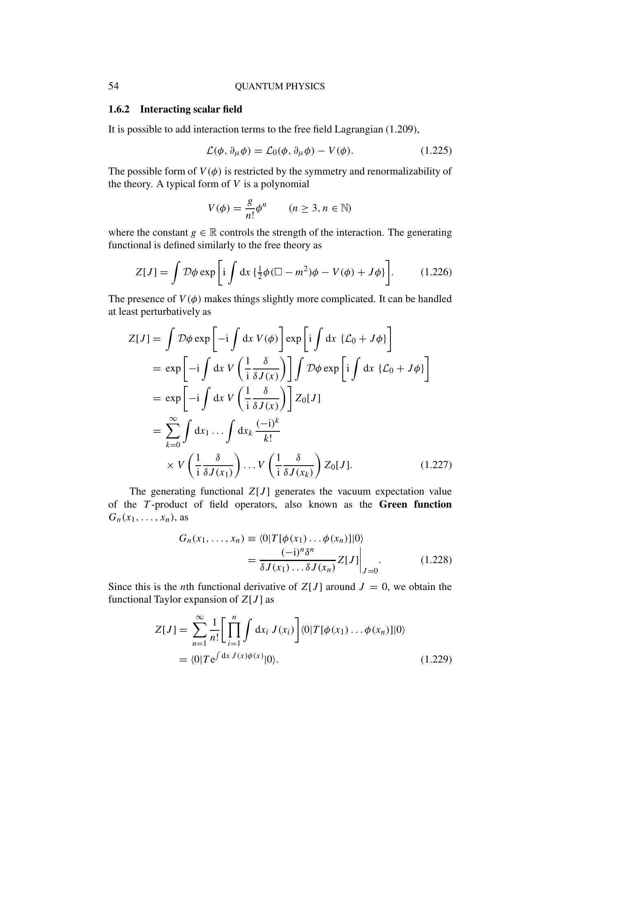

## 第 54 页句读与集注

### 句读式 (1.225)：为什么非二次项叫相互作用？

自由理论变成 Fourier 模式后，各模式彼此独立。加入 $\phi^4$ 一类项后，Fourier 展开会出现多个模式振幅的乘积，并要求相应动量之和守恒；一个模式的变化会与其他模式耦合。粒子解释中，它们可以产生散射等过程。因此“相互作用”不仅是单个点的势能形状改变，还表示激发模式之间发生耦合。

对称性会排除一些项，比如 $\phi\to-\phi$ 对称排除奇次势。稳定性还要求总势能有合适下界，例如单独正四次项比单独三次项更容易保证全局稳定。重整化性则涉及高能尺度下怎样控制理论参数，依赖时空维数。原文只是概括这些限制；不能把任意 $g\phi^n$ 都自动视为完整而稳定的基本理论。

现代有效场论允许按能量尺度保留高维项。本书在这里的表达服务于入门计算，不必把“非重整化项”理解为在任何低能描述中都不许出现。

### 疏式 (1.227)：用源导数替换场为什么成立？

因为

$$
\frac1i\frac{\delta}{\delta J(x)}
e^{i\int J\phi}=\phi(x)e^{i\int J\phi},
$$

所以可以把 $e^{-i\int V(\phi)}$ 化成作用在 $Z_0[J]$ 上的泛函微分算符。比如 $V=g\phi^4/4!$，最低阶修正是

$$
Z[J]=Z_0[J]
-\frac{ig}{4!}\int dx
\left(\frac1i\frac{\delta}{\delta J(x)}\right)^4Z_0[J]
+O(g^2).
$$

自由 $Z_0$ 是 Gaussian，反复求导产生两点核的配对。把配对画成线、把相互作用插入点画成顶点，就得到费曼图。图主要是组织积分、对称因子与微扰次数的记账工具；不能把每条内部线都当作实验中真正观测到的一颗小粒子沿轨迹飞行。

微扰展开也不保证对任意耦合或任意背景收敛。瞬子一节将讨论的某些贡献具有 $e^{-\text{常数}/g^2}$ 的尺度，任何有限阶的 $g$ 幂展开都捕捉不到它们。这就是为什么后文需要在非平凡场配置附近展开。

### 句读式 (1.228)：n 点函数在记什么？

$G_n(x_1,\ldots,x_n)$ 记录真空中的编时场关联。一次函数是平均场，两点函数记录基本相关，更多点函数则记录不能仅由一次、两次平均概括的结构。

如果 $Z$ 还含真空泡的整体因子，必须先用 $Z[J]/Z[0]$ 归一化，再把导数解释成单位归一化真空期望值。否则整套关联会带一个无关整体乘子。

**校记式 (1.229)：**接续本页 $e^{i\int J\phi}$ 的真实时间约定，展开应含 $n=0$ 项和 $i^n$ 因子：

$$
\widehat Z[J]
=\sum_{n=0}^{\infty}\frac{i^n}{n!}
\int dx_1\cdots dx_n\,J(x_1)\cdots J(x_n)G_n(x_1,\ldots,x_n).
$$

影印原文从 $n=1$ 开始且漏掉这些 $i$，若直接用它检验 $\widehat Z[0]=1$ 就会失败。欧氏约定可去掉 $i$，但需要一起改源的定义和前后公式。

## 原书第 55 页：原文底本

以下影印块是本小节在该页的完整原文；相邻小节在同页交接时按标题分界。PDF 页码为 78。

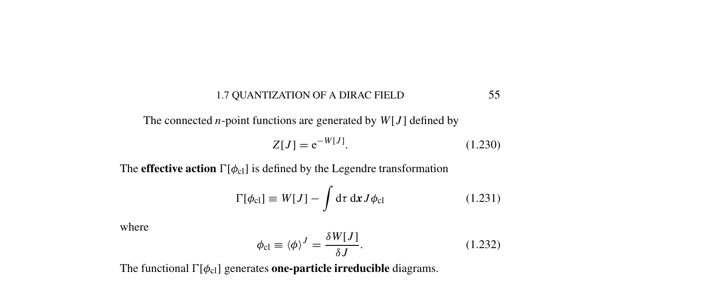

## 第 55 页句读与集注

### 句读式 (1.230)：为什么 log 会筛出连通关联？

统计中矩母函数的对数产生累积量。二阶例子最直观：

$$
\frac{\delta^2\log Z}{\delta J(x)\delta J(y)}
=\frac{Z_{,xy}}Z-\frac{Z_{,x}Z_{,y}}{Z^2}.
$$

第二项减去两次独立平均的乘积，所以保留连通的相关。更高阶同理剔除可分解成互不相关组块的部分。图像上，$Z$ 包含各种不连通组合，$\log Z$ 把它们整理成连通图。

原文用 $Z=e^{-W}$，因此其 $W=-\log Z$，还需追踪负号。先前使用的是含 $i$ 的真实时间源；本页后面却出现 $d\tau$，显示作者转向欧氏表达但没有完整重列所有约定。不能只抄一个 $W$ 的符号，就声称它的导数无条件等于平均场。

### 疏式 (1.231)–(1.232)：有效作用量为什么用 Legendre 变换？

为把逻辑说明白，单独选一套一致的欧氏约定：

$$
Z_E[J]=\int\mathcal D\phi\,e^{-S_E[\phi]+\int J\phi},\quad
W_E[J]=\log Z_E[J],\quad
\varphi=\frac{\delta W_E}{\delta J}.
$$

$J$ 是外界控制的源，$\varphi$ 是系统平均响应。现在希望以平均场而非外源为自变量，便定义

$$
\Gamma_E[\varphi]=\int J\varphi-W_E[J],
\qquad
\frac{\delta\Gamma_E}{\delta\varphi}=J.
$$

这正与你熟悉的凸对偶相接：在合适正性、正则条件下，$W_E$ 的 Hessian 是关联协方差，Legendre 变换将其逆过来。若存在简并、不可微性或相变，需更一般的 Legendre–Fenchel 处理，不能处处假设光滑可逆。

本书的写法 $W-\int J\phi_{\rm cl}$ 可以与另一套欧氏源符号搭配相容；注中这套定义用于讲清目的，不是把它悄悄当作作者原式的逐字符等同。比较公式时先对齐 $W$ 的正负号、源的正负号及是否含 $i$。

### 集注：经典作用量与有效作用量有何区别？

经典作用量控制经典配置的驻点；有效作用量把量子涨落对平均场动力学的影响也纳入。其顶点生成一粒子不可约图，即不能切断一条内部传播线就分成两个连通块的图。它们是组装更一般关联的基本构件，不是说每张图中只允许一个粒子。

撤去外源后，平均场满足 $\delta\Gamma/\delta\varphi=0$。这并不保证每一次测量的场值等于平均场，更不表示全部量子问题都已经化成经典单条轨迹。当前应掌握三层：$Z$ 记全部关联，$\log Z$ 记连通关联，Legendre 变换后的 $\Gamma$ 以平均场组织不可约顶点。

---

[总目录](README.md) · [上一小节](18-1.6.1.md) · [下一小节](20-1.7.md)

# 1.7 Quantization of a Dirac field｜Dirac 场的量子化

[总目录](README.md) · [上一小节](19-1.6.2.md) · [下一小节](21-1.8.1.md)

Dirac 场在此只用两页概述。对只有高中物理背景的读者，必须补上“自旋、矩阵微分算符、反交换积分”这三件事各自承担的任务，才不至于只看到公式更换字体。

## 原书第 55 页：原文底本

以下影印块是本小节在该页的完整原文；相邻小节在同页交接时按标题分界。PDF 页码为 78。

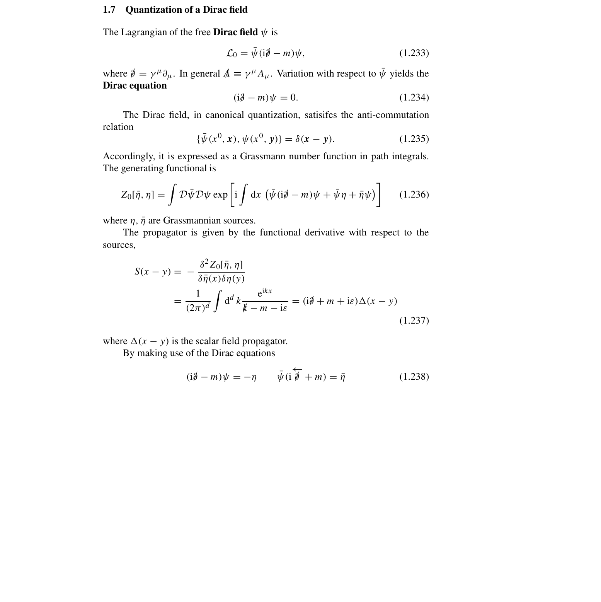

## 第 55 页句读与集注

### 句读式 (1.233)–(1.234)：为什么不继续用一个标量？

标量在时空坐标变换下没有额外的内部方向分量；Dirac 场则是旋量，具有与 Lorentz 变换相容的分量变换规律，用来描述电子这一类自旋 $1/2$ 的相对论性自由度。自旋不是一颗带电小球真的绕自身表面旋转；它是量子态对空间转动的特定响应。

一个常见动机是希望把相对论能量关系写成对时间、空间都一阶的方程。普通数字系数无法同时处理不同方向的平方和及交叉项，于是引入矩阵 $\gamma^\mu$，用 Clifford 反对易关系消去交叉项。旋量是这些矩阵作用的对象；它不是把普通空间三维向量简单增加一个分量。

对自旋 $1/2$，沿选定轴测量自旋投影时有两种结果，可用两个复振幅表示。旋转这些振幅使用 $SU(2)$ 矩阵；旋转 $2\pi$ 时旋量可变号，旋转 $4\pi$ 才回到原向量。单独的整体变号不改变概率，但在比较有不同旋转历史的相干分量时，相对符号能够进入干涉。这比把自旋想成小球转速更贴近其测量意义。四分量 Dirac 旋量还将相对论所需的粒子、反粒子结构组织在一起；不能仅由“四分量”就把每个分量解释成四个独立空间方向。

若采用常见的 $(+---)$ 演示约定，

$$
\{\gamma^\mu,\gamma^\nu\}=2\eta^{\mu\nu},\qquad
(i\gamma^\mu\partial_\mu+m)
(i\gamma^\nu\partial_\nu-m)=-(\Box+m^2).
$$

因此 Dirac 方程的每个分量也满足相应 Klein–Gordon 方程。但反过来不成立：Dirac 方程还包含自旋及分量之间的一阶约束。

这里特意声明演示约定，因为本书其他段落使用 $(-+++)$；更换度规时 $\gamma$ 与质量项记法也要相容。不能只把一个章节的 $\Box$ 符号搬进另一套 $\gamma$ 约定而不检查平方关系。

### 疏：bar、slash 与独立变分分别是什么意思？

$\not\!\partial=\gamma^\mu\partial_\mu$ 是缩写。$\bar\psi$ 是按相应度规与 $\gamma$ 约定定义的 Dirac 伴随，作用是让 $\bar\psi\psi$ 等双线性量具有需要的时空变换性质；它一般不等于简单逐分量复共轭。

推导方程及 Grassmann 积分时，$\psi,\bar\psi$ 作为独立变量处理。对 $\bar\psi$ 变分直接得到 $(i\not\!\partial-m)\psi=0$；对 $\psi$ 变分得到伴随方程。独立变分是技术安排，不是声称实验中电子场与其伴随毫无关系。

### 校读式 (1.235)：反对易关系的自旋指标不能全省略

通常正则等时关系写成

$$
\{\psi_\alpha(t,\mathbf x),
\psi_\beta^\dagger(t,\mathbf y)\}
=\delta_{\alpha\beta}\delta^{(3)}(\mathbf x-\mathbf y).
$$

若改用 $\bar\psi$，右边要带由伴随定义引入的 $\gamma^0$ 等矩阵结构，并注意指标和次序。原文把 $\{\bar\psi,\psi\}$ 直接写成标量 δ，只能当高度简写，不能当所有分量都共享的完整等式。

### 句读式 (1.236)–(1.238)：为什么源也必须是奇量？

$\bar\psi\eta+\bar\eta\psi$ 要与作用量其他项一样是偶元素，所以 $\eta,\bar\eta$ 也是 Grassmann 奇源。源导数插入场，交换导数次序产生费米负号。传播子现在是旋量分量之间的矩阵核，不再只是一个标量函数。

形式上的 $1/(\not k-m-i\epsilon)$ 指矩阵逆，并带着相应极点处方。可用另一个 Dirac 算符乘在标量 Green 核上来构造它，这就是式 (1.237) 将费米传播子连到标量传播子的结构。具体 $i$ 与质量符号要从一套完整约定核对；不能把未标 $J=0$、未写无源归一化的源导数式直接当作全部信息。

## 原书第 56 页：原文底本

以下影印块是本小节在该页的完整原文；相邻小节在同页交接时按标题分界。PDF 页码为 79。

## 第 56 页句读与集注

### 句读式 (1.239)–(1.240)：形式为什么再次如此熟悉？

记 Dirac 二次算符为 $D$。Grassmann 完成平方后，

$$
Z[\bar\eta,\eta]
=Z[0,0]\,e^{-i\int\bar\eta S_F\eta},
\qquad Z[0,0]\propto\det D
$$

（整体因子和相位按约定）。逆算符负责源之间的关联，行列式负责无源涨落。它与标量场的区别不是“有没有 Gaussian”，而是 Gaussian 所处代数不同，因此费米给 det，实玻色给 det 的倒平方根。

场论的 Det 仍需要边界条件和正则化；自由振子学过的教训没有消失。若只计算归一化自由关联，无源因子常被约掉；若背景场改变、要研究有效作用量，这个行列式可能携带重要背景依赖，不能随意称为无关常数。

### 集注：这一节可以带走的物理直观

Dirac 场的自旋结构由旋量与 Clifford 代数承担，费米统计由反对易关系承担，路径积分用 Grassmann 变量记录这些交换符号。三者彼此相连，却不是同一句话。

你不需要在这一页立即掌握所有自旋表示、反粒子和散射计算，但应能说明：为什么场需要多个分量，为什么求逆的是矩阵微分算符，以及为什么自由费米场会出现行列式。这些已经足够衔接下一节的带电场与规范耦合。

---

[总目录](README.md) · [上一小节](19-1.6.2.md) · [下一小节](21-1.8.1.md)

# 1.8.1 Abelian gauge theories｜电磁场与阿贝尔规范理论

[总目录](README.md) · [上一小节](20-1.7.md) · [下一小节](22-1.8.2.md)

本文件包括 1.8 导言与 1.8.1。原文说读者应熟悉 Maxwell 方程，但你的物理背景到高中，因此这里把场、势、四维记号、规范与协变导数依次补出。

## 原书第 56 页：原文底本

以下影印块是本小节在该页的完整原文；相邻小节在同页交接时按标题分界。PDF 页码为 79。

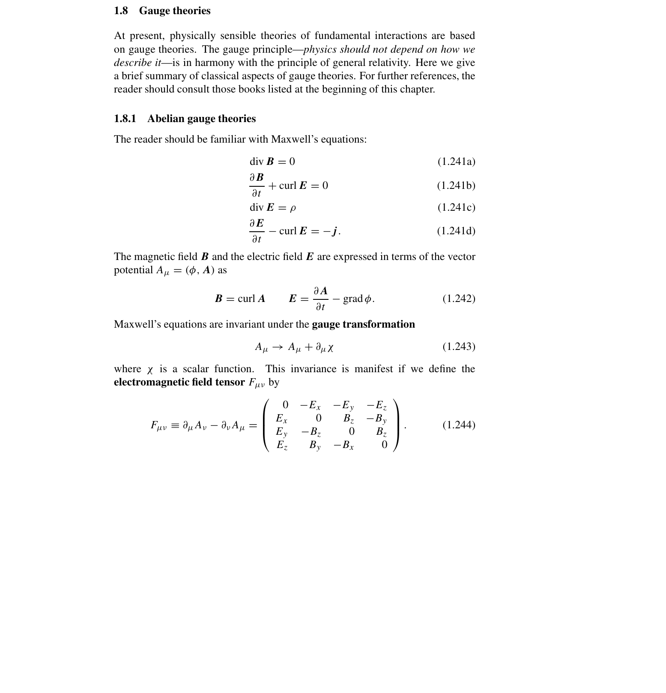

## 第 56 页句读与集注

### 句读导言：“physics should not depend on how we describe it”

同一种物理情况可以有多种描述，理论预测不应依赖这种选择。规范理论把这种冗余组织成局部变换。但这句原则本身不足以推出自然界有哪些粒子、规范群是什么或相互作用强度是多少；仍须给出自由度、作用量并与实验比较。

规范变换通常是同一物理状态的描述变化，不能简单等同于“把实验装置实际旋转了一下”。全局物理对称与局部描述冗余之间也有区别；边界、全局变换和电荷问题会使这种区别更细致。本节先掌握局部表达的基本逻辑。

### 句读式 (1.241)：四条方程各在说什么？

电场 $\mathbf E$ 和磁场 $\mathbf B$ 的操作意义可以从带电试探粒子的受力读出：

$$
\mathbf F=q(\mathbf E+\mathbf v\times\mathbf B)
$$

（取相容单位）。电场作用不要求试探粒子正在运动；磁力与速度有关，并垂直于速度，因此纯磁力本身不改变非相对论质点的速率。

$\operatorname{div}\mathbf B=0$ 说通常电磁理论没有磁荷源：闭曲面磁通净值为零。它不是说磁场不存在，而是磁力线没有像电荷那样的起止源。

$\partial_t\mathbf B+\operatorname{curl}\mathbf E=0$ 是 Faraday 感应：变化的磁通与环绕的电场相关。用 Stokes 定理可写成闭回路电场环量等于磁通变化率的负值。

$\operatorname{div}\mathbf E=\rho$ 是 Gauss 定律，电荷密度决定电通量源。第四式 $\partial_t\mathbf E-\operatorname{curl}\mathbf B=-\mathbf j$ 是带位移电流的 Ampère 定律，说明电流与变化电场关联磁场的环绕结构。

四条式子合起来还给出电荷守恒：对第四式取散度，再用第三式，得 $\partial_t\rho+\nabla\cdot\mathbf j=0$。对无源场进一步取旋度，可得到以 $c$ 传播的波动方程；因此电磁场不只是远处电荷之间的即时受力记号，它本身有局域传播的动力学。

### 物理补注：为什么把电场、磁场装进时空张量？

相对运动的惯性观察者会用不同方式划分电场与磁场。一个观察者看到的静止电荷，在另一观察者看来成为运动电荷与电流；要使同一实验的受力、运动和光传播规律相容，电、磁不能当作两套完全独立而不变的三维对象。

狭义相对论把时间与空间的坐标变换联系起来。取 $x^0=ct$，度规 $(-+++)$ 对应间隔

$$
ds^2=-c^2dt^2+dx^2+dy^2+dz^2.
$$

这不是概率或能量；它是惯性观察者变换下保持的时空间隔。用同一个张量 $F_{\mu\nu}$ 组织电、磁分量，便能用统一变换律比较不同观察者的描述。它没有把真实时间变成普通的第四个空间方向；稍后的欧氏时间则是一项另外声明的数学变换。

### 疏式 (1.242)–(1.244)：为什么引入“势”？

先选常用三维约定：

$$
\mathbf B=\nabla\times\mathbf A,\qquad
\mathbf E=-\partial_t\mathbf A-\nabla\Phi.
$$

这样前两条 Maxwell 方程自动成立，余下两条再决定动力学。势的引入把部分微分约束转成定义恒等式；但势不唯一：

$$
\mathbf A\mapsto\mathbf A+\nabla\chi,\qquad
\Phi\mapsto\Phi-\partial_t\chi
$$

不改变 $\mathbf E,\mathbf B$。这种不唯一性就是电磁规范自由，不是实验预测的任意性。

**校记：**影印 (1.242) 的电场写成 $+\partial_t\mathbf A-\operatorname{grad}\phi$，与其 $\mathbf B=\operatorname{curl}\mathbf A$ 及 (1.241b) 不相容：代入后一般得到 $2\partial_t\mathbf B$ 而不是零。应对齐势与时间分量约定，不能直接沿用该正号。(1.244) 的空间反对称块中，第 3 行第 4 列应对应 $B_x$，印为 $B_z$，与第 4 行第 3 列 $-B_x$ 不匹配。

四维写法 $F_{\mu\nu}=\partial_\mu A_\nu-\partial_\nu A_\mu$ 把 $\mathbf E,\mathbf B$ 合在反对称张量中。$F$ 不变来自偏导交换。这里“张量”首先保证不同时空坐标下以相容方式描述同一电磁场；不是再引入六种独立于电、磁的新物理实体。

## 原书第 57 页：原文底本

以下影印块是本小节在该页的完整原文；相邻小节在同页交接时按标题分界。PDF 页码为 80。

## 第 57 页句读与集注

### 句读式 (1.245)–(1.246)：两类 Maxwell 方程为何地位不同？

$F=dA$ 自动给 $dF=0$，即无磁源与 Faraday 定律。这是定义结构带来的 Bianchi 恒等式。另一组含电流的方程来自作用量变分，是动力学。

以作者的 $F$ 和指标约定，变分 $-\frac14F_{\mu\nu}F^{\mu\nu}+A_\mu j^\mu$：

$$
\delta S=\int d^4x\,
(\partial_\mu F^{\mu\nu}+j^\nu)\delta A_\nu
$$

（略去边界项），等价于原文调换反对称指标后的 $\partial_\nu F^{\mu\nu}=j^\mu$。这解释了为什么只用一条紧凑变分方程，还不足以取代 $F=dA$ 所含的结构条件。

升降指标会改变时间分量的符号，不能把所有上下标都当成版式差异。对于 Maxwell 理论，作用量的正负号应与能量密度 $\frac12(E^2+B^2)$ 及所选度规相容。注中不把本页的符号与别处的相反度规直接拼接。

### 句读式 (1.248)–(1.250)：整体相位为何不够，局部相位又多出什么？

整体变换 $\psi\mapsto e^{-ie\alpha}\psi$，$\alpha$ 常数，导数不碰出额外项。若 $\alpha=\alpha(x)$，

$$
\partial_\mu(e^{-ie\alpha}\psi)
=e^{-ie\alpha}
(\partial_\mu\psi-ie\,\partial_\mu\alpha\,\psi).
$$

普通导数比较相邻点的分量时，把两处相位基准当成相同；一旦允许每点独立选相位，它就把“基准的变化”误算成了“物理场的变化”。

这个问题不局限于相位：在曲面上比较不同点的向量，也需要说明怎样搬运方向。规范场正提供内部空间的比较规则，后面几何语言称其为联络。这里先用导数的额外项实际看见需要什么补偿。

### 疏式 (1.251)–(1.252)：补偿项为什么采取这个形状？

采用本书本段约定，

$$
D_\mu=\partial_\mu-ieA_\mu,\quad
\psi'=e^{-ie\alpha}\psi,\quad
A_\mu'=A_\mu-\partial_\mu\alpha.
$$

将 $D_\mu'\psi'$ 展开，$-ie\partial_\mu\alpha$ 与规范场变换产生的 $+ie\partial_\mu\alpha$ 抵消，留下 $e^{-ie\alpha}D_\mu\psi$。这就是“协变”：导数后的对象与原场按同一种规则变换。

这里选择这种最小耦合，使带电物质与电磁势相互作用。再加入 Maxwell 动能项，规范场才有自己的传播。局部不变性约束耦合结构，但不能单凭描述冗余就断言所有可能的附加规范不变相互作用都不存在。

## 原书第 58 页：原文底本

以下影印块是本小节在该页的完整原文；相邻小节在同页交接时按标题分界。PDF 页码为 81。

## 第 58 页句读与集注

### 句读式 (1.253)–(1.255)：规范场怎样具有可观测后果？

虽然 $A$ 的具体表达可变，沿回路的搬运相位以及曲率仍含物理内容。由

$$
[D_\mu,D_\nu]\psi=-ieF_{\mu\nu}\psi
$$

可见，先沿 $\mu$ 再沿 $\nu$ 与相反顺序比较场，差别由 $F$ 决定。局部规范选择不改变这个电磁场。对足够小的闭回路，累积相位与穿过回路的场强通量相联系；这是后面磁单极子与联络观点的入口。

不能据“势不唯一”得出“势没有任何作用”。量子相位的平行比较可以在全局问题中携带不能由单个点的 $F$ 值概括的信息；下一节非阿贝尔理论会进一步强调搬运次序。

### 句读练习 1.12：为什么标量也能带电？

规范变换作用在内部相位上，不要求场一定有自旋 $1/2$。复标量同样可按 $\phi\mapsto e^{-ie\alpha(x)}\phi$ 变换，使用同一个协变导数；$(D_\mu\phi)^\dagger D_\nu\phi$ 中相位彼此抵消，从而可构造规范不变项。

这道练习要求检查不变性，不等于它列出的全部动能、质量符号已经与前面 $(-+++)$ 的标量作用量约定自动一致。对物理稳定性还需单独检查时间动能与能量的符号。“规范不变”是约束之一，不是理论正确性的全部条件。

**回看问题：**E、B 各自怎样通过受力定义？哪组 Maxwell 方程来自 $F=dA$，哪组来自变分？局部相位为什么使普通导数多出一项？规范场为何可以理解为比较相邻点内部状态的规则？

---

[总目录](README.md) · [上一小节](20-1.7.md) · [下一小节](22-1.8.2.md)

# 1.8.2 Non-Abelian gauge theories｜非阿贝尔规范理论

[总目录](README.md) · [上一小节](21-1.8.1.md) · [下一小节](23-1.8.3.md)

本节用矩阵规范变换推广相位规范变换。物理直观的关键是“内部方向的搬运可能依赖次序”，数学上这迫使曲率出现交换子项。

## 原书第 58 页：原文底本

以下影印块是本小节在该页的完整原文；相邻小节在同页交接时按标题分界。PDF 页码为 81。

## 第 58 页句读与集注

### 句读开头：Abelian 与 non-Abelian 差别在哪里？

$U(1)$ 元素是单位复数，两个相位相乘顺序无关。矩阵群如 $SU(2)$ 中，先绕内部第一方向变换、再绕第二方向变换，通常不同于反过来。这里的“内部方向”不是普通三维空间中粒子的飞行方向，而是场分量所在表示空间中的方向。

例如 $SU(2)$ 的基本表示作用在两个复分量上。它与空间转动有数学联系，但具体理论里这些分量代表自旋、同位旋或其他内部量子数，要由物理模型说明，不能只因矩阵都是 $2\times2$ 就当成同一对象。

### 句读式 (1.258)–(1.260)：为什么使用 Lie 代数？

连续变换靠近单位元时，可以写成生成元的指数。交换子

$$
[T_\alpha,T_\beta]=f_{\alpha\beta}{}^\gamma T_\gamma
$$

记录无穷小变换不交换的方式。结构常数不是额外的力场分量，而是所选 Lie 代数基的乘法数据；基变换时它们也随之变。

作者取反 Hermitian 生成元，$T_\alpha^\dagger=-T_\alpha$，使实参数乘生成元再指数化得到酉矩阵。许多物理书改用 Hermitian 生成元并在指数、导数、场强中显式放 $i$。两种约定都可用，但 $i$、$g$、trace 正负号必须成套转换。

原文方括号中的 representation 提醒很重要：群的抽象定义还不足以决定怎样作用在具体物质场上。$\psi$ 属于哪个表示，决定它有多少内部分量、怎样与规范场耦合。可以先以基本表示作具体模型，再推广。

### 疏式 (1.261)：为何 𝒜 是 Lie 代数值的？

写 $\mathcal A_\mu=A_\mu^\alpha T_\alpha$，每个时空方向 $\mu$ 都携带一个内部无穷小变换。它告诉你沿这个方向移动一点时，如何调整内部基准来比较场。因此
$D_\mu=\partial_\mu+g\mathcal A_\mu$。时空指标与 Lie 代数指标分属不同空间，不要把两套求和混成一个普通四维矩阵。

## 原书第 59 页：原文底本

以下影印块是本小节在该页的完整原文；相邻小节在同页交接时按标题分界。PDF 页码为 82。

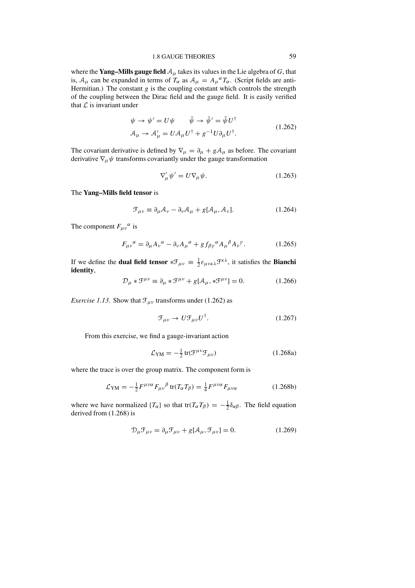

## 第 59 页句读与集注

### 句读式 (1.262)–(1.263)：变换律为什么带导数项？

要求 $D'_\mu\psi'=UD_\mu\psi$，其中 $\psi'=U\psi$。展开后出现 $(\partial_\mu U)\psi$，规范场必须补偿，得到

$$
\mathcal A'_\mu
=U\mathcal A_\mu U^{-1}
-\frac1g(\partial_\mu U)U^{-1}
=U\mathcal A_\mu U^{-1}+\frac1gU\partial_\mu U^{-1}.
$$

第一项像普通矩阵换基；第二项来自基准随位置变化。正是这项使联络本身不按张量那样只做齐次变换。它不是一个可删去的复杂附件。

### 疏式 (1.264)–(1.265)：交换子项为什么不可少？

直接计算

$$
[D_\mu,D_\nu]
=g\bigl(\partial_\mu\mathcal A_\nu-\partial_\nu\mathcal A_\mu
+g[\mathcal A_\mu,\mathcal A_\nu]\bigr)
=g\mathcal F_{\mu\nu}.
$$

普通导数部分只比较各方向系数的变化，最后的交换子则记录不同内部搬运不交换。沿一个小矩形走一圈，所得差别与面积乘 $\mathcal F_{\mu\nu}$ 相联系。这比把场强公式死记为“电磁公式再加一项”更能解释它的来由。

阿贝尔理论中交换子为零。非阿贝尔理论中，场强已含 $\mathcal A^2$，再写 $\operatorname{tr}\mathcal F^2$ 就包含三次、四次规范场项，表现为规范场的自相互作用。电磁真空的经典 Maxwell 方程线性，这里一般不再线性；该差别具有实际动力学内容。

### 句读式 (1.266)–(1.269)：恒等式、协变性与动力学三者分开

Bianchi 恒等式 $D\mathcal F=0$ 可由协变导数交换子的 Jacobi 恒等式得到，它依赖曲率如何定义。Yang–Mills 方程 $D_\mu\mathcal F^{\mu\nu}=0$ 则来自无源作用量变分。前者不是后者的解，后者也不只是重写前者；自对偶一节会借 Hodge 星将它们在特殊情况下联系起来。

曲率变换为 $\mathcal F'\!=U\mathcal F U^{-1}$，所以
$\operatorname{tr}(\mathcal F'\mathcal F')=\operatorname{tr}(\mathcal F\mathcal F)$。trace 消去内部换基依赖，因此可组成规范不变作用量。不是每个分量都不变；不变的是合适的整体组合。

### 校读 trace 的符号

反 Hermitian 基满足 $\operatorname{tr}(T_\alpha T_\beta)=-\delta_{\alpha\beta}/2$。因此在欧氏空间用 $-\operatorname{tr}\mathcal F^2$ 才给正二次型。Lorentz 时空还要考虑度规对电、磁部分的符号；本页把形式移向后文欧氏理论时，不能只沿用“平方总为正”的普通实数直觉。

**回看问题：**导数项在规范变换律中补偿什么？交换子项在曲率中记录什么？$\mathcal F$ 为什么仅协变而非每个分量不变？Bianchi 恒等式与 Yang–Mills 方程各自来自哪里？这些问题直接通向联络、曲率和纤维丛。

---

[总目录](README.md) · [上一小节](21-1.8.1.md) · [下一小节](23-1.8.3.md)

# 1.8.3 Higgs fields｜Higgs 场与质量

[总目录](README.md) · [上一小节](22-1.8.2.md) · [下一小节](24-1.9.1.md)

## 原书第 60 页：原文底本

以下影印块是本小节在该页的完整原文；相邻小节在同页交接时按标题分界。PDF 页码为 83。

## 第 60 页句读与集注

### 句读开头：为什么规范理论会遇到质量问题？

对自由电磁势直接添 $m_A^2A_\mu A^\mu/2$，一般会破坏原来的局部规范不变写法。可是实际理论又需要描述有质量的矢量激发。Higgs 机制的任务是：在保持完整规范结构的理论中，通过与标量场的真空结构耦合，产生有质量矢量的谱。

原文把这一点说成“没有可见的许多无质量矢量场，所以被迫破缺”，是一个概略动机。不能将它读成所有非阿贝尔场都必须通过 Higgs 机制获得质量；强相互作用中禁闭、质量隙等问题具有不同机制。当前讨论的是一个简单 $U(1)$ 模型，不是所有基本相互作用的完整故事。

### 句读式 (1.270)：势能的圆形最低点意味着什么？

设 $V=\lambda(|\phi|^2-v_0^2)^2$、$\lambda>0$。最低点满足 $|\phi|=v_0$，在复平面构成一个圆。径向离开这个圆会增加势能；沿圆改变相位不增加势能。但若相位是局部规范自由，同一圆上的许多描述并非不同的可测物理真空。

“局部规范对称自发破缺”是常见的固定规范叙述。更准确地说，选择一种真空代表和规范后，可以把谱组织成有质量矢量与实标量；局部描述冗余没有变成一种被实验打破的物理定律。$\langle\phi\rangle$ 的具体取向依赖规范，质量、散射等适当可观测量才是物理判断依据。

### 疏式 (1.271)–(1.273)：质量项如何实际出现？

用一套明确归一化来演示：

$$
\phi=\frac{v+h}{\sqrt2}e^{i\vartheta/v},
\qquad
V=\lambda\left(|\phi|^2-\frac{v^2}{2}\right)^2.
$$

在约定相容的动能中，

$$
|D_\mu\phi|^2
=\frac12(\partial_\mu h)^2+
\frac12(v+h)^2
\left(\frac{\partial_\mu\vartheta}{v}-eA_\mu\right)^2.
$$

相位和规范场只以这个组合出现。取单位规范将相位移去，留下

$$
\frac12e^2v^2A_\mu A^\mu
+e^2vhA_\mu A^\mu+\frac12e^2h^2A_\mu A^\mu.
$$

第一项是矢量质量项，给 $m_A=|e|v$；其余项是与径向激发的耦合。势能展开的二次项为 $\lambda v^2h^2$，所以 $m_h^2=2\lambda v^2$。这里先展示系数结构；放入 Lorentz 拉格朗日量时，要按所选度规安排动能、质量项的整体符号。

这个机制不是粒子穿过黏稠物质、被摩擦拖慢。质量对应小振动谱中的能量—动量关系以及静止能隙；均匀真空不选出一个产生普通阻力的绝对静止介质。

### 校记：原文的 v 与 √2 前后不相容

原文先写最低点 $|\phi|=v$，随后却以 $\phi=(v+\rho)/\sqrt2$ 在 $\rho=0$ 展开。这一点不在先前的最低圆上。可以把势改用 $v^2/2$，或把展开的常数改成 $\sqrt2v$，但必须一起改后续系数。

按它 (1.273) 已印出的矢量二次项 $\frac12e^2v^2A_\mu A^\mu$，变分得到的质量系数是 $e^2v^2$，不是 (1.274) 的 $2e^2v^2$。注中采用上面一套完整约定推导，保留原页供比较，避免把不同归一化拼出一个质量公式。

### 句读自由度计数：相位去了哪里？

在四维，普通无质量矢量有两个物理横向极化，复标量有两个实自由度，总共四个。有质量矢量有三个极化，包括纵向极化；再加一个径向标量，仍是四个。

相位并非凭空被删掉，它在规范约束下参与形成有质量矢量的纵向自由度。这就是常说的“吃掉 Goldstone 模”的实际计数含义。若仅是全局连续对称而没有规范场，沿最低圆的模式通常会作为独立 Goldstone 模保留下来，情形不同。

最后，$A_0$ 通常涉及约束，不是一个带普通独立动力学的第四极化。原文以“质量项符号错”一句排除它过于简略；完整解释要结合规范约束与方程结构。当前应掌握物理自由度数，而不把四个时空分量直接当四种可传播粒子。

**回看问题：**最低圆与一组可观测不同真空是否总是同一回事？为什么质量来自协变导数的二次项？相位模式如何与纵向极化对应？质量为什么不是摩擦？

---

[总目录](README.md) · [上一小节](22-1.8.2.md) · [下一小节](24-1.9.1.md)

# 1.9.1 Dirac monopole｜Dirac 磁单极子

[总目录](README.md) · [上一小节](23-1.8.3.md) · [下一小节](25-1.9.2.md)

本文件保留 1.9 导言与 1.9.1。磁单极子在此首先是一种假设的磁荷配置；本章研究它若存在，电磁势和带电波函数必须满足怎样的一致性条件。

## 原书第 60 页：原文底本

以下影印块是本小节在该页的完整原文；相邻小节在同页交接时按标题分界。PDF 页码为 83。

## 第 60 页句读与集注

### 句读导言：电、磁的不对称到底是什么？

普通 Maxwell 方程有 $\nabla\cdot\mathbf E=\rho$，却有 $\nabla\cdot\mathbf B=0$。电场可以有电荷源，磁场却没有对应的独立磁荷源。这不是指磁铁没有南北端，而是切开普通磁铁仍会得到具有两端的磁体，不能仅凭切割分离出一个独立磁荷。

Dirac 考察若允许点磁荷，会对量子理论带来什么限制。这个理论问题有价值，不需要先把磁荷当作前面方程已证明存在的对象。物理理论也经常通过研究可能配置及其一致性，发现数学结构与量子化条件。

下一页的 $g$ 是按磁通定义的磁荷强度，满足总磁通 $4\pi g$。因不同电磁单位制会改变 $4\pi,c$ 的位置，后面恢复单位时要跟随同一套磁荷归一化，不应把不同教材的 $g$ 直接当同一个数值。

## 原书第 61 页：原文底本

以下影印块是本小节在该页的完整原文；相邻小节在同页交接时按标题分界。PDF 页码为 84。

## 第 61 页句读与集注

### 句读式 (1.275)–(1.277)：为什么 B 是径向反平方场？

假设原点有点磁荷，且空间各方向等价。场只能径向，写 $\mathbf B=b(r)\hat{\mathbf r}$。对半径 $R$ 球面，通量为 $4\pi R^2b(R)$；若包围的磁荷固定，通量与 $R$ 无关，便得到

$$
\mathbf B=g\frac{\mathbf r}{r^3},\qquad
\int_{S^2}\mathbf B\cdot d\mathbf S=4\pi g.
$$

在原点以外散度为零；δ 分布把原点的源记录下来。不要把“在穿孔空间处处散度零”误解为“包围原点的闭面通量必为零”，因为散度定理所需的整个内部区域不再无奇点。

### 疏式 (1.278)–(1.280)：为什么场光滑而势却有一条线出问题？

原文的两种势在球坐标中为

$$
\mathbf A_N=\frac{g(1-\cos\theta)}{r\sin\theta}\hat{\mathbf e}_\varphi,
\quad
\mathbf A_S=-\frac{g(1+\cos\theta)}{r\sin\theta}\hat{\mathbf e}_\varphi.
$$

在北极附近，$1-\cos\theta\sim\theta^2/2$，所以 $\mathbf A_N$ 的系数趋于零；它在南极方向却奇异。$\mathbf A_S$ 正好相反。场 $\mathbf B$ 在固定半径球面上完全光滑，势的坏处并不是场在该方向真的突然发散。

计算旋度的径向分量可核对：

$$
(\nabla\times\mathbf A_N)_r
=\frac1{r\sin\theta}\partial_\theta
(\sin\theta\,A_{N,\varphi})
=\frac g{r^2}.
$$

这条计算只在该势定义良好的区域使用。若把它强行当作全空间带奇异线的分布势，会出现与 Dirac string 有关的额外分布项。原文 (1.279) 的字符串项需连同方向理解；不能把这个人为奇异线的全部旋度都直接当作想要的纯径向磁场。

### 句读“abandon the use of a single vector potential”：问题究竟是坐标还是拓扑？

“poor choice of coordinate system”容易让人以为换一套好坐标就能找到全球光滑势。实际更强：当通量非零时，不存在覆盖整个球面的单个光滑势一形式。

把磁场通量写成球面上的二形式 $F$。若有全局一形式 $A$ 满足 $F=dA$，由于球面没有边界，

$$
\int_{S^2}F=\int_{S^2}dA=\int_{\partial S^2}A=0,
$$

与 $4\pi g\ne0$ 矛盾。这一论证只在球面上用 Stokes 定理，不必假设势可以光滑延拓到原点内部；因此比单靠原文的体积散度论证更直接地揭示全局障碍。

局部上仍可以写 $F=dA$，全局上却不能。这不是微分运算出了错，而是“闭形式”不一定“恰当形式”。你以后读 de Rham 上同调时，便会看到它系统记录这种差别。

### 集注：物理直观怎样过渡到数学？

高中的磁通概念问“有多少场穿过闭面”；这里发现一个非零整体通量，无法由全球光滑势产生。于是不得不使用局部描述，并研究局部描述怎样拼接。纤维丛不是为了装饰电磁公式而外加的抽象语言，而是为这个拼接问题准备的。

**回看问题：**原点外散度为零为什么不排除非零通量？两种势各在哪个区域光滑？Dirac string 为什么不等同于一根实际磁性细线？Stokes 定理怎样证明全局光滑势不存在？

---

[总目录](README.md) · [上一小节](23-1.8.3.md) · [下一小节](25-1.9.2.md)

# 1.9.2 The Wu-Yang monopole｜Wu–Yang 拼接

[总目录](README.md) · [上一小节](24-1.9.1.md) · [下一小节](26-1.9.3.md)

## 原书第 62 页：原文底本

以下影印块是本小节在该页的完整原文；相邻小节在同页交接时按标题分界。PDF 页码为 85。

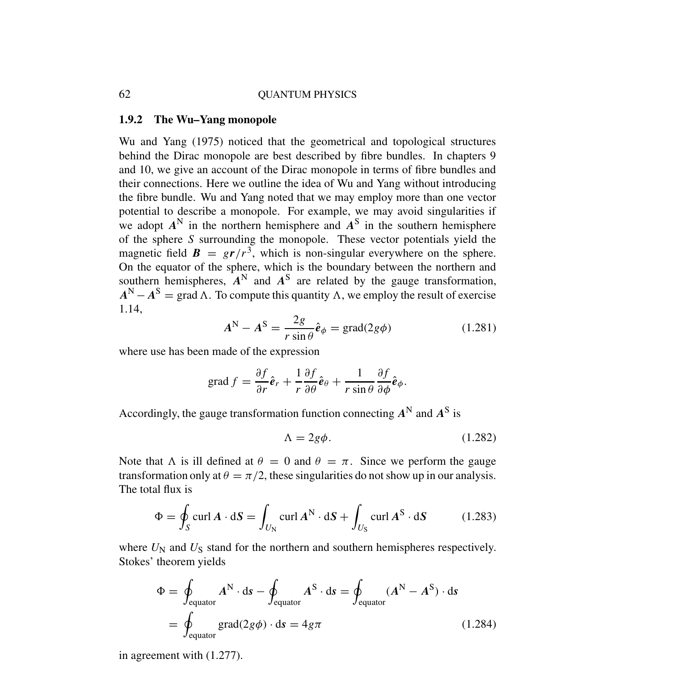

## 第 62 页句读与集注

### 句读开头：为什么“两张图”足以去掉奇异线？

不要只取不相交的南、北开半球，否则赤道没有共同定义域。应取稍大于半球的两个开集，使它们在赤道附近有一条重叠带：$A_N$ 用在避开南极的一片，$A_S$ 用在避开北极的一片。各自内部都没有 Dirac string。

重叠处两个势产生相同磁场，所以不是两个不同物理磁场，而是同一场的两套局部描述。要使带电物质也被一致描述，就还需要规定两片波函数之间的相位转换。下一小节会从这个要求得到量子化条件。

### 句读式 (1.281)–(1.282)：差值为何是一个梯度？

直接相减：

$$
\mathbf A_N-\mathbf A_S
=\frac{2g}{r\sin\theta}\hat{\mathbf e}_\varphi
=\nabla(2g\varphi).
$$

这里 $\varphi$ 是方位角，不是上一节标量场 $\phi$。局部规范函数可写 $\Lambda=2g\varphi$。但方位角绕一圈增加 $2\pi$，所以 $\Lambda$ 也增加 $4\pi g$；它不是覆盖整条赤道的单值实函数。

原文只强调两极不良定义，还应补上这项绕圈多值性。$\nabla\varphi$ 在重叠带局部有明确意义，而 $\varphi$ 自身需要分支。正是这种局部梯度与全球单值之间的区别，保存了非零通量。

### 疏：改写成一形式，半径因子为何消失？

沿球面有 $d\mathbf r=r\,d\theta\,\hat{\mathbf e}_\theta+
r\sin\theta\,d\varphi\,\hat{\mathbf e}_\varphi$。所以

$$
A_N=g(1-\cos\theta)d\varphi,\qquad
A_S=-g(1+\cos\theta)d\varphi,
$$

两者差 $2g\,d\varphi$。对应曲率

$$
F=dA_N=dA_S=g\sin\theta\,d\theta\wedge d\varphi.
$$

这把局部联络与全局曲率的关系写得很清楚。向量场分量中的 $1/(r\sin\theta)$ 来自坐标基的尺度，不是物理耦合忽然少了一项。

### 句读式 (1.283)–(1.284)：为什么两半球相加不会抵消？

对两片分别用 Stokes 定理，赤道的诱导方向相反，于是

$$
\int_{S^2}F
=\oint_{\rm eq}A_N-\oint_{\rm eq}A_S
=\oint_{\rm eq}2g\,d\varphi
=4\pi g.
$$

若是同一个全球 $A$，边界项会抵消；现在两片用不同局部势，差值留下了非零量。不能把最后一步写成“闭曲线上梯度积分必为零”，因为那个定理要求势函数全球单值，而 $\Lambda=2g\varphi$ 正不满足。

### 集注：纤维丛的骨架已经出现

每个点附带一个可选相位基准；在每片上可以选一套基准，重叠带上用 $U(1)$ 变换连接。局部势是这套基准下的联络表达，曲率是两片共同的物理场。

这比“球面必须用多张坐标图”多了一层：底空间坐标只是位置的描述，纤维方向还记录内部相位基准。两者都会用覆盖与拼接，但不能仅以地球经纬度的类比完全替代规范丛。

**回看问题：**为什么覆盖需要重叠？$\Lambda$ 局部存在为何不意味着全球单值？两半球的边界取向为何相反？哪一步使通量在局部势的拼接中被保存下来？

---

[总目录](README.md) · [上一小节](24-1.9.1.md) · [下一小节](26-1.9.3.md)

# 1.9.3 Charge quantization｜电荷量子化

[总目录](README.md) · [上一小节](25-1.9.2.md) · [下一小节](27-1.10.1.md)

## 原书第 62 页：原文底本

以下影印块是本小节在该页的完整原文；相邻小节在同页交接时按标题分界。PDF 页码为 85。

## 第 62 页句读与集注

### 句读开头：为什么让电荷在磁荷背景中运动？

磁场的经典通量可以先设为任意实数。要出现 Dirac 量子化条件，还要加入带电量子物质，并要求它的波函数在两套局部规范中相容。量子相位的单值性把原本连续的参数约束成离散组合。

将磁荷看成很重，是为了忽略它自身运动与反冲，用外部背景近似。运动的是电荷 $e$、质量 $m$ 的探针。本段只研究这个近似下的一致性，并没有求解完整的两体量子系统。

## 原书第 63 页：原文底本

以下影印块是本小节在该页的完整原文；相邻小节在同页交接时按标题分界。PDF 页码为 86。

## 第 63 页句读与集注

### 句读式 (1.285)：p−eA/c 为什么叫机械动量？

最小耦合下，

$$
H=\frac1{2m}\left(-i\hbar\nabla-\frac ec\mathbf A\right)^2.
$$

正则动量是产生坐标平移的算符；括号内的规范协变组合与机械动量相联系。若改变 $A$，同时给波函数适当相位，括号作用后的物理预测不变。不能只把 $A$ 改掉却让 $\psi$ 保持原式，再宣称同一个物理场导致不同能量。

### 疏式 (1.286)：两片波函数为什么不必数值相同？

两片使用不同相位基准，因此同一物理态的局部代表满足

$$
\psi_S=
\exp\left[-\frac{ie}{\hbar c}\Lambda\right]\psi_N,
\qquad \Lambda=2g\varphi.
$$

$|\psi_N|^2=|\psi_S|^2$，所以两片对位置概率一致。这个相位函数是过渡函数。数学上，全球态可以是一条线丛的截面，不必能在所有位置用同一个普通复函数及同一个相位基准表示。

### 句读式 (1.287)–(1.288)：整数从哪一步出现？

赤道方位角由 $\varphi$ 到 $\varphi+2\pi$ 对应同一点。过渡函数本身必须单值，因此

$$
\exp\left[-\frac{ie}{\hbar c}4\pi g\right]=1.
$$

单位复数绕圈后回到自身的条件是相位变化为 $2\pi n$，故

$$
\frac{2eg}{\hbar c}=n\in\mathbb Z,\qquad
eg=\frac n2\hbar c.
$$

这里量子化的首先是电荷与磁荷的乘积。$n$ 的正负随电磁荷符号、球面取向及规范约定改变；离散整数性才是共同结构。

### 疏：为什么这也是绕数？

过渡函数限制在赤道上，是一个 $S^1\to U(1)\cong S^1$ 的映射。它把赤道走一圈时的相位变化映到单位圆。连续变形不能随意把绕了 $n$ 圈改成绕了另一整数圈，这个整数就是全局拼接类型的标记。

以相应定向写，

$$
\frac e{2\pi\hbar c}\int_{S^2}F
=\frac{2eg}{\hbar c}\in\mathbb Z.
$$

它预示第一 Chern 数。注意要把曲率乘上电荷及单位因子后，才得到与特定带电线丛对应的整数归一化；不能不说明单位就称 $4\pi g$ 本身是整数。

### 集注：最后一句“所有电荷量子化”需要什么前提？

若同一 $U(1)$ 理论中存在固定非零磁荷 $g$，每种允许电荷 $q$ 都必须满足 $2qg/(\hbar c)\in\mathbb Z$，于是电荷受一个公共离散单位约束。这个推论以磁荷存在和量子理论的一致拼接为条件，并没有仅凭 Maxwell 方程证明自然界一定有磁单极子。

目前需要建立的物理直观是：局部势的不唯一性与量子相位并非没有后果；当它们跨越整个非平凡空间拼接时，全球一致性可能只允许整数类别。拓扑在这里直接限制允许的物理参数。

**回看问题：**为什么 $A_N,A_S$ 不同而概率相同？绕一圈必须单值的是局部实函数 $\Lambda$，还是指数过渡函数？量子化首先限制哪两个量的乘积？这个整数与赤道的绕数有什么关系？

---

[总目录](README.md) · [上一小节](25-1.9.2.md) · [下一小节](27-1.10.1.md)

# 1.10.1 Introduction｜瞬子与拓扑扇区

[总目录](README.md) · [上一小节](26-1.9.3.md) · [下一小节](28-1.10.2.md)

本文件包括 1.10 导言与 1.10.1。瞬子把前面的欧氏路径积分、非阿贝尔曲率和全球拓扑放在一起。先弄清研究的对象，公式才不会变成彼此孤立的名词。

## 原书第 63 页：原文底本

以下影印块是本小节在该页的完整原文；相邻小节在同页交接时按标题分界。PDF 页码为 86。

## 第 63 页句读与集注

### 句读式 (1.289)：为什么又回到欧氏时间？

真实时间权重是 $e^{iS/\hbar}$，经典极限靠驻相；欧氏时间权重是 $e^{-S_E/\hbar}$，可围绕有限作用量驻点研究半经典贡献。真空附近的小涨落给微扰理论；若存在不能从真空连续小变动得到的背景，还需要在这些背景附近另行展开。

一个有帮助的低维类比是双势阱的量子隧穿：真实时间经典轨迹可能无法跨越势垒，但欧氏方程可以有连接不同渐近真空的有限作用量轨迹，用来组织隧穿振幅。这解释“为什么找欧氏解”，却不意味着 Yang–Mills 瞬子就是一颗真的小球越过某条空间山坡。

### 疏：瞬子不是“寿命很短的一颗粒子”

这里研究四维欧氏时空中的场配置。它通常在空间与欧氏时间中都局域化，有有限作用量。它不是一个在真实三维空间中静止、随真实时间持续存在的经典粒子；那类对象更接近后文的某些孤子。

“instanton”这个名字容易使人联想到一个持续很短的实体，实际应从配置和边界条件理解。它在量子理论中的作用来自路径积分的不同半经典背景及其拓扑结构。

### 句读“local minima”：在哪个集合里取极小？

纯规范真空可以有零作用量；非零拓扑数瞬子的作用量却为正。因此不能说一个 $Q=1$ 瞬子是所有场配置中唯一的绝对最低点。自对偶解是在固定拓扑类别内达到作用量下界；不同类别不能通过保持相应边界条件的光滑小变形任意连通。

这里也可能有位置、尺度等连续参数，使“极小值”有平坦方向。它不是优化中一个 Hessian 严格正定的孤立极小点。下一节会把下界和参数说明白。

### 句读式 (1.290)：为什么强调四维与 SU(2)？

四维时，二形式的 Hodge 对偶仍是二形式，才能直接提出 $F=\pm *F$。$SU(2)$ 作为流形与 $S^3$ 同胚，恰好与四维空间无穷远的大球面 $S^3$ 发生关系；这种映射具有整数绕数。

因此“四维”“二形式曲率”“$SU(2)\cong S^3$”不是三个随手选择的标签，它们共同使本节最简单的瞬子拓扑与自对偶构造成立。别的群与维数也有相关结构，但不能把本页公式不改条件地平移过去。

## 原书第 64 页：原文底本

以下影印块是本小节在该页的完整原文；相邻小节在同页交接时按标题分界。PDF 页码为 87。

## 第 64 页句读与集注

### 句读式 (1.291)–(1.293)：有限作用量为什么牵涉无穷远？

欧氏作用量积分整个 $\mathbb R^4$。若场强在无穷远衰减不够快，体积因子会让积分发散。在本章考虑的光滑经典背景与常规渐近条件下，要求无穷远趋向平坦联络，即曲率趋零，势趋向纯规范。

原文说路径积分“只有有限作用量配置贡献”，对寻找半经典背景很有启发，但不能当作完整量子泛函测度的严格支撑定理。前面的粒子路径积分已经提醒过，典型积分配置可能粗糙，单独的经典作用量表达并不总逐点有意义。此处讨论的是可用于半经典分析的光滑有限作用量解。

### 校读“pure gauge”：需要一致的 Hermitian 约定

若取反 Hermitian 联络 $a$ 并将耦合吸收，曲率为

$$
f=da+a\wedge a.
$$

纯规范可以写 $a=U^{-1}dU$，Maurer–Cartan 恒等式给 $f=0$。若改用 Hermitian 势，公式中要加入相应 $i$ 和耦合常数。

本书本页一方面定义 $\mathcal A_\mu=A_\mu^\alpha\sigma_\alpha/(2i)$ 为反 Hermitian，另一方面 (1.293) 写 $iU^{-1}\partial_\mu U$，后者是 Hermitian，并且未与前文 $g$ 对齐。因此不能把该式直接代入同一套反 Hermitian 曲率就断言零。注中以明确的 $a,f$ 约定讲结构，原文照存以便核对。

### 疏：“S³ mapped to SU(2)” 怎样产生？

在 $\mathbb R^4$ 取很大的半径，固定半径后的方向组成三维球面 $S^3$。无穷远纯规范由每个方向上的群元素 $U(\Omega)$ 给出，因此有

$$
U:S^3_\infty\longrightarrow SU(2)\cong S^3.
$$

为什么 $SU(2)$ 会是三维球面？取 Pauli 矩阵

$$
\sigma_1=\begin{pmatrix}0&1\\1&0\end{pmatrix},\quad
\sigma_2=\begin{pmatrix}0&-i\\i&0\end{pmatrix},\quad
\sigma_3=\begin{pmatrix}1&0\\0&-1\end{pmatrix}.
$$

它们满足 $\sigma_i\sigma_j=\delta_{ij}I+i\epsilon_{ijk}\sigma_k$。一般 $SU(2)$ 元素可写 $U=a_0I+i\,a_i\sigma_i$，其中 $a_\mu$ 为实数且 $a_0^2+a_1^2+a_2^2+a_3^2=1$。四个实坐标受一个单位球面约束，正是 $S^3$。这里说的是群作为流形的形状，不是说它的乘法等于普通向量加法。

原文下一页的 $U=(x_4I-ix_i\sigma_i)/r$，就是把四维位置的单位方向变成这样的群元素。Pauli 恒等式保证 $U^\dagger U=I$，行列式为 1。于是看似突然出现的矩阵 ansatz，其实直接利用了两边相同的球面结构。

两幅映射若能连续变形，就属于同一同伦类；这些类由 $\pi_3(SU(2))\cong\mathbb Z$ 标记。整数描述覆盖方向球面的次数，不是说 $\mathbb R^4$ 里必须摆放 $n$ 个互不接触的硬球。

非零绕数意味着无穷远的规范数据不能以全球平凡的方式延入内部而始终保持纯规范。这与磁单极子的逻辑类似：局部表达可以简单，全球拼接却有障碍。以后把 $\mathbb R^4$ 紧化并以丛语言处理时，这个整数还会由曲率积分表达。

**补充核对来源：**[David Tong 的 TASI 瞬子讲义，§1.1](https://davidtong.org/pdfs/teaching/solitons/tasi1.pdf) 明确先给出 Euclidean 与 Hermitian 约定，再讨论有限作用量、无穷远纯规范及同伦类别。这里仅用它核对约定和构造次序；本注正文仍逐段解释你提供的原书。

---

[总目录](README.md) · [上一小节](26-1.9.3.md) · [下一小节](28-1.10.2.md)

# 1.10.2 The (anti-)self-dual solution｜自对偶解与作用量下界

[总目录](README.md) · [上一小节](27-1.10.1.md) · [下一小节](29-Problems.md)

本节把一个二阶的非线性方程，转成一类特别的一阶方程求解。要注意：自对偶解给出 Yang–Mills 解的一部分，不是所有二阶解都与自对偶方程等价。

## 原书第 64 页：原文底本

以下影印块是本小节在该页的完整原文；相邻小节在同页交接时按标题分界。PDF 页码为 87。

## 第 64 页句读与集注

### 句读式 (1.294)–(1.296)：Hodge 星在这里做什么？

四维欧氏空间中，

$$
(*F)_{\mu\nu}=\frac12\epsilon_{\mu\nu\rho\sigma}F_{\rho\sigma}.
$$

它利用度规和定向，把一个定向二维面积方向对应到互补二维方向。二形式空间有六维，且 $*^2=1$，所以可分解成三个自对偶方向与三个反自对偶方向：

$$
F_\pm=\frac12(F\pm *F).
$$

自对偶条件 $F=*F$ 表示反自对偶部分为零。这是对场强的特殊几何限制，不是说场等于它自己的复共轭，也不是把电场、磁场的向量值直接按普通三维方式相等。

在 Lorentz 四维中，二形式的 $*^2$ 符号会不同，因此实欧氏自对偶解不能原封不动解释成一个真实时间电磁场。Wick 旋转和度规是这一步成立的前提。

### 疏：为什么一阶条件保证二阶方程？

曲率本身满足 Bianchi 恒等式 $D_\mu(*F)_{\mu\nu}=0$。若 $F=\pm *F$，立刻得到

$$
D_\mu F_{\mu\nu}
=\pm D_\mu(*F)_{\mu\nu}=0.
$$

左边正是无源 Yang–Mills 方程。因为 $F$ 含势的一阶导数，自对偶条件对势是一阶；再作用协变导数才是二阶动力学。

这证明“自对偶 ⇒ Yang–Mills”，没有证明反向蕴含。原文开头的 “equivalent” 应按“在达到拓扑下界的特殊构造中，可以改解一阶系统”理解，不能当作一般二阶解分类的定理。

### 校读式 (1.294)：反 Hermitian 平方的 trace 不是非负

对反 Hermitian 矩阵 $X$，$\operatorname{tr}X^2\le0$，因此正范数要用 $-\operatorname{tr}X^2$。原文沿用反 Hermitian 场强却写 $\int\operatorname{tr}(F\pm *F)^2\ge0$，正负号不相容。若改用 Hermitian 场强，则需一起修改曲率中的 $i$ 与作用量约定。

为避免继续混用，下面统一采用反 Hermitian 联络 $a$、曲率 $f=da+a^2$，把耦合从联络吸收进作用量：

$$
S_E=-\frac1{2g_{\rm YM}^2}\int d^4x\,
\operatorname{tr}f_{\mu\nu}f_{\mu\nu},\qquad
Q=-\frac1{16\pi^2}\int d^4x\,
\operatorname{tr}f_{\mu\nu}(*f)_{\mu\nu}.
$$

在本节的光滑、适当渐近条件与 trace 归一化下，$Q$ 是整数。这里的新符号是在解释中建立一致计算，不是悄悄改写作者的原文。

## 原书第 65 页：原文底本

以下影印块是本小节在该页的完整原文；相邻小节在同页交接时按标题分界。PDF 页码为 88。

## 第 65 页句读与集注

### 句读式 (1.297)–(1.299)：下界怎样算出来？

令

$$
I=-\int\operatorname{tr}f^2,\qquad
J=-\int\operatorname{tr}f(*f)=16\pi^2Q.
$$

欧氏 Hodge 星保持二形式范数，故

$$
0\le-\int\operatorname{tr}(f\mp *f)^2
=2I\mp2J.
$$

两种符号同时给出 $I\ge|J|$，所以

$$
S_E\ge\frac{8\pi^2}{g_{\rm YM}^2}|Q|.
$$

等号当且仅当相应的一半曲率为零，即自对偶或反自对偶。若采用作者吸收耦合或取耦合为 1 的归一化，就出现 $8\pi^2|Q|$。不能在场强定义仍含任意 $g$ 时，忘记检查 $Q$ 与作用量的归一化是否一起改变。

这个推导在数学上类似“平方配方＋固定约束量”。不同的是约束量 $Q$ 来自全球拓扑，在固定类别内连续变动不改变它，所以不等式真正给出该类别中的能垒或作用量代价。$Q=0$ 真空仍可有更低的零作用量。

### 句读式 (1.300)–(1.303)：为何引入径向 profile f(r)？

先从无穷远的纯规范形状出发，乘一个仅依赖半径的函数。这个 ansatz 利用旋转对称性把偏微分方程简化为常微分方程；它是寻找一个高度对称解的方法，不是对所有瞬子的一般表达。

原文得到

$$
r f'(r)=2f(1-f).
$$

在 $0<f<1$ 的非平凡分支上，

$$
\frac{df}{f(1-f)}=2\frac{dr}{r}
\quad\Longrightarrow\quad
\log\frac f{1-f}=2\log r+C.
$$

因此

$$
f(r)=\frac{r^2}{r^2+\lambda^2}.
$$

它在无穷远趋于 1，使势趋于纯规范；在原点附近按 $r^2$ 消失，使适当规范中的核心保持正则。单有 $f(\infty)=1$ 还包括常数分支 $f=1$，需要结合核心正则性及非平凡拓扑来选择这个解。

### 疏：λ 为什么可以自由变化？

$\lambda$ 控制场强集中的尺度。经典四维纯 Yang–Mills 作用量具有尺度不变结构，因此可以有不同大小、同一拓扑数和同一经典作用量的解。将解平移，也得到不同中心的解。这些连续参数称为模或集体坐标。

所以围绕瞬子展开时，某些变化方向不会增加作用量，Hessian 有零模。前面 Gaussian 的“行列式倒平方根”不能直接对包含零特征值的整个算符使用；要把零模分出，转而积分相应集体坐标。这解释了为何瞬子计算虽然也从涨落展开出发，却比谐振子复杂。

### 校记式 (1.305)：分母幂次影响有限作用量

原文写场强随 $4\lambda^2/(r^2+\lambda^2)$ 衰减。以 $\lambda,r$ 都有长度单位检查，这个系数无量纲，而场强应有长度的 $-2$ 次量纲；若按此式在无穷远只有 $r^{-2}$，四维作用量尾部会有 $\int^\infty dr/r$ 的对数发散。

标准单瞬子场强的径向尺度应为

$$
f_{\mu\nu}\ \propto\
\frac{\lambda^2}{(r^2+\lambda^2)^2}
\times(\text{固定的群与时空张量}),
$$

整体符号、$i$ 和常数由 Hermitian 及生成元约定决定。关键是分母平方，带来 $r^{-4}$ 衰减和正确量纲。本页还承接前述 $\mathcal A$ 与 $i$ 的约定冲突，故不把印出的 (1.304)–(1.306) 整套当作无需调整即可数值代入的公式。

### 集注：从本章可以建立怎样的图像？

在无穷远，场看起来已经没有局部曲率，却仍可能带着不能消去的规范绕数。要在内部光滑填满这种边界数据，就会产生非零曲率核心。自对偶方程使这份曲率以固定拓扑数允许的最低作用量排列。这个图像把“局部曲率”“全球拼接”“积分整数”连了起来，也是作者后面几何与拓扑章节的物理动机。

**回看问题：**为什么自对偶只能保证一类二阶解？作用量下界依赖哪一个正范数？为什么 $Q$ 固定时能谈极小，而不同 $Q$ 仍可有更低值？$f(r)$ 的两个极限各有什么意义？为什么瞬子零模不能当普通 Gaussian 模式积分？

---

[总目录](README.md) · [上一小节](27-1.10.1.md) · [下一小节](29-Problems.md)

# Problems Problems｜Derrick 缩放论证

[总目录](README.md) · [上一小节](28-1.10.2.md)

这里保留章末 Problem 1.1 全文，并按题目的三步做详解。题目涉及标度、稳定性与拓扑激发，能帮助你区分“一个场配置有拓扑意义”和“给定动力学真的允许稳定解”。

## 原书第 66 页：原文底本

以下影印块是本小节在该页的完整原文；相邻小节在同页交接时按标题分界。PDF 页码为 89。

## 第 66 页句读与集注

### 句读题设：为什么只留下 H₁ 与 H₂？

Hamiltonian 是总能量。若场与时间无关，$\partial_t\phi=0$，时间动能消失，只剩

$$
E[\phi]=H_1+H_2,\quad
H_1=\frac12\int_{\mathbb R^n}|\nabla\phi|^2d^nx,\quad
H_2=\int_{\mathbb R^n}V(\phi)d^nx,
$$

其中 $V\ge0$。$H_1$ 是场在空间中变化的代价，$H_2$ 是偏离局部势能最低值的代价。有限能量通常要求无穷远趋向某个真空，使两项可积；也要保证下面的缩放变动不破坏允许的边界条件。

这不是任意场论的总能量模型。它限定为标准二阶梯度项、非负势、平直无穷空间中的静态标量配置。改了这些前提，结论可能改变。

### 句读第 (1) 问：先看“缩小”究竟是哪一个函数

令 $\phi_\lambda(x)=\phi(\lambda x)$。当 $\lambda>1$ 时，原来在半径 $R$ 发生的变化，现在在半径 $R/\lambda$ 就完成，配置缩小。

梯度按链式法则给 $\nabla\phi_\lambda(x)=\lambda(\nabla\phi)(\lambda x)$；换元 $y=\lambda x$ 给 $d^nx=\lambda^{-n}d^ny$，因此

$$
H_1[\phi_\lambda]=\lambda^{2-n}H_1[\phi],
\qquad
H_2[\phi_\lambda]=\lambda^{-n}H_2[\phi].
$$

梯度项有两份导数尺度，体积有 $n$ 份反尺度。势项没有空间导数，只有体积尺度。这就是所有指数的来由。

**校记：**题目第 (1) 问印成 $\lambda^{n-2}H_1$，与所给 $\phi(\lambda x)$ 不相容；正确是 $\lambda^{2-n}H_1$。若改用 $\phi(x/\lambda)$，两项指数都应同时反转，不能只改一项。题目的第 (2) 问实际上已经使用正确指数。

### 句读第 (2) 问：为何驻点必须对缩放也驻定？

若 $\phi$ 是满足适当边界条件的静态场方程解，则能量的一阶变分对允许变动为零。缩放只是许多变动方向中的一个，所以

$$
0=\left.\frac d{d\lambda}E[\phi_\lambda]\right|_{\lambda=1}
=(2-n)H_1-nH_2.
$$

这是一条必要条件。它检查配置是变大更有利，还是变小更有利。如果某个方向一阶就能降低能量，该配置便不可能是静态驻点。

更谨慎地说，若缩放变分不紧支撑，需要用有限能量和衰减条件控制边界项，或以带截断的变分取极限。不是任何边界问题都可以不经检查地套用这条公式。

### 句读第 (3) 问：各维数究竟推出什么？

若 $n>2$，$(2-n)H_1-nH_2$ 两项都非正；非平凡有限能配置无法相消，必须 $H_1=H_2=0$。因此在这些假设下排除通常的非平凡静态局域标量解。

若 $n=2$，条件给 $H_2=0$。若势的零点离散、场连续且目标空间是通常无约束实标量，$V(\phi)=0$ 会迫使配置取定一个真空，从而平凡。但单靠标度等式不能排除所有二维场模型；例如没有势、目标空间受约束的非线性 sigma 模型，梯度能的尺度不变可能允许不同现象。需要把模型假设说完整。

若 $n=1$，条件为 $H_1=H_2$，梯度代价与势能代价可以平衡。允许平衡不等于任何势都保证存在拓扑解。

**校记：“if and only if n=1”过强。**缩放论证主要给出排除条件和一维的可能性，不单独证明一维必然存在拓扑激发。例如只有一个真空的自由质量势，并不会因为空间是一维就自动出现连接两个不同真空的 kink。

### 疏：用一维 kink 看见两种能量为何能平衡

取

$$
V(\phi)=\frac{\lambda_0}{4}(\phi^2-v^2)^2,\qquad
\lambda_0>0.
$$

它有两个最低点 $\pm v$。要求 $\phi(-\infty)=-v$、$\phi(+\infty)=v$。空间中必须有一段过渡区，无法处处待在同一个真空。

静态方程为 $\phi''=V'(\phi)$。乘 $\phi'$ 并积分，

$$
\frac12(\phi')^2-V(\phi)=C.
$$

由远处 $\phi'\to0$、$V\to0$ 得 $C=0$，故梯度能密度与势能密度逐点相等。进一步积分得到

$$
\phi(x)=v\tanh\left(v\sqrt{\frac{\lambda_0}{2}}(x-x_0)\right).
$$

把过渡区压得太窄，梯度变大，$H_1$ 上升；拉得太宽，很多区域偏离真空，$H_2$ 上升。两者形成有限宽度平衡。边界的两个不同真空使它不能通过保持有限能量边界的连续变形直接变成单一常数真空，这就是此例的拓扑保护来源。

这还不意味着所有扰动稳定性都只需检查缩放。完整稳定性要研究所有允许变化方向；缩放只是其中一个有效的排除检验。

### 集注：“ways out”应当怎样理解？

可以改变能量项的缩放行为：加入高阶空间导数；引入规范场；使用不同目标空间与约束；允许带守恒荷的非静态场；改成有限体积或有边界的问题；加入引力等新动力学。每种方式都要重算能量及缩放，不能只说“有拓扑就一定稳定”。

本题也不排除前文四维欧氏 Yang–Mills 瞬子：它研究的不是同一个无约束静态标量能量泛函，曲率项在四维具有不同的尺度结构。比较两个定理前，先比较研究对象、维数含义、边界条件和作用量项。

**本章收束问题：**一个场配置可以同时具有局部方程、全局拓扑类别和能量稳定性要求；三者各限制什么？拓扑保护为何不自动等于任意动力学下存在稳定解？能说清这点，就能带着物理判断继续读后面的几何、同伦与纤维丛。

---

[总目录](README.md) · [上一小节](28-1.10.2.md)
