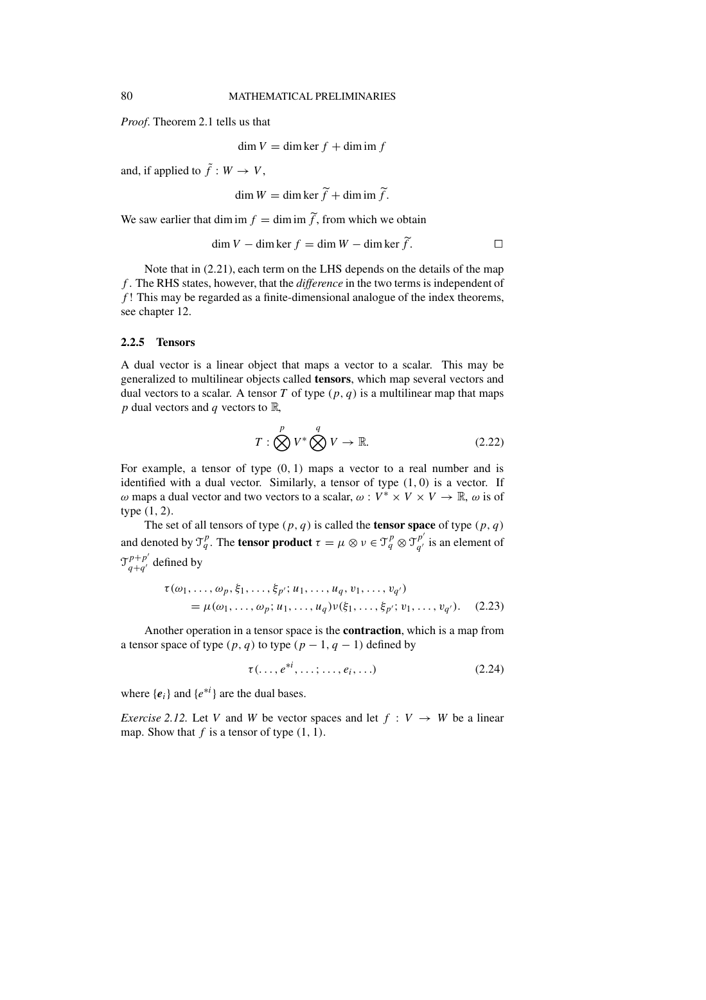

# 2.2.5 Tensors｜张量：多个输入的线性读数

[阅读目录](README.md) · [前置直观补充](00-before-tensors.md) · [下一节](02-2.3.1.md)

## 原书第 80 页：原文底本

本节位于下图中部 §2.2.5 起；上方是上一节 toy index theorem 的证明。同一整页保留，不把相邻内容冒充本节。

## 一、先问：一个读数为什么需要多个输入？

**这段在干什么：**从余向量推广到多重线性映射，解释式 (2.22)。这里先限于有限维实向量空间。

一个余向量 $\alpha$ 吃进一个向量 $u$，输出标量 $\alpha(u)$。但有些读数需要两个方向。例如给定正定矩阵 $g$，

$$
g(u,v)=u^{\mathsf T}gv.
$$

固定 $v$，它对 $u$ 线性；固定 $u$，它对 $v$ 线性。这叫双线性。

不要把“分别线性”误读成对两个输入一起线性：

$$
g(2u,3v)=6g(u,v),
$$

不是 $5g(u,v)$。动能 $T(v)=\tfrac12g(v,v)$ 对 $v$ 是二次的，却来自一个双线性对象。这说明“物理表达式不是线性的”与“底层存在张量”并不冲突。

## 二、类型 (p,q) 在数什么？

原书约定：$p$ 个余向量输入，$q$ 个向量输入，每个槽分别线性：

$$
T:\underbrace{V^*\times\cdots\times V^*}_{p}
\times\underbrace{V\times\cdots\times V}_{q}\to\mathbb R.
$$

| 类型 | 输入 | 例子 |
|---|---|---|
| $(0,0)$ | 无输入 | 标量 |
| $(0,1)$ | 一个向量 | 余向量 $\alpha(u)$ |
| $(1,0)$ | 一个余向量 | 向量 $v$ 诱导的 $\alpha\mapsto\alpha(v)$ |
| $(0,2)$ | 两个向量 | 双线性型 $g(u,v)$ |
| $(1,1)$ | 一个余向量、一个向量 | $T_A(\alpha,u)=\alpha(Au)$ |

为什么向量反而“吃余向量”？因为读数 $\alpha(v)$ 固定 $v$ 后，是关于 $\alpha$ 的线性函数。有限维时，$V$ 自然同构于 $V^{**}$；这次识别不需要内积，与 $V\cong V^*$ 的度量依赖识别不同。

## 三、原书为何在定义里写张量积？

多重线性映射可以等价地线性化为张量积空间上的线性映射。以双线性 $B$ 为例，有唯一的线性映射 $\widetilde B$，满足

$$
\widetilde B(u\otimes v)=B(u,v).
$$

原书式 (2.22) 用张量积表达输入空间；上面的笛卡尔积表达则把“分别线性”写得更直接。二者通过张量积的泛性质联系，不是把两个符号随意互换。

有限维还可将类型 $(p,q)$ 的张量空间自然识别为

$$
\mathcal T^p_q(V)=V^{\otimes p}\otimes(V^*)^{\otimes q}.
$$

这里的张量积描述对象由哪些因子组成；原书定义中的输入则相反：向量因子接收余向量测试，余向量因子接收向量测试。

## 四、坐标数组如何从对象中读出来？

选基 $e_i$ 和对偶基 $\theta^i$。双线性型的分量为

$$
g_{ij}=g(e_i,e_j).
$$

由分别线性立即得到

$$
g(u,v)=u^iv^jg(e_i,e_j)=g_{ij}u^iv^j.
$$

重复上下指标表示求和。若 $\dim V=n$，一个没有额外对称约束的 $(p,q)$ 张量有 $n^{p+q}$ 个分量，因为它对所有基底输入的值决定了对任意输入的值。

例如 $g=\operatorname{diag}(2,3)$，$u=(1,2)$、$v=(3,1)$，则 $g(u,v)=2\cdot1\cdot3+3\cdot2\cdot1=12$。

数组是在选基后记录对象的方法。一组数组若被规定按张量变换律换基，就能定义张量；只说“这是二维数组”则还没有规定它是线性算子、双线性型，还是其他对象。

## 五、为什么向量和余向量的指标变换相反？

为避免原书指标排列带来的歧义，本注固定换基约定

$$
e'_a=e_iM^i{}_a.
$$

同一个向量满足 $v=e_iv^i=e'_av'^a$，故

$$
v'=M^{-1}v.
$$

余向量的分量为 $\alpha_i=\alpha(e_i)$，所以

$$
\alpha'_a=M^i{}_a\alpha_i.
$$

一个乘 $M^{-1}$，一个乘 $M$，正好保证 $\alpha'_av'^a=\alpha_iv^i$。双线性型则每个向量输入都贡献一个 $M$：

$$
g'_{ab}=M^i{}_aM^j{}_bg_{ij},\qquad g'=M^{\mathsf T}gM.
$$

比如 $M=\operatorname{diag}(2,1)$、原来 $g=I$，则 $g'=\operatorname{diag}(4,1)$。原来 $v=(2,1)$ 的新分量为 $(1,1)$，长度平方仍是 $5$。物理长度没变，坐标和度量分量一起变。

## 六、式 (2.23)：张量积先分别读数，再相乘

对余向量 $\alpha,\beta$，定义

$$
(\alpha\otimes\beta)(u,v)=\alpha(u)\beta(v).
$$

例如 $\alpha(u)=u^1$、$\beta(v)=v^2$，则该张量输出 $u^1v^2$。把两个输入交换，一般不是原来的值，因此张量积默认没有对称性。

原书长公式只是这个定义增加输入槽后的版本：先把一组输入交给 $\mu$，另一组交给 $\nu$，再乘结果，类型便从 $(p,q)$ 与 $(p',q')$ 相加为 $(p+p',q+q')$。

不要以为任意张量都能写成一个简单乘积。例如在二维空间，$\theta^1\otimes\theta^1+\theta^2\otimes\theta^2$ 的矩阵是 $I$，秩为 $2$；单个 $\alpha\otimes\beta$ 的矩阵秩至多为 $1$。一般对象需要多个简单张量的和。

## 七、式 (2.24)：缩并为什么消去一上一下两个指标？

取一个余向量槽放入 $\theta^i$，一个向量槽放入 $e_i$，再对 $i$ 求和。这叫缩并。重要的不是“任选一个相同下标”，而是把自然配对放回对象中，因此必须一边向量、一边余向量。

对线性算子 $A:V\to V$，其 $(1,1)$ 张量是 $T_A(\alpha,u)=\alpha(Au)$。缩并得到

$$
\sum_iT_A(\theta^i,e_i)=\sum_i\theta^i(Ae_i)
=\sum_iA^i{}_i=\operatorname{tr}A.
$$

换基后 $A'=M^{-1}AM$，于是

$$
\operatorname{tr}A'=\operatorname{tr}(M^{-1}AM)=\operatorname{tr}A.
$$

更一般地，换基后插入的基与对偶基包含 $M$ 与 $M^{-1}$，求和时抵消，证明缩并不依赖基。没有度量时，不能直接缩并两个同类向量槽；若先用度量识别类型，要把使用的额外结构说清楚。

## 八、Exercise 2.12 有一个类型细节

原书给 $f:V\to W$，说它是 $(1,1)$ 张量。若 $V=W$，上述 $T_f(\alpha,u)=\alpha(fu)$ 就是准确解释。

若 $V,W$ 不同，应写成

$$
T_f:W^*\times V\to\mathbb R,\qquad T_f(\beta,u)=\beta(fu),
$$

对应 $W\otimes V^*$，不能在没有识别的情况下当成同一个 $V$ 上的张量；也不能随意对输出、输入指标取迹。这不是挑符号，而是保证每个输入都能合法送入下一步。

## 自测与后续用途

应能回答：为什么动能是二次函数却来自双线性型？为什么 $(1,0)$ 张量可理解为向量？为什么一般张量是简单张量的和？为什么迹与基无关？

后面每个流形点都有切空间，把本节对象逐点放上去就进入张量场。现在先掌握有限维对象，不必预先学习曲率或广义相对论。

[下一节：拓扑空间](02-2.3.1.md)
