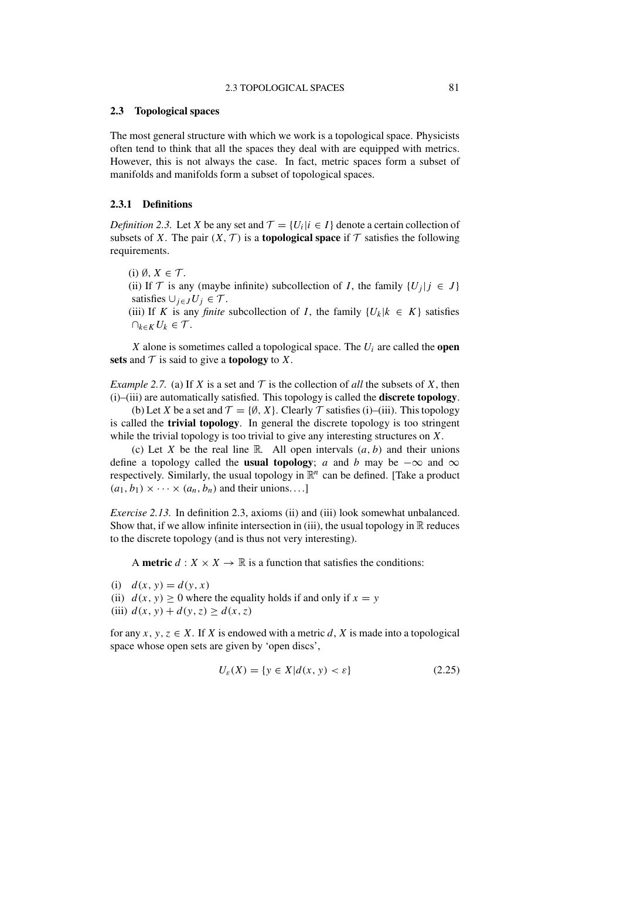
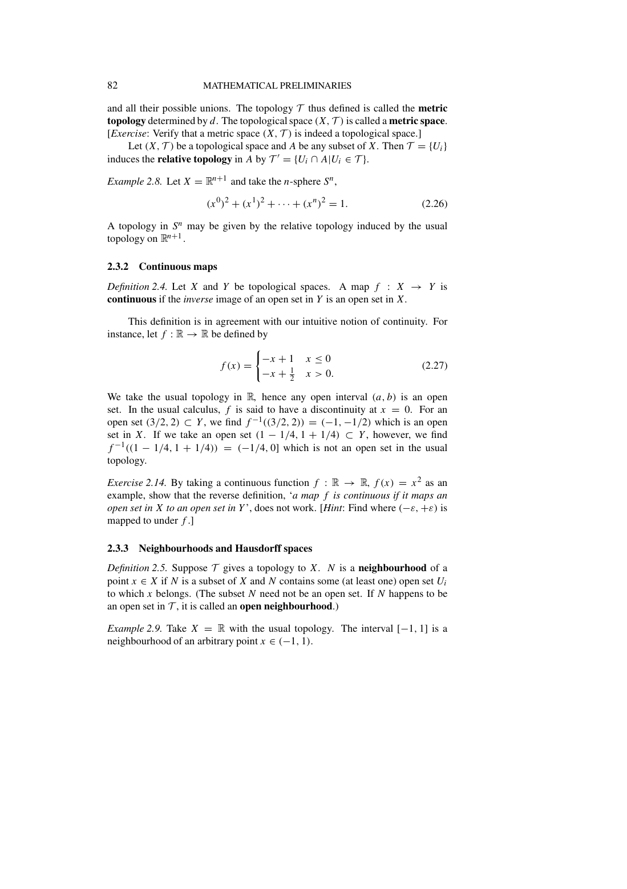

# 2.3.1 Definitions｜拓扑：不先测距离，也能讨论连续

[阅读目录](README.md) · [上一节](01-2.2.5.md) · [下一节](03-2.3.2.md)

## 原书第 81 页

## 一、作者为什么从距离退回开集？

**这段在干什么：**规定研究空间所需的基本结构，而不预先规定长度与角度。

同一个圆可以有不同周长，仍保留环绕与连续的结构。拓扑保留哪些区域是邻近的、哪些过程连续，不负责告诉你走一圈多少米。它不是完全没有结构的集合，而是集合加上一套开集规则。

先不要把“开”只理解成“不包含端点”。一般集合可能没有端点，更没有直线上的左右；哪些集合开，由所给拓扑决定。

**校记：**原书 §2.3 开头说所有度量空间都是流形，这不正确。Cantor 集有来自实数距离的度量，却不是局部欧氏空间。准确关系是“度量可诱导拓扑；流形是满足局部欧氏等条件的拓扑空间”。通常定义下的有限维 Hausdorff、第二可数流形可度量化，但这是另一项结论。

## 二、Definition 2.3 的三条公理在控制什么？

给集合 $X$ 指定一族子集 $\mathcal T$，要求：

1. $\varnothing,X\in\mathcal T$；
2. 任意多个开集的并仍开；
3. 有限多个开集的交仍开。

有了它们，$(X,\mathcal T)$ 才是拓扑空间。“任意并”包括空并，“有限交”包括空交，分别对应空集和全空间。

为什么不要求任意交？在实数通常拓扑中，

$$
\bigcap_{n=1}^{\infty}(-1/n,1/n)=\{0\},
$$

而单点不是通常开集。如果强制这些无限交也开，所有单点都开，任意集合又是单点的并，于是得到离散拓扑，改变了原本要描述的连续结构。这解释 Exercise 2.13，不是说一般拓扑不能碰巧对无限交封闭。

## 三、Example 2.7：同一个集合，可以有不同拓扑

离散拓扑 $\mathcal P(X)$ 中所有子集都开；最粗拓扑只有 $\varnothing,X$。前者能把每个点单独分开，后者不能用开集区分点。二者都合法，并不因为应用不常用就“不正确”。

实数通常拓扑由开区间的任意并组成。开区间是一组基，不是全部开集。以后所谓“由一类邻域生成拓扑”，要记住还需允许并。

## 原书第 82 页上部：度量拓扑与相对拓扑

## 四、距离怎样产生开集？

给定度量 $d$，定义 $B_\epsilon(x)=\{y:d(x,y)<\epsilon\}$，开球的并构成拓扑。交集公理如何验证？若 $z\in U\cap W$，两集合分别包含以 $z$ 为中心的某个小球，取半径较小者就落在交集中。并集则每个点只需使用包含它的那一个开集的小球。

不同度量可生成同一拓扑。例如 $d$ 与 $\min(d,1)$ 具有相同的小半径球；前者可能无界，后者有界，连续性却相同。可见拓扑不是把所有距离数值保存下来。

## 五、相对拓扑：只允许在空间内部活动

若 $A\subset X$，$A$ 中的开集定义为 $U\cap A$，其中 $U$ 在 $X$ 中开。

例如 $[0,1]$ 作为空间时，$[0,1/2)$ 是开集，因为它等于 $(-1,1/2)\cap[0,1]$。这不矛盾：在端点 $0$ 附近，只需考虑空间中允许出现的点。

球面 $S^n\subset\mathbb R^{n+1}$ 使用相对拓扑；球面上一小片区域可以在球面中开，尽管它在周围的欧氏空间中没有内部。

**自测：**指出开球与一般开集的区别；解释为什么同一个子集在不同环境空间中开闭性不同。
