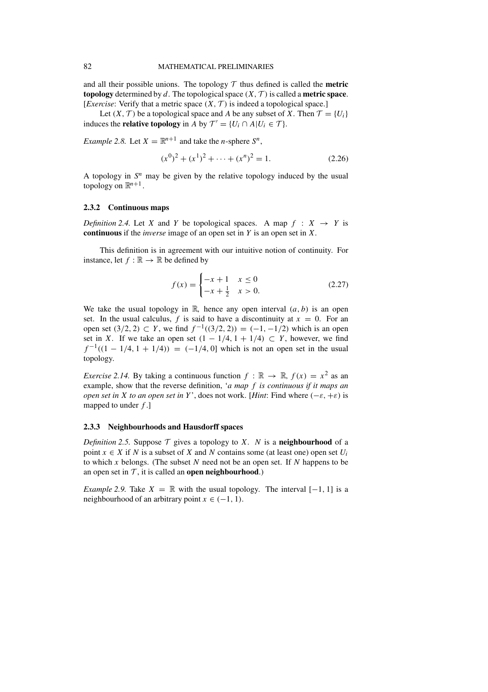

# 2.3.2 Continuous maps｜连续：目标的小范围要求能在源头实现

[阅读目录](README.md) · [上一节](02-2.3.1.md) · [下一节](04-2.3.3.md)

## 原书第 82 页：本节在页面中部

## 一、为什么连续用逆像定义？

**这段在干什么：**把分析中的连续性改写为不需要距离的语言。

设 $f:X\to Y$。若目标空间中每个开集 $U$ 的逆像 $f^{-1}(U)$ 在 $X$ 中开，就称 $f$ 连续。这里是集合逆像，不需要 $f$ 有逆函数。

把 $U$ 看作输出允许落入的一个区域。若 $x$ 的输出已在其中，则逆像开意味着 $x$ 周围仍有一整片输入能满足要求。它准确表达了“稍微改变输入，不会立刻跳出输出容许范围”。这个读法是直观帮助，不把拓扑连续性定义成任何仪器的实际分辨率。

## 二、怎样与 ε–δ 对上？

在度量空间中，若开集逆像判据成立，对 $f(x)$ 的任意 $\epsilon$ 球取逆像，得到包含 $x$ 的开集，因而包含某个 $\delta$ 球。这就是

$$
d_X(x,x')<\delta\Rightarrow d_Y(f(x),f(x'))<\epsilon.
$$

反过来，若逐点满足上述条件，对 $x\in f^{-1}(U)$，目标开集 $U$ 包含 $f(x)$ 的某个球，再用 $\delta$ 球说明逆像在 $x$ 附近开。因此两定义在度量空间中一致；不是引入另一种连续。

## 三、原书的分段函数怎样检测跳跃？

式 (2.27) 给

$$
f(x)=\begin{cases}-x+1,&x\le0,\\-x+1/2,&x>0.\end{cases}
$$

取目标开集 $(3/4,5/4)$，逆像是 $(-1/4,0]$，在实数通常拓扑中不开。零点右侧再小的扰动，也会把输出从 $1$ 附近跳到 $1/2$ 附近，因此不连续。

无需检查每个开集才能发现不连续：找到一个逆像不开的开集就足以否定。证明连续则要覆盖所有开集，通常借助定理或基来完成。

## 四、为什么不能用正像？Exercise 2.14

连续函数 $f(x)=x^2$ 将开区间 $(-\epsilon,\epsilon)$ 映成 $[0,\epsilon^2)$，不是实数中的开集。因此“把开集送到开集”是开映射的条件，不是连续的定义。

对复合映射，

$$
(g\circ f)^{-1}(U)=f^{-1}(g^{-1}(U)),
$$

因此连续映射的复合连续。这会保证换坐标、拼接与后面的同伦构造在连续性上合法。

**自测：**为什么常值映射连续？其开集逆像只有全空间或空集；因此不需要函数可逆，也不要求正像保持开。
