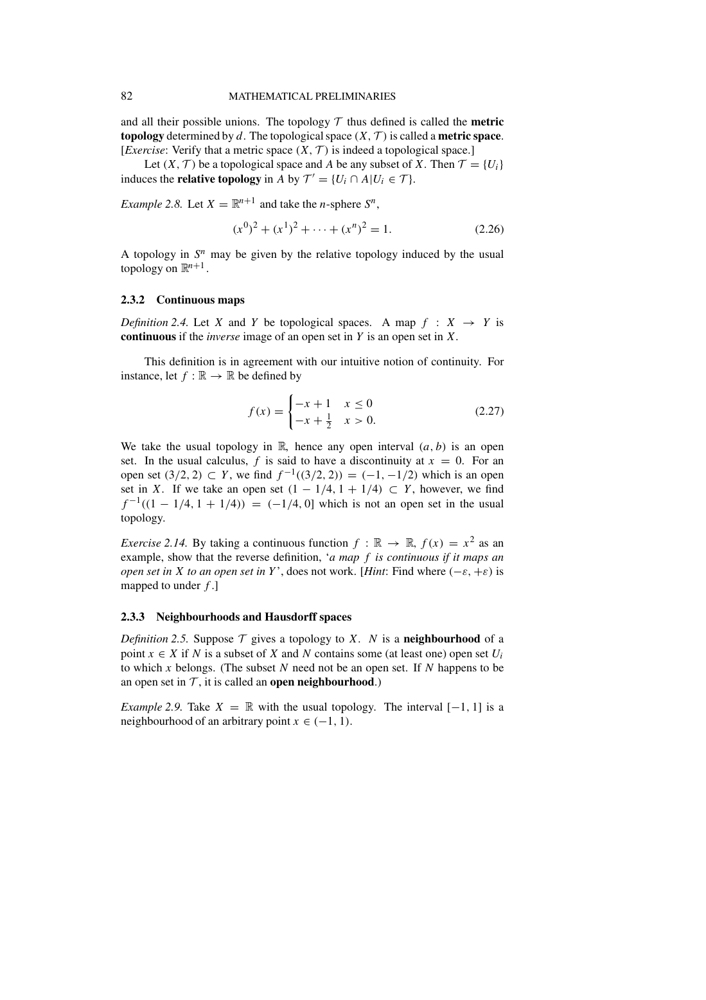
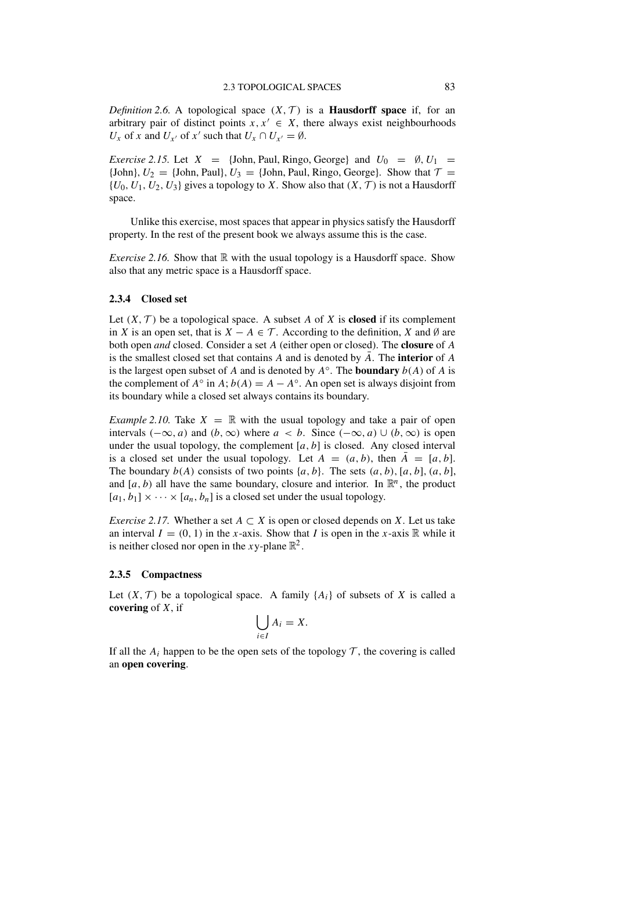

# 2.3.3 Neighbourhoods and Hausdorff spaces｜邻域与分离点

[阅读目录](README.md) · [上一节](03-2.3.2.md) · [下一节](05-2.3.4.md)

## 原书第 82–83 页

本节自 p.82 下部开始，至 p.83 Exercise 2.16 结束。

## 一、邻域不必本身是开集

**这段在干什么：**把“点周围留出活动余地”与集合是否开区分开。

$N$ 是 $x$ 的邻域，意思是存在开集 $U$，满足 $x\in U\subset N$。例如 $[-1,1]$ 是 $0$ 的邻域，因为包含 $(-1/2,1/2)$。但它不是端点 $1$ 的邻域：不存在实数中的开区间，既包含 $1$ 又完全落在 $[-1,1]$ 中。

若 $N$ 自身也开，才叫开邻域。以后说“取邻域”时，要看论证到底需不需要它开。

## 二、Hausdorff 条件到底加了什么？

任意两个不同点 $x,y$，都能选到不相交的邻域。它保证点不仅作为集合元素不同，还能用局部开集把它们分开。

度量空间自动满足：设 $r=d(x,y)/3$，若一个点同时落在两个半径 $r$ 的球中，三角不等式会给出 $d(x,y)<2d(x,y)/3$，矛盾。

但一般拓扑没有距离，必须另加这个条件。Exercise 2.15 的四点集合中，只要包含 George 的开集就只能是全空间，所以无法把 George 与 John 分开。合法拓扑不一定 Hausdorff。

## 三、它为什么有用？极限唯一性

若同一序列收敛到不同点 $x,y$，选它们不交的邻域。收敛要求充分靠后的项全部进入第一个邻域，也全部进入第二个邻域，这不可能。因此 Hausdorff 空间中的序列极限唯一。更一般的网也有相同结论；仅有序列极限唯一不反过来刻画所有空间的 Hausdorff 性。

物理上，我们通常希望极限配置有明确的状态解释；这是理解该条件的动机，不是说只凭一次实验就能证明整个空间 Hausdorff。原书明确声明后面采用 Hausdorff 假设，流形定义会再次用它。

**自测：**两点最粗拓扑为什么不是 Hausdorff？两个不同点唯一的非空开邻域都是全空间，无法分开。
