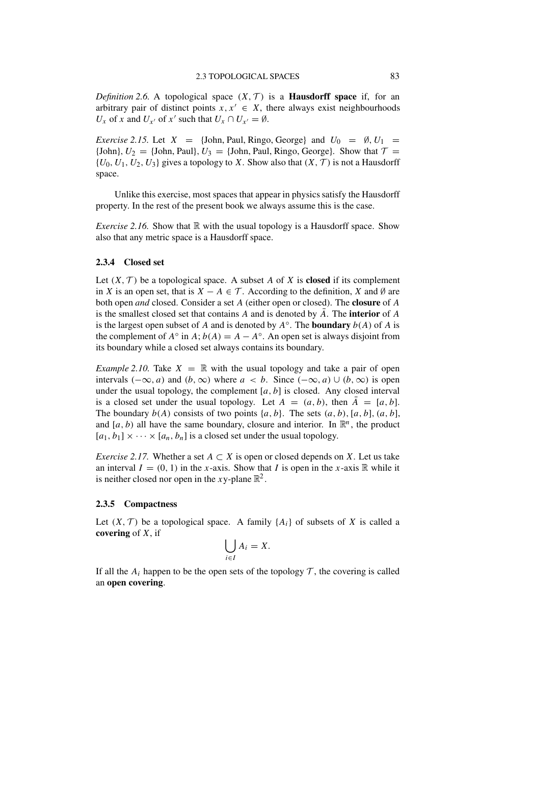

# 2.3.4 Closed set｜闭包、内部、边界：先说明在哪个空间里

[阅读目录](README.md) · [上一节](04-2.3.3.md) · [下一节](06-2.3.5.md)

## 原书第 83 页中部

## 一、熟悉概念的正确范围

**这段在干什么：**把实分析中的开闭语言用于一般空间，并为后面的几何边界消除歧义。

相对于 $X$，集合 $A$ 闭是指 $X\setminus A$ 开。闭包 $\overline A$ 是包含 $A$ 的最小闭集；内部 $A^\circ$ 是包含在 $A$ 中的最大开集。补集和闭包都依赖环境空间。

开与闭不是非此即彼：$X$ 与空集既开又闭，半开区间在实数中既不开也不闭。

## 二、原书边界公式有缺项

一般边界应定义为

$$
\boxed{\partial A=\overline A\setminus A^\circ
=\overline A\cap\overline{X\setminus A}.}
$$

原书写 $A\setminus A^\circ$，只对闭集可直接这样写。若对开区间 $(a,b)$ 用原式，会得到空集，与书中紧接着说边界为 $\{a,b\}$ 自相矛盾。影印不改，计算使用上式。

一个点在边界上，等价于它的每个邻域都同时遇到 $A$ 与其补集。它处于两边都不能避开的地方，不要求该点一定属于 $A$。

## 三、Exercise 2.17：同一条线段换环境以后怎样变化？

令 $A=\{(x,0):0<x<1\}$。

| 环境空间 | 内部 | 闭包 | 边界 |
|---|---|---|---|
| $x$ 轴 $\mathbb R$ | $(0,1)$ | $[0,1]$ | 两端点 |
| 平面 $\mathbb R^2$ | 空集 | 闭线段 | 整条闭线段 |

在平面中，任何圆盘都包含不在线段上的点，所以线段没有平面内部。它也不是平面闭集，因为漏掉两个极限端点。因此它在轴上开，在平面中既不开也不闭。

## 四、与物理区域及后续流形的区别

物理模型说“区域边界”时，必须先确定配置允许活动的空间。还有一个后续容易混淆的概念：流形自身的边界，与它嵌入欧氏空间后的集合边界，不是同一回事。例如圆 $S^1$ 在平面中的集合边界是整个圆，但它作为一维流形没有流形边界。现在先记住两种“边界”所问的问题不同。

**自测：**闭区间作为自身的空间时，内部是自身、集合边界为空；这不否认它作为一维带边界流形有两个端点。
