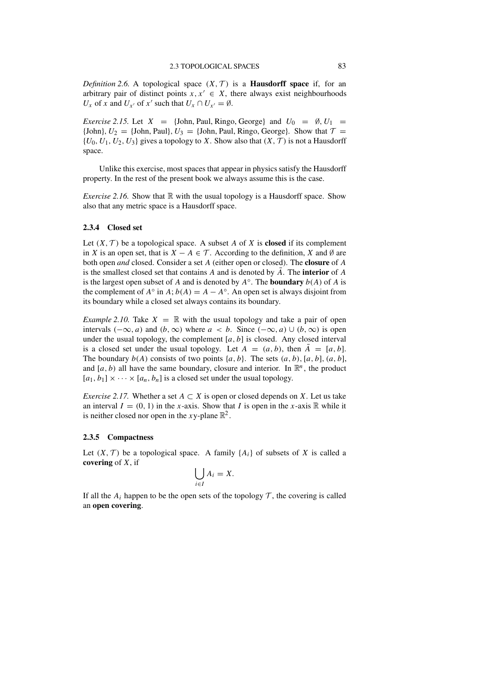
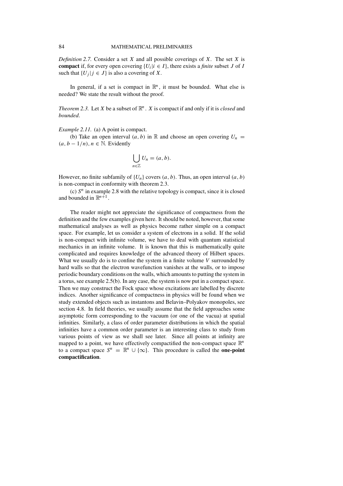

# 2.3.5 Compactness｜紧致，以及有限体积和单点紧化的物理动机

[阅读目录](README.md) · [上一节](05-2.3.4.md) · [下一节](07-2.3.6.md)

## 原书第 83 页下部至第 84 页

## 一、开覆盖定义：从无限局部信息中取出有限份

**这段在干什么：**引入常用于整体论证的有限性条件，再解释物理上为什么喜欢先把系统放进有限盒子。

每一个开覆盖都能选出有限子覆盖，称空间紧致。“每一个”很重要；能找到一个有限覆盖没有任何判别力，因为空间自己就构成一个单元素开覆盖。

原书用 $(a,b)$ 的覆盖 $U_n=(a,b-1/n)$ 说明不紧致。覆盖中的集合随 $n$ 增大而扩大，任取有限个，最大者仍漏掉靠近 $b$ 的一段。所有 $n$ 的并却能覆盖整个开区间。

对欧氏空间的子集，Heine–Borel 定理说紧致等价于闭且有界。你已有分析基础，这里只需核对“欧氏空间”和“通常拓扑”这些条件，不能把闭有界当成所有空间的定义。

例如在 $\ell^2$ 中，标准单位向量 $e_n$ 都在闭单位球中，但任意两者距离为 $\sqrt2$，没有收敛子列。因此无限维闭单位球在范数拓扑下不紧。后面若使用弱拓扑，结论又需要另行讨论。

## 二、为什么有限盒子让物理计算容易？

原书讨论固体中的电子，但核心可先用一个粒子理解。无限直线上，自由粒子的平面波波数可以连续取值。现在把它限制在 $[0,L]$，两端令波函数为零：

$$
\psi(0)=\psi(L)=0.
$$

允许的正弦模式为

$$
\psi_n(x)\propto\sin\frac{n\pi x}{L},\qquad
k_n=\frac{n\pi}{L},\quad n=1,2,\ldots.
$$

原先连续的波数，被边界条件筛成离散标签。这与第一章的“方程加允许状态条件共同筛选本征值”相呼应。

无限深势阱中波函数在墙上为零，数学上常在开区间内部求解并附加 Dirichlet 边界条件；说“紧空间”时把盒子的闭包作为几何区域。不要因此误认为开区间本身紧致。谱的离散性依赖适当的算符和边界条件，不能只由一个抽象空间紧致就断言任意算符都有离散谱。

## 三、周期边界条件为什么等于把空间做成环面？

另一种有限体积处理是令

$$
\psi(x+L)=\psi(x).
$$

对模式 $e^{ikx}$，这要求 $e^{ikL}=1$，故

$$
k_n=\frac{2\pi n}{L},\qquad n\in\mathbb Z.
$$

位置坐标 $x$ 与 $x+L$ 被识别，几何上就是圆。二维同时在两个方向周期识别，得到 $T^2$；三维则为 $T^3$。没有硬墙，却仍有有限的周期空间。

这不是说真实固体一定是一个环面，而是选取一种方便的有限体积模型。增大 $L$ 时波数间隔缩小，适当条件下求和逐渐接近积分；无限体积极限并不因为写出 $L\to\infty$ 就自动完成全部分析。

## 四、Fock 空间那句话需要懂到什么程度？

原书说离散模式可以用来构造 Fock 空间。最低限度的意思是：除说明粒子处于哪个单粒子模式，还记录各模式占据了多少粒子，用占据数组织多粒子状态。

例如两个电子模式可分别记为占据或未占据；真实电子还需要自旋等标签，费米占据规则也不是由紧致性推出的。本节不需要重做第一章的产生湮灭算符和费米路径积分。它的用途只是解释：离散的模式标签便于先定义、计算，再研究极限。

## 五、单点紧化不是只在集合里添一个符号

将 $\mathbb R^n$ 加一个点 $\infty$，还需规定新点的邻域。单点紧化中，含 $\infty$ 的基本邻域为

$$
\{\infty\}\cup(\mathbb R^n\setminus K),
$$

其中 $K$ 是紧集。离开任何足够大的有限区域，就进入这个新点的邻域。原来的欧氏开集仍保留；这套拓扑使扩大的空间紧致。

通过球面的立体投影可得

$$
\boxed{\mathbb R^n\cup\{\infty\}\cong S^n.}
$$

一维的两端 $+\infty,-\infty$ 接到同一个新增点，得到圆；若把它们加成两个不同端点，则是另一种紧化，不能混用。

## 六、场在远处趋于同一状态，为什么允许这样做？

用最简单的取向场理解：给空间每个位置 $x$ 指定一个状态 $\phi(x)\in Y$。假设当 $|x|\to\infty$ 时，不论从哪个方向离开，$\phi(x)$ 都趋于同一个 $y_0$。

那么定义 $\phi(\infty)=y_0$，就能连续地把场扩张成

$$
\widehat\phi:S^n\to Y.
$$

这样就可以研究球面到目标空间的映射如何分类，为后面的拓扑缺陷提供入口。若不同远处方向趋于不同状态，就不能按这个理由把全部无穷远识别成一点；必须先检查边界条件。也不是所有有限能量模型都会自动满足同一个渐近条件。

**自测：**解释硬墙与周期条件的波数差别；写出无穷远点的邻域；说明紧化的是场的定义域，目标空间 $Y$ 不因此自动变成球面。
