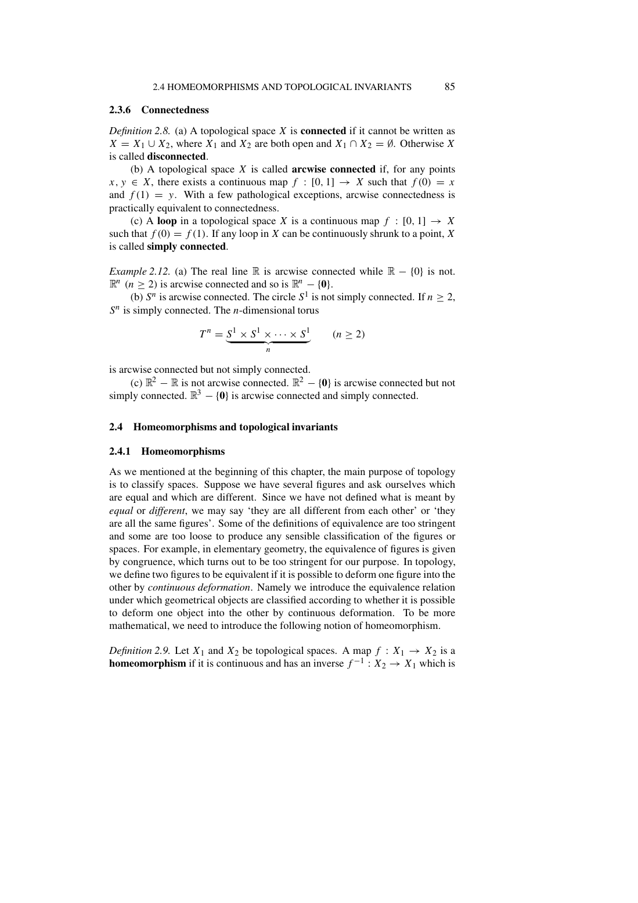

# 2.3.6 Connectedness｜连通、道路连通、单连通不是一个概念

[阅读目录](README.md) · [上一节](06-2.3.5.md) · [下一节](08-2.4.1.md)

## 原书第 85 页上部

## 一、三种问题分别是什么？

**这段在干什么：**把“没有断成两块”“两点之间有路”“环路能收缩”分开，准备后面的基本群。

连通：不能把 $X$ 分成两个不交、非空的开集之并。原书 Definition 2.8(a) 漏说非空；必须补上，否则 $X=X\cup\varnothing$ 会使任何空间都不连通。

道路连通：任意 $x,y$ 之间存在连续路径 $\gamma:[0,1]\to X$，满足 $\gamma(0)=x,\gamma(1)=y$。原书 arcwise connected 此处实际使用的是这个路径定义，不另要求路径单射。

单连通：通常要求空间道路连通，且每条环路都能在空间内部连续收缩到一点。只说“每条环路可缩”而漏掉道路连通，会不恰当地容纳多个互不相连的可缩分支。

## 二、为什么道路连通能推出连通？

若 $X$ 被非空不交开集 $U,W$ 分开，从各取一点，以路径相连。$\gamma^{-1}(U)$ 和 $\gamma^{-1}(W)$ 就会把区间 $[0,1]$ 分成两个非空不交开集，与区间连通矛盾。

反向一般不成立。例如正弦曲线 $\{(x,\sin(1/x)):0<x\le1\}$ 的闭包加上 $x=0$ 的整条竖直极限线，构成连通但非道路连通的经典空间。它的细节不必现在攻完，但不能把两定义当成同义词。在流形等局部道路连通空间里，两者才一致。

## 三、去掉一点，二维与三维为何不同？

$\mathbb R\setminus\{0\}$ 分成两块，所以不连通。$\mathbb R^2\setminus\{0\}$ 可以绕开缺点连接任意两点，因此道路连通；但绕原点一圈的环路不能在不穿过原点的情况下缩成点。

三维的 $\mathbb R^3\setminus\{0\}$ 则与 $S^2$ 同伦等价，且 $S^2$ 单连通，因此缺一个点不会造成同样的环路障碍。一个圆环看起来围住缺点时，还可利用第三个方向移动。严格的任意环路结论依赖球面基本群的结果，不以一张图证明全部情况。

| 空间 | 道路连通 | 单连通 |
|---|---|---|
| $S^1$ | 是 | 否 |
| $S^n,n\ge2$ | 是 | 是 |
| $T^n,n\ge1$ | 是 | 否 |
| $\mathbb R^2\setminus\{0\}$ | 是 | 否 |
| $\mathbb R^3\setminus\{0\}$ | 是 | 是 |

## 四、物理上为什么要关心环路？

如果配置空间中一条闭合变化过程无法连续缩成不变化的过程，就可能保留不同的绕行类别。它以后会影响角度场、缺陷等问题，但“空间非单连通”本身还没有给出具体力学方程或量子相位；必须结合模型。

**自测：**圆上任意两点都有路，为什么仍非单连通？因为前者只问有没有连接，后者还问所有闭路能否消去。
