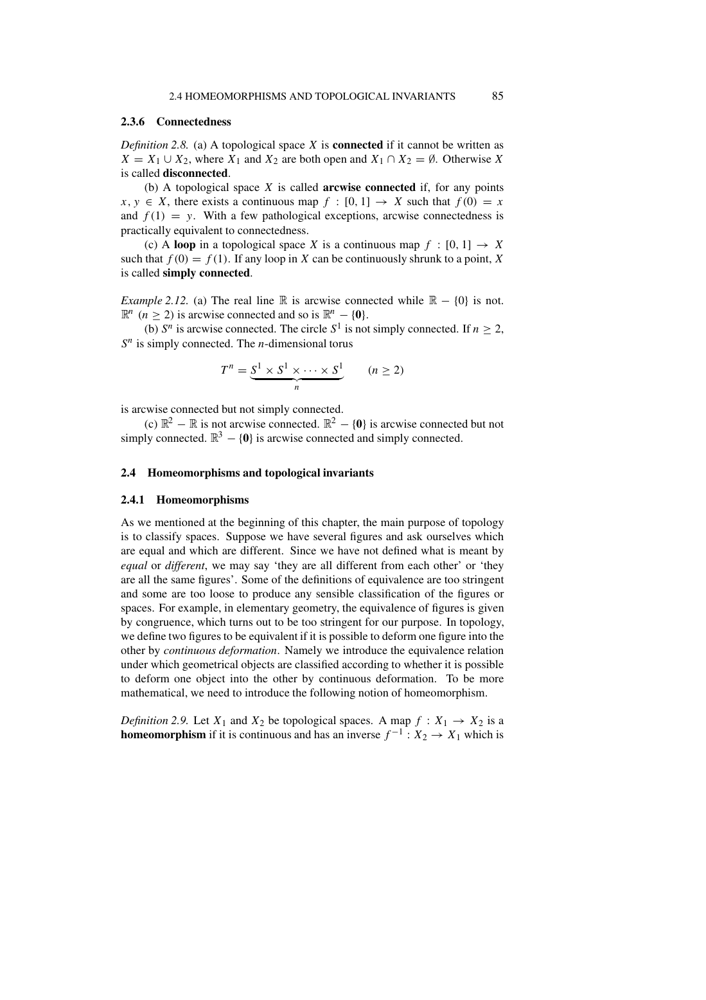
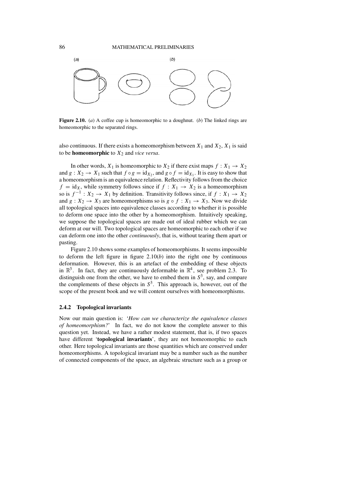

# 2.4.1 Homeomorphisms｜同胚：保留全部拓扑信息的对应

[阅读目录](README.md) · [上一节](07-2.3.6.md) · [下一节](09-2.4.2.md)

## 原书第 85 页下部至第 86 页

## 一、什么叫两个空间“相同”？

**这段在干什么：**规定拓扑学中的等价关系，区别于集合双射与刚体全等。

群同构保存群运算，拓扑同胚保存开集结构。$f:X\to Y$ 是同胚，要求它是双射，而且 $f$ 与 $f^{-1}$ 都连续。等价地，两方向连续映射满足

$$
f\circ g=\operatorname{id}_Y,\qquad g\circ f=\operatorname{id}_X.
$$

这里两条等式还不够，连续性不能省略。原书 p.86 的重述需要沿用前面的连续性要求。

同胚不必保留距离、角度、面积或光滑性。圆与椭圆可以同胚，甚至圆与正方形边框也同胚，尽管边框有角。

## 二、连续双射为什么仍不够？

考虑

$$
f:[0,2\pi)\to S^1,\qquad f(t)=(\cos t,\sin t).
$$

它连续且双射，但逆函数在接缝处不连续。取圆上的 $z_n=f(2\pi-1/n)$，有 $z_n\to f(0)$，而其逆像趋近 $2\pi$，不趋近半开区间里的 $0$。

这再次说明选代表元只给集合对应，不能自动保留拓扑。若定义域改成带商拓扑的 $\mathbb R/(2\pi\mathbb Z)$，就得到同胚。

一个常用充分条件是：从紧空间到 Hausdorff 空间的连续双射必为同胚。理由是源空间闭集紧，像仍紧，目标中紧集闭，所以逆映射连续。这里用到的每个条件都有作用。

## 三、图 2.10 的连环为什么与分开的两圈同胚？

把两个圈本身当空间，都只是两个互不相交的 $S^1$：

$$
S^1\sqcup S^1.
$$

逐个圈建立连续可逆对应即可，不需要在三维中真的把它们解开。

但“连着的两环能否在三维环境中不相交地解开”是另一问题：比较嵌入或环境同痕，必须保留周围空间及放置方式。抽象空间的同胚忘掉了这些信息。

因此原书的“橡皮形变”比喻需谨慎。它适合建立直观，却不能把所有抽象同胚等同于固定环境中的无碰撞运动。去研究补空间的拓扑，才有机会检测这种链接差别。

**自测：**两条曲线作为空间同胚，是否说明它们在三维中的打结方式相同？不说明，因为后者要求更多结构。
