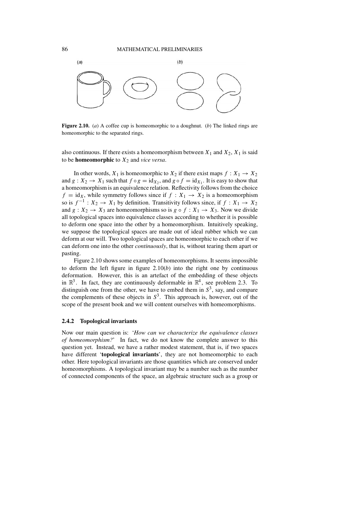
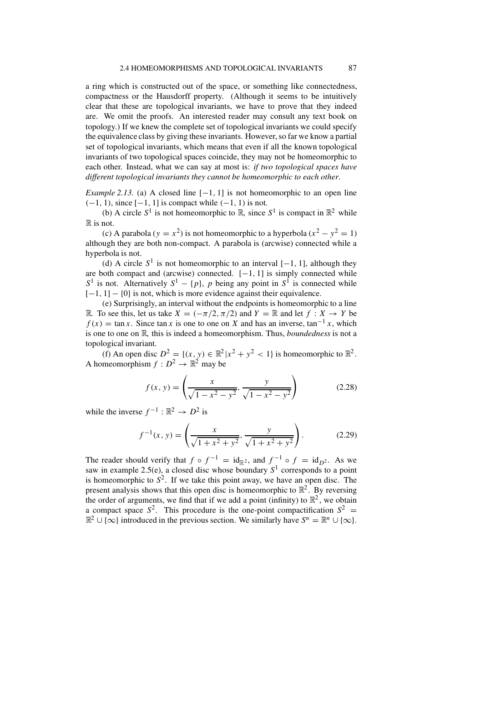
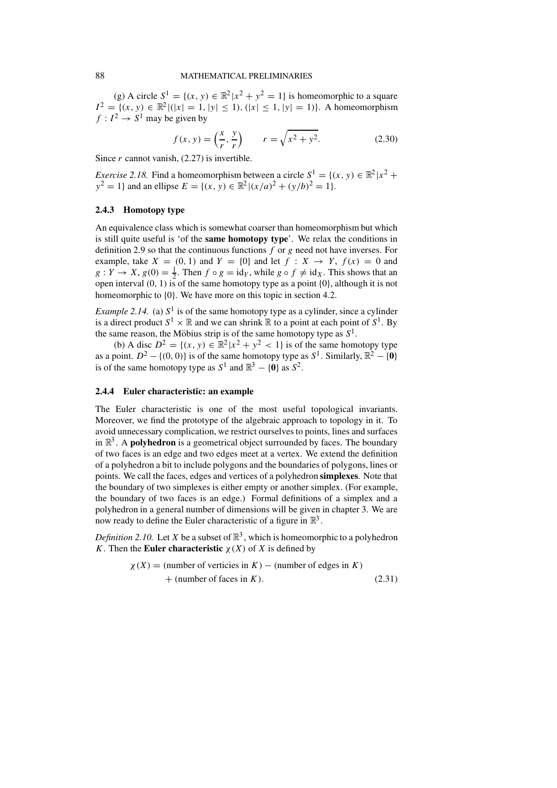

# 2.4.2 Topological invariants｜用不变量否定同胚

[阅读目录](README.md) · [上一节](08-2.4.1.md) · [下一节](10-2.4.3.md)

## 原书第 86 页下部至第 88 页上部

## 一、不变量的逻辑只有一个方向

**这段在干什么：**在很难直接构造同胚时，用较容易检查的性质排除同胚。

若 $I$ 是拓扑不变量，则

$$
X\cong Y\Rightarrow I(X)=I(Y).
$$

取逆否命题：不变量不同就不可能同胚。反过来，不变量相同一般不能推出同胚。它与群的阶类似：同构群阶相同，同阶群却未必同构。

不变量不一定是数字，也可以是紧致性、连通性，或以后构造的群与环。对于代数结构，“相同”通常指适当的同构。

## 二、为什么紧致性与连通性真的被保持？

书中省略证明，这里补两条主线。

连续像保持紧致：给像空间一个开覆盖，逆像覆盖紧空间，选出有限子覆盖，再推回去。因此同胚的两端要么都紧，要么都不紧。

连续像保持连通：若像被两个不交非空开集分离，它们的逆像也把源空间分离，矛盾。若有同胚，就能在两个方向应用。

Hausdorff 性也可通过同胚运输不交邻域。与之不同，有界性依赖选定的度量，不是拓扑不变量。

## 三、Example 2.13：逐个指出使用的证据

| 空间对 | 为什么不同胚 |
|---|---|
| 闭区间与开区间 | 前者紧致，后者不紧致 |
| 圆与实数轴 | 圆紧致，实数轴不紧致 |
| 抛物线与双曲线 $x^2-y^2=1$ | 前者连通，后者有两个分支 |
| 圆与闭区间 | 都紧且连通，但删点后的连通性不同 |

最后一项展开如下：假如同胚 $f:[-1,1]\to S^1$ 存在，删掉源空间的 $0$ 与对应点 $f(0)$，限制映射仍是同胚。但前者分为两块，后者仍连通，矛盾。关键是删掉对应点，不能随意比较两个没有对应关系的删点例子。

## 四、开区间为何能与无限长直线同胚？

映射

$$
\tan:(-\pi/2,\pi/2)\to\mathbb R
$$

及其逆 $\arctan$ 都连续。这证明有界与无界的空间也能同胚。靠近区间端点的区域被拉得越来越长，但不需要实际包含那个端点。

圆盘同理。令 $D=\{u\in\mathbb R^2:\|u\|<1\}$，

$$
F(u)=\frac{u}{\sqrt{1-\|u\|^2}},\qquad
F^{-1}(v)=\frac{v}{\sqrt{1+\|v\|^2}}.
$$

验算 $1+\|F(u)\|^2=1/(1-\|u\|^2)$，可得 $F^{-1}(F(u))=u$；反向相同。分母在定义域中正，保证连续。这个构造只改变径向距离，不改变方向。

注意：开圆盘同胚于平面，但闭圆盘不是。把闭圆盘的整条边界压成一点得到球面，则是商空间操作，不是闭圆盘与球面的同胚。

## 五、圆与正方形边框：补上逆函数

原书式 (2.30) 以 $u\mapsto u/\|u\|_2$ 将正方形边框映到圆。每条从原点出发的射线与边框恰交一点，其逆为

$$
v\mapsto\frac{v}{\|v\|_\infty},\qquad v\in S^1.
$$

两个分母都不为零，并且两映射连续、互逆，因此同胚。单说“分母非零”只说明函数有定义，不能对任意公式由此直接推出可逆；此处可逆还依赖径向唯一交点。

Exercise 2.18 的椭圆例子可取 $(x,y)\mapsto(ax,by)$，其中 $a,b>0$。逆为 $(X,Y)\mapsto(X/a,Y/b)$。

**自测：**紧致性、连通性、Euler 示性数都相同时，能否直接宣布同胚？不能，除非有针对该类空间的完整分类定理支持。
