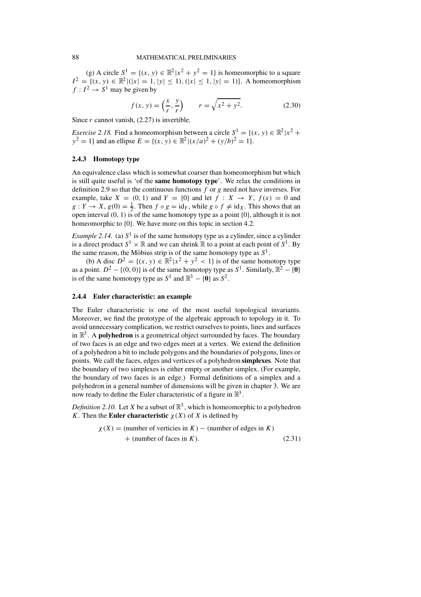

# 2.4.3 Homotopy type｜同伦等价：允许来回后只恢复到连续形变

[阅读目录](README.md) · [上一节](09-2.4.2.md) · [下一节](11-2.4.4.md)

## 原书第 88 页中部

## 一、“不要求逆映射”还缺了什么？

**这段在干什么：**引入比同胚更粗的等价关系，为基本群与同调提供可简化的模型。

同胚要求连续 $f:X\to Y$、$g:Y\to X$ 满足两复合严格等于恒等。若只去掉严格互逆条件，却不加任何其他要求，几乎任意两个非空空间都能用常值映射来回联系，这显然不是作者想说的。

必须补成

$$
\boxed{g\circ f\simeq\operatorname{id}_X,
\qquad f\circ g\simeq\operatorname{id}_Y.}
$$

其中 $F_0\simeq F_1$ 表示存在连续映射

$$
H:X\times[0,1]\to Y,\qquad
H(x,0)=F_0(x),\quad H(x,1)=F_1(x).
$$

它是一整族随参数连续变化的映射，而且必须对 $(x,t)$ 联合连续，不是只对每个固定 $x$ 画一条路径。形变参数不必是物理时间。

## 二、开区间为什么与点同伦等价？

取 $X=(0,1)$、$Y=\{*\}$，$f(x)=*$、$g(*)=1/2$。则 $fg=\operatorname{id}_Y$，而 $gf$ 是常值映射，不等于 $\operatorname{id}_X$。

构造

$$
H(x,t)=(1-t)x+t/2.
$$

它始终落在 $(0,1)$，从恒等映射连续变成常值映射，补上了缺失的证明。因此区间可缩，与一点同伦等价，但显然不同胚。形变过程中允许不同点逐渐合并；同胚要求始终保留一一对应，这正是区别。

## 三、圆柱和 Möbius 带为何都与圆同伦等价？

圆柱 $S^1\times\mathbb R$ 可用

$$
H((z,s),t)=(z,(1-t)s)
$$

压到中央圆 $S^1\times\{0\}$，同时保持中央圆上的点固定。这叫变形收缩。有限高圆柱同样适用。

Möbius 带用矩形边界反向识别表示，仍可把横向坐标 $s$ 变成 $(1-t)s$。因 $s$ 与 $-s$ 的粘合关系在缩放后依旧成立，这个形变在商空间上有定义，也收缩到中央圆。

它们不同胚，却有相同同伦型。可定向性等更细的流形性质，不一定被这种较粗的等价关系保存。

## 四、穿孔空间怎样缩到球面？

在 $\mathbb R^n\setminus\{0\}$ 中定义

$$
H(x,t)=\left[(1-t)+\frac{t}{\|x\|}\right]x.
$$

系数始终正，所以不碰原点；终点在单位球面 $S^{n-1}$；球面上的点全过程固定。因此

$$
\mathbb R^n\setminus\{0\}\simeq S^{n-1}.
$$

对穿孔开圆盘，单位圆不在空间内，应收缩到半径 $\rho\in(0,1)$ 的圆；把上式的 $t/\|x\|$ 改成 $t\rho/\|x\|$ 即可。新半径是原半径与 $\rho$ 的凸组合，始终在 $(0,1)$。不能不检查定义域就照抄单位圆公式。

## 五、为何后面反复使用同伦型？

它允许把厚的圆柱换成薄的圆，把穿孔平面换成圆，从而保留基本群、同调等信息并简化计算。但它不会保留所有拓扑信息，例如一点与开区间同伦等价，紧致性却不同。

**自测：**与一点同伦等价的空间叫可缩；“每个小区域都可缩”不等于整个空间可缩，圆上短弧可缩而整个圆不可缩。
