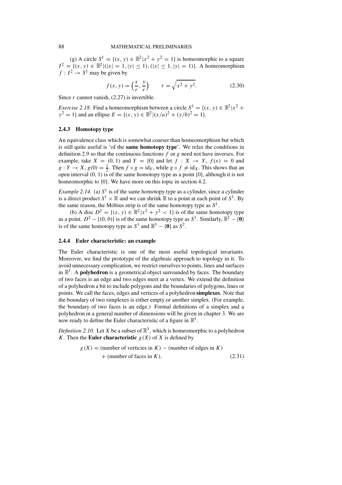
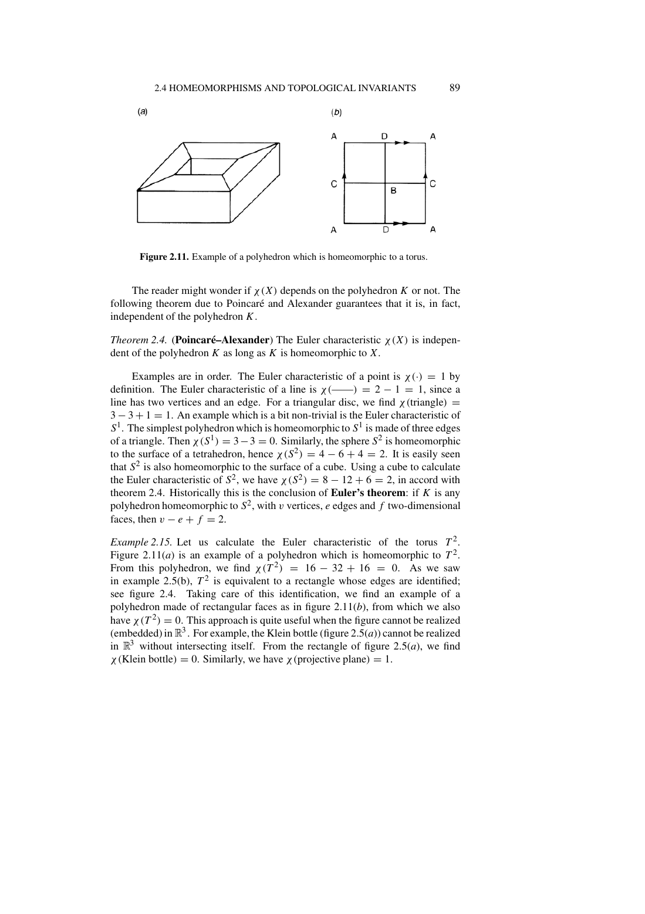
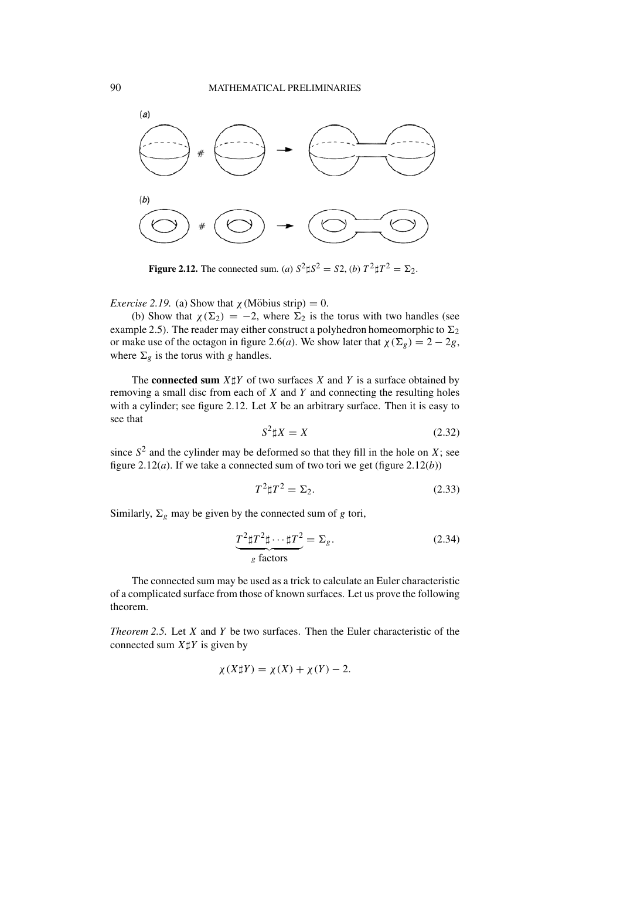
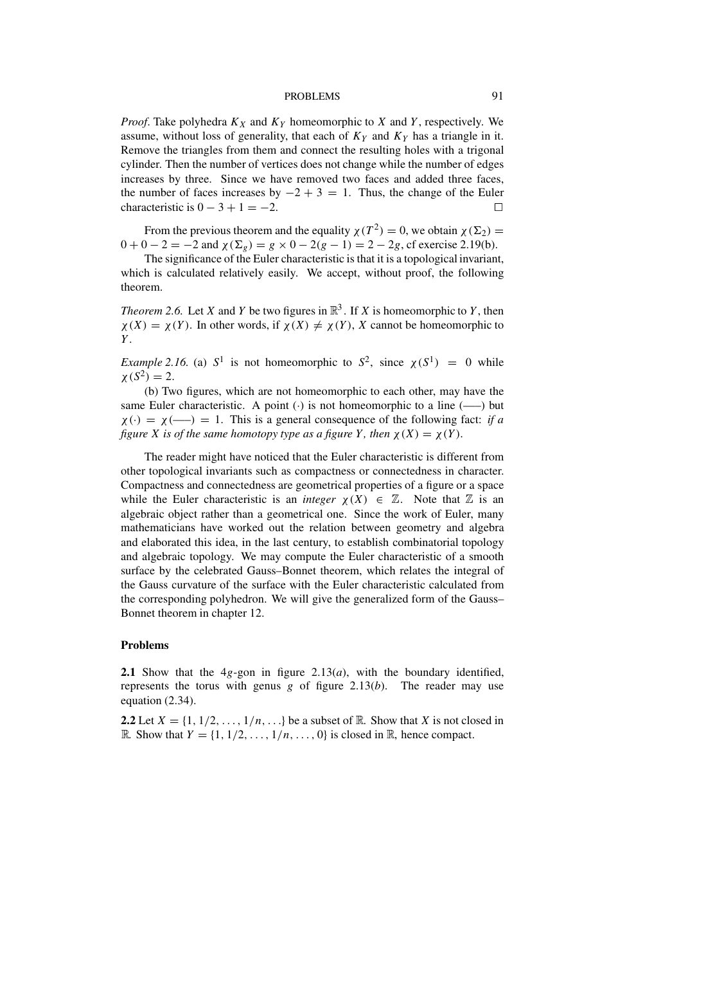

# 2.4.4 Euler characteristic｜Euler 示性数：把空间变成可计算的整数

[阅读目录](README.md) · [上一节](10-2.4.3.md) · [章末题](12-Problems.md)

## 原书第 88 页下部至第 91 页

## 一、为什么顶点减边再加面？

**这段在干什么：**展示用代数数据研究空间的最小模型，不是要求背多面体清单。

对有合适有限胞腔或单纯分解的二维空间，定义

$$
\boxed{\chi=V-E+F.}
$$

这里是空间本身的分解，不一定是某实体的外壳。三角形边框有 $V=3,E=3,F=0$，所以 $\chi=0$；填满的三角形多一个面，得到 $\chi=1$。

| 空间 | 一个分解 | $\chi$ |
|---|---|---|
| 点 | $V=1$ | 1 |
| 闭线段 | $V=2,E=1$ | 1 |
| 圆 | 三角形边框 | 0 |
| 闭圆盘 | 填满三角形 | 1 |
| 球面 | 四面体表面：$4-6+4$ | 2 |

四面体表面有四个二维面。若连内部三维体积也当作空间，必须再减去一个三维胞腔，得到闭三维球的 $\chi=1$；本节二维公式不能漏维数地套用。

## 二、换一种剖分，为什么计数不变？

在一条边中加一点，把原边分成两条，$\Delta V=1,\Delta E=1$，总变化零。在一个面中加一条分割边，$\Delta E=1,\Delta F=1$，也为零。

这些操作说明交错计数为什么有希望稳定，但不是对任意同胚与任意分解的完整证明。原书 Theorem 2.4 陈述不依赖合适分解的结论，没有在这里证明；第 3 章的同调会给出更结构化的解释。不能仅凭几个细分例子声称已证明一般拓扑不变性。

## 三、环面为什么是零？先数粘合后的点与边

将正方形对边按同向粘合：四个角成为同一个顶点，两对边各成为一条边，内部是一个面，得到

$$
\chi(T^2)=1-2+1=0.
$$

这是胞腔分解计数，不是严格单纯复形的分解：严格的三角形不能把自己的三个顶点都当成同一点。需要时可以进一步细分，得到相同结果。

Klein 瓶也有 $1-2+1=0$。射影平面用一个零维、一个一维和一个二维胞腔可得 $1-1+1=1$。射影平面的二维胞腔沿绕核心圆两圈的附着映射粘上去；计数不要求这个映射单射。它们不能无自交地嵌入三维，并不妨碍抽象胞腔计数。

## 四、连通和为什么减去 2？

连通和 $X\#Y$：从两个曲面各挖去一个小圆盘，再沿留下的边界连接。原书用三角孔与三角柱侧面说明。

取匹配的三角孔：移去两个面的内部，保留边界；加入三条连接边和三个矩形侧面。于是相对于原来的两空间之和，

$$
\Delta V=0,\qquad\Delta E=3,\qquad\Delta F=-2+3=1.
$$

所以

$$
\boxed{\chi(X\#Y)=\chi(X)+\chi(Y)-2.}
$$

若坚持三角剖分，把三个矩形各分成两三角形，就再增加三条边和三个面，交错和不变。条件是适当的曲面、内部小圆盘和有限分解，不把它推广成任意空间的粘合公式。

## 五、为什么 g 个把手是 2−2g？

球面 $\chi=2$；一个环面 $\chi=0$。$g$ 个环面连通和用了 $g-1$ 次连接，因此

$$
\chi(\Sigma_g)=g\cdot0-2(g-1)=2-2g,\qquad g\ge1.
$$

$g=0$ 是球面，同样满足公式。每增加一个把手，示性数减少 $2$。这是闭、连通、可定向曲面的公式；不能把“任何表面”都用一个把手数描述，有边界和不可定向情形需调整。

## 六、相同示性数能说明多少？

同胚必有相同 $\chi$；在有限 CW 复形等适用范围内，同伦等价也保持 $\chi$。反向都不能仅凭这个整数推出。例如点与闭线段的 $\chi$ 都是 $1$，却不同胚；圆与环面都为 $0$，却连同伦型也不同。

原书借 Gauss–Bonnet 预告它与曲率积分的联系。只需先理解：一个由顶点边面算出的整数，后来还能从连续几何量得到。一般形式与假设将在后文学习，不必现在插入整套 Riemannian 几何。

**自测：**为什么实心三角形与边框差 1？为什么给边加顶点不改变 $\chi$？为什么环面正方形不能数成 $4-4+1$？
