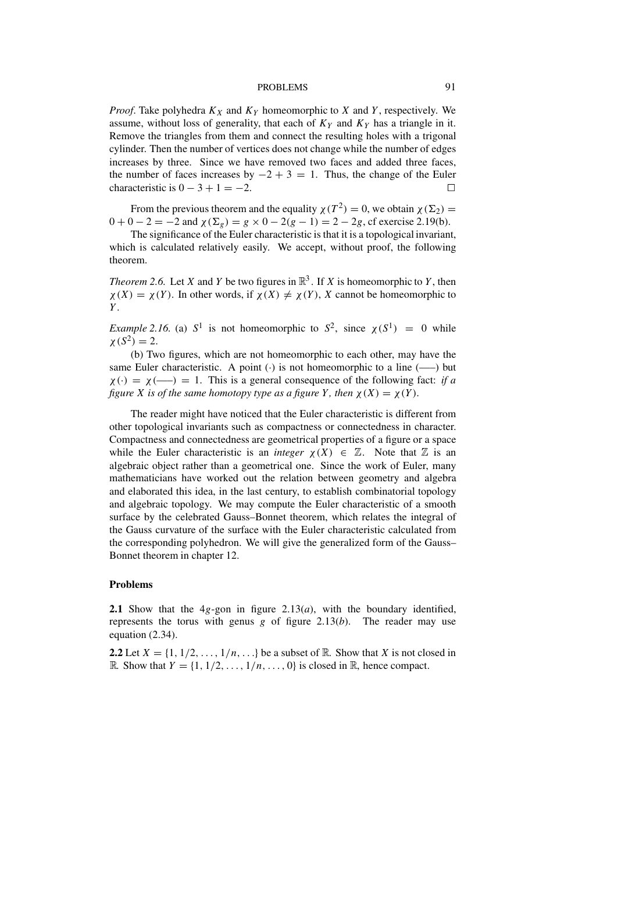
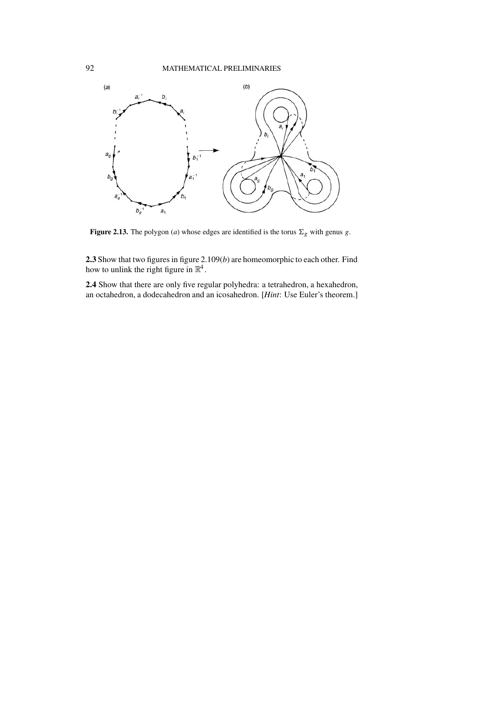

# Chapter 2 Problems｜章末题：把本章方法真正用一次

[阅读目录](README.md) · [上一节](11-2.4.4.md)

下面先给每题的目标与提示，再给推导要点。题意以影印原文为准；新增解答不是原书正文。

## 原书第 91–92 页

## Problem 2.1：4g 边形怎样表示 g 个把手？

**先做：**把每四条边按 $a_ib_ia_i^{-1}b_i^{-1}$ 的方向成对识别。单独一个四边块给什么？将边形分成把手块时，为什么连接处不是新增一个洞？

**解读：**标准边界词为

$$
a_1b_1a_1^{-1}b_1^{-1}\cdots a_gb_ga_g^{-1}b_g^{-1}.
$$

每个四边块对应一个环面把手，完整粘合表示 $g$ 个环面的连通和。可将边形用不交切割线划成带孔的环面块，再沿这些切口连接；方向识别决定最终闭且可定向，不能只凭“有 $4g$ 条边”判断拓扑。

作为核对，粘合后一个顶点、$2g$ 条边、一个面，得到 $\chi=2-2g$。它与连通和计算一致，但只比较 $\chi$ 本身不是该识别结论的全部证明；标准边界词的切割构造提供了空间的具体识别。

## Problem 2.2：漏掉极限点会怎样？

**先做：**检验零的每个邻域是否遇到 $X=\{1/n:n\ge1\}$，而零是否在 $X$ 中。

**推导：**$1/n\to0$，所以 $0\in\overline X\setminus X$，$X$ 在实数中不闭。令 $Y=X\cup\{0\}$。除零以外，每个非零实数附近只有有限个 $1/n$ 需要检查；若点不在 $Y$，就能选足够小区间避开这些点，因此补集开，$Y$ 闭。再由 $Y\subset[0,1]$ 与 Heine–Borel 得到紧致。

也可直接证明 $Y$ 紧：任取开覆盖，选一个包含零的开集，它会包含所有足够靠后的 $1/n$；剩下只有有限点，各选一个覆盖集即可。

## Problem 2.3：同胚与在环境中解链

**先做：**忽略三维摆放，只分别参数化每个圆。

**解读：**两幅图的环本身都为 $S^1\sqcup S^1$，逐圈对应就是抽象同胚。至于在四维中解开图示的普通圆环：把其中一个环移到第四坐标 $w=c\ne0$ 的平面，另一个留在 $w=0$；在第一环保持 $w=c$ 时沿前三个坐标移到足够远，再降回 $w=0$，就能避免穿过另一个环。对图中普通圆环选择相应刚体移动即可。

这展示额外维度怎样消除该三维链接障碍，不是宣称所有维数、所有嵌入对象都能用同一招解开。原题图号有排印问题，指的是图 2.10(b)。

## Problem 2.4：为什么只有五种凸正多面体？

**先做：**设每面为正 $p$ 边形，每顶点相接 $q$ 个面。把边分别按面和顶点数两次。

**推导：**闭的凸多面体表面同胚于球面，所以

$$
pF=2E,\qquad qV=2E,\qquad V-E+F=2.
$$

代入得

$$
\frac1p+\frac1q=\frac12+\frac1E>\frac12.
$$

又 $p,q\ge3$。若二者都至少为 $4$ 就不满足严格不等式。因此一个为 $3$，另一个只能是 $3,4,5$。候选为

| $(p,q)$ | $V$ | $E$ | $F$ | 对应多面体 |
|---|---:|---:|---:|---|
| $(3,3)$ | 4 | 6 | 4 | 正四面体 |
| $(4,3)$ | 8 | 12 | 6 | 正六面体（立方体） |
| $(3,4)$ | 6 | 12 | 8 | 正八面体 |
| $(5,3)$ | 20 | 30 | 12 | 正十二面体 |
| $(3,5)$ | 12 | 30 | 20 | 正二十面体 |

计数排除了其他候选，五个标准构造证明各候选可实现。若要求完整的几何分类，还应说明给定正面与顶点图形的凸正多面体的唯一性；本题提示的 Euler 论证本身主要完成候选限制，不能只凭整数条件自动断言存在与唯一。

这里采用通常的凸正多面体含义。若允许自交的星形正多面体，“只有五种”就必须另作限定。

## 读完第二章的放行检查

能说明张量类型和缩并；能对换环境后的开闭性作判断；能用开覆盖和显式映射论证；能区分同胚、同伦等价与环境中的形变；能算常见空间的 Euler 示性数且不把同值误当成分类完成。做到这些，就可以进入第 3 章，不需要先精通本章穿插的全部量子统计背景。
