# 《Geometry, Topology and Physics》第二章注疏：合订本

[分册目录与范围说明](README.md) · [复习提纲](review-guide.md) · [校记](editorial-notes.md) · [全部原页](source-pages.md)

主线从 §2.2.5 开始；开篇附此前的物理与几何直观。各分册内容按顺序合并，共用 assets 原页，不修改第一章正文。

## 合订本内跳转

- [§2.2.5 之前的直观补充](#chapter2-00)
- [2.2.5 Tensors](#chapter2-01)
- [2.3.1 Definitions](#chapter2-02)
- [2.3.2 Continuous maps](#chapter2-03)
- [2.3.3 Neighbourhoods and Hausdorff spaces](#chapter2-04)
- [2.3.4 Closed set](#chapter2-05)
- [2.3.5 Compactness](#chapter2-06)
- [2.3.6 Connectedness](#chapter2-07)
- [2.4.1 Homeomorphisms](#chapter2-08)
- [2.4.2 Topological invariants](#chapter2-09)
- [2.4.3 Homotopy type](#chapter2-10)
- [2.4.4 Euler characteristic](#chapter2-11)
- [Problems 2.1–2.4](#chapter2-12)

---

## §2.2.5 之前的补充：熟悉数学背后的物理与几何直观

[阅读目录](README.md) · [进入 §2.2.5 张量](01-2.2.5.md)

**这篇不重讲映射和向量空间公理。它解释原书 pp.67–80 的物理例子与几何用途，并补足张量直接需要的对偶、配对和度量。**未学大学物理也可以读；新增例子明确作为注疏，不冒充原文。

### p.67：为什么把向量空间与拓扑放在同一章？

[原页影印](assets/p067.png)。原书用小块曲面与切平面说明局部近似，用拓扑说明整体。

[p.68 的映射基础与例子](assets/p068.png) 可作快速复习；这些内容不另行重复证明。

想象地球表面上一小块操场。范围很小时，可以用一张平面地图描述位移；绕地球一圈时，一张无限平面就不能不加处理地代表整个球面。这是两个问题：附近怎样计算，整体怎样连接。

向量空间提供局部线性计算的模型，拓扑提供邻近、连续和拼接的语言。不过“向量空间看局部、拓扑看整体”只是教学动机：拓扑也研究局部性质，流形本身也不是向量空间。以后每个点有自己的切空间，不是把整张曲面直接当成一个向量空间。

### p.69 Exercise 2.4：旋转和平移怎样组成刚体运动？

[原页影印](assets/p069.png)。把平面上的一个点先转动，再移动，可写成

$$
x\longmapsto Rx+a.
$$

$R$ 是保持内积的正交矩阵，$a$ 是平移向量。原书写 $O(n)$，其中也包括镜像反射；若只允许保持定向的旋转，应取 $SO(n)$。

先做 $(R_1,a_1)$，再做 $(R_2,a_2)$：

$$
x\mapsto R_1x+a_1\mapsto R_2R_1x+R_2a_1+a_2.
$$

所以合成律为

$$
(R_2,a_2)(R_1,a_1)=(R_2R_1,R_2a_1+a_2).
$$

为什么不是简单把两次平移相加？因为第二次旋转也会旋转第一次平移产生的位移。用平面直角坐标试一下：先向右走一单位，再绕原点逆时针转 $90^\circ$，最终位移向上；反过来先转再向右走，最终位移向右。

逆运动要先撤销平移再撤销旋转：

$$
(R,a)^{-1}=(R^{-1},-R^{-1}a).
$$

这是群作用的具体运动解释，不需要先学 Noether 定理。若一个力学模型的作用量具有相应的连续对称性，在相应条件下还会导出守恒量；这一步不是单凭上述群合成就能证明的。

### pp.70–72：周期坐标为什么是圆？粘合不是只删掉重复数字

[p.70](assets/p070.png) · [p.71 与图 2.2](assets/p071.png) · [p.72 与图 2.3–2.4](assets/p072.png)。

对钟表指针或平面转子的角度，$\theta$ 与 $\theta+2\pi n$ 代表同一方向。因此状态标签不是一个唯一实数，而是等价类

$$
[\theta]=\{\theta+2\pi n:n\in\mathbb Z\}.
$$

可以选 $[0,2\pi)$ 中一个数字来登记各类，但还要保留跨过接缝的邻近关系：很小的 $\epsilon$ 与 $2\pi-\epsilon$ 对应的方向很接近。普通半开区间的子空间拓扑不保留这种接近。

精确做法是给投影 $\pi:\mathbb R\to\mathbb R/(2\pi\mathbb Z)$ 的商集赋商拓扑：

$$
U\text{ 开}\quad\Longleftrightarrow\quad\pi^{-1}(U)\text{ 在 }\mathbb R\text{ 中开}.
$$

如此得到的空间与 $S^1$ 同胚。对商空间定义函数，也须检查代表元无关：若想把实函数 $F(\theta)$ 看成圆上的函数，要有 $F(\theta+2\pi)=F(\theta)$。

圆柱与 Möbius 带则说明粘合还要交代方向。矩形的两条边同向对应形成圆柱，反向对应形成 Möbius 带。后者沿中央绕一圈，局部“这一面”的选择会翻转；这预告了定向问题，不代表局部微积分失效。

两个独立的周期坐标给出 $S^1\times S^1=T^2$。它既能表示两个转子的构形，也能表示周期边界条件下的二维位置。不是所有环面都要理解成三维空间中摆着一个实体甜甜圈。

### pp.73–74：没有头尾的杆，为什么用射影平面描述方向？

[p.73 原文](assets/p073.png) · [p.74 图 2.6](assets/p074.png)。这是本章前半段最直接的物理模型。

固定一根杆的中心和长度，只讨论它在三维中的朝向。若杆有箭头，单位向量 $n\in S^2$ 足以描述方向；若两端完全相同，$n$ 与 $-n$ 代表同一个物理配置。因此真实的方向空间为

$$
\boxed{\mathbb{RP}^2=S^2/(n\sim-n).}
$$

它也可以理解为穿过原点的一条无向直线：直线上的 $n$ 和 $-n$ 没有区别。这里固定了杆中心；若还允许平移，完整构形空间需要额外的位置自由度。

为什么不能直接用半球？北半球内部各点确实能各代表一类，但赤道上的 $n$ 与 $-n$ 仍都在边界上，必须继续粘合。因此它不是带普通边界的半球。这个模型后来会出现在无头尾分子的取向描述中；现在只需理解“物理上不可区分”怎样产生商空间。

与之不同，$D^2/\partial D^2\cong S^2$ 是把圆盘的整条边界压成同一个点，而不是只把对径点两两对应。两种等价关系不同，得到的空间也不同。

### pp.75–77：函数也是向量，分量不是对象本身

[p.75](assets/p075.png) · [p.76](assets/p076.png) · [p.77](assets/p077.png)。这一段的基础线性代数只需复习。

向量是能相加、能乘标量的对象，不必是空间中的箭头。例如函数空间里有 $f+g$ 和 $cf$；第一章的波函数就属于这种线性结构。有限维写 $v=v^ie_i$ 时，$v^i$ 只是选定基底后的坐标。换基会改变数字，不会把同一个物理位移变成另一个位移。

原书随后假定维数有限。因而“单射的线性自映射必为同构”等结论不能不加检查地套到无限维函数空间。

**校记：**p.77 秩—零度定理的证明所选的任意补空间，只保证 $V=\ker f\oplus U$，不自动是正交补。未选内积时甚至还没有“正交”；选了内积也须另行选择。后文若要用正交性，应取 $(\ker f)^\perp$。

### pp.77–78：余向量可以理解成测量位移的线性规则

[p.77 对偶定义](assets/p077.png) · [p.78 拉回与图 2.9](assets/p078.png)。下面的位移、功和温度例子是补充说明。

位移向量 $v$ 输入一个线性规则 $\alpha:V\to\mathbb R$，得到数字 $\alpha(v)$。例如

$$
\alpha(v^1,v^2)=2v^1+3v^2.
$$

给定位移 $(1,-1)$，输出 $-1$。若 $\alpha$ 描述一个标量温度场在某点的微分，这个数就是该小位移引起的一阶温度变化；若描述力对位移的功，则单位换成功的单位。这里不是说任何物理测量都线性，而是很多一阶响应自然是线性泛函。

对偶基 $\theta^i$ 满足 $\theta^i(e_j)=\delta^i_j$，因此从 $v=v^je_j$ 取出 $\theta^i(v)=v^i$。于是 $\alpha=\alpha_i\theta^i$，配对为

$$
\alpha(v)=\alpha_iv^i.
$$

这个配对无需内积。原书将它称为 inner product，容易误会；更准确说它是 $V^*\times V$ 的自然配对，不是预先定义在 $V\times V$ 的正定内积。

若 $F:V\to W$，而 $\beta:W\to\mathbb R$ 是目标空间中的读数规则，那么在原空间中的读数是

$$
(F^*\beta)(v)=\beta(Fv).
$$

因为“先送到 $W$ 再读数”组成了一个 $V$ 上的规则，所以 $F^*:W^*\to V^*$ 反向。这里的星号是对偶映射，不是复共轭，也不直接等于选择内积后的伴随。

第一章中的 $\langle\phi|\psi\rangle$ 与此相接：bra 对 ket 输出复数。但从 ket 构造对应 bra 要使用 Hermitian 内积，而且是共轭线性的；不能把复向量与其复线性对偶不加说明地等同。

### pp.78–79：度量提供什么额外信息？

[p.78](assets/p078.png) · [p.79](assets/p079.png)。实向量空间选定正定对称矩阵 $g$ 后，

$$
\langle v,w\rangle_g=v^{\mathsf T}gw.
$$

它定义长度和角度，并把向量 $v$ 变成读数规则 $w\mapsto\langle v,w\rangle_g$。这种识别依赖 $g$，不是仅靠向量空间结构自然指定的。

例如 $g=\operatorname{diag}(4,1)$，则 $v=(1,1)$ 的长度平方为 $5$；它对应的余向量为 $(4,1)$，对 $w$ 输出 $4w^1+w^2$。不要把上下标看成纯排版：它们在提醒向量分量与余向量分量承担不同角色。

物理联系可以用小振动的动能理解：$T=\tfrac12\dot q^{\mathsf T}M\dot q$，正定质量矩阵 $M$ 给速度方向分配不同权重。于是动量 $p_i=\partial T/\partial\dot q^i=M_{ij}\dot q^j$ 自然带余向量的变换方式。这只是解释度量型双线性形式的用途，不把所有几何度量都认作质量矩阵。

### pp.79–80：伴随与 toy index theorem 为什么值得留意？

[p.79 定义](assets/p079.png) · [p.80 证明](assets/p080.png)。对 $F:V\to W$，伴随由

$$
\langle Fv,w\rangle_G=\langle v,F^\dagger w\rangle_g
$$

确定。展开实矩阵有 $v^{\mathsf T}F^{\mathsf T}Gw=v^{\mathsf T}gF^\dagger w$，因此

$$
F^\dagger=g^{-1}F^{\mathsf T}G.
$$

例如两边内积都取 $g=G=\operatorname{diag}(4,1)$，而

$$
F=\begin{pmatrix}0&1\\0&0\end{pmatrix},
\qquad F^\dagger=\begin{pmatrix}0&0\\4&0\end{pmatrix}.
$$

它不是普通转置。复数情形需把转置改成共轭转置，并使用一致的 Hermitian 内积约定。第一章的“厄米”说的是相对于所用内积自伴，不能只看某组非正交坐标中的矩阵是否表面上对称。

toy index theorem 没有在这里引入新物理公设。设 $\dim V=m,\dim W=n,\operatorname{rank}F=r$，伴随与原映射同秩，故

$$
\dim\ker F=m-r,\qquad\dim\ker F^\dagger=n-r,
$$

相减得到

$$
\dim\ker F-\dim\ker F^\dagger=m-n.
$$

核的维数分别会变，但差值固定。它预告后面用一个稳定整数连接分析与拓扑的思路；不能因此宣称一般无限维算子都具有这个简单公式。

### 进入张量之前的检查

你不必重新背向量空间公理。应能解释：周期角度为何形成圆；无头尾杆为何需要对径点识别；配对为何不依赖内积；对偶映射为何反向；伴随为何依赖内积。张量会把“一个输入的线性读数”推广为“多个输入、分别线性的读数”。

[进入 §2.2.5 张量](01-2.2.5.md)

---

## 2.2.5 Tensors｜张量：多个输入的线性读数

[阅读目录](README.md) · [前置直观补充](00-before-tensors.md) · [下一节](02-2.3.1.md)

### 原书第 80 页：原文底本

本节位于下图中部 §2.2.5 起；上方是上一节 toy index theorem 的证明。同一整页保留，不把相邻内容冒充本节。

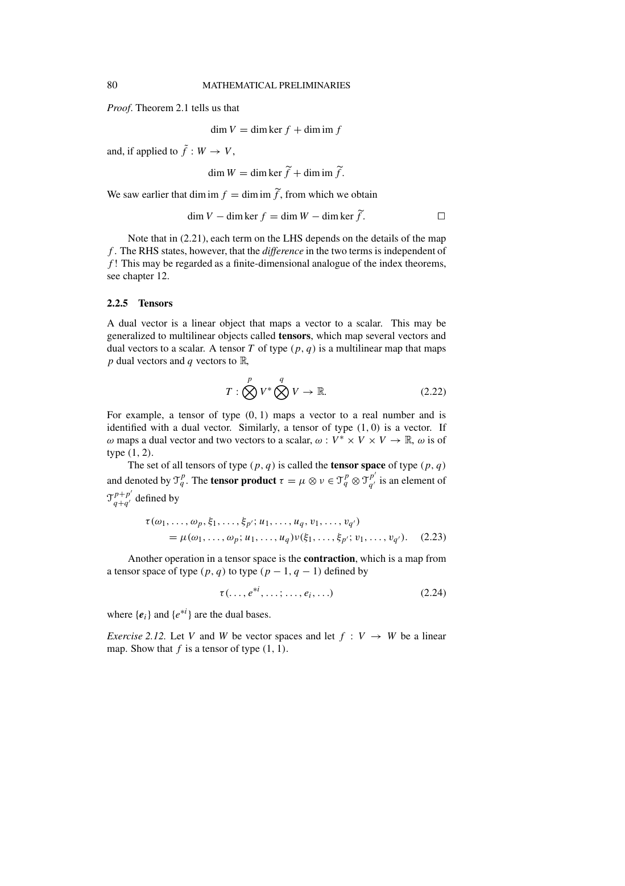

### 一、先问：一个读数为什么需要多个输入？

**这段在干什么：**从余向量推广到多重线性映射，解释式 (2.22)。这里先限于有限维实向量空间。

一个余向量 $\alpha$ 吃进一个向量 $u$，输出标量 $\alpha(u)$。但有些读数需要两个方向。例如给定正定矩阵 $g$，

$$
g(u,v)=u^{\mathsf T}gv.
$$

固定 $v$，它对 $u$ 线性；固定 $u$，它对 $v$ 线性。这叫双线性。

不要把“分别线性”误读成对两个输入一起线性：

$$
g(2u,3v)=6g(u,v),
$$

不是 $5g(u,v)$。动能 $T(v)=\tfrac12g(v,v)$ 对 $v$ 是二次的，却来自一个双线性对象。这说明“物理表达式不是线性的”与“底层存在张量”并不冲突。

### 二、类型 (p,q) 在数什么？

原书约定：$p$ 个余向量输入，$q$ 个向量输入，每个槽分别线性：

$$
T:\underbrace{V^*\times\cdots\times V^*}_{p}
\times\underbrace{V\times\cdots\times V}_{q}\to\mathbb R.
$$

| 类型 | 输入 | 例子 |
|---|---|---|
| $(0,0)$ | 无输入 | 标量 |
| $(0,1)$ | 一个向量 | 余向量 $\alpha(u)$ |
| $(1,0)$ | 一个余向量 | 向量 $v$ 诱导的 $\alpha\mapsto\alpha(v)$ |
| $(0,2)$ | 两个向量 | 双线性型 $g(u,v)$ |
| $(1,1)$ | 一个余向量、一个向量 | $T_A(\alpha,u)=\alpha(Au)$ |

为什么向量反而“吃余向量”？因为读数 $\alpha(v)$ 固定 $v$ 后，是关于 $\alpha$ 的线性函数。有限维时，$V$ 自然同构于 $V^{**}$；这次识别不需要内积，与 $V\cong V^*$ 的度量依赖识别不同。

### 三、原书为何在定义里写张量积？

多重线性映射可以等价地线性化为张量积空间上的线性映射。以双线性 $B$ 为例，有唯一的线性映射 $\widetilde B$，满足

$$
\widetilde B(u\otimes v)=B(u,v).
$$

原书式 (2.22) 用张量积表达输入空间；上面的笛卡尔积表达则把“分别线性”写得更直接。二者通过张量积的泛性质联系，不是把两个符号随意互换。

有限维还可将类型 $(p,q)$ 的张量空间自然识别为

$$
\mathcal T^p_q(V)=V^{\otimes p}\otimes(V^*)^{\otimes q}.
$$

这里的张量积描述对象由哪些因子组成；原书定义中的输入则相反：向量因子接收余向量测试，余向量因子接收向量测试。

### 四、坐标数组如何从对象中读出来？

选基 $e_i$ 和对偶基 $\theta^i$。双线性型的分量为

$$
g_{ij}=g(e_i,e_j).
$$

由分别线性立即得到

$$
g(u,v)=u^iv^jg(e_i,e_j)=g_{ij}u^iv^j.
$$

重复上下指标表示求和。若 $\dim V=n$，一个没有额外对称约束的 $(p,q)$ 张量有 $n^{p+q}$ 个分量，因为它对所有基底输入的值决定了对任意输入的值。

例如 $g=\operatorname{diag}(2,3)$，$u=(1,2)$、$v=(3,1)$，则 $g(u,v)=2\cdot1\cdot3+3\cdot2\cdot1=12$。

数组是在选基后记录对象的方法。一组数组若被规定按张量变换律换基，就能定义张量；只说“这是二维数组”则还没有规定它是线性算子、双线性型，还是其他对象。

### 五、为什么向量和余向量的指标变换相反？

为避免原书指标排列带来的歧义，本注固定换基约定

$$
e'_a=e_iM^i{}_a.
$$

同一个向量满足 $v=e_iv^i=e'_av'^a$，故

$$
v'=M^{-1}v.
$$

余向量的分量为 $\alpha_i=\alpha(e_i)$，所以

$$
\alpha'_a=M^i{}_a\alpha_i.
$$

一个乘 $M^{-1}$，一个乘 $M$，正好保证 $\alpha'_av'^a=\alpha_iv^i$。双线性型则每个向量输入都贡献一个 $M$：

$$
g'_{ab}=M^i{}_aM^j{}_bg_{ij},\qquad g'=M^{\mathsf T}gM.
$$

比如 $M=\operatorname{diag}(2,1)$、原来 $g=I$，则 $g'=\operatorname{diag}(4,1)$。原来 $v=(2,1)$ 的新分量为 $(1,1)$，长度平方仍是 $5$。物理长度没变，坐标和度量分量一起变。

### 六、式 (2.23)：张量积先分别读数，再相乘

对余向量 $\alpha,\beta$，定义

$$
(\alpha\otimes\beta)(u,v)=\alpha(u)\beta(v).
$$

例如 $\alpha(u)=u^1$、$\beta(v)=v^2$，则该张量输出 $u^1v^2$。把两个输入交换，一般不是原来的值，因此张量积默认没有对称性。

原书长公式只是这个定义增加输入槽后的版本：先把一组输入交给 $\mu$，另一组交给 $\nu$，再乘结果，类型便从 $(p,q)$ 与 $(p',q')$ 相加为 $(p+p',q+q')$。

不要以为任意张量都能写成一个简单乘积。例如在二维空间，$\theta^1\otimes\theta^1+\theta^2\otimes\theta^2$ 的矩阵是 $I$，秩为 $2$；单个 $\alpha\otimes\beta$ 的矩阵秩至多为 $1$。一般对象需要多个简单张量的和。

### 七、式 (2.24)：缩并为什么消去一上一下两个指标？

取一个余向量槽放入 $\theta^i$，一个向量槽放入 $e_i$，再对 $i$ 求和。这叫缩并。重要的不是“任选一个相同下标”，而是把自然配对放回对象中，因此必须一边向量、一边余向量。

对线性算子 $A:V\to V$，其 $(1,1)$ 张量是 $T_A(\alpha,u)=\alpha(Au)$。缩并得到

$$
\sum_iT_A(\theta^i,e_i)=\sum_i\theta^i(Ae_i)
=\sum_iA^i{}_i=\operatorname{tr}A.
$$

换基后 $A'=M^{-1}AM$，于是

$$
\operatorname{tr}A'=\operatorname{tr}(M^{-1}AM)=\operatorname{tr}A.
$$

更一般地，换基后插入的基与对偶基包含 $M$ 与 $M^{-1}$，求和时抵消，证明缩并不依赖基。没有度量时，不能直接缩并两个同类向量槽；若先用度量识别类型，要把使用的额外结构说清楚。

### 八、Exercise 2.12 有一个类型细节

原书给 $f:V\to W$，说它是 $(1,1)$ 张量。若 $V=W$，上述 $T_f(\alpha,u)=\alpha(fu)$ 就是准确解释。

若 $V,W$ 不同，应写成

$$
T_f:W^*\times V\to\mathbb R,\qquad T_f(\beta,u)=\beta(fu),
$$

对应 $W\otimes V^*$，不能在没有识别的情况下当成同一个 $V$ 上的张量；也不能随意对输出、输入指标取迹。这不是挑符号，而是保证每个输入都能合法送入下一步。

### 自测与后续用途

应能回答：为什么动能是二次函数却来自双线性型？为什么 $(1,0)$ 张量可理解为向量？为什么一般张量是简单张量的和？为什么迹与基无关？

后面每个流形点都有切空间，把本节对象逐点放上去就进入张量场。现在先掌握有限维对象，不必预先学习曲率或广义相对论。

[下一节：拓扑空间](02-2.3.1.md)

---

## 2.3.1 Definitions｜拓扑：不先测距离，也能讨论连续

[阅读目录](README.md) · [上一节](01-2.2.5.md) · [下一节](03-2.3.2.md)

### 原书第 81 页

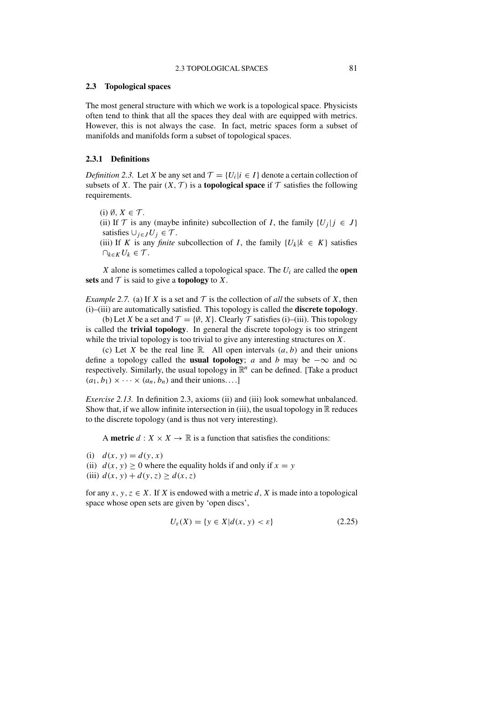

### 一、作者为什么从距离退回开集？

**这段在干什么：**规定研究空间所需的基本结构，而不预先规定长度与角度。

同一个圆可以有不同周长，仍保留环绕与连续的结构。拓扑保留哪些区域是邻近的、哪些过程连续，不负责告诉你走一圈多少米。它不是完全没有结构的集合，而是集合加上一套开集规则。

先不要把“开”只理解成“不包含端点”。一般集合可能没有端点，更没有直线上的左右；哪些集合开，由所给拓扑决定。

**校记：**原书 §2.3 开头说所有度量空间都是流形，这不正确。Cantor 集有来自实数距离的度量，却不是局部欧氏空间。准确关系是“度量可诱导拓扑；流形是满足局部欧氏等条件的拓扑空间”。通常定义下的有限维 Hausdorff、第二可数流形可度量化，但这是另一项结论。

### 二、Definition 2.3 的三条公理在控制什么？

给集合 $X$ 指定一族子集 $\mathcal T$，要求：

1. $\varnothing,X\in\mathcal T$；
2. 任意多个开集的并仍开；
3. 有限多个开集的交仍开。

有了它们，$(X,\mathcal T)$ 才是拓扑空间。“任意并”包括空并，“有限交”包括空交，分别对应空集和全空间。

为什么不要求任意交？在实数通常拓扑中，

$$
\bigcap_{n=1}^{\infty}(-1/n,1/n)=\{0\},
$$

而单点不是通常开集。如果强制这些无限交也开，所有单点都开，任意集合又是单点的并，于是得到离散拓扑，改变了原本要描述的连续结构。这解释 Exercise 2.13，不是说一般拓扑不能碰巧对无限交封闭。

### 三、Example 2.7：同一个集合，可以有不同拓扑

离散拓扑 $\mathcal P(X)$ 中所有子集都开；最粗拓扑只有 $\varnothing,X$。前者能把每个点单独分开，后者不能用开集区分点。二者都合法，并不因为应用不常用就“不正确”。

实数通常拓扑由开区间的任意并组成。开区间是一组基，不是全部开集。以后所谓“由一类邻域生成拓扑”，要记住还需允许并。

### 原书第 82 页上部：度量拓扑与相对拓扑

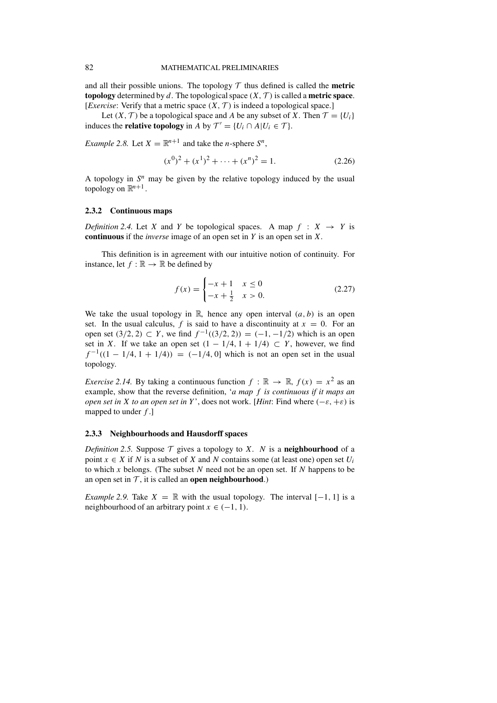

### 四、距离怎样产生开集？

给定度量 $d$，定义 $B_\epsilon(x)=\{y:d(x,y)<\epsilon\}$，开球的并构成拓扑。交集公理如何验证？若 $z\in U\cap W$，两集合分别包含以 $z$ 为中心的某个小球，取半径较小者就落在交集中。并集则每个点只需使用包含它的那一个开集的小球。

不同度量可生成同一拓扑。例如 $d$ 与 $\min(d,1)$ 具有相同的小半径球；前者可能无界，后者有界，连续性却相同。可见拓扑不是把所有距离数值保存下来。

### 五、相对拓扑：只允许在空间内部活动

若 $A\subset X$，$A$ 中的开集定义为 $U\cap A$，其中 $U$ 在 $X$ 中开。

例如 $[0,1]$ 作为空间时，$[0,1/2)$ 是开集，因为它等于 $(-1,1/2)\cap[0,1]$。这不矛盾：在端点 $0$ 附近，只需考虑空间中允许出现的点。

球面 $S^n\subset\mathbb R^{n+1}$ 使用相对拓扑；球面上一小片区域可以在球面中开，尽管它在周围的欧氏空间中没有内部。

**自测：**指出开球与一般开集的区别；解释为什么同一个子集在不同环境空间中开闭性不同。

---

## 2.3.2 Continuous maps｜连续：目标的小范围要求能在源头实现

[阅读目录](README.md) · [上一节](02-2.3.1.md) · [下一节](04-2.3.3.md)

### 原书第 82 页：本节在页面中部

### 一、为什么连续用逆像定义？

**这段在干什么：**把分析中的连续性改写为不需要距离的语言。

设 $f:X\to Y$。若目标空间中每个开集 $U$ 的逆像 $f^{-1}(U)$ 在 $X$ 中开，就称 $f$ 连续。这里是集合逆像，不需要 $f$ 有逆函数。

把 $U$ 看作输出允许落入的一个区域。若 $x$ 的输出已在其中，则逆像开意味着 $x$ 周围仍有一整片输入能满足要求。它准确表达了“稍微改变输入，不会立刻跳出输出容许范围”。这个读法是直观帮助，不把拓扑连续性定义成任何仪器的实际分辨率。

### 二、怎样与 ε–δ 对上？

在度量空间中，若开集逆像判据成立，对 $f(x)$ 的任意 $\epsilon$ 球取逆像，得到包含 $x$ 的开集，因而包含某个 $\delta$ 球。这就是

$$
d_X(x,x')<\delta\Rightarrow d_Y(f(x),f(x'))<\epsilon.
$$

反过来，若逐点满足上述条件，对 $x\in f^{-1}(U)$，目标开集 $U$ 包含 $f(x)$ 的某个球，再用 $\delta$ 球说明逆像在 $x$ 附近开。因此两定义在度量空间中一致；不是引入另一种连续。

### 三、原书的分段函数怎样检测跳跃？

式 (2.27) 给

$$
f(x)=\begin{cases}-x+1,&x\le0,\\-x+1/2,&x>0.\end{cases}
$$

取目标开集 $(3/4,5/4)$，逆像是 $(-1/4,0]$，在实数通常拓扑中不开。零点右侧再小的扰动，也会把输出从 $1$ 附近跳到 $1/2$ 附近，因此不连续。

无需检查每个开集才能发现不连续：找到一个逆像不开的开集就足以否定。证明连续则要覆盖所有开集，通常借助定理或基来完成。

### 四、为什么不能用正像？Exercise 2.14

连续函数 $f(x)=x^2$ 将开区间 $(-\epsilon,\epsilon)$ 映成 $[0,\epsilon^2)$，不是实数中的开集。因此“把开集送到开集”是开映射的条件，不是连续的定义。

对复合映射，

$$
(g\circ f)^{-1}(U)=f^{-1}(g^{-1}(U)),
$$

因此连续映射的复合连续。这会保证换坐标、拼接与后面的同伦构造在连续性上合法。

**自测：**为什么常值映射连续？其开集逆像只有全空间或空集；因此不需要函数可逆，也不要求正像保持开。

---

## 2.3.3 Neighbourhoods and Hausdorff spaces｜邻域与分离点

[阅读目录](README.md) · [上一节](03-2.3.2.md) · [下一节](05-2.3.4.md)

### 原书第 82–83 页

本节自 p.82 下部开始，至 p.83 Exercise 2.16 结束。

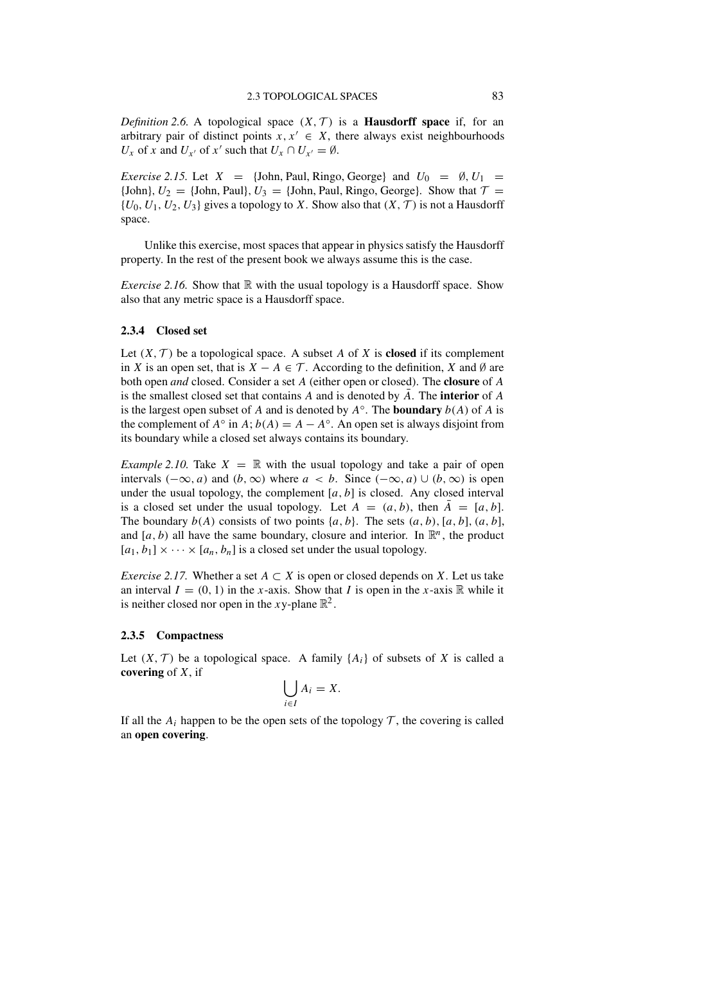

### 一、邻域不必本身是开集

**这段在干什么：**把“点周围留出活动余地”与集合是否开区分开。

$N$ 是 $x$ 的邻域，意思是存在开集 $U$，满足 $x\in U\subset N$。例如 $[-1,1]$ 是 $0$ 的邻域，因为包含 $(-1/2,1/2)$。但它不是端点 $1$ 的邻域：不存在实数中的开区间，既包含 $1$ 又完全落在 $[-1,1]$ 中。

若 $N$ 自身也开，才叫开邻域。以后说“取邻域”时，要看论证到底需不需要它开。

### 二、Hausdorff 条件到底加了什么？

任意两个不同点 $x,y$，都能选到不相交的邻域。它保证点不仅作为集合元素不同，还能用局部开集把它们分开。

度量空间自动满足：设 $r=d(x,y)/3$，若一个点同时落在两个半径 $r$ 的球中，三角不等式会给出 $d(x,y)<2d(x,y)/3$，矛盾。

但一般拓扑没有距离，必须另加这个条件。Exercise 2.15 的四点集合中，只要包含 George 的开集就只能是全空间，所以无法把 George 与 John 分开。合法拓扑不一定 Hausdorff。

### 三、它为什么有用？极限唯一性

若同一序列收敛到不同点 $x,y$，选它们不交的邻域。收敛要求充分靠后的项全部进入第一个邻域，也全部进入第二个邻域，这不可能。因此 Hausdorff 空间中的序列极限唯一。更一般的网也有相同结论；仅有序列极限唯一不反过来刻画所有空间的 Hausdorff 性。

物理上，我们通常希望极限配置有明确的状态解释；这是理解该条件的动机，不是说只凭一次实验就能证明整个空间 Hausdorff。原书明确声明后面采用 Hausdorff 假设，流形定义会再次用它。

**自测：**两点最粗拓扑为什么不是 Hausdorff？两个不同点唯一的非空开邻域都是全空间，无法分开。

---

## 2.3.4 Closed set｜闭包、内部、边界：先说明在哪个空间里

[阅读目录](README.md) · [上一节](04-2.3.3.md) · [下一节](06-2.3.5.md)

### 原书第 83 页中部

### 一、熟悉概念的正确范围

**这段在干什么：**把实分析中的开闭语言用于一般空间，并为后面的几何边界消除歧义。

相对于 $X$，集合 $A$ 闭是指 $X\setminus A$ 开。闭包 $\overline A$ 是包含 $A$ 的最小闭集；内部 $A^\circ$ 是包含在 $A$ 中的最大开集。补集和闭包都依赖环境空间。

开与闭不是非此即彼：$X$ 与空集既开又闭，半开区间在实数中既不开也不闭。

### 二、原书边界公式有缺项

一般边界应定义为

$$
\boxed{\partial A=\overline A\setminus A^\circ
=\overline A\cap\overline{X\setminus A}.}
$$

原书写 $A\setminus A^\circ$，只对闭集可直接这样写。若对开区间 $(a,b)$ 用原式，会得到空集，与书中紧接着说边界为 $\{a,b\}$ 自相矛盾。影印不改，计算使用上式。

一个点在边界上，等价于它的每个邻域都同时遇到 $A$ 与其补集。它处于两边都不能避开的地方，不要求该点一定属于 $A$。

### 三、Exercise 2.17：同一条线段换环境以后怎样变化？

令 $A=\{(x,0):0<x<1\}$。

| 环境空间 | 内部 | 闭包 | 边界 |
|---|---|---|---|
| $x$ 轴 $\mathbb R$ | $(0,1)$ | $[0,1]$ | 两端点 |
| 平面 $\mathbb R^2$ | 空集 | 闭线段 | 整条闭线段 |

在平面中，任何圆盘都包含不在线段上的点，所以线段没有平面内部。它也不是平面闭集，因为漏掉两个极限端点。因此它在轴上开，在平面中既不开也不闭。

### 四、与物理区域及后续流形的区别

物理模型说“区域边界”时，必须先确定配置允许活动的空间。还有一个后续容易混淆的概念：流形自身的边界，与它嵌入欧氏空间后的集合边界，不是同一回事。例如圆 $S^1$ 在平面中的集合边界是整个圆，但它作为一维流形没有流形边界。现在先记住两种“边界”所问的问题不同。

**自测：**闭区间作为自身的空间时，内部是自身、集合边界为空；这不否认它作为一维带边界流形有两个端点。

---

## 2.3.5 Compactness｜紧致，以及有限体积和单点紧化的物理动机

[阅读目录](README.md) · [上一节](05-2.3.4.md) · [下一节](07-2.3.6.md)

### 原书第 83 页下部至第 84 页

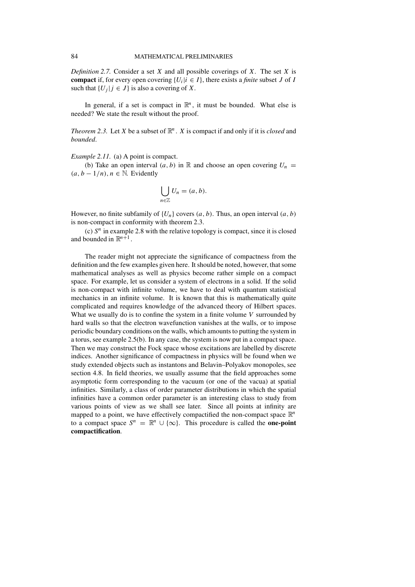

### 一、开覆盖定义：从无限局部信息中取出有限份

**这段在干什么：**引入常用于整体论证的有限性条件，再解释物理上为什么喜欢先把系统放进有限盒子。

每一个开覆盖都能选出有限子覆盖，称空间紧致。“每一个”很重要；能找到一个有限覆盖没有任何判别力，因为空间自己就构成一个单元素开覆盖。

原书用 $(a,b)$ 的覆盖 $U_n=(a,b-1/n)$ 说明不紧致。覆盖中的集合随 $n$ 增大而扩大，任取有限个，最大者仍漏掉靠近 $b$ 的一段。所有 $n$ 的并却能覆盖整个开区间。

对欧氏空间的子集，Heine–Borel 定理说紧致等价于闭且有界。你已有分析基础，这里只需核对“欧氏空间”和“通常拓扑”这些条件，不能把闭有界当成所有空间的定义。

例如在 $\ell^2$ 中，标准单位向量 $e_n$ 都在闭单位球中，但任意两者距离为 $\sqrt2$，没有收敛子列。因此无限维闭单位球在范数拓扑下不紧。后面若使用弱拓扑，结论又需要另行讨论。

### 二、为什么有限盒子让物理计算容易？

原书讨论固体中的电子，但核心可先用一个粒子理解。无限直线上，自由粒子的平面波波数可以连续取值。现在把它限制在 $[0,L]$，两端令波函数为零：

$$
\psi(0)=\psi(L)=0.
$$

允许的正弦模式为

$$
\psi_n(x)\propto\sin\frac{n\pi x}{L},\qquad
k_n=\frac{n\pi}{L},\quad n=1,2,\ldots.
$$

原先连续的波数，被边界条件筛成离散标签。这与第一章的“方程加允许状态条件共同筛选本征值”相呼应。

无限深势阱中波函数在墙上为零，数学上常在开区间内部求解并附加 Dirichlet 边界条件；说“紧空间”时把盒子的闭包作为几何区域。不要因此误认为开区间本身紧致。谱的离散性依赖适当的算符和边界条件，不能只由一个抽象空间紧致就断言任意算符都有离散谱。

### 三、周期边界条件为什么等于把空间做成环面？

另一种有限体积处理是令

$$
\psi(x+L)=\psi(x).
$$

对模式 $e^{ikx}$，这要求 $e^{ikL}=1$，故

$$
k_n=\frac{2\pi n}{L},\qquad n\in\mathbb Z.
$$

位置坐标 $x$ 与 $x+L$ 被识别，几何上就是圆。二维同时在两个方向周期识别，得到 $T^2$；三维则为 $T^3$。没有硬墙，却仍有有限的周期空间。

这不是说真实固体一定是一个环面，而是选取一种方便的有限体积模型。增大 $L$ 时波数间隔缩小，适当条件下求和逐渐接近积分；无限体积极限并不因为写出 $L\to\infty$ 就自动完成全部分析。

### 四、Fock 空间那句话需要懂到什么程度？

原书说离散模式可以用来构造 Fock 空间。最低限度的意思是：除说明粒子处于哪个单粒子模式，还记录各模式占据了多少粒子，用占据数组织多粒子状态。

例如两个电子模式可分别记为占据或未占据；真实电子还需要自旋等标签，费米占据规则也不是由紧致性推出的。本节不需要重做第一章的产生湮灭算符和费米路径积分。它的用途只是解释：离散的模式标签便于先定义、计算，再研究极限。

### 五、单点紧化不是只在集合里添一个符号

将 $\mathbb R^n$ 加一个点 $\infty$，还需规定新点的邻域。单点紧化中，含 $\infty$ 的基本邻域为

$$
\{\infty\}\cup(\mathbb R^n\setminus K),
$$

其中 $K$ 是紧集。离开任何足够大的有限区域，就进入这个新点的邻域。原来的欧氏开集仍保留；这套拓扑使扩大的空间紧致。

通过球面的立体投影可得

$$
\boxed{\mathbb R^n\cup\{\infty\}\cong S^n.}
$$

一维的两端 $+\infty,-\infty$ 接到同一个新增点，得到圆；若把它们加成两个不同端点，则是另一种紧化，不能混用。

### 六、场在远处趋于同一状态，为什么允许这样做？

用最简单的取向场理解：给空间每个位置 $x$ 指定一个状态 $\phi(x)\in Y$。假设当 $|x|\to\infty$ 时，不论从哪个方向离开，$\phi(x)$ 都趋于同一个 $y_0$。

那么定义 $\phi(\infty)=y_0$，就能连续地把场扩张成

$$
\widehat\phi:S^n\to Y.
$$

这样就可以研究球面到目标空间的映射如何分类，为后面的拓扑缺陷提供入口。若不同远处方向趋于不同状态，就不能按这个理由把全部无穷远识别成一点；必须先检查边界条件。也不是所有有限能量模型都会自动满足同一个渐近条件。

**自测：**解释硬墙与周期条件的波数差别；写出无穷远点的邻域；说明紧化的是场的定义域，目标空间 $Y$ 不因此自动变成球面。

---

## 2.3.6 Connectedness｜连通、道路连通、单连通不是一个概念

[阅读目录](README.md) · [上一节](06-2.3.5.md) · [下一节](08-2.4.1.md)

### 原书第 85 页上部

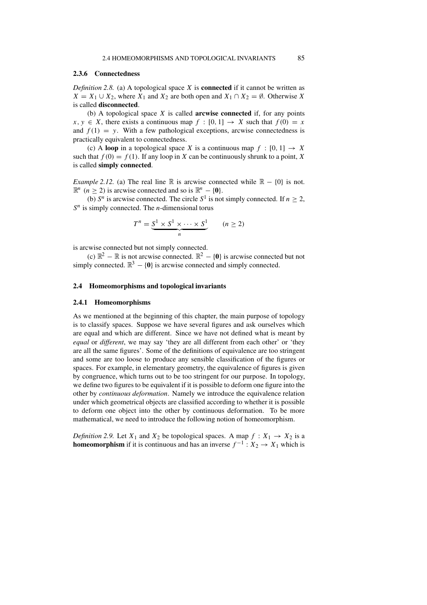

### 一、三种问题分别是什么？

**这段在干什么：**把“没有断成两块”“两点之间有路”“环路能收缩”分开，准备后面的基本群。

连通：不能把 $X$ 分成两个不交、非空的开集之并。原书 Definition 2.8(a) 漏说非空；必须补上，否则 $X=X\cup\varnothing$ 会使任何空间都不连通。

道路连通：任意 $x,y$ 之间存在连续路径 $\gamma:[0,1]\to X$，满足 $\gamma(0)=x,\gamma(1)=y$。原书 arcwise connected 此处实际使用的是这个路径定义，不另要求路径单射。

单连通：通常要求空间道路连通，且每条环路都能在空间内部连续收缩到一点。只说“每条环路可缩”而漏掉道路连通，会不恰当地容纳多个互不相连的可缩分支。

### 二、为什么道路连通能推出连通？

若 $X$ 被非空不交开集 $U,W$ 分开，从各取一点，以路径相连。$\gamma^{-1}(U)$ 和 $\gamma^{-1}(W)$ 就会把区间 $[0,1]$ 分成两个非空不交开集，与区间连通矛盾。

反向一般不成立。例如正弦曲线 $\{(x,\sin(1/x)):0<x\le1\}$ 的闭包加上 $x=0$ 的整条竖直极限线，构成连通但非道路连通的经典空间。它的细节不必现在攻完，但不能把两定义当成同义词。在流形等局部道路连通空间里，两者才一致。

### 三、去掉一点，二维与三维为何不同？

$\mathbb R\setminus\{0\}$ 分成两块，所以不连通。$\mathbb R^2\setminus\{0\}$ 可以绕开缺点连接任意两点，因此道路连通；但绕原点一圈的环路不能在不穿过原点的情况下缩成点。

三维的 $\mathbb R^3\setminus\{0\}$ 则与 $S^2$ 同伦等价，且 $S^2$ 单连通，因此缺一个点不会造成同样的环路障碍。一个圆环看起来围住缺点时，还可利用第三个方向移动。严格的任意环路结论依赖球面基本群的结果，不以一张图证明全部情况。

| 空间 | 道路连通 | 单连通 |
|---|---|---|
| $S^1$ | 是 | 否 |
| $S^n,n\ge2$ | 是 | 是 |
| $T^n,n\ge1$ | 是 | 否 |
| $\mathbb R^2\setminus\{0\}$ | 是 | 否 |
| $\mathbb R^3\setminus\{0\}$ | 是 | 是 |

### 四、物理上为什么要关心环路？

如果配置空间中一条闭合变化过程无法连续缩成不变化的过程，就可能保留不同的绕行类别。它以后会影响角度场、缺陷等问题，但“空间非单连通”本身还没有给出具体力学方程或量子相位；必须结合模型。

**自测：**圆上任意两点都有路，为什么仍非单连通？因为前者只问有没有连接，后者还问所有闭路能否消去。

---

## 2.4.1 Homeomorphisms｜同胚：保留全部拓扑信息的对应

[阅读目录](README.md) · [上一节](07-2.3.6.md) · [下一节](09-2.4.2.md)

### 原书第 85 页下部至第 86 页

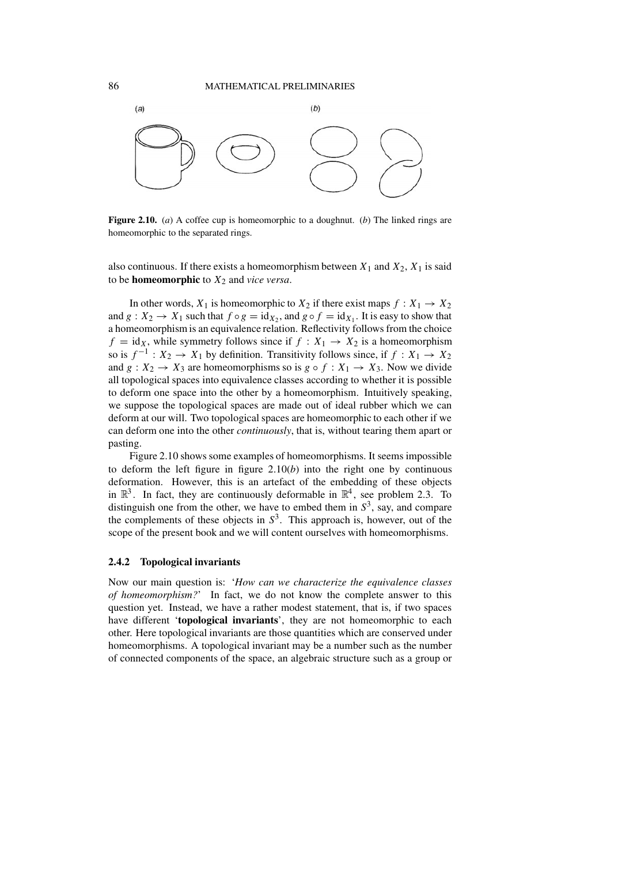

### 一、什么叫两个空间“相同”？

**这段在干什么：**规定拓扑学中的等价关系，区别于集合双射与刚体全等。

群同构保存群运算，拓扑同胚保存开集结构。$f:X\to Y$ 是同胚，要求它是双射，而且 $f$ 与 $f^{-1}$ 都连续。等价地，两方向连续映射满足

$$
f\circ g=\operatorname{id}_Y,\qquad g\circ f=\operatorname{id}_X.
$$

这里两条等式还不够，连续性不能省略。原书 p.86 的重述需要沿用前面的连续性要求。

同胚不必保留距离、角度、面积或光滑性。圆与椭圆可以同胚，甚至圆与正方形边框也同胚，尽管边框有角。

### 二、连续双射为什么仍不够？

考虑

$$
f:[0,2\pi)\to S^1,\qquad f(t)=(\cos t,\sin t).
$$

它连续且双射，但逆函数在接缝处不连续。取圆上的 $z_n=f(2\pi-1/n)$，有 $z_n\to f(0)$，而其逆像趋近 $2\pi$，不趋近半开区间里的 $0$。

这再次说明选代表元只给集合对应，不能自动保留拓扑。若定义域改成带商拓扑的 $\mathbb R/(2\pi\mathbb Z)$，就得到同胚。

一个常用充分条件是：从紧空间到 Hausdorff 空间的连续双射必为同胚。理由是源空间闭集紧，像仍紧，目标中紧集闭，所以逆映射连续。这里用到的每个条件都有作用。

### 三、图 2.10 的连环为什么与分开的两圈同胚？

把两个圈本身当空间，都只是两个互不相交的 $S^1$：

$$
S^1\sqcup S^1.
$$

逐个圈建立连续可逆对应即可，不需要在三维中真的把它们解开。

但“连着的两环能否在三维环境中不相交地解开”是另一问题：比较嵌入或环境同痕，必须保留周围空间及放置方式。抽象空间的同胚忘掉了这些信息。

因此原书的“橡皮形变”比喻需谨慎。它适合建立直观，却不能把所有抽象同胚等同于固定环境中的无碰撞运动。去研究补空间的拓扑，才有机会检测这种链接差别。

**自测：**两条曲线作为空间同胚，是否说明它们在三维中的打结方式相同？不说明，因为后者要求更多结构。

---

## 2.4.2 Topological invariants｜用不变量否定同胚

[阅读目录](README.md) · [上一节](08-2.4.1.md) · [下一节](10-2.4.3.md)

### 原书第 86 页下部至第 88 页上部

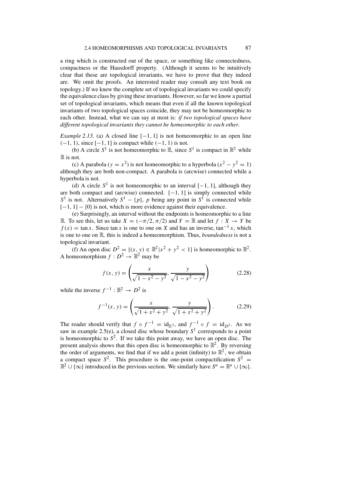

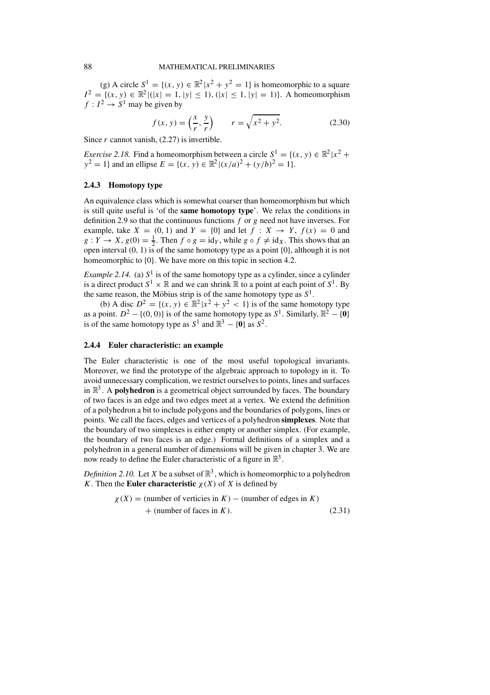

### 一、不变量的逻辑只有一个方向

**这段在干什么：**在很难直接构造同胚时，用较容易检查的性质排除同胚。

若 $I$ 是拓扑不变量，则

$$
X\cong Y\Rightarrow I(X)=I(Y).
$$

取逆否命题：不变量不同就不可能同胚。反过来，不变量相同一般不能推出同胚。它与群的阶类似：同构群阶相同，同阶群却未必同构。

不变量不一定是数字，也可以是紧致性、连通性，或以后构造的群与环。对于代数结构，“相同”通常指适当的同构。

### 二、为什么紧致性与连通性真的被保持？

书中省略证明，这里补两条主线。

连续像保持紧致：给像空间一个开覆盖，逆像覆盖紧空间，选出有限子覆盖，再推回去。因此同胚的两端要么都紧，要么都不紧。

连续像保持连通：若像被两个不交非空开集分离，它们的逆像也把源空间分离，矛盾。若有同胚，就能在两个方向应用。

Hausdorff 性也可通过同胚运输不交邻域。与之不同，有界性依赖选定的度量，不是拓扑不变量。

### 三、Example 2.13：逐个指出使用的证据

| 空间对 | 为什么不同胚 |
|---|---|
| 闭区间与开区间 | 前者紧致，后者不紧致 |
| 圆与实数轴 | 圆紧致，实数轴不紧致 |
| 抛物线与双曲线 $x^2-y^2=1$ | 前者连通，后者有两个分支 |
| 圆与闭区间 | 都紧且连通，但删点后的连通性不同 |

最后一项展开如下：假如同胚 $f:[-1,1]\to S^1$ 存在，删掉源空间的 $0$ 与对应点 $f(0)$，限制映射仍是同胚。但前者分为两块，后者仍连通，矛盾。关键是删掉对应点，不能随意比较两个没有对应关系的删点例子。

### 四、开区间为何能与无限长直线同胚？

映射

$$
\tan:(-\pi/2,\pi/2)\to\mathbb R
$$

及其逆 $\arctan$ 都连续。这证明有界与无界的空间也能同胚。靠近区间端点的区域被拉得越来越长，但不需要实际包含那个端点。

圆盘同理。令 $D=\{u\in\mathbb R^2:\|u\|<1\}$，

$$
F(u)=\frac{u}{\sqrt{1-\|u\|^2}},\qquad
F^{-1}(v)=\frac{v}{\sqrt{1+\|v\|^2}}.
$$

验算 $1+\|F(u)\|^2=1/(1-\|u\|^2)$，可得 $F^{-1}(F(u))=u$；反向相同。分母在定义域中正，保证连续。这个构造只改变径向距离，不改变方向。

注意：开圆盘同胚于平面，但闭圆盘不是。把闭圆盘的整条边界压成一点得到球面，则是商空间操作，不是闭圆盘与球面的同胚。

### 五、圆与正方形边框：补上逆函数

原书式 (2.30) 以 $u\mapsto u/\|u\|_2$ 将正方形边框映到圆。每条从原点出发的射线与边框恰交一点，其逆为

$$
v\mapsto\frac{v}{\|v\|_\infty},\qquad v\in S^1.
$$

两个分母都不为零，并且两映射连续、互逆，因此同胚。单说“分母非零”只说明函数有定义，不能对任意公式由此直接推出可逆；此处可逆还依赖径向唯一交点。

Exercise 2.18 的椭圆例子可取 $(x,y)\mapsto(ax,by)$，其中 $a,b>0$。逆为 $(X,Y)\mapsto(X/a,Y/b)$。

**自测：**紧致性、连通性、Euler 示性数都相同时，能否直接宣布同胚？不能，除非有针对该类空间的完整分类定理支持。

---

## 2.4.3 Homotopy type｜同伦等价：允许来回后只恢复到连续形变

[阅读目录](README.md) · [上一节](09-2.4.2.md) · [下一节](11-2.4.4.md)

### 原书第 88 页中部

### 一、“不要求逆映射”还缺了什么？

**这段在干什么：**引入比同胚更粗的等价关系，为基本群与同调提供可简化的模型。

同胚要求连续 $f:X\to Y$、$g:Y\to X$ 满足两复合严格等于恒等。若只去掉严格互逆条件，却不加任何其他要求，几乎任意两个非空空间都能用常值映射来回联系，这显然不是作者想说的。

必须补成

$$
\boxed{g\circ f\simeq\operatorname{id}_X,
\qquad f\circ g\simeq\operatorname{id}_Y.}
$$

其中 $F_0\simeq F_1$ 表示存在连续映射

$$
H:X\times[0,1]\to Y,\qquad
H(x,0)=F_0(x),\quad H(x,1)=F_1(x).
$$

它是一整族随参数连续变化的映射，而且必须对 $(x,t)$ 联合连续，不是只对每个固定 $x$ 画一条路径。形变参数不必是物理时间。

### 二、开区间为什么与点同伦等价？

取 $X=(0,1)$、$Y=\{*\}$，$f(x)=*$、$g(*)=1/2$。则 $fg=\operatorname{id}_Y$，而 $gf$ 是常值映射，不等于 $\operatorname{id}_X$。

构造

$$
H(x,t)=(1-t)x+t/2.
$$

它始终落在 $(0,1)$，从恒等映射连续变成常值映射，补上了缺失的证明。因此区间可缩，与一点同伦等价，但显然不同胚。形变过程中允许不同点逐渐合并；同胚要求始终保留一一对应，这正是区别。

### 三、圆柱和 Möbius 带为何都与圆同伦等价？

圆柱 $S^1\times\mathbb R$ 可用

$$
H((z,s),t)=(z,(1-t)s)
$$

压到中央圆 $S^1\times\{0\}$，同时保持中央圆上的点固定。这叫变形收缩。有限高圆柱同样适用。

Möbius 带用矩形边界反向识别表示，仍可把横向坐标 $s$ 变成 $(1-t)s$。因 $s$ 与 $-s$ 的粘合关系在缩放后依旧成立，这个形变在商空间上有定义，也收缩到中央圆。

它们不同胚，却有相同同伦型。可定向性等更细的流形性质，不一定被这种较粗的等价关系保存。

### 四、穿孔空间怎样缩到球面？

在 $\mathbb R^n\setminus\{0\}$ 中定义

$$
H(x,t)=\left[(1-t)+\frac{t}{\|x\|}\right]x.
$$

系数始终正，所以不碰原点；终点在单位球面 $S^{n-1}$；球面上的点全过程固定。因此

$$
\mathbb R^n\setminus\{0\}\simeq S^{n-1}.
$$

对穿孔开圆盘，单位圆不在空间内，应收缩到半径 $\rho\in(0,1)$ 的圆；把上式的 $t/\|x\|$ 改成 $t\rho/\|x\|$ 即可。新半径是原半径与 $\rho$ 的凸组合，始终在 $(0,1)$。不能不检查定义域就照抄单位圆公式。

### 五、为何后面反复使用同伦型？

它允许把厚的圆柱换成薄的圆，把穿孔平面换成圆，从而保留基本群、同调等信息并简化计算。但它不会保留所有拓扑信息，例如一点与开区间同伦等价，紧致性却不同。

**自测：**与一点同伦等价的空间叫可缩；“每个小区域都可缩”不等于整个空间可缩，圆上短弧可缩而整个圆不可缩。

---

## 2.4.4 Euler characteristic｜Euler 示性数：把空间变成可计算的整数

[阅读目录](README.md) · [上一节](10-2.4.3.md) · [章末题](12-Problems.md)

### 原书第 88 页下部至第 91 页

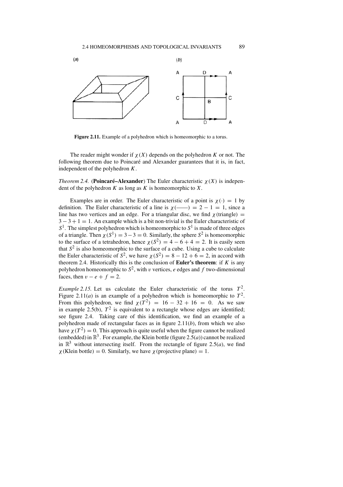

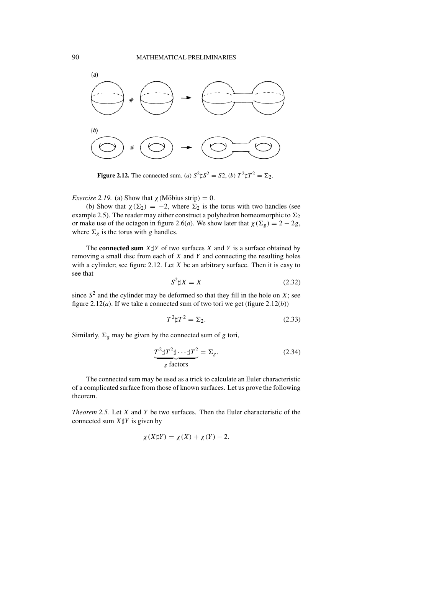

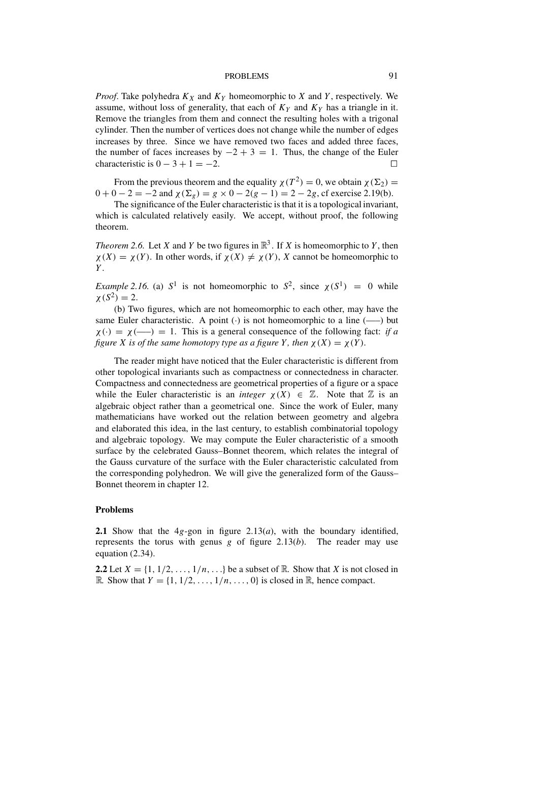

### 一、为什么顶点减边再加面？

**这段在干什么：**展示用代数数据研究空间的最小模型，不是要求背多面体清单。

对有合适有限胞腔或单纯分解的二维空间，定义

$$
\boxed{\chi=V-E+F.}
$$

这里是空间本身的分解，不一定是某实体的外壳。三角形边框有 $V=3,E=3,F=0$，所以 $\chi=0$；填满的三角形多一个面，得到 $\chi=1$。

| 空间 | 一个分解 | $\chi$ |
|---|---|---|
| 点 | $V=1$ | 1 |
| 闭线段 | $V=2,E=1$ | 1 |
| 圆 | 三角形边框 | 0 |
| 闭圆盘 | 填满三角形 | 1 |
| 球面 | 四面体表面：$4-6+4$ | 2 |

四面体表面有四个二维面。若连内部三维体积也当作空间，必须再减去一个三维胞腔，得到闭三维球的 $\chi=1$；本节二维公式不能漏维数地套用。

### 二、换一种剖分，为什么计数不变？

在一条边中加一点，把原边分成两条，$\Delta V=1,\Delta E=1$，总变化零。在一个面中加一条分割边，$\Delta E=1,\Delta F=1$，也为零。

这些操作说明交错计数为什么有希望稳定，但不是对任意同胚与任意分解的完整证明。原书 Theorem 2.4 陈述不依赖合适分解的结论，没有在这里证明；第 3 章的同调会给出更结构化的解释。不能仅凭几个细分例子声称已证明一般拓扑不变性。

### 三、环面为什么是零？先数粘合后的点与边

将正方形对边按同向粘合：四个角成为同一个顶点，两对边各成为一条边，内部是一个面，得到

$$
\chi(T^2)=1-2+1=0.
$$

这是胞腔分解计数，不是严格单纯复形的分解：严格的三角形不能把自己的三个顶点都当成同一点。需要时可以进一步细分，得到相同结果。

Klein 瓶也有 $1-2+1=0$。射影平面用一个零维、一个一维和一个二维胞腔可得 $1-1+1=1$。射影平面的二维胞腔沿绕核心圆两圈的附着映射粘上去；计数不要求这个映射单射。它们不能无自交地嵌入三维，并不妨碍抽象胞腔计数。

### 四、连通和为什么减去 2？

连通和 $X\#Y$：从两个曲面各挖去一个小圆盘，再沿留下的边界连接。原书用三角孔与三角柱侧面说明。

取匹配的三角孔：移去两个面的内部，保留边界；加入三条连接边和三个矩形侧面。于是相对于原来的两空间之和，

$$
\Delta V=0,\qquad\Delta E=3,\qquad\Delta F=-2+3=1.
$$

所以

$$
\boxed{\chi(X\#Y)=\chi(X)+\chi(Y)-2.}
$$

若坚持三角剖分，把三个矩形各分成两三角形，就再增加三条边和三个面，交错和不变。条件是适当的曲面、内部小圆盘和有限分解，不把它推广成任意空间的粘合公式。

### 五、为什么 g 个把手是 2−2g？

球面 $\chi=2$；一个环面 $\chi=0$。$g$ 个环面连通和用了 $g-1$ 次连接，因此

$$
\chi(\Sigma_g)=g\cdot0-2(g-1)=2-2g,\qquad g\ge1.
$$

$g=0$ 是球面，同样满足公式。每增加一个把手，示性数减少 $2$。这是闭、连通、可定向曲面的公式；不能把“任何表面”都用一个把手数描述，有边界和不可定向情形需调整。

### 六、相同示性数能说明多少？

同胚必有相同 $\chi$；在有限 CW 复形等适用范围内，同伦等价也保持 $\chi$。反向都不能仅凭这个整数推出。例如点与闭线段的 $\chi$ 都是 $1$，却不同胚；圆与环面都为 $0$，却连同伦型也不同。

原书借 Gauss–Bonnet 预告它与曲率积分的联系。只需先理解：一个由顶点边面算出的整数，后来还能从连续几何量得到。一般形式与假设将在后文学习，不必现在插入整套 Riemannian 几何。

**自测：**为什么实心三角形与边框差 1？为什么给边加顶点不改变 $\chi$？为什么环面正方形不能数成 $4-4+1$？

---

## Chapter 2 Problems｜章末题：把本章方法真正用一次

[阅读目录](README.md) · [上一节](11-2.4.4.md)

下面先给每题的目标与提示，再给推导要点。题意以影印原文为准；新增解答不是原书正文。

### 原书第 91–92 页

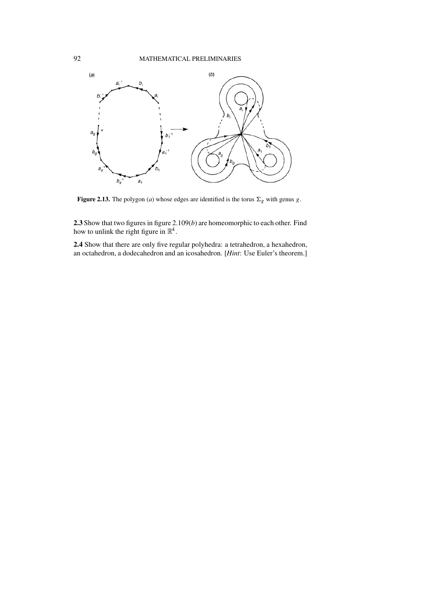

### Problem 2.1：4g 边形怎样表示 g 个把手？

**先做：**把每四条边按 $a_ib_ia_i^{-1}b_i^{-1}$ 的方向成对识别。单独一个四边块给什么？将边形分成把手块时，为什么连接处不是新增一个洞？

**解读：**标准边界词为

$$
a_1b_1a_1^{-1}b_1^{-1}\cdots a_gb_ga_g^{-1}b_g^{-1}.
$$

每个四边块对应一个环面把手，完整粘合表示 $g$ 个环面的连通和。可将边形用不交切割线划成带孔的环面块，再沿这些切口连接；方向识别决定最终闭且可定向，不能只凭“有 $4g$ 条边”判断拓扑。

作为核对，粘合后一个顶点、$2g$ 条边、一个面，得到 $\chi=2-2g$。它与连通和计算一致，但只比较 $\chi$ 本身不是该识别结论的全部证明；标准边界词的切割构造提供了空间的具体识别。

### Problem 2.2：漏掉极限点会怎样？

**先做：**检验零的每个邻域是否遇到 $X=\{1/n:n\ge1\}$，而零是否在 $X$ 中。

**推导：**$1/n\to0$，所以 $0\in\overline X\setminus X$，$X$ 在实数中不闭。令 $Y=X\cup\{0\}$。除零以外，每个非零实数附近只有有限个 $1/n$ 需要检查；若点不在 $Y$，就能选足够小区间避开这些点，因此补集开，$Y$ 闭。再由 $Y\subset[0,1]$ 与 Heine–Borel 得到紧致。

也可直接证明 $Y$ 紧：任取开覆盖，选一个包含零的开集，它会包含所有足够靠后的 $1/n$；剩下只有有限点，各选一个覆盖集即可。

### Problem 2.3：同胚与在环境中解链

**先做：**忽略三维摆放，只分别参数化每个圆。

**解读：**两幅图的环本身都为 $S^1\sqcup S^1$，逐圈对应就是抽象同胚。至于在四维中解开图示的普通圆环：把其中一个环移到第四坐标 $w=c\ne0$ 的平面，另一个留在 $w=0$；在第一环保持 $w=c$ 时沿前三个坐标移到足够远，再降回 $w=0$，就能避免穿过另一个环。对图中普通圆环选择相应刚体移动即可。

这展示额外维度怎样消除该三维链接障碍，不是宣称所有维数、所有嵌入对象都能用同一招解开。原题图号有排印问题，指的是图 2.10(b)。

### Problem 2.4：为什么只有五种凸正多面体？

**先做：**设每面为正 $p$ 边形，每顶点相接 $q$ 个面。把边分别按面和顶点数两次。

**推导：**闭的凸多面体表面同胚于球面，所以

$$
pF=2E,\qquad qV=2E,\qquad V-E+F=2.
$$

代入得

$$
\frac1p+\frac1q=\frac12+\frac1E>\frac12.
$$

又 $p,q\ge3$。若二者都至少为 $4$ 就不满足严格不等式。因此一个为 $3$，另一个只能是 $3,4,5$。候选为

| $(p,q)$ | $V$ | $E$ | $F$ | 对应多面体 |
|---|---:|---:|---:|---|
| $(3,3)$ | 4 | 6 | 4 | 正四面体 |
| $(4,3)$ | 8 | 12 | 6 | 正六面体（立方体） |
| $(3,4)$ | 6 | 12 | 8 | 正八面体 |
| $(5,3)$ | 20 | 30 | 12 | 正十二面体 |
| $(3,5)$ | 12 | 30 | 20 | 正二十面体 |

计数排除了其他候选，五个标准构造证明各候选可实现。若要求完整的几何分类，还应说明给定正面与顶点图形的凸正多面体的唯一性；本题提示的 Euler 论证本身主要完成候选限制，不能只凭整数条件自动断言存在与唯一。

这里采用通常的凸正多面体含义。若允许自交的星形正多面体，“只有五种”就必须另作限定。

### 读完第二章的放行检查

能说明张量类型和缩并；能对换环境后的开闭性作判断；能用开覆盖和显式映射论证；能区分同胚、同伦等价与环境中的形变；能算常见空间的 Euler 示性数且不把同值误当成分类完成。做到这些，就可以进入第 3 章，不需要先精通本章穿插的全部量子统计背景。
