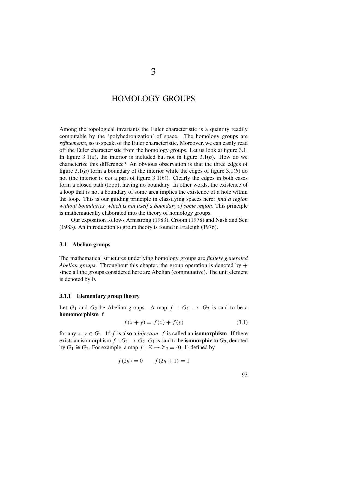
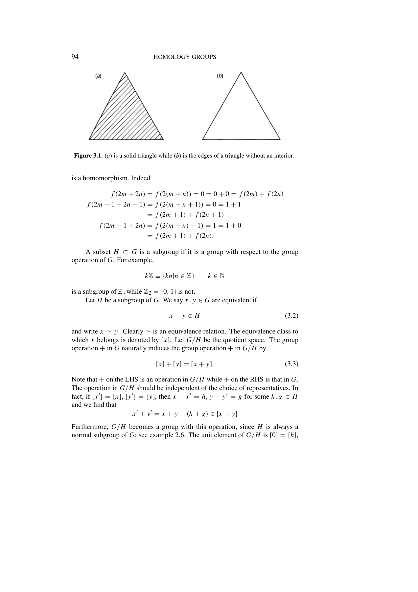
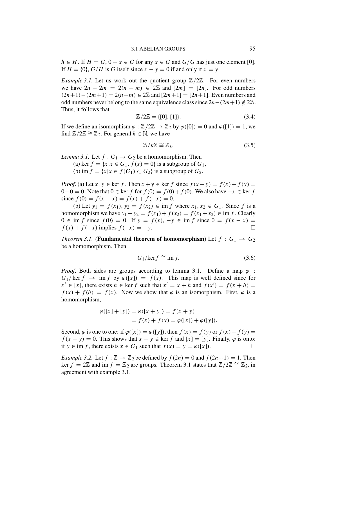

# 3.1.1 Elementary group theory｜本章为什么先复习群？

[阅读目录](README.md) · [第二章](../gtp-chapter-2/README.md) · [下一节](02-3.1.2.md)

## 原书第 93–95 页：导言、图 3.1 与本节

## 一、作者想从空间中提取什么？

**这段在干什么：**把第二章的一个整数不变量推广成一系列群，先交代几何问题，再准备代数工具。

图 3.1 中，实心三角形与三角形边框都含有三条边绕成的一圈。但前者有一个二维面，其边界就是这一圈；后者内部不属于所研究的空间，无法用空间内的面填满它。

因此要区分两件事：一个对象自己没有留下边界；这个对象是不是某个更高维对象的边界。第三章的核心是从“无边界的”里面，商掉“本来就是边界的”。不是用一张嵌入图上看见几个空白区域，就直接定义洞的数量。

第二章 $\chi=V-E+F$ 只输出一个整数。同调群保留分维数的信息，最后还能从它们读出 $\chi$。它仍然不是空间的完整分类，所有同调群相同也不保证同胚。

## 二、熟悉的代数在这里各做什么？

本章主要使用有限生成阿贝尔群，运算记作加法，单位元记 $0$。群论本身你可以快读；需保留下面的功能对应：

| 群论对象 | 后面的几何角色 |
|---|---|
| 自由阿贝尔群 | 用整数登记各块有向积木 |
| 群同态 | 线性地取边界 |
| 核 | 取边界后为零的链 |
| 像 | 真正从高一维取边界得到的链 |
| 商群 | 把相差一个边界的闭链视为同类 |

阿贝尔群里的 $nx$ 是把元素重复相加，不要求它是实向量。$\mathbb Z_2$ 里的 $1+1=0$，不是普通整数加法。

## 三、商掉 H 不是把 H 中的点简单删掉

对于阿贝尔群 $G$ 的子群 $H$，定义

$$
x\sim y\quad\Longleftrightarrow\quad x-y\in H.
$$

商群的元素是类 $[x]=x+H$。类的加法 $[x]+[y]=[x+y]$ 需与代表元选择无关：若 $x'=x+h_1,y'=y+h_2$，则 $(x'+y')-(x+y)=h_1+h_2\in H$，所以结果同类。

商群里的零是整类 $H$，不是仅保留原来的单个元素 $0$。之后说“边界变成零”，就是所有边界链都属于同一个零类，并非从原空间中物理移除这些边。

最小例子：$\mathbb Z/2\mathbb Z$ 中偶数同类、奇数同类。$[1]\ne[0]$，但 $2[1]=[0]$。这个模式会在射影平面出现。

## 四、式 (3.6) 为什么反复有用？

同态基本定理是

$$
G/\ker f\cong\operatorname{im}f.
$$

映射 $[x]\mapsto f(x)$ 的良定义来自：同类元素之差在核里，所以像相同。它单射，因为像相同也意味着差在核里；它满射到像，由像的定义直接得到。

后面求 $H_0$ 时，作者取“把各顶点系数加起来”的同态，证明其核恰好是边界群，再用本定理得到 $\mathbb Z$。这里无需重新背整段证明，但要看清究竟是哪个群除以哪个核。

**自测：**在 $\mathbb Z/2\mathbb Z$ 中，为什么零类包含 $2$？因为商群关心模掉的关系，不是原来数字的大小。回读同调时用同样逻辑理解非零链为何能代表零类。
