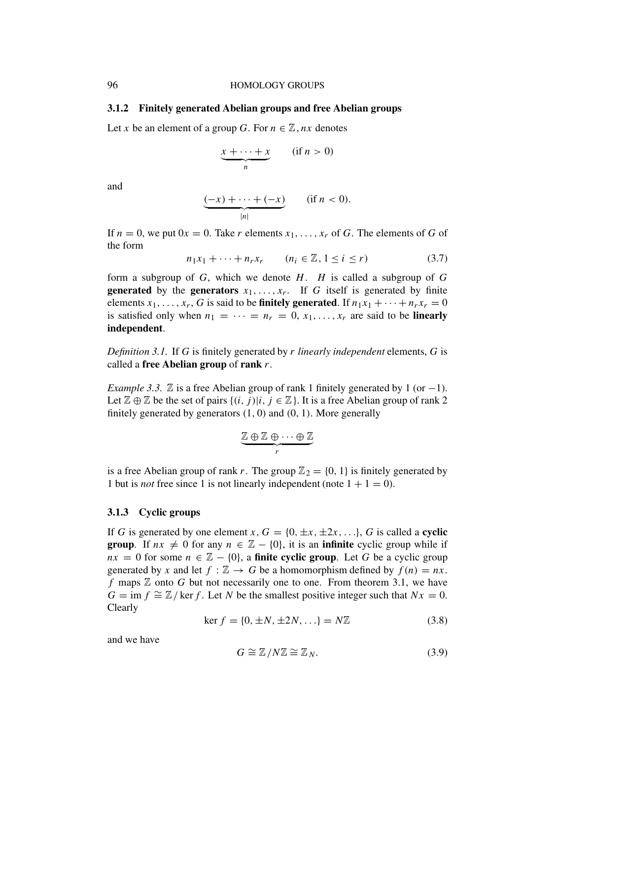

# 3.1.2 Finitely generated Abelian groups｜链的整数系数不是实数坐标

[阅读目录](README.md) · [上一节](01-3.1.1.md) · [下一节](03-3.1.3.md)

## 原书第 96 页上部

## 一、有限生成与自由，各多了什么要求？

**这段在干什么：**为链群建立准确的代数模型。

有限生成：存在有限个元素 $x_1,\ldots,x_r$，每个群元素都能写成 $\sum n_ix_i$，其中 $n_i\in\mathbb Z$。自由：可选一组生成元，使这个表达唯一；等价地，$\sum n_ix_i=0$ 只能在所有 $n_i=0$ 时成立。

因此 $\mathbb Z^r$ 是自由阿贝尔群，而 $\mathbb Z_2$ 虽由一个元素生成，却有非零整数关系 $2[1]=0$，并不自由。零群按约定是秩为零的自由阿贝尔群。

## 二、为什么与线性代数很像，却不能直接用实数消元？

设两条有向边作生成元，$2e_1-e_2$ 是合法链，但 $\tfrac12e_1$ 不是整数链。选基和变换生成元时，必须保留整数格点。

比如 $e$ 是 $\mathbb Z$ 的基，$2e$ 不是，因为无法整数线性组合得到 $e$。作为抽象群，$2\mathbb Z\cong\mathbb Z$；但它嵌入 $\mathbb Z$ 的方式不同，商群 $\mathbb Z/2\mathbb Z$ 会记录这个差别。

这提醒后面的计算：只知道两个子群同构，不足以知道它们的商；要知道实际的包含关系。也不能把实矩阵的秩当成全部整数信息。

## 三、你会在图中怎样使用这些生成元？

每个几何单纯形选一个方向，只登记一次。反向的同一块定义为负号，不另添一个独立生成元。若有三条不同边，链群是 $\mathbb Z^3$；反向边再多画三个箭头，也不把秩变成六。

链加法是形式组合的相加，不是路径按先后顺序的拼接。它是阿贝尔的；这一点与下一章可能非交换的基本群不同。

**自测：**$\langle2e\rangle$ 的自由秩是多少？是 1。$\mathbb Z e/\langle2e\rangle$ 的自由秩是多少？是 0，但群仍有两个元素，说明秩不能描述所有信息。
