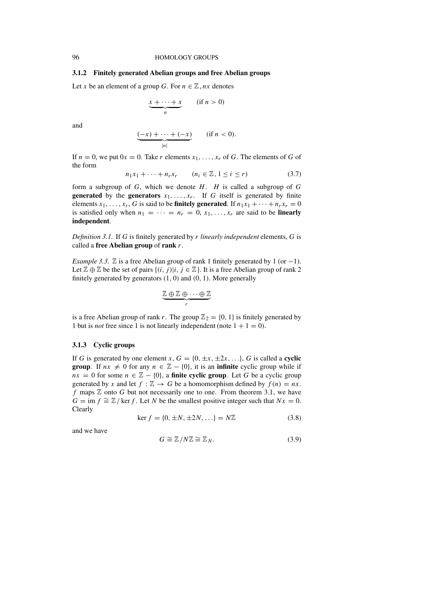
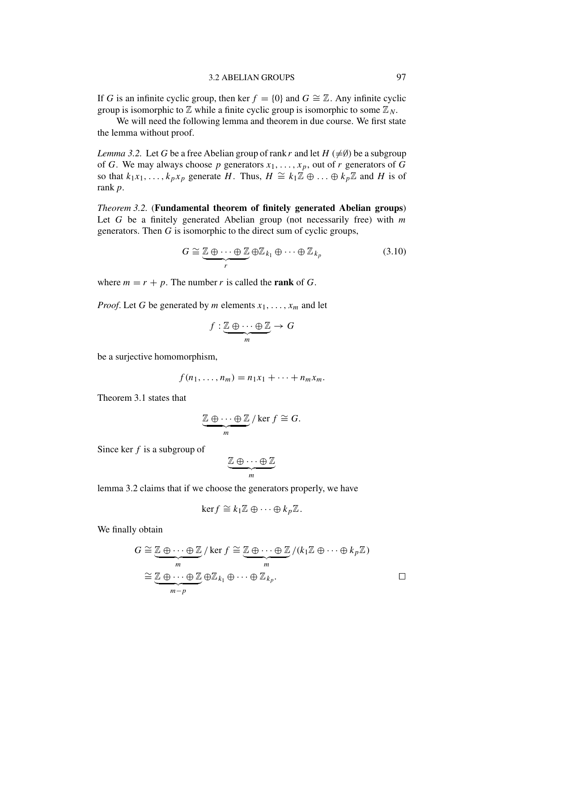

# 3.1.3 Cyclic groups｜关系如何产生有限阶元素

[阅读目录](README.md) · [上一节](02-3.1.2.md) · [下一节](04-3.2.1.md)

## 原书第 96 页下部至第 97 页

## 一、循环群与第一同构定理

**这段在干什么：**说明后面的同调群为什么既会出现 $\mathbb Z$，也会出现 $\mathbb Z_k$。

若 $G$ 由 $x$ 生成，定义满同态 $f:\mathbb Z\to G$，$f(n)=nx$。若没有非零 $n$ 使 $nx=0$，核为零，得到 $G\cong\mathbb Z$。若最小正整数 $k$ 满足 $kx=0$，则核为 $k\mathbb Z$，所以

$$
G\cong\mathbb Z/k\mathbb Z=\mathbb Z_k.
$$

后面 $2[z]=0$ 说的是同调类的有限阶，不是某条几何曲线加两次以后从图上消失。

## 二、有限生成阿贝尔群为何能分解？

选 $m$ 个生成元，得到满同态 $\pi:\mathbb Z^m\to G$。核记录它们满足的所有整数关系。因此

$$
G\cong\mathbb Z^m/\ker\pi.
$$

把关系通过合法的整数基变换化成对角形式，就变成若干关系 $d_ix_i=0$ 与若干没有关系的生成元，得到

$$
\boxed{G\cong\mathbb Z^b\oplus\mathbb Z_{d_1}\oplus\cdots\oplus\mathbb Z_{d_s}.}
$$

通常省去 $d_i=1$ 的平凡因子，并按 $d_i\mid d_{i+1}$ 排列为不变因子形式，才便于表述唯一性。

原书 Lemma 3.2 中“选择生成元”的含义需要重新选择自由基，不能总从原先固定基里挑子集。例如 $\mathbb Z^2$ 的子群 $\langle(1,1)\rangle$ 不是原来任一坐标轴的整数倍，但可换成以 $(1,1)$ 为第一向量的新整数基。

原书把整数对角化的关键引理不加证明地引用。这里说明它的作用，不把一句“选好生成元”当成完整证明。若需算法，可看[整数计算补充](integer-computations.md)中的允许操作；完整 Smith 标准形存在性是另一个代数定理。

## 三、一个完整的小算例

取自由群 $\mathbb Z a\oplus\mathbb Z b$，加关系 $2a=0$，但不对 $b$ 加关系。任意类可写成

$$
\epsilon[a]+n[b],\qquad\epsilon\in\{0,1\},\ n\in\mathbb Z.
$$

于是商为 $\mathbb Z_2\oplus\mathbb Z$，即后面的 Klein 瓶第一同调的代数形式。

若改成 $a=0$，商为 $\mathbb Z$；两个关系矩阵在实数上都只有秩 1，但整数商不同。实数消元允许除以 2，整数基变换不允许悄悄这样做。

**校读提醒：**原书式 (3.10) 的生成元计数若含冗余生成元，可能需保留平凡 $\mathbb Z_1$ 因子才能维持字面的 $m=r+p$；删去平凡因子后，不能把任意选出的生成元总数当作不变量。
