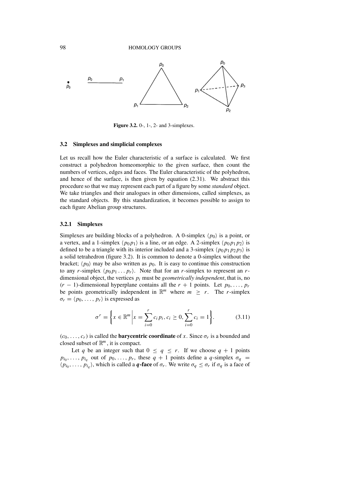
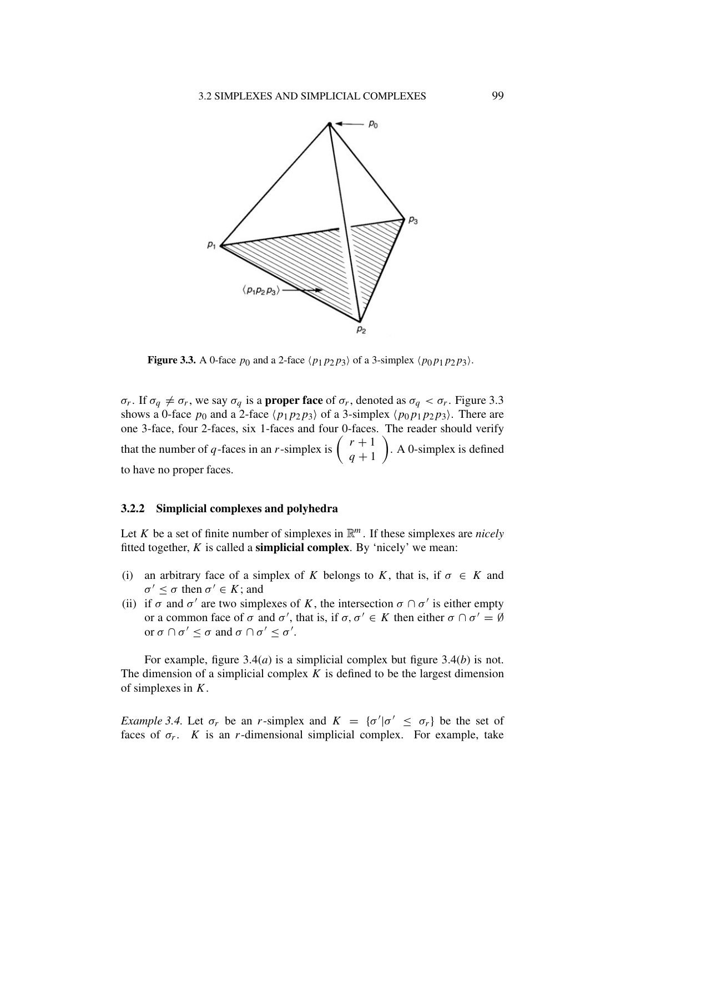

# 3.2.1 Simplexes｜单纯形：从顶点构造标准积木

[阅读目录](README.md) · [上一节](03-3.1.3.md) · [下一节](05-3.2.2.md)

## 原书第 98–99 页：本节到 p.99 的 §3.2.2 前

## 一、为什么选三角形，不直接用任意形状？

**这段在干什么：**用统一积木描述空间，方便把边界写成通用公式。

0-单纯形是点，1-单纯形是包含端点的线段，2-单纯形是包括内部的三角形，3-单纯形是包括内部的四面体。维数 $r$ 的单纯形需要 $r+1$ 个仿射无关顶点。

“仿射无关”表示 $p_1-p_0,\ldots,p_r-p_0$ 线性无关。三个共线点不能构成真正二维三角形，四个共面点不能构成真正三维四面体。维数不是只数出几个点就自动得到的。

## 二、式 (3.11) 的非负系数和为 1 在做什么？

$$
\sigma^r=\left\{\sum_{i=0}^rc_ip_i:\ c_i\ge0,\ \sum c_i=1\right\}.
$$

这叫顶点的凸包。对线段，$x=(1-t)p_0+tp_1$，$0\le t\le1$；对三角形，三个非负权重和为 1，将位置限制在三角形内及边上。

例：$p_0=(0,0),p_1=(1,0),p_2=(0,1)$。点 $(x,y)$ 的重心坐标为 $(1-x-y,x,y)$，因此恰需 $x\ge0,y\ge0,x+y\le1$。权重允许为零，所以边和顶点也包括在内。

这不是普通向量空间的基展开：系数受限制，原点也不需与某顶点重合。仿射无关保证这些受约束坐标唯一。

## 三、faces 不仅指二维面

选 $q+1$ 个顶点张成的 $q$-单纯形，叫 $q$ 维面。一个四面体有 4 个点、6 条边、4 个三角面，以及自身这一个三维面。一般个数为

$$
\binom{r+1}{q+1}.
$$

因为是在 $r+1$ 个顶点中选出 $q+1$ 个。自己也叫面，真面则排除自己。这套说法为后面“删一个顶点得到一个余维一面”提供统一表达。

单纯形紧致，可由标准闭有界单纯形在连续仿射映射下的像得到；这里复用第二章紧致性，不必重新证明整个 Heine–Borel 定理。

**自测：**三角形与它的三条边之并，维数为什么不同？前者包含一个二维单纯形，后者最高只有一维单纯形。
