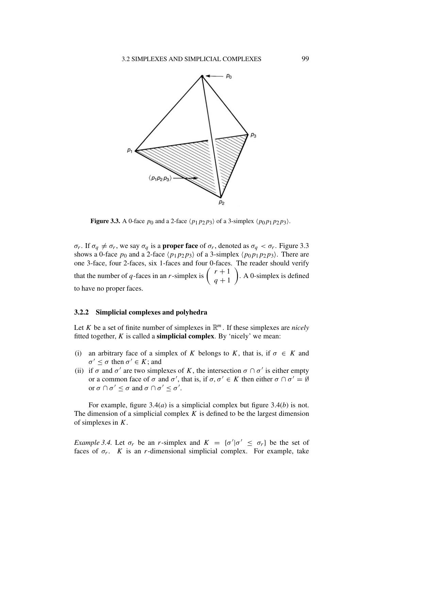
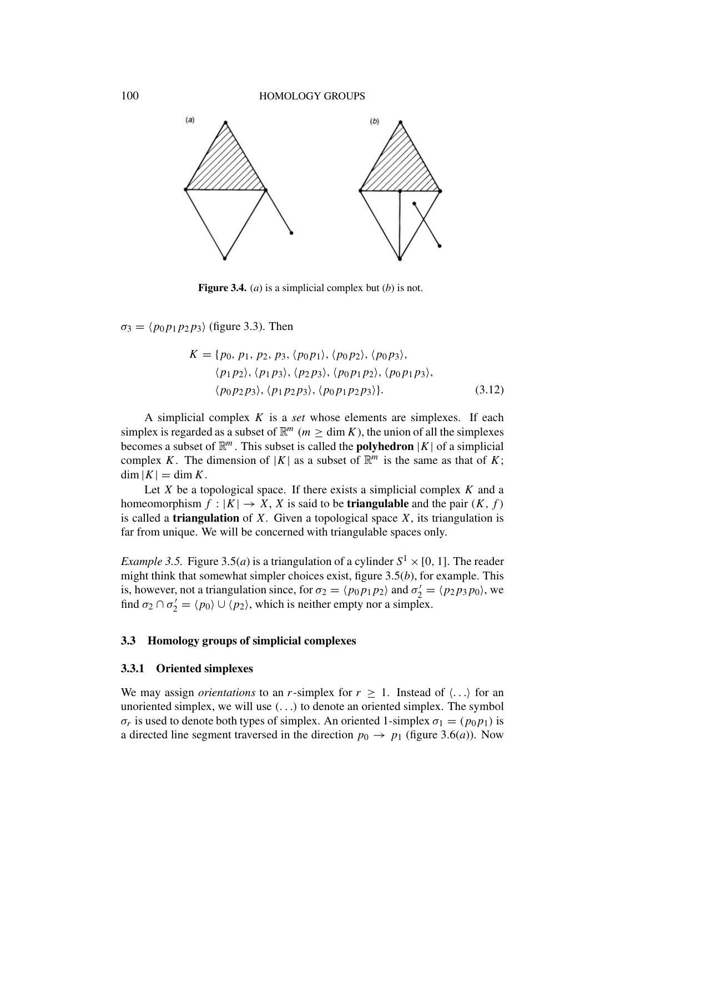
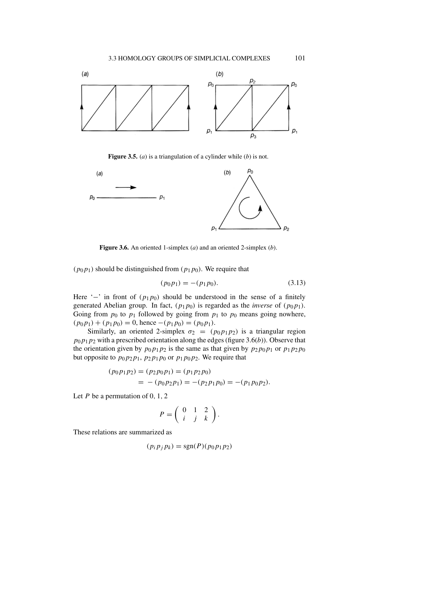

# 3.2.2 Simplicial complexes and polyhedra｜怎样合法地拼积木？

[阅读目录](README.md) · [上一节](04-3.2.1.md) · [下一节](06-3.3.1.md)

## 原书第 99–101 页：图 3.5 位于下一页

## 一、两条拼接规则缺一不可

**这段在干什么：**保证每一块及它的边界都有明确账目，避免积木以无法登记的方式相交。

原书限于有限单纯复形 $K$：一块单纯形属于 $K$，它的所有面也须属于 $K$；任意两块交集只能为空或二者的共同面。

第一条确保有三角面就必须登记三条边和三个点。第二条禁止一条边的端点扎进另一条边的中间却不细分；也禁止两块三角形只交于两个分离的顶点。后者不是一个单纯形。

这些形状未必无法研究，只是当前分块不合规则。可通过增加顶点和细分修复许多例子。

## 二、K 与 |K| 的区别

$K$ 是由单纯形组成的组合清单；$|K|$ 是把这些单纯形视作几何子集后取并得到的空间。清单的元素是积木，空间的元素是点，两者不能混用。

例如实心三角形对应的清单包括 3 个顶点、3 条边、1 个面；$|K|$ 却包含连续无穷多个点。所谓“有限复形”是有限块，不是有限点的空间。

## 三、triangulation 不要求空间原来就长得像直边三角形

三角剖分是 $(K,f)$，其中 $f:|K|\to X$ 为同胚。圆可用三角形边框作模型，球面可用四面体表面作模型，靠同胚将直边模型送到弯曲空间。

不是随便画网格就已经证明它是三角剖分；要确认组合规则与空间对应。原书图 3.5(b) 只有少量块的圆柱表示，在边界识别后两块的交集出现两个分离点，违反共同面要求。

第二章用“一顶点、两边、一面”计算环面 Euler 示性数是胞腔分解，不是严格单纯复形。两种方法都可用，但不能把其链群和边界规则不加解释地混在一起。本章曲面计算需要简化时，会明确标记所借用的胞腔同调定理。

## 四、原书范围与读者需要保留的边界

本章不声称任意拓扑空间都可三角剖分，且原书此处以有限复形为工作范围。一般空间的同调可另用奇异同调定义，但不把这项更广的理论当作已经在这里证明。

**自测：**为什么三条边围成的圈不能在没有新增二维面的情况下，直接登记一个“内部”？因为那会改变空间，而非只是改变其剖分。
