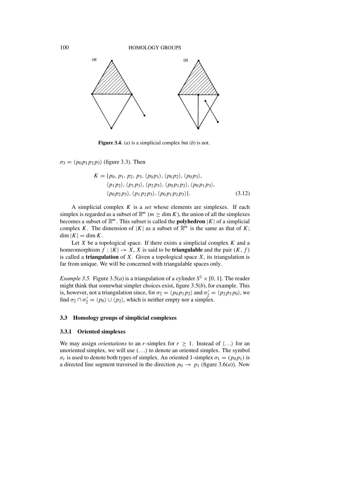
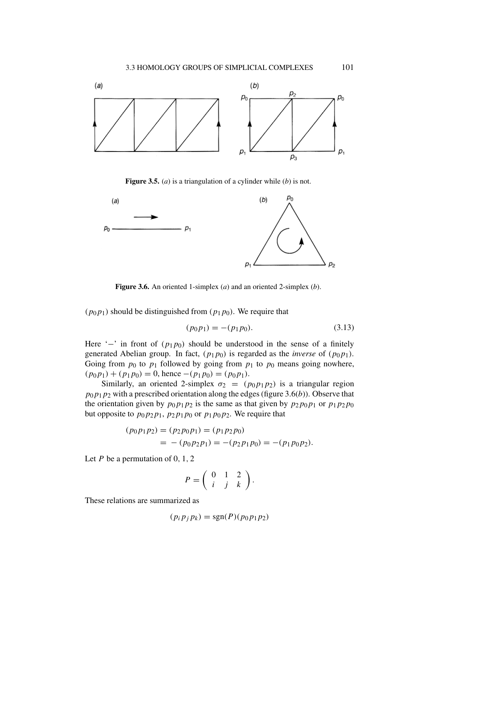
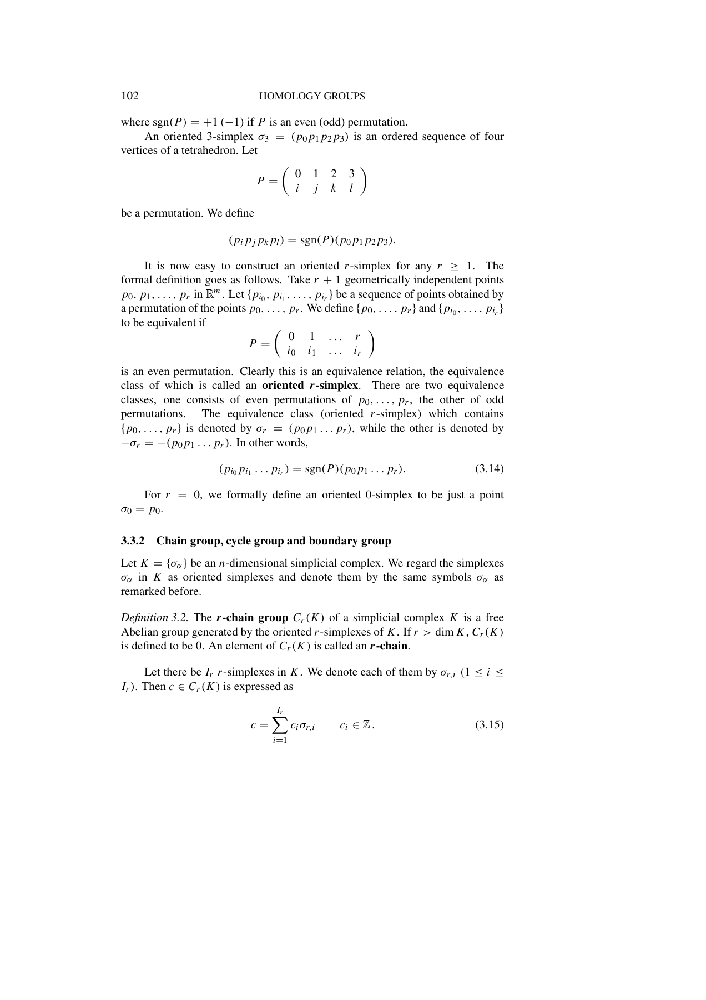

# 3.3.1 Oriented simplexes｜定向：给相消准备正负号

[阅读目录](README.md) · [上一节](05-3.2.2.md) · [下一节](07-3.3.2.md)

## 原书第 100 页下部至第 102 页上部

## 一、为什么几何上相同的边，要区分两个方向？

**这段在干什么：**让两个相邻区域的公共边能按符号抵消，最终只留下整体外边界。

原书用尖括号表示未定向单纯形，用圆括号表示有向单纯形。本注也常用 $[p_0,\ldots,p_r]$ 表示一个有向生成元；写 $[z]$ 表示同调类时另由上下文说明，二者不是同一个层次。

对有向边规定

$$
[A,B]=-[B,A].
$$

负号表示链群里的加法逆元，不表示把线段搬到原点另一侧。$[A,B]+[B,A]=0$ 是形式链的相消，而不是把任意物理运动过程视为没有发生。

## 二、三角形为什么三个循环排列同号？

顺着边界读 $A\to B\to C\to A$，从哪个顶点开始都保持同一循环方向，所以

$$
[A,B,C]=[B,C,A]=[C,A,B].
$$

交换两个顶点会反向，例如 $[A,C,B]=-[A,B,C]$。统一规则是

$$
[p_{i_0},\ldots,p_{i_r}]=\operatorname{sgn}(P)[p_0,\ldots,p_r].
$$

偶排列同号，奇排列异号。这与行列式的交替性一致，给高维定向提供无需画顺逆时针的定义。对 $r\ge1$ 有两种定向；0-单纯形按本章约定就是顶点生成元，负点通过整数系数表示。

## 三、局部每块能定向，不代表整体可定向

每个小三角形都能独立选方向。若要整张曲面定向，还要求公共边的诱导方向成对抵消；绕不可定向曲面一圈，这种选择可能无法一致返回。

因此 Möbius 带与射影平面照样可以建立有向链群，不会因为整体不可定向就不能算整数同调。后面消不掉的符号关系恰好会记录这种差异。

## 四、改变参考方向不应改变答案

若把某条边的参考方向反转，它在每个链中的系数也取相反数。矩阵里相应基变换只是乘 $-1$，是合法整数可逆操作，不改变同调群的同构类型。

**自测：**为什么不能把所有边界项都加正号？先试两段首尾相接线段，中间顶点会被错误地数两次；下一节会用这个要求推出差号。
