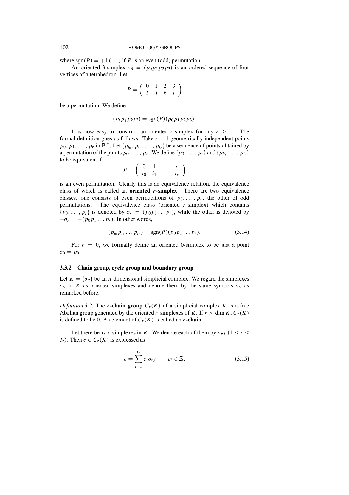
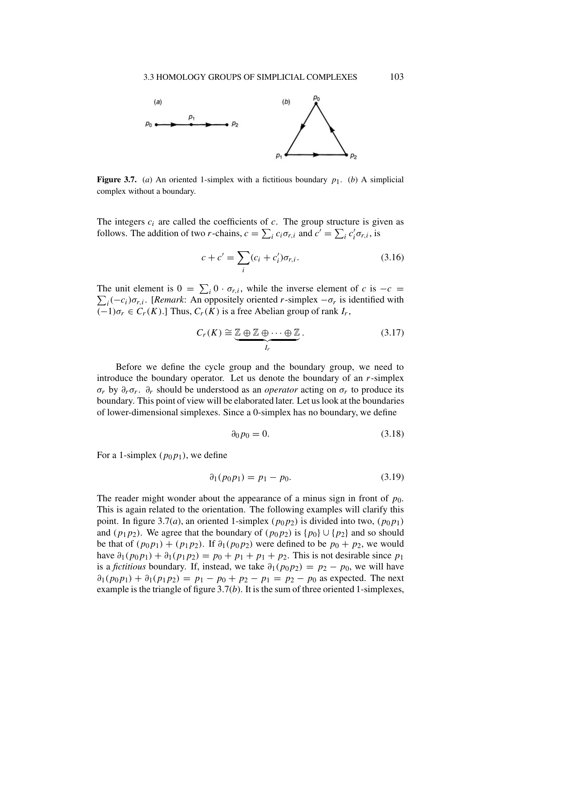
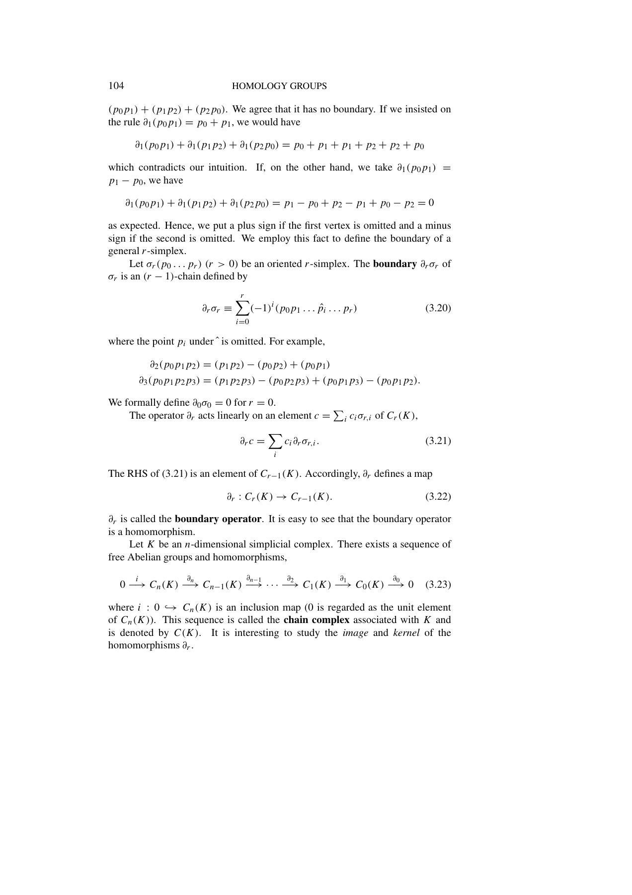
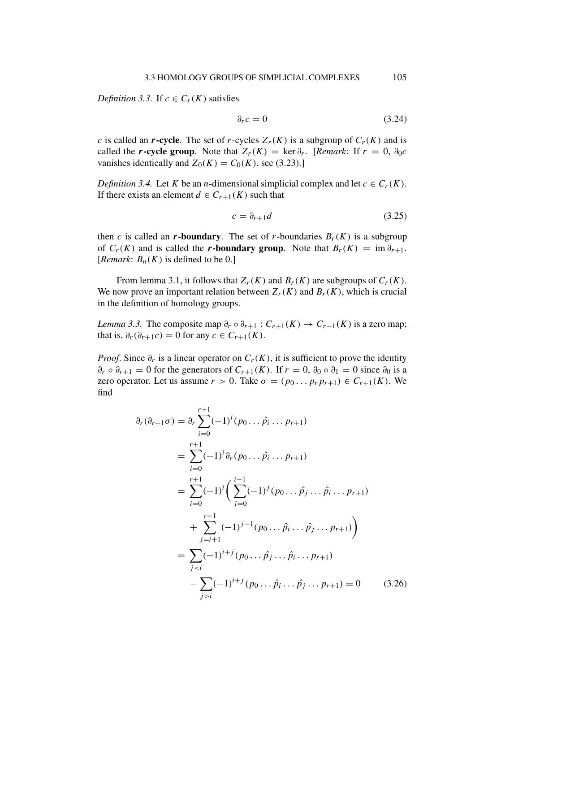
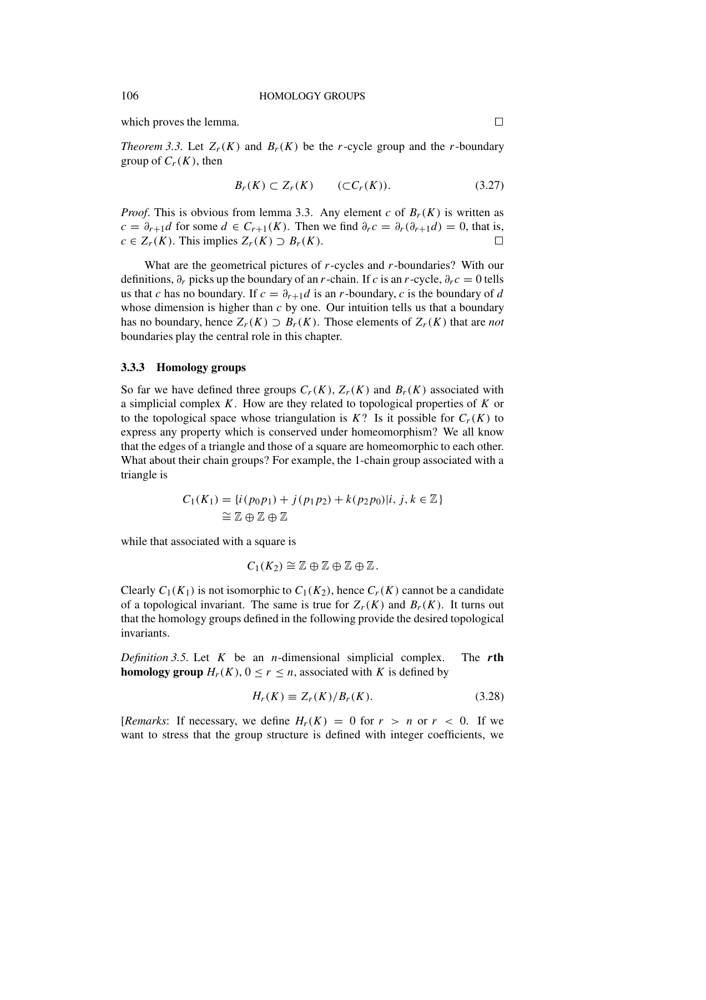

# 3.3.2 Chain, cycle and boundary groups｜链、闭链、边界链分别是什么？

[阅读目录](README.md) · [上一节](06-3.3.1.md) · [下一节](08-3.3.3.md)

## 原书第 102 页下部至第 106 页上部

## 一、链是形式账本，不是一条必须连起来的路径

**这段在干什么：**把空间的分块转成群，再用一个同态区分两种“边界”。

每个几何 $r$-单纯形选一个参考定向，记作 $\sigma_i$，定义

$$
C_r(K)=\left\{\sum_i n_i\sigma_i:n_i\in\mathbb Z\right\}.
$$

例如 $2[A,B]-3[C,D]$ 是合法 1-链，不要求两条边相接。$[A,B]+[B,C]$ 是两块边的和，不能不说明细分关系就把它在同一链群里直接等同于一个新生成元 $[A,C]$。

若有 $I_r$ 块几何单纯形，则 $C_r\cong\mathbb Z^{I_r}$。反向定向通过负系数处理，不把两个方向同时当独立基。系数可解释成有向叠加次数，但不需要每个链都对应一张无自交的实体曲面。

## 二、为什么线段的边界是终点减起点？

定义

$$
\partial_1[A,B]=B-A.
$$

这样两段相接时，内部端点消失：

$$
\partial([A,B]+[B,C])=(B-A)+(C-B)=C-A.
$$

如果用 $A+B$，会得到 $A+2B+C$，错误地留下人为切分点。对绕一圈的链

$$
c=[A,B]+[B,C]+[C,A],
$$

边界就是 $(B-A)+(C-B)+(A-C)=0$。这正是闭合应当表达的相消。

这里的结果是 0-链，不是点集：$B-A$ 保留方向和系数。第二章的集合边界只有集合，不能承担这项任务。对边框的“没有边界”也指这个闭链的代数边界为零，不是说它作为平面子集的拓扑边界为空。

## 三、一般公式为何逐个删顶点、正负交替？

$$
\boxed{\partial_r[p_0,\ldots,p_r]
=\sum_{i=0}^{r}(-1)^i[p_0,\ldots,\widehat p_i,\ldots,p_r].}
$$

帽子表示删去该顶点。删一个顶点留下一个余维一面，符号保证诱导方向一致。比如

$$
\partial_2[A,B,C]=[B,C]-[A,C]+[A,B],
$$

即沿 $A\to B\to C\to A$ 的一圈。四面体同理：

$$
\partial_3[A,B,C,D]=[B,C,D]-[A,C,D]+[A,B,D]-[A,B,C].
$$

只需对基底单纯形给出边界，再按整数线性延拓到所有链，所以 $\partial_r:C_r\to C_{r-1}$ 是群同态。本章取 $\partial_0=0$、$C_{-1}=0$，这是普通同调约定；约化同调需要另改最低端。

## 四、闭链与边界链：两个问题

$$
\boxed{Z_r=\ker\partial_r,\qquad B_r=\operatorname{im}\partial_{r+1}.}
$$

对 $c\in C_r$：

- 闭链：检验它自己取边界是否为零；
- 边界链：寻找更高一维的 $d\in C_{r+1}$，使 $c=\partial_{r+1}d$。

它们都位于同一个 $C_r$ 中，不能把 $B_r$ 的下标误解为产生它的高维链的维数。$B_1$ 是由二维链产生的一维边界链。

三角形边框中的一圈 $c$ 是闭链，但该空间没有二维面，不能成为边界；填满三角形后，$c=\partial[A,B,C]$，才成为边界链。空间外的纸面或三维填充物不能擅自加入。

## 五、为什么边界的边界为零？先算低维

$$
\begin{aligned}
\partial_1\partial_2[A,B,C]
&=(C-B)-(C-A)+(B-A)\\
&=0.
\end{aligned}
$$

四面体的四张有向面取边界时，每条边也出现两次、符号相反。一般情况如下：给定原顶点次序中的 $i<j$，先删 $i$ 再删 $j$，第二次的序号变为 $j-1$，总符号为 $(-1)^i(-1)^{j-1}$；先删 $j$ 再删 $i$，总符号为 $(-1)^j(-1)^i$。二者相反，而得到的余下单纯形相同，因此成对抵消。

$$
\boxed{\partial_r\partial_{r+1}=0.}
$$

这不是只有二维图形成立的直觉，而是完整的组合符号证明。由线性性，对生成元证明后即对任意链成立。

## 六、为什么同调群的商有定义？

若 $b\in B_r$，存在 $d$ 使 $b=\partial d$；于是 $\partial b=\partial^2d=0$，故

$$
B_r\subseteq Z_r\subseteq C_r.
$$

所有群都是阿贝尔群，因此 $B_r$ 自动是 $Z_r$ 的正规子群，下一节才可定义 $Z_r/B_r$。

写成链复形，

$$
0\to C_n\xrightarrow{\partial_n}\cdots
\xrightarrow{\partial_2}C_1\xrightarrow{\partial_1}C_0\to0.
$$

链复形只要求相邻两箭头复合为零，不要求像等于核。若某处像恰等于核，就称在那里正合；同调正是在测量“不正合留下了什么”。不能看到一串箭头就默认它是正合列。

## 七、把抽象定义写成你熟悉的矩阵

固定顶点基 $(A,B,C)$，边基 $([A,B],[A,C],[B,C])$，面基 $([A,B,C])$：

$$
D_1=\begin{pmatrix}-1&-1&0\\1&0&-1\\0&1&1\end{pmatrix},
\qquad D_2=\begin{pmatrix}1\\-1\\1\end{pmatrix}.
$$

每一列就是一个基底积木取边界后的坐标。直接相乘 $D_1D_2=0$。所以 $Z_1$ 是整数方程 $D_1x=0$ 的解集，$B_1$ 是 $D_2$ 的整数列组合。

矩阵并不替代几何定义：它是选定基底后记录边界规则的方法。后面算整数商，须保留系数格而不只看实数秩。

**自测：**$B_2=0$ 是否说明 $H_2=0$？不说明，还要看 $Z_2$。没有更高维链只能排除“已经是边界”，不能排除“非零闭链”。
