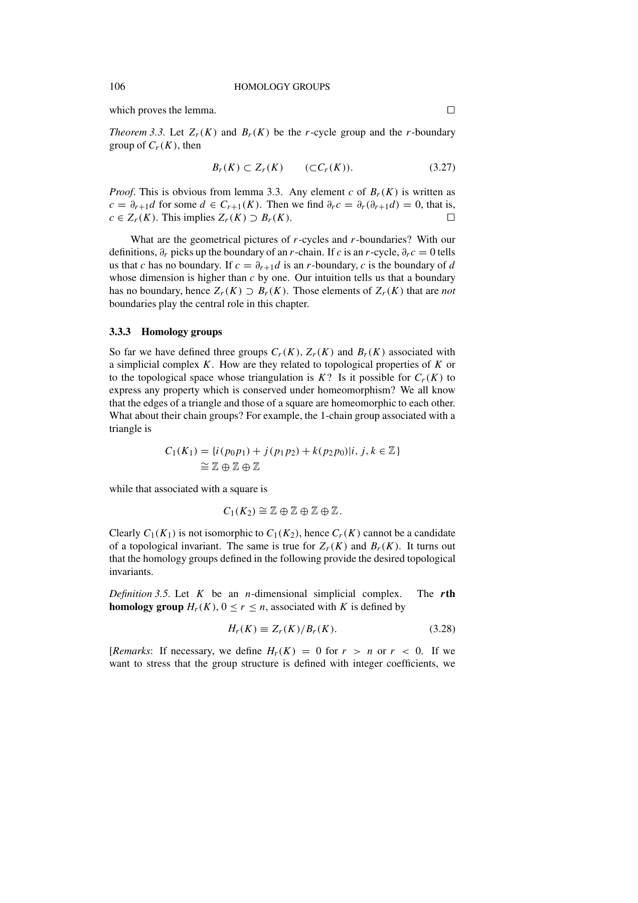
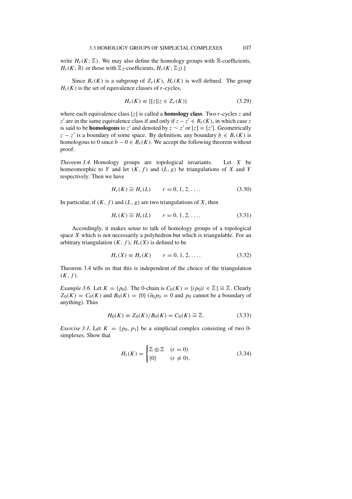
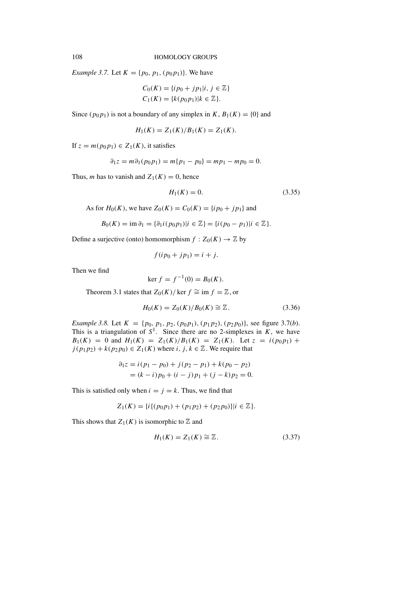
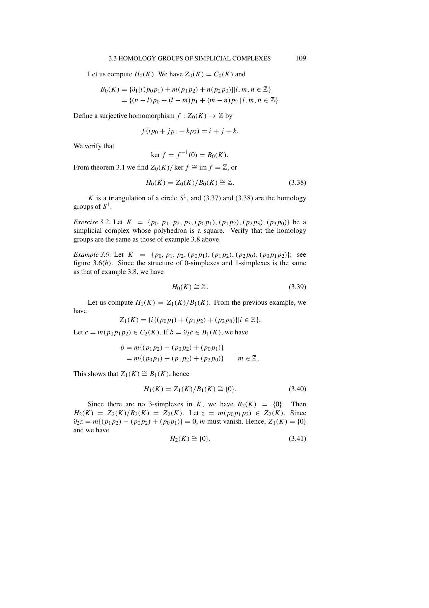
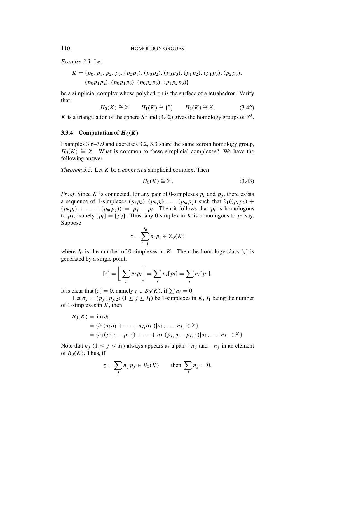

# 3.3.3 Homology groups｜为什么取闭链除以边界链？

[阅读目录](README.md) · [上一节](07-3.3.2.md) · [下一节](09-3.3.4.md)

## 原书第 106–110 页

本节定义在 p.106 下部，例题与习题持续到 p.110 Exercise 3.3；同页后半开始 §3.3.4。

## 一、链群为什么不能直接作为不变量？

**这段在干什么：**消除剖分细节，只保留闭合结构中不属于边界的部分。

一个圆用三条边剖分，$C_1\cong\mathbb Z^3$；改成四条边，$C_1\cong\mathbb Z^4$。空间拓扑相同，链群却不同。所以需要进一步筛选并识别。

定义

$$
\boxed{H_r(K)=Z_r(K)/B_r(K).}
$$

它的元素不是单独的链，而是闭链的等价类：

$$
[z]=z+B_r,\qquad [z]=[z']\Longleftrightarrow z-z'=\partial d.
$$

“两圈同调”表示它们的差能由空间内高一维链填起来。若 $z$ 自己就是边界，它代表零类。不是直接删除空间中的某条圈，也不要求两个闭链作为点集完全相同。

## 二、什么是书中接受而未证明的结论？

Theorem 3.4 说同胚的可三角剖分空间具有同构的同调群，因此换三角剖分不改变 $H_r$。这是实质性定理；书中明确不证明。

验证三边圆与四边圆结果相同，是示例，不是对所有剖分的证明。一般证明需要比较链复形、细分和相应映射等工具。这里使用该定理，允许我们将 $H_r(K)$ 记作空间的 $H_r(X)$。

## 三、Example 3.6–3.7：一个点与一条线段

一个点：$C_0=\mathbb Z A$、$\partial_0=0$，又无边，所以 $B_0=0$，得到 $H_0\cong\mathbb Z$，其他维数为零。

一条线段：$C_0=\mathbb Z A\oplus\mathbb Z B$、$C_1=\mathbb Z e$，$\partial e=B-A$。若 $ne$ 是闭链，则 $n(B-A)=0$，由顶点生成元独立可得 $n=0$，所以 $H_1=0$。

在 $H_0$ 中，$B-A$ 成为零，因此 $[B]=[A]$。但单个 $[A]$ 不为零：任何边界的顶点系数总和都是零，而 $A$ 的总和为 1。于是 $H_0\cong\mathbb Z$。这说明 $H_0$ 不是在数顶点个数。

## 四、Example 3.8：三角形边框的完整计算

记 $e_1=[A,B],e_2=[B,C],e_3=[C,A]$。任意 1-链为 $z=ae_1+be_2+ce_3$，

$$
\partial z=(c-a)A+(a-b)B+(b-c)C.
$$

因此闭合当且仅当 $a=b=c$，即

$$
Z_1=\mathbb Z(e_1+e_2+e_3).
$$

边框没有二维链，$B_1=0$，所以

$$
H_1\cong\mathbb Z.
$$

它并不是“有无穷多个独立洞”：只有一个自由生成元，可以取任意整数倍。

又由 $B-A,C-B$ 是边界，三个顶点在 $H_0$ 中同类，$H_0\cong\mathbb Z$。Exercise 3.2 的四边框同样要求沿圈的四个边系数一致，仍只剩一个生成元。

## 五、Example 3.9：加上一个面，究竟改变了哪里？

保留相同顶点和边，新增 $F=[A,B,C]$。因此 $C_0,C_1$ 和 $\partial_1$ 都不变，$Z_1$ 也不变。但

$$
\partial_2F=e_1+e_2+e_3,
$$

所以 $B_1=Z_1$，于是 $H_1=0$。原来的一圈仍然是闭链，只是在商群中现在成为零。

再算 $H_2$：任意二维链 $mF$ 的边界是 $m(e_1+e_2+e_3)$，只有 $m=0$ 才为零。所以 $Z_2=0$，得到 $H_2=0$。有二维面并不意味着有二维闭链。

**校记：**原书这里写“$Z_1\cong B_1$，所以商为零”容易误导。真正足够的是它们作为 $C_1$ 的子群相等；两个抽象同构的子群不保证商为零，例如 $2\mathbb Z\cong\mathbb Z$，而 $\mathbb Z/2\mathbb Z\ne0$。另有 $Z_1=0$ 的排印应为此处正在计算的 $Z_2=0$。

## 六、Exercise 3.3：四面体表面为什么有一个二维类？

只取四面体表面，不包括内部三维单纯形。固定顶点 $0,1,2,3$，组合

$$
s=[1,2,3]-[0,2,3]+[0,1,3]-[0,1,2]
$$

取边界为零。公共边相消，构成整张有向球面。令一般二维链为四面的线性组合，逐边令系数为零，会迫使四个系数按上式符号取同一个倍数，所以 $Z_2=\mathbb Z s$。

空间中没有三维链，$B_2=0$，故 $H_2\cong\mathbb Z$。不能把四面体的实体内部从环境空间借进来：若真的新增该三维单纯形，$s$ 就成为它的边界，计算的已是另一空间。

为什么 $H_1=0$？取顶点 0 为根，三条连到它的边作树。剩余三条边各与树上的路径形成三角闭链；这三条基本闭链分别是面 $[0,1,2],[0,1,3],[0,2,3]$ 的边界。任意一维闭链都是它们的整数和，故 $Z_1=B_1$。连通则给 $H_0\cong\mathbb Z$。

## 七、把前三个模型对齐

| 空间 | $H_0$ | $H_1$ | $H_2$ |
|---|---|---|---|
| 点／闭线段／闭圆盘 | $\mathbb Z$ | 0 | 0 |
| 圆 | $\mathbb Z$ | $\mathbb Z$ | 0 |
| 球面 | $\mathbb Z$ | 0 | $\mathbb Z$ |

这些都是整数系数的普通同调。高于所列空间维数的群均为零。同调相同不推出同胚，例如点与闭线段已有同样的同调。

**自测：**圆盘与圆的差别发生在 $Z_1$ 还是 $B_1$？使用同一三角形模型时，$Z_1$ 相同，新增二维面改变了 $B_1$。
