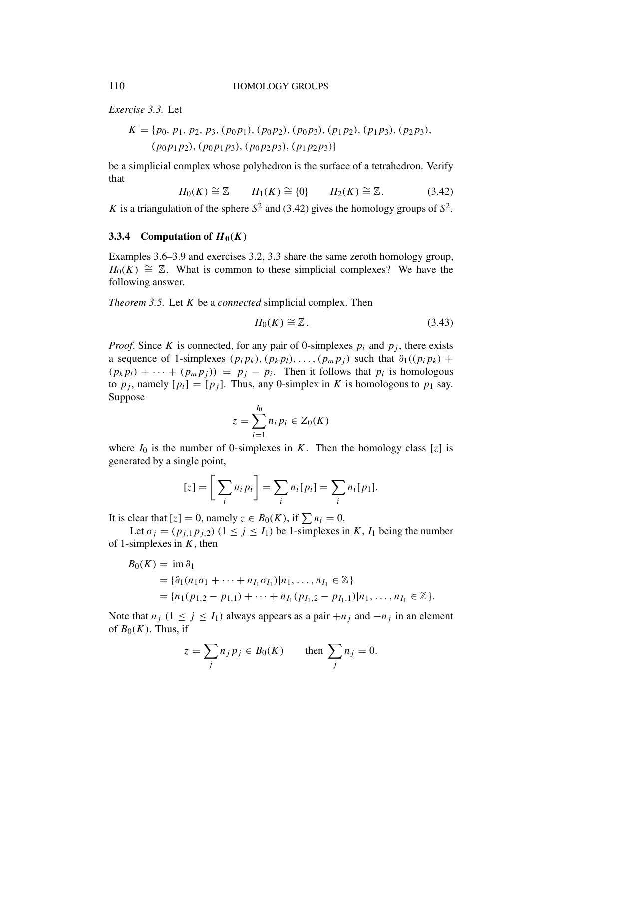
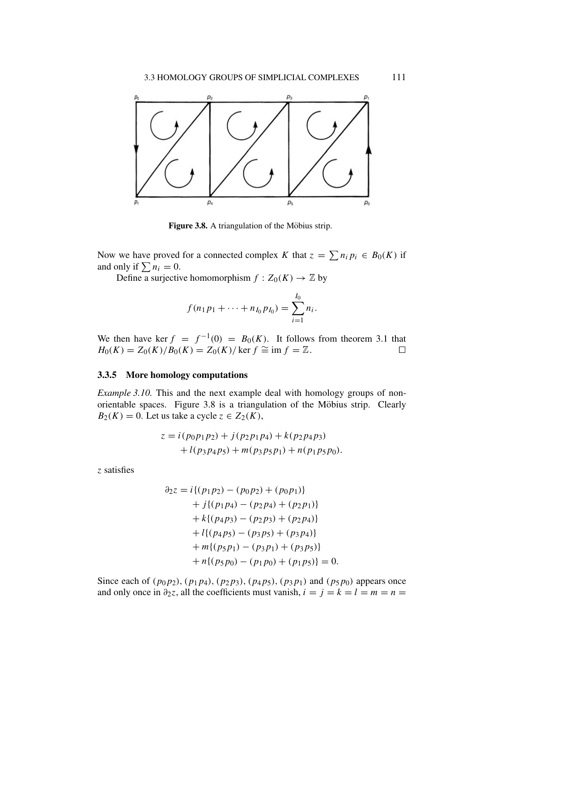

# 3.3.4 Computation of H0｜为什么连通空间留下一个整数？

[阅读目录](README.md) · [上一节](08-3.3.3.md) · [下一节](10-3.3.5.md)

## 原书第 110 页中部至第 111 页上部

## 一、H0 不能凭“零维洞”猜

**这段在干什么：**证明 $H_0$ 精确记录连通分支，而不是给它生硬套一个洞的比喻。

由于 $\partial_0=0$，任何 0-链都是闭链，所以

$$
H_0=C_0/\operatorname{im}\partial_1.
$$

边界关系 $\partial[A,B]=B-A$ 把能沿边相连的顶点识别为同一个类。对有限单纯复形，几何连通与顶点可沿边链连接相对应；不是在任意一般拓扑空间中直接把连通当成道路连通。

## 二、把“总和为零”与边界相互推出

固定一个根顶点 $p_0$。对每个顶点 $p_i$ 选一条从 $p_0$ 到 $p_i$ 的有向边链 $\gamma_i$，则

$$
\partial\gamma_i=p_i-p_0.
$$

考虑 $z=\sum n_ip_i$。如果 $\sum n_i=0$，则

$$
z=\sum_i n_i(p_i-p_0)
=\partial\left(\sum_i n_i\gamma_i\right).
$$

这给出实际填充的一维链，证明它是边界。

反过来，任何一条边的边界有一个 $+1$、一个 $-1$，总系数为零；由线性性，任意一维链的边界也总和为零。因此

$$
z\in B_0\quad\Longleftrightarrow\quad\sum n_i=0.
$$

## 三、第一同构定理在此落地

定义满同态

$$
\varepsilon:C_0\to\mathbb Z,\qquad
\varepsilon\left(\sum n_ip_i\right)=\sum n_i.
$$

上一步证明 $\ker\varepsilon=B_0$，所以

$$
\boxed{H_0=C_0/B_0\cong\mathbb Z.}
$$

注意这里的 $\varepsilon$ 只是另一个同态，本章普通链复形的 $\partial_0$ 仍为零；若用 $\varepsilon$ 延长复形，才进入增广与约化同调，不能悄悄更换约定。

## 四、结论的几何含义

在一个连通分支内，顶点之差可以通过路径的边界消去，剩下的是总系数。不是所有顶点“成为空间中的同一点”，而是它们在商群中代表同一零维同调类。

多个分支时，各分支的总系数彼此独立，下一节相关定理会给出 $H_0\cong\mathbb Z^N$。

**自测：**为什么一个连通空间的 $H_0$ 不是零？单个顶点总系数为 1，不可能是一维链的边界。
