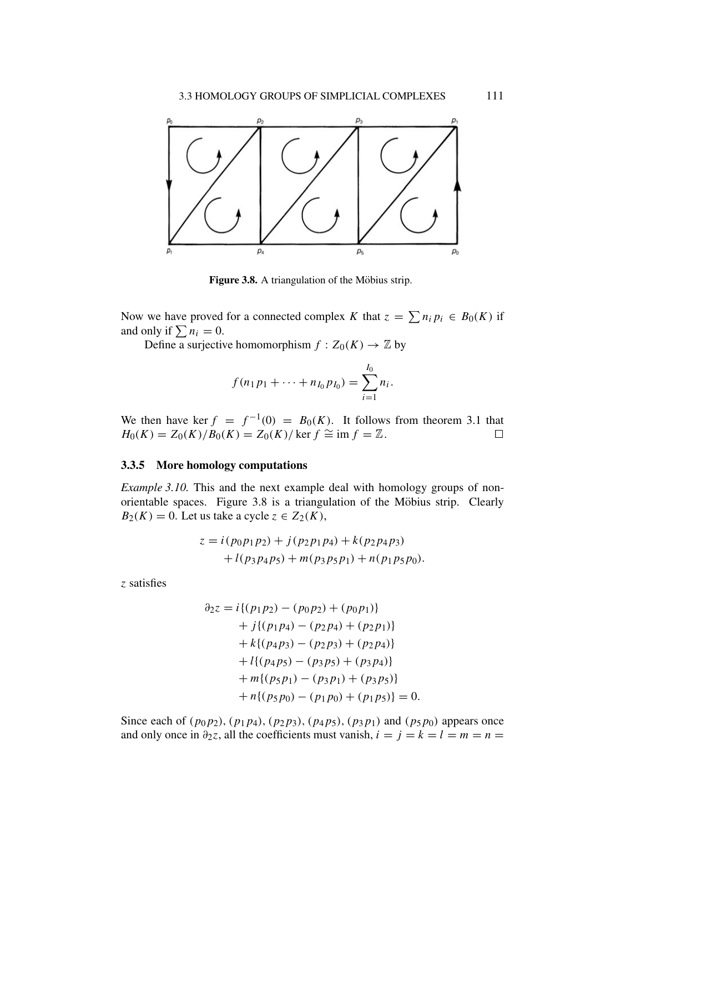
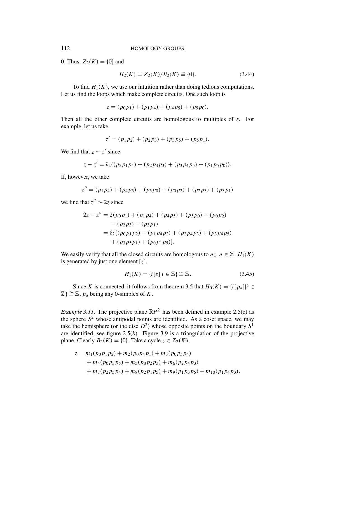
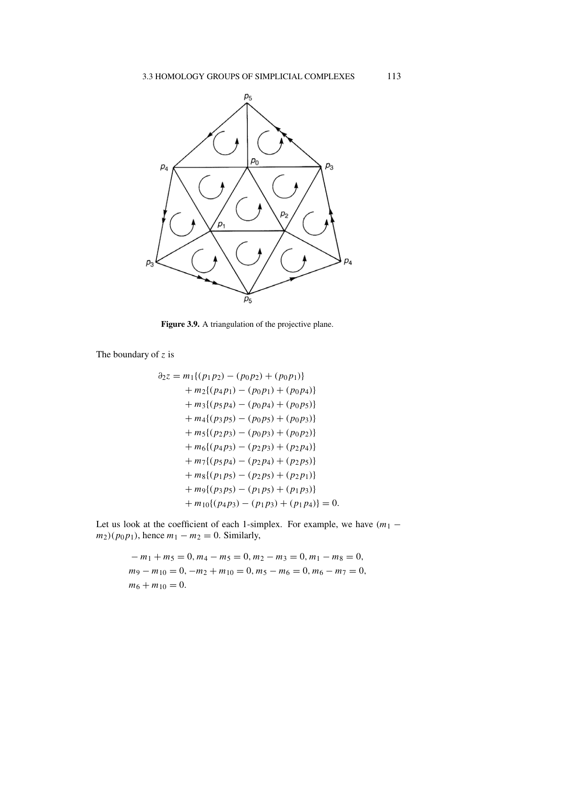
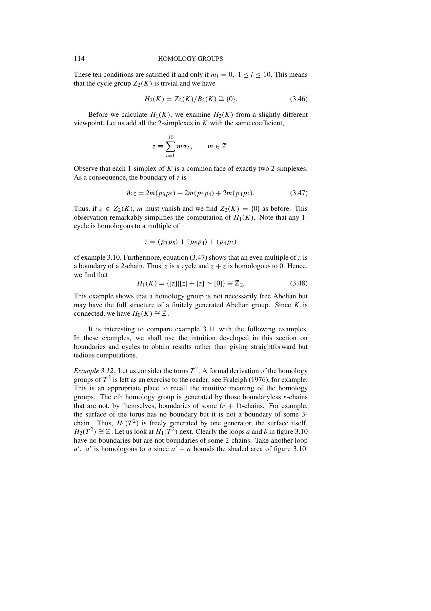
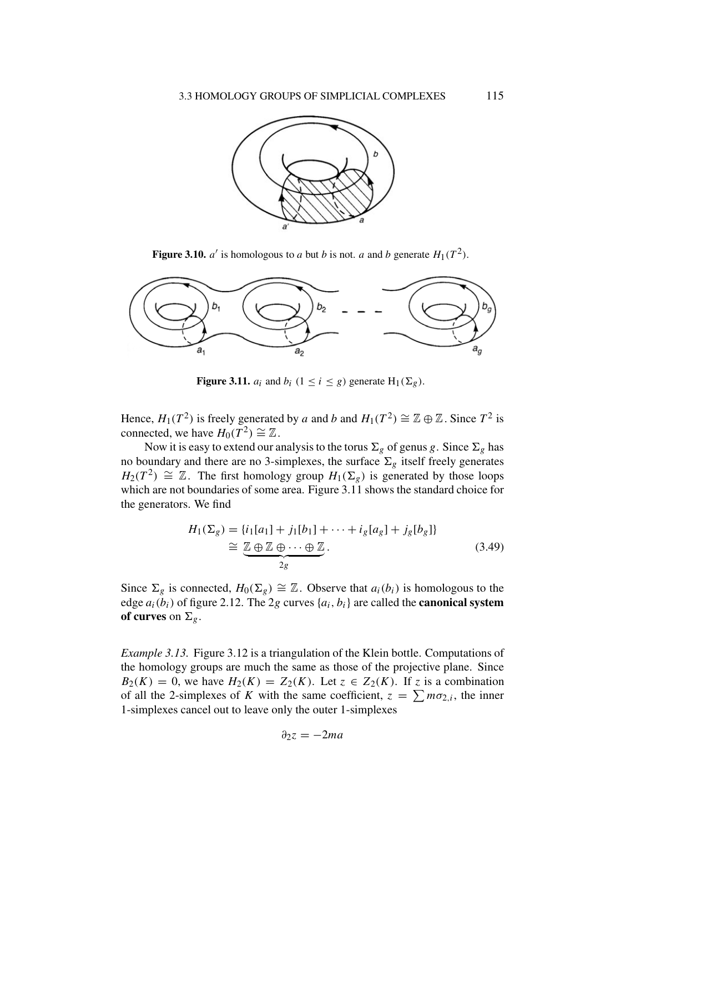
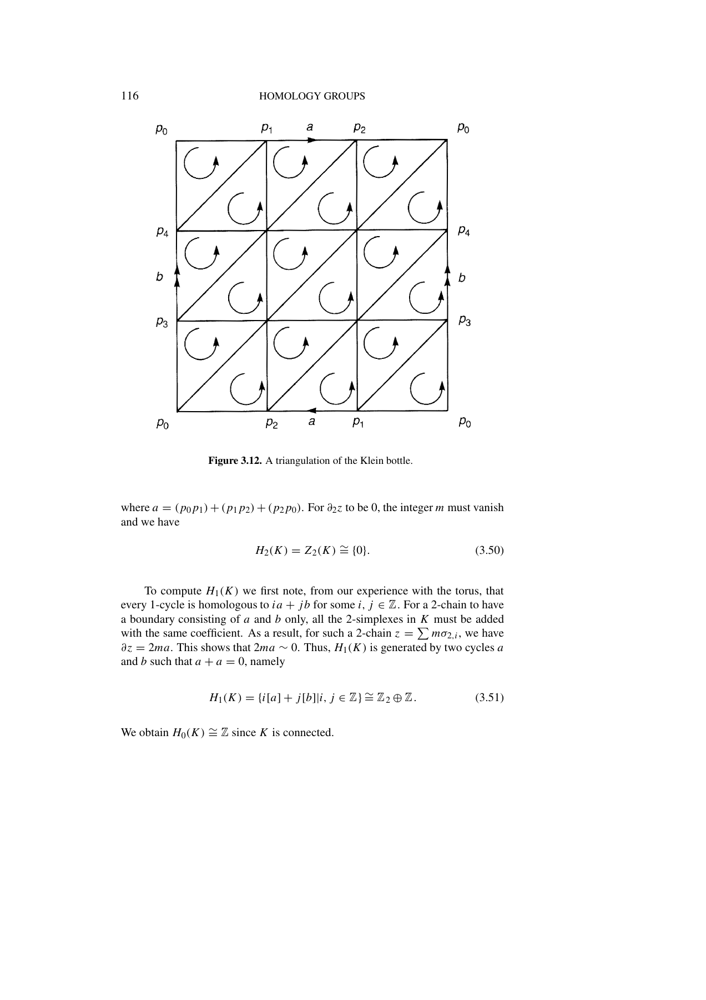

# 3.3.5 More homology computations｜从绕一圈到二阶挠元

[阅读目录](README.md) · [上一节](09-3.3.4.md) · [下一节](11-3.4.1.md) · [整数计算补充](integer-computations.md)

## 原书第 111–116 页

## 一、这些例子共同在算什么？

**这段在干什么：**用几个曲面检验 $H_r=\ker\partial_r/\operatorname{im}\partial_{r+1}$，尤其看整数关系如何保留下来。

这些空间均连通，故 $H_0\cong\mathbb Z$。它们的模型没有三维单纯形，所以 $B_2=0$，$H_2=Z_2$。但还必须算二维闭链，不能据此直接宣布 $H_2=0$。

对 $H_1$，始终分成两步：找到所有闭链的整数生成元；再把二维链边界产生的关系商掉。证明“$2z$ 是边界”只说明 $[z]$ 的阶至多为 2，尚未证明它不是零。

## 二、Example 3.10：Möbius 带为什么没有整数二维类？

沿原图的编号，六个有向三角面为

$$
[012],\ [214],\ [243],\ [345],\ [351],\ [150].
$$

这里 $[ijk]$ 简记 $[p_i,p_j,p_k]$。任意二维链写成六面的整数线性组合。看外缘边 $[02],[14],[23],[45],[31],[50]$：每条只出现于一个面的边界，因此若整个二维链闭合，对应的面系数必须为零。六个系数全被迫为零，于是

$$
H_2(M)=0.
$$

这不是“没有二维部分”，而是没有非零的二维闭链。它的确是一张二维带，但有边缘。

## 三、Möbius 带的 H1：补上书中“所有圈都是倍数”的计算

先用一棵树组织图的闭链。对图的每条非树边，加上树中的回路补边，得到一个基本闭链；这些闭链构成整数闭链群的一组基。[计算补充](integer-computations.md)给出理由。

对本图选树边

$$
[01],[02],[05],[13],[14].
$$

其余七条边为 $[12],[15],[23],[24],[34],[35],[45]$。记相应基本闭链的坐标生成元为 $x_{ij}$。它们不是把单独一条非闭边直接当作同调类；树中的路径已补好闭合条件。

把六个面的边界投到这些坐标，得到六条关系：

$$
\begin{gathered}
x_{12}=0,\quad -x_{24}-x_{12}=0,\quad
-x_{34}-x_{23}+x_{24}=0,\\
x_{45}-x_{35}+x_{34}=0,\quad
-x_{15}+x_{35}=0,\quad x_{15}=0.
\end{gathered}
$$

逐项消去：$x_{12}=x_{24}=x_{15}=x_{35}=0$，$x_{34}=-x_{23}$，$x_{45}=x_{23}$。只剩一个没有任何非零倍数关系的生成元 $x_{23}$，所以

$$
\boxed{H_1(M)\cong\mathbb Z.}
$$

这比“看起来只有一圈”多证明了一步：没有隐藏的额外生成元，也没有遗漏有限阶关系。

## 四、边界绕两圈为什么不等于出现 Z2？

原书取闭链

$$
z=[01]+[14]+[45]+[50].
$$

其非树坐标是 $x_{45}=x_{23}$，所以它是上述生成元。带的整个几何边缘按原书方向构成

$$
b=[14]+[45]+[50]+[02]+[23]+[31].
$$

其坐标为 $x_{45}+x_{23}=2x_{23}$，故 $[b]=2[z]$。

**它不等于说 $2[z]=0$。**该边缘是曲面的拓扑边界，但对不可定向的 Möbius 带，它不是某个整体整数二维链的代数边界；$2[z]$ 在 $H_1\cong\mathbb Z$ 中非零。单凭“扭了一下”不能推断第一同调有挠元。

也可用第二章的中央圆变形收缩解释 $H_1$ 的结果，但那条路线需要使用同伦不变性。上面的链计算无需把该定理当成已证明。

## 五、Example 3.11：射影平面 H2 的符号矛盾

原书给出十个面

$$
[012],[041],[054],[035],[023],
[243],[254],[215],[135],[143].
$$

一般二维链写成 $\sum m_iF_i$。p.113 逐边令边界系数为零：若干关系先迫使所有 $m_i$ 相等，最后又给出 $m_6+m_{10}=0$，即 $2m=0$。

由于系数在 $\mathbb Z$ 中，只能 $m=0$。所以 $Z_2=0$，即

$$
H_2(\mathbb{RP}^2;\mathbb Z)=0.
$$

不能只检查所有面同系数的一种特殊组合，就宣称已排除全部二维闭链。原书前面的逐边方程才给出一般性结论；后面的同系数观察用于看清整数关系。

## 六、为什么第一同调恰好是 Z2，而不是零？

书中把所有面按所列方向求和，得到

$$
\partial\left(\sum_{i=1}^{10}F_i\right)=2z,
\qquad z=[35]+[54]+[43].
$$

于是 $2[z]=0$。但要证明 $[z]\ne0$，需要检查全部关系。

原图一维骨架有六个顶点、十五条边。选五条星形树边 $[01],[02],[03],[04],[05]$，其余十条边的基本闭链给 $Z_1\cong\mathbb Z^{10}$，记作 $x_{12},x_{13},x_{14},x_{15},x_{23},x_{24},x_{25},x_{34},x_{35},x_{45}$。

前五个含顶点 0 的面产生

$$
x_{12}=x_{14}=x_{45}=x_{35}=x_{23}=0.
$$

后五面依次产生

$$
\begin{gathered}
-x_{34}-x_{23}+x_{24}=0,\quad
-x_{45}-x_{24}+x_{25}=0,\\
x_{15}-x_{25}-x_{12}=0,\quad
x_{35}-x_{15}+x_{13}=0,\quad
-x_{34}-x_{13}+x_{14}=0.
\end{gathered}
$$

前四条把剩下的 $x_{24},x_{25},x_{15},x_{13}$ 全写成 $x_{34}$；最后一条只给 $2x_{34}=0$。因此完整的商为

$$
\boxed{H_1(\mathbb{RP}^2;\mathbb Z)
=\mathbb Z x_{34}/\langle2x_{34}\rangle\cong\mathbb Z_2.}
$$

$z$ 的非树坐标为 $x_{35}-x_{45}-x_{34}=-x_{34}$，正是这个非零二阶类。这样就补齐了“所有圈归结到一个生成元，而且只有偶数倍为零”的论证，而不是只凭一个 $2z$ 边界公式猜群。

这个例子也是[整数核验脚本](verify-homology.py)的重点：约化关系矩阵满秩但行列式绝对值为 2，商不为零。

## 七、Example 3.12：环面两个圈为什么独立？

图 3.10 的 $a$ 与 $a'$ 之间夹一条带状二维链，取相容方向后边界是 $a'-a$，故它们同调。相互平行移动不会每次新增一个独立生成元。

为了严谨补上原书留给读者的环面计算，这里明确借用一个额外工具：**胞腔同调定理**，即对 CW 分解按附着映射计算的胞腔链复形给出同一拓扑同调。它不等于“一面正方形就是严格单纯形”；本章没有证明该定理，补充中说明使用的边界规则。

环面用一个顶点、两条环边 $a,b$、一个二维面 $F$ 表示。所有边的起终点相同，$\partial_1=0$。沿面边界读到 $aba^{-1}b^{-1}$，在一维链中为

$$
\partial_2F=a+b-a-b=0.
$$

于是胞腔复形是

$$
0\to\mathbb Z\xrightarrow{0}\mathbb Z^2
\xrightarrow{0}\mathbb Z\to0,
$$

直接得到

$$
H_0(T^2)=\mathbb Z,\qquad H_1(T^2)=\mathbb Z^2,\qquad H_2(T^2)=\mathbb Z.
$$

两条一维生成元之间没有关系，是由 $\operatorname{im}\partial_2=0$ 证明的，不只因为画了两条看起来不同的圈。二维生成元对应整张有向面；研究空间是环面表面，不包括三维实体内部。

## 八、闭可定向亏格 g 曲面

一个顶点、$2g$ 条边与一个面，边界附着词为

$$
\prod_{i=1}^g a_ib_ia_i^{-1}b_i^{-1}.
$$

在链的阿贝尔加法里，每条边正负各一次，故 $\partial_2=0$，得到

$$
\boxed{H_0(\Sigma_g)=\mathbb Z,\quad
H_1(\Sigma_g)=\mathbb Z^{2g},\quad
H_2(\Sigma_g)=\mathbb Z.}
$$

$g=0$ 即球面，一维群为零。这里“闭”在曲面术语中指紧且无流形边界。不要把它推广为所有曲面都由一个把手数描述。

## 九、Example 3.13：Klein 瓶保留一个自由类和一个二阶类

原书图 3.12 把一对边同向、另一对反向识别。选与其结论相容的边标记，面附着词可写为 $ab ab^{-1}$，在链中有

$$
\partial_2F=a+b+a-b=2a.
$$

改变面的定向可能得到 $-2a$，不改变像子群。原书前后两处的正负差异应按这个意义理解。

对应胞腔复形中 $\partial_1=0$，而 $\partial_2(1)=(2,0)$，因此

$$
H_1(K)=\frac{\mathbb Z a\oplus\mathbb Z b}{\langle2a\rangle}
\cong\mathbb Z_2\oplus\mathbb Z.
$$

又整数映射 $m\mapsto(2m,0)$ 的核为零，所以 $H_2(K)=0$。这同时说明所有二维闭链为何为零，避免只检查一种同系数面组合后就宣布一般结论。

## 十、统一比较

| 空间，均取整数系数 | $H_0$ | $H_1$ | $H_2$ |
|---|---|---|---|
| Möbius 带 | $\mathbb Z$ | $\mathbb Z$ | 0 |
| 射影平面 | $\mathbb Z$ | $\mathbb Z_2$ | 0 |
| 环面 | $\mathbb Z$ | $\mathbb Z^2$ | $\mathbb Z$ |
| Klein 瓶 | $\mathbb Z$ | $\mathbb Z\oplus\mathbb Z_2$ | 0 |
| 闭可定向亏格 $g$ 曲面 | $\mathbb Z$ | $\mathbb Z^{2g}$ | $\mathbb Z$ |

高于二维的群都为零。“不可定向”不等于“第一同调必有挠元”，Möbius 带就是反例；“几何上没有边缘”也不等于“存在非零整数二维同调”，射影平面与 Klein 瓶是反例。

**自测：**证明 $2[z]=0$ 后还缺什么才能得到 $\mathbb Z_2$？需证明 $[z]\ne0$，并证明没有其他独立生成元。完整的整数生成元—关系计算承担了这两项任务。
