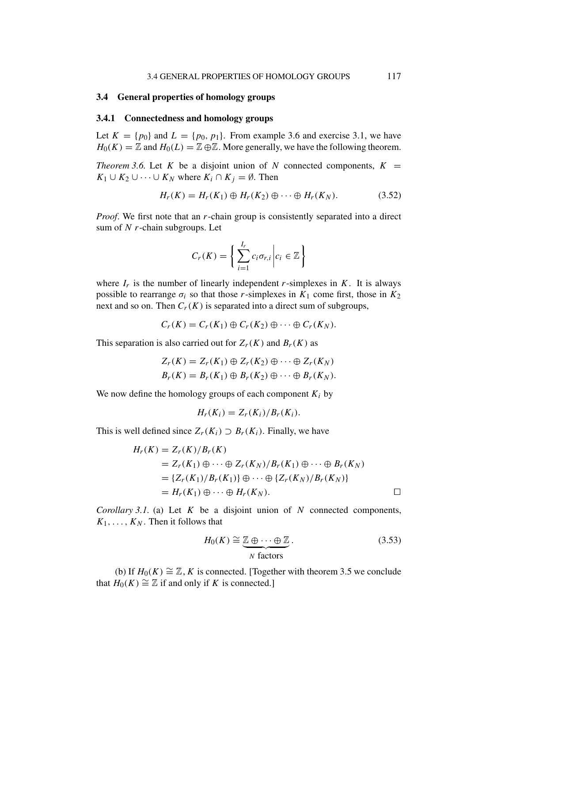

# 3.4.1 Connectedness and homology｜分开的空间怎样分别计数？

[阅读目录](README.md) · [上一节](10-3.3.5.md) · [下一节](12-3.4.2.md)

## 原书第 117 页

## 一、为什么是不交并对应直和？

**这段在干什么：**把连通空间的 $H_0=\mathbb Z$ 推广到多个分支，并给出所有维数的统一公式。

设有限复形由互不相交的连通分支 $K_1,\ldots,K_N$ 组成。每块单纯形完全属于一个分支，边界也不会跨到另一分支。因此

$$
C_r(K)=\bigoplus_{j=1}^NC_r(K_j),\qquad
\partial_r=\bigoplus_j\partial_r^{(j)}.
$$

一个链边界为零，当且仅当各分支内的分量分别为零；一个链是边界，当且仅当各分量分别是边界。故核、像也按分支直和分解，最后

$$
\boxed{H_r(K)\cong\bigoplus_{j=1}^NH_r(K_j).}
$$

商与直和在这里可以逐分量对应：$[(z_1,\ldots,z_N)]\mapsto([z_1],\ldots,[z_N])$，良定义、单射和满射都由分量条件验证，不是随意把任意商群符号拆开。

## 二、H0 的整数因子是在数分支，不是在数点

每个非空连通分支贡献一个 $\mathbb Z$，于是

$$
\boxed{H_0(K)\cong\mathbb Z^N.}
$$

两个孤立点给 $\mathbb Z^2$；用一条边把它们连起来，边界关系使二者同类，变为 $\mathbb Z$。本章有限复形的语境下，$H_0\cong\mathbb Z$ 恰好意味着一个连通分支。

## 三、一个完整的不连通例子

令 $X=S^1\sqcup S^2$。两个部分分别贡献

$$
H_0(X)=\mathbb Z^2,\qquad
H_1(X)=\mathbb Z,\qquad H_2(X)=\mathbb Z.
$$

这与把圆和球面粘在一个点上的空间不同：后者连通，$H_0$ 只有一个 $\mathbb Z$。不能只看图上有几个熟悉的形状就套不交并公式。

**自测：**两个互不相交的圆的一维同调与环面相同，都是 $\mathbb Z^2$，但 $H_0,H_2$ 不同。比较空间时应读整组不变量，不只看某一个维数。
