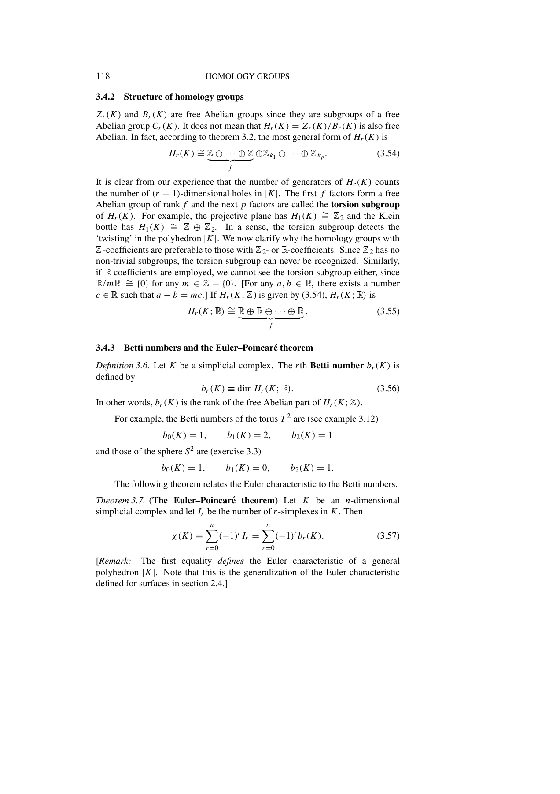

# 3.4.2 Structure of homology groups｜自由部分、挠部分和系数选择

[阅读目录](README.md) · [上一节](11-3.4.1.md) · [下一节](13-3.4.3.md)

## 原书第 118 页上部

## 一、子群自由，为什么商群却不自由？

**这段在干什么：**用章首的阿贝尔群结构定理解释刚算出的结果，并说明整数系数保留了什么。

有限复形中，$C_r$ 自由阿贝尔；其子群 $Z_r,B_r$ 也自由。但商 $Z_r/B_r$ 可以有有限阶元素。最小例子就是

$$
\mathbb Z/2\mathbb Z=\mathbb Z_2.
$$

因此一般形式为

$$
H_r(K;\mathbb Z)\cong\mathbb Z^{b_r}\oplus T_r,
\qquad T_r\cong\bigoplus_i\mathbb Z_{d_i}.
$$

自由部分的类可取任意整数倍而不归零；挠元则非零，但存在正整数倍等于零。$\mathbb Z_2$ 的非零类就是二阶挠元。

“扭曲”只是名称的几何联想，不是完整判据。Möbius 带不可定向而 $H_1=\mathbb Z$ 无挠；不能看到纸带扭转就宣布出现 $\mathbb Z_2$。自由秩可直观联系独立闭合结构，但不能把全部生成元数简单等同于画面上的空洞数。

## 二、为什么实系数会看不见整数挠元？

最容易从同一个关系看出：在整数里，$a$ 不是 $2a$ 的整数倍，所以商 $\mathbb Z a/\langle2a\rangle$ 非零。在实数里，$a=\tfrac12(2a)$，于是 $\mathbb R a/\mathbb R(2a)=0$。

对有限复形，实系数同调只保留整数同调自由部分对应的实向量空间：

$$
H_r(K;\mathbb R)\cong\mathbb R^{b_r}.
$$

它可由整数链复形换系数及实数的平坦性等代数事实证明，本节给出用途与最小例子，不把单个关系的演示冒充一般换系数定理的全证。

射影平面的整数 $H_1=\mathbb Z_2$，而实系数 $H_1=0$。只做实矩阵秩计算会漏掉这项差别。

## 三、模 2 系数并不是“完全看不到挠现象”

原书关于 $\mathbb Z_2$ 系数的说明过于简略。模 2 时 $-1=1$，方向符号消失，同一个关系矩阵中的 $2$ 也变成零。它确实能反映与二阶挠相关的变化，但不能单凭一个模 2 向量空间恢复全部整数挠群。

例如射影平面的胞腔复形里，整数边界为

$$
0\to\mathbb Z\xrightarrow{\times2}\mathbb Z\xrightarrow{0}\mathbb Z\to0.
$$

改成 $\mathbb F_2=\mathbb Z_2$ 系数后，乘 2 变成零，所以

$$
H_0(\mathbb{RP}^2;\mathbb F_2)=\mathbb F_2,\quad
H_1=\mathbb F_2,\quad H_2=\mathbb F_2.
$$

整数 $H_2$ 原本为零，换系数后却出现了非零二维类。不能把每一维整数答案单独“把 $\mathbb Z$ 换成 $\mathbb F_2$，再忽略挠”来猜；一般还牵涉相邻维数的挠信息，通用系数定理会精确表达。

## 四、选择哪种系数？

整数系数保留自由与有限阶关系，信息较多但计算更细；实系数便于线性代数、微分形式与分析；模 2 系数简化定向并适合某些不可定向问题。它们是不同的信息提取方式，不是某一种总能无条件替代另一种。

**自测：**对关系 $4a=0$，实系数看不到该有限阶；模 2 又只看见该关系变零，不能由此分辨它原来是 $2a=0$ 还是 $4a=0$。
