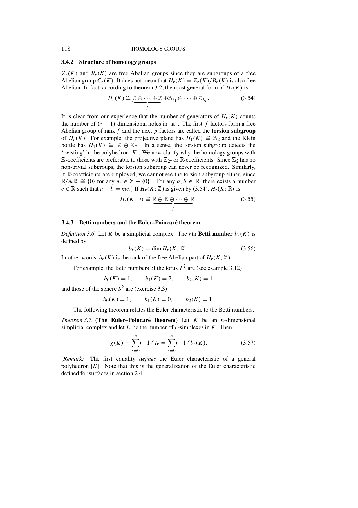
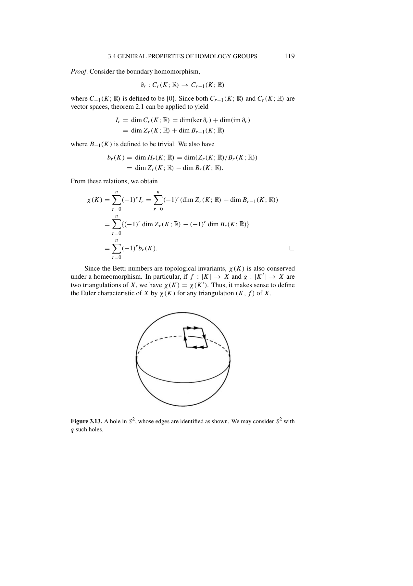

# 3.4.3 Betti numbers and Euler–Poincaré｜为什么 V−E+F 真的是拓扑量？

[阅读目录](README.md) · [上一节](12-3.4.2.md) · [章末题](14-Problems.md)

## 原书第 118 页下部至第 119 页

## 一、Betti 数只数自由秩

**这段在干什么：**把具体剖分的积木数量，转成同调的不变量，从而解释第二章的 Euler 示性数。

定义

$$
b_r=\dim_{\mathbb R}H_r(K;\mathbb R)
=\operatorname{rank}_{\mathbb Z}H_r(K;\mathbb Z).
$$

后一个 rank 是自由秩，不包括有限挠群的生成元。射影平面整数 $H_1=\mathbb Z_2$，但 $b_1=0$；环面 $H_1=\mathbb Z^2$，故 $b_1=2$。

## 二、公式 (3.57) 要证明的桥梁

设 $I_r$ 是 $r$-单纯形个数，最高维为 $n$，则

$$
\boxed{\chi(K)=\sum_{r=0}^n(-1)^rI_r
=\sum_{r=0}^n(-1)^rb_r.}
$$

左边依赖选择的分块来计算，右边用同调自由秩表达。由于同调群不依赖剖分，等式使 Euler 示性数也不依赖剖分。

这没有独立证明同调的拓扑不变性：它仍使用前面接受的 Theorem 3.4。逻辑依赖不能倒过来形成循环论证。

## 三、证明里为什么“边界维数”会消掉？

为使用普通维数，转到实系数。记

$$
z_r=\dim Z_r(K;\mathbb R),\qquad
\beta_r=\dim B_r(K;\mathbb R).
$$

$\beta_r$ 不是 Betti 数 $b_r$，这里特意换字母避免混淆。秩—零度公式给

$$
I_r=z_r+\beta_{r-1}.
$$

因为 $\ker\partial_r=Z_r$，而 $\operatorname{im}\partial_r=B_{r-1}$，下标差一不能漏。商空间维数又给

$$
b_r=z_r-\beta_r,
$$

所以

$$
I_r=b_r+\beta_r+\beta_{r-1}.
$$

取交错和后，每个 $\beta_r$ 在第 $r$ 项以 $(-1)^r$ 出现，在第 $r+1$ 项以 $(-1)^{r+1}$ 出现，恰好抵消。两端取 $B_{-1}=B_n=0$，无剩余项，便得结论。

二维时可直接展开：

$$
\begin{aligned}
I_0&=b_0+\beta_0,\\
I_1&=b_1+\beta_1+\beta_0,\\
I_2&=b_2+\beta_1.
\end{aligned}
$$

相减相加得到 $I_0-I_1+I_2=b_0-b_1+b_2$。这就是书中一行指标重排背后的消去过程。

## 四、把前面的例子全部验算一次

| 空间 | $(b_0,b_1,b_2)$ | $\chi$ |
|---|---|---:|
| 闭圆盘 | $(1,0,0)$ | 1 |
| 圆 | $(1,1,0)$ | 0 |
| 球面 | $(1,0,1)$ | 2 |
| 环面 | $(1,2,1)$ | 0 |
| Möbius 带 | $(1,1,0)$ | 0 |
| 射影平面 | $(1,0,0)$ | 1 |
| Klein 瓶 | $(1,1,0)$ | 0 |
| 闭可定向亏格 $g$ 曲面 | $(1,2g,1)$ | $2-2g$ |

圆与环面的 Euler 示性数都为零，但 $H_1,H_2$ 不同。这精确体现第三章开头的承诺：同调比一个交错和更细。

**自测：**为什么整数挠群不能用其元素个数加进 $b_r$？Betti 数是实向量空间维数或整数自由秩，挠关系在实系数下消失，不参与这个交错和。
