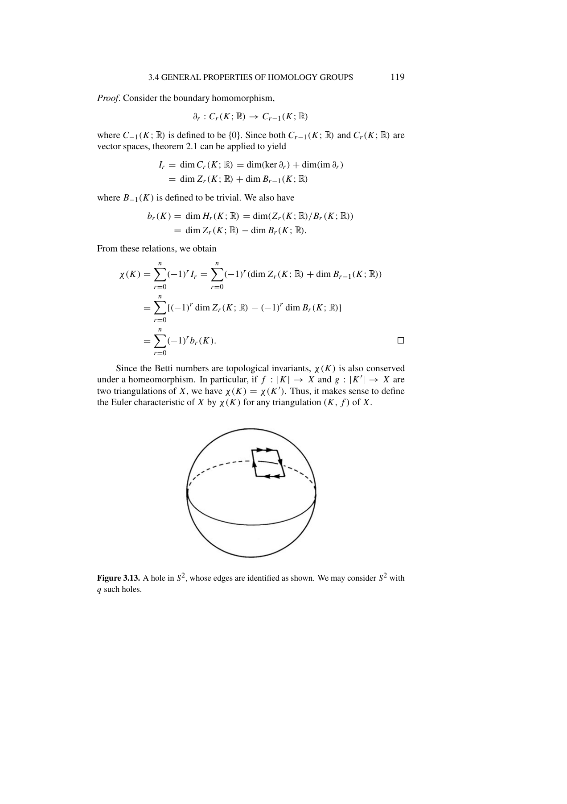

# Chapter 3 Problems｜带把手、带边界和 crosscap 的曲面

[阅读目录](README.md) · [上一节](13-3.4.3.md) · [常见曲面计算](10-3.3.5.md)

## 原书第 119–120 页

图 3.13 在 p.119，题目在 p.120。新增解答明确区分不粘合的边界孔与粘合成 crosscap 的孔。

## Problem 3.1：h 个把手、q 个边界孔

**题意：**按本题的有限型、连通、紧可定向曲面语境，从闭亏格 $h$ 曲面挖去 $q$ 个互不相交开圆盘，保留边界圆。原文“最一般曲面”不能理解为覆盖一切非紧或无限型曲面。

### 先试：为什么必须把 q=0 与 q>0 分开？

没有边界时整张有向曲面形成二维闭链。有边界时，整张面的边界留下边缘，不能再作为非零的绝对二维同调类。因此 $H_2$ 会变化。本题求普通绝对同调，不是相对边界的同调。

### q=0：闭曲面

本章已经得到

$$
H_0=\mathbb Z,\qquad H_1=\mathbb Z^{2h},\qquad H_2=\mathbb Z,
\qquad \chi=2-2h.
$$

### q≥1：边界圈之间少一个独立关系

曲面有 $2h$ 条把手方向的圈，还有 $q$ 条边界圈 $c_1,\ldots,c_q$。取相容方向，它们的总和是整张曲面的边界，因而在 $H_1$ 中满足

$$
[c_1]+\cdots+[c_q]=0.
$$

故边界只新增 $q-1$ 个独立类。完整理由可用标准切割脊骨：有边界的曲面变形收缩到 $2h+q-1$ 个圆的楔和；也可先把连接各边界的树状弧压到一点，得到一个含 $2h+q$ 条环边、一张附着面的同伦等价 CW 模型，面边界在阿贝尔化后为 $c_1+\cdots+c_q$。这是一条本原关系，可以消去 $c_q$，不会产生挠。压缩后的模型用于同调计算，不宣称仍与原曲面同胚。

因此

$$
\boxed{
H_0=\mathbb Z,\quad H_1=\mathbb Z^{2h+q-1},\quad H_2=0,
\quad\chi=2-2h-q\qquad(q\ge1).
}
$$

这里用到同伦不变性／胞腔同调作为计算工具，见[计算补充](integer-computations.md)；不能只凭数出若干圈就假定没有其他关系。高于二维的群为零。

### 检查三个特例

| $(h,q)$ | 空间 | $H_1$ | $\chi$ |
|---|---|---|---:|
| $(0,1)$ | 闭圆盘 | 0 | 1 |
| $(0,2)$ | 圆环带 | $\mathbb Z$ | 0 |
| $(0,3)$ | 三边界曲面（裤子面） | $\mathbb Z^2$ | −1 |

一个边界孔不一定贡献一个独立 $H_1$ 生成元。闭圆盘只有一个边界圈，它恰好是整张面的边界，所以其类为零。

## Problem 3.2：q 个 crosscaps 不是保留 q 条边界

### 先说明构造

图 3.13 把边界上的点按反向配对，填入的是射影平面式的识别。一个 crosscap 给 $\mathbb{RP}^2$；$q$ 个给闭不可定向曲面

$$
N_q=\underbrace{\mathbb{RP}^2\#\cdots\#\mathbb{RP}^2}_{q},\qquad q\ge1.
$$

这些孔已被粘合处理，不是上一题留下的边界分支。

### 生成元与关系

标准 CW 模型有一个顶点、$q$ 条一维环边 $a_1,\ldots,a_q$、一个二维面。面附着词为 $a_1^2\cdots a_q^2$，所以

$$
\partial_2F=2a_1+\cdots+2a_q,
\qquad\partial_1=0.
$$

整数映射 $\mathbb Z\to\mathbb Z^q$，$1\mapsto(2,\ldots,2)$，在 $q\ge1$ 时单射，故 $H_2=0$。第一同调为

$$
H_1=\frac{\mathbb Z^q}{\langle2(a_1+\cdots+a_q)\rangle}.
$$

令 $u=a_1+\cdots+a_q$。$u,a_2,\ldots,a_q$ 是整数基，因为 $a_1=u-a_2-\cdots-a_q$，变换整数可逆。关系仅是 $2u=0$，所以

$$
\boxed{
H_0(N_q)=\mathbb Z,\quad
H_1(N_q)=\mathbb Z^{q-1}\oplus\mathbb Z_2,\quad
H_2(N_q)=0,\quad\chi(N_q)=2-q.
}
$$

$q=1$ 回到射影平面，$q=2$ 回到 Klein 瓶。$q=0$ 应单独取球面，不能把 $q-1$ 写成负的自由秩；此时 $H_2=\mathbb Z$。

## 最容易混淆的三组概念

把手与边界孔不同；边界孔与 crosscap 不同；闭曲面的二维整数同调与有边界曲面的相对二维同调不同。所有公式都要先明确所研究的空间、系数与同调版本。
