# 《Geometry, Topology and Physics》第三章注疏：合订本

[分册目录与阅读说明](README.md) · [复习提纲](review-guide.md) · [术语表](glossary.md) · [校记](editorial-notes.md) · [全部原页](source-pages.md)

按原书 §3.1.1 至章末次序合并，开篇包含 p.93 导言。原页和分册共用 assets；最后附整数与胞腔计算方法。

## 合订本内跳转

- [3.1.1 Elementary group theory](#chapter3-01)
- [3.1.2 Finitely generated Abelian groups](#chapter3-02)
- [3.1.3 Cyclic groups](#chapter3-03)
- [3.2.1 Simplexes](#chapter3-04)
- [3.2.2 Simplicial complexes and polyhedra](#chapter3-05)
- [3.3.1 Oriented simplexes](#chapter3-06)
- [3.3.2 Chain, cycle and boundary groups](#chapter3-07)
- [3.3.3 Homology groups](#chapter3-08)
- [3.3.4 Computation of H0](#chapter3-09)
- [3.3.5 More homology computations](#chapter3-10)
- [3.4.1 Connectedness and homology groups](#chapter3-11)
- [3.4.2 Structure of homology groups](#chapter3-12)
- [3.4.3 Betti numbers and Euler–Poincaré](#chapter3-13)
- [Problems 3.1–3.2](#chapter3-14)
- [补充：整数关系与胞腔计算](#chapter3-15)

---

## 3.1.1 Elementary group theory｜本章为什么先复习群？

[阅读目录](README.md) · [第二章](../gtp-chapter-2/README.md) · [下一节](02-3.1.2.md)

### 原书第 93–95 页：导言、图 3.1 与本节

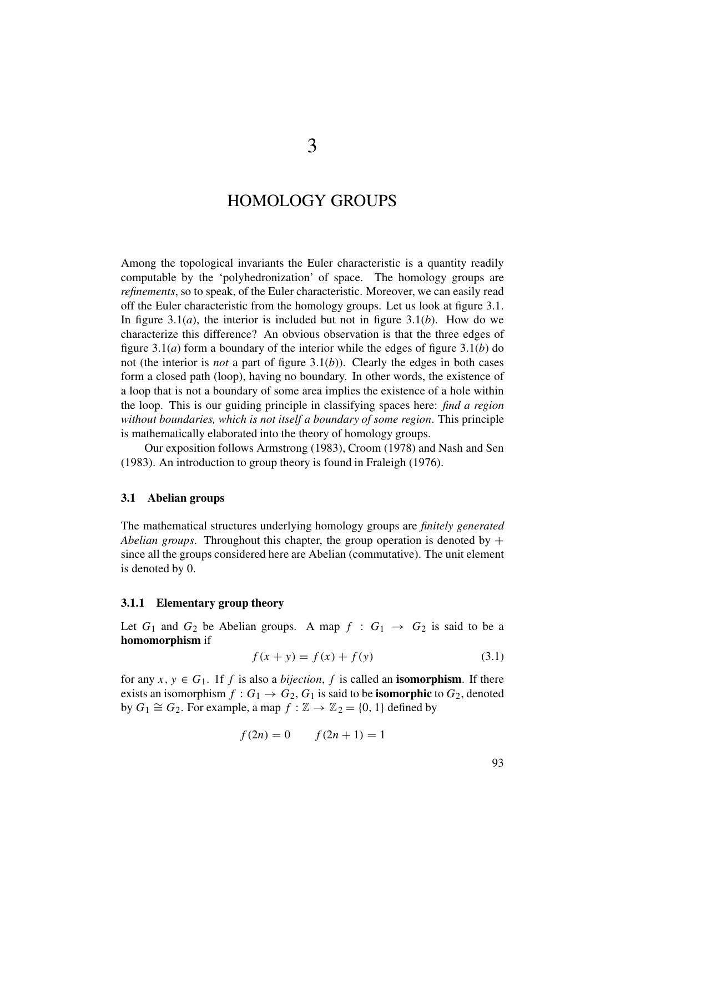

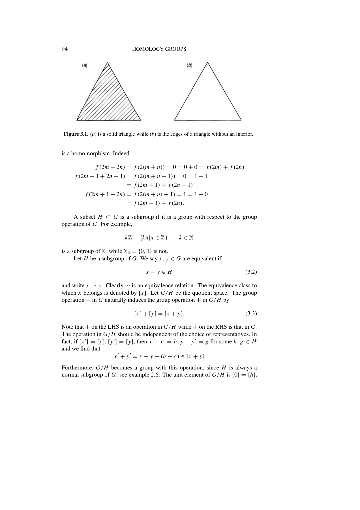

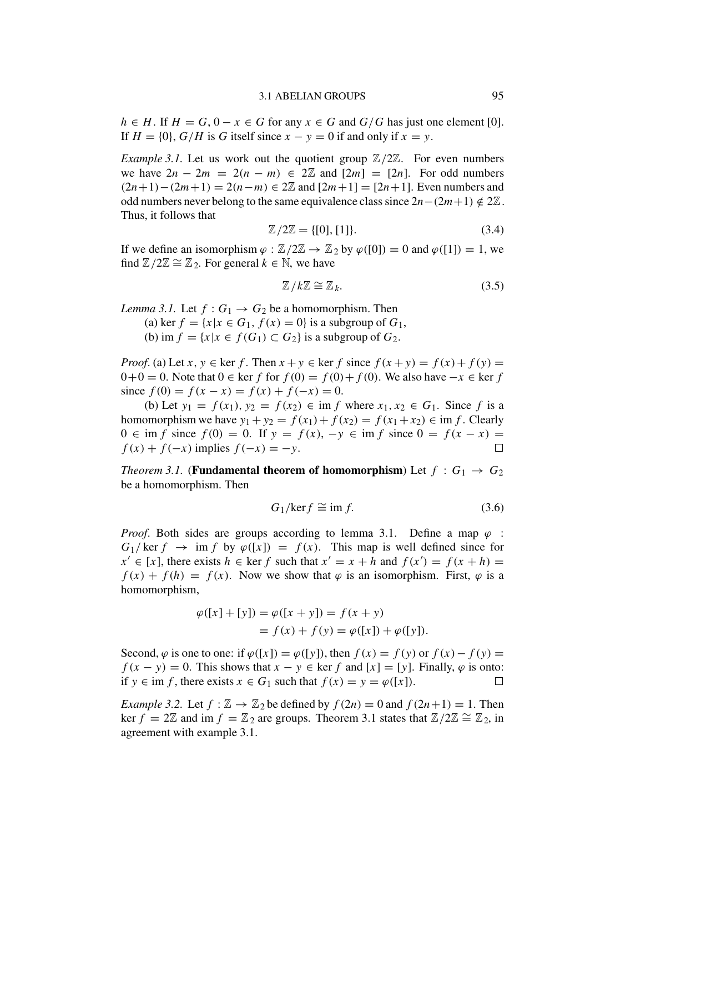

### 一、作者想从空间中提取什么？

**这段在干什么：**把第二章的一个整数不变量推广成一系列群，先交代几何问题，再准备代数工具。

图 3.1 中，实心三角形与三角形边框都含有三条边绕成的一圈。但前者有一个二维面，其边界就是这一圈；后者内部不属于所研究的空间，无法用空间内的面填满它。

因此要区分两件事：一个对象自己没有留下边界；这个对象是不是某个更高维对象的边界。第三章的核心是从“无边界的”里面，商掉“本来就是边界的”。不是用一张嵌入图上看见几个空白区域，就直接定义洞的数量。

第二章 $\chi=V-E+F$ 只输出一个整数。同调群保留分维数的信息，最后还能从它们读出 $\chi$。它仍然不是空间的完整分类，所有同调群相同也不保证同胚。

### 二、熟悉的代数在这里各做什么？

本章主要使用有限生成阿贝尔群，运算记作加法，单位元记 $0$。群论本身你可以快读；需保留下面的功能对应：

| 群论对象 | 后面的几何角色 |
|---|---|
| 自由阿贝尔群 | 用整数登记各块有向积木 |
| 群同态 | 线性地取边界 |
| 核 | 取边界后为零的链 |
| 像 | 真正从高一维取边界得到的链 |
| 商群 | 把相差一个边界的闭链视为同类 |

阿贝尔群里的 $nx$ 是把元素重复相加，不要求它是实向量。$\mathbb Z_2$ 里的 $1+1=0$，不是普通整数加法。

### 三、商掉 H 不是把 H 中的点简单删掉

对于阿贝尔群 $G$ 的子群 $H$，定义

$$
x\sim y\quad\Longleftrightarrow\quad x-y\in H.
$$

商群的元素是类 $[x]=x+H$。类的加法 $[x]+[y]=[x+y]$ 需与代表元选择无关：若 $x'=x+h_1,y'=y+h_2$，则 $(x'+y')-(x+y)=h_1+h_2\in H$，所以结果同类。

商群里的零是整类 $H$，不是仅保留原来的单个元素 $0$。之后说“边界变成零”，就是所有边界链都属于同一个零类，并非从原空间中物理移除这些边。

最小例子：$\mathbb Z/2\mathbb Z$ 中偶数同类、奇数同类。$[1]\ne[0]$，但 $2[1]=[0]$。这个模式会在射影平面出现。

### 四、式 (3.6) 为什么反复有用？

同态基本定理是

$$
G/\ker f\cong\operatorname{im}f.
$$

映射 $[x]\mapsto f(x)$ 的良定义来自：同类元素之差在核里，所以像相同。它单射，因为像相同也意味着差在核里；它满射到像，由像的定义直接得到。

后面求 $H_0$ 时，作者取“把各顶点系数加起来”的同态，证明其核恰好是边界群，再用本定理得到 $\mathbb Z$。这里无需重新背整段证明，但要看清究竟是哪个群除以哪个核。

**自测：**在 $\mathbb Z/2\mathbb Z$ 中，为什么零类包含 $2$？因为商群关心模掉的关系，不是原来数字的大小。回读同调时用同样逻辑理解非零链为何能代表零类。

---

## 3.1.2 Finitely generated Abelian groups｜链的整数系数不是实数坐标

[阅读目录](README.md) · [上一节](01-3.1.1.md) · [下一节](03-3.1.3.md)

### 原书第 96 页上部

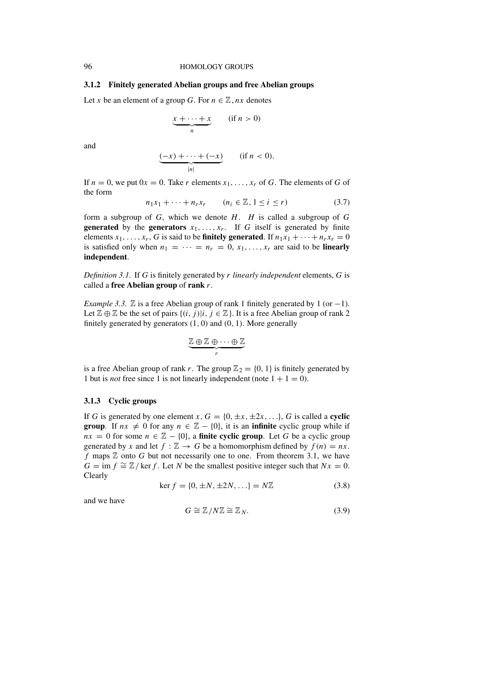

### 一、有限生成与自由，各多了什么要求？

**这段在干什么：**为链群建立准确的代数模型。

有限生成：存在有限个元素 $x_1,\ldots,x_r$，每个群元素都能写成 $\sum n_ix_i$，其中 $n_i\in\mathbb Z$。自由：可选一组生成元，使这个表达唯一；等价地，$\sum n_ix_i=0$ 只能在所有 $n_i=0$ 时成立。

因此 $\mathbb Z^r$ 是自由阿贝尔群，而 $\mathbb Z_2$ 虽由一个元素生成，却有非零整数关系 $2[1]=0$，并不自由。零群按约定是秩为零的自由阿贝尔群。

### 二、为什么与线性代数很像，却不能直接用实数消元？

设两条有向边作生成元，$2e_1-e_2$ 是合法链，但 $\tfrac12e_1$ 不是整数链。选基和变换生成元时，必须保留整数格点。

比如 $e$ 是 $\mathbb Z$ 的基，$2e$ 不是，因为无法整数线性组合得到 $e$。作为抽象群，$2\mathbb Z\cong\mathbb Z$；但它嵌入 $\mathbb Z$ 的方式不同，商群 $\mathbb Z/2\mathbb Z$ 会记录这个差别。

这提醒后面的计算：只知道两个子群同构，不足以知道它们的商；要知道实际的包含关系。也不能把实矩阵的秩当成全部整数信息。

### 三、你会在图中怎样使用这些生成元？

每个几何单纯形选一个方向，只登记一次。反向的同一块定义为负号，不另添一个独立生成元。若有三条不同边，链群是 $\mathbb Z^3$；反向边再多画三个箭头，也不把秩变成六。

链加法是形式组合的相加，不是路径按先后顺序的拼接。它是阿贝尔的；这一点与下一章可能非交换的基本群不同。

**自测：**$\langle2e\rangle$ 的自由秩是多少？是 1。$\mathbb Z e/\langle2e\rangle$ 的自由秩是多少？是 0，但群仍有两个元素，说明秩不能描述所有信息。

---

## 3.1.3 Cyclic groups｜关系如何产生有限阶元素

[阅读目录](README.md) · [上一节](02-3.1.2.md) · [下一节](04-3.2.1.md)

### 原书第 96 页下部至第 97 页

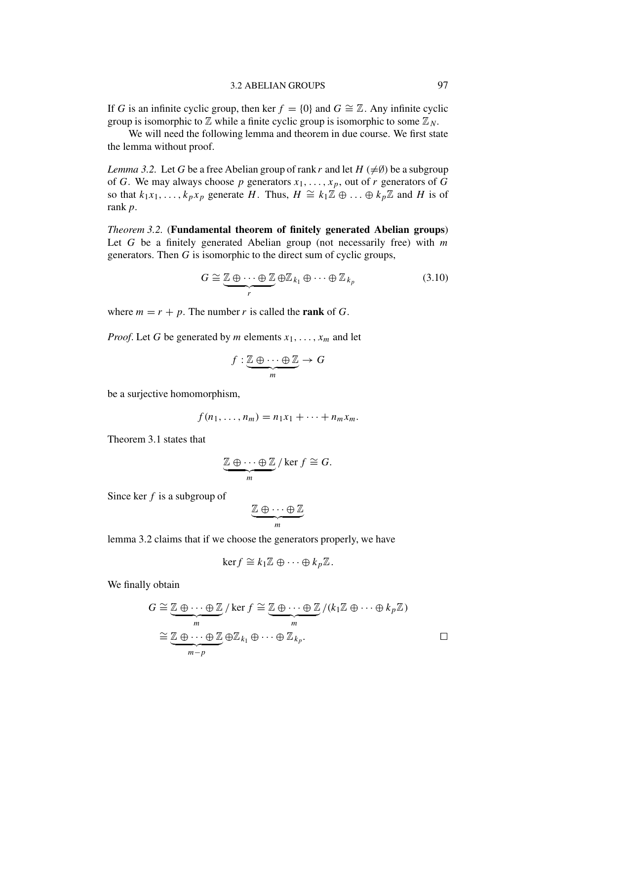

### 一、循环群与第一同构定理

**这段在干什么：**说明后面的同调群为什么既会出现 $\mathbb Z$，也会出现 $\mathbb Z_k$。

若 $G$ 由 $x$ 生成，定义满同态 $f:\mathbb Z\to G$，$f(n)=nx$。若没有非零 $n$ 使 $nx=0$，核为零，得到 $G\cong\mathbb Z$。若最小正整数 $k$ 满足 $kx=0$，则核为 $k\mathbb Z$，所以

$$
G\cong\mathbb Z/k\mathbb Z=\mathbb Z_k.
$$

后面 $2[z]=0$ 说的是同调类的有限阶，不是某条几何曲线加两次以后从图上消失。

### 二、有限生成阿贝尔群为何能分解？

选 $m$ 个生成元，得到满同态 $\pi:\mathbb Z^m\to G$。核记录它们满足的所有整数关系。因此

$$
G\cong\mathbb Z^m/\ker\pi.
$$

把关系通过合法的整数基变换化成对角形式，就变成若干关系 $d_ix_i=0$ 与若干没有关系的生成元，得到

$$
\boxed{G\cong\mathbb Z^b\oplus\mathbb Z_{d_1}\oplus\cdots\oplus\mathbb Z_{d_s}.}
$$

通常省去 $d_i=1$ 的平凡因子，并按 $d_i\mid d_{i+1}$ 排列为不变因子形式，才便于表述唯一性。

原书 Lemma 3.2 中“选择生成元”的含义需要重新选择自由基，不能总从原先固定基里挑子集。例如 $\mathbb Z^2$ 的子群 $\langle(1,1)\rangle$ 不是原来任一坐标轴的整数倍，但可换成以 $(1,1)$ 为第一向量的新整数基。

原书把整数对角化的关键引理不加证明地引用。这里说明它的作用，不把一句“选好生成元”当成完整证明。若需算法，可看[整数计算补充](integer-computations.md)中的允许操作；完整 Smith 标准形存在性是另一个代数定理。

### 三、一个完整的小算例

取自由群 $\mathbb Z a\oplus\mathbb Z b$，加关系 $2a=0$，但不对 $b$ 加关系。任意类可写成

$$
\epsilon[a]+n[b],\qquad\epsilon\in\{0,1\},\ n\in\mathbb Z.
$$

于是商为 $\mathbb Z_2\oplus\mathbb Z$，即后面的 Klein 瓶第一同调的代数形式。

若改成 $a=0$，商为 $\mathbb Z$；两个关系矩阵在实数上都只有秩 1，但整数商不同。实数消元允许除以 2，整数基变换不允许悄悄这样做。

**校读提醒：**原书式 (3.10) 的生成元计数若含冗余生成元，可能需保留平凡 $\mathbb Z_1$ 因子才能维持字面的 $m=r+p$；删去平凡因子后，不能把任意选出的生成元总数当作不变量。

---

## 3.2.1 Simplexes｜单纯形：从顶点构造标准积木

[阅读目录](README.md) · [上一节](03-3.1.3.md) · [下一节](05-3.2.2.md)

### 原书第 98–99 页：本节到 p.99 的 §3.2.2 前

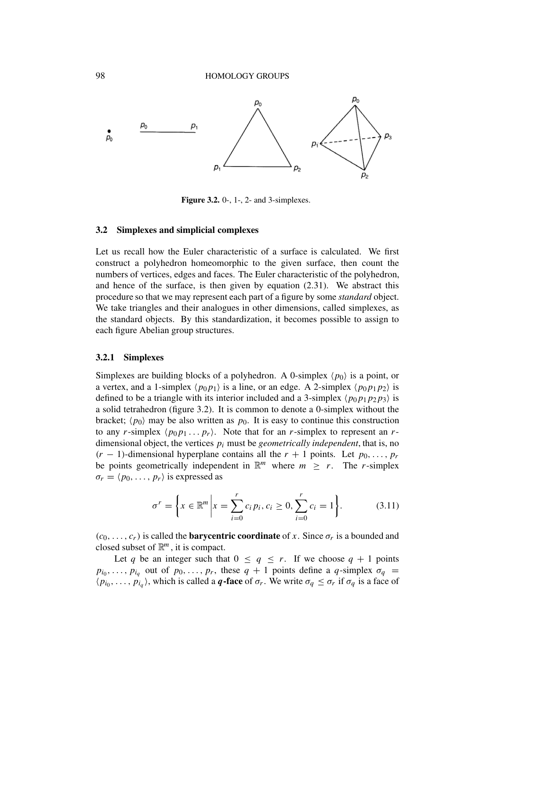

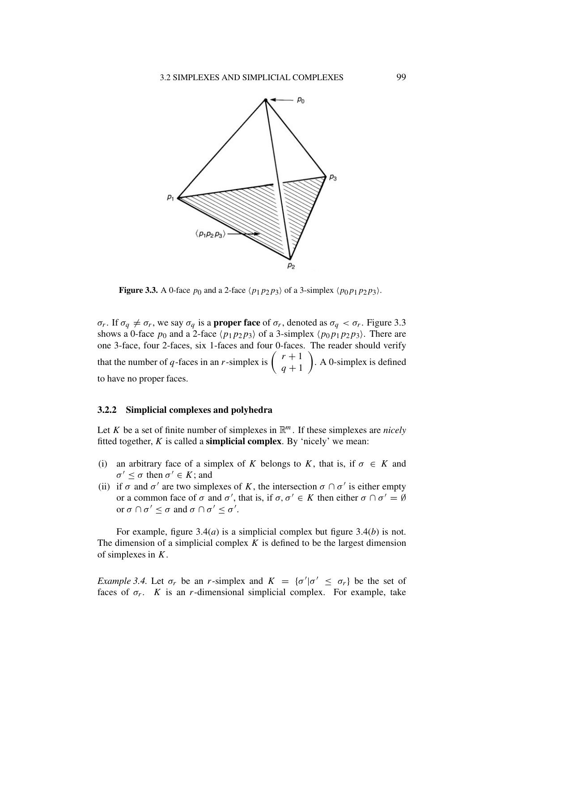

### 一、为什么选三角形，不直接用任意形状？

**这段在干什么：**用统一积木描述空间，方便把边界写成通用公式。

0-单纯形是点，1-单纯形是包含端点的线段，2-单纯形是包括内部的三角形，3-单纯形是包括内部的四面体。维数 $r$ 的单纯形需要 $r+1$ 个仿射无关顶点。

“仿射无关”表示 $p_1-p_0,\ldots,p_r-p_0$ 线性无关。三个共线点不能构成真正二维三角形，四个共面点不能构成真正三维四面体。维数不是只数出几个点就自动得到的。

### 二、式 (3.11) 的非负系数和为 1 在做什么？

$$
\sigma^r=\left\{\sum_{i=0}^rc_ip_i:\ c_i\ge0,\ \sum c_i=1\right\}.
$$

这叫顶点的凸包。对线段，$x=(1-t)p_0+tp_1$，$0\le t\le1$；对三角形，三个非负权重和为 1，将位置限制在三角形内及边上。

例：$p_0=(0,0),p_1=(1,0),p_2=(0,1)$。点 $(x,y)$ 的重心坐标为 $(1-x-y,x,y)$，因此恰需 $x\ge0,y\ge0,x+y\le1$。权重允许为零，所以边和顶点也包括在内。

这不是普通向量空间的基展开：系数受限制，原点也不需与某顶点重合。仿射无关保证这些受约束坐标唯一。

### 三、faces 不仅指二维面

选 $q+1$ 个顶点张成的 $q$-单纯形，叫 $q$ 维面。一个四面体有 4 个点、6 条边、4 个三角面，以及自身这一个三维面。一般个数为

$$
\binom{r+1}{q+1}.
$$

因为是在 $r+1$ 个顶点中选出 $q+1$ 个。自己也叫面，真面则排除自己。这套说法为后面“删一个顶点得到一个余维一面”提供统一表达。

单纯形紧致，可由标准闭有界单纯形在连续仿射映射下的像得到；这里复用第二章紧致性，不必重新证明整个 Heine–Borel 定理。

**自测：**三角形与它的三条边之并，维数为什么不同？前者包含一个二维单纯形，后者最高只有一维单纯形。

---

## 3.2.2 Simplicial complexes and polyhedra｜怎样合法地拼积木？

[阅读目录](README.md) · [上一节](04-3.2.1.md) · [下一节](06-3.3.1.md)

### 原书第 99–101 页：图 3.5 位于下一页

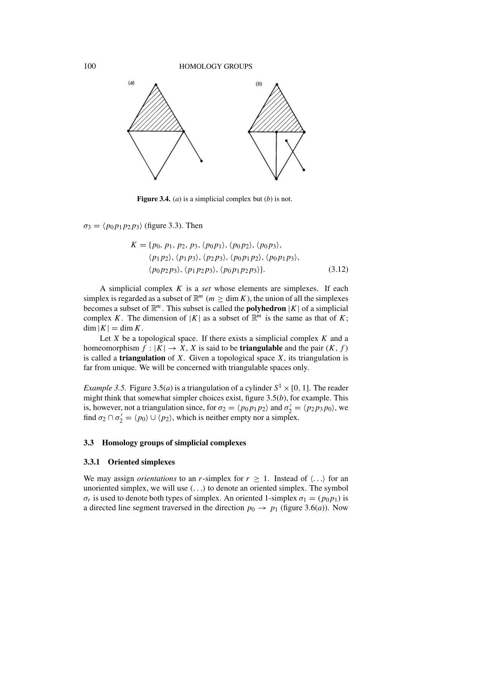

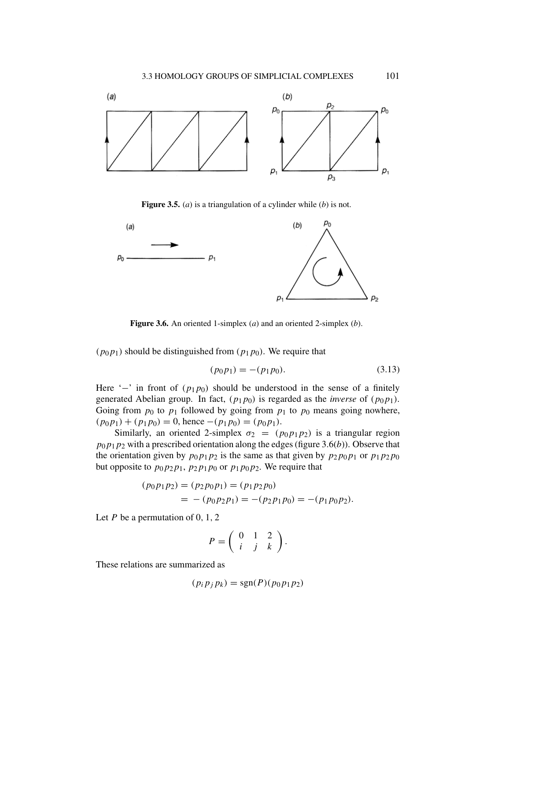

### 一、两条拼接规则缺一不可

**这段在干什么：**保证每一块及它的边界都有明确账目，避免积木以无法登记的方式相交。

原书限于有限单纯复形 $K$：一块单纯形属于 $K$，它的所有面也须属于 $K$；任意两块交集只能为空或二者的共同面。

第一条确保有三角面就必须登记三条边和三个点。第二条禁止一条边的端点扎进另一条边的中间却不细分；也禁止两块三角形只交于两个分离的顶点。后者不是一个单纯形。

这些形状未必无法研究，只是当前分块不合规则。可通过增加顶点和细分修复许多例子。

### 二、K 与 |K| 的区别

$K$ 是由单纯形组成的组合清单；$|K|$ 是把这些单纯形视作几何子集后取并得到的空间。清单的元素是积木，空间的元素是点，两者不能混用。

例如实心三角形对应的清单包括 3 个顶点、3 条边、1 个面；$|K|$ 却包含连续无穷多个点。所谓“有限复形”是有限块，不是有限点的空间。

### 三、triangulation 不要求空间原来就长得像直边三角形

三角剖分是 $(K,f)$，其中 $f:|K|\to X$ 为同胚。圆可用三角形边框作模型，球面可用四面体表面作模型，靠同胚将直边模型送到弯曲空间。

不是随便画网格就已经证明它是三角剖分；要确认组合规则与空间对应。原书图 3.5(b) 只有少量块的圆柱表示，在边界识别后两块的交集出现两个分离点，违反共同面要求。

第二章用“一顶点、两边、一面”计算环面 Euler 示性数是胞腔分解，不是严格单纯复形。两种方法都可用，但不能把其链群和边界规则不加解释地混在一起。本章曲面计算需要简化时，会明确标记所借用的胞腔同调定理。

### 四、原书范围与读者需要保留的边界

本章不声称任意拓扑空间都可三角剖分，且原书此处以有限复形为工作范围。一般空间的同调可另用奇异同调定义，但不把这项更广的理论当作已经在这里证明。

**自测：**为什么三条边围成的圈不能在没有新增二维面的情况下，直接登记一个“内部”？因为那会改变空间，而非只是改变其剖分。

---

## 3.3.1 Oriented simplexes｜定向：给相消准备正负号

[阅读目录](README.md) · [上一节](05-3.2.2.md) · [下一节](07-3.3.2.md)

### 原书第 100 页下部至第 102 页上部

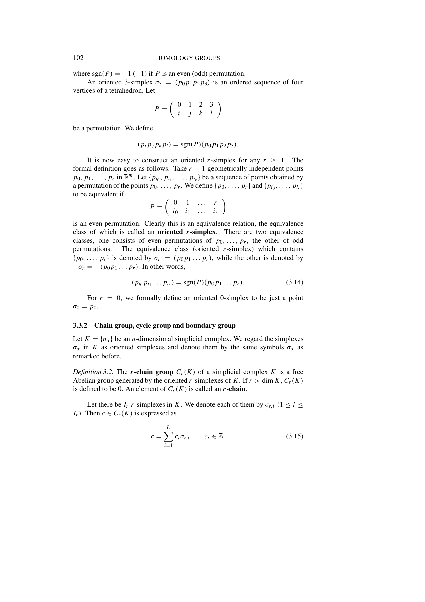

### 一、为什么几何上相同的边，要区分两个方向？

**这段在干什么：**让两个相邻区域的公共边能按符号抵消，最终只留下整体外边界。

原书用尖括号表示未定向单纯形，用圆括号表示有向单纯形。本注也常用 $[p_0,\ldots,p_r]$ 表示一个有向生成元；写 $[z]$ 表示同调类时另由上下文说明，二者不是同一个层次。

对有向边规定

$$
[A,B]=-[B,A].
$$

负号表示链群里的加法逆元，不表示把线段搬到原点另一侧。$[A,B]+[B,A]=0$ 是形式链的相消，而不是把任意物理运动过程视为没有发生。

### 二、三角形为什么三个循环排列同号？

顺着边界读 $A\to B\to C\to A$，从哪个顶点开始都保持同一循环方向，所以

$$
[A,B,C]=[B,C,A]=[C,A,B].
$$

交换两个顶点会反向，例如 $[A,C,B]=-[A,B,C]$。统一规则是

$$
[p_{i_0},\ldots,p_{i_r}]=\operatorname{sgn}(P)[p_0,\ldots,p_r].
$$

偶排列同号，奇排列异号。这与行列式的交替性一致，给高维定向提供无需画顺逆时针的定义。对 $r\ge1$ 有两种定向；0-单纯形按本章约定就是顶点生成元，负点通过整数系数表示。

### 三、局部每块能定向，不代表整体可定向

每个小三角形都能独立选方向。若要整张曲面定向，还要求公共边的诱导方向成对抵消；绕不可定向曲面一圈，这种选择可能无法一致返回。

因此 Möbius 带与射影平面照样可以建立有向链群，不会因为整体不可定向就不能算整数同调。后面消不掉的符号关系恰好会记录这种差异。

### 四、改变参考方向不应改变答案

若把某条边的参考方向反转，它在每个链中的系数也取相反数。矩阵里相应基变换只是乘 $-1$，是合法整数可逆操作，不改变同调群的同构类型。

**自测：**为什么不能把所有边界项都加正号？先试两段首尾相接线段，中间顶点会被错误地数两次；下一节会用这个要求推出差号。

---

## 3.3.2 Chain, cycle and boundary groups｜链、闭链、边界链分别是什么？

[阅读目录](README.md) · [上一节](06-3.3.1.md) · [下一节](08-3.3.3.md)

### 原书第 102 页下部至第 106 页上部

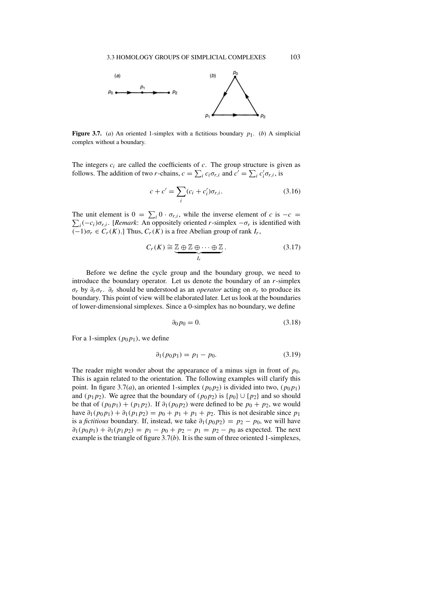

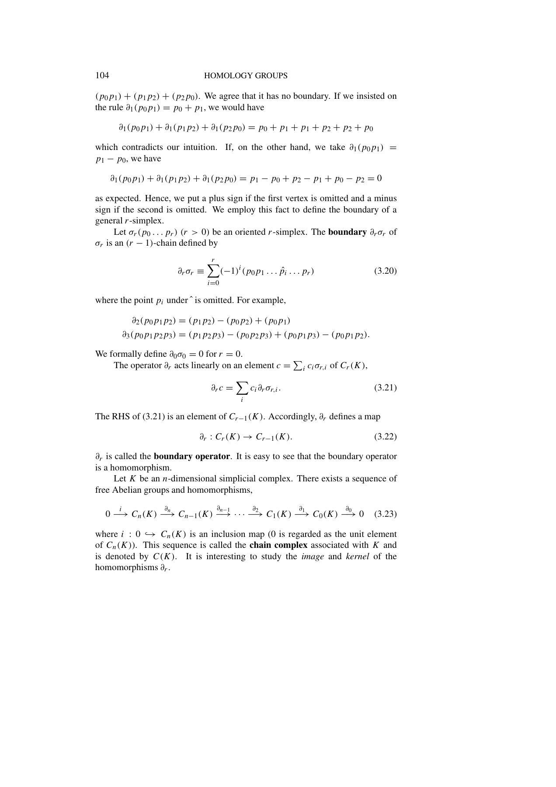

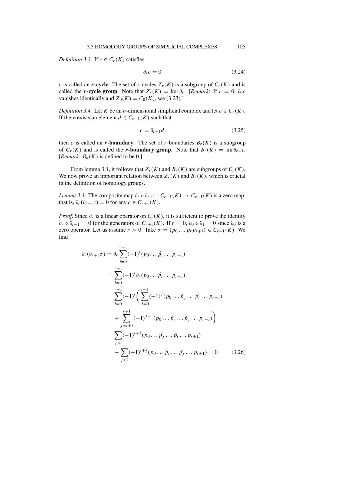

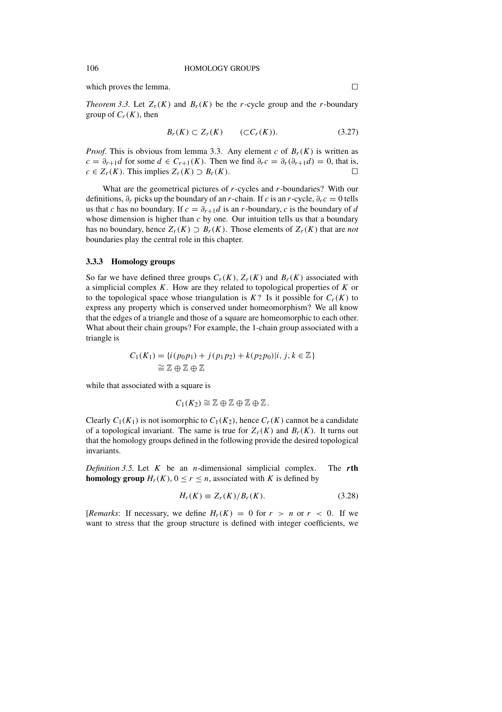

### 一、链是形式账本，不是一条必须连起来的路径

**这段在干什么：**把空间的分块转成群，再用一个同态区分两种“边界”。

每个几何 $r$-单纯形选一个参考定向，记作 $\sigma_i$，定义

$$
C_r(K)=\left\{\sum_i n_i\sigma_i:n_i\in\mathbb Z\right\}.
$$

例如 $2[A,B]-3[C,D]$ 是合法 1-链，不要求两条边相接。$[A,B]+[B,C]$ 是两块边的和，不能不说明细分关系就把它在同一链群里直接等同于一个新生成元 $[A,C]$。

若有 $I_r$ 块几何单纯形，则 $C_r\cong\mathbb Z^{I_r}$。反向定向通过负系数处理，不把两个方向同时当独立基。系数可解释成有向叠加次数，但不需要每个链都对应一张无自交的实体曲面。

### 二、为什么线段的边界是终点减起点？

定义

$$
\partial_1[A,B]=B-A.
$$

这样两段相接时，内部端点消失：

$$
\partial([A,B]+[B,C])=(B-A)+(C-B)=C-A.
$$

如果用 $A+B$，会得到 $A+2B+C$，错误地留下人为切分点。对绕一圈的链

$$
c=[A,B]+[B,C]+[C,A],
$$

边界就是 $(B-A)+(C-B)+(A-C)=0$。这正是闭合应当表达的相消。

这里的结果是 0-链，不是点集：$B-A$ 保留方向和系数。第二章的集合边界只有集合，不能承担这项任务。对边框的“没有边界”也指这个闭链的代数边界为零，不是说它作为平面子集的拓扑边界为空。

### 三、一般公式为何逐个删顶点、正负交替？

$$
\boxed{\partial_r[p_0,\ldots,p_r]
=\sum_{i=0}^{r}(-1)^i[p_0,\ldots,\widehat p_i,\ldots,p_r].}
$$

帽子表示删去该顶点。删一个顶点留下一个余维一面，符号保证诱导方向一致。比如

$$
\partial_2[A,B,C]=[B,C]-[A,C]+[A,B],
$$

即沿 $A\to B\to C\to A$ 的一圈。四面体同理：

$$
\partial_3[A,B,C,D]=[B,C,D]-[A,C,D]+[A,B,D]-[A,B,C].
$$

只需对基底单纯形给出边界，再按整数线性延拓到所有链，所以 $\partial_r:C_r\to C_{r-1}$ 是群同态。本章取 $\partial_0=0$、$C_{-1}=0$，这是普通同调约定；约化同调需要另改最低端。

### 四、闭链与边界链：两个问题

$$
\boxed{Z_r=\ker\partial_r,\qquad B_r=\operatorname{im}\partial_{r+1}.}
$$

对 $c\in C_r$：

- 闭链：检验它自己取边界是否为零；
- 边界链：寻找更高一维的 $d\in C_{r+1}$，使 $c=\partial_{r+1}d$。

它们都位于同一个 $C_r$ 中，不能把 $B_r$ 的下标误解为产生它的高维链的维数。$B_1$ 是由二维链产生的一维边界链。

三角形边框中的一圈 $c$ 是闭链，但该空间没有二维面，不能成为边界；填满三角形后，$c=\partial[A,B,C]$，才成为边界链。空间外的纸面或三维填充物不能擅自加入。

### 五、为什么边界的边界为零？先算低维

$$
\begin{aligned}
\partial_1\partial_2[A,B,C]
&=(C-B)-(C-A)+(B-A)\\
&=0.
\end{aligned}
$$

四面体的四张有向面取边界时，每条边也出现两次、符号相反。一般情况如下：给定原顶点次序中的 $i<j$，先删 $i$ 再删 $j$，第二次的序号变为 $j-1$，总符号为 $(-1)^i(-1)^{j-1}$；先删 $j$ 再删 $i$，总符号为 $(-1)^j(-1)^i$。二者相反，而得到的余下单纯形相同，因此成对抵消。

$$
\boxed{\partial_r\partial_{r+1}=0.}
$$

这不是只有二维图形成立的直觉，而是完整的组合符号证明。由线性性，对生成元证明后即对任意链成立。

### 六、为什么同调群的商有定义？

若 $b\in B_r$，存在 $d$ 使 $b=\partial d$；于是 $\partial b=\partial^2d=0$，故

$$
B_r\subseteq Z_r\subseteq C_r.
$$

所有群都是阿贝尔群，因此 $B_r$ 自动是 $Z_r$ 的正规子群，下一节才可定义 $Z_r/B_r$。

写成链复形，

$$
0\to C_n\xrightarrow{\partial_n}\cdots
\xrightarrow{\partial_2}C_1\xrightarrow{\partial_1}C_0\to0.
$$

链复形只要求相邻两箭头复合为零，不要求像等于核。若某处像恰等于核，就称在那里正合；同调正是在测量“不正合留下了什么”。不能看到一串箭头就默认它是正合列。

### 七、把抽象定义写成你熟悉的矩阵

固定顶点基 $(A,B,C)$，边基 $([A,B],[A,C],[B,C])$，面基 $([A,B,C])$：

$$
D_1=\begin{pmatrix}-1&-1&0\\1&0&-1\\0&1&1\end{pmatrix},
\qquad D_2=\begin{pmatrix}1\\-1\\1\end{pmatrix}.
$$

每一列就是一个基底积木取边界后的坐标。直接相乘 $D_1D_2=0$。所以 $Z_1$ 是整数方程 $D_1x=0$ 的解集，$B_1$ 是 $D_2$ 的整数列组合。

矩阵并不替代几何定义：它是选定基底后记录边界规则的方法。后面算整数商，须保留系数格而不只看实数秩。

**自测：**$B_2=0$ 是否说明 $H_2=0$？不说明，还要看 $Z_2$。没有更高维链只能排除“已经是边界”，不能排除“非零闭链”。

---

## 3.3.3 Homology groups｜为什么取闭链除以边界链？

[阅读目录](README.md) · [上一节](07-3.3.2.md) · [下一节](09-3.3.4.md)

### 原书第 106–110 页

本节定义在 p.106 下部，例题与习题持续到 p.110 Exercise 3.3；同页后半开始 §3.3.4。

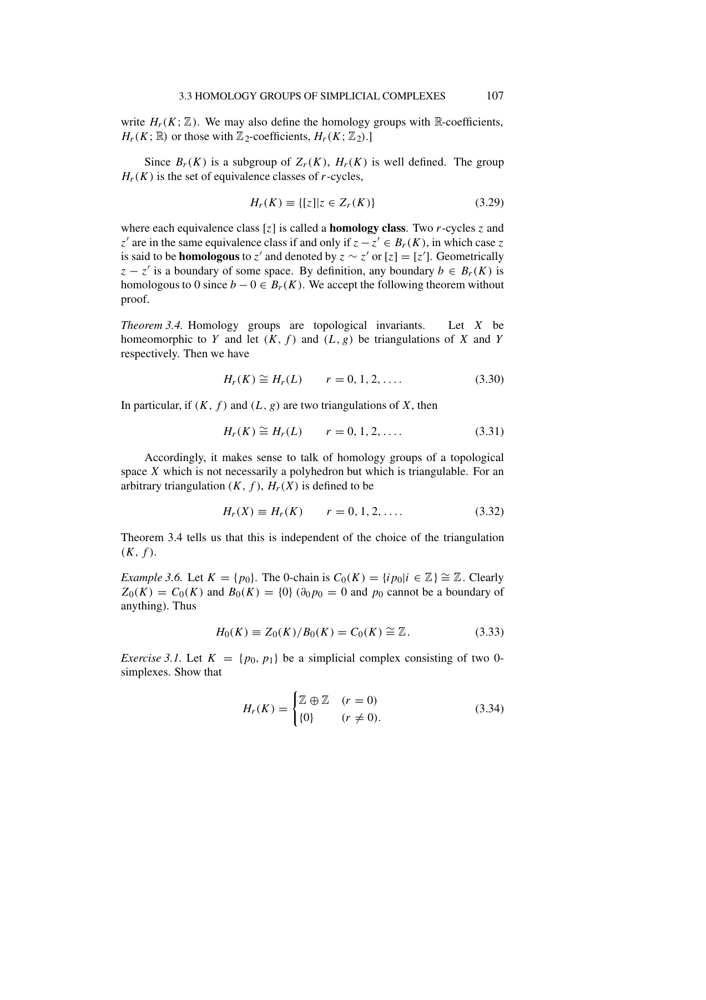

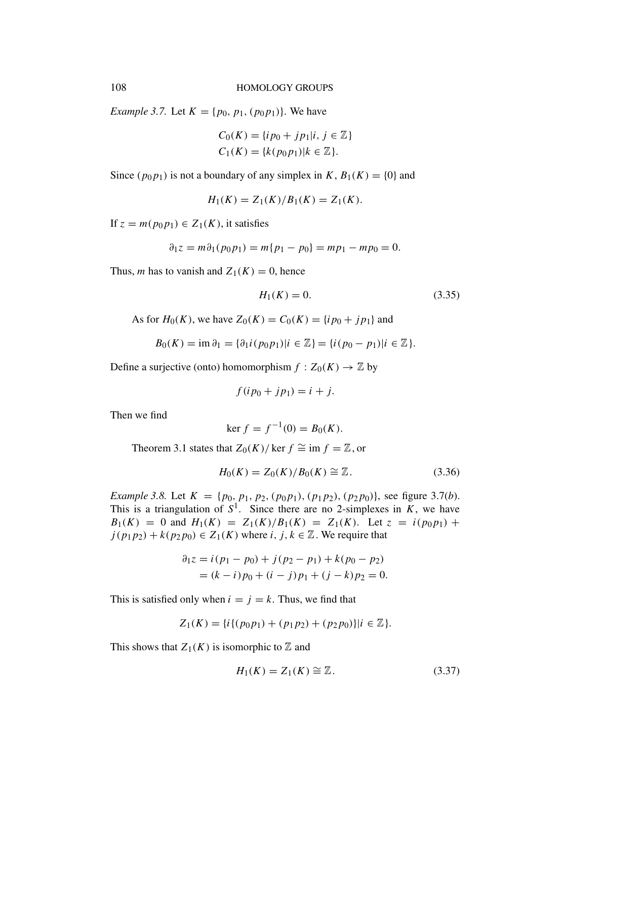

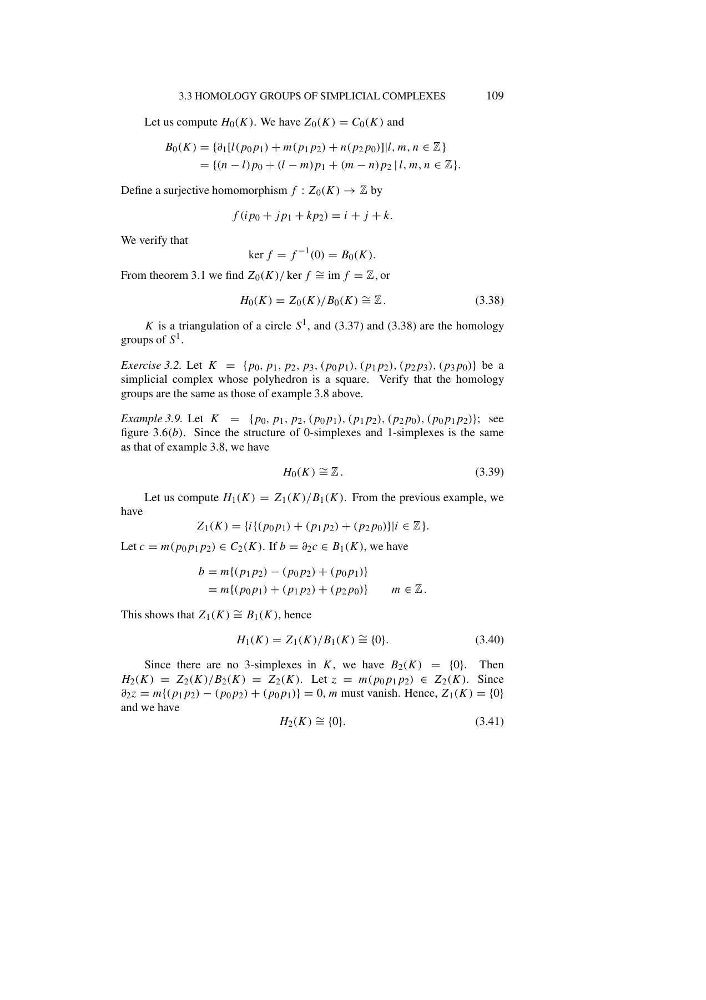

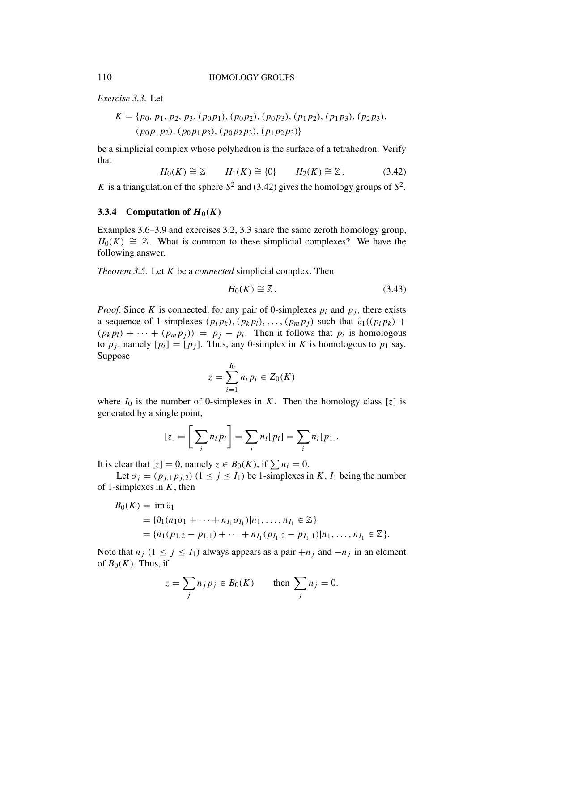

### 一、链群为什么不能直接作为不变量？

**这段在干什么：**消除剖分细节，只保留闭合结构中不属于边界的部分。

一个圆用三条边剖分，$C_1\cong\mathbb Z^3$；改成四条边，$C_1\cong\mathbb Z^4$。空间拓扑相同，链群却不同。所以需要进一步筛选并识别。

定义

$$
\boxed{H_r(K)=Z_r(K)/B_r(K).}
$$

它的元素不是单独的链，而是闭链的等价类：

$$
[z]=z+B_r,\qquad [z]=[z']\Longleftrightarrow z-z'=\partial d.
$$

“两圈同调”表示它们的差能由空间内高一维链填起来。若 $z$ 自己就是边界，它代表零类。不是直接删除空间中的某条圈，也不要求两个闭链作为点集完全相同。

### 二、什么是书中接受而未证明的结论？

Theorem 3.4 说同胚的可三角剖分空间具有同构的同调群，因此换三角剖分不改变 $H_r$。这是实质性定理；书中明确不证明。

验证三边圆与四边圆结果相同，是示例，不是对所有剖分的证明。一般证明需要比较链复形、细分和相应映射等工具。这里使用该定理，允许我们将 $H_r(K)$ 记作空间的 $H_r(X)$。

### 三、Example 3.6–3.7：一个点与一条线段

一个点：$C_0=\mathbb Z A$、$\partial_0=0$，又无边，所以 $B_0=0$，得到 $H_0\cong\mathbb Z$，其他维数为零。

一条线段：$C_0=\mathbb Z A\oplus\mathbb Z B$、$C_1=\mathbb Z e$，$\partial e=B-A$。若 $ne$ 是闭链，则 $n(B-A)=0$，由顶点生成元独立可得 $n=0$，所以 $H_1=0$。

在 $H_0$ 中，$B-A$ 成为零，因此 $[B]=[A]$。但单个 $[A]$ 不为零：任何边界的顶点系数总和都是零，而 $A$ 的总和为 1。于是 $H_0\cong\mathbb Z$。这说明 $H_0$ 不是在数顶点个数。

### 四、Example 3.8：三角形边框的完整计算

记 $e_1=[A,B],e_2=[B,C],e_3=[C,A]$。任意 1-链为 $z=ae_1+be_2+ce_3$，

$$
\partial z=(c-a)A+(a-b)B+(b-c)C.
$$

因此闭合当且仅当 $a=b=c$，即

$$
Z_1=\mathbb Z(e_1+e_2+e_3).
$$

边框没有二维链，$B_1=0$，所以

$$
H_1\cong\mathbb Z.
$$

它并不是“有无穷多个独立洞”：只有一个自由生成元，可以取任意整数倍。

又由 $B-A,C-B$ 是边界，三个顶点在 $H_0$ 中同类，$H_0\cong\mathbb Z$。Exercise 3.2 的四边框同样要求沿圈的四个边系数一致，仍只剩一个生成元。

### 五、Example 3.9：加上一个面，究竟改变了哪里？

保留相同顶点和边，新增 $F=[A,B,C]$。因此 $C_0,C_1$ 和 $\partial_1$ 都不变，$Z_1$ 也不变。但

$$
\partial_2F=e_1+e_2+e_3,
$$

所以 $B_1=Z_1$，于是 $H_1=0$。原来的一圈仍然是闭链，只是在商群中现在成为零。

再算 $H_2$：任意二维链 $mF$ 的边界是 $m(e_1+e_2+e_3)$，只有 $m=0$ 才为零。所以 $Z_2=0$，得到 $H_2=0$。有二维面并不意味着有二维闭链。

**校记：**原书这里写“$Z_1\cong B_1$，所以商为零”容易误导。真正足够的是它们作为 $C_1$ 的子群相等；两个抽象同构的子群不保证商为零，例如 $2\mathbb Z\cong\mathbb Z$，而 $\mathbb Z/2\mathbb Z\ne0$。另有 $Z_1=0$ 的排印应为此处正在计算的 $Z_2=0$。

### 六、Exercise 3.3：四面体表面为什么有一个二维类？

只取四面体表面，不包括内部三维单纯形。固定顶点 $0,1,2,3$，组合

$$
s=[1,2,3]-[0,2,3]+[0,1,3]-[0,1,2]
$$

取边界为零。公共边相消，构成整张有向球面。令一般二维链为四面的线性组合，逐边令系数为零，会迫使四个系数按上式符号取同一个倍数，所以 $Z_2=\mathbb Z s$。

空间中没有三维链，$B_2=0$，故 $H_2\cong\mathbb Z$。不能把四面体的实体内部从环境空间借进来：若真的新增该三维单纯形，$s$ 就成为它的边界，计算的已是另一空间。

为什么 $H_1=0$？取顶点 0 为根，三条连到它的边作树。剩余三条边各与树上的路径形成三角闭链；这三条基本闭链分别是面 $[0,1,2],[0,1,3],[0,2,3]$ 的边界。任意一维闭链都是它们的整数和，故 $Z_1=B_1$。连通则给 $H_0\cong\mathbb Z$。

### 七、把前三个模型对齐

| 空间 | $H_0$ | $H_1$ | $H_2$ |
|---|---|---|---|
| 点／闭线段／闭圆盘 | $\mathbb Z$ | 0 | 0 |
| 圆 | $\mathbb Z$ | $\mathbb Z$ | 0 |
| 球面 | $\mathbb Z$ | 0 | $\mathbb Z$ |

这些都是整数系数的普通同调。高于所列空间维数的群均为零。同调相同不推出同胚，例如点与闭线段已有同样的同调。

**自测：**圆盘与圆的差别发生在 $Z_1$ 还是 $B_1$？使用同一三角形模型时，$Z_1$ 相同，新增二维面改变了 $B_1$。

---

## 3.3.4 Computation of H0｜为什么连通空间留下一个整数？

[阅读目录](README.md) · [上一节](08-3.3.3.md) · [下一节](10-3.3.5.md)

### 原书第 110 页中部至第 111 页上部

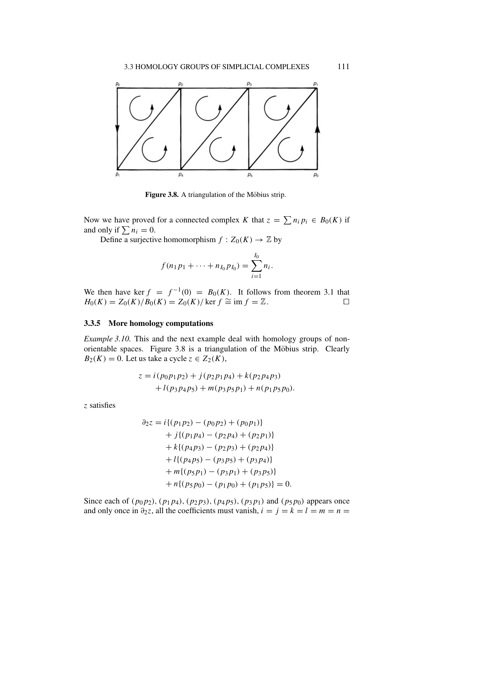

### 一、H0 不能凭“零维洞”猜

**这段在干什么：**证明 $H_0$ 精确记录连通分支，而不是给它生硬套一个洞的比喻。

由于 $\partial_0=0$，任何 0-链都是闭链，所以

$$
H_0=C_0/\operatorname{im}\partial_1.
$$

边界关系 $\partial[A,B]=B-A$ 把能沿边相连的顶点识别为同一个类。对有限单纯复形，几何连通与顶点可沿边链连接相对应；不是在任意一般拓扑空间中直接把连通当成道路连通。

### 二、把“总和为零”与边界相互推出

固定一个根顶点 $p_0$。对每个顶点 $p_i$ 选一条从 $p_0$ 到 $p_i$ 的有向边链 $\gamma_i$，则

$$
\partial\gamma_i=p_i-p_0.
$$

考虑 $z=\sum n_ip_i$。如果 $\sum n_i=0$，则

$$
z=\sum_i n_i(p_i-p_0)
=\partial\left(\sum_i n_i\gamma_i\right).
$$

这给出实际填充的一维链，证明它是边界。

反过来，任何一条边的边界有一个 $+1$、一个 $-1$，总系数为零；由线性性，任意一维链的边界也总和为零。因此

$$
z\in B_0\quad\Longleftrightarrow\quad\sum n_i=0.
$$

### 三、第一同构定理在此落地

定义满同态

$$
\varepsilon:C_0\to\mathbb Z,\qquad
\varepsilon\left(\sum n_ip_i\right)=\sum n_i.
$$

上一步证明 $\ker\varepsilon=B_0$，所以

$$
\boxed{H_0=C_0/B_0\cong\mathbb Z.}
$$

注意这里的 $\varepsilon$ 只是另一个同态，本章普通链复形的 $\partial_0$ 仍为零；若用 $\varepsilon$ 延长复形，才进入增广与约化同调，不能悄悄更换约定。

### 四、结论的几何含义

在一个连通分支内，顶点之差可以通过路径的边界消去，剩下的是总系数。不是所有顶点“成为空间中的同一点”，而是它们在商群中代表同一零维同调类。

多个分支时，各分支的总系数彼此独立，下一节相关定理会给出 $H_0\cong\mathbb Z^N$。

**自测：**为什么一个连通空间的 $H_0$ 不是零？单个顶点总系数为 1，不可能是一维链的边界。

---

## 3.3.5 More homology computations｜从绕一圈到二阶挠元

[阅读目录](README.md) · [上一节](09-3.3.4.md) · [下一节](11-3.4.1.md) · [整数计算补充](integer-computations.md)

### 原书第 111–116 页

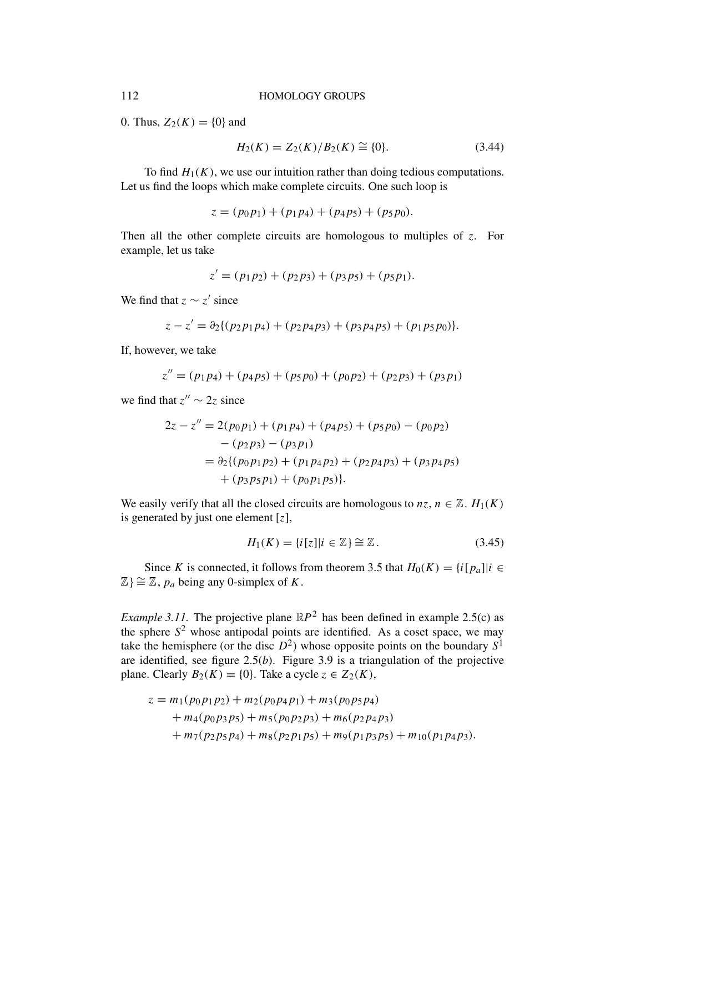

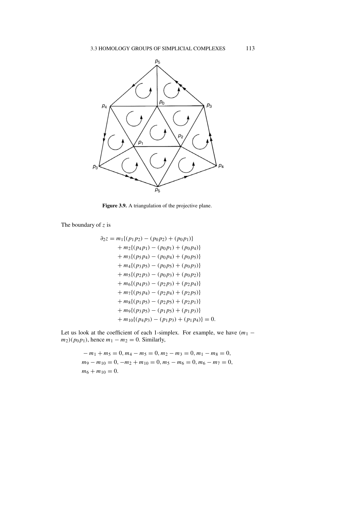

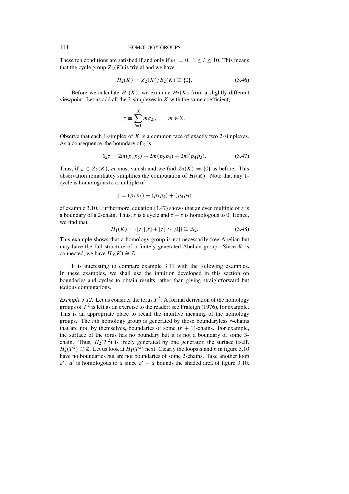

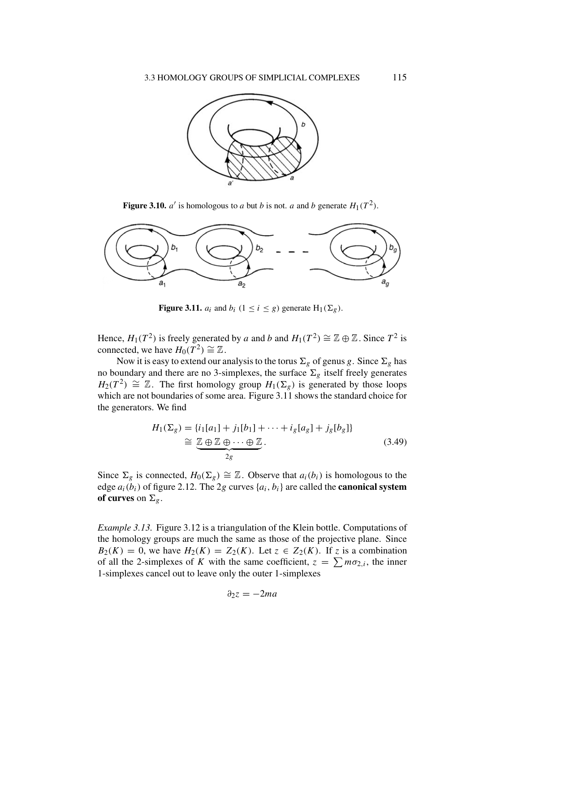

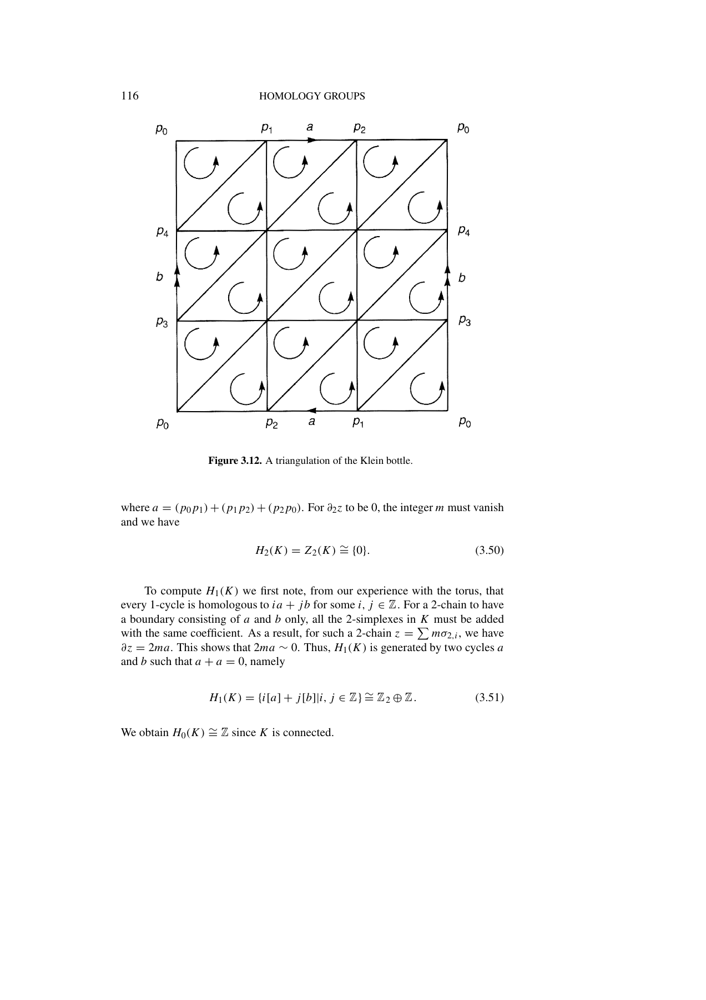

### 一、这些例子共同在算什么？

**这段在干什么：**用几个曲面检验 $H_r=\ker\partial_r/\operatorname{im}\partial_{r+1}$，尤其看整数关系如何保留下来。

这些空间均连通，故 $H_0\cong\mathbb Z$。它们的模型没有三维单纯形，所以 $B_2=0$，$H_2=Z_2$。但还必须算二维闭链，不能据此直接宣布 $H_2=0$。

对 $H_1$，始终分成两步：找到所有闭链的整数生成元；再把二维链边界产生的关系商掉。证明“$2z$ 是边界”只说明 $[z]$ 的阶至多为 2，尚未证明它不是零。

### 二、Example 3.10：Möbius 带为什么没有整数二维类？

沿原图的编号，六个有向三角面为

$$
[012],\ [214],\ [243],\ [345],\ [351],\ [150].
$$

这里 $[ijk]$ 简记 $[p_i,p_j,p_k]$。任意二维链写成六面的整数线性组合。看外缘边 $[02],[14],[23],[45],[31],[50]$：每条只出现于一个面的边界，因此若整个二维链闭合，对应的面系数必须为零。六个系数全被迫为零，于是

$$
H_2(M)=0.
$$

这不是“没有二维部分”，而是没有非零的二维闭链。它的确是一张二维带，但有边缘。

### 三、Möbius 带的 H1：补上书中“所有圈都是倍数”的计算

先用一棵树组织图的闭链。对图的每条非树边，加上树中的回路补边，得到一个基本闭链；这些闭链构成整数闭链群的一组基。[计算补充](integer-computations.md)给出理由。

对本图选树边

$$
[01],[02],[05],[13],[14].
$$

其余七条边为 $[12],[15],[23],[24],[34],[35],[45]$。记相应基本闭链的坐标生成元为 $x_{ij}$。它们不是把单独一条非闭边直接当作同调类；树中的路径已补好闭合条件。

把六个面的边界投到这些坐标，得到六条关系：

$$
\begin{gathered}
x_{12}=0,\quad -x_{24}-x_{12}=0,\quad
-x_{34}-x_{23}+x_{24}=0,\\
x_{45}-x_{35}+x_{34}=0,\quad
-x_{15}+x_{35}=0,\quad x_{15}=0.
\end{gathered}
$$

逐项消去：$x_{12}=x_{24}=x_{15}=x_{35}=0$，$x_{34}=-x_{23}$，$x_{45}=x_{23}$。只剩一个没有任何非零倍数关系的生成元 $x_{23}$，所以

$$
\boxed{H_1(M)\cong\mathbb Z.}
$$

这比“看起来只有一圈”多证明了一步：没有隐藏的额外生成元，也没有遗漏有限阶关系。

### 四、边界绕两圈为什么不等于出现 Z2？

原书取闭链

$$
z=[01]+[14]+[45]+[50].
$$

其非树坐标是 $x_{45}=x_{23}$，所以它是上述生成元。带的整个几何边缘按原书方向构成

$$
b=[14]+[45]+[50]+[02]+[23]+[31].
$$

其坐标为 $x_{45}+x_{23}=2x_{23}$，故 $[b]=2[z]$。

**它不等于说 $2[z]=0$。**该边缘是曲面的拓扑边界，但对不可定向的 Möbius 带，它不是某个整体整数二维链的代数边界；$2[z]$ 在 $H_1\cong\mathbb Z$ 中非零。单凭“扭了一下”不能推断第一同调有挠元。

也可用第二章的中央圆变形收缩解释 $H_1$ 的结果，但那条路线需要使用同伦不变性。上面的链计算无需把该定理当成已证明。

### 五、Example 3.11：射影平面 H2 的符号矛盾

原书给出十个面

$$
[012],[041],[054],[035],[023],
[243],[254],[215],[135],[143].
$$

一般二维链写成 $\sum m_iF_i$。p.113 逐边令边界系数为零：若干关系先迫使所有 $m_i$ 相等，最后又给出 $m_6+m_{10}=0$，即 $2m=0$。

由于系数在 $\mathbb Z$ 中，只能 $m=0$。所以 $Z_2=0$，即

$$
H_2(\mathbb{RP}^2;\mathbb Z)=0.
$$

不能只检查所有面同系数的一种特殊组合，就宣称已排除全部二维闭链。原书前面的逐边方程才给出一般性结论；后面的同系数观察用于看清整数关系。

### 六、为什么第一同调恰好是 Z2，而不是零？

书中把所有面按所列方向求和，得到

$$
\partial\left(\sum_{i=1}^{10}F_i\right)=2z,
\qquad z=[35]+[54]+[43].
$$

于是 $2[z]=0$。但要证明 $[z]\ne0$，需要检查全部关系。

原图一维骨架有六个顶点、十五条边。选五条星形树边 $[01],[02],[03],[04],[05]$，其余十条边的基本闭链给 $Z_1\cong\mathbb Z^{10}$，记作 $x_{12},x_{13},x_{14},x_{15},x_{23},x_{24},x_{25},x_{34},x_{35},x_{45}$。

前五个含顶点 0 的面产生

$$
x_{12}=x_{14}=x_{45}=x_{35}=x_{23}=0.
$$

后五面依次产生

$$
\begin{gathered}
-x_{34}-x_{23}+x_{24}=0,\quad
-x_{45}-x_{24}+x_{25}=0,\\
x_{15}-x_{25}-x_{12}=0,\quad
x_{35}-x_{15}+x_{13}=0,\quad
-x_{34}-x_{13}+x_{14}=0.
\end{gathered}
$$

前四条把剩下的 $x_{24},x_{25},x_{15},x_{13}$ 全写成 $x_{34}$；最后一条只给 $2x_{34}=0$。因此完整的商为

$$
\boxed{H_1(\mathbb{RP}^2;\mathbb Z)
=\mathbb Z x_{34}/\langle2x_{34}\rangle\cong\mathbb Z_2.}
$$

$z$ 的非树坐标为 $x_{35}-x_{45}-x_{34}=-x_{34}$，正是这个非零二阶类。这样就补齐了“所有圈归结到一个生成元，而且只有偶数倍为零”的论证，而不是只凭一个 $2z$ 边界公式猜群。

这个例子也是[整数核验脚本](verify-homology.py)的重点：约化关系矩阵满秩但行列式绝对值为 2，商不为零。

### 七、Example 3.12：环面两个圈为什么独立？

图 3.10 的 $a$ 与 $a'$ 之间夹一条带状二维链，取相容方向后边界是 $a'-a$，故它们同调。相互平行移动不会每次新增一个独立生成元。

为了严谨补上原书留给读者的环面计算，这里明确借用一个额外工具：**胞腔同调定理**，即对 CW 分解按附着映射计算的胞腔链复形给出同一拓扑同调。它不等于“一面正方形就是严格单纯形”；本章没有证明该定理，补充中说明使用的边界规则。

环面用一个顶点、两条环边 $a,b$、一个二维面 $F$ 表示。所有边的起终点相同，$\partial_1=0$。沿面边界读到 $aba^{-1}b^{-1}$，在一维链中为

$$
\partial_2F=a+b-a-b=0.
$$

于是胞腔复形是

$$
0\to\mathbb Z\xrightarrow{0}\mathbb Z^2
\xrightarrow{0}\mathbb Z\to0,
$$

直接得到

$$
H_0(T^2)=\mathbb Z,\qquad H_1(T^2)=\mathbb Z^2,\qquad H_2(T^2)=\mathbb Z.
$$

两条一维生成元之间没有关系，是由 $\operatorname{im}\partial_2=0$ 证明的，不只因为画了两条看起来不同的圈。二维生成元对应整张有向面；研究空间是环面表面，不包括三维实体内部。

### 八、闭可定向亏格 g 曲面

一个顶点、$2g$ 条边与一个面，边界附着词为

$$
\prod_{i=1}^g a_ib_ia_i^{-1}b_i^{-1}.
$$

在链的阿贝尔加法里，每条边正负各一次，故 $\partial_2=0$，得到

$$
\boxed{H_0(\Sigma_g)=\mathbb Z,\quad
H_1(\Sigma_g)=\mathbb Z^{2g},\quad
H_2(\Sigma_g)=\mathbb Z.}
$$

$g=0$ 即球面，一维群为零。这里“闭”在曲面术语中指紧且无流形边界。不要把它推广为所有曲面都由一个把手数描述。

### 九、Example 3.13：Klein 瓶保留一个自由类和一个二阶类

原书图 3.12 把一对边同向、另一对反向识别。选与其结论相容的边标记，面附着词可写为 $ab ab^{-1}$，在链中有

$$
\partial_2F=a+b+a-b=2a.
$$

改变面的定向可能得到 $-2a$，不改变像子群。原书前后两处的正负差异应按这个意义理解。

对应胞腔复形中 $\partial_1=0$，而 $\partial_2(1)=(2,0)$，因此

$$
H_1(K)=\frac{\mathbb Z a\oplus\mathbb Z b}{\langle2a\rangle}
\cong\mathbb Z_2\oplus\mathbb Z.
$$

又整数映射 $m\mapsto(2m,0)$ 的核为零，所以 $H_2(K)=0$。这同时说明所有二维闭链为何为零，避免只检查一种同系数面组合后就宣布一般结论。

### 十、统一比较

| 空间，均取整数系数 | $H_0$ | $H_1$ | $H_2$ |
|---|---|---|---|
| Möbius 带 | $\mathbb Z$ | $\mathbb Z$ | 0 |
| 射影平面 | $\mathbb Z$ | $\mathbb Z_2$ | 0 |
| 环面 | $\mathbb Z$ | $\mathbb Z^2$ | $\mathbb Z$ |
| Klein 瓶 | $\mathbb Z$ | $\mathbb Z\oplus\mathbb Z_2$ | 0 |
| 闭可定向亏格 $g$ 曲面 | $\mathbb Z$ | $\mathbb Z^{2g}$ | $\mathbb Z$ |

高于二维的群都为零。“不可定向”不等于“第一同调必有挠元”，Möbius 带就是反例；“几何上没有边缘”也不等于“存在非零整数二维同调”，射影平面与 Klein 瓶是反例。

**自测：**证明 $2[z]=0$ 后还缺什么才能得到 $\mathbb Z_2$？需证明 $[z]\ne0$，并证明没有其他独立生成元。完整的整数生成元—关系计算承担了这两项任务。

---

## 3.4.1 Connectedness and homology｜分开的空间怎样分别计数？

[阅读目录](README.md) · [上一节](10-3.3.5.md) · [下一节](12-3.4.2.md)

### 原书第 117 页

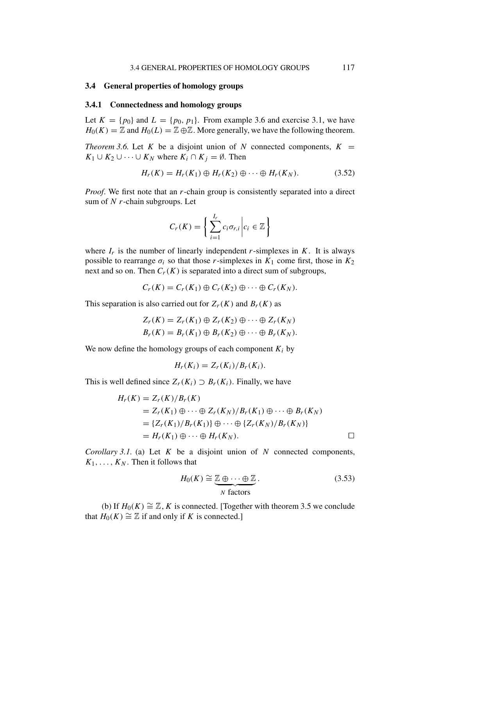

### 一、为什么是不交并对应直和？

**这段在干什么：**把连通空间的 $H_0=\mathbb Z$ 推广到多个分支，并给出所有维数的统一公式。

设有限复形由互不相交的连通分支 $K_1,\ldots,K_N$ 组成。每块单纯形完全属于一个分支，边界也不会跨到另一分支。因此

$$
C_r(K)=\bigoplus_{j=1}^NC_r(K_j),\qquad
\partial_r=\bigoplus_j\partial_r^{(j)}.
$$

一个链边界为零，当且仅当各分支内的分量分别为零；一个链是边界，当且仅当各分量分别是边界。故核、像也按分支直和分解，最后

$$
\boxed{H_r(K)\cong\bigoplus_{j=1}^NH_r(K_j).}
$$

商与直和在这里可以逐分量对应：$[(z_1,\ldots,z_N)]\mapsto([z_1],\ldots,[z_N])$，良定义、单射和满射都由分量条件验证，不是随意把任意商群符号拆开。

### 二、H0 的整数因子是在数分支，不是在数点

每个非空连通分支贡献一个 $\mathbb Z$，于是

$$
\boxed{H_0(K)\cong\mathbb Z^N.}
$$

两个孤立点给 $\mathbb Z^2$；用一条边把它们连起来，边界关系使二者同类，变为 $\mathbb Z$。本章有限复形的语境下，$H_0\cong\mathbb Z$ 恰好意味着一个连通分支。

### 三、一个完整的不连通例子

令 $X=S^1\sqcup S^2$。两个部分分别贡献

$$
H_0(X)=\mathbb Z^2,\qquad
H_1(X)=\mathbb Z,\qquad H_2(X)=\mathbb Z.
$$

这与把圆和球面粘在一个点上的空间不同：后者连通，$H_0$ 只有一个 $\mathbb Z$。不能只看图上有几个熟悉的形状就套不交并公式。

**自测：**两个互不相交的圆的一维同调与环面相同，都是 $\mathbb Z^2$，但 $H_0,H_2$ 不同。比较空间时应读整组不变量，不只看某一个维数。

---

## 3.4.2 Structure of homology groups｜自由部分、挠部分和系数选择

[阅读目录](README.md) · [上一节](11-3.4.1.md) · [下一节](13-3.4.3.md)

### 原书第 118 页上部

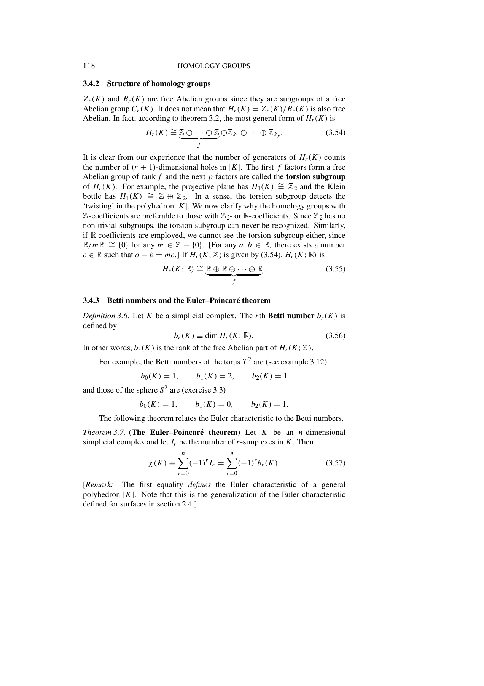

### 一、子群自由，为什么商群却不自由？

**这段在干什么：**用章首的阿贝尔群结构定理解释刚算出的结果，并说明整数系数保留了什么。

有限复形中，$C_r$ 自由阿贝尔；其子群 $Z_r,B_r$ 也自由。但商 $Z_r/B_r$ 可以有有限阶元素。最小例子就是

$$
\mathbb Z/2\mathbb Z=\mathbb Z_2.
$$

因此一般形式为

$$
H_r(K;\mathbb Z)\cong\mathbb Z^{b_r}\oplus T_r,
\qquad T_r\cong\bigoplus_i\mathbb Z_{d_i}.
$$

自由部分的类可取任意整数倍而不归零；挠元则非零，但存在正整数倍等于零。$\mathbb Z_2$ 的非零类就是二阶挠元。

“扭曲”只是名称的几何联想，不是完整判据。Möbius 带不可定向而 $H_1=\mathbb Z$ 无挠；不能看到纸带扭转就宣布出现 $\mathbb Z_2$。自由秩可直观联系独立闭合结构，但不能把全部生成元数简单等同于画面上的空洞数。

### 二、为什么实系数会看不见整数挠元？

最容易从同一个关系看出：在整数里，$a$ 不是 $2a$ 的整数倍，所以商 $\mathbb Z a/\langle2a\rangle$ 非零。在实数里，$a=\tfrac12(2a)$，于是 $\mathbb R a/\mathbb R(2a)=0$。

对有限复形，实系数同调只保留整数同调自由部分对应的实向量空间：

$$
H_r(K;\mathbb R)\cong\mathbb R^{b_r}.
$$

它可由整数链复形换系数及实数的平坦性等代数事实证明，本节给出用途与最小例子，不把单个关系的演示冒充一般换系数定理的全证。

射影平面的整数 $H_1=\mathbb Z_2$，而实系数 $H_1=0$。只做实矩阵秩计算会漏掉这项差别。

### 三、模 2 系数并不是“完全看不到挠现象”

原书关于 $\mathbb Z_2$ 系数的说明过于简略。模 2 时 $-1=1$，方向符号消失，同一个关系矩阵中的 $2$ 也变成零。它确实能反映与二阶挠相关的变化，但不能单凭一个模 2 向量空间恢复全部整数挠群。

例如射影平面的胞腔复形里，整数边界为

$$
0\to\mathbb Z\xrightarrow{\times2}\mathbb Z\xrightarrow{0}\mathbb Z\to0.
$$

改成 $\mathbb F_2=\mathbb Z_2$ 系数后，乘 2 变成零，所以

$$
H_0(\mathbb{RP}^2;\mathbb F_2)=\mathbb F_2,\quad
H_1=\mathbb F_2,\quad H_2=\mathbb F_2.
$$

整数 $H_2$ 原本为零，换系数后却出现了非零二维类。不能把每一维整数答案单独“把 $\mathbb Z$ 换成 $\mathbb F_2$，再忽略挠”来猜；一般还牵涉相邻维数的挠信息，通用系数定理会精确表达。

### 四、选择哪种系数？

整数系数保留自由与有限阶关系，信息较多但计算更细；实系数便于线性代数、微分形式与分析；模 2 系数简化定向并适合某些不可定向问题。它们是不同的信息提取方式，不是某一种总能无条件替代另一种。

**自测：**对关系 $4a=0$，实系数看不到该有限阶；模 2 又只看见该关系变零，不能由此分辨它原来是 $2a=0$ 还是 $4a=0$。

---

## 3.4.3 Betti numbers and Euler–Poincaré｜为什么 V−E+F 真的是拓扑量？

[阅读目录](README.md) · [上一节](12-3.4.2.md) · [章末题](14-Problems.md)

### 原书第 118 页下部至第 119 页

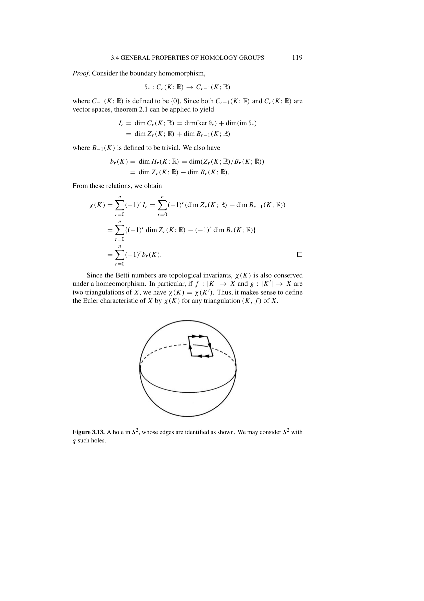

### 一、Betti 数只数自由秩

**这段在干什么：**把具体剖分的积木数量，转成同调的不变量，从而解释第二章的 Euler 示性数。

定义

$$
b_r=\dim_{\mathbb R}H_r(K;\mathbb R)
=\operatorname{rank}_{\mathbb Z}H_r(K;\mathbb Z).
$$

后一个 rank 是自由秩，不包括有限挠群的生成元。射影平面整数 $H_1=\mathbb Z_2$，但 $b_1=0$；环面 $H_1=\mathbb Z^2$，故 $b_1=2$。

### 二、公式 (3.57) 要证明的桥梁

设 $I_r$ 是 $r$-单纯形个数，最高维为 $n$，则

$$
\boxed{\chi(K)=\sum_{r=0}^n(-1)^rI_r
=\sum_{r=0}^n(-1)^rb_r.}
$$

左边依赖选择的分块来计算，右边用同调自由秩表达。由于同调群不依赖剖分，等式使 Euler 示性数也不依赖剖分。

这没有独立证明同调的拓扑不变性：它仍使用前面接受的 Theorem 3.4。逻辑依赖不能倒过来形成循环论证。

### 三、证明里为什么“边界维数”会消掉？

为使用普通维数，转到实系数。记

$$
z_r=\dim Z_r(K;\mathbb R),\qquad
\beta_r=\dim B_r(K;\mathbb R).
$$

$\beta_r$ 不是 Betti 数 $b_r$，这里特意换字母避免混淆。秩—零度公式给

$$
I_r=z_r+\beta_{r-1}.
$$

因为 $\ker\partial_r=Z_r$，而 $\operatorname{im}\partial_r=B_{r-1}$，下标差一不能漏。商空间维数又给

$$
b_r=z_r-\beta_r,
$$

所以

$$
I_r=b_r+\beta_r+\beta_{r-1}.
$$

取交错和后，每个 $\beta_r$ 在第 $r$ 项以 $(-1)^r$ 出现，在第 $r+1$ 项以 $(-1)^{r+1}$ 出现，恰好抵消。两端取 $B_{-1}=B_n=0$，无剩余项，便得结论。

二维时可直接展开：

$$
\begin{aligned}
I_0&=b_0+\beta_0,\\
I_1&=b_1+\beta_1+\beta_0,\\
I_2&=b_2+\beta_1.
\end{aligned}
$$

相减相加得到 $I_0-I_1+I_2=b_0-b_1+b_2$。这就是书中一行指标重排背后的消去过程。

### 四、把前面的例子全部验算一次

| 空间 | $(b_0,b_1,b_2)$ | $\chi$ |
|---|---|---:|
| 闭圆盘 | $(1,0,0)$ | 1 |
| 圆 | $(1,1,0)$ | 0 |
| 球面 | $(1,0,1)$ | 2 |
| 环面 | $(1,2,1)$ | 0 |
| Möbius 带 | $(1,1,0)$ | 0 |
| 射影平面 | $(1,0,0)$ | 1 |
| Klein 瓶 | $(1,1,0)$ | 0 |
| 闭可定向亏格 $g$ 曲面 | $(1,2g,1)$ | $2-2g$ |

圆与环面的 Euler 示性数都为零，但 $H_1,H_2$ 不同。这精确体现第三章开头的承诺：同调比一个交错和更细。

**自测：**为什么整数挠群不能用其元素个数加进 $b_r$？Betti 数是实向量空间维数或整数自由秩，挠关系在实系数下消失，不参与这个交错和。

---

## Chapter 3 Problems｜带把手、带边界和 crosscap 的曲面

[阅读目录](README.md) · [上一节](13-3.4.3.md) · [常见曲面计算](10-3.3.5.md)

### 原书第 119–120 页

图 3.13 在 p.119，题目在 p.120。新增解答明确区分不粘合的边界孔与粘合成 crosscap 的孔。

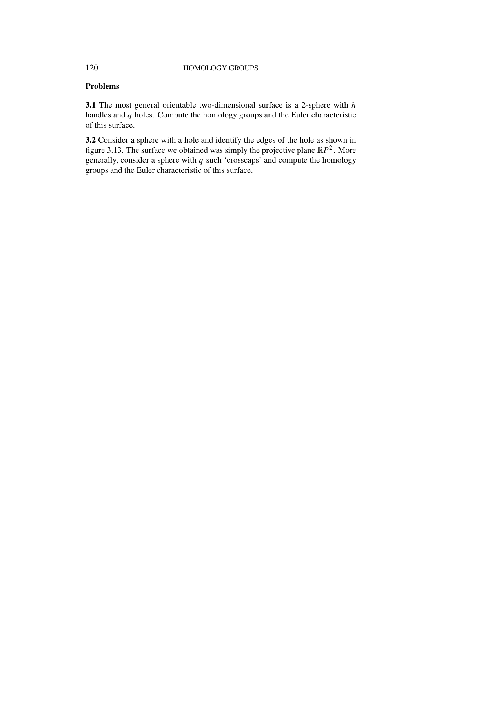

### Problem 3.1：h 个把手、q 个边界孔

**题意：**按本题的有限型、连通、紧可定向曲面语境，从闭亏格 $h$ 曲面挖去 $q$ 个互不相交开圆盘，保留边界圆。原文“最一般曲面”不能理解为覆盖一切非紧或无限型曲面。

#### 先试：为什么必须把 q=0 与 q>0 分开？

没有边界时整张有向曲面形成二维闭链。有边界时，整张面的边界留下边缘，不能再作为非零的绝对二维同调类。因此 $H_2$ 会变化。本题求普通绝对同调，不是相对边界的同调。

#### q=0：闭曲面

本章已经得到

$$
H_0=\mathbb Z,\qquad H_1=\mathbb Z^{2h},\qquad H_2=\mathbb Z,
\qquad \chi=2-2h.
$$

#### q≥1：边界圈之间少一个独立关系

曲面有 $2h$ 条把手方向的圈，还有 $q$ 条边界圈 $c_1,\ldots,c_q$。取相容方向，它们的总和是整张曲面的边界，因而在 $H_1$ 中满足

$$
[c_1]+\cdots+[c_q]=0.
$$

故边界只新增 $q-1$ 个独立类。完整理由可用标准切割脊骨：有边界的曲面变形收缩到 $2h+q-1$ 个圆的楔和；也可先把连接各边界的树状弧压到一点，得到一个含 $2h+q$ 条环边、一张附着面的同伦等价 CW 模型，面边界在阿贝尔化后为 $c_1+\cdots+c_q$。这是一条本原关系，可以消去 $c_q$，不会产生挠。压缩后的模型用于同调计算，不宣称仍与原曲面同胚。

因此

$$
\boxed{
H_0=\mathbb Z,\quad H_1=\mathbb Z^{2h+q-1},\quad H_2=0,
\quad\chi=2-2h-q\qquad(q\ge1).
}
$$

这里用到同伦不变性／胞腔同调作为计算工具，见[计算补充](integer-computations.md)；不能只凭数出若干圈就假定没有其他关系。高于二维的群为零。

#### 检查三个特例

| $(h,q)$ | 空间 | $H_1$ | $\chi$ |
|---|---|---|---:|
| $(0,1)$ | 闭圆盘 | 0 | 1 |
| $(0,2)$ | 圆环带 | $\mathbb Z$ | 0 |
| $(0,3)$ | 三边界曲面（裤子面） | $\mathbb Z^2$ | −1 |

一个边界孔不一定贡献一个独立 $H_1$ 生成元。闭圆盘只有一个边界圈，它恰好是整张面的边界，所以其类为零。

### Problem 3.2：q 个 crosscaps 不是保留 q 条边界

#### 先说明构造

图 3.13 把边界上的点按反向配对，填入的是射影平面式的识别。一个 crosscap 给 $\mathbb{RP}^2$；$q$ 个给闭不可定向曲面

$$
N_q=\underbrace{\mathbb{RP}^2\#\cdots\#\mathbb{RP}^2}_{q},\qquad q\ge1.
$$

这些孔已被粘合处理，不是上一题留下的边界分支。

#### 生成元与关系

标准 CW 模型有一个顶点、$q$ 条一维环边 $a_1,\ldots,a_q$、一个二维面。面附着词为 $a_1^2\cdots a_q^2$，所以

$$
\partial_2F=2a_1+\cdots+2a_q,
\qquad\partial_1=0.
$$

整数映射 $\mathbb Z\to\mathbb Z^q$，$1\mapsto(2,\ldots,2)$，在 $q\ge1$ 时单射，故 $H_2=0$。第一同调为

$$
H_1=\frac{\mathbb Z^q}{\langle2(a_1+\cdots+a_q)\rangle}.
$$

令 $u=a_1+\cdots+a_q$。$u,a_2,\ldots,a_q$ 是整数基，因为 $a_1=u-a_2-\cdots-a_q$，变换整数可逆。关系仅是 $2u=0$，所以

$$
\boxed{
H_0(N_q)=\mathbb Z,\quad
H_1(N_q)=\mathbb Z^{q-1}\oplus\mathbb Z_2,\quad
H_2(N_q)=0,\quad\chi(N_q)=2-q.
}
$$

$q=1$ 回到射影平面，$q=2$ 回到 Klein 瓶。$q=0$ 应单独取球面，不能把 $q-1$ 写成负的自由秩；此时 $H_2=\mathbb Z$。

### 最容易混淆的三组概念

把手与边界孔不同；边界孔与 crosscap 不同；闭曲面的二维整数同调与有边界曲面的相对二维同调不同。所有公式都要先明确所研究的空间、系数与同调版本。

---

## 计算补充：怎样把“看图”变成整数核、像与关系？

[阅读目录](README.md) · [曲面例子](10-3.3.5.md) · [核验脚本](verify-homology.py) · [核验结果](verification-results.json)

本篇是新增计算方法，不是原书额外小节。它解释两项正文使用的工具，并明确它们的论证范围。

### 一、边界矩阵的每一列是什么？

给所有几何边选统一定向，例如顶点编号小到大；给各面选参考定向。对每个面计算 $\partial[i,j,k]=[j,k]-[i,k]+[i,j]$，反向边改成负号，然后把边系数填入这一列。

顶点—边矩阵 $D_1$ 的边列在起点为 $-1$、终点为 $+1$。对全部面有 $D_1D_2=0$。脚本据原书给出的面列表重新生成这些矩阵，而非把预期同调结果写成矩阵。

对于整数链，$\ker D_1$ 表示整数核，$\operatorname{im}D_2$ 表示整数列组合。除以非单位整数会改变格点和商群，不能照搬实数行化简的全部操作。

### 二、用生成树给闭链群选一组真正的整数基

在连通的一维骨架中选一棵包含全部顶点的树。对每条不在树中的有向边 $e:u\to v$，用树中从 $v$ 回到 $u$ 的唯一路径补上它，构成基本闭链 $c_e$。

它们生成全部闭链：对任意闭链，按各非树边系数减去相应 $c_e$，剩下一个只支持在树上的闭链。树有叶顶点，在该点的边界系数迫使唯一相接边系数为零；逐叶删除可得剩余链为零。

它们也整数线性独立：每个 $c_e$ 在自己的非树边上系数为 1，在其他非树边上系数为零。因此记录非树边系数给出

$$
Z_1\cong\mathbb Z^{E-V+1}.
$$

有 $N$ 个分支时分别取树，变成 $\mathbb Z^{E-V+N}$。这避免了用实数零空间基后忘记检查它是否生成整个整数核的问题。

### 三、H1 变成一个整数表示

每个面边界已经闭合，所以记录它在非树边上的系数，就得到它在上面闭链整数基里的完整坐标。把这些列组成矩阵 $R$，则

$$
\boxed{H_1\cong\mathbb Z^{E-V+N}/\operatorname{im}_{\mathbb Z}R.}
$$

只需取 $D_2$ 的非树边行，不代表随意删除其余信息；能这样做是因为前一步已经证明该坐标投影在闭链群上是整数同构。

正文 Möbius 带和射影平面的逐关系消去，就是对这个整数表示的手工计算。操作只涉及某个生成元等于其他生成元整数和的代入，不在未说明时除以 2。

### 四、Smith 标准形和秩分别告诉什么？

合法的整数基变换包括交换、变号，以及给一行或一列加另一行或列的整数倍。它们对应行列式为 $\pm1$ 的可逆整数矩阵。Smith 定理保证可化为非零对角元 $d_1\mid d_2\mid\cdots\mid d_r$ 加零块。

若 $R$ 有 $m$ 行，商群为

$$
\mathbb Z^{m-r}\oplus\bigoplus_{i=1}^r\mathbb Z_{d_i},
$$

$d_i=1$ 的因子可删去。实数秩只告诉 $m-r$，对角元中的非单位整数才提供挠信息。

核验脚本不实现一般 Smith 标准形，而用精确有理秩与整数行列式子式作独立检查：满秩方阵的余核阶等于行列式绝对值；秩为 $r$ 时所有 $r$ 阶子式绝对值的最大公因数等于挠部分的阶。后者依赖 Smith 定理，不是新的无条件矩阵技巧。

对射影平面的 $10\times10$ 关系矩阵，行列式绝对值为 2，因而余核只有两个元素，必为 $\mathbb Z_2$。对 Möbius 带的 $7\times6$ 关系矩阵，秩为 6，最大子式的最大公因数为 1，因而余核是无挠的 $\mathbb Z$。

没有三维单纯形时，$H_2=\ker D_2$ 是自由阿贝尔群，其秩为面数减去 $D_2$ 的有理秩。这个核的自由秩可用有理秩计算，但 $H_1$ 的挠不能用相同的单一秩数据恢复。

### 五、胞腔计算为什么能用，但不能冒充单纯计算？

环面的一顶点、两环边、一面模型不是严格单纯复形，却是 CW 分解。胞腔同调定理保证这种链复形计算得到空间的拓扑同调，与三角剖分结果一致。这是正文额外使用的定理，本章原文没有建立完整 CW 理论；若坚持只用原章工具，需要另做完整三角剖分的边界矩阵计算。

在本文使用的二维单顶点曲面模型中：每条环边的起终点相同，所以一维边界为零；二维边界系数由附着圆绕每条环边的有向次数给出。例如

$$
aba^{-1}b^{-1}\mapsto a+b-a-b=0,
$$

$$
abab^{-1}\mapsto a+b+a-b=2a,
$$

$$
a_1^2\cdots a_q^2\mapsto2a_1+\cdots+2a_q.
$$

这些是链群中的阿贝尔和，不是声称第一条附着词在一般非交换群中也等于单位元的形式简化。下一章基本群会保留更多乘法次序信息。

### 六、验证不是一般定理的证明

脚本独立检查三角形、球面、Möbius 带与射影平面的边界矩阵及关键整数不变量，帮助发现抄写、符号或算术错误。它不证明一般同调拓扑不变性、一般 Smith 定理或胞腔同调定理；正文对这些依赖另作明确说明。
