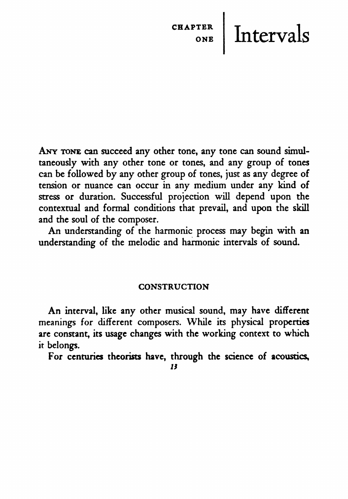
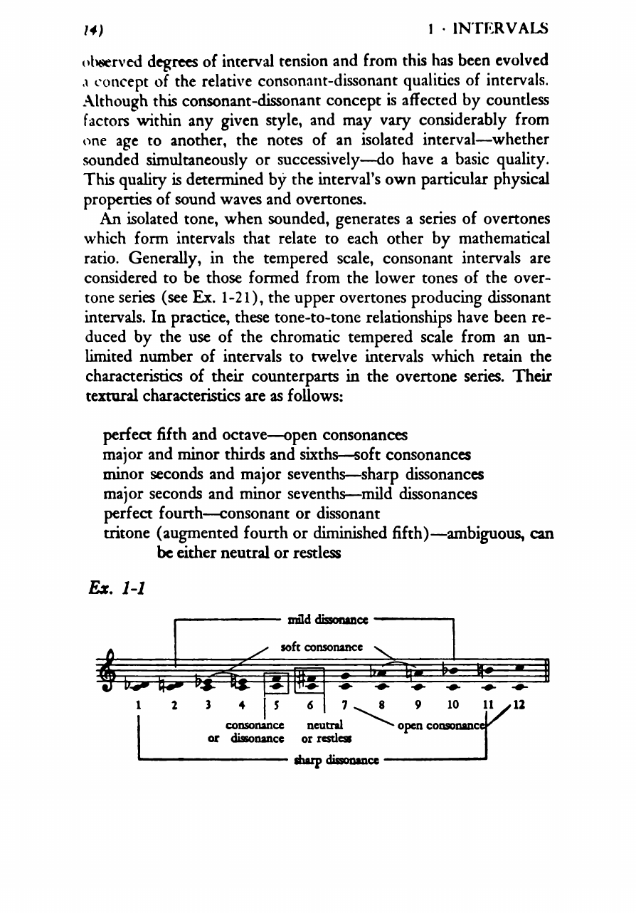
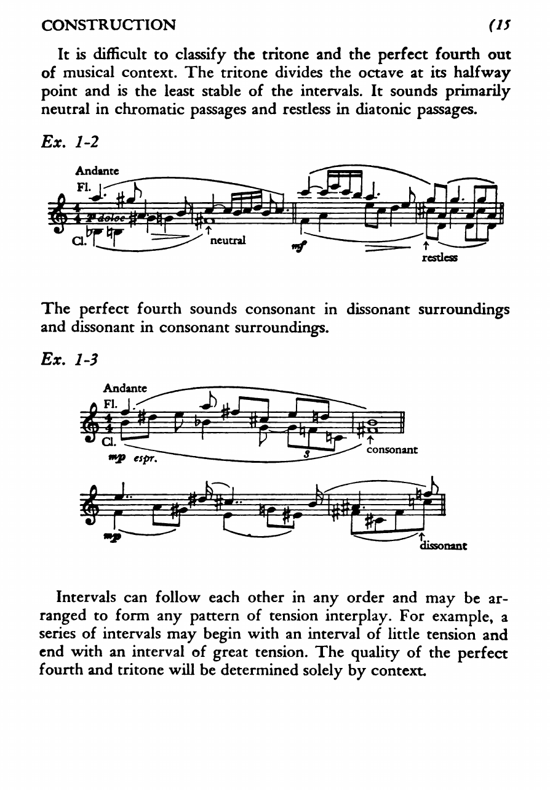
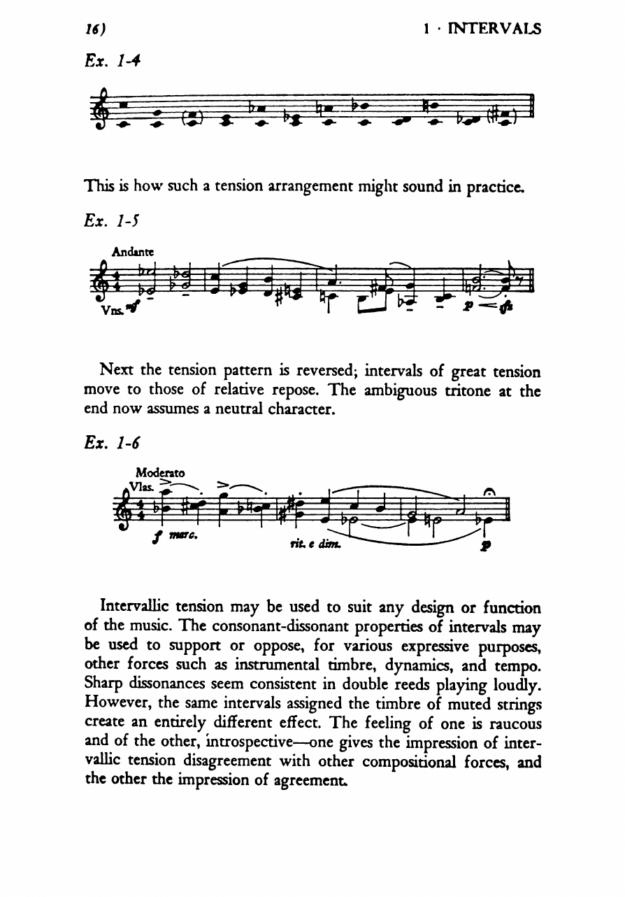
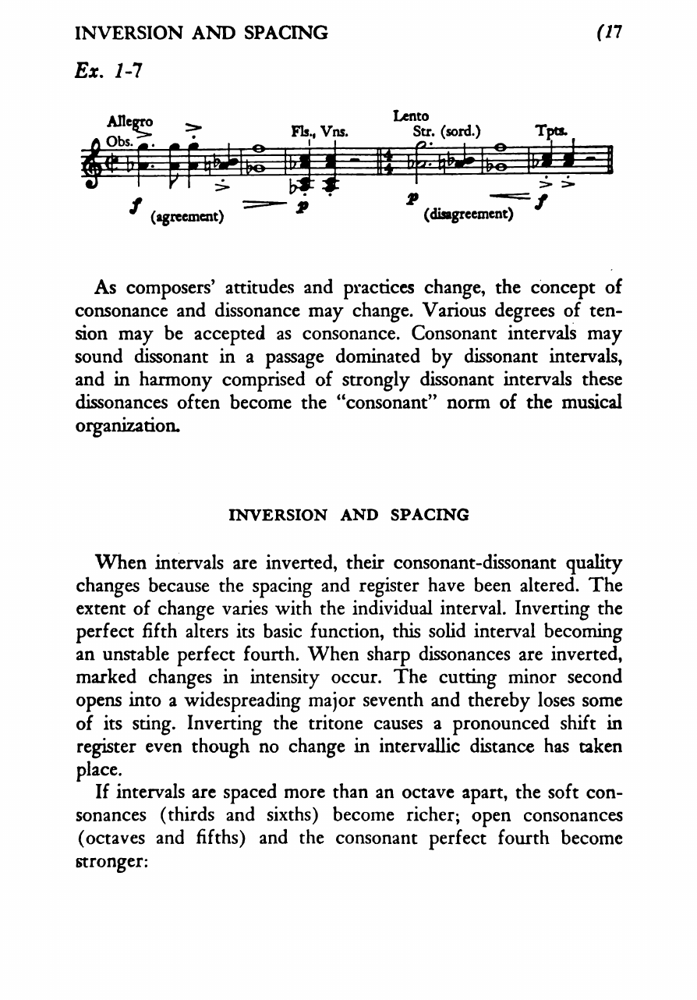

# 构成与语境中的音程张力

[阅读目录](README.md) · [上一节](00-hc-bridge.md) · [下一节](02-inversion-spacing.md)

本节对应章首与 Construction，印刷页 13–17 上部。核心问题是：当和声不预先限定在一套功能进行里，怎样仍能比较不同音程，并让它们形成有方向的音乐？

## 原书第 13 页

PDF 第 11 页。全页底本如下。

### 一 开篇列出的三个自由

**这段在干什么：**先扩大可用材料和连接的范围。原文依次说单音的先后、单音的同时结合、音组之间的先后连接。

“Any tone can succeed any other tone”谈的是横向：旋律的下一音可以是什么。“sound simultaneously”谈的是纵向：两个或多个音可以同时出现。随后扩大到一组音之后接另一组音。接着又说张力、色调、媒介、重音与时值的组合，说明自由不只发生在音高。

**句读：**这里的 can 是“可以成为创作选择”，不能译成“随便怎样都同样有效”。下句马上提出条件：效果取决于上下文、形式和作曲者的能力。一个音组是否站得住，要看它之前怎样被准备、出现时怎样发音、之后怎样继续。

**集注【深化】：**你的 L16 用常用和弦组合建立词汇，L17–L26 学习词汇的功能。本章则先允许材料越出这张词汇表，再研究怎样听清和控制它。两种教学任务不同。

### 二 作者为什么从音程开始

**这段在干什么：**给全书选一个足够小、又能连接旋律与和声的单位。

只看一个音，不能谈“两个音之间的距离”。两个音就能形成音程：先后出现时是旋律音程，同时出现时是和声音程。这一点在 L4 已有。新增问题是：相同的距离放在不同位置，是否承担相同的作用？

自拟比较：先弹 G3–B3–D4–F4，再接 C3–E4–G4。B–F 处于属七和弦里，具有熟悉的解决倾向。另写一串不断平移的三全音 C4–F♯4、D4–G♯4、E4–A♯4。后者同样含三全音，但没有凭音程名称就能唯一确定的“正确解决目标”。

### 三 物理特征与音乐用法为什么要分开

Construction 第一段把“物理性质”与“在创作环境里的用途”分开。对指定的两个声音，可以比较频率、分音和实际距离；但说它是开端、装饰、延宕、高潮或句末，需要时间中的语境。

**疏【重点新增】：**不要把“物理性质恒定”读成“所有小二度在任何乐器和音区都听起来一样”。音程名称只规定一部分关系。音区、调律、音色和响度变动时，声音条件已经变了。作者要保留的是材料可辨认的特性，同时承认它的音乐意义会变化。

读完本页，可以用两句话检查理解：“我准备用什么音程材料？”“我准备怎样让它在这段音乐中成立？”第一句不能代替第二句。

## 原书第 14 页

PDF 第 12 页。此页含 Ex. 1-1。

### 四 泛音的引入先为分类提供听觉背景

作者先说，单音的分音之间存在可用数比描述的关系，较低分音形成的距离通常与熟悉的协和关系相联。详细声学放到后面的 Overtone Influence；在这里先把它当作分类的一个背景。

**校读：**泛音列并不自动推出一套适用于所有文化、乐器、音区的协和法则。作者这页已承认时代与风格的差异，后面又指出高次分音与平均律不合。阅读时应同时保留这两层限定。

### 五 六组名称具体说什么

**【重点新增】**原书用下面六组描述来整理十二种八度以内的半音距离。这里的数值列为本注补充，按十二平均律计算。表中的“典型感觉”是帮助比较的语言，不是对每次聆听的保证。

| 半音数 | 常用拼写 | 原书类别 | 起步时可以听什么 |
|---|---|---|---|
| 1 | 小二度 | sharp dissonance，尖锐不协和 | 相邻音的摩擦、挤压 |
| 2 | 大二度 | mild dissonance，温和不协和 | 仍有分离和摩擦，但通常不如小二度尖 |
| 3 | 小三度 | soft consonance，柔和协和 | 三度的融合与色彩 |
| 4 | 大三度 | soft consonance | 与小三度比较明暗及密度，避免只套情绪标签 |
| 5 | 纯四度 | 可协和，也可不协和 | 周围材料和低音关系尤其重要 |
| 6 | 增四度或减五度 | ambiguous，模棱两可 | 可以显得中性，也可以显得不安 |
| 7 | 纯五度 | open consonance，开放协和 | 开阔、空心、融合 |
| 8 | 小六度 | soft consonance | 三度转位后的另一种间距 |
| 9 | 大六度 | soft consonance | 与三度比较开放程度 |
| 10 | 小七度 | mild dissonance | 宽阔的温和摩擦 |
| 11 | 大七度 | sharp dissonance | 接近八度又未重合的紧张 |
| 12 | 纯八度 | open consonance | 音高层级相差一倍，常有强烈同一性 |

同度没有在 Ex. 1-1 的 1–12 半音图中单列；它仍是实际音乐中的基本关系，不能据图断言本章禁止同度。

**句读：**open 说“开放”，不是“开放排列”的正式同义词。一个近距离纯五度仍属于这里的 open consonance。soft 也不是力度 p。用很强的力度演奏三度，三度不会因此在分类表里改名为 sharp dissonance。

sharp 在此不是升号，mild 也不是小音程的意思。大七度被放入尖锐组，小七度被放入温和组；类别名称和音程性质不能相互替代。

### 六 怎样使用 Ex. 1-1

先固定低音，在同一音区、同一音色、相近时值与音量下比较各个距离。这样先减少其他因素的干扰。第二轮再把全组升高或降低八度，检验第一次的排序是否仍可靠。

最后回到音乐：把其中三四种音程连起来，观察分类是否足以预测乐句。通常你会发现，重拍、时值、旋律走向和前一和音也改变判断。这个发现正好把你带到下一页。

**集注【深化】：**L9 教你区分几套数字。本表里的 7 是半音数时，表示纯五度；若写成音程度数“七度”，却可能是十或十一个半音；若是调性第七级，又是另一个概念。练习时请给数字写清单位。

## 原书第 15 页

PDF 第 13 页。此页含 Ex. 1-2、1-3。

### 七 三全音怎样既不稳定又能显得中性

**这段在干什么：**解释为什么不能把三全音直接放进一种固定的表情类别。作者指出，它将八度平分。

十二平均律中一个八度是 12 个半音，三全音是 6 个。将 C4–F♯4 转位为 F♯4–C5，仍是 6 个半音。纯五度转位后变成纯四度，而三全音的半音跨度保持不变。这种对称关系使它不像大小三度那样直接给出一个熟悉的三和弦归属。

作者继而说，在半音化的段落中它常显得中性，在自然音材料的段落中则常显得不安。这里的 chromatic 是材料与写法的半音化，不是只要旋律出现一个半音级进就自动归类；diatonic 也不是“任何大调作品”。

**疏：**在 C 大调的明确属功能环境里，B–F 很容易让你期待 C–E。这是音级和既有语法参与听觉的结果。如果许多不同位置的三全音连续出现，没有一个目标持续得到确认，耳朵可能不再要求它只向这一个目标解决。

“中性”并不等于无色彩、悦耳或没有摩擦；它首先表示没有被听成某一个明确功能的强烈指向。“不安”也不能唯一决定要接哪个和弦。

### 八 怎样读 Ex. 1-2

先找谱上标出的 neutral 与 restless。分别向前看：标记前的音高材料有什么差异？周围是否出现熟悉的音阶性线条？两条线的半音化程度如何？然后只弹两个标记处，再连同前后文演奏。

这两次比较会把“孤立的三全音”与“在一段音乐里的三全音”区分开来。作者的例子意在展示语境差异，不是用一对音的名称解释全部效果。

### 九 四度为什么会改变角色

作者说，纯四度在不协和环境中可以显得协和，在协和环境中可以显得不协和。Ex. 1-3 把这两个结果并列。

**集注【深化】：**你在终止四六中已经接触到后者：C 大调以 G 为低音，上方 C 到 B 的 4–3 运动使四度具有等待解决的意义。但若一段由更尖锐的二度、七度构成，抵达一个纯四度可能给出清理与松开的感觉。

这不是要求你把古典四度规则忘掉，而是要说清规则使用在哪一种语境。独立两声部、和弦内部的上方声部之间、以低音为基准的终止四六，也不是同一情况。

**自拟比较：**先弹 C4–E4 → C4–F4 → C4–E4，试把中间 F 处理为倚音；再弹 C4–D♭4 → C4–E♭4 → C4–F4，延长最后一组。在第二段里，四度更可能被听成相对松开的终点。这个试验展示的是可能性，若你的听感不同，先检查节奏、触键和先前调性感。

### 十 从分类进入张力次序

本页末提出：音程可以按不同顺序形成张力布局。作者举“从小张力开始，最后达到大张力”的过程，而不要求用和弦根音关系完成它。

**【重点新增】**这是本章最有用的创作动作：先选一条整体过程，再挑材料。你可以设计“逐渐增压”“先紧后松”“两次波峰”“持续压迫后突然变空”。分类表帮助起步，具体实现仍由音区、线条、节奏和音色共同决定。

## 原书第 16 页

PDF 第 14 页。此页含 Ex. 1-4、1-5、1-6。

### 十一 Ex. 1-4 是材料次序，Ex. 1-5 才把它写成乐句

Ex. 1-4 用一列音程显示大体的张力安排；Ex. 1-5 再把这样的安排放进中提琴二声部的节奏、句法和表情中。

**句读：**“This is how … might sound”里的 might 值得保留。作者给一种写法，不宣布把那串音程照顺序摆出来就只有这一种乐句。你应比较：哪些音程被延长，哪些只是过渡，哪一个声部保持平稳，哪里加入重音或动态变化。

不要只给 Ex. 1-5 每一拍贴分类标签。还应单独唱上声部，再唱下声部，确认纵向关系由两条可成立的线产生。这与 H&C 的对位视角相接。

### 十二 Ex. 1-6 将张力安排反过来

作者把过程改为从较紧走向相对休止，末尾三全音因而获得中性性质。这里最有启发的地方是：结束不必等于把所有不协和清除。

你在 L11 学过某些终止式如何建立句末。这里又增加一种句末条件：前面的材料、节奏放缓、时值延长、动态减弱以及音程比较，共同让最后的声音被接受为到达。不能仅从这一小例推出任何三全音都能结束任何曲子，但可以听见它怎样在这段里做到。

### 十三 音程张力可以和其他因素同向或相反

原文提到 timbre、dynamics、tempo，意在说明音高关系可以支持其他表现因素，也可以与它们形成差别。

“尖锐不协和 + 强烈双簧管”可能让各项力量一起指向外放、刺耳的效果。“尖锐不协和 + 弱奏弱音弦乐”则可能把摩擦变成内敛、持续的紧绷。这里的比较是创作想象，具体音区、演奏法仍须核对。

**自拟四格：**

| 音程材料 | 动态过程 | 可以尝试的听觉关系 |
|---|---|---|
| 逐渐变尖 | 渐强 | 两种变化互相支持 |
| 逐渐变尖 | 渐弱 | 声音退后，内部仍收紧 |
| 逐渐变柔或开放 | 渐强 | 音量扩张而和声松开 |
| 逐渐变柔或开放 | 渐弱 | 两种变化共同退落 |

这些是可写的组合，不是四个固定情绪公式。起步时把速度、节奏与音区尽量保持一致，才容易听清你安排的两条过程。

## 原书第 17 页上部

PDF 第 15 页。此页 Ex. 1-7 与其下第一段结束 Construction；本页下部在下一分册解读。

### 十四 Ex. 1-7 中的 agreement 与 disagreement

先读乐器、速度与演奏标记，再读括号文字。前一组使材料与表现因素较一致，后一组展示它们之间的差别。这里 disagreement 不是“写错了”或“互相抵消到没有效果”，而是一种表达方式。

这会修正一个常见联想：激烈的音乐不必全靠小二度、大七度；柔和的音乐也不必只使用三度六度。原书章末练习 2 与 3 正是要求你把这两件事拆开。

### 十五 新的常态怎样建立

Construction 最后一段说，作曲实践会改变听众接受的协和与不协和范围。一段持续使用强不协和的音乐，可以把这些材料建立为它自己的常态。

**句读：**原文把新的“consonant”加引号。此时更适合读为“在这部作品中可作为稳定参照的常态”。这不表示小二度物理上变成了八度，也不要求把前页分类表删掉。

**集注【重点新增】：**分析时可以并列写：“这一音组含尖锐不协和，但在本段反复出现，承担相对稳定的背景；随后突然插入的纯三和弦反而构成显著变化。”两层描述一起用，比只判“协和/不协和”更准确。

## 本节复习

现在应能解释：音程本身的典型质感、它在某种风格中的处理、它在这段音乐中的具体作用，是相互关联的三个层次。分类帮助你比较材料，语境决定它实际怎样工作。

读后做一个自拟四小节：两声部，先限定节奏很简单，让张力从开放距离走向尖锐距离；随后复制节奏，让张力方向相反。请写出实际音区，并说明最后一组音为什么可以停住。若只写“因为协和”，再补一句前面怎样让耳朵接受这个到达。
