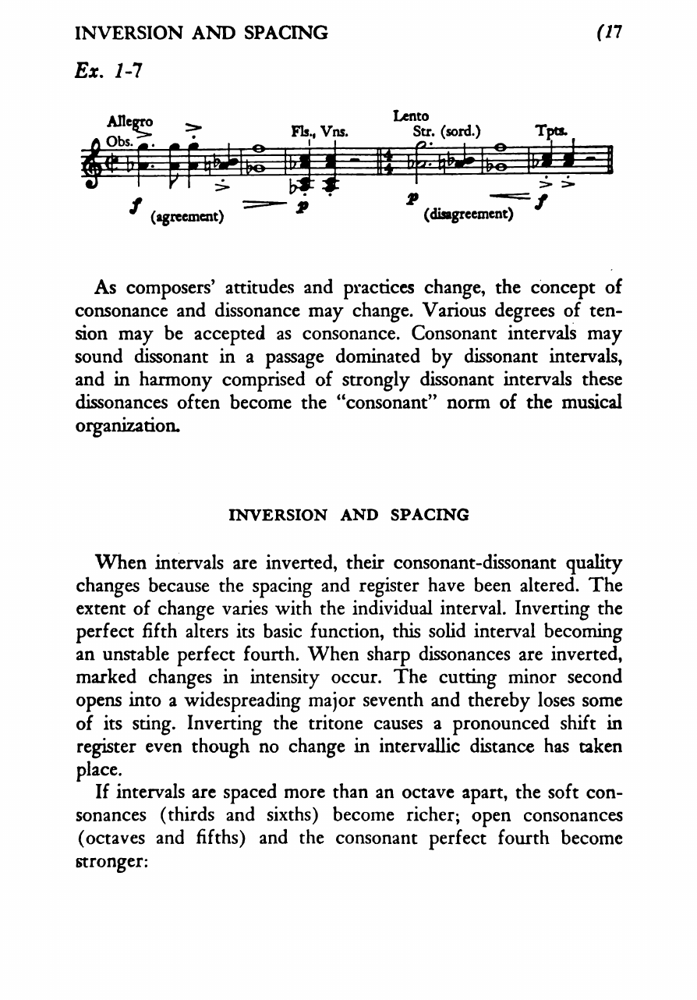
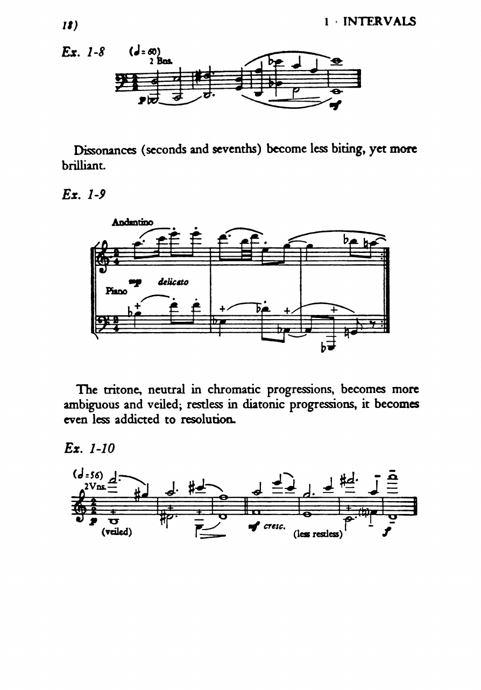

# 转位与间距

[阅读目录](README.md) · [上一节](01-construction.md) · [下一节](03-intervals-in-chords.md)

本节对应 Inversion and Spacing，印刷页 17 下部至 18。第 19 页开始下一节。你在 L4 已学过转位名称与复音程，本节要把这些操作同实际声响变化联系起来。

## 原书第 17 页

PDF 第 15 页。下半页是本节正文起点。

### 一 转位会改动哪些东西

作者说，音程转位后的协和、不协和性质可能变化，因为间距和音区改变了。先以 C4–E4 为例。把下面 C4 提高八度，得到 E4–C5；大三度转成小六度。两个音级仍是 C 与 E，但低音身份、实际距离和所在音区都不同。

**【深化】**L4 中的“度数相加为九”是识别单音程转位的口诀：三度与六度、二度与七度、四度与五度相配。它不保证互为转位的两个声音具有相同的质感、功能或张力。

| 原配置 | 操作后 | 实际改变 |
|---|---|---|
| C4–E4，大三度 | E4–C5，小六度 | 上下关系交换，4 半音变 8 半音 |
| C4–G4，纯五度 | G4–C5，纯四度 | 7 半音变 5 半音，低音改变 |
| C4–D♭4，小二度 | D♭4–C5，大七度 | 1 半音变 11 半音，近距摩擦变成宽距关系 |
| C4–F♯4，增四度 | F♯4–C5，减五度 | 仍为 6 半音，拼写与低音、音区改变 |

表中八度转移只是一个清楚的示范方向，也可把上音降低八度。不同移动方向对总音区的影响不同，比较时要写清楚做了哪种操作。

### 二 纯五度转成四度为什么是显著变化

作者称纯五度结实、纯四度不稳定。这承接前节四度的语境问题，不能脱离前后文理解为“四度永远不稳定”。

**集注：**如果你在 C 大调先听到 C–G，再把 C 放到 G 上方，低音从主音变为属音，熟悉的调性解释也会变化。若在没有明确调性感的二声部中做同样操作，仍会改变距离和声部地位，但未必产生同一种功能解释。

所以作者把听觉变化归于转位，不代表所有变化只来自“音程名称”。实验时必须留意：你是否同时引入了一个熟悉的低音、改变重音或延长了某音？

### 三 小二度与大七度都尖锐，却不一样尖锐

原文说，切割感强的小二度展开成宽广的大七度，会失去一部分 sting。两者在上一节同属 sharp dissonance，这里却比较组内差别。

**疏【重点新增】：**分组并不抹去具体配置。C4–D♭4 与 D♭4–C5 共享同一对音级，但后者把两个基音拉远了。真实声音还各有分音，因此“基音拉远”也不能简单推成“完全没有摩擦”。保持同一音色与相近时值比较，可以先听见最直接的变化。

在钢琴上不要为较宽的音程额外加力；否则更响的声音会干扰对间距的判断。也不要把较窄的音程踩更多踏板，然后把全部差别归因于转位。

### 四 三全音的距离不变为什么仍会变

十二平均律中，C4–F♯4 与 F♯4–C5 都是六个半音。作者却说音区有显著转移。可以直接列出两个频率范围：第一组较低，第二组整体位置较高，低音也换了。

这说明只保留“6”这一个数字不能完整描述声音。如果进一步把两音压成八度等价的音级集合，又会删去更多具体信息。抽象有助于看出对称性，写作仍须回到实际配置。

### 五 转位 扩展 整体移调要分开

**【重点新增】**原文随后讨论把间距拉到八度以外，这与前面的转位相关，却不是同一个操作。

| 操作 | 自拟例子 | 保留什么 | 改变什么 |
|---|---|---|---|
| 整体移调 | C4–E4 → C5–E5 | 大三度与两音的相对排列 | 两音共同提高，音区改变 |
| 音程转位 | C4–E4 → E4–C5 | 两个音级 | 上下身份、音程、音区 |
| 扩为复音程 | C4–E4 → C4–E5 | 低音、上方成员的音级 | 大三度变大十度，间距扩大 |
| 保留跨度改音区 | C4–E5 → C3–E4 | 大十度 | 整体向下移动 |

复音程的“度数加七”只适用于多一个八度时的泛音程度数。大三度跨一个八度为大十度，跨两个八度为大十七度；半音数分别是 4、16、28。性质不能仅靠度数口诀求出。

### 六 为什么作者建议比较八度以外的间距

作者提出经验性的声响变化：三度和六度展开后可以更丰厚；五度、八度和用作协和的四度可以更强健。下一页补充二度七度与三全音的情况。

这里 richer、stronger 不是音量单位。更宽的配置可能让声部更清楚、共鸣更展开，而不是让同样的触键必然产生更大的声压。还要看乐器音域是否让每一音都能有效发声。

## 原书第 18 页

PDF 第 16 页。含 Ex. 1-8、1-9、1-10。

### 七 Ex. 1-8 低音管的宽距配置

此例承接前页的“展开”。先按两个实际声部阅读，不把谱面的上下位置直接当成声部身份。观察哪一音在持续，哪一音展开，末尾怎样扩大间距。

**集注【重点新增】：**低音乐器并不必然只能在低处挤成密集配置。用较宽的间距，可能增加清晰与纵深。具体音域和演奏难度仍需要真实乐器检验。本章给的是和声手法，不是完整配器音域表。

### 八 Ex. 1-9 不协和的展开

作者说二度、七度在宽距中可能减少咬合，同时增加 brilliance。例子写给钢琴，带有轻巧的音色与触键提示。

**句读：**less biting 和 more brilliant 可以同时成立。“尖锐程度降低”不等于“暗淡”，因为声音是否闪亮还与音区、发音和高频能量有关。不要把所有听觉形容词都压到同一根紧张度刻度上。

本例左手的符号与发音安排也是谱例的一部分。初读时即使先用普通触键核对音高，也要回到原页看它为何强调特定声音效果；钢琴的持续与衰减方式会参与间距的呈现。

### 九 Ex. 1-10 展开的三全音

原文分别说：半音化环境中本来中性的三全音，展开后可以更含混、更朦胧；自然音环境中本来不安的三全音，展开后可能减少非解决不可的压力。

**疏：**C4–F♯4 扩展为 C4–F♯5，实际从增四度变增十一度，半音数从 6 变 18。它仍保留三全音的音级关系，但实际距离已经不同。作者这时讨论的是复音程扩展，不能和前页“转位后仍六个半音”混为一谈。

### 十 怎样做一次能解释结果的比较

**自拟四步：**

1. 固定音色、力度与每组持续时间，比较 C4–D♭4、D♭4–C5、C4–D♭5。
2. 写下三组分别是小二度、大七度、小九度；不要把后两者都叫“展开的小二度”后便结束分析。
3. 把每组放到同一段节奏中，比较张力与到达感。
4. 将整段降低八度，再比较一次；记录哪些结论保持、哪些发生变化。

第一步比较声响，第三步开始比较语境。听觉记录可以是“更挤”“更清楚”“更空”“更难停住”，不必强行给出一个总分。能说出条件，比给所有音程排永久名次更有用。

## 本节复习

读完应能回答：两个音级相同，为什么仍可能得到不同效果？因为实际间距、上下关系、整体音区、声部地位和发音条件仍可变化。

继续往下读时要保留这一点：下一节将和弦拆成两两音程，拆出的关系也必须带着实际排列来理解。
