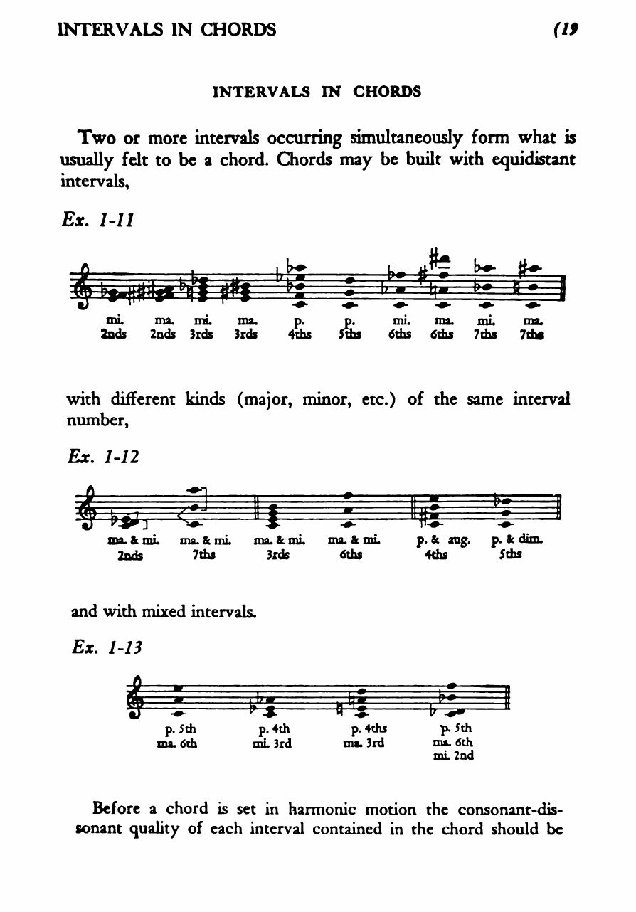
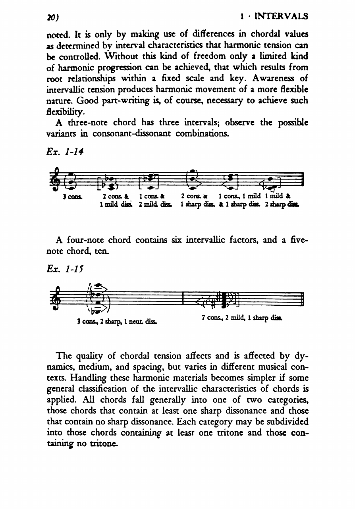
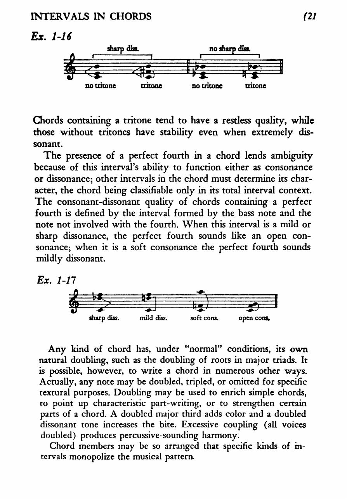
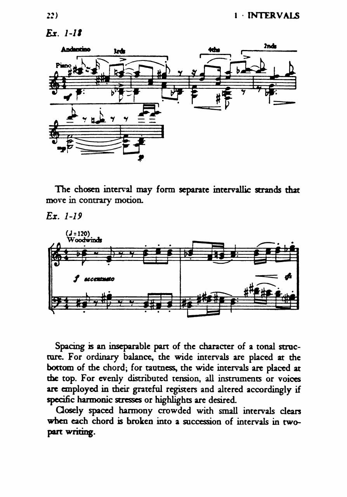
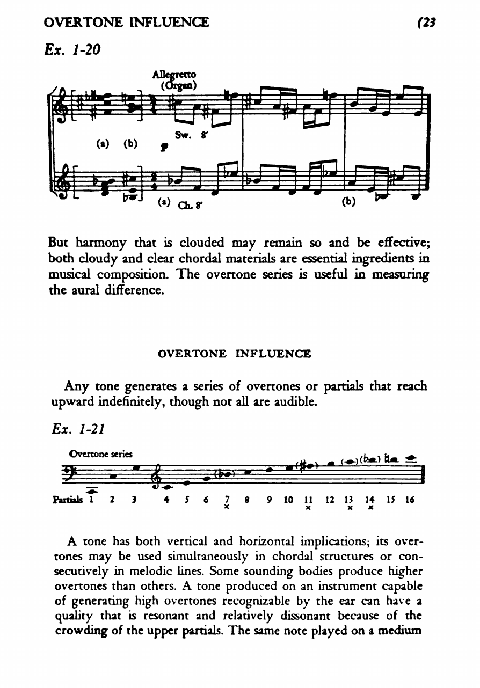

# 和弦内部的全部音程

[阅读目录](README.md) · [上一节](02-inversion-spacing.md) · [下一节](04-overtones.md)

本节对应 Intervals in Chords，印刷页 19–23 上部。它提供本章最可反复使用的方法：先听清一个和弦内部的全部关系，再研究怎样让它移动。

## 原书第 19 页

PDF 第 17 页。含 Ex. 1-11、1-12、1-13。

### 一 从两个音程到一个和弦

作者说两个或更多同时发生的音程，通常会被感知为和弦。最简单是三个音：两个相邻距离连起来，同时还出现首尾距离。

**【深化】**L5、L8 先用三和弦、七和弦建立名称。本节先把和弦看成一个纵向音组。它可以由三度组织，也可以由二度、四度或混合距离组织。由什么材料构成，与它此时有没有主属功能，是两个问题。

### 二 Ex. 1-11 等距构造

这组例子依次给出同种距离的堆叠。读谱时先找相邻音，不要先看最下面到最上面的总跨度。相邻都是小二度，与相邻都是纯五度，虽然都符合等距构造，声响密度完全不同。

**自拟算例：**

| 配置 | 相邻间距 | 全部两两间距 |
|---|---|---|
| C4–D♭4–D4 | 两个半音 | 小二度、小二度、大二度 |
| C4–D4–E4 | 两个全音 | 大二度、大二度、大三度 |
| C4–E♭4–G♭4 | 两个小三度 | 小三度、小三度、减五度 |
| C4–F4–B♭4 | 两个纯四度 | 纯四度、纯四度、小七度 |
| C3–G3–D4 | 两个纯五度 | 纯五度、纯五度、大九度 |

这张表直接显示：**生成它的相邻音程，不能概括它内部的全部关系。**两个小三度叠出减三和弦，尖锐或不安的成分还要看外侧的三全音；两个全音叠起时，外侧却出现柔和的大三度。

### 三 Ex. 1-12 同度数但不同性质的构造

作者第二种方法保留音程度数，混用大小、增减等性质。C4–E4–G4 是大三度加小三度，仍属三度构造，但不是两个完全相同的距离。

**句读：**same interval number 指“都是三度、都是四度”等泛音程度数，不是“半音数相同”。若相邻半音数必须相同，普通大小三和弦反而都不满足。

纯四度与增四度也可混合为四度构造。拼写因此重要：C–F–B 与 C–F–C♭ 不能仅因某个键盘音接近就随意互换；它们表达的成员关系不同。

### 四 Ex. 1-13 混合音程

第三种构造不要求相邻保持同一度数。可以五度加六度，可以四度加三度，也可以更多种距离并置。此处先认识构造自由，不急着给每组音找一个熟悉的根音。

**集注【重点新增】：**若每遇到一个新音组，都先移动八度、重新排列，直到看上去像某个三和弦加外音，可能会丢掉作者真正利用的实际间距。先按原配置听，再决定传统名称是否有解释力。

## 原书第 20 页

PDF 第 18 页。含 Ex. 1-14、1-15。

### 五 为什么先分析静止的和弦

本页开头承接前页：在和弦投入运动之前，应先注意它各个内部音程的性质。否则只能依靠固定音阶与调里的根音关系安排运动。作者希望扩大可控制的范围，同时立即补上 good part-writing 的必要性。

**集注【深化】：**你的 L18 提醒从低音、对位、终止读和声；这里增加“纵向音程构成”。它不会替代声部进行。两个和弦各自有趣，连接时若每条线都缺乏方向，仍不必然形成好句子。

### 六 三个音为什么有三个音程

把三个声音标成 A、B、C。可选出的两两组合是 AB、AC、BC，共三组。若只数谱面上相邻的两段，就漏了 AC。

**【重点新增】**有 n 个分开的音高位置，每对只计一次，组合数为：

$$N=\binom n2=\frac{n(n-1)}2.$$

所以三音为 3，四音为 6，五音为 10。这里只是计数关系，不是张力计算公式；十组关系不表示张力一定比三组大。

若讨论实际四声部 C3–G3–C4–E4，有六组声部对；若先合并八度等价，只保留 C、E、G 三种音级，则有三组不同音级对。两个计数回答不同问题。原书此处的入门例子无需先引入集合论，但分析倍增时要说明自己数哪一种。

### 七 Ex. 1-14 三音组的不同组合

例子把三组关系分别组合为协和、温和不协和、尖锐不协和。不要只抄例下文字；拿其中一组自己找足三对，核对分类。

**自拟完整示范一：C4–E4–G4。**C–E 大三度，E–G 小三度，C–G 纯五度。共有两个柔和协和和一个开放协和。

**自拟完整示范二：C4–E4–B4。**C–E 大三度，E–B 纯五度，C–B 大七度。它仍有两组协和关系，同时包含一组尖锐不协和。这个描述比笼统的“不协和和弦”提供更多信息。

**自拟完整示范三：C4–D4–E♭4。**C–D 大二度，D–E♭ 小二度，C–E♭ 小三度。于是恰有一组协和、一组温和不协和、一组尖锐不协和。章末练习 8 会直接用到这种构造。

### 八 Ex. 1-15 多音组不要漏掉内部关系

本例显示四音、五音配置；可按“固定第一个音，与其余音配对，再换第二个音”的顺序列出，避免重复和漏项。

**自拟四音例：C4–E4–G4–B4。**

| 音对 | 音程 | 本章起步分类 |
|---|---|---|
| C–E | 大三度 | 柔和协和 |
| C–G | 纯五度 | 开放协和 |
| C–B | 大七度 | 尖锐不协和 |
| E–G | 小三度 | 柔和协和 |
| E–B | 纯五度 | 开放协和 |
| G–B | 大三度 | 柔和协和 |

六组里只有一组尖锐关系，但若它正处在突出音区、持续很长或形成外声部，就可能对全和弦影响很大。不能简单用“五比一”投票宣布它没什么张力。

### 九 先有无尖锐关系 再有无三全音

本页末提出两次二分。第一次问是否含小二度或大七度这种尖锐关系；第二次问是否含三全音。

**【重点新增】**这给出四个起步类别，下面用自拟配置说明。先按单音程或约定的八度归约识别关系，同时在实际演奏时保留间距信息。

| 有尖锐不协和 | 有三全音 | 自拟音组 | 核对 |
|---|---|---|---|
| 无 | 无 | C4–E4–G4 | 大三、小三、纯五 |
| 无 | 有 | C4–E♭4–G♭4 | 两个小三与减五 |
| 有 | 无 | C4–E4–B4 | 大七存在，无六半音关系 |
| 有 | 有 | C4–F♯4–B4 | C–B 大七，C–F♯ 三全音，F♯–B 纯四 |

它们不是四个功能，也不是从最差到最好的排名。它们帮助你比较“尖锐摩擦”和“可能的不安感”怎样组合。复音程中的小九度等也要据实际声响说明，不能把所有八度扩展都视为听感相同。

## 原书第 21 页

PDF 第 19 页。含 Ex. 1-16、1-17。

### 十 Ex. 1-16 尖锐与不安不是同一个维度

谱例把前页的四种组合并列。随后作者说，含三全音的和弦倾向于有不安感；没有三全音的和弦，即使很不协和，也可以比较稳定。

**句读：**tend to 要读成倾向。前节已有三全音可中性的例子，本段不能把它推翻。更合理的连读是：材料层面有可利用的倾向，具体作用仍由全段决定。

**自拟听法：**先将 C4–D♭4–D4 反复三次，每次同样发音。它有强烈近距摩擦，但无三全音。再听 B3–D4–F4 放进 C 大调属功能语境。第二组没有小二度和大七度，却可以强烈指向解决。这让“粗糙”与“方向性”分开显现。

### 十一 Ex. 1-17 四度要放回整个音组

作者说，和弦中的四度具有模棱两可的性质，需要其他音程决定它如何被听到。随后给一个具体判断法：在三音配置中，检查低音与不属于该四度的那个音所形成的距离。

若该距离是温和或尖锐不协和，四度可能显得较开放、协和；若该距离是柔和协和，四度反而可能显得轻度不协和。该段属于作者的创作性听觉概括，尤其适合对照三音例子，不应把单句当作任意复杂多音和弦的定理。

**自拟 A：C4–D4–F4。**要观察的四度是 C–F，不属于它的音是 D。低音 C 与 D 是大二度。全组较显眼的摩擦是 C–D，C–F 可以成为较开阔的部分。

**自拟 B：C4–E4–F4。**要观察的仍是 C–F，不属于它的音是 E。C–E 是大三度，E–F 却产生小二度。把 C–E 先确立为柔和参照时，F 可能显得需要处理。这里还必须考虑那组 E–F，不能只查 C–E 就忽略全组。

原文这一局部判断法，与更一般的“看完整音程环境”应一起使用；四个以上音、有多个四度或多个候选低音关系时，不宜机械套一条。

### 十二 倍增与省略从规则转向具体目的

作者先承认常规配置有习惯性倍增，例如大三和弦常加倍根音；随后允许为具体织体目的加倍、三重化或省略其他音。

**集注【深化】：**L15 中完整与不完整 V7→I，研究的是特定古典四部语法如何满足解决。这里讨论更宽的创作范围。你可以突出一个色彩音、强化一条线、让某个尖锐关系更突出；是否保留某个和弦成员，要由这一目的判断。

同音或八度加倍未必增加新的音级，却会改变响度比例、音区覆盖和融合。大三度的成员被加倍可能增加色彩，不协和音被加倍可能增强咬合；具体结果还取决于音色与音量平衡。

“excessive coupling”指大量声部成组加倍所产生的厚重或打击性效果。它不是“凡加倍就是打击乐”，持续弱奏也不会仅因加倍而自动出现同样效果。

## 原书第 22 页

PDF 第 20 页。含 Ex. 1-18、1-19。

### 十三 Ex. 1-18 让某一种音程贯穿表面

前页末说可以排列和弦成员，让特定音程支配音乐图案。这里的例子分段标出三度、四度、二度等。

**【重点新增】**“支配”不表示和弦内部只有这类关系。一个四音和弦有六组音程，不能因为手型里反复出现三度，就删掉其他四组。它说的是耳朵容易追踪的配对、声部组合或织体特征。

自拟方法：右手始终弹一对三度，左手保持另一对三度，两手位置各自移动。全体垂直音组会不断变化，但三度成对的质感可以持续。先听每一对，再听合奏，比较“局部组织”与“总和弦”。

### 十四 Ex. 1-19 两条成组线可以反向运动

原文说，所选音程可形成分开的 strands，并彼此反向运动。图中木管声部被分为可辨认的两组。

**集注【深化】：**H&C 的反向进行常先指两条单线。这里每条“线”可以是一个成对音程或音组：上组整体上行，下组整体下行。全体和弦由这些组的交会产生。

读谱步骤是：先分别追踪上组和下组的节奏、方向，再在若干重音处查完整纵向关系。若一开始把所有音压成连续和弦标签，可能看不到这种生成方式。

### 十五 间距决定清晰度与重量分布

作者给出经验：通常下面留较宽距离，上面可以较密；若希望更紧绷，也可以把较宽的距离放在上部。这个“通常”需要连同音区与乐器理解。

**疏【重点新增】：**C2–E2–G2 与 C3–G3–E4 都含 C、E、G，声音密度却不同。低处密集可能带来浑厚、遮蔽和混合；上移某些成员则可能把低音与和声色彩分开。低处清晰不是永远最好的目标，下一页作者明确保留浑浊音响的创作价值。

“grateful registers”可理解为乐器或人声发音顺畅、音色适宜的音域。不是所有声部都必须处在相同八度，也不是让每件乐器以一样的力度便自然均衡。

### 十六 把密集团块拆成连续二声部音程

本页末说，密集小音程构成的和声可以通过分解为连续的两声部音程而变清楚。关键变化是时间与发音组织。

例如 C4–D4–E4–F♯4 同时按下时是一个团块；若先弹 C–D，再弹 E–F♯，听者较容易辨认两个成对动作。它不再与原始齐奏具有完全相同的垂直持续效果，恰好说明织体参与和声呈现。

## 原书第 23 页上部

PDF 第 21 页。Ex. 1-20 与其后短段结束本节；下部进入泛音。

### 十七 Ex. 1-20 齐奏团块与分解后的二声部

先找图中的 a、b 标记，对照前面的静态和音与后面的展开。作者使用管风琴，声音的持续条件与钢琴不同；分析时不要用钢琴自然衰减的直觉覆盖原谱。

观察同一材料怎样经由发音错开、声部配对与间距显示而更可分辨。然后再问，分解后是否仍保留原来想要的重量和持续感。有时变清晰也意味着失去某种混合效果。

### 十八 浑浊可以是目标

原文紧接着说，浑浊的和声也可能保持浑浊而有效，清晰与浑浊材料都可用于作曲。这个补句防止你把前面的经验误学成“凡密集都应改开”。

**集注【重点新增】：**写作判断应是：“这段需要怎样的可分辨程度？这团声音是否正好承担遮蔽、重量、压迫、远景等作用？”若你的目标是内声部清楚而结果听不见，它需要调整；若目标本来是融合成一块，就不能只凭音符拥挤宣布失败。

## 本节可重复使用的分析流程

1. 写实际音高与音区，先按原配置听。
2. 列全部两两音程，同时区分相邻距离与跨越距离。
3. 标出尖锐不协和、三全音、四度与主要协和支撑。
4. 找出最突出的一组关系：外声部、长时值、重音、特殊音色或倍增。
5. 分别追踪声部怎样连接，不仅比较静态和弦。
6. 说明这一处的作用，再与调性或功能解释对照。

**自拟小题：**比较 C4–E4–B4 与 C3–B3–E5。二者音级材料相同，前者含大三、纯五、大七；后者的实际间距变为大七、复四度和复大三度。请分别记下低音、最高音和最紧密的一组关系。若一开始就把两者写成同一个“Cmaj7 省五音”标签，尚未完成本章要求的声响分析。
