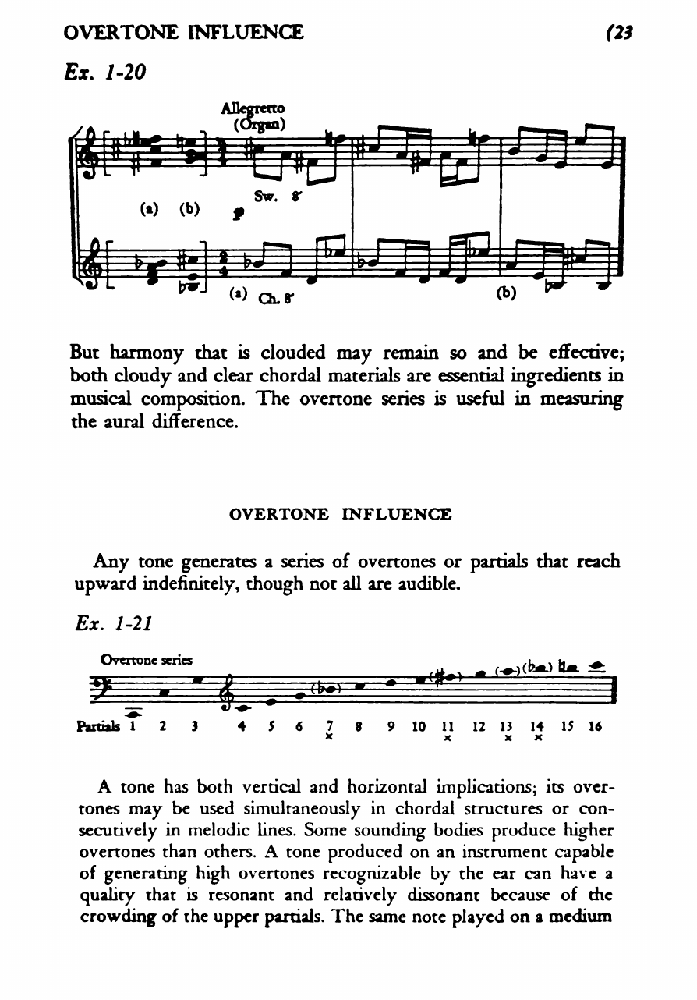
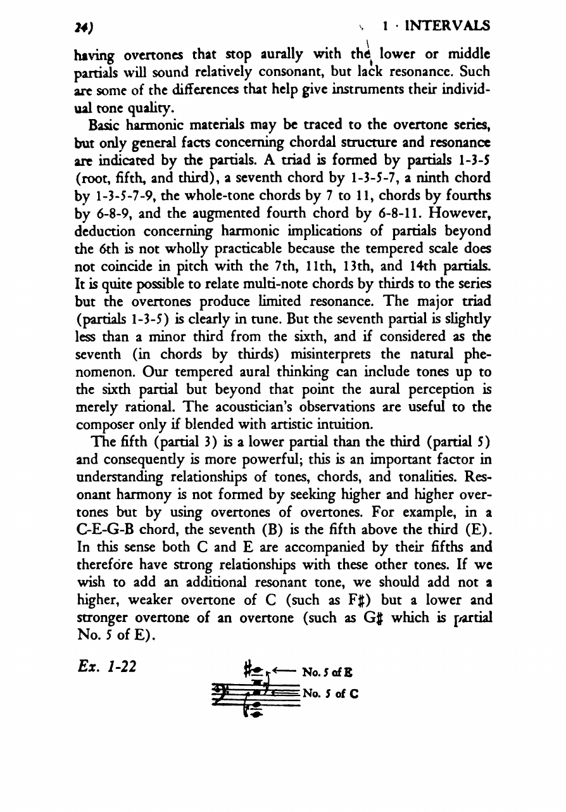
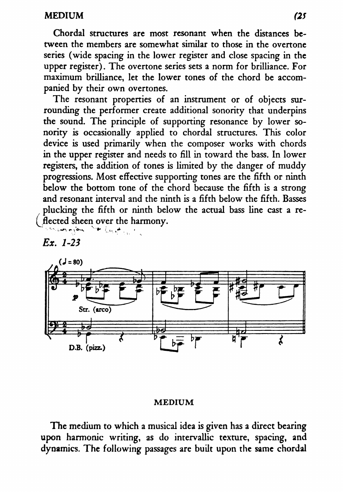

# 泛音及其解释的限度

[阅读目录](README.md) · [上一节](03-intervals-in-chords.md) · [下一节](05-medium.md)

本节对应 Overtone Influence，印刷页 23 下部至 25 上部。**【重点新增】**现有 H&C 文字笔记没有系统展开泛音列、调律差异与共鸣配置，因此这里从最基本的概念开始。公式用来核对距离，不作为评价音乐的公式。

## 原书第 23 页

PDF 第 21 页。Ex. 1-21 是本节起点；上部 Ex. 1-20 已在前节解释。

### 一 一个音符为什么不只有一个频率

先想象非常简单的周期振动，每秒重复 100 次，频率就是 100 Hz。真实乐器的一次发声通常比这个复杂：除 100 Hz 外，还可能同时有 200、300、400 Hz 等成分。许多成分共同构成一个被你听作同一音高的声音。

若这些成分的频率近似为某个基频 f 的整数倍，就得到理想的谐波序列：

$$f,2f,3f,4f,5f,\ldots$$

**基频**是这里的 f；**分音 partial**指组成复合声音的一个频率成分；**谐波 harmonic**在此专指整数倍关系的分音。**泛音 overtone**通常指基音以上的成分。因此第一分音是基音，第一泛音通常是第二分音。

原书把 overtone、partial 较宽松地连用，图却明确按 partials 编号。读 Ex. 1-21 的数字时以“第几分音”为准，避免把所有编号错后一位。

**校读：**作者说任何音都产生延伸的泛音列，适合作为传统有固定音高乐器的入门模型。实际纯正弦音没有这些额外谐波，某些敲击声的分音也不成整数倍；弦乐与钢琴等还可能偏离理想关系。不是所有声音都严格服从这列数字。

### 二 Ex. 1-21 怎样从频率倍数读出音名

先假定基音为 C。第二分音是高八度 C；第三分音再向上到 G；第四分音为更高八度的 C；第五分音接近 E；第六分音接近 G。因这些音落在不同八度，要比较音级，可以把频率除以适当的 2，移回同一八度。

例如第三分音是 3f，除以 2 后为 3f/2。故“纯五度接近 3∶2”的意思不是第三分音恰在基音上方五度，而是将它降低一个八度后，得到五度关系。

第五分音是 5f，除以 4 后为 5f/4，得到大三度。第六分音除以 4 后为 3f/2，又回到五度。这说明不同分音编号可以归到相同音级。

### 三 先把前八个分音算清楚

| 分音编号 | 若 f=100 Hz | 降回基音上方一个八度内 | 以 C 为基音的近似音名 |
|---|---|---|---|
| 1 | 100 | 1 | C |
| 2 | 200 | 1 | C，原位高八度 |
| 3 | 300 | 3/2 | G |
| 4 | 400 | 1 | C |
| 5 | 500 | 5/4 | E |
| 6 | 600 | 3/2 | G |
| 7 | 700 | 7/4 | 比平均律 B♭ 更低的音 |
| 8 | 800 | 1 | C |

100 Hz 只是便于心算的假定基频，不声称它在标准定音下就是 C。音名列表示相对于“假定为 C 的基音”的音程关系。

从表中看：相邻分音的绝对频率差都是 f，但比例 n+1 对 n 越来越接近 1。2∶1 是八度，3∶2 是五度，4∶3 是四度，5∶4 是大三度，6∶5 是小三度。越往上，相邻分音的音乐距离总体越小。

这就是后面“下宽上密”配置得到声学启发的一个来源。它不是要求把和弦机械地抄成泛音列，也不保证任意乐器照抄就得到同一种共鸣。

### 四 横向与纵向的两种启示

作者说泛音可以在和弦中同时使用，也可以变成旋律里的先后关系。若你选择 C、G、E 作为音高材料，可同时构成音组，也可先后写进线条。

**句读：**这不是说演奏者在弹 C 后“实际单独弹出了它内部的第五分音”。它说作曲可以把由泛音关系启发的音高作为独立音符来使用。实际音符与声音内部的频谱成分属于两个层面。

### 五 相同音高为什么有不同音色

本页末比较分音延伸程度不同的声音。如果较高分音显著，声音可能更明亮、更富共鸣或更复杂；若高分音弱，可能更柔和，却少一些作者所说的共鸣感。

**疏：**频率的位置只是一部分，还要看每个成分有多强、怎样起音、怎样衰减。即使两件乐器发相同基频，也可能有不同的分音强度和时间变化。不能只数“有几个泛音”就完整预测音色。

将两音合奏时，两套分音也会同时出现。某些成分接近，可能形成拍动或粗糙感；某些相合，可能有利于融合。所用音区与音色改变，交互也会改变。这给前节的间距比较增加了原因。

## 原书第 24 页

PDF 第 22 页。含 Ex. 1-22。

### 六 作者怎样从分音选出熟悉的和弦

作者依次列出若干选取方式。下面将其重排为便于核对的表，数字保留原书的分音编号。

| 原书选取 | 以 C 为基音的近似成员 | 要注意什么 |
|---|---|---|
| 1–3–5 | C、G、E | 重排可识别大三和弦，实际跨度很宽 |
| 1–3–5–7 | C、G、E、近似 B♭ | 第七分音不是平均律小七度 |
| 1–3–5–7–9 | 再加入 D | 类似九和弦材料，但不能忽略调律差异 |
| 7 至 11 | 近似 B♭、C、D、E、F♯ | 接近一组全音关系，各间距并不严格相等 |
| 6–8–9 | G、C、D | 四度与相关关系的来源之一，重排时可得到四度堆叠 |
| 6–8–11 | G、C、近似 F♯ | 结合纯四度与增四度，最后一音偏离平均律 |

**集注【重点新增】：**这表展示联系，不是“自然界已规定所有合法和弦”的证明。尤其越过低次分音，平均律音符与真实分音之间的偏差越来越不能忽略。

### 七 为什么十二平均律不是泛音列的直接抄本

十二平均律把八度分成十二个相等的频率比例步长。每一步乘以：

$$2^{1/12}.$$

k 个半音的频率比是：

$$r_k=2^{k/12}.$$

五度的平均律比是 2^(7/12)，约 1.498307；理想纯五度比 3/2=1.5，二者很接近。大三度的平均律比是 2^(4/12)，约 1.259921；分音关系 5/4=1.25，差别较明显。

这里“平均”指每个半音使用相同倍数，不是每个半音增加同样的 Hz。若总以固定 Hz 相加，跨不同音区就不能维持同样音程。

### 八 用音分量出差别

为避免只说“略高”“略低”，把一个八度分成 1200 音分 cents，平均律半音便是 100 音分。频率比 r 对应：

$$c=1200\log_2 r.$$

下表把分音降回一个八度，并与最接近的平均律音比较。正号表示该分音较高，负号表示较低。

| 分音 | 归约比 | 音分约值 | 最近平均律音 | 偏差约值 |
|---|---|---|---|---|
| 3 | 3/2 | 701.96 | G，700 | +1.96 |
| 5 | 5/4 | 386.31 | E，400 | −13.69 |
| 7 | 7/4 | 968.83 | B♭，1000 | −31.17 |
| 9 | 9/8 | 203.91 | D，200 | +3.91 |
| 11 | 11/8 | 551.32 | F♯，600 | −48.68 |
| 13 | 13/8 | 840.53 | A♭，800 | +40.53 |
| 14 | 7/4 | 968.83 | B♭，1000 | −31.17 |
| 15 | 15/8 | 1088.27 | B，1100 | −11.73 |

原书图中的特殊标记正是提醒某些音不等同于普通平均律音。第十一分音处在 F 与 F♯ 之间，更接近 F♯，但相差接近半个半音；不能毫无说明地把它写成一个准确的 F♯。

作者特别提醒第 7、11、13、14 分音；这不意味着第 5、15 分音毫无偏差，只是那些偏差在本段的论证中更突出。

### 九 第六到第七分音为何不是普通小三度

原文说，第七分音距第六分音略小于小三度。两者频率比是 7/6，对应约 266.87 音分；平均律小三度是 300 音分。

因此把 6、7 两个分音看作平均律 G–B♭，已经近似化了。再据这种近似去声称“属七和弦是精确自然产物”，会把差别隐藏起来。

**校读：**本页某些关于第六分音以后听觉判断的措辞很强。适合将其理解为作者反对机械推导高叠和弦的立场，不能当作人耳在第六分音以后突然失去听觉能力的科学界限。音分差异仍可听、可测，艺术用途也不止一种。

### 十 泛音的泛音是什么意思

作者举 C–E–G–B：G 是 C 上方的五度关系，B 又可以理解为 E 上方的五度关系。这样不是只从一个 C 一路寻找更高分音，还可以让和弦中不同成员各自得到低次关系的支持。

**【重点新增】**把“E 的五度 B”写成比值：若 E 相对 C 取 5/4，B 相对 E 取 3/2，则 B 相对 C 为：

$$\frac54\cdot\frac32=\frac{15}{8}.$$

这个 B 不是 C 的第七分音；C 的第七分音接近偏低的 B♭。这点能直接避免“七和弦七音就是第七泛音”的混淆。

作者又提到可选 E 的第五分音所指的 G♯。按音级归约的纯比计算：

$$\frac54\cdot\frac54=\frac{25}{16}.$$

它约为 772.63 音分，也不等于平均律 G♯ 的 800 音分。此处用普通音名说明关系，不能忘了调律模型。若讨论理想整数倍体系，它也可与 C 的更高编号分音联系；“泛音的泛音”强调的是构造思路，并非数学上脱离原来的整数倍结构。

### 十一 Ex. 1-22 怎样读

先找谱旁对 C 与 E 的分音标记，区别“以哪个音作为出发点”。接着回到实际和弦，观察哪些成员获得五度或三度的支持。

**集注：**这可以启发你写更有层次的纵向支撑，但不构成所有和弦都必须有一个唯一根音的证明。更不能据“某音是某人的泛音”就自动决定它应当更响或必须加倍。实际音量还受乐器频谱、发音与配器影响。

## 原书第 25 页上部

PDF 第 23 页。Ex. 1-23 与其前两段结束本节；下部进入 Medium。

### 十二 下宽上密是一种共鸣配置

作者说，和弦成员之间的间距若有些类似泛音列——低处较宽，高处较密——可以获得较好的共鸣与明亮感。

**自拟比较：**C2–E2–G2–B2 与 C2–G2–E3–B3。两组具有相同四种音级，第一组把很多较小间距挤在低处，第二组给低音更多空间，把色彩移到上部。请保持相同总时长、相近响度来听。

“类似”不是要求逐个满足 1–3–5–7，更不是禁止低音密集。上一节已说明浑浊也有价值。这里的目标是共鸣与明亮，而不是给所有音乐订一个正确排列。

### 十三 在高处和弦下加入支持音

作者接着讨论乐器与周围物体的共鸣，并提出一种色彩手法：当和弦主要在较高音区，可以用下方较低声音作支持，尤其提到在原和弦最低音下方五度或九度。

**句读：**这里的 fifth/ninth below 是以原和弦最低音为基准向下量，不能误作“调性第五级或第九级”。也不是所有和弦都自动增加一个“标准根音”。

以 C4 为原和弦最低音，自拟支持音可用其下纯五度 F3，或其下大九度 B♭2。若实际选用其他性质的九度，必须另行说明；原段的“下方五度的下方五度”对应复纯五度，也就是大九度。

为什么提到九度？从 C 向下纯五度到 F，再从 F 向下纯五度到 B♭，总共 14 个半音；按泛音程度数是九度。此时上方 C 是 B♭ 的大九度，联系到 B♭ 的第九分音关系。

### 十四 Ex. 1-23 弦乐与低音提琴拨弦

先区分弓奏弦乐与 D.B. pizz. 的发音。低音提琴不是简单持续加粗同一个音，而以独立短促的低处支持改变共鸣底色。

作者同时提醒，低音区再加音可能使进行浑浊。高处音组下加一点支持，与本来已很密的低区继续堆音，不是同一种条件。请实际检查最下面两三音之间的距离与持续长度。

## 本节复习

读完应能说明：泛音列提供频率关系与配置的启发，平均律提供另一套近似兼容的音高网格，实际和声还取决于具体声音与语境。它们有联系，也有差异。

若只记三项：第一分音包含基音；第七分音不是平均律小七度；“泛音启发一种写法”不等于“自然界证明这写法唯一正确”。
