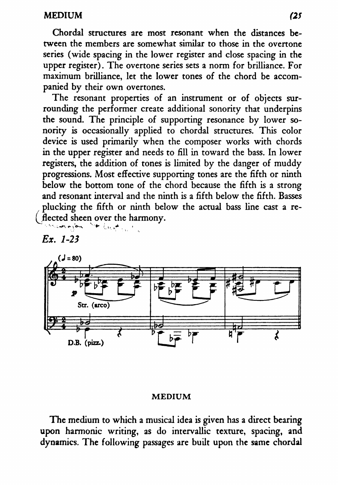
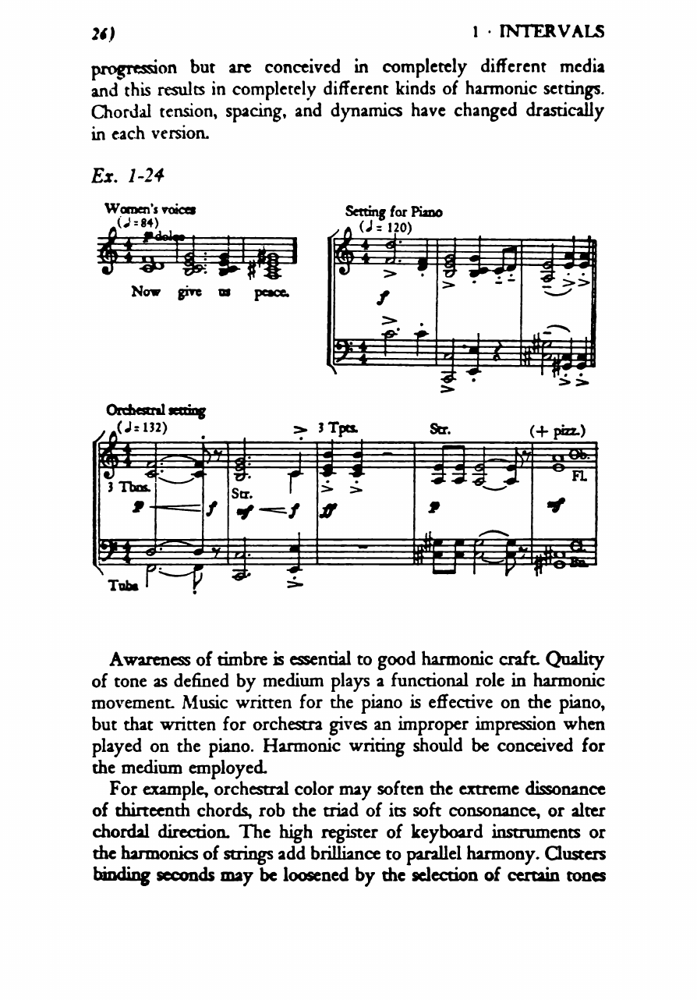
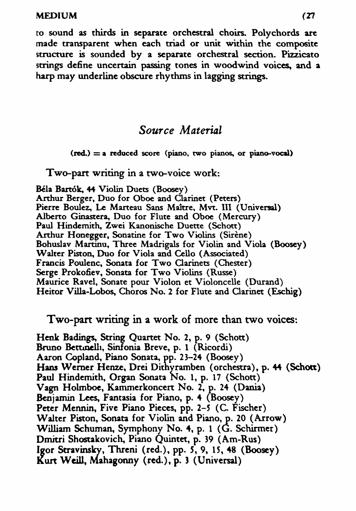

# 乐器与人声怎样参与和声

[阅读目录](README.md) · [上一节](04-overtones.md) · [下一节](06-source-material.md)

本节对应 Medium，印刷页 25 下部至 27 上部。**【重点新增】**现有 H&C 笔记主要从音高、功能、低音与声部进行解释音乐，这里将发声媒介直接放进和声判断。

## 原书第 25 页下部

PDF 第 23 页。Medium 标题下的一段从本页起，续至下页。

### 一 Medium 在这里指什么

medium 指承载音乐的发声媒介，例如女声、钢琴、管弦乐组合，或更具体的乐器与演奏法。不能把它译成音区中的“中音”，也不是指录音文件格式。

作者说，媒介像音程织体、间距与力度一样，直接影响和声写作。其含义是：同一个和弦交给不同声音，作曲者可能需要重新考虑排列、时值、倍增、节奏甚至和声运动。

**疏：**假设同一组 C4–D♭4。钢琴短促击发后逐渐衰减，两支管乐可持续保持，而两把弦乐还可在持续中渐强。即使没有换音，听觉过程已经不同。纸面上“两个音同时出现”不足以指定完整结果。

### 二 保留和弦过程不等于保留所有条件

作者预告，接下来几种版本基于同一和弦进行，却因媒介改变而具有不同设置。这里既改变乐器，也可能调整间距、力度与速度。

**校读：**它是一组作曲比较，不是严格控制其他变量的实验。因此不能从三份谱例得出某个乐器单独造成了全部差别。读谱时要分别列出哪些条件保留、哪些调整，才知道作者如何为媒介重新写作。

## 原书第 26 页

PDF 第 24 页。含 Ex. 1-24 的女声、钢琴、管弦乐三种设置。

### 三 第一种设置 女声

先看文字 “Now give us peace”、速度、dolce 与长时值。人声不是没有词义的持续音发生器。元音、辅音、呼吸、文字重音与歌唱线条共同组织和声的发出方式。

**【重点新增】**一个音组若要由几个人准确唱出，要考虑每条线能否被听见、进入时能否找到音高、是否有足够呼吸位置。仅把钢琴上按得出的音分给各声部，不代表已完成合唱写作。

本例可以先纵向检查相邻间距，再分别唱各条线。观察不协和是否通过平稳的声部进入、长时值与轻柔表达而被包容。这里“轻柔”不消除它的音程关系，而是改变它在声音中的呈现。

### 四 第二种设置 钢琴

钢琴版的速度、重音、分配与节奏不同。上下手的距离、和弦起音、低音动作使材料得到另一种轮廓。

钢琴通常在起音后衰减，踏板能延长并混合声音，但混合也可能增加残留音。原谱没有明确要求时，不要为所有和弦都加满踏板，再把累积产生的摩擦当成和弦本身的固有属性。

**集注【深化】：**L14 的键盘式声部进行给你手型与连接经验。本章提醒，适于手指的配置、适于持续合唱的配置、适于管弦乐融合的配置，可能各不相同。

### 五 第三种设置 管弦乐

看清长号、大号、小号、弦乐、长笛及拨弦等标记，观察谁承担低音、谁突出上方色彩、谁延长、谁以短音介入。配器在这里直接决定纵向音组哪部分更突出。

实际读法可以分三轮：第一轮只跟低音，观察支撑何时变化；第二轮只跟较亮的上层音，观察方向与重音；第三轮听各组的交接与叠合。这样比先压成一串钢琴和弦更能接近作者目的。

### 六 三版逐项比较

| 比较项 | 应检查的具体内容 |
|---|---|
| 材料对应 | 哪些音组或运动方向在三版中相通 |
| 音区和间距 | 哪些成员被移高、移低、拉开或聚拢 |
| 节奏 | 和弦同时起音，还是以分解、错开发声 |
| 强弱与重音 | 哪个音组被突出；整体音量怎样变化 |
| 持续 | 长音、衰减、休止、交接怎样改变混合 |
| 文字与句法 | 人声版本的词义、呼吸怎样影响到达 |
| 配器 | 一组音是融合为一个整体，还是分成可辨认的层 |

**句读：**原文说 tension、spacing、dynamics 在各版中显著改变。不要只给它们一句“同和弦不同音色”的摘要；作者实际上在示范重新构思音响。

### 七 音色可以改变和声方向的呈现

本页下段说，配器可以软化十三和弦的极端不协和、改变三和弦的柔和性质，甚至改变和声方向。

**疏：**所谓改变方向，起步可理解为“改变耳朵注意到谁、期待谁继续”。若某成员由突出的独奏乐器持续保留，它可能成为线索；若同样成员被埋进融合音组，则未必承担同样分量。到后面学习更复杂和弦与调中心时，再回头检验这一点。

十三和弦、平行和声、音簇和复合和弦在此只是预告。本章不需要你先掌握后面各章的完整定义。暂时分别理解为较多三度叠置成员的和弦、成组平行移动的和声、邻近音聚集的音组、以及多个可辨认单元并置的和声。

### 八 高频或泛音音色怎样带来明亮感

原文举键盘高音区与弦乐泛音。这里的弦乐 harmonics 还可以指特定演奏法所产生的泛音声，不能与上一节“一个声音内部总有分音”的一般讨论完全等同。

同样一组平行运动，用较轻、较高、较透明的声音呈现，可能与中低音区厚重齐奏形成不同效果。但高音区不自动等于清楚或好听；刺耳、单薄、融合不足也可能是实际结果。

## 原书第 27 页上部

PDF 第 25 页。顶部续段结束 Medium，之后为 Source Material。

### 九 把音簇分给不同乐器组

跨页句子的完整意思是：由二度紧密结合的音簇，可以通过挑出某些音、让它们在分开的乐器组中构成三度关系而松开。

**自拟示范：**C4–D4–E4–F♯4 中，相邻是三个大二度。把 C4–E4 交给一组，把 D4–F♯4 交给另一组，每组内部都是大三度，总体音级却未减少。

如果两组有不同音色、不同起音或不同音区，耳朵可能更容易追踪两个三度单元。若所有音仍以完全相同的强度和时值融合，分组效果可能较弱。配器标注必须落实到可听见的差别。

### 十 复合和弦怎样变透明

作者说，把复合结构内的每个三和弦或单元交给分开的乐器组，可以提高透明度。核心是保留各单元的可辨认性，而不是一律把整个总音组混成一个颜色。

**自拟比较：**让一组三和弦 C–E–G 与另一组 F♯–A♯–C♯ 同时出现。先用同一种持续音合在一起听，再让两组交替起音、略分音区。检查你听到的是一个复杂和弦，还是两个单元的关系。这个例子只解释分组，不预先断言它有哪种调性。

### 十一 拨弦和竖琴为什么能帮助线条与节奏

末句举拨弦弦乐帮助明确木管经过音，竖琴帮助强调较不清楚的弦乐节奏。短促清楚的起音可以标记某一时点，也可以将一条较难辨认的线加以勾勒。

**集注【深化】：**L22、L23 区分结构与装饰的思想在这里仍有效，但装饰是否能被听清还受发音影响。你不只要在分析里写“这是经过音”，也要考虑实际听者能否跟上它的运动。

## 本节实践

选一个你已写出的四和弦短句，做三种草稿：持续人声、短促键盘、两组交替发声。每版都说明哪些音保留，哪些八度、时值、倍增因媒介而改变。不要在尚未设计这些条件时，仅将乐器名称替换后宣布完成。

第一次不必追求完整配器。用两三行谱或实际音高表，先把声音设想说清楚。若要给真实演奏者使用，再核查音域、呼吸、弓法、移调和排练难度。
