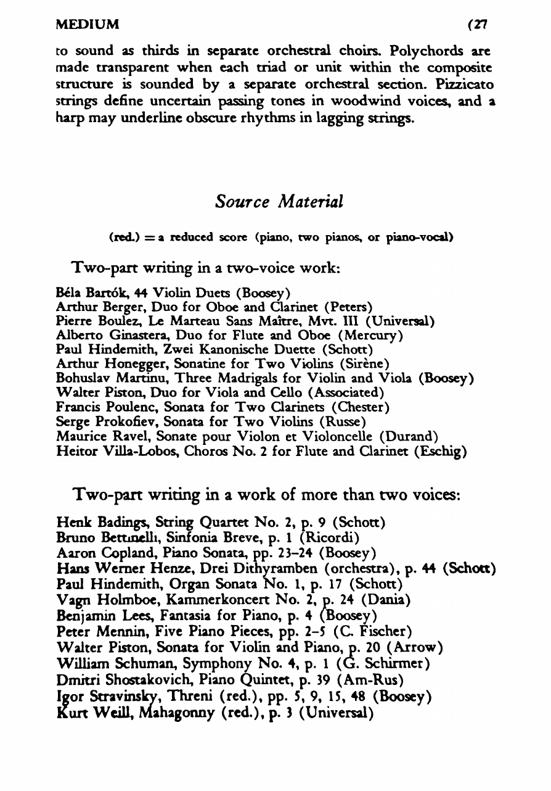
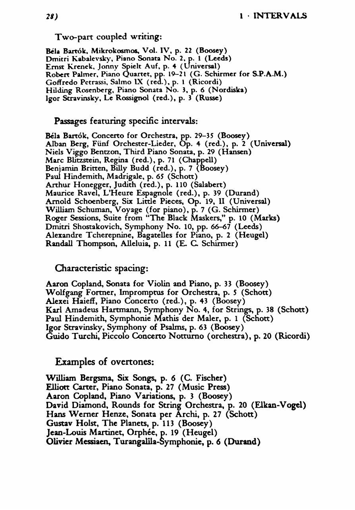
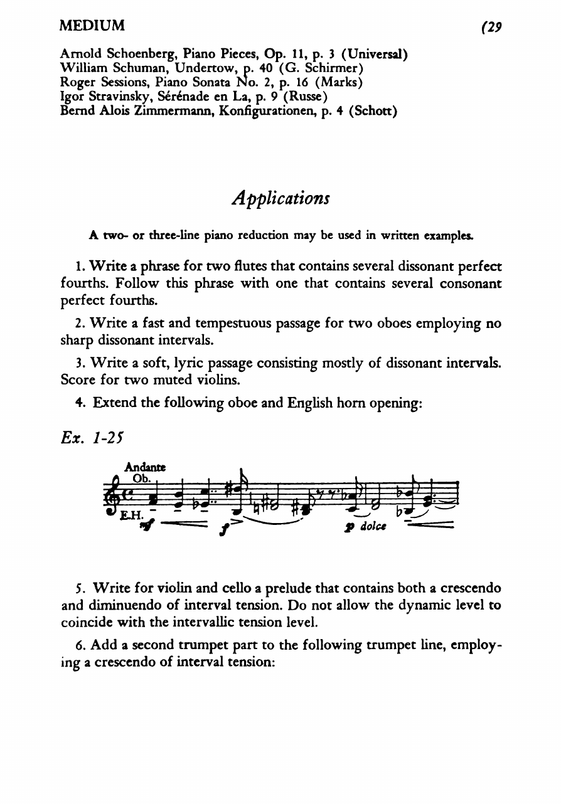

# 怎样使用作品索引

[阅读目录](README.md) · [上一节](05-medium.md) · [下一节](07-applications.md)

原书 Source Material 位于印刷页 27–29 前部。这里保存全部清单，并解释六组题头如何对应本章。它们是进一步读谱的入口，不是需要一次听完的曲单。

## 原书第 27 页

PDF 第 25 页。Source Material 从本页开始。

### 一 red. 表示缩编谱

原书先解释 red. 为 reduced score，包括钢琴、双钢琴、钢琴声乐缩编。它不表示作品原来就是钢琴独奏，也不表示已把全部配器信息保留。

**集注：**前节刚说明媒介会改变和声呈现，因此此处尤其要注意：缩编谱适合查音高、和弦和线条；若问题是音色融合、某声部是否突出，还需尽可能对照原编制总谱与演奏。

页码与出版社是作者所用版本的定位信息。换版后可能不同，找到相应乐段应继续用乐章、排练号、小节或明显主题确认，不能把这里的页码当作所有版本的固定位置。

### 二 两声部作品中的二声部写作

这一组包括 Bartók《44 首小提琴二重奏》、Berger 的双簧管与单簧管二重奏、Hindemith 的二重奏、Ravel 的小提琴与大提琴奏鸣曲等。完整名单见原页。

题头的价值在于减少干扰：整段主要由两条线构成，比较容易把每个纵向距离听出来。任务可从一小句开始：标出重拍上的音程；查看四度、三全音怎样进入和离开；只唱其中一条线；再听合起来的张力。

这与 L4 的和声/旋律音程、L18 的对位视角直接相接。新增的是不要预先要求每个不协和都按某一种古典模式解决。

### 三 多声部作品中的局部二声部

第二组包括弦乐四重奏、交响曲、钢琴与管风琴作品中的局部段落。整部作品虽有较多声部，某一处仍可能由两条主线承担组织。

**【深化】**不要把每一拍所有发出的声音都当成同样重要。先确定谁在形成主要线条，谁在加倍、支撑、延续或装饰；同时不能只因某音短便自动把它删除。它可能在音色、节奏或某次重音上很突出。

原页名单的作用是给你寻找局部简化的线索。尚未取得对应总谱前，不凭作品名假定指定页面一定含某个具体音程。

## 原书第 28 页

PDF 第 26 页。此页列出其余四组。

### 四 两条成组线的写作

Two-part coupled writing 对应正文 Ex. 1-18、1-19。它提醒你寻找的不一定是两条单音旋律，也可能是两个被成组加倍、以固定音程配对的层。

读这类谱例时，把“每组内部的关系”与“组与组之间的运动”分开。一个上行的三度对与一个下行的三度对，合成的总和弦可以很复杂，但其动作仍清楚。

### 五 突出特定音程的乐段

Passages featuring specific intervals 对应本章把某种距离作为持续特征的做法。原书列 Bartók、Berg、Britten、Ravel、Schoenberg、Shostakovich 等不同作者，不要求这些作者共享一种和声系统。

具体读法：先选八至十六个起音点，观察是否有某种距离反复出现；再看它是否只在某个声部对、某种节奏或某个音区中突出。若只统计整段所有音程次数，可能把听觉上很显著的特征冲淡。

**自查：**你说“三度支配这一段”时，能否指出是哪两条线、如何被配器或重音突出？若只能说“谱面上有很多三度”，解释还不够。

### 六 特征性的间距

Characteristic spacing 对应前文低处宽、上处密，以及为紧绷或特殊音色作其他配置的讨论。

读谱时先画出每次和弦的最低与最高音，再标出最大的相邻空隙。然后查看这道空隙是分开低音和上层，还是分开两组音色。这样可以比和弦名称更直接地看见声响重心。

可以将原配置改写成密集配置作一次比较，但必须标作自己的实验；不能据改写的钢琴效果反过来声称原作配器无效。

### 七 泛音与共鸣的例子

Examples of overtones 从本页开始，续至下一页。包括 Carter、Copland、Holst、Messiaen 等作品线索。

这组题头不保证清单中的每一例都在“按 1、2、3、4 分音严格排和弦”。可能涉及共鸣配置、泛音演奏法、特定支撑音或相关声响。应在具体总谱里确定实际做法。

**【重点新增】**听到明亮不等于已经证明用了泛音列。要回到音高、音区、发音与演奏法。反过来，图上音高接近泛音关系，也不意味着实际配器就会有同一种明亮感。

## 原书第 29 页上部

PDF 第 27 页。顶端五条继续“泛音与共鸣”清单，其后才开始 Applications。

### 八 一次读谱的记录方式

不必先写长篇赏析。用下面六项完成一小段即可：

1. 作品、版本、乐章、实际位置。
2. 这次想核对的问题，例如“四度何时显得放松”。
3. 两至四个关键时点的实际音高、音区与乐器。
4. 全部主要音程关系，以及它们怎样连接。
5. 听到的变化与可能原因。
6. 一处可以用于自己写作的具体动作。

例如最后一项可以是“把一组密集音分成两个不同音色的三度对”，不必泛写“学习大师丰富的和声”。前者可实施，也能在下一次写作中检验。

初学可以先从本书自带的短例完成这张记录，再进入清单中的真实作品。这样用同一套问题读原例、读作品、读自己的作业，知识更容易连起来。
