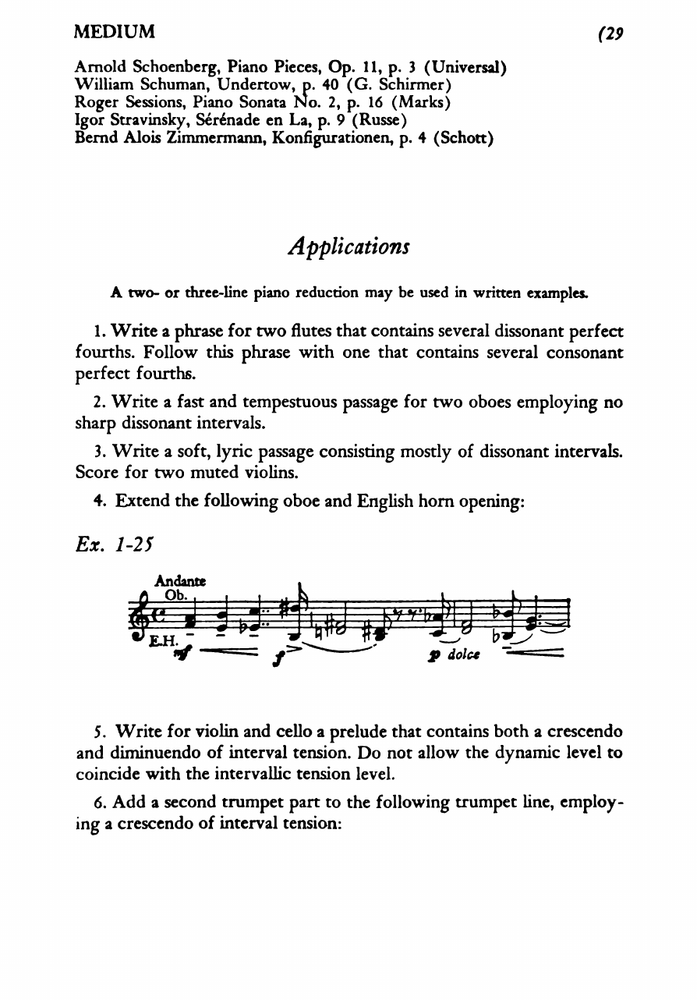
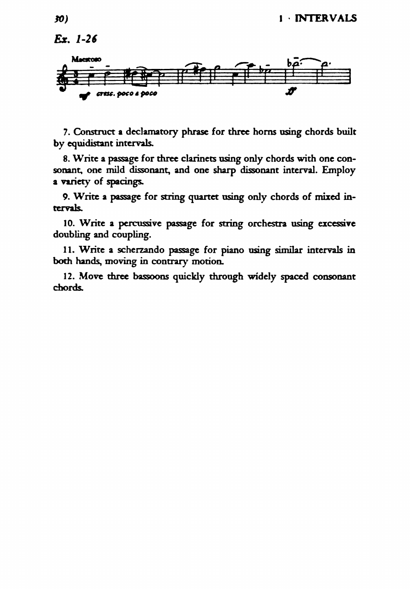

# 十二道实践题逐题疏解

[阅读目录](README.md) · [上一节](06-source-material.md) · [复习问答](review-guide.md)

原书 Applications 位于印刷页 29–30。这些是创作题，没有唯一标准成品。以下给题意、训练目标、实施步骤、起步材料与自查标准；自拟材料只负责把限制变得可操作，不冒充原书答案。

## 原书第 29 页

PDF 第 27 页。含题 1–6、Ex. 1-25；题 6 所给旋律见次页 Ex. 1-26。

### 开始前 缩编可以帮助你把工作做完整

原书允许用两行或三行钢琴缩编记谱。意思是先在有限行数上清楚呈现材料，不要求你一开始便写出复杂总谱。实际音区、声部与表情仍要标明。

本注起步音高均按**实际发声**说明，C4 为中央 C。若以后誊成给单簧管、圆号、英国管使用的分谱，再按具体乐器移调，并清楚标注记谱规则；不要把移调前后的音高混在一张分析表里。原书印出的开头继续以影印为底本，不据本注自行更改。

## 题一 两支长笛中的两种纯四度

**题意：**先写一个含数个不协和纯四度的乐句，再接一个含数个协和纯四度的乐句。关键不是将后一句全部改成五度，而是让四度本身改变作用。

**训练目标【深化】：**用语境解释四度，不只按音程名称分类。对应 Ex. 1-3。

**实施步骤：**

1. 第一乐句先建立比较明确的柔和协和背景，让四度出现在期待继续的位置，随后以级进转成三度等较熟悉的休止关系。
2. 第二乐句让二度、七度等更紧的材料占较明显位置，四度作为相对宽松的到达出现。
3. 两句都保留可唱的线条，至少使用不止一次四度，避免只有最后一个音程符合题目。

**自拟局部：**第一句可从下声部 C5 持续、上声部 E5→F5→E5 入手；F5 得到重音和稍长时值时，C5–F5 可表现为期待转回三度的四度。第二句可从 C5–D♭5 的紧密摩擦逐渐走到 C5–F5，并使四度获得较长停留。具体成句还需两声部的呼吸与方向，不应只循环这几个和音。

**自查：**把两处四度孤立弹奏，再连前后文听。差别若只靠第二句整体更轻、第一句整体更响，尚未清楚证明四度的语境安排。可先统一动态再比较。

## 题二 两支双簧管的激烈段落

**题意：**写快速、激烈的二重奏，却不用尖锐不协和音程。限制针对小二度和大七度及其需说明的复音程关系，不是禁止任何不协和。

**训练目标【重点新增】：**让节奏、重音、发音和线条承担激烈感。对应正文的 agreement/disagreement 比较。

**实施步骤：**先选择纯五度、三度、六度、大二度、小七度等允许距离；用短动机、切分、重复音、方向迅速变化和清楚重音塑造过程。不要一口气把所有可能因素都加满，先使一两种动作有效。

**自拟起步和音：**C5–D5 → D5–G5 → E5–B5 → D5–E5 → C5–E♭5。纵向依次是大二度、纯四度、纯五度、大二度、小三度，都不属尖锐组。用这串材料构成节奏鲜明的短句，再调整过大的跳进。

**自查：**检查所有实际重叠时段。若一条声部持续、另一条先换音，中间可能产生你没有登记的小二度或大七度，不能只查同时起音的点。

激烈不等于超出乐器舒适音域或写满无法换气的长句。此题练表达与材料的独立安排，实际可演奏性仍属于完成度。

## 题三 两把弱音小提琴的柔和抒情段落

**题意：**主要采用不协和音程，却写得柔和、抒情；指定两把加弱音器的小提琴。题目是 mostly，不要求每一瞬间都不协和。

**训练目标【重点新增】：**持续摩擦可以承载细腻线条，音程分类不等于固定情绪。

**实施步骤：**选一个缓慢、可呼吸的动机；让两条线以平稳运动形成二度、七度或其他不协和；在句末用时值、动态或音区收束建立到达。适当让一声部保持，另一声部轻微变化，会更容易听清摩擦的变化。

**自拟起步和音：**C5–D5 → B4–C5 → A4–B4 → G4–A4。它们依次是大二、小二、大二、大二度。可将其扩为宽距、改变部分声部八度，再比较近处的紧绷与宽处的悬浮。

**自查：**分别唱两条线，避免只是上下机械平移。再检查，柔和是否由实际的弱奏、连贯与句法实现，而不是标题写上“抒情”就算完成。若用合成播放，没有真实弱音器音色时，应把这次判断限于音高、节奏和力度布局。

## 题四 续写双簧管与英国管开头

**题意：**延长 Ex. 1-25 给定开头。此题没有附加一个简单的全段音程限制，而是要求从已给音乐中读出可延续的特点。

**训练目标【深化】：**把材料分析转为续写，保留旧课关于动机、重复、发展和乐句的经验。

### Ex. 1-25 的读法

先按原页确定两条声部、拍号、速度与动态；再圈出节奏动机、持续音、两线的同向或反向运动。特别留意四度、三全音、二度等关系是否在特定位置反复。

**实施步骤：**第一轮只写一句“这个开头最可辨认的动作是什么”。第二轮选其中一个节奏或轮廓作变化，而不是同时换掉全部特征。第三轮决定续段总体张力：继续增压、先松后紧、或者走向相对休止。最后检查每条线能否单独成立。

给自己两版短续句很有用：A 版保留节奏而改音程组合；B 版保留某个音程特征而改节奏。比较哪版更像同一乐思的继续。它们是练习方法，不是原书额外规定的题数。

**自查：**遮住原开头，仅听续写是否独立成句；再接上开头，听两者是否有联系。独立成立与能接得上要分别满足。

## 题五 音程张力与力度不重合的前奏曲

**题意：**为小提琴与大提琴写一段前奏曲，包含音程张力的增强与减弱，同时不要让力度水平与音程张力水平相重合。

**训练目标【重点新增】：**单独设计两个过程。原文不是仅要求“一次渐强或渐弱”，而是要求音程张力自身也有起伏。

**自拟布局：**

| 乐段 | 音程张力目标 | 力度目标 | 可采用的动作 |
|---|---|---|---|
| A | 较松走向较紧 | 渐弱 | 五度、三六度逐渐引入七度或近距摩擦 |
| B | 较紧走向较松 | 渐强 | 大七、小二等转向较开放配置 |

若将这一布局细化为八个和音，先在每个和音上标张力预期，再单独写动态。完成后以统一力度播放一次，检验音程过程是否仍可感知；再恢复动态，比较两条过程如何叠合。

**自查：**张力不应只靠“进入大提琴低区就变浑”来实现，除非你明确把音区也作为本次变量。初次可尽量保持整体音区，再安排间距与音程变化。最终完整音乐可综合运用，但应知道每一步用了什么。

这题不是要你永久避免音量与张力同向，而是通过一次有意分离，让你学会分别控制。

## 题六 为给定小号旋律加第二声部

**题意：**为次页 Ex. 1-26 的小号旋律写第二小号声部，形成音程张力的渐增。

**训练目标：**上声部已定时，通过另一个声部改变纵向过程。与写一串自由和弦相比，限制更具体。

**实施步骤：**将给定旋律按起音点抄到草稿；在下方先写期望的音程类别；再据上声部反推第二声部实际音高；最后把反推得到的音列当作旋律唱一遍，修正无目的的跳进。

你可以先安排开阔或柔和关系，逐渐增添温和不协和，最后让尖锐关系占据更突出的位置。四度、三全音与复音程的具体位置不能只凭表格排序，要放回整个句子试听。

**自查：**上声部已标的渐强不能替代音程张力的渐增。统一音量再听，是本题最直接的检查。也不必要求每相邻一个起音都严格“更紧”；可有局部回落，但总体过程要清楚。

## 原书第 30 页

PDF 第 28 页。含 Ex. 1-26 与题 7–12。

### Ex. 1-26 的读法

先把谱上给出的单线视为固定材料，区分连线、延音与新起音。若旋律一音被保持，新增声部变化时仍会形成新的和声音程，这些时点都应记录。原有表情标记是开头设想的一部分，续写时需要回应。

本注不把扫描谱例另行凭记忆转录为音名序列。实际练习以影印核对临时记号和八度位置，避免因一次抄错把全部后续配音移位。

## 题七 三支圆号的等距和弦

**题意：**为三支圆号写一个宣叙性的乐句，使用由等距音程构成的和弦。对应 Ex. 1-11。

**训练目标【重点新增】：**在材料限制下，通过节奏、发音、音区形成有姿态的陈述。

**疏：**declamatory 指清楚、有言说姿态的陈述，不等于全段每拍都最强。等距应先落实为每个和弦相邻两段具有相同距离，例如 C4–E4–G♯4 的两个大三度，或 C4–F4–B♭4 的两个纯四度。外侧距离自然不同，不能要求所有三对音程都相等。

**实施步骤：**先只用一种等距结构写三四个和弦；给它们一个具有停顿与重音的节奏；再决定是否切换到另一种等距结构。原题没有明确要求全段只用同一种堆叠距离，初练固定一种便于听清。

**自查：**三个声部都要有可演奏的连接。若要正式写 F 调圆号分谱，实际发声 C4–E4–G♯4 对应常规记谱 G4–B4–D♯5；先保持一种记谱基准完成和声分析，再整体转换。

## 题八 三支单簧管的三种音程组合

**题意：**每个和弦恰含一组协和、一组温和不协和、一组尖锐不协和；使用多种间距。此题必须数全部三对关系。

**训练目标【重点新增】：**把抽象类别转换成可核算的三音材料，再比较配置。

**自拟起步：C4–D4–E♭4。**C–D 为大二度，温和不协和；D–E♭ 为小二度，尖锐不协和；C–E♭ 为小三度，协和。刚好符合。

可整体移调为 D4–E4–F4、E4–F♯4–G4，保持间距结构，再试将一音或多音移高八度。例如 C4–D5–E♭5 保留一组大九度、一组小二度、一组小十度；分类时注明复音程归属，并实际比较尖锐感的分布。

**重要条件：**不要假设任意转位仍符合“一温和一尖锐”。例如 C4–E♭4–D5 的 C–D 是大九度、E♭–D 是大七度、C–E♭ 是小三度，仍能保留三类；但每做一次改位都要重新核对，而不是凭音级集名称直接通过。若某次扩展已让原本尖锐关系在听觉上显著软化，也应在评语里说明分类与具体声响的差别。

**自查：**给每个和弦写三行小表，不能只标低音到上两音。也要检查各声部交叉后是否改变你原先写下的实际配置。使用 B♭ 调单簧管时，先按实际发声写完整，再统一转换分谱。

## 题九 弦乐四重奏的混合音程和弦

**题意：**只使用混合音程构成的和弦。对应 Ex. 1-13，而不是把所有和弦都变成完全同一种堆叠。

**训练目标：**从多种距离组织纵向结构，并让四条线保持连续。

**自拟起步：C3–G3–B3–D♯4。**相邻依次为纯五度、大三度、大三度；它不是等距结构，也不全属同一音程度数。另一种可以试 C3–E3–F♯3–B3，相邻为大三度、大二度、纯四度。

先为大提琴与第一小提琴写清楚的外声部，再补中间两条线，或先写两组配对线再合成。两种方法都可以，但不能只对每一拍拼一个有趣形状，忽略中提琴与第二小提琴的运动。

**自查：**逐和弦核对相邻构造，再检查全部六组关系。混合的构造不保证全体不会出现某种音程集中，也不保证声音自动丰富；仍要靠节奏、音区、连接塑形。

## 题十 弦乐队中的打击性和声

**题意：**用大量倍增与成组加倍，为弦乐队写一个带打击性的段落。

**训练目标【重点新增】：**加倍不只是维持和弦完整，也可以主动制造重量与发音效果。对应正文第 21 页。

**实施步骤：**先写很短、起音清楚的节奏单元；让几组弦乐在同音或八度上加倍关键成员；通过一致的发音、明确重音与适度休止，使齐奏起音可被辨认。先只改变一次加倍比例，比较“厚”与“钝”是否不同。

**自查：**若所有声部都长时值弱奏、起音模糊，即使加倍很多，未必符合你想要的打击性。若全部效果来自另加打击乐，也偏离本题训练目的。它要求在弦乐发声与倍增本身寻找效果。

作品层面的实际弓法、分弓、音区和演奏速度需要另核。不要为追求厚重就让所有声部长期处在难发声的极端位置。

## 题十一 钢琴两手的相似音程与反向运动

**题意：**写诙谐、轻巧的段落，两手使用相似的音程组合，并向相反方向运动。对应 Ex. 1-19 的成组线条。

**训练目标【深化】：**将反向进行从两条单线扩展到两组音程。

**自拟起步：**右手 E4–G4 → F4–A♭4 → G4–B♭4，三组小三度上行；左手 C3–E♭3 → B2–D3 → A2–C3，三组小三度下行。两手内部结构相似，总体和弦关系随两组分离而变化。

在此基础上加一个短休止或错位重音，让 scherzando 由节奏与发音体现；可以适当变化重复模式，避免只得到练指序列。总纵向音组还应重新核对，不能只关注两手内部的三度。

**自查：**两手方向是否在关键段落清楚相反？相似音程是否确实可辨？是否需要为了看起来反向而写出不方便的手型？完成时应能分别描述局部两音组和总和弦。

## 题十二 三支低音管的宽距协和运动

**题意：**让三支低音管快速穿过宽间距的协和和弦。它把“较低的乐器”“快速”“宽距”“协和”几个条件合在一起。

**训练目标【重点新增】：**在指定媒介里组织间距，避免只把和弦整体压在低处。对应 Ex. 1-8 与间距讨论。

**自拟起步：C3–G3–E4 → D3–A3–F4 → E3–B3–G4。**每组都是拉开的大小三和弦配置，包含五度、六度与复三度关系，可作短草稿。这个序列展示结构，不等于已证明适合任意速度或任意水平的演奏者。

先用中速检查三条线，再提高速度。不要为了和弦总跨度宽，就让每个声部都不断大跳；总配置宽与单声部运动平稳完全可以共存。

**自查：**各组三音是否都符合所选的协和条件？低处是否拥挤？最快的声部是否能换气、连接是否合理？若某个转位引入四度，要说明为何在这里作为协和使用，而非仅因它属于三和弦便略过。

## 十二题如何安排才容易消化

第一轮先做题 1、2、3，每题四至八小节，目标是把音程类别与表情分开。第二轮做题 5、8、11，集中训练张力过程、全部音程核对与成组反向运动。第三轮再做 4、6、7、9、10、12，将续写、配器和较复杂织体加入。

这个次序是本注的学习建议，原书没有要求按此分轮。初练篇幅也可更短；关键是每题的限制真正落在声音中。

## 每题通用的完成标准

先确认题目限制，再听句子是否成立。写完至少保留：一份能辨认各声部的谱或音高表；必要的速度、力度、发音与句法标记；两三个关键纵向的音程分析；一段说明预期效果与实际听感的短评。

如果限制全对却没有可听出的乐思，回到重复、变化、停顿与方向。若乐思有效却违反限制，先检查是否误解了某个音程，必要时改配置。创作题需要同时照顾材料与表达。
