# 二十世纪和声第一章章句集注合订本

[分册目录](README.md) · [复习问答](review-guide.md) · [术语校读](editorial-notes.md) · [听觉比较](listening/README.md)

底本为本地英文扫描本，印刷页13–30，PDF第11–28页。正文沿原书次序展开；同页跨节时重复显示原页。前置课程对照为本注补充。分册与本合订本正文相同。

# 已有知识与新增问题

## 一 从一个熟悉的问题开始

你在 H&C Lesson 15 学过属七和弦解决。在 C 大调中，G–B–D–F 接到 C–E–G，B 常上行到 C，F 常下行到 E。这里至少同时发生三件事：一个属功能走向主功能，两条声部按各自倾向运动，B–F 的三全音变成 C–E 的三度关系。

旧课着重说明前两项怎样在古典语法里相互支持。本章会把第三项单独展开：如果没有明确的 V–I，能不能仍组织一个可听出的紧张与放松过程？如果 B–F 保持不动，换音区、速度、力度和乐器，听起来又会怎样？

所以你不必先把旧知识全部推倒。真正要改变的是提问习惯：看到一个和音，先把“它属于哪个调、是什么功能”暂放一旁，再问“它内部有哪些距离、怎样排列、怎样发声、前后是什么环境”。之后可以把两类解释重新合起来。

## 二 你的课程笔记已经给出的工具

| 工具 | 笔记对应 | 本章怎样使用 |
|---|---|---|
| 旋律音程与和声音程 | L4 | 分别观察横向线条与同时发生的纵向距离 |
| 音程度数、性质、转位、复音程 | L4 | 精确说出改变了什么，进一步比较听感 |
| 三和弦、七和弦、转位 | L5、L7、L8、L25 | 作为熟悉的音组，再检查其全部内部音程 |
| 音级、罗马数字、和弦成员、数字低音的区别 | L6、L9 | 避免把实际音程与调性身份混写 |
| 外音与声部进行 | L10、L14、L15、L23、L24 | 解释某些紧张来自线条，但不预设所有紧张都是外音 |
| 终止与乐句 | L11、L12 | 认识张力在时间中的作用，并比较其他形成句末的方法 |
| 功能、低音、对位、终止多角度分析 | L17–L22 | 保留语境意识，加入音程构成和音色的视角 |
| 应用属和弦 | L26 | 识别局部导音与解决倾向，区别于无指定目标的音程紧张 |
| 经过性的 V6 | 当前项目 L27 | 看见“和弦名称相同，作用仍要看线条”的具体实例 |

这里的“已有”只表示笔记出现过。有些课次主要由图片承担，文字很短；不据此推定你已经掌握四部和声的全部细则。

## 三 本章需要重点增加的知识

### 1 音程的声响与调性作用可以分别描述

**【重点新增】**C4–D♭4 是紧邻的小二度。无论它最后怎样使用，两个音靠近、同时持续时往往具有鲜明的摩擦感。但它是否应当解决到 C、是否是某个属功能的一部分、是否可以当作全段常态，还要看音乐怎样组织。

你可以写一段始终使用小二度的音乐，末尾突然出现纯五度。纯五度可能因过分突兀而成为事件；这不意味着小二度的频率距离变了。**局部声响特征与全段的常态、偏离、到达，是相关而不同的问题。**

本章说“协和”“不协和”时，有时偏向声响质感，有时偏向语境中的稳定程度。阅读时要问它在说哪一层，不能把所有句子压成一条绝对等级。

### 2 同一音程的实际配置属于音乐内容

**【深化】**L4 给你转位、复音程的识别。现在还要比较：C4–D♭4，C4–D♭5，C2–D♭2，C6–D♭6。它们有的共享音程类别，有的共享音程名称，听起来却未必相近。

“音名一样”没有指定八度、间距、声部位置、力度和时值。分析时把这些信息删去，可以看清某些结构；写作时必须把它们重新放回去。

### 3 和弦的全部两两音程都值得检查

**【重点新增】**C–E–G 的三个音之间有 C–E、E–G、C–G 三组关系。C–D–E 也有三组：C–D、D–E、C–E。后者虽然相邻是两个大二度，整体仍含一个大三度。

这让你能研究许多不必先命名为某个古典和弦的音组。名称仍然方便，但“说出名字”与“说明为什么这样响”是两个任务。

### 4 张力曲线可以独立于音量曲线安排

**【重点新增】**一段音乐可以越弹越轻，同时从纯五度走向小二度。另一段可以越来越响，同时从大七度走向八度。原书练习 2、3、5 都在拆开习惯性的绑定。

你在 L12 接触过发展段的碎片化与加速；现在增加另一条可单独设计的过程：音程材料怎样逐渐变尖、变柔、变空、变密。

### 5 泛音和配器进入和声分析

**【重点新增】**音符表示一个基本音高，真实乐器往往同时发出许多分音。低音中密集排列的和弦、较高音区的同一音组、持续弦乐与短促钢琴，可能产生明显不同的清晰度和融合程度。

本章只建立必要的声学与配器入门，不要求先修大学物理。先说明基音、分音、频率比，再用数值解释平均律和泛音列怎样相近、又怎样不同。

## 四 四个旧习惯需要加上适用条件

### 1 不是每一个不协和音都要登记成外音

在 L10、L23、L24 的古典分析里，经过音、邻音、倚音等依赖一套可辨认的和声背景。若全段稳定地把 C–D–E 作为结构音组，不能仅因含二度就把 D 删掉，宣布“真正和声一定是 C–E”。要有节奏、重复、线条或终止等证据。

### 2 纯四度的传统处理不能自动推广到全书

终止四六中的四度有明确的低音和解决方向。那是一种具体语法。本章还讨论四度和弦、不同周围材料中的四度，以及四度作为相对休息点的可能。只有说出所处语境，两种说法才不矛盾。

### 3 没有 V–I 不等于没有方向

方向还可能来自音区上升、节奏变密、声音聚拢、音程张力增大、逐步撤去声部、回到反复出现的音组。本章提供其中的一部分。是否形成完整形式仍要看实际音乐，不能只凭“张力上升”四字推定。

### 4 新的允许范围不会替你写好旋律

作者允许任何音连接任何音，并不替你决定什么时候需要重复、跳进、停顿和对比。旧课培养的线条意识在这里仍然重要。一次纵向配置有效，前后的声部连接也要听起来有理由。

## 五 三组最容易混淆的词

| 词组 | 如何区分 | 自拟例子 |
|---|---|---|
| 大二度与大调二级 | 一个说两音距离，一个说相对于主音的位置 | C–D 是大二度；C 大调的第二级是 D |
| 音程转位与和弦转位 | 前者交换两个音的上下关系，后者改变哪个和弦成员在低音 | C4–E4 → E4–C5；C–E–G → E–G–C |
| 音色与力度 | 前者涉及声音的频谱和发音形态，后者涉及强弱；实际演奏中常互相影响 | 同样标 p 的长笛和钢琴不会发出同一种声音 |
| 密集与不协和 | 一个说排列，一个说特定语境中的声响或稳定性 | C4–E4–G4 密集而无尖锐不协和；C3–B4 很宽却含复大七度 |
| 紧张与粗糙 | 紧张可以来自期待、节奏、方向；粗糙偏向声音交互产生的听感 | 很轻的导音也可有明确期待；一团持续噪声未必指向某个终点 |
| 共鸣与协和 | 共鸣涉及声体或频谱的响应、融合；协和还涉及风格和语境 | 强烈共鸣的声音仍可能包含尖锐摩擦 |

## 六 开始阅读前的自测

1. 能否认出 C4–F4 是纯四度，而 C4–F♯4 是增四度？
2. 能否说明 C4–E5 是大十度，既有大三度的成员关系，又有不同的实际间距？
3. 能否把 C4–E4–B4 的三组距离全部列出？
4. 能否听一段没有明确终止式的短句，并尝试说明哪一处比较紧张、用了什么因素？

前三题的起步答案：纯四度为五个半音，增四度为六个半音；大十度为十六个半音；C4–E4、E4–B4、C4–B4 分别是大三度、纯五度、大七度。第四题没有固定答案，但说明必须指向具体声音，而不能只说“有现代感”。

---

# 构成与语境中的音程张力

本节对应章首与 Construction，印刷页 13–17 上部。核心问题是：当和声不预先限定在一套功能进行里，怎样仍能比较不同音程，并让它们形成有方向的音乐？

## 原书第 13 页

PDF 第 11 页。全页底本如下。

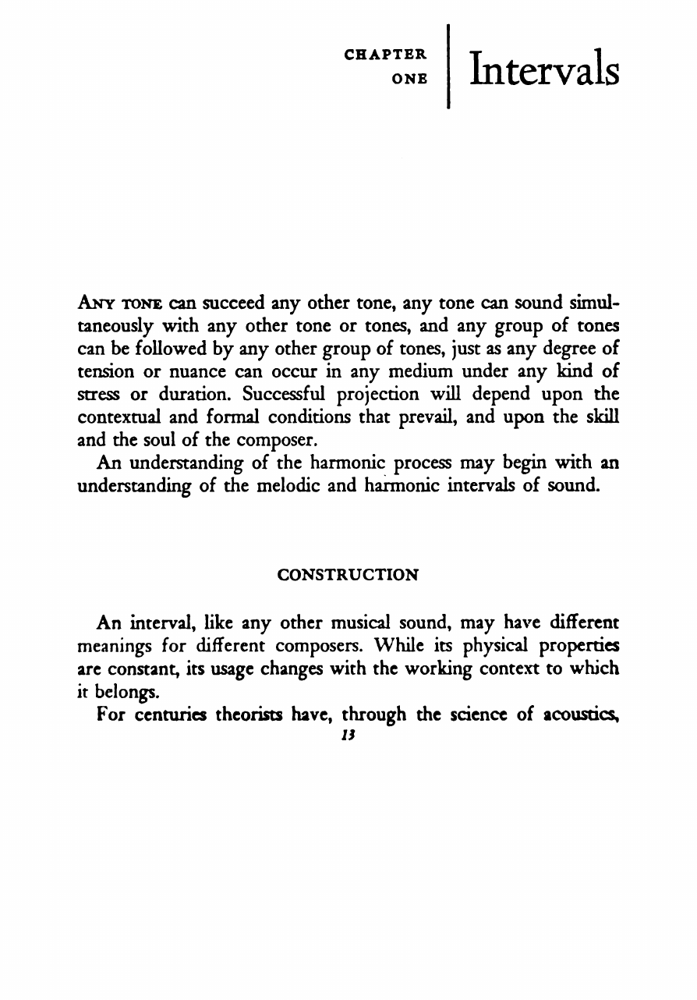

### 一 开篇列出的三个自由

**这段在干什么：**先扩大可用材料和连接的范围。原文依次说单音的先后、单音的同时结合、音组之间的先后连接。

“Any tone can succeed any other tone”谈的是横向：旋律的下一音可以是什么。“sound simultaneously”谈的是纵向：两个或多个音可以同时出现。随后扩大到一组音之后接另一组音。接着又说张力、色调、媒介、重音与时值的组合，说明自由不只发生在音高。

**句读：**这里的 can 是“可以成为创作选择”，不能译成“随便怎样都同样有效”。下句马上提出条件：效果取决于上下文、形式和作曲者的能力。一个音组是否站得住，要看它之前怎样被准备、出现时怎样发音、之后怎样继续。

**集注【深化】：**你的 L16 用常用和弦组合建立词汇，L17–L26 学习词汇的功能。本章则先允许材料越出这张词汇表，再研究怎样听清和控制它。两种教学任务不同。

### 二 作者为什么从音程开始

**这段在干什么：**给全书选一个足够小、又能连接旋律与和声的单位。

只看一个音，不能谈“两个音之间的距离”。两个音就能形成音程：先后出现时是旋律音程，同时出现时是和声音程。这一点在 L4 已有。新增问题是：相同的距离放在不同位置，是否承担相同的作用？

自拟比较：先弹 G3–B3–D4–F4，再接 C3–E4–G4。B–F 处于属七和弦里，具有熟悉的解决倾向。另写一串不断平移的三全音 C4–F♯4、D4–G♯4、E4–A♯4。后者同样含三全音，但没有凭音程名称就能唯一确定的“正确解决目标”。

### 三 物理特征与音乐用法为什么要分开

Construction 第一段把“物理性质”与“在创作环境里的用途”分开。对指定的两个声音，可以比较频率、分音和实际距离；但说它是开端、装饰、延宕、高潮或句末，需要时间中的语境。

**疏【重点新增】：**不要把“物理性质恒定”读成“所有小二度在任何乐器和音区都听起来一样”。音程名称只规定一部分关系。音区、调律、音色和响度变动时，声音条件已经变了。作者要保留的是材料可辨认的特性，同时承认它的音乐意义会变化。

读完本页，可以用两句话检查理解：“我准备用什么音程材料？”“我准备怎样让它在这段音乐中成立？”第一句不能代替第二句。

## 原书第 14 页

PDF 第 12 页。此页含 Ex. 1-1。

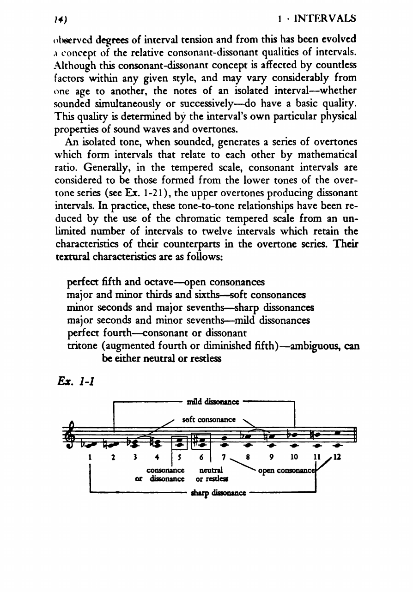

### 四 泛音的引入先为分类提供听觉背景

作者先说，单音的分音之间存在可用数比描述的关系，较低分音形成的距离通常与熟悉的协和关系相联。详细声学放到后面的 Overtone Influence；在这里先把它当作分类的一个背景。

**校读：**泛音列并不自动推出一套适用于所有文化、乐器、音区的协和法则。作者这页已承认时代与风格的差异，后面又指出高次分音与平均律不合。阅读时应同时保留这两层限定。

### 五 六组名称具体说什么

**【重点新增】**原书用下面六组描述来整理十二种八度以内的半音距离。这里的数值列为本注补充，按十二平均律计算。表中的“典型感觉”是帮助比较的语言，不是对每次聆听的保证。

| 半音数 | 常用拼写 | 原书类别 | 起步时可以听什么 |
|---|---|---|---|
| 1 | 小二度 | sharp dissonance，尖锐不协和 | 相邻音的摩擦、挤压 |
| 2 | 大二度 | mild dissonance，温和不协和 | 仍有分离和摩擦，但通常不如小二度尖 |
| 3 | 小三度 | soft consonance，柔和协和 | 三度的融合与色彩 |
| 4 | 大三度 | soft consonance | 与小三度比较明暗及密度，避免只套情绪标签 |
| 5 | 纯四度 | 可协和，也可不协和 | 周围材料和低音关系尤其重要 |
| 6 | 增四度或减五度 | ambiguous，模棱两可 | 可以显得中性，也可以显得不安 |
| 7 | 纯五度 | open consonance，开放协和 | 开阔、空心、融合 |
| 8 | 小六度 | soft consonance | 三度转位后的另一种间距 |
| 9 | 大六度 | soft consonance | 与三度比较开放程度 |
| 10 | 小七度 | mild dissonance | 宽阔的温和摩擦 |
| 11 | 大七度 | sharp dissonance | 接近八度又未重合的紧张 |
| 12 | 纯八度 | open consonance | 音高层级相差一倍，常有强烈同一性 |

同度没有在 Ex. 1-1 的 1–12 半音图中单列；它仍是实际音乐中的基本关系，不能据图断言本章禁止同度。

**句读：**open 说“开放”，不是“开放排列”的正式同义词。一个近距离纯五度仍属于这里的 open consonance。soft 也不是力度 p。用很强的力度演奏三度，三度不会因此在分类表里改名为 sharp dissonance。

sharp 在此不是升号，mild 也不是小音程的意思。大七度被放入尖锐组，小七度被放入温和组；类别名称和音程性质不能相互替代。

### 六 怎样使用 Ex. 1-1

先固定低音，在同一音区、同一音色、相近时值与音量下比较各个距离。这样先减少其他因素的干扰。第二轮再把全组升高或降低八度，检验第一次的排序是否仍可靠。

最后回到音乐：把其中三四种音程连起来，观察分类是否足以预测乐句。通常你会发现，重拍、时值、旋律走向和前一和音也改变判断。这个发现正好把你带到下一页。

**集注【深化】：**L9 教你区分几套数字。本表里的 7 是半音数时，表示纯五度；若写成音程度数“七度”，却可能是十或十一个半音；若是调性第七级，又是另一个概念。练习时请给数字写清单位。

## 原书第 15 页

PDF 第 13 页。此页含 Ex. 1-2、1-3。

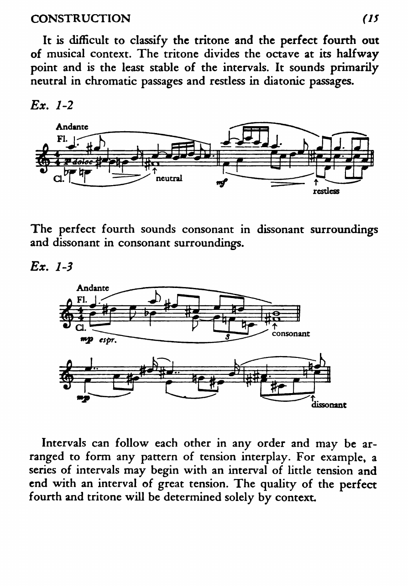

### 七 三全音怎样既不稳定又能显得中性

**这段在干什么：**解释为什么不能把三全音直接放进一种固定的表情类别。作者指出，它将八度平分。

十二平均律中一个八度是 12 个半音，三全音是 6 个。将 C4–F♯4 转位为 F♯4–C5，仍是 6 个半音。纯五度转位后变成纯四度，而三全音的半音跨度保持不变。这种对称关系使它不像大小三度那样直接给出一个熟悉的三和弦归属。

作者继而说，在半音化的段落中它常显得中性，在自然音材料的段落中则常显得不安。这里的 chromatic 是材料与写法的半音化，不是只要旋律出现一个半音级进就自动归类；diatonic 也不是“任何大调作品”。

**疏：**在 C 大调的明确属功能环境里，B–F 很容易让你期待 C–E。这是音级和既有语法参与听觉的结果。如果许多不同位置的三全音连续出现，没有一个目标持续得到确认，耳朵可能不再要求它只向这一个目标解决。

“中性”并不等于无色彩、悦耳或没有摩擦；它首先表示没有被听成某一个明确功能的强烈指向。“不安”也不能唯一决定要接哪个和弦。

### 八 怎样读 Ex. 1-2

先找谱上标出的 neutral 与 restless。分别向前看：标记前的音高材料有什么差异？周围是否出现熟悉的音阶性线条？两条线的半音化程度如何？然后只弹两个标记处，再连同前后文演奏。

这两次比较会把“孤立的三全音”与“在一段音乐里的三全音”区分开来。作者的例子意在展示语境差异，不是用一对音的名称解释全部效果。

### 九 四度为什么会改变角色

作者说，纯四度在不协和环境中可以显得协和，在协和环境中可以显得不协和。Ex. 1-3 把这两个结果并列。

**集注【深化】：**你在终止四六中已经接触到后者：C 大调以 G 为低音，上方 C 到 B 的 4–3 运动使四度具有等待解决的意义。但若一段由更尖锐的二度、七度构成，抵达一个纯四度可能给出清理与松开的感觉。

这不是要求你把古典四度规则忘掉，而是要说清规则使用在哪一种语境。独立两声部、和弦内部的上方声部之间、以低音为基准的终止四六，也不是同一情况。

**自拟比较：**先弹 C4–E4 → C4–F4 → C4–E4，试把中间 F 处理为倚音；再弹 C4–D♭4 → C4–E♭4 → C4–F4，延长最后一组。在第二段里，四度更可能被听成相对松开的终点。这个试验展示的是可能性，若你的听感不同，先检查节奏、触键和先前调性感。

### 十 从分类进入张力次序

本页末提出：音程可以按不同顺序形成张力布局。作者举“从小张力开始，最后达到大张力”的过程，而不要求用和弦根音关系完成它。

**【重点新增】**这是本章最有用的创作动作：先选一条整体过程，再挑材料。你可以设计“逐渐增压”“先紧后松”“两次波峰”“持续压迫后突然变空”。分类表帮助起步，具体实现仍由音区、线条、节奏和音色共同决定。

## 原书第 16 页

PDF 第 14 页。此页含 Ex. 1-4、1-5、1-6。

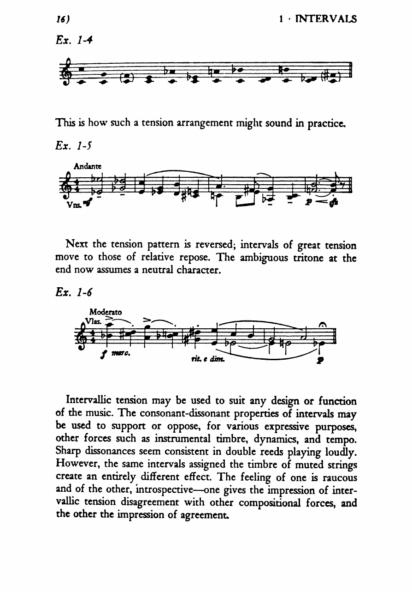

### 十一 Ex. 1-4 是材料次序，Ex. 1-5 才把它写成乐句

Ex. 1-4 用一列音程显示大体的张力安排；Ex. 1-5 再把这样的安排放进中提琴二声部的节奏、句法和表情中。

**句读：**“This is how … might sound”里的 might 值得保留。作者给一种写法，不宣布把那串音程照顺序摆出来就只有这一种乐句。你应比较：哪些音程被延长，哪些只是过渡，哪一个声部保持平稳，哪里加入重音或动态变化。

不要只给 Ex. 1-5 每一拍贴分类标签。还应单独唱上声部，再唱下声部，确认纵向关系由两条可成立的线产生。这与 H&C 的对位视角相接。

### 十二 Ex. 1-6 将张力安排反过来

作者把过程改为从较紧走向相对休止，末尾三全音因而获得中性性质。这里最有启发的地方是：结束不必等于把所有不协和清除。

你在 L11 学过某些终止式如何建立句末。这里又增加一种句末条件：前面的材料、节奏放缓、时值延长、动态减弱以及音程比较，共同让最后的声音被接受为到达。不能仅从这一小例推出任何三全音都能结束任何曲子，但可以听见它怎样在这段里做到。

### 十三 音程张力可以和其他因素同向或相反

原文提到 timbre、dynamics、tempo，意在说明音高关系可以支持其他表现因素，也可以与它们形成差别。

“尖锐不协和 + 强烈双簧管”可能让各项力量一起指向外放、刺耳的效果。“尖锐不协和 + 弱奏弱音弦乐”则可能把摩擦变成内敛、持续的紧绷。这里的比较是创作想象，具体音区、演奏法仍须核对。

**自拟四格：**

| 音程材料 | 动态过程 | 可以尝试的听觉关系 |
|---|---|---|
| 逐渐变尖 | 渐强 | 两种变化互相支持 |
| 逐渐变尖 | 渐弱 | 声音退后，内部仍收紧 |
| 逐渐变柔或开放 | 渐强 | 音量扩张而和声松开 |
| 逐渐变柔或开放 | 渐弱 | 两种变化共同退落 |

这些是可写的组合，不是四个固定情绪公式。起步时把速度、节奏与音区尽量保持一致，才容易听清你安排的两条过程。

## 原书第 17 页上部

PDF 第 15 页。此页 Ex. 1-7 与其下第一段结束 Construction；本页下部在下一分册解读。

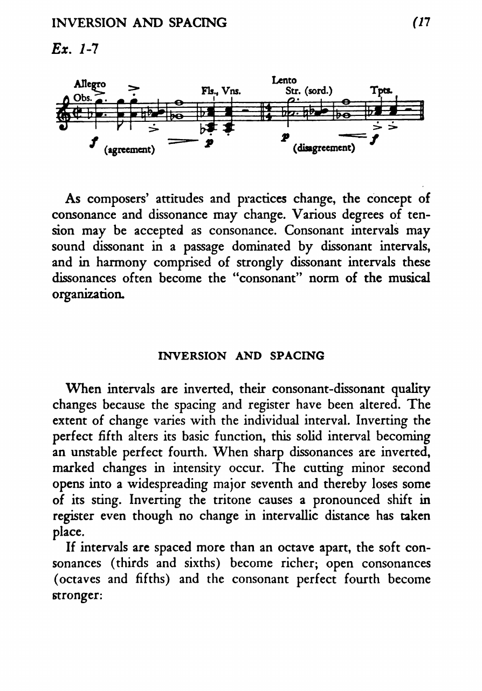

### 十四 Ex. 1-7 中的 agreement 与 disagreement

先读乐器、速度与演奏标记，再读括号文字。前一组使材料与表现因素较一致，后一组展示它们之间的差别。这里 disagreement 不是“写错了”或“互相抵消到没有效果”，而是一种表达方式。

这会修正一个常见联想：激烈的音乐不必全靠小二度、大七度；柔和的音乐也不必只使用三度六度。原书章末练习 2 与 3 正是要求你把这两件事拆开。

### 十五 新的常态怎样建立

Construction 最后一段说，作曲实践会改变听众接受的协和与不协和范围。一段持续使用强不协和的音乐，可以把这些材料建立为它自己的常态。

**句读：**原文把新的“consonant”加引号。此时更适合读为“在这部作品中可作为稳定参照的常态”。这不表示小二度物理上变成了八度，也不要求把前页分类表删掉。

**集注【重点新增】：**分析时可以并列写：“这一音组含尖锐不协和，但在本段反复出现，承担相对稳定的背景；随后突然插入的纯三和弦反而构成显著变化。”两层描述一起用，比只判“协和/不协和”更准确。

## 本节复习

现在应能解释：音程本身的典型质感、它在某种风格中的处理、它在这段音乐中的具体作用，是相互关联的三个层次。分类帮助你比较材料，语境决定它实际怎样工作。

读后做一个自拟四小节：两声部，先限定节奏很简单，让张力从开放距离走向尖锐距离；随后复制节奏，让张力方向相反。请写出实际音区，并说明最后一组音为什么可以停住。若只写“因为协和”，再补一句前面怎样让耳朵接受这个到达。

---

# 转位与间距

本节对应 Inversion and Spacing，印刷页 17 下部至 18。第 19 页开始下一节。你在 L4 已学过转位名称与复音程，本节要把这些操作同实际声响变化联系起来。

## 原书第 17 页

PDF 第 15 页。下半页是本节正文起点。

### 一 转位会改动哪些东西

作者说，音程转位后的协和、不协和性质可能变化，因为间距和音区改变了。先以 C4–E4 为例。把下面 C4 提高八度，得到 E4–C5；大三度转成小六度。两个音级仍是 C 与 E，但低音身份、实际距离和所在音区都不同。

**【深化】**L4 中的“度数相加为九”是识别单音程转位的口诀：三度与六度、二度与七度、四度与五度相配。它不保证互为转位的两个声音具有相同的质感、功能或张力。

| 原配置 | 操作后 | 实际改变 |
|---|---|---|
| C4–E4，大三度 | E4–C5，小六度 | 上下关系交换，4 半音变 8 半音 |
| C4–G4，纯五度 | G4–C5，纯四度 | 7 半音变 5 半音，低音改变 |
| C4–D♭4，小二度 | D♭4–C5，大七度 | 1 半音变 11 半音，近距摩擦变成宽距关系 |
| C4–F♯4，增四度 | F♯4–C5，减五度 | 仍为 6 半音，拼写与低音、音区改变 |

表中八度转移只是一个清楚的示范方向，也可把上音降低八度。不同移动方向对总音区的影响不同，比较时要写清楚做了哪种操作。

### 二 纯五度转成四度为什么是显著变化

作者称纯五度结实、纯四度不稳定。这承接前节四度的语境问题，不能脱离前后文理解为“四度永远不稳定”。

**集注：**如果你在 C 大调先听到 C–G，再把 C 放到 G 上方，低音从主音变为属音，熟悉的调性解释也会变化。若在没有明确调性感的二声部中做同样操作，仍会改变距离和声部地位，但未必产生同一种功能解释。

所以作者把听觉变化归于转位，不代表所有变化只来自“音程名称”。实验时必须留意：你是否同时引入了一个熟悉的低音、改变重音或延长了某音？

### 三 小二度与大七度都尖锐，却不一样尖锐

原文说，切割感强的小二度展开成宽广的大七度，会失去一部分 sting。两者在上一节同属 sharp dissonance，这里却比较组内差别。

**疏【重点新增】：**分组并不抹去具体配置。C4–D♭4 与 D♭4–C5 共享同一对音级，但后者把两个基音拉远了。真实声音还各有分音，因此“基音拉远”也不能简单推成“完全没有摩擦”。保持同一音色与相近时值比较，可以先听见最直接的变化。

在钢琴上不要为较宽的音程额外加力；否则更响的声音会干扰对间距的判断。也不要把较窄的音程踩更多踏板，然后把全部差别归因于转位。

### 四 三全音的距离不变为什么仍会变

十二平均律中，C4–F♯4 与 F♯4–C5 都是六个半音。作者却说音区有显著转移。可以直接列出两个频率范围：第一组较低，第二组整体位置较高，低音也换了。

这说明只保留“6”这一个数字不能完整描述声音。如果进一步把两音压成八度等价的音级集合，又会删去更多具体信息。抽象有助于看出对称性，写作仍须回到实际配置。

### 五 转位 扩展 整体移调要分开

**【重点新增】**原文随后讨论把间距拉到八度以外，这与前面的转位相关，却不是同一个操作。

| 操作 | 自拟例子 | 保留什么 | 改变什么 |
|---|---|---|---|
| 整体移调 | C4–E4 → C5–E5 | 大三度与两音的相对排列 | 两音共同提高，音区改变 |
| 音程转位 | C4–E4 → E4–C5 | 两个音级 | 上下身份、音程、音区 |
| 扩为复音程 | C4–E4 → C4–E5 | 低音、上方成员的音级 | 大三度变大十度，间距扩大 |
| 保留跨度改音区 | C4–E5 → C3–E4 | 大十度 | 整体向下移动 |

复音程的“度数加七”只适用于多一个八度时的泛音程度数。大三度跨一个八度为大十度，跨两个八度为大十七度；半音数分别是 4、16、28。性质不能仅靠度数口诀求出。

### 六 为什么作者建议比较八度以外的间距

作者提出经验性的声响变化：三度和六度展开后可以更丰厚；五度、八度和用作协和的四度可以更强健。下一页补充二度七度与三全音的情况。

这里 richer、stronger 不是音量单位。更宽的配置可能让声部更清楚、共鸣更展开，而不是让同样的触键必然产生更大的声压。还要看乐器音域是否让每一音都能有效发声。

## 原书第 18 页

PDF 第 16 页。含 Ex. 1-8、1-9、1-10。

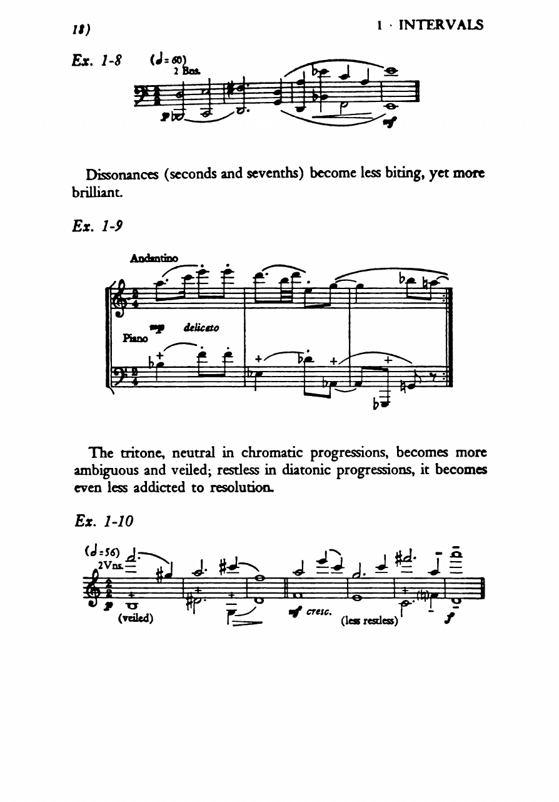

### 七 Ex. 1-8 低音管的宽距配置

此例承接前页的“展开”。先按两个实际声部阅读，不把谱面的上下位置直接当成声部身份。观察哪一音在持续，哪一音展开，末尾怎样扩大间距。

**集注【重点新增】：**低音乐器并不必然只能在低处挤成密集配置。用较宽的间距，可能增加清晰与纵深。具体音域和演奏难度仍需要真实乐器检验。本章给的是和声手法，不是完整配器音域表。

### 八 Ex. 1-9 不协和的展开

作者说二度、七度在宽距中可能减少咬合，同时增加 brilliance。例子写给钢琴，带有轻巧的音色与触键提示。

**句读：**less biting 和 more brilliant 可以同时成立。“尖锐程度降低”不等于“暗淡”，因为声音是否闪亮还与音区、发音和高频能量有关。不要把所有听觉形容词都压到同一根紧张度刻度上。

本例左手的符号与发音安排也是谱例的一部分。初读时即使先用普通触键核对音高，也要回到原页看它为何强调特定声音效果；钢琴的持续与衰减方式会参与间距的呈现。

### 九 Ex. 1-10 展开的三全音

原文分别说：半音化环境中本来中性的三全音，展开后可以更含混、更朦胧；自然音环境中本来不安的三全音，展开后可能减少非解决不可的压力。

**疏：**C4–F♯4 扩展为 C4–F♯5，实际从增四度变增十一度，半音数从 6 变 18。它仍保留三全音的音级关系，但实际距离已经不同。作者这时讨论的是复音程扩展，不能和前页“转位后仍六个半音”混为一谈。

### 十 怎样做一次能解释结果的比较

**自拟四步：**

1. 固定音色、力度与每组持续时间，比较 C4–D♭4、D♭4–C5、C4–D♭5。
2. 写下三组分别是小二度、大七度、小九度；不要把后两者都叫“展开的小二度”后便结束分析。
3. 把每组放到同一段节奏中，比较张力与到达感。
4. 将整段降低八度，再比较一次；记录哪些结论保持、哪些发生变化。

第一步比较声响，第三步开始比较语境。听觉记录可以是“更挤”“更清楚”“更空”“更难停住”，不必强行给出一个总分。能说出条件，比给所有音程排永久名次更有用。

## 本节复习

读完应能回答：两个音级相同，为什么仍可能得到不同效果？因为实际间距、上下关系、整体音区、声部地位和发音条件仍可变化。

继续往下读时要保留这一点：下一节将和弦拆成两两音程，拆出的关系也必须带着实际排列来理解。

---

# 和弦内部的全部音程

本节对应 Intervals in Chords，印刷页 19–23 上部。它提供本章最可反复使用的方法：先听清一个和弦内部的全部关系，再研究怎样让它移动。

## 原书第 19 页

PDF 第 17 页。含 Ex. 1-11、1-12、1-13。

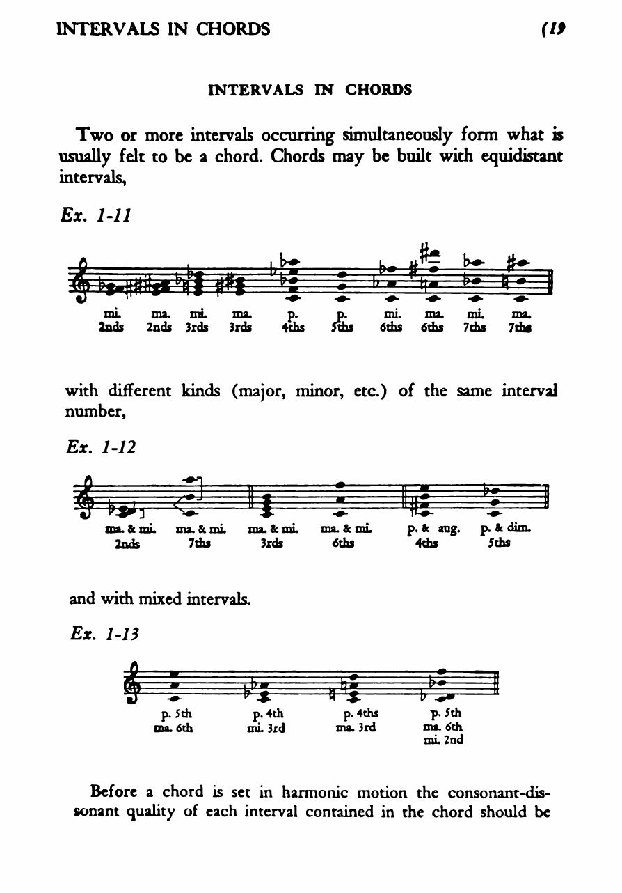

### 一 从两个音程到一个和弦

作者说两个或更多同时发生的音程，通常会被感知为和弦。最简单是三个音：两个相邻距离连起来，同时还出现首尾距离。

**【深化】**L5、L8 先用三和弦、七和弦建立名称。本节先把和弦看成一个纵向音组。它可以由三度组织，也可以由二度、四度或混合距离组织。由什么材料构成，与它此时有没有主属功能，是两个问题。

### 二 Ex. 1-11 等距构造

这组例子依次给出同种距离的堆叠。读谱时先找相邻音，不要先看最下面到最上面的总跨度。相邻都是小二度，与相邻都是纯五度，虽然都符合等距构造，声响密度完全不同。

**自拟算例：**

| 配置 | 相邻间距 | 全部两两间距 |
|---|---|---|
| C4–D♭4–D4 | 两个半音 | 小二度、小二度、大二度 |
| C4–D4–E4 | 两个全音 | 大二度、大二度、大三度 |
| C4–E♭4–G♭4 | 两个小三度 | 小三度、小三度、减五度 |
| C4–F4–B♭4 | 两个纯四度 | 纯四度、纯四度、小七度 |
| C3–G3–D4 | 两个纯五度 | 纯五度、纯五度、大九度 |

这张表直接显示：**生成它的相邻音程，不能概括它内部的全部关系。**两个小三度叠出减三和弦，尖锐或不安的成分还要看外侧的三全音；两个全音叠起时，外侧却出现柔和的大三度。

### 三 Ex. 1-12 同度数但不同性质的构造

作者第二种方法保留音程度数，混用大小、增减等性质。C4–E4–G4 是大三度加小三度，仍属三度构造，但不是两个完全相同的距离。

**句读：**same interval number 指“都是三度、都是四度”等泛音程度数，不是“半音数相同”。若相邻半音数必须相同，普通大小三和弦反而都不满足。

纯四度与增四度也可混合为四度构造。拼写因此重要：C–F–B 与 C–F–C♭ 不能仅因某个键盘音接近就随意互换；它们表达的成员关系不同。

### 四 Ex. 1-13 混合音程

第三种构造不要求相邻保持同一度数。可以五度加六度，可以四度加三度，也可以更多种距离并置。此处先认识构造自由，不急着给每组音找一个熟悉的根音。

**集注【重点新增】：**若每遇到一个新音组，都先移动八度、重新排列，直到看上去像某个三和弦加外音，可能会丢掉作者真正利用的实际间距。先按原配置听，再决定传统名称是否有解释力。

## 原书第 20 页

PDF 第 18 页。含 Ex. 1-14、1-15。

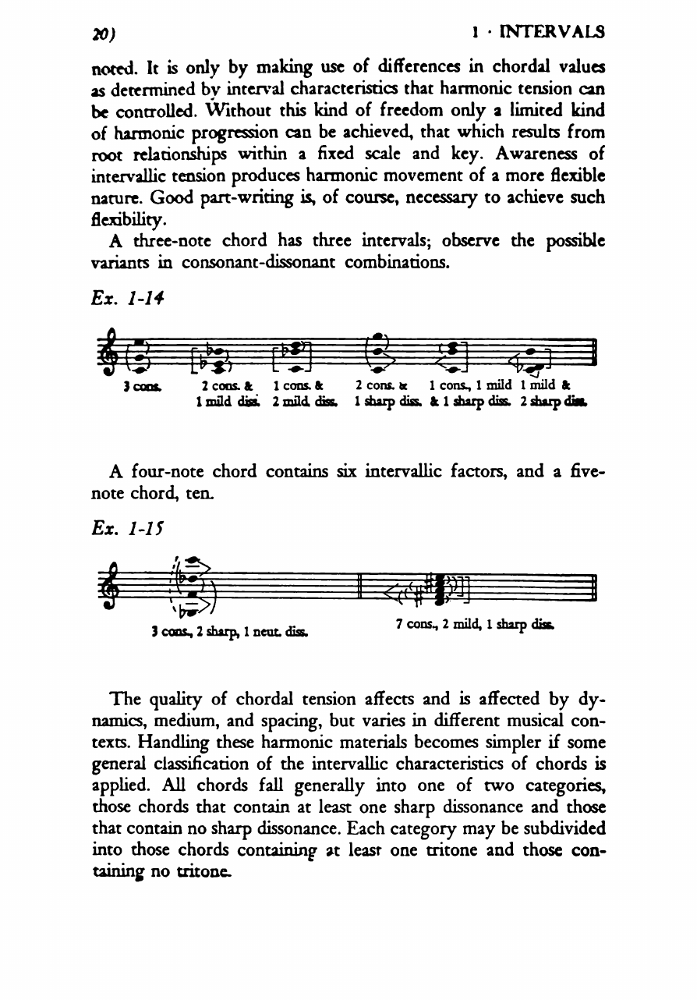

### 五 为什么先分析静止的和弦

本页开头承接前页：在和弦投入运动之前，应先注意它各个内部音程的性质。否则只能依靠固定音阶与调里的根音关系安排运动。作者希望扩大可控制的范围，同时立即补上 good part-writing 的必要性。

**集注【深化】：**你的 L18 提醒从低音、对位、终止读和声；这里增加“纵向音程构成”。它不会替代声部进行。两个和弦各自有趣，连接时若每条线都缺乏方向，仍不必然形成好句子。

### 六 三个音为什么有三个音程

把三个声音标成 A、B、C。可选出的两两组合是 AB、AC、BC，共三组。若只数谱面上相邻的两段，就漏了 AC。

**【重点新增】**有 n 个分开的音高位置，每对只计一次，组合数为：

$$N=\binom n2=\frac{n(n-1)}2.$$

所以三音为 3，四音为 6，五音为 10。这里只是计数关系，不是张力计算公式；十组关系不表示张力一定比三组大。

若讨论实际四声部 C3–G3–C4–E4，有六组声部对；若先合并八度等价，只保留 C、E、G 三种音级，则有三组不同音级对。两个计数回答不同问题。原书此处的入门例子无需先引入集合论，但分析倍增时要说明自己数哪一种。

### 七 Ex. 1-14 三音组的不同组合

例子把三组关系分别组合为协和、温和不协和、尖锐不协和。不要只抄例下文字；拿其中一组自己找足三对，核对分类。

**自拟完整示范一：C4–E4–G4。**C–E 大三度，E–G 小三度，C–G 纯五度。共有两个柔和协和和一个开放协和。

**自拟完整示范二：C4–E4–B4。**C–E 大三度，E–B 纯五度，C–B 大七度。它仍有两组协和关系，同时包含一组尖锐不协和。这个描述比笼统的“不协和和弦”提供更多信息。

**自拟完整示范三：C4–D4–E♭4。**C–D 大二度，D–E♭ 小二度，C–E♭ 小三度。于是恰有一组协和、一组温和不协和、一组尖锐不协和。章末练习 8 会直接用到这种构造。

### 八 Ex. 1-15 多音组不要漏掉内部关系

本例显示四音、五音配置；可按“固定第一个音，与其余音配对，再换第二个音”的顺序列出，避免重复和漏项。

**自拟四音例：C4–E4–G4–B4。**

| 音对 | 音程 | 本章起步分类 |
|---|---|---|
| C–E | 大三度 | 柔和协和 |
| C–G | 纯五度 | 开放协和 |
| C–B | 大七度 | 尖锐不协和 |
| E–G | 小三度 | 柔和协和 |
| E–B | 纯五度 | 开放协和 |
| G–B | 大三度 | 柔和协和 |

六组里只有一组尖锐关系，但若它正处在突出音区、持续很长或形成外声部，就可能对全和弦影响很大。不能简单用“五比一”投票宣布它没什么张力。

### 九 先有无尖锐关系 再有无三全音

本页末提出两次二分。第一次问是否含小二度或大七度这种尖锐关系；第二次问是否含三全音。

**【重点新增】**这给出四个起步类别，下面用自拟配置说明。先按单音程或约定的八度归约识别关系，同时在实际演奏时保留间距信息。

| 有尖锐不协和 | 有三全音 | 自拟音组 | 核对 |
|---|---|---|---|
| 无 | 无 | C4–E4–G4 | 大三、小三、纯五 |
| 无 | 有 | C4–E♭4–G♭4 | 两个小三与减五 |
| 有 | 无 | C4–E4–B4 | 大七存在，无六半音关系 |
| 有 | 有 | C4–F♯4–B4 | C–B 大七，C–F♯ 三全音，F♯–B 纯四 |

它们不是四个功能，也不是从最差到最好的排名。它们帮助你比较“尖锐摩擦”和“可能的不安感”怎样组合。复音程中的小九度等也要据实际声响说明，不能把所有八度扩展都视为听感相同。

## 原书第 21 页

PDF 第 19 页。含 Ex. 1-16、1-17。

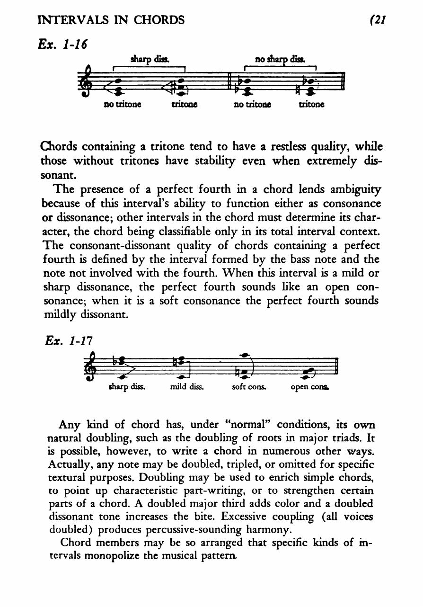

### 十 Ex. 1-16 尖锐与不安不是同一个维度

谱例把前页的四种组合并列。随后作者说，含三全音的和弦倾向于有不安感；没有三全音的和弦，即使很不协和，也可以比较稳定。

**句读：**tend to 要读成倾向。前节已有三全音可中性的例子，本段不能把它推翻。更合理的连读是：材料层面有可利用的倾向，具体作用仍由全段决定。

**自拟听法：**先将 C4–D♭4–D4 反复三次，每次同样发音。它有强烈近距摩擦，但无三全音。再听 B3–D4–F4 放进 C 大调属功能语境。第二组没有小二度和大七度，却可以强烈指向解决。这让“粗糙”与“方向性”分开显现。

### 十一 Ex. 1-17 四度要放回整个音组

作者说，和弦中的四度具有模棱两可的性质，需要其他音程决定它如何被听到。随后给一个具体判断法：在三音配置中，检查低音与不属于该四度的那个音所形成的距离。

若该距离是温和或尖锐不协和，四度可能显得较开放、协和；若该距离是柔和协和，四度反而可能显得轻度不协和。该段属于作者的创作性听觉概括，尤其适合对照三音例子，不应把单句当作任意复杂多音和弦的定理。

**自拟 A：C4–D4–F4。**要观察的四度是 C–F，不属于它的音是 D。低音 C 与 D 是大二度。全组较显眼的摩擦是 C–D，C–F 可以成为较开阔的部分。

**自拟 B：C4–E4–F4。**要观察的仍是 C–F，不属于它的音是 E。C–E 是大三度，E–F 却产生小二度。把 C–E 先确立为柔和参照时，F 可能显得需要处理。这里还必须考虑那组 E–F，不能只查 C–E 就忽略全组。

原文这一局部判断法，与更一般的“看完整音程环境”应一起使用；四个以上音、有多个四度或多个候选低音关系时，不宜机械套一条。

### 十二 倍增与省略从规则转向具体目的

作者先承认常规配置有习惯性倍增，例如大三和弦常加倍根音；随后允许为具体织体目的加倍、三重化或省略其他音。

**集注【深化】：**L15 中完整与不完整 V7→I，研究的是特定古典四部语法如何满足解决。这里讨论更宽的创作范围。你可以突出一个色彩音、强化一条线、让某个尖锐关系更突出；是否保留某个和弦成员，要由这一目的判断。

同音或八度加倍未必增加新的音级，却会改变响度比例、音区覆盖和融合。大三度的成员被加倍可能增加色彩，不协和音被加倍可能增强咬合；具体结果还取决于音色与音量平衡。

“excessive coupling”指大量声部成组加倍所产生的厚重或打击性效果。它不是“凡加倍就是打击乐”，持续弱奏也不会仅因加倍而自动出现同样效果。

## 原书第 22 页

PDF 第 20 页。含 Ex. 1-18、1-19。

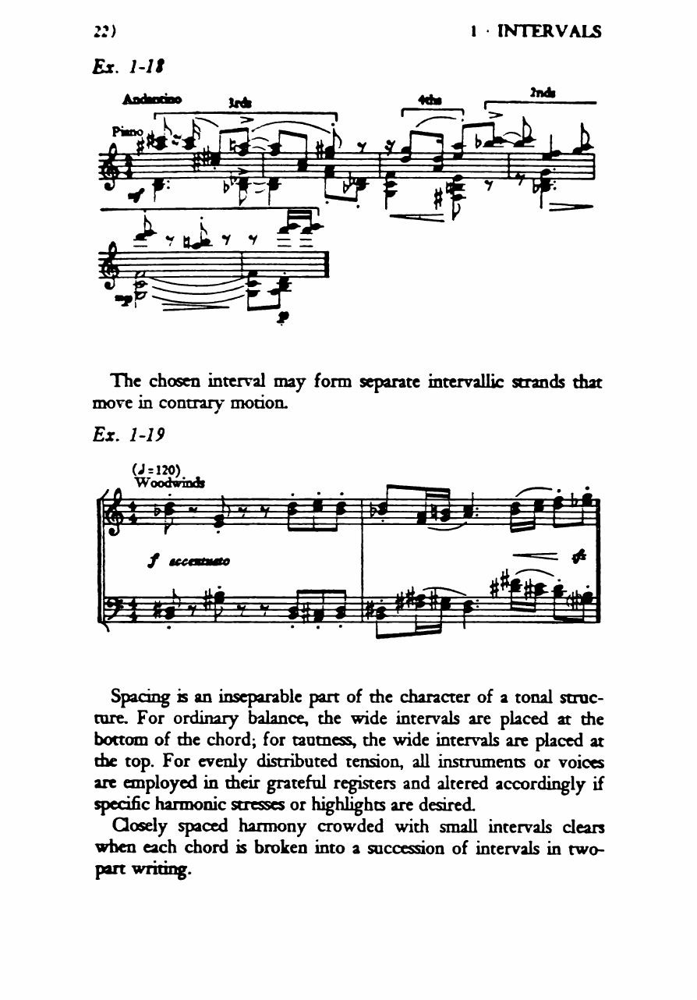

### 十三 Ex. 1-18 让某一种音程贯穿表面

前页末说可以排列和弦成员，让特定音程支配音乐图案。这里的例子分段标出三度、四度、二度等。

**【重点新增】**“支配”不表示和弦内部只有这类关系。一个四音和弦有六组音程，不能因为手型里反复出现三度，就删掉其他四组。它说的是耳朵容易追踪的配对、声部组合或织体特征。

自拟方法：右手始终弹一对三度，左手保持另一对三度，两手位置各自移动。全体垂直音组会不断变化，但三度成对的质感可以持续。先听每一对，再听合奏，比较“局部组织”与“总和弦”。

### 十四 Ex. 1-19 两条成组线可以反向运动

原文说，所选音程可形成分开的 strands，并彼此反向运动。图中木管声部被分为可辨认的两组。

**集注【深化】：**H&C 的反向进行常先指两条单线。这里每条“线”可以是一个成对音程或音组：上组整体上行，下组整体下行。全体和弦由这些组的交会产生。

读谱步骤是：先分别追踪上组和下组的节奏、方向，再在若干重音处查完整纵向关系。若一开始把所有音压成连续和弦标签，可能看不到这种生成方式。

### 十五 间距决定清晰度与重量分布

作者给出经验：通常下面留较宽距离，上面可以较密；若希望更紧绷，也可以把较宽的距离放在上部。这个“通常”需要连同音区与乐器理解。

**疏【重点新增】：**C2–E2–G2 与 C3–G3–E4 都含 C、E、G，声音密度却不同。低处密集可能带来浑厚、遮蔽和混合；上移某些成员则可能把低音与和声色彩分开。低处清晰不是永远最好的目标，下一页作者明确保留浑浊音响的创作价值。

“grateful registers”可理解为乐器或人声发音顺畅、音色适宜的音域。不是所有声部都必须处在相同八度，也不是让每件乐器以一样的力度便自然均衡。

### 十六 把密集团块拆成连续二声部音程

本页末说，密集小音程构成的和声可以通过分解为连续的两声部音程而变清楚。关键变化是时间与发音组织。

例如 C4–D4–E4–F♯4 同时按下时是一个团块；若先弹 C–D，再弹 E–F♯，听者较容易辨认两个成对动作。它不再与原始齐奏具有完全相同的垂直持续效果，恰好说明织体参与和声呈现。

## 原书第 23 页上部

PDF 第 21 页。Ex. 1-20 与其后短段结束本节；下部进入泛音。

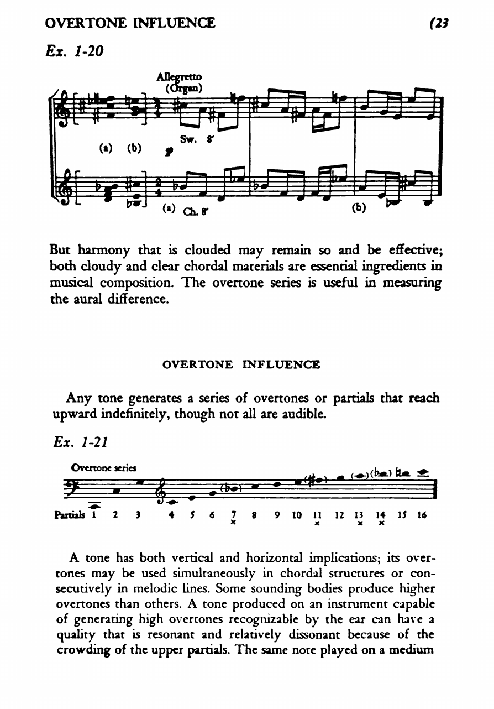

### 十七 Ex. 1-20 齐奏团块与分解后的二声部

先找图中的 a、b 标记，对照前面的静态和音与后面的展开。作者使用管风琴，声音的持续条件与钢琴不同；分析时不要用钢琴自然衰减的直觉覆盖原谱。

观察同一材料怎样经由发音错开、声部配对与间距显示而更可分辨。然后再问，分解后是否仍保留原来想要的重量和持续感。有时变清晰也意味着失去某种混合效果。

### 十八 浑浊可以是目标

原文紧接着说，浑浊的和声也可能保持浑浊而有效，清晰与浑浊材料都可用于作曲。这个补句防止你把前面的经验误学成“凡密集都应改开”。

**集注【重点新增】：**写作判断应是：“这段需要怎样的可分辨程度？这团声音是否正好承担遮蔽、重量、压迫、远景等作用？”若你的目标是内声部清楚而结果听不见，它需要调整；若目标本来是融合成一块，就不能只凭音符拥挤宣布失败。

## 本节可重复使用的分析流程

1. 写实际音高与音区，先按原配置听。
2. 列全部两两音程，同时区分相邻距离与跨越距离。
3. 标出尖锐不协和、三全音、四度与主要协和支撑。
4. 找出最突出的一组关系：外声部、长时值、重音、特殊音色或倍增。
5. 分别追踪声部怎样连接，不仅比较静态和弦。
6. 说明这一处的作用，再与调性或功能解释对照。

**自拟小题：**比较 C4–E4–B4 与 C3–B3–E5。二者音级材料相同，前者含大三、纯五、大七；后者的实际间距变为大七、复四度和复大三度。请分别记下低音、最高音和最紧密的一组关系。若一开始就把两者写成同一个“Cmaj7 省五音”标签，尚未完成本章要求的声响分析。

---

# 泛音及其解释的限度

本节对应 Overtone Influence，印刷页 23 下部至 25 上部。**【重点新增】**现有 H&C 文字笔记没有系统展开泛音列、调律差异与共鸣配置，因此这里从最基本的概念开始。公式用来核对距离，不作为评价音乐的公式。

## 原书第 23 页

PDF 第 21 页。Ex. 1-21 是本节起点；上部 Ex. 1-20 已在前节解释。

### 一 一个音符为什么不只有一个频率

先想象非常简单的周期振动，每秒重复 100 次，频率就是 100 Hz。真实乐器的一次发声通常比这个复杂：除 100 Hz 外，还可能同时有 200、300、400 Hz 等成分。许多成分共同构成一个被你听作同一音高的声音。

若这些成分的频率近似为某个基频 f 的整数倍，就得到理想的谐波序列：

$$f,2f,3f,4f,5f,\ldots$$

**基频**是这里的 f；**分音 partial**指组成复合声音的一个频率成分；**谐波 harmonic**在此专指整数倍关系的分音。**泛音 overtone**通常指基音以上的成分。因此第一分音是基音，第一泛音通常是第二分音。

原书把 overtone、partial 较宽松地连用，图却明确按 partials 编号。读 Ex. 1-21 的数字时以“第几分音”为准，避免把所有编号错后一位。

**校读：**作者说任何音都产生延伸的泛音列，适合作为传统有固定音高乐器的入门模型。实际纯正弦音没有这些额外谐波，某些敲击声的分音也不成整数倍；弦乐与钢琴等还可能偏离理想关系。不是所有声音都严格服从这列数字。

### 二 Ex. 1-21 怎样从频率倍数读出音名

先假定基音为 C。第二分音是高八度 C；第三分音再向上到 G；第四分音为更高八度的 C；第五分音接近 E；第六分音接近 G。因这些音落在不同八度，要比较音级，可以把频率除以适当的 2，移回同一八度。

例如第三分音是 3f，除以 2 后为 3f/2。故“纯五度接近 3∶2”的意思不是第三分音恰在基音上方五度，而是将它降低一个八度后，得到五度关系。

第五分音是 5f，除以 4 后为 5f/4，得到大三度。第六分音除以 4 后为 3f/2，又回到五度。这说明不同分音编号可以归到相同音级。

### 三 先把前八个分音算清楚

| 分音编号 | 若 f=100 Hz | 降回基音上方一个八度内 | 以 C 为基音的近似音名 |
|---|---|---|---|
| 1 | 100 | 1 | C |
| 2 | 200 | 1 | C，原位高八度 |
| 3 | 300 | 3/2 | G |
| 4 | 400 | 1 | C |
| 5 | 500 | 5/4 | E |
| 6 | 600 | 3/2 | G |
| 7 | 700 | 7/4 | 比平均律 B♭ 更低的音 |
| 8 | 800 | 1 | C |

100 Hz 只是便于心算的假定基频，不声称它在标准定音下就是 C。音名列表示相对于“假定为 C 的基音”的音程关系。

从表中看：相邻分音的绝对频率差都是 f，但比例 n+1 对 n 越来越接近 1。2∶1 是八度，3∶2 是五度，4∶3 是四度，5∶4 是大三度，6∶5 是小三度。越往上，相邻分音的音乐距离总体越小。

这就是后面“下宽上密”配置得到声学启发的一个来源。它不是要求把和弦机械地抄成泛音列，也不保证任意乐器照抄就得到同一种共鸣。

### 四 横向与纵向的两种启示

作者说泛音可以在和弦中同时使用，也可以变成旋律里的先后关系。若你选择 C、G、E 作为音高材料，可同时构成音组，也可先后写进线条。

**句读：**这不是说演奏者在弹 C 后“实际单独弹出了它内部的第五分音”。它说作曲可以把由泛音关系启发的音高作为独立音符来使用。实际音符与声音内部的频谱成分属于两个层面。

### 五 相同音高为什么有不同音色

本页末比较分音延伸程度不同的声音。如果较高分音显著，声音可能更明亮、更富共鸣或更复杂；若高分音弱，可能更柔和，却少一些作者所说的共鸣感。

**疏：**频率的位置只是一部分，还要看每个成分有多强、怎样起音、怎样衰减。即使两件乐器发相同基频，也可能有不同的分音强度和时间变化。不能只数“有几个泛音”就完整预测音色。

将两音合奏时，两套分音也会同时出现。某些成分接近，可能形成拍动或粗糙感；某些相合，可能有利于融合。所用音区与音色改变，交互也会改变。这给前节的间距比较增加了原因。

## 原书第 24 页

PDF 第 22 页。含 Ex. 1-22。

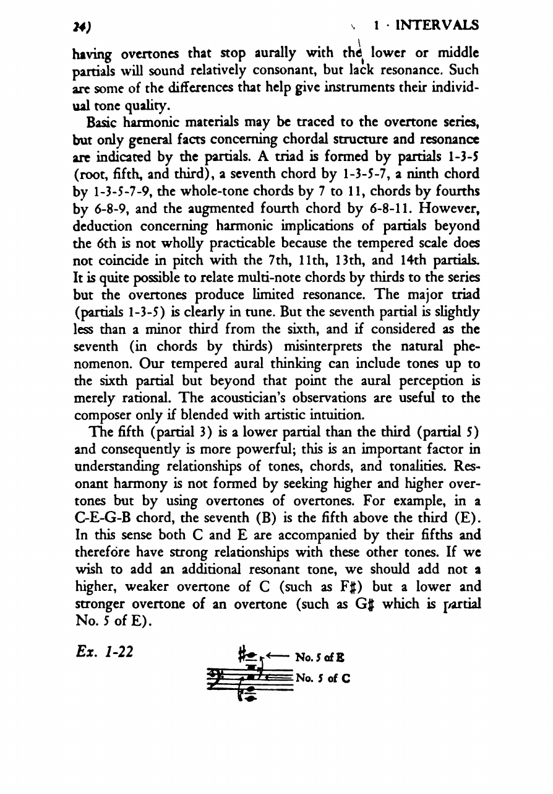

### 六 作者怎样从分音选出熟悉的和弦

作者依次列出若干选取方式。下面将其重排为便于核对的表，数字保留原书的分音编号。

| 原书选取 | 以 C 为基音的近似成员 | 要注意什么 |
|---|---|---|
| 1–3–5 | C、G、E | 重排可识别大三和弦，实际跨度很宽 |
| 1–3–5–7 | C、G、E、近似 B♭ | 第七分音不是平均律小七度 |
| 1–3–5–7–9 | 再加入 D | 类似九和弦材料，但不能忽略调律差异 |
| 7 至 11 | 近似 B♭、C、D、E、F♯ | 接近一组全音关系，各间距并不严格相等 |
| 6–8–9 | G、C、D | 四度与相关关系的来源之一，重排时可得到四度堆叠 |
| 6–8–11 | G、C、近似 F♯ | 结合纯四度与增四度，最后一音偏离平均律 |

**集注【重点新增】：**这表展示联系，不是“自然界已规定所有合法和弦”的证明。尤其越过低次分音，平均律音符与真实分音之间的偏差越来越不能忽略。

### 七 为什么十二平均律不是泛音列的直接抄本

十二平均律把八度分成十二个相等的频率比例步长。每一步乘以：

$$2^{1/12}.$$

k 个半音的频率比是：

$$r_k=2^{k/12}.$$

五度的平均律比是 2^(7/12)，约 1.498307；理想纯五度比 3/2=1.5，二者很接近。大三度的平均律比是 2^(4/12)，约 1.259921；分音关系 5/4=1.25，差别较明显。

这里“平均”指每个半音使用相同倍数，不是每个半音增加同样的 Hz。若总以固定 Hz 相加，跨不同音区就不能维持同样音程。

### 八 用音分量出差别

为避免只说“略高”“略低”，把一个八度分成 1200 音分 cents，平均律半音便是 100 音分。频率比 r 对应：

$$c=1200\log_2 r.$$

下表把分音降回一个八度，并与最接近的平均律音比较。正号表示该分音较高，负号表示较低。

| 分音 | 归约比 | 音分约值 | 最近平均律音 | 偏差约值 |
|---|---|---|---|---|
| 3 | 3/2 | 701.96 | G，700 | +1.96 |
| 5 | 5/4 | 386.31 | E，400 | −13.69 |
| 7 | 7/4 | 968.83 | B♭，1000 | −31.17 |
| 9 | 9/8 | 203.91 | D，200 | +3.91 |
| 11 | 11/8 | 551.32 | F♯，600 | −48.68 |
| 13 | 13/8 | 840.53 | A♭，800 | +40.53 |
| 14 | 7/4 | 968.83 | B♭，1000 | −31.17 |
| 15 | 15/8 | 1088.27 | B，1100 | −11.73 |

原书图中的特殊标记正是提醒某些音不等同于普通平均律音。第十一分音处在 F 与 F♯ 之间，更接近 F♯，但相差接近半个半音；不能毫无说明地把它写成一个准确的 F♯。

作者特别提醒第 7、11、13、14 分音；这不意味着第 5、15 分音毫无偏差，只是那些偏差在本段的论证中更突出。

### 九 第六到第七分音为何不是普通小三度

原文说，第七分音距第六分音略小于小三度。两者频率比是 7/6，对应约 266.87 音分；平均律小三度是 300 音分。

因此把 6、7 两个分音看作平均律 G–B♭，已经近似化了。再据这种近似去声称“属七和弦是精确自然产物”，会把差别隐藏起来。

**校读：**本页某些关于第六分音以后听觉判断的措辞很强。适合将其理解为作者反对机械推导高叠和弦的立场，不能当作人耳在第六分音以后突然失去听觉能力的科学界限。音分差异仍可听、可测，艺术用途也不止一种。

### 十 泛音的泛音是什么意思

作者举 C–E–G–B：G 是 C 上方的五度关系，B 又可以理解为 E 上方的五度关系。这样不是只从一个 C 一路寻找更高分音，还可以让和弦中不同成员各自得到低次关系的支持。

**【重点新增】**把“E 的五度 B”写成比值：若 E 相对 C 取 5/4，B 相对 E 取 3/2，则 B 相对 C 为：

$$\frac54\cdot\frac32=\frac{15}{8}.$$

这个 B 不是 C 的第七分音；C 的第七分音接近偏低的 B♭。这点能直接避免“七和弦七音就是第七泛音”的混淆。

作者又提到可选 E 的第五分音所指的 G♯。按音级归约的纯比计算：

$$\frac54\cdot\frac54=\frac{25}{16}.$$

它约为 772.63 音分，也不等于平均律 G♯ 的 800 音分。此处用普通音名说明关系，不能忘了调律模型。若讨论理想整数倍体系，它也可与 C 的更高编号分音联系；“泛音的泛音”强调的是构造思路，并非数学上脱离原来的整数倍结构。

### 十一 Ex. 1-22 怎样读

先找谱旁对 C 与 E 的分音标记，区别“以哪个音作为出发点”。接着回到实际和弦，观察哪些成员获得五度或三度的支持。

**集注：**这可以启发你写更有层次的纵向支撑，但不构成所有和弦都必须有一个唯一根音的证明。更不能据“某音是某人的泛音”就自动决定它应当更响或必须加倍。实际音量还受乐器频谱、发音与配器影响。

## 原书第 25 页上部

PDF 第 23 页。Ex. 1-23 与其前两段结束本节；下部进入 Medium。

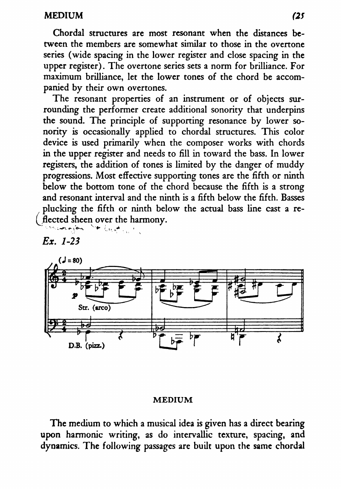

### 十二 下宽上密是一种共鸣配置

作者说，和弦成员之间的间距若有些类似泛音列——低处较宽，高处较密——可以获得较好的共鸣与明亮感。

**自拟比较：**C2–E2–G2–B2 与 C2–G2–E3–B3。两组具有相同四种音级，第一组把很多较小间距挤在低处，第二组给低音更多空间，把色彩移到上部。请保持相同总时长、相近响度来听。

“类似”不是要求逐个满足 1–3–5–7，更不是禁止低音密集。上一节已说明浑浊也有价值。这里的目标是共鸣与明亮，而不是给所有音乐订一个正确排列。

### 十三 在高处和弦下加入支持音

作者接着讨论乐器与周围物体的共鸣，并提出一种色彩手法：当和弦主要在较高音区，可以用下方较低声音作支持，尤其提到在原和弦最低音下方五度或九度。

**句读：**这里的 fifth/ninth below 是以原和弦最低音为基准向下量，不能误作“调性第五级或第九级”。也不是所有和弦都自动增加一个“标准根音”。

以 C4 为原和弦最低音，自拟支持音可用其下纯五度 F3，或其下大九度 B♭2。若实际选用其他性质的九度，必须另行说明；原段的“下方五度的下方五度”对应复纯五度，也就是大九度。

为什么提到九度？从 C 向下纯五度到 F，再从 F 向下纯五度到 B♭，总共 14 个半音；按泛音程度数是九度。此时上方 C 是 B♭ 的大九度，联系到 B♭ 的第九分音关系。

### 十四 Ex. 1-23 弦乐与低音提琴拨弦

先区分弓奏弦乐与 D.B. pizz. 的发音。低音提琴不是简单持续加粗同一个音，而以独立短促的低处支持改变共鸣底色。

作者同时提醒，低音区再加音可能使进行浑浊。高处音组下加一点支持，与本来已很密的低区继续堆音，不是同一种条件。请实际检查最下面两三音之间的距离与持续长度。

## 本节复习

读完应能说明：泛音列提供频率关系与配置的启发，平均律提供另一套近似兼容的音高网格，实际和声还取决于具体声音与语境。它们有联系，也有差异。

若只记三项：第一分音包含基音；第七分音不是平均律小七度；“泛音启发一种写法”不等于“自然界证明这写法唯一正确”。

---

# 乐器与人声怎样参与和声

本节对应 Medium，印刷页 25 下部至 27 上部。**【重点新增】**现有 H&C 笔记主要从音高、功能、低音与声部进行解释音乐，这里将发声媒介直接放进和声判断。

## 原书第 25 页下部

PDF 第 23 页。Medium 标题下的一段从本页起，续至下页。

### 一 Medium 在这里指什么

medium 指承载音乐的发声媒介，例如女声、钢琴、管弦乐组合，或更具体的乐器与演奏法。不能把它译成音区中的“中音”，也不是指录音文件格式。

作者说，媒介像音程织体、间距与力度一样，直接影响和声写作。其含义是：同一个和弦交给不同声音，作曲者可能需要重新考虑排列、时值、倍增、节奏甚至和声运动。

**疏：**假设同一组 C4–D♭4。钢琴短促击发后逐渐衰减，两支管乐可持续保持，而两把弦乐还可在持续中渐强。即使没有换音，听觉过程已经不同。纸面上“两个音同时出现”不足以指定完整结果。

### 二 保留和弦过程不等于保留所有条件

作者预告，接下来几种版本基于同一和弦进行，却因媒介改变而具有不同设置。这里既改变乐器，也可能调整间距、力度与速度。

**校读：**它是一组作曲比较，不是严格控制其他变量的实验。因此不能从三份谱例得出某个乐器单独造成了全部差别。读谱时要分别列出哪些条件保留、哪些调整，才知道作者如何为媒介重新写作。

## 原书第 26 页

PDF 第 24 页。含 Ex. 1-24 的女声、钢琴、管弦乐三种设置。

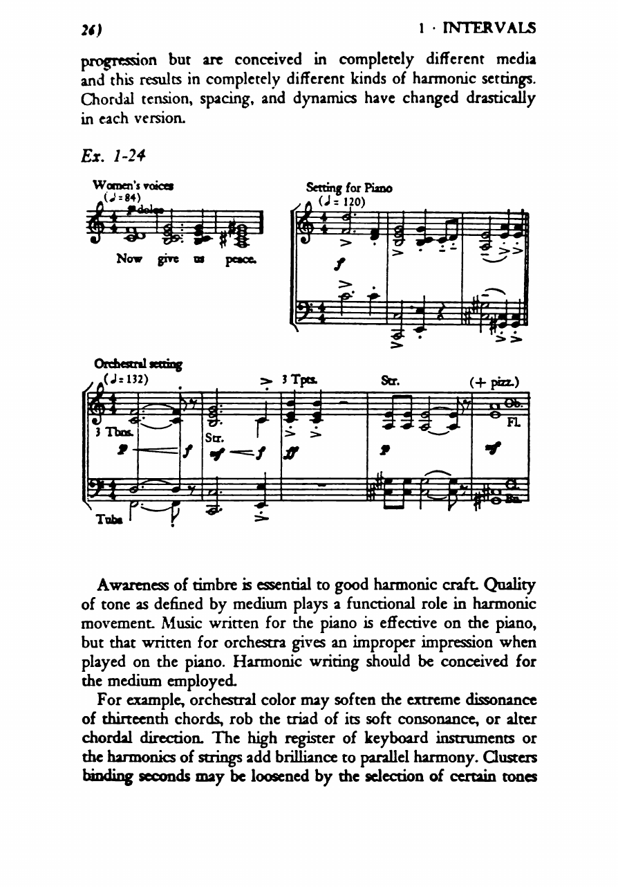

### 三 第一种设置 女声

先看文字 “Now give us peace”、速度、dolce 与长时值。人声不是没有词义的持续音发生器。元音、辅音、呼吸、文字重音与歌唱线条共同组织和声的发出方式。

**【重点新增】**一个音组若要由几个人准确唱出，要考虑每条线能否被听见、进入时能否找到音高、是否有足够呼吸位置。仅把钢琴上按得出的音分给各声部，不代表已完成合唱写作。

本例可以先纵向检查相邻间距，再分别唱各条线。观察不协和是否通过平稳的声部进入、长时值与轻柔表达而被包容。这里“轻柔”不消除它的音程关系，而是改变它在声音中的呈现。

### 四 第二种设置 钢琴

钢琴版的速度、重音、分配与节奏不同。上下手的距离、和弦起音、低音动作使材料得到另一种轮廓。

钢琴通常在起音后衰减，踏板能延长并混合声音，但混合也可能增加残留音。原谱没有明确要求时，不要为所有和弦都加满踏板，再把累积产生的摩擦当成和弦本身的固有属性。

**集注【深化】：**L14 的键盘式声部进行给你手型与连接经验。本章提醒，适于手指的配置、适于持续合唱的配置、适于管弦乐融合的配置，可能各不相同。

### 五 第三种设置 管弦乐

看清长号、大号、小号、弦乐、长笛及拨弦等标记，观察谁承担低音、谁突出上方色彩、谁延长、谁以短音介入。配器在这里直接决定纵向音组哪部分更突出。

实际读法可以分三轮：第一轮只跟低音，观察支撑何时变化；第二轮只跟较亮的上层音，观察方向与重音；第三轮听各组的交接与叠合。这样比先压成一串钢琴和弦更能接近作者目的。

### 六 三版逐项比较

| 比较项 | 应检查的具体内容 |
|---|---|
| 材料对应 | 哪些音组或运动方向在三版中相通 |
| 音区和间距 | 哪些成员被移高、移低、拉开或聚拢 |
| 节奏 | 和弦同时起音，还是以分解、错开发声 |
| 强弱与重音 | 哪个音组被突出；整体音量怎样变化 |
| 持续 | 长音、衰减、休止、交接怎样改变混合 |
| 文字与句法 | 人声版本的词义、呼吸怎样影响到达 |
| 配器 | 一组音是融合为一个整体，还是分成可辨认的层 |

**句读：**原文说 tension、spacing、dynamics 在各版中显著改变。不要只给它们一句“同和弦不同音色”的摘要；作者实际上在示范重新构思音响。

### 七 音色可以改变和声方向的呈现

本页下段说，配器可以软化十三和弦的极端不协和、改变三和弦的柔和性质，甚至改变和声方向。

**疏：**所谓改变方向，起步可理解为“改变耳朵注意到谁、期待谁继续”。若某成员由突出的独奏乐器持续保留，它可能成为线索；若同样成员被埋进融合音组，则未必承担同样分量。到后面学习更复杂和弦与调中心时，再回头检验这一点。

十三和弦、平行和声、音簇和复合和弦在此只是预告。本章不需要你先掌握后面各章的完整定义。暂时分别理解为较多三度叠置成员的和弦、成组平行移动的和声、邻近音聚集的音组、以及多个可辨认单元并置的和声。

### 八 高频或泛音音色怎样带来明亮感

原文举键盘高音区与弦乐泛音。这里的弦乐 harmonics 还可以指特定演奏法所产生的泛音声，不能与上一节“一个声音内部总有分音”的一般讨论完全等同。

同样一组平行运动，用较轻、较高、较透明的声音呈现，可能与中低音区厚重齐奏形成不同效果。但高音区不自动等于清楚或好听；刺耳、单薄、融合不足也可能是实际结果。

## 原书第 27 页上部

PDF 第 25 页。顶部续段结束 Medium，之后为 Source Material。

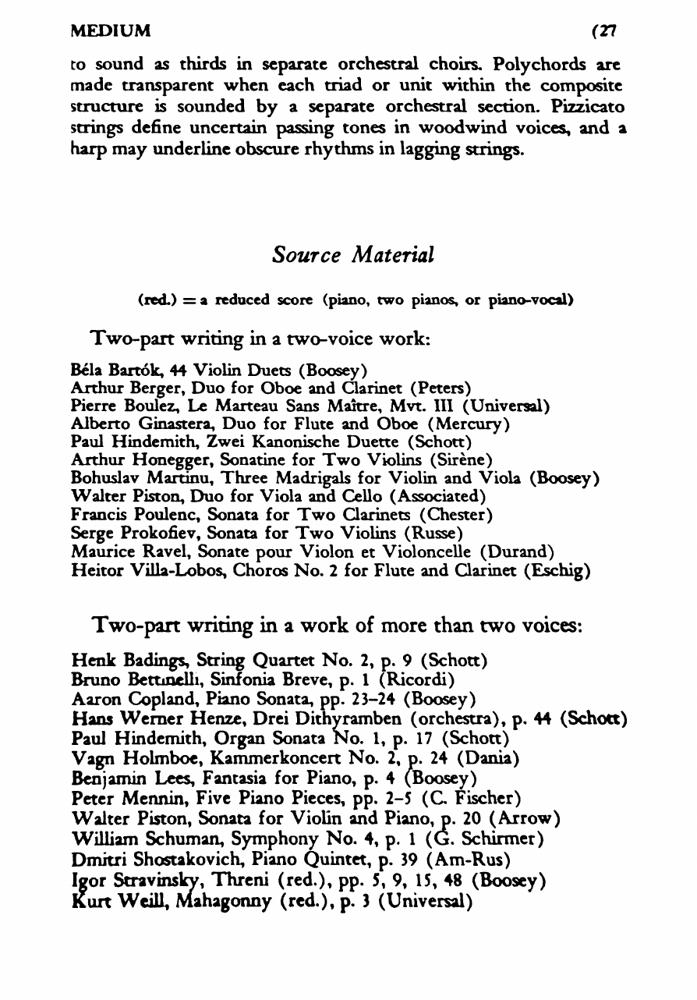

### 九 把音簇分给不同乐器组

跨页句子的完整意思是：由二度紧密结合的音簇，可以通过挑出某些音、让它们在分开的乐器组中构成三度关系而松开。

**自拟示范：**C4–D4–E4–F♯4 中，相邻是三个大二度。把 C4–E4 交给一组，把 D4–F♯4 交给另一组，每组内部都是大三度，总体音级却未减少。

如果两组有不同音色、不同起音或不同音区，耳朵可能更容易追踪两个三度单元。若所有音仍以完全相同的强度和时值融合，分组效果可能较弱。配器标注必须落实到可听见的差别。

### 十 复合和弦怎样变透明

作者说，把复合结构内的每个三和弦或单元交给分开的乐器组，可以提高透明度。核心是保留各单元的可辨认性，而不是一律把整个总音组混成一个颜色。

**自拟比较：**让一组三和弦 C–E–G 与另一组 F♯–A♯–C♯ 同时出现。先用同一种持续音合在一起听，再让两组交替起音、略分音区。检查你听到的是一个复杂和弦，还是两个单元的关系。这个例子只解释分组，不预先断言它有哪种调性。

### 十一 拨弦和竖琴为什么能帮助线条与节奏

末句举拨弦弦乐帮助明确木管经过音，竖琴帮助强调较不清楚的弦乐节奏。短促清楚的起音可以标记某一时点，也可以将一条较难辨认的线加以勾勒。

**集注【深化】：**L22、L23 区分结构与装饰的思想在这里仍有效，但装饰是否能被听清还受发音影响。你不只要在分析里写“这是经过音”，也要考虑实际听者能否跟上它的运动。

## 本节实践

选一个你已写出的四和弦短句，做三种草稿：持续人声、短促键盘、两组交替发声。每版都说明哪些音保留，哪些八度、时值、倍增因媒介而改变。不要在尚未设计这些条件时，仅将乐器名称替换后宣布完成。

第一次不必追求完整配器。用两三行谱或实际音高表，先把声音设想说清楚。若要给真实演奏者使用，再核查音域、呼吸、弓法、移调和排练难度。

---

# 怎样使用作品索引

原书 Source Material 位于印刷页 27–29 前部。这里保存全部清单，并解释六组题头如何对应本章。它们是进一步读谱的入口，不是需要一次听完的曲单。

## 原书第 27 页

PDF 第 25 页。Source Material 从本页开始。

### 一 red. 表示缩编谱

原书先解释 red. 为 reduced score，包括钢琴、双钢琴、钢琴声乐缩编。它不表示作品原来就是钢琴独奏，也不表示已把全部配器信息保留。

**集注：**前节刚说明媒介会改变和声呈现，因此此处尤其要注意：缩编谱适合查音高、和弦和线条；若问题是音色融合、某声部是否突出，还需尽可能对照原编制总谱与演奏。

页码与出版社是作者所用版本的定位信息。换版后可能不同，找到相应乐段应继续用乐章、排练号、小节或明显主题确认，不能把这里的页码当作所有版本的固定位置。

### 二 两声部作品中的二声部写作

这一组包括 Bartók《44 首小提琴二重奏》、Berger 的双簧管与单簧管二重奏、Hindemith 的二重奏、Ravel 的小提琴与大提琴奏鸣曲等。完整名单见原页。

题头的价值在于减少干扰：整段主要由两条线构成，比较容易把每个纵向距离听出来。任务可从一小句开始：标出重拍上的音程；查看四度、三全音怎样进入和离开；只唱其中一条线；再听合起来的张力。

这与 L4 的和声/旋律音程、L18 的对位视角直接相接。新增的是不要预先要求每个不协和都按某一种古典模式解决。

### 三 多声部作品中的局部二声部

第二组包括弦乐四重奏、交响曲、钢琴与管风琴作品中的局部段落。整部作品虽有较多声部，某一处仍可能由两条主线承担组织。

**【深化】**不要把每一拍所有发出的声音都当成同样重要。先确定谁在形成主要线条，谁在加倍、支撑、延续或装饰；同时不能只因某音短便自动把它删除。它可能在音色、节奏或某次重音上很突出。

原页名单的作用是给你寻找局部简化的线索。尚未取得对应总谱前，不凭作品名假定指定页面一定含某个具体音程。

## 原书第 28 页

PDF 第 26 页。此页列出其余四组。

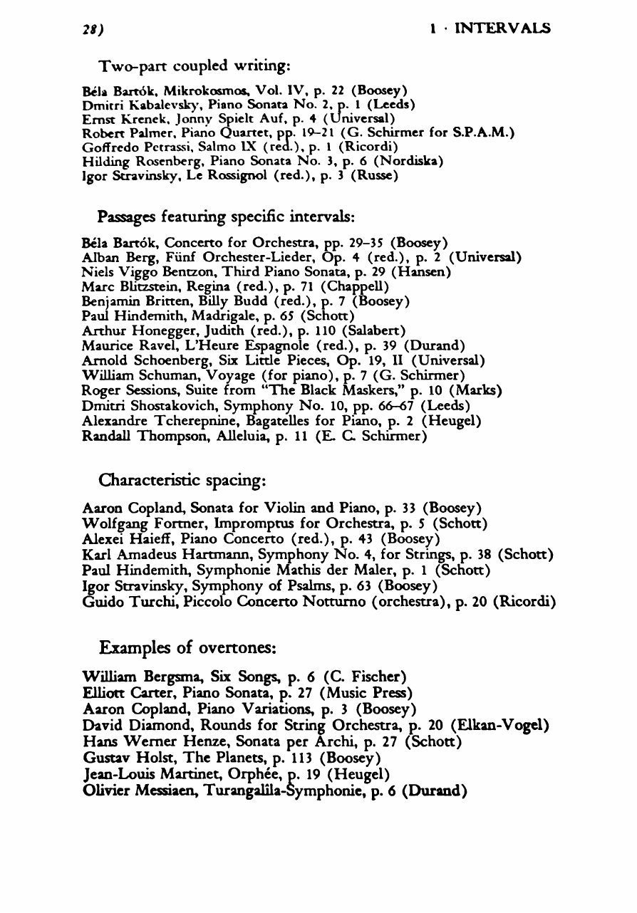

### 四 两条成组线的写作

Two-part coupled writing 对应正文 Ex. 1-18、1-19。它提醒你寻找的不一定是两条单音旋律，也可能是两个被成组加倍、以固定音程配对的层。

读这类谱例时，把“每组内部的关系”与“组与组之间的运动”分开。一个上行的三度对与一个下行的三度对，合成的总和弦可以很复杂，但其动作仍清楚。

### 五 突出特定音程的乐段

Passages featuring specific intervals 对应本章把某种距离作为持续特征的做法。原书列 Bartók、Berg、Britten、Ravel、Schoenberg、Shostakovich 等不同作者，不要求这些作者共享一种和声系统。

具体读法：先选八至十六个起音点，观察是否有某种距离反复出现；再看它是否只在某个声部对、某种节奏或某个音区中突出。若只统计整段所有音程次数，可能把听觉上很显著的特征冲淡。

**自查：**你说“三度支配这一段”时，能否指出是哪两条线、如何被配器或重音突出？若只能说“谱面上有很多三度”，解释还不够。

### 六 特征性的间距

Characteristic spacing 对应前文低处宽、上处密，以及为紧绷或特殊音色作其他配置的讨论。

读谱时先画出每次和弦的最低与最高音，再标出最大的相邻空隙。然后查看这道空隙是分开低音和上层，还是分开两组音色。这样可以比和弦名称更直接地看见声响重心。

可以将原配置改写成密集配置作一次比较，但必须标作自己的实验；不能据改写的钢琴效果反过来声称原作配器无效。

### 七 泛音与共鸣的例子

Examples of overtones 从本页开始，续至下一页。包括 Carter、Copland、Holst、Messiaen 等作品线索。

这组题头不保证清单中的每一例都在“按 1、2、3、4 分音严格排和弦”。可能涉及共鸣配置、泛音演奏法、特定支撑音或相关声响。应在具体总谱里确定实际做法。

**【重点新增】**听到明亮不等于已经证明用了泛音列。要回到音高、音区、发音与演奏法。反过来，图上音高接近泛音关系，也不意味着实际配器就会有同一种明亮感。

## 原书第 29 页上部

PDF 第 27 页。顶端五条继续“泛音与共鸣”清单，其后才开始 Applications。

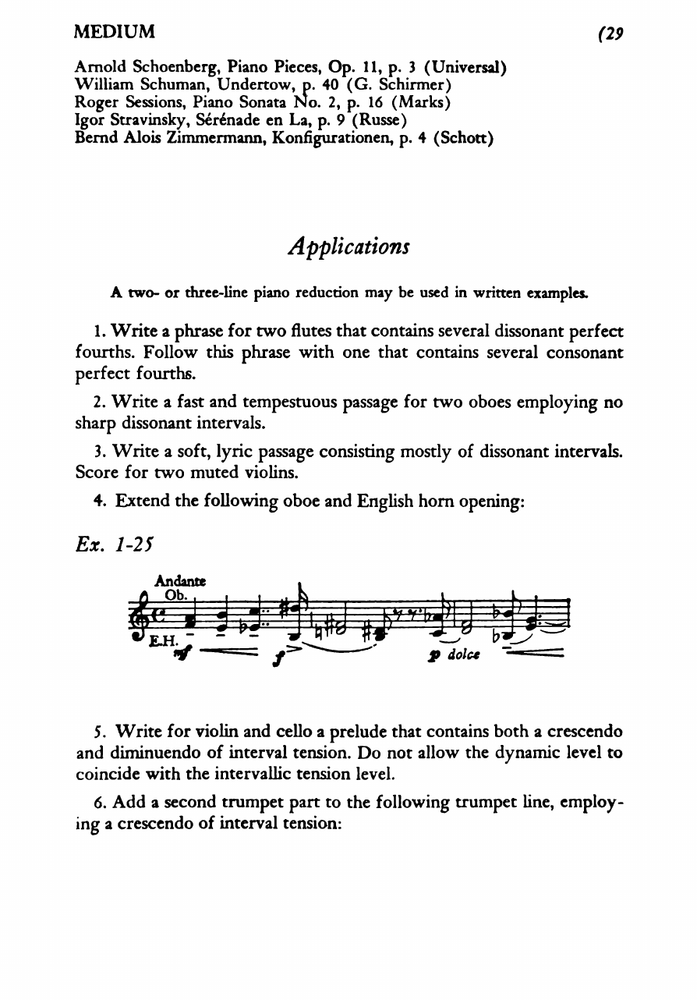

### 八 一次读谱的记录方式

不必先写长篇赏析。用下面六项完成一小段即可：

1. 作品、版本、乐章、实际位置。
2. 这次想核对的问题，例如“四度何时显得放松”。
3. 两至四个关键时点的实际音高、音区与乐器。
4. 全部主要音程关系，以及它们怎样连接。
5. 听到的变化与可能原因。
6. 一处可以用于自己写作的具体动作。

例如最后一项可以是“把一组密集音分成两个不同音色的三度对”，不必泛写“学习大师丰富的和声”。前者可实施，也能在下一次写作中检验。

初学可以先从本书自带的短例完成这张记录，再进入清单中的真实作品。这样用同一套问题读原例、读作品、读自己的作业，知识更容易连起来。

---

# 十二道实践题逐题疏解

原书 Applications 位于印刷页 29–30。这些是创作题，没有唯一标准成品。以下给题意、训练目标、实施步骤、起步材料与自查标准；自拟材料只负责把限制变得可操作，不冒充原书答案。

## 原书第 29 页

PDF 第 27 页。含题 1–6、Ex. 1-25；题 6 所给旋律见次页 Ex. 1-26。

### 开始前 缩编可以帮助你把工作做完整

原书允许用两行或三行钢琴缩编记谱。意思是先在有限行数上清楚呈现材料，不要求你一开始便写出复杂总谱。实际音区、声部与表情仍要标明。

本注起步音高均按**实际发声**说明，C4 为中央 C。若以后誊成给单簧管、圆号、英国管使用的分谱，再按具体乐器移调，并清楚标注记谱规则；不要把移调前后的音高混在一张分析表里。原书印出的开头继续以影印为底本，不据本注自行更改。

## 题一 两支长笛中的两种纯四度

**题意：**先写一个含数个不协和纯四度的乐句，再接一个含数个协和纯四度的乐句。关键不是将后一句全部改成五度，而是让四度本身改变作用。

**训练目标【深化】：**用语境解释四度，不只按音程名称分类。对应 Ex. 1-3。

**实施步骤：**

1. 第一乐句先建立比较明确的柔和协和背景，让四度出现在期待继续的位置，随后以级进转成三度等较熟悉的休止关系。
2. 第二乐句让二度、七度等更紧的材料占较明显位置，四度作为相对宽松的到达出现。
3. 两句都保留可唱的线条，至少使用不止一次四度，避免只有最后一个音程符合题目。

**自拟局部：**第一句可从下声部 C5 持续、上声部 E5→F5→E5 入手；F5 得到重音和稍长时值时，C5–F5 可表现为期待转回三度的四度。第二句可从 C5–D♭5 的紧密摩擦逐渐走到 C5–F5，并使四度获得较长停留。具体成句还需两声部的呼吸与方向，不应只循环这几个和音。

**自查：**把两处四度孤立弹奏，再连前后文听。差别若只靠第二句整体更轻、第一句整体更响，尚未清楚证明四度的语境安排。可先统一动态再比较。

## 题二 两支双簧管的激烈段落

**题意：**写快速、激烈的二重奏，却不用尖锐不协和音程。限制针对小二度和大七度及其需说明的复音程关系，不是禁止任何不协和。

**训练目标【重点新增】：**让节奏、重音、发音和线条承担激烈感。对应正文的 agreement/disagreement 比较。

**实施步骤：**先选择纯五度、三度、六度、大二度、小七度等允许距离；用短动机、切分、重复音、方向迅速变化和清楚重音塑造过程。不要一口气把所有可能因素都加满，先使一两种动作有效。

**自拟起步和音：**C5–D5 → D5–G5 → E5–B5 → D5–E5 → C5–E♭5。纵向依次是大二度、纯四度、纯五度、大二度、小三度，都不属尖锐组。用这串材料构成节奏鲜明的短句，再调整过大的跳进。

**自查：**检查所有实际重叠时段。若一条声部持续、另一条先换音，中间可能产生你没有登记的小二度或大七度，不能只查同时起音的点。

激烈不等于超出乐器舒适音域或写满无法换气的长句。此题练表达与材料的独立安排，实际可演奏性仍属于完成度。

## 题三 两把弱音小提琴的柔和抒情段落

**题意：**主要采用不协和音程，却写得柔和、抒情；指定两把加弱音器的小提琴。题目是 mostly，不要求每一瞬间都不协和。

**训练目标【重点新增】：**持续摩擦可以承载细腻线条，音程分类不等于固定情绪。

**实施步骤：**选一个缓慢、可呼吸的动机；让两条线以平稳运动形成二度、七度或其他不协和；在句末用时值、动态或音区收束建立到达。适当让一声部保持，另一声部轻微变化，会更容易听清摩擦的变化。

**自拟起步和音：**C5–D5 → B4–C5 → A4–B4 → G4–A4。它们依次是大二、小二、大二、大二度。可将其扩为宽距、改变部分声部八度，再比较近处的紧绷与宽处的悬浮。

**自查：**分别唱两条线，避免只是上下机械平移。再检查，柔和是否由实际的弱奏、连贯与句法实现，而不是标题写上“抒情”就算完成。若用合成播放，没有真实弱音器音色时，应把这次判断限于音高、节奏和力度布局。

## 题四 续写双簧管与英国管开头

**题意：**延长 Ex. 1-25 给定开头。此题没有附加一个简单的全段音程限制，而是要求从已给音乐中读出可延续的特点。

**训练目标【深化】：**把材料分析转为续写，保留旧课关于动机、重复、发展和乐句的经验。

### Ex. 1-25 的读法

先按原页确定两条声部、拍号、速度与动态；再圈出节奏动机、持续音、两线的同向或反向运动。特别留意四度、三全音、二度等关系是否在特定位置反复。

**实施步骤：**第一轮只写一句“这个开头最可辨认的动作是什么”。第二轮选其中一个节奏或轮廓作变化，而不是同时换掉全部特征。第三轮决定续段总体张力：继续增压、先松后紧、或者走向相对休止。最后检查每条线能否单独成立。

给自己两版短续句很有用：A 版保留节奏而改音程组合；B 版保留某个音程特征而改节奏。比较哪版更像同一乐思的继续。它们是练习方法，不是原书额外规定的题数。

**自查：**遮住原开头，仅听续写是否独立成句；再接上开头，听两者是否有联系。独立成立与能接得上要分别满足。

## 题五 音程张力与力度不重合的前奏曲

**题意：**为小提琴与大提琴写一段前奏曲，包含音程张力的增强与减弱，同时不要让力度水平与音程张力水平相重合。

**训练目标【重点新增】：**单独设计两个过程。原文不是仅要求“一次渐强或渐弱”，而是要求音程张力自身也有起伏。

**自拟布局：**

| 乐段 | 音程张力目标 | 力度目标 | 可采用的动作 |
|---|---|---|---|
| A | 较松走向较紧 | 渐弱 | 五度、三六度逐渐引入七度或近距摩擦 |
| B | 较紧走向较松 | 渐强 | 大七、小二等转向较开放配置 |

若将这一布局细化为八个和音，先在每个和音上标张力预期，再单独写动态。完成后以统一力度播放一次，检验音程过程是否仍可感知；再恢复动态，比较两条过程如何叠合。

**自查：**张力不应只靠“进入大提琴低区就变浑”来实现，除非你明确把音区也作为本次变量。初次可尽量保持整体音区，再安排间距与音程变化。最终完整音乐可综合运用，但应知道每一步用了什么。

这题不是要你永久避免音量与张力同向，而是通过一次有意分离，让你学会分别控制。

## 题六 为给定小号旋律加第二声部

**题意：**为次页 Ex. 1-26 的小号旋律写第二小号声部，形成音程张力的渐增。

**训练目标：**上声部已定时，通过另一个声部改变纵向过程。与写一串自由和弦相比，限制更具体。

**实施步骤：**将给定旋律按起音点抄到草稿；在下方先写期望的音程类别；再据上声部反推第二声部实际音高；最后把反推得到的音列当作旋律唱一遍，修正无目的的跳进。

你可以先安排开阔或柔和关系，逐渐增添温和不协和，最后让尖锐关系占据更突出的位置。四度、三全音与复音程的具体位置不能只凭表格排序，要放回整个句子试听。

**自查：**上声部已标的渐强不能替代音程张力的渐增。统一音量再听，是本题最直接的检查。也不必要求每相邻一个起音都严格“更紧”；可有局部回落，但总体过程要清楚。

## 原书第 30 页

PDF 第 28 页。含 Ex. 1-26 与题 7–12。

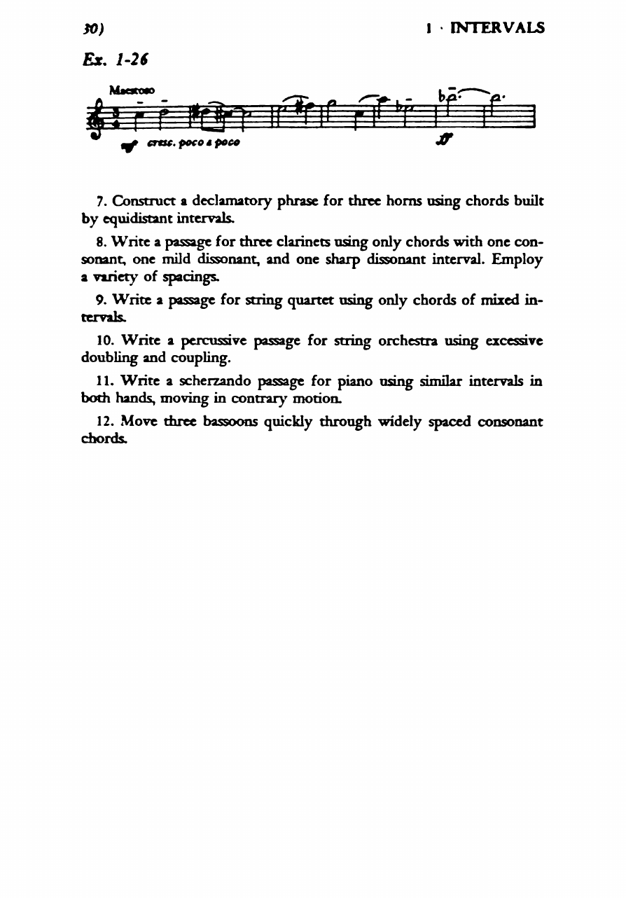

### Ex. 1-26 的读法

先把谱上给出的单线视为固定材料，区分连线、延音与新起音。若旋律一音被保持，新增声部变化时仍会形成新的和声音程，这些时点都应记录。原有表情标记是开头设想的一部分，续写时需要回应。

本注不把扫描谱例另行凭记忆转录为音名序列。实际练习以影印核对临时记号和八度位置，避免因一次抄错把全部后续配音移位。

## 题七 三支圆号的等距和弦

**题意：**为三支圆号写一个宣叙性的乐句，使用由等距音程构成的和弦。对应 Ex. 1-11。

**训练目标【重点新增】：**在材料限制下，通过节奏、发音、音区形成有姿态的陈述。

**疏：**declamatory 指清楚、有言说姿态的陈述，不等于全段每拍都最强。等距应先落实为每个和弦相邻两段具有相同距离，例如 C4–E4–G♯4 的两个大三度，或 C4–F4–B♭4 的两个纯四度。外侧距离自然不同，不能要求所有三对音程都相等。

**实施步骤：**先只用一种等距结构写三四个和弦；给它们一个具有停顿与重音的节奏；再决定是否切换到另一种等距结构。原题没有明确要求全段只用同一种堆叠距离，初练固定一种便于听清。

**自查：**三个声部都要有可演奏的连接。若要正式写 F 调圆号分谱，实际发声 C4–E4–G♯4 对应常规记谱 G4–B4–D♯5；先保持一种记谱基准完成和声分析，再整体转换。

## 题八 三支单簧管的三种音程组合

**题意：**每个和弦恰含一组协和、一组温和不协和、一组尖锐不协和；使用多种间距。此题必须数全部三对关系。

**训练目标【重点新增】：**把抽象类别转换成可核算的三音材料，再比较配置。

**自拟起步：C4–D4–E♭4。**C–D 为大二度，温和不协和；D–E♭ 为小二度，尖锐不协和；C–E♭ 为小三度，协和。刚好符合。

可整体移调为 D4–E4–F4、E4–F♯4–G4，保持间距结构，再试将一音或多音移高八度。例如 C4–D5–E♭5 保留一组大九度、一组小二度、一组小十度；分类时注明复音程归属，并实际比较尖锐感的分布。

**重要条件：**不要假设任意转位仍符合“一温和一尖锐”。例如 C4–E♭4–D5 的 C–D 是大九度、E♭–D 是大七度、C–E♭ 是小三度，仍能保留三类；但每做一次改位都要重新核对，而不是凭音级集名称直接通过。若某次扩展已让原本尖锐关系在听觉上显著软化，也应在评语里说明分类与具体声响的差别。

**自查：**给每个和弦写三行小表，不能只标低音到上两音。也要检查各声部交叉后是否改变你原先写下的实际配置。使用 B♭ 调单簧管时，先按实际发声写完整，再统一转换分谱。

## 题九 弦乐四重奏的混合音程和弦

**题意：**只使用混合音程构成的和弦。对应 Ex. 1-13，而不是把所有和弦都变成完全同一种堆叠。

**训练目标：**从多种距离组织纵向结构，并让四条线保持连续。

**自拟起步：C3–G3–B3–D♯4。**相邻依次为纯五度、大三度、大三度；它不是等距结构，也不全属同一音程度数。另一种可以试 C3–E3–F♯3–B3，相邻为大三度、大二度、纯四度。

先为大提琴与第一小提琴写清楚的外声部，再补中间两条线，或先写两组配对线再合成。两种方法都可以，但不能只对每一拍拼一个有趣形状，忽略中提琴与第二小提琴的运动。

**自查：**逐和弦核对相邻构造，再检查全部六组关系。混合的构造不保证全体不会出现某种音程集中，也不保证声音自动丰富；仍要靠节奏、音区、连接塑形。

## 题十 弦乐队中的打击性和声

**题意：**用大量倍增与成组加倍，为弦乐队写一个带打击性的段落。

**训练目标【重点新增】：**加倍不只是维持和弦完整，也可以主动制造重量与发音效果。对应正文第 21 页。

**实施步骤：**先写很短、起音清楚的节奏单元；让几组弦乐在同音或八度上加倍关键成员；通过一致的发音、明确重音与适度休止，使齐奏起音可被辨认。先只改变一次加倍比例，比较“厚”与“钝”是否不同。

**自查：**若所有声部都长时值弱奏、起音模糊，即使加倍很多，未必符合你想要的打击性。若全部效果来自另加打击乐，也偏离本题训练目的。它要求在弦乐发声与倍增本身寻找效果。

作品层面的实际弓法、分弓、音区和演奏速度需要另核。不要为追求厚重就让所有声部长期处在难发声的极端位置。

## 题十一 钢琴两手的相似音程与反向运动

**题意：**写诙谐、轻巧的段落，两手使用相似的音程组合，并向相反方向运动。对应 Ex. 1-19 的成组线条。

**训练目标【深化】：**将反向进行从两条单线扩展到两组音程。

**自拟起步：**右手 E4–G4 → F4–A♭4 → G4–B♭4，三组小三度上行；左手 C3–E♭3 → B2–D3 → A2–C3，三组小三度下行。两手内部结构相似，总体和弦关系随两组分离而变化。

在此基础上加一个短休止或错位重音，让 scherzando 由节奏与发音体现；可以适当变化重复模式，避免只得到练指序列。总纵向音组还应重新核对，不能只关注两手内部的三度。

**自查：**两手方向是否在关键段落清楚相反？相似音程是否确实可辨？是否需要为了看起来反向而写出不方便的手型？完成时应能分别描述局部两音组和总和弦。

## 题十二 三支低音管的宽距协和运动

**题意：**让三支低音管快速穿过宽间距的协和和弦。它把“较低的乐器”“快速”“宽距”“协和”几个条件合在一起。

**训练目标【重点新增】：**在指定媒介里组织间距，避免只把和弦整体压在低处。对应 Ex. 1-8 与间距讨论。

**自拟起步：C3–G3–E4 → D3–A3–F4 → E3–B3–G4。**每组都是拉开的大小三和弦配置，包含五度、六度与复三度关系，可作短草稿。这个序列展示结构，不等于已证明适合任意速度或任意水平的演奏者。

先用中速检查三条线，再提高速度。不要为了和弦总跨度宽，就让每个声部都不断大跳；总配置宽与单声部运动平稳完全可以共存。

**自查：**各组三音是否都符合所选的协和条件？低处是否拥挤？最快的声部是否能换气、连接是否合理？若某个转位引入四度，要说明为何在这里作为协和使用，而非仅因它属于三和弦便略过。

## 十二题如何安排才容易消化

第一轮先做题 1、2、3，每题四至八小节，目标是把音程类别与表情分开。第二轮做题 5、8、11，集中训练张力过程、全部音程核对与成组反向运动。第三轮再做 4、6、7、9、10、12，将续写、配器和较复杂织体加入。

这个次序是本注的学习建议，原书没有要求按此分轮。初练篇幅也可更短；关键是每题的限制真正落在声音中。

## 每题通用的完成标准

先确认题目限制，再听句子是否成立。写完至少保留：一份能辨认各声部的谱或音高表；必要的速度、力度、发音与句法标记；两三个关键纵向的音程分析；一段说明预期效果与实际听感的短评。

如果限制全对却没有可听出的乐思，回到重复、变化、停顿与方向。若乐思有效却违反限制，先检查是否误解了某个音程，必要时改配置。创作题需要同时照顾材料与表达。
